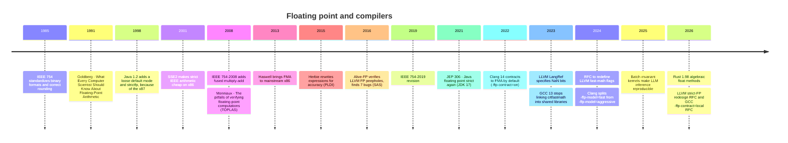
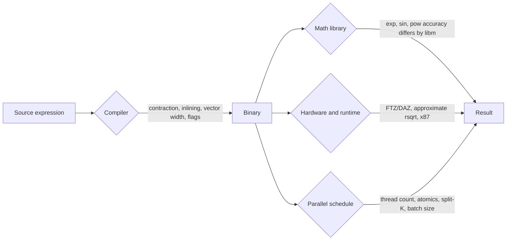

---
tags:
  - compilers
  - foundations
  - floating-point
  - ieee-754
  - fast-math
  - reassociation
  - fma
  - contraction
  - reproducibility
  - numerical-accuracy
  - llvm
  - gcc
  - rust
  - verification
status: complete
sources:
  - https://docs.oracle.com/cd/E19957-01/816-2464/ncg_goldberg.html
  - https://pages.stat.wisc.edu/~bwu62/771/goldberg1991.pdf
  - https://arxiv.org/abs/cs/0701192
  - https://openjdk.org/jeps/306
  - https://inside.java/2021/05/21/jep-306-proposed-to-target-jdk17
  - https://kristerw.github.io/2021/10/19/fast-math
  - https://gcc.gnu.org/pipermail/gcc-bugs/2021-May/742711.html
  - https://trofi.github.io/posts/302-Ofast-and-ffast-math-non-local-effects.html
  - https://gcc.gnu.org/pipermail/gcc-patches/2023-January/610756.html
  - https://gcc.gnu.org/pipermail/gcc/2023-September/242487.html
  - https://gcc.gnu.org/pipermail/gcc/2026-October/249010.html
  - https://gcc.gnu.org/gcc-16/changes.html
  - https://gcc.gnu.org/pipermail/gcc-announce/2026/000190.html
  - https://discourse.llvm.org/t/fp-contraction-fma-on-by-default/64975
  - https://discourse.llvm.org/t/rfc-improving-ir-fast-math-semantics/78736
  - https://discourse.llvm.org/t/rfc-yet-another-strict-fp/90798
  - https://lists.llvm.org/pipermail/llvm-commits/Week-of-Mon-20231002/1218911.html
  - https://lists.llvm.org/pipermail/llvm-commits/Week-of-Mon-20260323/1882901.html
  - https://lists.llvm.org/pipermail/cfe-commits/Week-of-Mon-20240819/611543.html
  - https://lists.llvm.org/pipermail/mlir-commits/2026-June/172195.html
  - https://www.llvm.org/devmtg/2026-04/slides/technical_talk/technical_talk_pirog.pdf
  - https://people.cs.rutgers.edu/%7Esn349/papers/alive-fp-sas16.pdf
  - https://fpbench.cs.washington.edu/pldi15-paper.pdf
  - https://bebop.cs.berkeley.edu/reproblas
  - https://www.thinkingmachines.ai/blog/defeating-nondeterminism-in-llm-inference/
  - https://docs.nvidia.com/cuda/archive/13.2.1/cuda-programming-guide/05-appendices/mathematical-functions.html
  - https://www.phoronix.com/news/Rust-1.98-Released
  - https://github.com/rust-lang/rust/pull/136457
  - https://dev.classmethod.jp/en/articles/rust-1-98-algebraic-float-audio-dsp/
  - https://open-std.org/JTC1/SC22/WG21/docs/papers/2025/p3375r3.html
  - https://open-std.org/JTC1/SC22/WG21/docs/papers/2026/p3864r1.html
created: 2026-11-27
updated: 2026-11-27
---

## Table Of Contents

- [[#TL;DR|TL;DR]]
- [[#The Problem|The Problem]]
- [[#Foundations|Foundations]]
    - [[#IEEE 754 in One Page|IEEE 754 in One Page]]
    - [[#The Rounding Model|The Rounding Model]]
    - [[#Which Algebra Survives|Which Algebra Survives]]
    - [[#What the Language Promises|What the Language Promises]]
    - [[#The Fast-Math Vocabulary|The Fast-Math Vocabulary]]
- [[#How We Got Here|How We Got Here]]
- [[#How It Works|How It Works]]
    - [[#Fast-Math as Per-Instruction Flags in LLVM IR|Fast-Math as Per-Instruction Flags in LLVM IR]]
    - [[#Measured - Reassociation Unlocks a Reduction|Measured - Reassociation Unlocks a Reduction]]
    - [[#Measured - FMA Contraction Breaks a Cross Product|Measured - FMA Contraction Breaks a Cross Product]]
    - [[#Measured - Fast-Math Deletes Kahan Summation|Measured - Fast-Math Deletes Kahan Summation]]
    - [[#Measured - Finite-Math Deletes a NaN Check|Measured - Finite-Math Deletes a NaN Check]]
    - [[#Measured - One Flag Changes the Whole Process|Measured - One Flag Changes the Whole Process]]
    - [[#The Strict Side - FP Environment and Constrained Operations|The Strict Side - FP Environment and Constrained Operations]]
    - [[#Checking Floating-Point Rewrites|Checking Floating-Point Rewrites]]
    - [[#Reproducibility - Where Results Diverge|Reproducibility - Where Results Diverge]]
- [[#Where It Is Now|Where It Is Now]]
- [[#Trade-offs & Open Problems|Trade-offs & Open Problems]]
- [[#Resources|Resources]]
- [[#Related Notes|Related Notes]]

## ***TL;DR***
---
*Floating-point numbers are not real numbers: addition is not associative, `x + 0.0` is not always `x`, and `x == x` can be false. Every optimizer that wants to use algebra on floats has to ask permission, and the flags that grant it (fast-math, FMA contraction) trade speed against accuracy, reproducibility and sometimes plain correctness.*

- **The default is exact IEEE 754.** Each `+`, `-`, `*`, `/` and `sqrt` is computed as if exactly, then rounded once. Under that contract the compiler may only make rewrites that give bit-identical results, which rules out most of school algebra: regrouping a sum, turning `x / y` into `x * (1/y)`, or folding `x - x` to `0`.
- **Fast-math is a bundle of separate promises.** GCC's `-ffast-math` and LLVM's per-instruction flags split into "no NaNs", "no infinities", "sign of zero doesn't matter", "allow reassociation", "allow reciprocals", "allow contraction into FMA" and "allow approximate functions". Each unlocks different rewrites, and each breaks different code ([kristerw](https://kristerw.github.io/2021/10/19/fast-math); [Piróg, EuroLLVM 2026](https://www.llvm.org/devmtg/2026-04/slides/technical_talk/technical_talk_pirog.pdf)).
- **Measured here (GCC 13.3, Clang 18.1, x86-64-v3):** reassociation let a float sum vectorize and run about **5x faster**, and it also landed closer to the exact sum (error 9.4 vs 401.6 on 16.8 million values). Default FMA contraction made `x1*y2 - x2*y1` return `1.67e-18` instead of `0` for equal vectors, in both compilers. `-ffast-math` silently turned Kahan summation back into a plain sum, made GCC compile a NaN check to `return 0`, and flushed subnormals to zero for the whole program.
- **Contraction is the quiet default.** Clang has contracted within an expression (`-ffp-contract=on`) since Clang 14; GCC in its default GNU C mode contracts across statements (`=fast`), while `-std=c17` turns it off ([LLVM Discourse](https://discourse.llvm.org/t/fp-contraction-fma-on-by-default/64975); [GCC list, 2023](https://gcc.gnu.org/pipermail/gcc/2023-September/242487.html)). CUDA contracts by default too ([CUDA guide](https://docs.nvidia.com/cuda/archive/13.2.1/cuda-programming-guide/05-appendices/mathematical-functions.html)).
- **Reproducibility is a separate problem from accuracy.** Results can change with vector width, inlining, library version, thread count or, on GPUs, batch size. Thinking Machines found 80 distinct outputs from 1,000 identical temperature-0 LLM requests, traced to batch-size-dependent reduction order ([He et al., 2025](https://www.thinkingmachines.ai/blog/defeating-nondeterminism-in-llm-inference/)).
- **As of November 2026:** LLVM is redefining its four "rewrite" flags and its strict-FP model (RFCs from 2024 and May 2026); GCC is discussing a new `-ffp-contract=local` (October 2026); Rust 1.98 (August 20, 2026) stabilized per-operation "algebraic" float methods; and WG21 has proposals for correctly rounded `cr_add`-style functions (P3375R3, P3864R1).

## ***The Problem***
---
*A compiler wants to treat `a + b + c` like the real-number expression it looks like. IEEE 754 says it is a specific sequence of roundings, and changing that sequence changes the answer. The compiler is stuck between three users who want different things.*

The textbook demonstration, from the Thinking Machines post:

```python
(0.1 + 1e20) - 1e20   # 0.0
0.1 + (1e20 - 1e20)   # 0.1
```

In the first line, `0.1` disappears when it is rounded into a number as large as `1e20`. Regrouping changed the answer completely ([He et al.](https://www.thinkingmachines.ai/blog/defeating-nondeterminism-in-llm-inference/)). Goldberg's 1991 survey put the consequence for compilers bluntly: "A language definition that does not require parentheses to be honored is useless for floating-point calculations" ([Goldberg](https://pages.stat.wisc.edu/~bwu62/771/goldberg1991.pdf)).

Three groups want different things from the same `float`:

| Who | What they want | What breaks it |
|---|---|---|
| **Performance code** (DSP, graphics, ML kernels, games) | Vectorized reductions, FMA, reciprocal multiplies, fast approximate `exp` | Strict ordering: a float sum cannot be split into vector lanes without regrouping it (see [[Vectorization]]) |
| **Numerical code** (solvers, compensated sums, interval arithmetic, robust geometry) | Every rounding exactly where the source put it; NaN and infinity to mean something | Any rewrite that "simplifies" `(t - s) - y` or assumes no NaNs |
| **Reproducibility** (lockstep games, finance sign-off, scientific reruns, ML evals) | The same bits on every run, machine and build | Contraction decided by inlining, vector width chosen by CPU, libm differences, parallel reduction order |

The compiler's job is to give each group a precise switch and to make sure the switches mean exactly what they say. As the rest of this note shows, both halves of that job are still being worked on.

## ***Foundations***
---
*Five pieces: what IEEE 754 guarantees, the one-line model of rounding error, the algebraic laws that do and do not survive, what each language promises on top, and the vocabulary of fast-math flags compilers use to relax those promises.*

### IEEE 754 in One Page

IEEE 754 (1985, revised 2008 and 2019) defines binary formats and says that the basic operations are **correctly rounded**: compute the exact real result, then round it to the nearest representable number (ties to even, by default).

| Format | Bits (sign / exponent / fraction) | Precision $p$ | Unit roundoff $u = 2^{-p}$ | Notes |
|---|---|---|---|---|
| binary16 (`half`) | 1 / 5 / 10 | 11 | $2^{-11} \approx 4.9\times10^{-4}$ | Storage and ML |
| bfloat16 | 1 / 8 / 7 | 8 | $2^{-8} \approx 3.9\times10^{-3}$ | Not an IEEE format; float32's range |
| binary32 (`float`) | 1 / 8 / 23 | 24 | $2^{-24} \approx 6.0\times10^{-8}$ | |
| binary64 (`double`) | 1 / 11 / 52 | 53 | $2^{-53} \approx 1.1\times10^{-16}$ | |
| x87 extended | 1 / 15 / 64 | 64 | $2^{-64}$ | x87 registers; the source of "excess precision" |

Beyond ordinary numbers, the standard defines the values that make compiler algebra hard:

- **Signed zeros.** `+0.0 == -0.0`, but `1/+0.0 = +inf` and `1/-0.0 = -inf`, and `-0.0 + +0.0 = +0.0`. So `x + 0.0` is not an identity: it turns `-0.0` into `+0.0`.
- **Infinities** from overflow and division by zero.
- **NaN** ("not a number") from `0/0`, `inf - inf`, `sqrt(-1)`. Every comparison with a NaN is false, including `x == x`. NaNs carry a sign and a payload, and come in quiet and signaling kinds.
- **Subnormals**, the tiny numbers below the smallest normal value, which give gradual underflow. Many CPUs process them slowly, which is why "flush to zero" (FTZ) and "denormals are zero" (DAZ) hardware modes exist.
- **Exceptions and the FP environment.** Operations set sticky status flags (inexact, underflow, overflow, divide-by-zero, invalid), and a dynamic rounding mode (to nearest, up, down, toward zero) lives in a control register. Both are hidden global state.
- **Fused multiply-add**, added in 2008: `fma(a, b, c)` computes $a \times b + c$ with **one** rounding instead of two.

### The Rounding Model

Every basic operation $\circ \in \{+,-,\times,\div\}$ obeys, barring overflow and underflow:

$$\mathrm{fl}(a \circ b) = (a \circ b)(1 + \delta), \qquad |\delta| \le u$$

**In plain English:** each operation is exact except for a relative error no bigger than half a unit in the last place. Goldberg calls the bound $u$ *machine epsilon* ([Goldberg](https://docs.oracle.com/cd/E19957-01/816-2464/ncg_goldberg.html)).

Chain $n$ additions left to right and the errors pile up. The standard first-order bound for recursive summation (Higham, *Accuracy and Stability of Numerical Algorithms*, ch. 4) is:

$$\Big|\hat{s} - \sum_{i=1}^{n} x_i\Big| \le (n-1)\,u \sum_{i=1}^{n} |x_i| + O(u^2)$$

**In plain English:** the error of a left-to-right sum can grow linearly with the number of terms. A different grouping has a different bound: pairwise (tree) summation grows like $\log_2 n$ instead of $n$, which is why regrouping a sum, the thing strict semantics forbids, often makes it *more* accurate, not less. It just makes it *different*.

### Which Algebra Survives

| Law or rewrite | Holds in IEEE 754? | Why not | Flag that permits it |
|---|---|---|---|
| $a + b = b + a$, $a \times b = b \times a$ | Yes (value; NaN payloads aside) | | always allowed |
| $(a + b) + c = a + (b + c)$ | No | Each grouping rounds differently | `reassoc` / `-fassociative-math` |
| $a(b + c) = ab + ac$ | No | Different roundings; overflow | `reassoc` |
| $x + 0 = x$ | No | `-0.0 + 0.0 = +0.0` | `nsz` / `-fno-signed-zeros` |
| $x - x = 0$, $x \times 0 = 0$ | No | NaN and infinity give NaN; sign of zero | `nnan` + `ninf` (+ `nsz`) |
| $x = x$ | No | `NaN != NaN` | `nnan` / `-ffinite-math-only` |
| $x / y = x \times (1/y)$ | No | Two roundings | `arcp` / `-freciprocal-math` |
| $x / 2 = x \times 0.5$ | Yes | Power of two: the reciprocal is exact | always allowed |
| $a \times b + c = \mathrm{fma}(a,b,c)$ | No | One rounding vs two | `contract` / `-ffp-contract` |
| $\sqrt{x}\sqrt{x} = x$, $\sin x / \cos x = \tan x$ | No | Rounding, domain | `afn`/`reassoc` / `-funsafe-math-optimizations` |
| $-(-x) = x$, $\lvert x\rvert$, `copysign` | Yes | Defined as bit operations on the sign | always allowed |

GCC's `-funsafe-math-optimizations` is where rewrites like `sqrt(x)*sqrt(x)` to `x`, `exp(x)*exp(y)` to `exp(x+y)` and `sin(x)/cos(x)` to `tan(x)` live ([kristerw](https://kristerw.github.io/2021/10/19/fast-math)).

### What the Language Promises

The compiler can only relax what the language specified in the first place:

- **C and C++** leave room. `FLT_EVAL_METHOD` lets intermediate results be held in wider precision (the x87 case), and `#pragma STDC FP_CONTRACT` lets an implementation fuse a multiply and add *within one expression*. Contraction is legal C; contracting across statements is not ([jyknight on LLVM Discourse](https://discourse.llvm.org/t/fp-contraction-fma-on-by-default/64975); [Monakov, GCC list](https://gcc.gnu.org/pipermail/gcc/2023-September/242487.html)).
- **Java** had a looser default mode from Java SE 1.2 because exact semantics on the x87 "required large overheads of additional instructions"; once SSE2 (Pentium 4, circa 2001) made strict arithmetic cheap, JEP 306 made all floating point strict again in JDK 17 ([JEP 306](https://openjdk.org/jeps/306); [inside.java](https://inside.java/2021/05/21/jep-306-proposed-to-target-jdk17)).
- **Rust** promises IEEE semantics with no global fast-math switch; relaxation is opt-in per operation (see [[#Where It Is Now|Where It Is Now]]).
- **[[WebAssembly]]** is deterministic except for NaN bit patterns, plus the relaxed-SIMD instructions that deliberately allow either an FMA or a separate multiply and add.
- **LLVM IR** pins down even the NaN bits. Since October 2023 the LangRef says a NaN result has a nondeterministic sign and a payload chosen from a small set (the canonical NaN, or one of the inputs' payloads), and that `fneg`, `fabs` and `copysign` are bit operations, not arithmetic ([Ralf Jung's LangRef change](https://lists.llvm.org/pipermail/llvm-commits/Week-of-Mon-20231002/1218911.html)). That precision is what lets tools like Alive2 check FP rewrites at all (see [[Translation Validation]]).

### The Fast-Math Vocabulary

GCC exposes command-line flags; LLVM attaches flags to individual instructions, so code compiled with different options can be inlined together and keep its own rules.

| GCC flag (implied by `-ffast-math`) | LLVM IR flag | Promise or permission | Typical rewrite unlocked |
|---|---|---|---|
| `-ffinite-math-only` | `nnan`, `ninf` | Promise: no NaN / infinity inputs or results (otherwise `poison`) | `x - x` to `0`; `isnan(x)` to false |
| `-fno-signed-zeros` | `nsz` | Sign of zero doesn't matter | `x + 0.0` to `x` |
| `-fassociative-math` | `reassoc` | Allow regrouping | Vectorized and unrolled reductions |
| `-freciprocal-math` | `arcp` | Allow `x/y` as `x*(1/y)` | One divide, many multiplies |
| `-ffp-contract=fast` | `contract` | Allow fusing into FMA | `a*b+c` to `fma` |
| `-funsafe-math-optimizations` (partly) | `afn` | Allow approximate library functions | Fast `exp`, `rsqrt` estimates |
| `-fno-math-errno` | (function attributes) | `sqrt` etc. don't set `errno` | `sqrt` becomes one instruction |
| `-fno-trapping-math` | (default FP environment) | No trap handlers observe exceptions | Speculate or hoist FP operations |
| `-fcx-limited-range` | (Clang `-fcomplex-arithmetic`) | Use textbook complex formulas | Faster complex multiply/divide |

Sources: GCC flags from [kristerw](https://kristerw.github.io/2021/10/19/fast-math); LLVM flags from the [Cranmer RFC](https://discourse.llvm.org/t/rfc-improving-ir-fast-math-semantics/78736) and [Piróg](https://www.llvm.org/devmtg/2026-04/slides/technical_talk/technical_talk_pirog.pdf). The `fast` flag in LLVM IR is simply all seven together.

Two kinds of flag hide in that table. **Value flags** (`nnan`, `ninf`, `nsz`) are promises about data: break them and the result is `poison`, the same machinery as integer overflow in [[Undefined Behavior and Compiler Semantics]]. **Rewrite flags** (`reassoc`, `arcp`, `contract`, `afn`) are permissions to compute something different; they never make anything undefined, but they also have no crisp definition of "how different", which is the source of most current trouble ([Piróg](https://www.llvm.org/devmtg/2026-04/slides/technical_talk/technical_talk_pirog.pdf)).

## ***How We Got Here***
---
*Floating point began as a zoo of vendor formats, became one standard in 1985, spent the 1990s fighting x87 excess precision, and has spent the 2010s and 2020s defining exactly what an optimizer may and may not do with it.*



- **Before 1985**, every vendor rounded differently; portable numerical code was close to impossible. IEEE 754 made the result of each operation a specification, not an implementation accident.
- **The x87 decade.** Intel's x87 kept values in 80-bit registers and rounded only when spilling to memory, so a result could change with register pressure, optimization level or an added `printf`. Monniaux's 2008 TOPLAS paper catalogued how floating-point semantics "may change with many factors beyond source-code level, such as choices made by compilers" ([arXiv](https://arxiv.org/abs/cs/0701192)). Java answered with a loose default and `strictfp`; SSE2 eventually made the problem go away on x86-64, and JDK 17 went back to always-strict ([JEP 306](https://openjdk.org/jeps/306)).
- **FMA arrives.** With FMA in IEEE 754-2008 and in x86 hardware from Haswell, contraction became a real performance question for the first time, and compilers had to decide when `a*b + c` may become one instruction. Clang made within-expression contraction its default in Clang 14 ([Discourse](https://discourse.llvm.org/t/fp-contraction-fma-on-by-default/64975)); GCC kept `fast` in GNU mode, which surfaced as test failures when CentOS Stream rebuilt with `-march=x86-64-v3` in 2023 ([GCC list](https://gcc.gnu.org/pipermail/gcc/2023-September/242487.html)).
- **Tools for accuracy and correctness.** Herbie (PLDI 2015) used sampling against arbitrary precision plus an [[E-Graphs and Equality Saturation|e-graph]] of rewrites to *improve* accuracy, recovering "up to 60 bits lost to rounding error" on textbook examples ([Herbie](https://fpbench.cs.washington.edu/pldi15-paper.pdf)). Alive-FP (SAS 2016) encoded LLVM's FP peepholes in SMT's floating-point theory and found seven wrong optimizations ([Alive-FP](https://people.cs.rutgers.edu/%7Esn349/papers/alive-fp-sas16.pdf)).
- **The 2020s cleanup.** Specifying NaN bits (2023), separating "fast but NaN-aware" from "aggressive" in Clang (2024), and redefining the rewrite flags (2024 to 2026) are all the same project: make each permission precise enough to check.

## ***How It Works***
---
*How fast-math is represented inside a compiler, five measurements of what it does to real code, the strict mode at the other end, how floating-point rewrites are checked, and where reproducibility leaks.*

### Fast-Math as Per-Instruction Flags in LLVM IR

Clang turns command-line options into flags on each FP instruction, so the optimizer sees the permission at the exact place it applies. The loop body `s += a[i]` from `sum.c` below, at `-O0` without and with `-ffast-math` (Clang 18):

```llvm
; clang -O0               (strict)
%17 = fadd float %16, %15
; clang -O0 -ffast-math   (all seven flags)
%17 = fadd fast float %16, %15
```

Passes read these bits before rewriting. The loop vectorizer checks for `reassoc` before splitting a reduction across lanes, InstCombine checks `nsz` before folding `x + 0.0`, and the back end checks `contract` before forming an FMA during [[Instruction Selection]]. Because flags live on instructions, LTO and inlining can mix strict and fast code in one function ([[Linking and LTO]]). The flip side is that every pass must also *set* flags correctly on the instructions it creates; the EuroLLVM 2026 talk lists back-end combines that drop or ignore them ([Piróg](https://www.llvm.org/devmtg/2026-04/slides/technical_talk/technical_talk_pirog.pdf)).

Contraction is handled differently. Under `-ffp-contract=on`, Clang's front end decides, expression by expression, and emits the `llvm.fmuladd` intrinsic, which means "fused or not, back end's choice". The cross product below compiles to:

```llvm
%6 = fmul double %5, %1                                         ; the second product, rounded
%7 = tail call double @llvm.fmuladd.f64(double %0, double %3, double %6)
```

The front end owns this because only it knows where C's expression boundaries were; by the time the optimizer runs, statements have been inlined and merged.

### Measured - Reassociation Unlocks a Reduction

*A float sum vectorizes only if the compiler may regroup it. With permission it ran about 5x faster and, on this data, was more accurate.*

```c
float sum(const float *a, size_t n) {
  float s = 0.0f;
  for (size_t i = 0; i < n; i++) s += a[i];
  return s;
}
```

Setup: GCC 13.3 and Clang 18.1, `-O3 -march=x86-64-v3` (AVX2 + FMA), Intel Xeon at 2.1 GHz, $n = 2^{24}$ (16.8 million) uniform random floats in $[0,1]$, mean of 20 calls; exact sum computed in double.

| Build | Vector adds (`vaddps`) | Result | Error vs exact (8,386,732.6) | Time per call |
|---|---|---|---|---|
| clang -O3 | 0 | 8,386,331.0 | 401.6 | 15.6 to 20.0 ms (4 runs) |
| clang -O3 -ffast-math | 9 | 8,386,742.0 | 9.4 | 2.7 to 3.9 ms (4 runs) |
| clang -O3 -fassociative-math -fno-signed-zeros -fno-trapping-math | 9 | 8,386,742.0 | 9.4 | 3.1 ms |
| gcc -O3 | 0 | 8,386,331.0 | 401.6 | 18.1 ms |
| gcc -O3 -ffast-math | 8 | 8,386,718.0 | 14.6 | 2.8 ms |

Without permission Clang says so directly:

```text
remark: loop not vectorized: cannot prove it is safe to reorder floating-point operations;
allow reordering by specifying '#pragma clang loop vectorize(enable)' before the loop or by
providing the compiler option '-ffast-math'.
```

With it, the loop keeps four 8-wide accumulators (32 partial sums) and combines them at the end with `llvm.vector.reduce.fadd`. Three things to take from the table:

- **The speedup is latency, not width.** The strict loop is one dependent chain of `vaddss`, each waiting for the last (see [[Microarchitectural Performance Models]] for why one accumulator is bound by add latency). Four independent vector accumulators hide that latency.
- **Only associative math was needed.** `-fassociative-math` (with `-fno-signed-zeros` and `-fno-trapping-math`, which GCC requires alongside it) gave the same code and result as full `-ffast-math`, without promising anything about NaNs.
- **Strict is not "more accurate".** Near 8.4 million, consecutive floats are 0.5 apart, so the single accumulator rounds every addend to a multiple of 0.5; the 32 partial sums stay small longer. The two compilers' fast results still differ from each other (9.4 vs 14.6), because they chose different groupings. That is the reproducibility cost.

The [[Vectorization]] note shows the same wall from the vectorizer's side, including GCC's in-order fallback; `#pragma omp simd reduction(+:s)` grants the same permission for one loop only.

### Measured - FMA Contraction Breaks a Cross Product

*Default contraction turns `x1*y2 - x2*y1` into an FMA that rounds one product but not the other, so equal vectors give a nonzero cross product.*

```c
double cross(double x1, double y1, double x2, double y2) { return x1*y2 - x2*y1; }
/* called with x1 = x2 = 0.1, y1 = y2 = 0.3 */
```

| Build (`-O2 -march=x86-64-v3`) | Instructions | Result |
|---|---|---|
| gcc (default GNU C mode) | `vmulsd`, `vfmsub132sd` | `0x1.eb851eb851eb8p-60` (1.67e-18) |
| gcc `-std=c17` | `vmulsd`, `vmulsd`, `vsubsd` | 0 |
| gcc `-ffp-contract=off` | `vmulsd`, `vmulsd`, `vsubsd` | 0 |
| clang (default `-ffp-contract=on`) | `vmulsd`, `vfmsub213sd` | 1.67e-18 |
| clang `-ffp-contract=fast` | `vmulsd`, `vfmsub213sd` | 1.67e-18 |
| clang `-ffp-contract=off` | `vmulsd`, `vmulsd`, `vsubsd` | 0 |

Why it isn't zero: the compiler computes $p = \mathrm{fl}(x_2 y_1)$ and then $\mathrm{fma}(x_1, y_2, -p) = x_1 y_2 - \mathrm{fl}(x_1 y_2)$, exactly. With equal inputs, that is precisely the rounding error of the product: a tiny nonzero number instead of zero. An orientation test in a geometry kernel would now say two identical vectors are not parallel. The same pattern was reported on Apple M1 with Clang's default ([Discourse, 2023](https://discourse.llvm.org/t/fp-contraction-fma-on-by-default/64975)) and in [GCC bug 100839](https://gcc.gnu.org/pipermail/gcc-bugs/2021-May/742711.html), "please don't break my cross product".

Contraction is legal C within one expression, and it usually *improves* accuracy, which is why compilers default to it. The problem is that whether it happens depends on the target (no FMA on baseline x86-64, so no change there), the language mode, and, for GCC's `fast` mode, on inlining decisions far away (see [[#Where It Is Now|Where It Is Now]]).

### Measured - Fast-Math Deletes Kahan Summation

*Compensated summation works by computing the rounding error with an expression that is zero in real arithmetic. Reassociation is exactly the permission to notice that.*

```c
float kahan(const float *a, size_t n) {
  float s = 0.0f, c = 0.0f;
  for (size_t i = 0; i < n; i++) {
    float y = a[i] - c;
    float t = s + y;
    c = (t - s) - y;     /* the part of y that didn't make it into t */
    s = t;
  }
  return s;
}
```

Same 16.8 million floats as above:

| Build | Subtracts in the asm | Result | Error |
|---|---|---|---|
| clang -O3 | 27 | 8,386,732.5 | 0.1 |
| clang -O3 -ffast-math | 0 | 8,386,742.0 | 9.4 |
| gcc -O3 | 3 | 8,386,732.5 | 0.1 |
| gcc -O3 -ffast-math | 0 | 8,386,718.0 | 14.6 |

Under `-ffast-math`, $(t - s) - y = ((s + y) - s) - y = 0$, so `c` is always zero and the loop becomes the plain sum, vectorized. The output is bit-for-bit the fast-math `sum()` result from the previous table. Nothing warns; the algorithm just stops being Kahan's. This is the classic reason numerical libraries are compiled without fast-math even when the application uses it.

### Measured - Finite-Math Deletes a NaN Check

*`-ffinite-math-only` is a promise that NaNs never occur. A compiler may use that promise to delete the code that checks for them.*

```c
#include <math.h>
int has_nan(const double *a, int n) {
  for (int i = 0; i < n; i++) if (isnan(a[i])) return 1;
  return 0;
}
/* called on {1.0, NAN, 2.0} from a separately compiled -O0 main */
```

| Build | Result | What the compiler emitted |
|---|---|---|
| gcc -O2 | 1 | The loop |
| gcc -O2 -ffast-math | **0** | `xorl %eax, %eax; ret` (the whole function is `return 0`) |
| clang -O2 | 1 | The loop |
| clang -O2 -ffast-math | 1 | The loop with `ucomisd` + `jp`, plus `warning: use of NaN is undefined behavior due to the currently enabled floating-point options [-Wnan-infinity-disabled]` |

GCC took the promise literally. Clang 18 keeps `isnan` as an unordered compare without the `nnan` flag but warns that the program has undefined behavior. Both are allowed: once the promise is broken, the result is `poison` in LLVM terms ([[Undefined Behavior and Compiler Semantics]]). In practice it means you cannot validate inputs in code compiled with `-ffinite-math-only`; Clang's `-ffp-model=fast` was changed in 2024 to keep NaN and infinity handling for exactly this reason, with the old behavior renamed `-ffp-model=aggressive` ([commit 27e5f50](https://lists.llvm.org/pipermail/cfe-commits/Week-of-Mon-20240819/611543.html)).

### Measured - One Flag Changes the Whole Process

*Linking with `-ffast-math` on x86 sets flush-to-zero for every thread of the program, not just for the code that asked.*

```c
volatile double x = DBL_MIN;          /* smallest normal double */
volatile double y = x / 4.0;          /* a subnormal */
printf("%g\n", y);
```

| Build | Output |
|---|---|
| gcc -O2 | `5.56268e-309` (subnormal) |
| gcc -O2 -ffast-math | `0` (flushed) |
| clang -O2 -ffast-math | `0` (flushed) |

When the *link* uses `-ffast-math`, GCC adds `crtfastmath.o`, whose constructor sets the FTZ and DAZ bits in MXCSR at startup, so every function in the process, including libraries compiled strictly, now flushes subnormals ([trofi](https://trofi.github.io/posts/302-Ofast-and-ffast-math-non-local-effects.html)). Clang's driver did the same here. In 2023 libsodium 1.0.19 switched its default build to `-Ofast`, and because shared libraries also pulled in `crtfastmath.o`, downstream programs (including Bitcoin Core's `double` serialization tests) failed; GCC 13 stopped adding it for `-shared` (PR55522), and the trofi post reports that Clang 19 follows ([trofi](https://trofi.github.io/posts/302-Ofast-and-ffast-math-non-local-effects.html); [GCC patches](https://gcc.gnu.org/pipermail/gcc-patches/2023-January/610756.html)).

### The Strict Side - FP Environment and Constrained Operations

At the other end, some code reads exception flags (`fetestexcept`) or changes the rounding mode (`fesetround`), for example interval arithmetic. The default compilation model assumes round-to-nearest and that nobody looks at the flags, so it freely constant-folds, hoists and deletes FP operations. Telling the compiler otherwise (`#pragma STDC FENV_ACCESS ON`, `-frounding-math`, `-ffp-exception-behavior=strict`) is the "strict FP" mode.

LLVM implements it today with a separate family of *constrained intrinsics* (`llvm.experimental.constrained.fadd` and friends) used inside functions marked `strictfp`. That design is being replaced:

- **Two worlds.** "Having separate constrained FP intrinsics splits FP handling into two separate worlds," duplicating every optimization, and it can't express static rounding modes or per-instruction denormal flushing ([nikic, May 2026](https://discourse.llvm.org/t/rfc-yet-another-strict-fp/90798)).
- **The proposal** makes the environment an annotation on ordinary FP instructions (`fadd float %a, %b fpenv(...)`) and models the control and status registers as memory locations (`fpenv`, `fpstatus`) that FP operations read and write, so existing alias analysis and code motion respect them. Discussion reached "a rough consensus on the direction" by May 26, 2026, with details open.
- **A step in that direction** lets ordinary math intrinsics appear in `strictfp` functions with "optional" side effects (Serge Pavlov's PR #188297, March 2026), because mixing up the two forms was an easy, silent bug ([llvm-commits](https://lists.llvm.org/pipermail/llvm-commits/Week-of-Mon-20260323/1882901.html)). [[MLIR]]'s LLVM dialect has a matching PR, "Add new support for strict fp handling" (#205158, June 2026); its merge status was not checked ([mlir-commits](https://lists.llvm.org/pipermail/mlir-commits/2026-June/172195.html)).

### Checking Floating-Point Rewrites

A floating-point rewrite is correct only if it is correct for every input, including NaNs, both zeros, infinities and subnormals. Three families of tools check that:

| Tool | Question it answers | How | Result |
|---|---|---|---|
| **Alive-FP** (SAS 2016), then Alive2 | Is this LLVM peephole bit-exact? | SMT floating-point theory (Z3); `nsz` as a nondeterministic sign; `nnan`/`ninf` as poison | 104 LLVM 3.8 FP optimizations checked; 7 wrong ones found, e.g. PR26746, wrong for $x = -0.0$ ([paper](https://people.cs.rutgers.edu/%7Esn349/papers/alive-fp-sas16.pdf)) |
| **Herbie** (PLDI 2015) | Is there a *more accurate* way to write this? | Sample 256 inputs, compare to MPFR, rewrite with 126 rules in an e-graph, split input ranges | All 28 Hamming textbook examples improved; patches merged into Math.js ([paper](https://fpbench.cs.washington.edu/pldi15-paper.pdf)) |
| **Differential testing with tolerances** | Does the output look close enough? | Run both versions, compare within an epsilon | Cheap, but the tolerance is a hole an optimizer can hide in ([[LLM-Written Kernels]]) |

Alive-FP handled the value flags but explicitly left out `fast` and `arcp`, and that gap persists: Alive2 models `nnan`, `ninf` and `nsz`, while the four rewrite flags "are not well-defined" enough to model ([Piróg](https://www.llvm.org/devmtg/2026-04/slides/technical_talk/technical_talk_pirog.pdf)). Under reassociation there is no single correct answer to check against, only a set of acceptable ones, which is also why [[Compiler Testing and Fuzzing]] struggles with FP oracles and why proofs about real-valued networks don't transfer to compiled ones ([[Neural Network Verification]]). Equivalence checkers for kernels that reason over reals have the same blind spot ([[Translation Validation]]).

### Reproducibility - Where Results Diverge



| Source of variation | Example | Fix |
|---|---|---|
| Contraction and flags | Cross product above; GCC `fast` contraction changes with inlining | `-ffp-contract=off`, or `on` (expression-local) |
| Vector width | A fast-math reduction groups by the vector width chosen for `-march`, so AVX2 and AVX-512 builds can differ (as GCC and Clang did above) | Fixed-width or explicitly ordered reductions |
| Math library | `afn`, or different libms with different ULP errors; constant folding uses the compiler's own library | Correctly rounded libraries; P3864's `cr_` functions for the basic ops |
| FP environment | `crtfastmath.o`; CUDA's `--use_fast_math` implies `-ftz=true` ([CUDA guide](https://docs.nvidia.com/cuda/archive/13.2.1/cuda-programming-guide/05-appendices/mathematical-functions.html)) | Keep fast-math out of the link step |
| Parallel order | GPU atomic adds depend on "hardware scheduling which can vary between runs" ([CUDA guide](https://docs.nvidia.com/cuda/archive/13.2.1/cuda-programming-guide/05-appendices/mathematical-functions.html)); kernels change reduction strategy with batch size | Fixed reduction trees, batch-invariant kernels, ReproBLAS |

Two results show the range of fixes:

- **ReproBLAS** (Demmel and Nguyen, Berkeley) makes a sum independent of order and processor count by accumulating into *binned* floating-point numbers, a 6-word accumulator with "at least 80 bits of precision". The cost is about $9n$ flops instead of $n$, a 4x slowdown for a dot product on one Sandy Bridge core but under 1.2x for a million doubles across more than 512 Ivy Bridge cores ([ReproBLAS](https://bebop.cs.berkeley.edu/reproblas)).
- **Batch-invariant inference.** Running Qwen3-235B 1,000 times at temperature 0 on the same prompt gave 80 unique completions, the first divergence at token 103. The cause was not atomics ("there is usually not a single atomic add present" in a forward pass) but RMSNorm, split-K matmuls and split-KV attention picking different reduction orders for different batch sizes, and batch size depends on server load. With batch-invariant kernels all 1,000 matched; vLLM went from 26 s to 55 s, then 42 s with a better attention kernel ([He et al., Sept 2025](https://www.thinkingmachines.ai/blog/defeating-nondeterminism-in-llm-inference/)). This is a compiler problem as much as a kernel one: [[ML Compilers]] and [[GPU Kernel Compilers]] choose those reduction strategies.

## ***Where It Is Now***
---
*As of November 2026 nothing about IEEE 754 is changing; what is changing is how precisely compilers define their permissions to deviate from it, and how languages let programmers grant them one operation at a time.*

- **LLVM: redefining the rewrite flags.** Joshua Cranmer's May 2024 RFC proposed defining `contract`, `reassoc`, `arcp` and `afn` over whole expression trees as "mathematically equivalent" rewrites, narrowing `reassoc` to add, multiply and FMA, and replacing `afn` with precision attributes, since "how approximate is approximate?" ([RFC](https://discourse.llvm.org/t/rfc-improving-ir-fast-math-semantics/78736)). At EuroLLVM (Dublin, April 2026) Mikołaj Piróg (Intel) called `reassoc` the "most widely misused flag" (InstCombine uses it to rewrite `sin/cos` into `tan`), proposed splitting it into "reassoc-fundamental" and "reassoc-all", ordering flags by precision loss, and extending Alive2 to rewrite flags, and listed in-flight PRs: #187340 (`contract` semantics), #105746 (honor pragmas under `-ffp-contract=fast`), #167252, #167595, #174291 (back-end and InstCombine fixes), and #185582/#163504 (removing global "no NaNs" options) ([slides](https://www.llvm.org/devmtg/2026-04/slides/technical_talk/technical_talk_pirog.pdf)). The talk did not give merge status for most of them, and it was not checked here.
- **LLVM: strict FP redesign.** The May 2026 "Yet another strict FP" RFC (above) had rough consensus on direction but no decision as of its last replies on May 26, 2026 ([RFC](https://discourse.llvm.org/t/rfc-yet-another-strict-fp/90798)).
- **GCC: contraction that doesn't depend on inlining.** An October 2026 RFC proposes `-ffp-contract=local`, which "fuses a * b + c only when the multiply and the add come from the same function", because under `fast`, "whether a * b + c gets fused depends on IPA inlining" and in one large C++ codebase "a header change flips a vfmadd in code it doesn't touch". Richard Biener asked for a full proposal including an `fp_contractable_{add,mul}` attribute ([GCC list, Oct 2026](https://gcc.gnu.org/pipermail/gcc/2026-October/249010.html)). GCC 16.1 (released April 30, 2026) lists no change to FP contraction or fast-math defaults; its FP news is new FP8, BF16 and `_Float16` support ([GCC 16 changes](https://gcc.gnu.org/gcc-16/changes.html); [announcement](https://gcc.gnu.org/pipermail/gcc-announce/2026/000190.html)).
- **Rust: fast-math one operation at a time.** Rust 1.98 (August 20, 2026) stabilized `algebraic_add`, `_sub`, `_mul`, `_div` and `_rem` on `f32` and `f64`; they lower to LLVM's `reassoc nsz arcp contract` and deliberately not `nnan`/`ninf`, so they are nondeterministic but "never cause undefined behavior". The motivating issue was dot products up to 8x slower than C++ ([Phoronix](https://www.phoronix.com/news/Rust-1.98-Released); [PR #136457](https://github.com/rust-lang/rust/pull/136457)). An independent September 2026 test on an Apple M4 (rustc 1.98.1, LLVM 22.1.8) measured dot products 2.8x to 6.9x faster and a 64-tap FIR 3.5x faster, gain and mixing unchanged, and found an overflow case returning NaN instead of infinity ([classmethod](https://dev.classmethod.jp/en/articles/rust-1-98-algebraic-float-audio-dsp/)).
- **C++: reproducibility by library.** P3375R3 (Guy Davidson, May 2025) asks SG6 to pick an approach to reproducible FP and proposes correctly rounded `cr_add`, `cr_sub`, `cr_mul`, `cr_div`, `cr_sqrt`; P3864R1 (Davidson and Schultke, February 2026) specifies those five as round-to-nearest-even overloads. Both are proposals, not adopted ([P3375R3](https://open-std.org/JTC1/SC22/WG21/docs/papers/2025/p3375r3.html); [P3864R1](https://open-std.org/JTC1/SC22/WG21/docs/papers/2026/p3864r1.html)).
- **GPUs and ML.** CUDA still contracts by default and NVIDIA still recommends `-ftz=false -prec-div=true -prec-sqrt=true` and no `--use_fast_math` ([CUDA 13.2 guide](https://docs.nvidia.com/cuda/archive/13.2.1/cuda-programming-guide/05-appendices/mathematical-functions.html)). Batch invariance (Sept 2025) turned reproducible LLM inference into an engineering target rather than a lost cause.

## ***Trade-offs & Open Problems***
---
*Every floating-point mode is a point on a triangle of speed, accuracy and reproducibility, and the open problems are mostly about naming those points precisely enough that tools can check them.*

| Mode | Speed | Accuracy | Reproducible across builds/machines | Safe for NaN/inf checks |
|---|---|---|---|---|
| Strict IEEE, `-ffp-contract=off` | Slowest reductions | As written | Yes (same libm, no x87) | Yes |
| Default Clang (`contract` within expressions) | FMA where written as `a*b+c` | Usually better, occasionally surprising | Varies by `-march` (FMA or not) | Yes |
| Default GCC GNU mode (`-ffp-contract=fast`) | FMA across statements | Usually better | Varies with inlining and `-march` | Yes |
| `-fassociative-math -fno-signed-zeros` / Rust `algebraic_*` | Vectorized reductions | Often better, sometimes worse | Varies with vector width and compiler | Yes |
| Full `-ffast-math` / `-ffp-model=aggressive` | Fastest | Unbounded in the worst case | No | **No**: checks may be deleted |
| Strict environment (`FENV_ACCESS`, constrained ops) | Slower: limits folding and motion | As written, any rounding mode | Yes | Yes, and flags are observable |

- **Rewrite flags have no checkable meaning.** "Reassociation is allowed" does not say how far, which is why `reassoc` covers both splitting a sum and turning `sin/cos` into `tan`. Until the flags are defined as sets of allowed results, tools like Alive2 can't verify the rewrites they license.
- **`afn` depends on someone else's library.** "Approximate" functions are only as accurate as the libm on the machine at build time and at run time, which may differ; even constant folding of non-correctly-rounded functions varies ([Piróg](https://www.llvm.org/devmtg/2026-04/slides/technical_talk/technical_talk_pirog.pdf)).
- **Contraction is non-local.** FMA formation after inlining or LTO means a function's results depend on its callers, the problem `-ffp-contract=local` targets. Clang's front-end `fmuladd` avoids this for `on`, but not for `fast`.
- **Value flags are undefined-behavior generators.** `nnan` and `ninf` make a NaN `poison`, "a potent tool for exploiting undefined behavior" ([Cranmer](https://discourse.llvm.org/t/rfc-improving-ir-fast-math-semantics/78736)). The measured `has_nan` deletion is the floating-point version of the signed-overflow check that disappears in C.
- **Global state leaks.** FTZ/DAZ and rounding modes are per-thread hardware state; one library built with `-ffast-math` can change another's results, and LLVM still cannot express per-instruction denormal handling.
- **Oracles.** With reassociation there is no single right answer, so testing uses tolerances, and tolerances can hide real bugs or deliberate shortcuts ([[LLM-Written Kernels]]). Verification over reals misses rounding; verification over IEEE floats is expensive in SMT. Mixed approaches (Herbie-style sampling against high precision, bounded-error proofs) are not yet compiler-integrated.
- **Low precision makes all of this worse.** With bfloat16's $u \approx 3.9 \times 10^{-3}$, summation order can change results in the second decimal place, so the order an ML compiler picks for a reduction is part of the model's numerics, not an implementation detail ([[ML Compilers]]).

## ***Resources***
---
*Start with Goldberg for the arithmetic, the GCC flag tour for what fast-math does, and the LLVM RFCs for where the semantics are going.*

**Foundations**
- [What Every Computer Scientist Should Know About Floating-Point Arithmetic](https://docs.oracle.com/cd/E19957-01/816-2464/ncg_goldberg.html): David Goldberg, ACM Computing Surveys, 1991 ([PDF](https://pages.stat.wisc.edu/~bwu62/771/goldberg1991.pdf)).
- Nicholas Higham, *Accuracy and Stability of Numerical Algorithms* (2nd ed., SIAM 2002), ch. 4 on summation: the error bounds used above.
- [The pitfalls of verifying floating-point computations](https://arxiv.org/abs/cs/0701192): David Monniaux, TOPLAS 30(3), 2008.
- [JEP 306: Restore Always-Strict Floating-Point Semantics](https://openjdk.org/jeps/306): the x87 story from the Java side.

**Compiler behavior**
- [Optimizations enabled by -ffast-math](https://kristerw.github.io/2021/10/19/fast-math): Krister Walfridsson, 2021; flag by flag with GCC examples.
- [-Ofast and -ffast-math non-local effects](https://trofi.github.io/posts/302-Ofast-and-ffast-math-non-local-effects.html): Sergei Trofimovich, October 2023; crtfastmath and the libsodium incident.
- [Concerns regarding the -ffp-contract=fast default](https://gcc.gnu.org/pipermail/gcc/2023-September/242487.html): GCC list, September 2023; [FP contraction (FMA) on by default](https://discourse.llvm.org/t/fp-contraction-fma-on-by-default/64975): LLVM Discourse.
- [\[RFC\] -ffp-contract=local](https://gcc.gnu.org/pipermail/gcc/2026-October/249010.html): GCC list, October 2026.
- [\[LangRef\] Specify NaN behavior more precisely](https://lists.llvm.org/pipermail/llvm-commits/Week-of-Mon-20231002/1218911.html): Ralf Jung, October 2023.
- [\[RFC\] Improving IR fast-math semantics](https://discourse.llvm.org/t/rfc-improving-ir-fast-math-semantics/78736): Joshua Cranmer, May 2024.
- [Fast-math flags: a bag of issues and a handful of solutions](https://www.llvm.org/devmtg/2026-04/slides/technical_talk/technical_talk_pirog.pdf): Mikołaj Piróg, EuroLLVM 2026.
- [\[RFC\] Yet another strict FP](https://discourse.llvm.org/t/rfc-yet-another-strict-fp/90798): Nikita Popov (nikic), May 2026; [PR #188297](https://lists.llvm.org/pipermail/llvm-commits/Week-of-Mon-20260323/1882901.html), Serge Pavlov, March 2026.
- [Make ffp-model=fast honor non-finite values, introduce ffp-model=aggressive](https://lists.llvm.org/pipermail/cfe-commits/Week-of-Mon-20240819/611543.html): Andy Kaylor, August 2024.

**Checking and accuracy**
- [Alive-FP: Automated Verification of Floating Point Based Peephole Optimizations in LLVM](https://people.cs.rutgers.edu/%7Esn349/papers/alive-fp-sas16.pdf): Menendez, Nagarakatte and Gupta, SAS 2016.
- [Automatically Improving Accuracy for Floating Point Expressions](https://fpbench.cs.washington.edu/pldi15-paper.pdf): Panchekha, Sanchez-Stern, Wilcox and Tatlock, PLDI 2015 (Herbie).

**Reproducibility**
- [ReproBLAS](https://bebop.cs.berkeley.edu/reproblas): Demmel and Nguyen, Berkeley.
- [Defeating Nondeterminism in LLM Inference](https://www.thinkingmachines.ai/blog/defeating-nondeterminism-in-llm-inference/): Horace He et al., Thinking Machines, September 2025.
- [CUDA Programming Guide, Floating-Point Computation](https://docs.nvidia.com/cuda/archive/13.2.1/cuda-programming-guide/05-appendices/mathematical-functions.html): NVIDIA, CUDA 13.2.
- [P3375R3 Reproducible floating-point results](https://open-std.org/JTC1/SC22/WG21/docs/papers/2025/p3375r3.html) and [P3864R1 Correctly rounded floating-point maths functions](https://open-std.org/JTC1/SC22/WG21/docs/papers/2026/p3864r1.html): WG21.

**Languages**
- [Rust 1.98 algebraic float methods](https://www.phoronix.com/news/Rust-1.98-Released): Phoronix, August 2026; [rust-lang/rust#136457](https://github.com/rust-lang/rust/pull/136457); [audio DSP measurements](https://dev.classmethod.jp/en/articles/rust-1-98-algebraic-float-audio-dsp/), classmethod, September 2026.

## ***Related Notes***
---
*The optimizations that need floating-point permission, the semantics and verification work that defines it, and the ML and GPU compilers where reduction order is part of the result.*

- [[Vectorization]] — Float reductions vectorize only with reassociation; the vectorizer's side of the measurements above.
- [[Microarchitectural Performance Models]] — Why a single float accumulator is latency-bound, and what splitting it buys.
- [[Classic Optimizations]] — Constant folding, CSE and InstCombine, each restricted by IEEE rules.
- [[Instruction Selection]] — Where `fmuladd` and `contract` become FMA instructions.
- [[Instruction Scheduling]] — FP latency chains that reassociation breaks up.
- [[Loop Optimizations]] — Unrolling reductions with multiple accumulators needs the same permission.
- [[Undefined Behavior and Compiler Semantics]] — `nnan`/`ninf` produce `poison`, the same machinery as integer UB.
- [[LLVM]] — Fast-math flags on instructions, `llvm.fmuladd`, constrained intrinsics.
- [[MLIR]] — The `arith` dialect's fast-math attributes and the strict-FP work in the LLVM dialect.
- [[Linking and LTO]] — Per-instruction flags let strict and fast code be inlined together; `crtfastmath.o` is a link-time effect.
- [[Translation Validation]] — Alive2's floating-point encoding and why NaN bits had to be specified.
- [[E-Graphs and Equality Saturation]] — Herbie searches accuracy-improving rewrites with an e-graph.
- [[Superoptimization]] — Minotaur and Souper-style search over FP code needs a precise FP semantics to verify.
- [[Compiler Testing and Fuzzing]] — Weak oracles when results legitimately vary.
- [[Verified Compilers]] — Proving compilation correct when floats, not reals, are the semantics.
- [[LLM-Written Kernels]] — Tolerances and reordered reductions in generated kernels.
- [[Neural Network Verification]] — Proofs over reals versus networks run in floating point.
- [[ML Compilers]] — Fusion and reduction order decide the numerics of a model.
- [[GPU Kernel Compilers]] — Split-K, atomics and contraction by default.
- [[WebAssembly]] — Deterministic floats except NaN bits and relaxed SIMD.
- [[JIT Compilation]] — The JVM went back to always-strict floating point in JDK 17.
- [[Abstract Interpretation]] — GCC's `frange` extends range analysis to floating-point values.
- [[Reproducible Builds]] — Planned: deterministic compiler output, a neighbour of deterministic program output.
- [[Calling Conventions and ABIs]] — Planned: x87 return values are one of LLVM's documented NaN-semantics violations.
