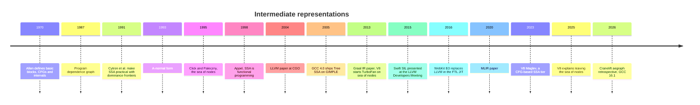
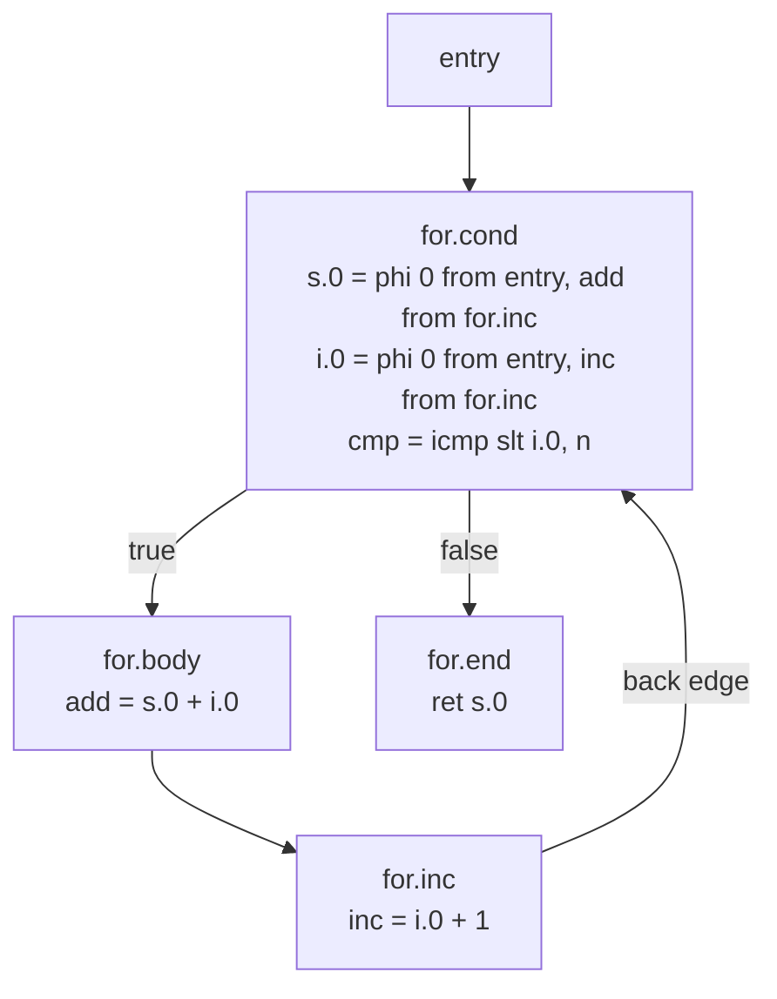
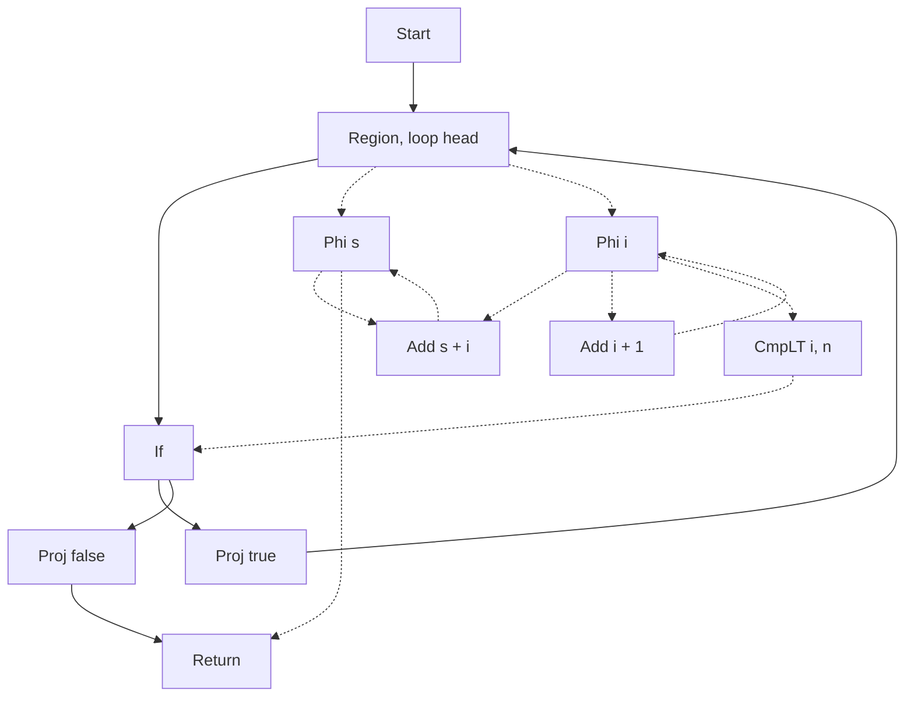

---
tags:
  - compilers
  - intermediate-representation
  - ir
  - control-flow-graph
  - ssa
  - sea-of-nodes
  - bytecode
status: complete
sources:
  - https://www.cs.columbia.edu/~suman/secure_sw_devel/p1-allen.pdf
  - https://cs.utexas.edu/~less/reading/spring00/ferrante.pdf
  - https://cs.brown.edu/research/pubs/techreports/reports/CS-91-21.html
  - https://www.cs.tufts.edu/comp/150FP/archive/keith-cooper/dom14.pdf
  - https://www.cs.tufts.edu/~nr/cs257/archive/cormac-flanagan/anormal.pdf
  - https://www.microsoft.com/en-us/research/publication/compiling-with-continuations-continued/
  - https://www.cs.princeton.edu/~appel/papers/ssafun.pdf
  - https://bernsteinbear.com/assets/img/click-ssa.pdf
  - https://ssw.jku.at/General/Staff/GD/APPLC-2013-paper_12.pdf
  - https://llvm.org/pubs/2004-01-30-CGO-LLVM.html
  - https://arxiv.org/pdf/2002.11054
  - https://mlir.llvm.org/docs/Rationale/Rationale/
  - https://mlir.llvm.org/docs/Dialects/SCFDialect/
  - https://cocalc.com/github/bytecodealliance/wasmtime/blob/main/cranelift/docs/ir.md
  - https://www.cfallin.org/blog/2026/04/09/aegraph
  - https://gcc.gnu.org/onlinedocs/gccint/GIMPLE.html
  - https://gnu.googlesource.com/gcc.git/+/refs/heads/trunk/gcc/doc/passes.texi
  - https://gcc.gnu.org/gcc-4.0/changes.html
  - https://gcc.gnu.org/pipermail/gcc-announce/2026/000190.html
  - https://rustc-dev-guide.rust-lang.org/mir
  - https://rust-lang.github.io/rfcs/1211-mir.html
  - https://apple-swift.readthedocs.io/en/latest/SIL.html
  - https://llvm.org/devmtg/2015-10/slides/GroffLattner-SILHighLevelIR.pdf
  - https://v8.dev/blog/leaving-the-sea-of-nodes
  - https://v8.dev/blog/maglev
  - https://webkit.org/blog/5852/
  - https://github.com/WebAssembly/design/blob/main/Rationale.md
  - https://docs.python.org/3.14/library/dis.html
  - https://peps.python.org/pep-0836/
  - https://blog.llvm.org/posts/2025-gsoc-clangir-upstreaming/
  - https://releases.llvm.org/21.1.0/docs/ReleaseNotes.html
  - https://releases.llvm.org/22.1.0/docs/ReleaseNotes.html
  - https://www.cs.cornell.edu/courses/cs6120/2025fa/lesson/2/
created: 2026-11-26
updated: 2026-11-26
---

## Table Of Contents

- [[#TL;DR|TL;DR]]
- [[#The Problem|The Problem]]
- [[#Foundations|Foundations]]
    - [[#Levels of IR|Levels of IR]]
    - [[#Linear Forms|Linear Forms]]
    - [[#Basic Blocks, CFGs and Dominators|Basic Blocks, CFGs and Dominators]]
    - [[#SSA as a Property|SSA as a Property]]
    - [[#Graph Forms|Graph Forms]]
    - [[#CPS and ANF|CPS and ANF]]
- [[#How We Got Here|How We Got Here]]
- [[#How It Works|How It Works]]
    - [[#One Function in Three-Address Code|One Function in Three-Address Code]]
    - [[#The CFG and Where the Phis Go|The CFG and Where the Phis Go]]
    - [[#LLVM IR and GIMPLE|LLVM IR and GIMPLE]]
    - [[#Block Arguments in Cranelift and MLIR|Block Arguments in Cranelift and MLIR]]
    - [[#Stack Bytecode|Stack Bytecode]]
    - [[#Phi Nodes vs Block Arguments|Phi Nodes vs Block Arguments]]
    - [[#Sea of Nodes|Sea of Nodes]]
    - [[#Real Compiler IR Stacks|Real Compiler IR Stacks]]
- [[#Where It Is Now|Where It Is Now]]
    - [[#V8 Leaves the Sea of Nodes|V8 Leaves the Sea of Nodes]]
    - [[#Hybrids, MLIR and the Big IRs|Hybrids, MLIR and the Big IRs]]
- [[#Trade-offs & Open Problems|Trade-offs & Open Problems]]
- [[#Resources|Resources]]
- [[#Related Notes|Related Notes]]

## ***TL;DR***
---
*An intermediate representation (IR) is the data structure a compiler actually reasons about: lower than source so control and data flow are explicit, higher than machine code so it can still be analyzed and retargeted. Real compilers chain several IRs, each tuned for the work done at that level.*

- **Why IRs exist.** N front ends share M back ends, and implicit things in source (evaluation order, temporaries, the jumps inside a `for`) become explicit instructions that analyses can walk. See [[Compiler Pipeline]].
- **The levels.** AST → language-specific high-level IR (Swift SIL, Rust MIR, ClangIR) → shared mid-level IR (LLVM IR, GCC GIMPLE) → machine IR (LLVM Machine IR, GCC RTL) → assembly.
- **Two shapes.** *Linear* forms (three-address code, stack bytecode) are instruction lists grouped into basic blocks and a control-flow graph. *Graph* forms (program dependence graph, sea of nodes) drop instruction order and keep only dependences.
- **SSA is a property, not an IR.** LLVM IR, GIMPLE, CLIF, MLIR and SIL are all in [[SSA Form]]. They differ in how merges are spelled: *phi nodes* (LLVM, GCC) or *block arguments* (Cranelift, MLIR, SIL), which Appel showed are function parameters in disguise.
- **The sea-of-nodes reversal.** Click's 1995 graph IR powered HotSpot C2 and V8's TurboFan, but in March 2025 V8 explained its move to CFG IRs (Turboshaft, Maglev): most nodes were pinned to effect or control chains anyway, and the CFG version halved compile time ([V8, 2025](https://v8.dev/blog/leaving-the-sea-of-nodes)).

## ***The Problem***
---
*Source is too implicit to optimize and machine code is too specific to analyze. An IR sits between them so each pass sees exactly the facts it needs, no more and no less.*

To optimize `s += i` in a `for` loop a compiler needs the loop's back edge, which definitions of `s` reach this use, and whether `i` is aliased. None of that is written in the source, and an AST still hides it inside one `for` node. Two real failures show the cost of a missing middle layer:

- **Diagnostics on a fake CFG.** Clang goes straight from AST to LLVM IR, so its source-level analyses run on a separate CFG that "lacks fidelity" and is "off the hot path". Swift added SIL so diagnostics and optimization run on what is actually compiled ([Groff and Lattner, 2015](https://llvm.org/devmtg/2015-10/slides/GroffLattner-SILHighLevelIR.pdf)).
- **Every pass re-simulating desugaring.** Before MIR, each rustc phase re-simulated closures, `for` loops, operators and method calls, and non-lexical lifetimes were "almost infeasible to implement" ([RFC 1211](https://rust-lang.github.io/rfcs/1211-mir.html)).

Lowering too early fails the other way: once a loop nest is branches or a tensor op is pointer arithmetic, the structure an optimization needs is gone. MLIR's rule is to "maintain higher-level semantics" and lose structure only deliberately ([Lattner et al., 2020](https://arxiv.org/pdf/2002.11054)). A good IR is also *closed* (passes read and write the same IR, so they compose), *verifiable* between passes, *typed* (LLVM's "language-independent type system", [Lattner and Adve, 2004](https://llvm.org/pubs/2004-01-30-CGO-LLVM.html)) and *printable*, so you can dump it, edit it and feed it back.

## ***Foundations***
---
*Every IR answers the same questions: how values are named, how control flow is shown, and how much source structure survives. Basic blocks, CFGs, dominators, SSA, dependence graphs and CPS are the vocabulary for comparing any two IRs.*

### Levels of IR

*Each level keeps what its passes need and drops the rest.*

| Level | Keeps | Typical passes | Examples |
|---|---|---|---|
| **AST** | Syntax, scopes, nesting | Name resolution, [[Type Systems and Inference\|type checking]] | Clang AST, rustc HIR. See [[Lexing and Parsing]] |
| **High-level IR** | Language semantics: ownership, generics, dispatch | Borrow checking, definite initialization, devirtualization | Swift SIL, Rust MIR, ClangIR |
| **Mid-level IR** | Language-neutral ops, CFG, SSA, typed memory | [[Classic Optimizations]], [[Loop Optimizations]], [[Vectorization]] | LLVM IR, GIMPLE, Cranelift CLIF |
| **Machine IR** | Target instructions, virtual then physical registers | [[Instruction Selection]], scheduling, [[Register Allocation]] | LLVM Machine IR, GCC RTL, WebKit Air |
| **Assembly / object** | Encodings, relocations | Assembling, [[Linking and LTO\|linking]] | See [[Compiler, Assembler, Linker, and Loader]] |

SIL is "an SSA-form IR with high-level semantic information designed to implement the Swift programming language" and runs dataflow diagnostics such as definite initialization ([SIL docs](https://apple-swift.readthedocs.io/en/latest/SIL.html)). MIR is "based on a control-flow graph", has "no nested expressions", makes all types explicit, and is where the borrow checker runs ([rustc dev guide](https://rustc-dev-guide.rust-lang.org/mir)). [[MLIR]] generalizes this: many levels (dialects) can coexist in one module.

### Linear Forms

*Linear IRs are lists of simple instructions; the main split is whether operands are named or implicit on a stack.*

- **Three-address code.** At most one operator and three addresses per instruction: `t1 = a + b`. GIMPLE is "a three-address representation derived from GENERIC", made by breaking expressions into tuples of at most three operands ([GCC internals](https://gcc.gnu.org/onlinedocs/gccint/GIMPLE.html)). Stored as **quadruples** (op, arg1, arg2, result) or **triples** (the result is named by the instruction's position).
- **Register-transfer forms.** Three-address code close to the machine, with register classes and side effects such as flag clobbers explicit (GCC RTL).
- **Stack bytecode.** Operands are implicit: `iload_1; iload_2; iadd`. JVM, WebAssembly and CPython bytecode are stack machines. Wasm chose a stack because it encodes smaller than registers or SSA and decodes, compiles and interprets efficiently ([Wasm rationale](https://github.com/WebAssembly/design/blob/main/Rationale.md)).

Stack bytecode is a great *distribution* format and a poor *optimization* format, so JITs rebuild SSA from it straight away: Maglev abstractly interprets V8's Ignition bytecode, creating SSA nodes in "a single forward pass" ([V8, 2023](https://v8.dev/blog/maglev)).

### Basic Blocks, CFGs and Dominators

*Group straight-line code into blocks, connect blocks by jumps, and compute which blocks must run before which. This is the skeleton nearly every analysis uses.*

Allen's 1970 definitions still stand: "A basic block is a linear sequence of program instructions having one entry point" (and one exit), and "a control flow graph is a directed graph in which the nodes represent basic blocks" ([Allen, 1970](https://www.cs.columbia.edu/~suman/secure_sw_devel/p1-allen.pdf)). Each block ends in a *terminator*; MIR defines terminators as "actions with potentially multiple successors; always at the end of a block" ([rustc dev guide](https://rustc-dev-guide.rust-lang.org/mir)). Forming blocks is one pass: start a block at the entry, at each jump target, and after each terminator, the first exercise in [Cornell CS 6120](https://www.cs.cornell.edu/courses/cs6120/2025fa/lesson/2/).

Block $n$ *dominates* $b$ if $n$ "lies on every path from the entry node of the cfg to b"; in the *dominator tree* "each node is a child of its immediate dominator" ([Cooper, Harvey and Kennedy](https://www.cs.tufts.edu/comp/150FP/archive/keith-cooper/dom14.pdf)). As a [[Dataflow Analysis|dataflow]] problem:

$$
\text{Dom}(n_0) = \{n_0\}, \qquad \text{Dom}(n) = \{n\} \cup \bigcap_{p \in \text{pred}(n)} \text{Dom}(p)
$$

**In plain English:** the entry dominates only itself; any other block is dominated by itself plus whatever dominates *all* its predecessors. Iterate to a fixpoint. The *dominance frontier* $DF(b)$ is the set of blocks $y$ where $b$ dominates a predecessor of $y$ but not $y$ itself, which is exactly where two definitions can meet and so where SSA construction puts phis ([Cytron et al., 1991](https://cs.brown.edu/research/pubs/techreports/reports/CS-91-21.html)). Cooper, Harvey and Kennedy's simple iterative algorithm ran about 2.5 times faster than the asymptotically better Lengauer-Tarjan on 169 Fortran routines.

### SSA as a Property

*SSA means each value is defined once and every use is dominated by its definition. It is a discipline on an IR, not an IR itself.*

Cranelift states it as "every value is defined exactly once, and every use of a value must be dominated by the definition" ([Cranelift IR reference](https://cocalc.com/github/bytecodealliance/wasmtime/blob/main/cranelift/docs/ir.md)). Where two definitions meet, SSA needs a merge: a **phi node** at the top of the join block, or **block arguments** passed by each jump. Appel showed these are one idea: "SSA form is a kind of functional programming", each block is a function, and "the left-hand side of the φ assignment is the formal parameter of the corresponding function" ([Appel, 1998](https://www.cs.princeton.edu/~appel/papers/ssafun.pdf)). Not every IR is SSA: MIR locals are "memory locations allocated on the stack (conceptually, at least)" that can be reassigned, and Clang emits LLVM IR with stack slots that a pass later promotes. Construction and destruction are in [[SSA Form]].

### Graph Forms

*Graph IRs throw away instruction order and keep only what must happen before what. Optimizers get more freedom, and scheduling becomes a separate step.*

- **Program dependence graph (PDG).** Ferrante, Ottenstein and Warren made "explicit both the data and control dependence" for each operation, so vectorization, code motion and loop fusion become walks over dependence edges ([Ferrante et al., 1987](https://cs.utexas.edu/~less/reading/spring00/ferrante.pdf)). *Control dependence* means "this runs only if that branch went this way".
- **Sea of nodes.** Click and Paleczny used one graph for both kinds of dependence: nodes are operations, edges are use-def links, control is a value, REGION nodes replace basic blocks, and memory is a STORE value threaded through loads and stores ([Click and Paleczny, 1995](https://bernsteinbear.com/assets/img/click-ssa.pdf)). Pure nodes "float" until a scheduler places them.
- **DAGs and tensor graphs.** Per-block DAGs drive [[Instruction Selection]] (LLVM's SelectionDAG); graphs of tensor ops sit at the top of [[ML Compilers]].

### CPS and ANF

*Functional compilers name every intermediate result and make every jump a call. CPS does this with explicit continuations; ANF does it in direct style.*

In **continuation-passing style (CPS)** each function takes a continuation argument and never returns; it calls the continuation. **A-normal form (ANF)** keeps direct style but makes every argument a variable or constant, binding intermediates with `let`. Flanagan, Sabry, Duba and Felleisen showed that a CPS compiler's convert-simplify-generate phases amount to a source-level transformation, so ANF can play the same role as CPS ([Flanagan et al., PLDI 1993](https://www.cs.tufts.edu/~nr/cs257/archive/cormac-flanagan/anormal.pdf)). Kennedy argued back that CPS is more practical, since inlining is "a simple substitution of variables for variables" while ANF needs re-normalization that can introduce new *join points* ([Kennedy, ICFP 2007](https://www.microsoft.com/en-us/research/publication/compiling-with-continuations-continued/)).

```ocaml
(* source *)           f (g x) (h y)
(* ANF *)              let a = g x in let b = h y in f a b
(* CPS, k = return *)  g x (fun a -> h y (fun b -> f a b k))
```

A continuation that is only ever jumped to, never stored, is a basic block, and its parameters are block arguments.

## ***How We Got Here***
---
*IR design went from flow graphs (1970s) to dependence graphs and SSA (late 1980s), to reusable SSA infrastructure (2000s), to language-specific and multi-level IRs (2010s). The 2020s brought a partial retreat from pure graph IRs in JITs.*



- **Sea of nodes in production.** Click's goal was "simple and light weight while allowing easy expression of fast optimizations" ([Click and Paleczny](https://bernsteinbear.com/assets/img/click-ssa.pdf)). By 2013 HotSpot C2 had used it for over 10 years, which is why V8 chose it for TurboFan ([V8, 2025](https://v8.dev/blog/leaving-the-sea-of-nodes)). Graal kept a fixed control backbone with floating data nodes ([Duboscq et al., 2013](https://ssw.jku.at/General/Staff/GD/APPLC-2013-paper_12.pdf)).
- **Shared SSA infrastructure.** LLVM offered "a common, low-level code representation in Static Single Assignment (SSA) form" ([Lattner and Adve](https://llvm.org/pubs/2004-01-30-CGO-LLVM.html)); GCC 4.0 added Tree SSA, "a completely new optimization framework based on a higher level intermediate representation" than RTL ([GCC 4.0](https://gcc.gnu.org/gcc-4.0/changes.html)).
- **Language IRs, and JITs leaving LLVM.** SIL and MIR filled the gap between AST and LLVM IR. WebKit replaced LLVM in its FTL tier with B3 (SSA) and Air (assembly-level), because LLVM was "often three quarters or more" of FTL compile time and took 4.7 times longer than B3 on JetStream's hot functions ([Pizlo, 2016](https://webkit.org/blog/5852/)).
- **Multi-level IR.** MLIR answered "modern high level languages often end up building their own high-level IR" with one framework of dialects and progressive lowering ([Lattner et al.](https://arxiv.org/pdf/2002.11054)).

## ***How It Works***
---
*One small loop pushed through several IRs shows what each keeps and drops. LLVM IR, GIMPLE, JVM bytecode and assembly below are real output (Clang 18.1.3, GCC 13.3, javac, x86-64); CLIF, MLIR and Wasm are hand-written.*

### One Function in Three-Address Code

*The `for` is gone, replaced by labels and conditional jumps.*

```c
int sum_to(int n) {
  int s = 0;
  for (int i = 0; i < n; i++)
    s += i;
  return s;
}
```

```text
      s = 0
      i = 0
L1:   if i >= n goto L2      // as a quadruple: (if>=, i, n, L2)
      s = s + i              // (+, s, i, s)
      i = i + 1              // (+, i, 1, i)
      goto L1
L2:   return s
```

`s` and `i` are assigned more than once, so this is not SSA. The leaders are the entry, the jump targets `L1` and `L2`, and the instruction after the conditional jump, giving four blocks.

### The CFG and Where the Phis Go

*Clang names the blocks `entry`, `for.cond`, `for.body`, `for.inc`, `for.end`. The back edge into `for.cond` makes it a loop.*



| Block | Preds | idom | Dominance frontier |
|---|---|---|---|
| entry | none | none | {} |
| for.cond | entry, for.inc | entry | {for.cond} |
| for.body | for.cond | for.cond | {for.cond} |
| for.inc | for.body | for.body | {for.cond} |
| for.end | for.cond | for.cond | {} |

**Worked example.** Dom(for.cond) = {for.cond} ∪ (Dom(entry) ∩ Dom(for.inc)) = {for.cond, entry}. `s` is assigned in `entry` and `for.body`, `i` in `entry` and `for.inc`. `entry`'s frontier is empty, but `for.body` and `for.inc` both have frontier {for.cond}, so each variable gets exactly one phi, in `for.cond`. An edge whose target dominates its source (`for.inc → for.cond`) is a back edge, which is how [[Loop Optimizations]] find loops.

### LLVM IR and GIMPLE

*Front ends emit easy non-SSA code; a pass rebuilds SSA with phis exactly where the frontier said.*

Clang at `-O0` keeps every variable in an `alloca` slot (`%s = alloca i32`, then `store`/`load` around every use). `opt -passes=mem2reg` promotes the slots into SSA values:

```llvm
define dso_local i32 @sum_to(i32 noundef %n) {
entry:
  br label %for.cond

for.cond:                                 ; preds = %for.inc, %entry
  %s.0 = phi i32 [ 0, %entry ], [ %add, %for.inc ]
  %i.0 = phi i32 [ 0, %entry ], [ %inc, %for.inc ]
  %cmp = icmp slt i32 %i.0, %n
  br i1 %cmp, label %for.body, label %for.end

for.body:                                 ; preds = %for.cond
  %add = add nsw i32 %s.0, %i.0
  br label %for.inc

for.inc:                                  ; preds = %for.body
  %inc = add nsw i32 %i.0, 1
  br label %for.cond

for.end:                                  ; preds = %for.cond
  ret i32 %s.0
}
```

At `-O2` the loop vanishes: induction-variable analysis rewrites it to a closed form in 33-bit arithmetic (`mul i33`, `lshr i33 ..., 1`) so the intermediate product can't overflow. It can only see that recurrence because the phis make it explicit. GCC's `-fdump-tree-ssa` shows the same loop in GIMPLE with versioned names, `# s_1 = PHI <s_3(2), s_8(3)>` and `s_8 = s_1 + i_2;`, after GCC has built the CFG and rewritten the function "such that it is in SSA form" ([GCC passes](https://gnu.googlesource.com/gcc.git/+/refs/heads/trunk/gcc/doc/passes.texi)). GIMPLE descends from the SIMPLE IL of McGill's McCAT compiler, and comes in *high* (nested `GIMPLE_BIND`, `GIMPLE_TRY`) and *low* (explicit jumps) forms ([GCC internals](https://gcc.gnu.org/onlinedocs/gccint/GIMPLE.html)). After the tree passes GCC expands to RTL, where the add becomes (simplified) `(set (reg:SI 83) (plus:SI (reg:SI 83) (reg:SI 82)))` alongside an explicit `(clobber (reg:CC 17 flags))`.

At the bottom, [[Register Allocation]] turns the phis into register reuse. Running `llc -O1` on the IR above (which skips the closed-form rewrite) gives:

```asm
.LBB0_2:                    # %for.body
    addl    %ecx, %eax      # s += i
    incl    %ecx            # i++
    cmpl    %edi, %ecx
    jl      .LBB0_2
```

### Block Arguments in Cranelift and MLIR

*No phi instructions: each jump into the loop header passes the new values.*

Cranelift "does not have phi instructions but uses [BB parameter]s instead"; "whenever control is transferred to the BB, argument values for the parameters must be provided" ([Cranelift IR reference](https://cocalc.com/github/bytecodealliance/wasmtime/blob/main/cranelift/docs/ir.md)):

```text
function %sum_to(i32) -> i32 {
block0(v0: i32):
    v1 = iconst.i32 0
    jump block1(v1, v1)          ; s = 0, i = 0
block1(v2: i32, v3: i32):        ; v2 = s, v3 = i
    v4 = icmp slt v3, v0
    brif v4, block2, block3
block2:
    v5 = iadd v2, v3
    v6 = iadd_imm v3, 1
    jump block1(v5, v6)
block3:
    return v2
}
```

MLIR's `cf` dialect looks the same (`^header(%s: i32, %i: i32):` and `cf.br ^header(%s2, %i2 : i32, i32)`). But MLIR can also stay *above* the CFG: in the `scf` dialect the loop is still a loop and the sum is a loop-carried `iter_args` value (here with `index` types, as in the [SCF docs](https://mlir.llvm.org/docs/Dialects/SCFDialect/)):

```mlir
%sum = scf.for %i = %c0 to %n step %c1
    iter_args(%s = %c0) -> (index) {
  %s2 = arith.addi %s, %i : index
  scf.yield %s2 : index
}
```

Lowering `scf.for` to `cf` yields the block-argument CFG: progressive lowering in one step. Written as OCaml, `let rec header s i = if i < n then header (s + i) (i + 1) else s in header 0 0`, the block arguments are plainly function parameters, as Appel said.

### Stack Bytecode

*Stack machines need no value names: locals live in numbered slots, temporaries on the operand stack.*

**JVM** (`javap -c`, read down each column; local 0 is `n`, 1 is `s`, 2 is `i`):

```text
 0: iconst_0          5: iload_0             13: iinc  2, 1
 1: istore_1          6: if_icmpge  19       16: goto  4
 2: iconst_0          9: iload_1             19: iload_1
 3: istore_2         10: iload_2             20: ireturn
 4: iload_2          11: iadd
                     12: istore_1
```

**WebAssembly** has no `goto`. A `br` to a `block` exits it, a `br` to a `loop` restarts it. Structured control flow "greatly simplifies one-pass verification, avoiding a fixpoint computation" like the JVM's before stack maps, and any control flow, even irreducible, can be converted with the Relooper ([Wasm rationale](https://github.com/WebAssembly/design/blob/main/Rationale.md)). See [[WebAssembly]].

```wasm
(func $sum_to (param $n i32) (result i32)
  (local $s i32) (local $i i32)
  (block $exit
    (loop $header
      (br_if $exit (i32.ge_s (local.get $i) (local.get $n)))
      (local.set $s (i32.add (local.get $s) (local.get $i)))
      (local.set $i (i32.add (local.get $i) (i32.const 1)))
      (br $header)))
  (local.get $s))
```

**CPython** (3.13 `dis` of a `while` version) uses the superinstruction `LOAD_FAST_LOAD_FAST (i, n)`, then `COMPARE_OP (bool(<))`, `POP_JUMP_IF_FALSE`, and closes the loop with one `JUMP_BACKWARD` after a duplicated test. Its bytecode is explicitly "an implementation detail" with no stability promise; 3.14 added `LOAD_SMALL_INT` and `LOAD_FAST_BORROW` ([Python dis docs](https://docs.python.org/3.14/library/dis.html)). JVM and Wasm bytecode, by contrast, are stable, verified distribution formats.

### Phi Nodes vs Block Arguments

*Same information; block arguments put it on the edge where it is used.*

| | Phi nodes (LLVM, GCC) | Block arguments (Cranelift, MLIR, SIL) |
|---|---|---|
| Merge lives in | Instructions at the top of the join block | Parameters of the join block, passed by each branch |
| Function arguments | A separate `Argument` kind | The entry block's arguments |
| Ordering | Must stay grouped at the block top; passes skip them | No special position |
| Semantics trap | Phis in a block execute "atomically", the root of the *lost-copy* problem | Parallel assignment is explicit at the jump |
| Edge-specific values | Hard: `invoke` needs `landingpad` for the exception value | A branch can pass a value to just one successor |

The MLIR rationale lists these points and calls the forms "representationally identical" ([MLIR Rationale](https://mlir.llvm.org/docs/Rationale/Rationale/)); SIL used block arguments first, "as an alternative to LLVM's phi nodes" ([SIL docs](https://apple-swift.readthedocs.io/en/latest/SIL.html)).

### Sea of Nodes

*Make control a value like any other, let everything pure float, and schedule it back into blocks only at the end.*

In Click's IR, control and data dependences "have the same form and implementation"; an IF yields a tuple from which PROJECTION nodes take the true and false control, and a REGION merges control like a block header ([Click and Paleczny](https://bernsteinbear.com/assets/img/click-ssa.pdf)). The `sum_to` loop (solid: control; dotted: data, drawn definition to use; constants omitted):



No block owns `Add s + i`, so value numbering, folding and hoisting need no code motion; a scheduler picks a block later. The catch is side effects: in JavaScript nearly every operation can touch the heap or call user code, so it sits on an *effect chain*, and V8 found that "only pure nodes actually float freely" ([V8, 2025](https://v8.dev/blog/leaving-the-sea-of-nodes)).

### Real Compiler IR Stacks

*Production compilers chain three to six IRs; the shared mid level is where most optimization happens.*

| Compiler | IR chain | Notes |
|---|---|---|
| Clang / [[LLVM]] | AST → LLVM IR → SelectionDAG → MachineInstr → MCInst | Chain as listed in the MLIR paper; ClangIR being added after the AST |
| GCC | GENERIC → GIMPLE (high, low, SSA) → RTL | Tree SSA on GIMPLE, register allocation on RTL |
| rustc | AST → HIR → THIR → MIR → LLVM IR | Borrow checking on MIR |
| swiftc | AST → raw SIL → canonical SIL → LLVM IR | Diagnostics on SIL |
| HotSpot | JVM bytecode → C2 sea of nodes | Graal: its own floating-node graph |
| V8 | Ignition bytecode → Maglev / Turbofan → Turboshaft | CFG-based since the 2025 transition |
| Wasmtime | Wasm → CLIF → machine code | Block parameters, aegraph mid-end |
| CPython JIT | Bytecode → micro-ops → copy-and-patch | "The uops themselves also form the intermediate representation" ([PEP 836](https://peps.python.org/pep-0836/)) |

V8 shows IRs tracking execution temperature: Ignition and Sparkplug run bytecode, Maglev builds a CFG SSA graph and compiles about 10 times faster than TurboFan, and TurboFan is the top tier ([V8, 2023](https://v8.dev/blog/maglev)). See [[JIT Compilation]].

## ***Where It Is Now***
---
*As of November 2026: CFG-based SSA, with phis or block arguments, is the default for new compilers; pure sea of nodes is in retreat in JavaScript engines; hybrids that float only pure operations are doing well; and MLIR is moving from ML compilers into C and C++.*

### V8 Leaves the Sea of Nodes

*The most prominent sea-of-nodes compiler outside the JVM is being rebuilt on CFG IRs.*

Darius Mercadier's post of 25 March 2025 lays out the case ([V8, 2025](https://v8.dev/blog/leaving-the-sea-of-nodes)):

| Problem | What V8 saw |
|---|---|
| Nodes don't float | Effect and control chains pin most nodes, which "completely defeats the purpose" |
| Hard to get right | A wrong effect chain in one change was found months later |
| No natural visiting order | Peephole passes change a node "only once every 20 visits" on average |
| Costly state tracking | New CFG load elimination "up to 190 times faster" in the author's benchmarks |
| Cache-unfriendly | About 3x more L1 data-cache misses on average, up to 7x in some phases |
| Discards schedules | Bad for Wasm, often already scheduled by an ahead-of-time toolchain |

Status per that post: Turbofan's whole JavaScript backend and the whole Wasm pipeline use **Turboshaft**, a CFG IR; the JavaScript frontend is being replaced by **Maglev**'s CFG IR; builtins are moving "slowly"; and "compile time got divided by 2 compared to SoN". The V8 blog archive lists no IR follow-up since (and no 2026 posts), so I could not confirm whether the frontend replacement is finished.

### Hybrids, MLIR and the Big IRs

*The lesson drawn was "float only what is pure," while the big shared IRs keep evolving in small semantic steps.*

- **Cranelift's aegraph.** Chris Fallin's April 2026 retrospective describes a sea of nodes for pure ops over a CFG "side-effect skeleton": lift pure ops out (hash-consed), rewrite eagerly, then *elaborate* them back into blocks, which gives GVN, LICM and rematerialization for free. He cites V8 as evidence that full sea of nodes adds complexity, and finds the e-graph part may not "(yet?) be pulling its weight": 1.13 nodes per e-class on average, about 0.1% runtime gain ([Fallin, 2026](https://www.cfallin.org/blog/2026/04/09/aegraph)). See [[E-Graphs and Equality Saturation]].
- **HotSpot C2 and Graal.** I found no announcement of either leaving its graph IR.
- **ClangIR.** An MLIR dialect between Clang's AST and LLVM IR, "a high-level representation in Clang that reflects aspects of the C/C++ languages". Upstreaming began in April 2024; by December 2025 vectors, complex types and C++ exceptions worked upstream, with OpenMP and coroutines incomplete ([LLVM blog, 2025](https://blog.llvm.org/posts/2025-gsoc-clangir-upstreaming/)).
- **LLVM 21 and 22.** LLVM 21 replaced `nocapture` with `captures(none)` and removed constant-expression `mul` ([LLVM 21.1.0 notes](https://releases.llvm.org/21.1.0/docs/ReleaseNotes.html)). LLVM 22 added `ptrtoaddr`, which returns a pointer's address without capturing provenance, unlike `ptrtoint`, and stopped making `switch` case values operands ([LLVM 22.1.0 notes](https://releases.llvm.org/22.1.0/docs/ReleaseNotes.html)).
- **GCC 16.1** (30 April 2026) keeps GENERIC → GIMPLE → RTL; headline optimizer work is vectorizing uncounted loops and broader speculative devirtualization ([GCC 16.1](https://gcc.gnu.org/pipermail/gcc-announce/2026/000190.html)).
- **CPython** builds its JIT IR (uops) from the interpreter's bytecode definitions. PEP 836 proposed a method-based frontend for 3.16 but was withdrawn on 19 October 2026 ([PEP 836](https://peps.python.org/pep-0836/)).

## ***Trade-offs & Open Problems***
---
*Every IR choice trades analysis power against compile time, memory and how easy the IR is to get right. The open questions are about where to keep structure and for how long.*

| Choice | You get | You pay |
|---|---|---|
| AST-like IR | Source structure, good diagnostics | Each pass re-derives control flow |
| Linear CFG + SSA | Mature algorithms, natural pass order, readable | Code motion must move instructions between blocks |
| Sea of nodes | Free floating of pure ops; GVN and code motion fall out | Effect chains, scheduling, poor locality (V8) |
| Stack bytecode | Compact, fast to verify and interpret | Must be rebuilt into SSA to optimize |
| Many levels (MLIR) | Optimize at the right abstraction | More lowering code where semantics can drift |
| One shared IR (LLVM IR) | Reuse across languages and targets | Semantics lost early; slow for JITs (B3) |

**Open problems.**

- **Semantics of each level.** Every new IR (SIL, MIR, ClangIR) needs its own semantics and correct lowering, and LLVM's 2025-2026 capture and provenance changes show even old IRs are still being pinned down. See [[Verified Compilers]] and [[Formal Methods in Practice]].
- **Compile time versus freedom.** V8 halved compile time by giving up floating; Cranelift found eager rewriting matters more than keeping equivalent forms. How much generality a JIT IR can afford is still decided case by case.
- **Memory effects.** Sea of nodes failed in V8 mainly on memory; multiple effect chains are "hard to manage" when most accesses may alias. Better alias information in the IR is the lever.
- **Structure versus flexibility.** Wasm and `scf` keep structured control flow for verification and loop transforms, but irreducible code then needs the Relooper or node splitting.
- **Testing IR invariants.** Wrong effect chains and bad lowerings survive for months; see [[Compiler Testing and Fuzzing]].

## ***Resources***
---
*Start with Allen and Cornell CS 6120 for CFGs, Cytron et al. and Appel for SSA, then read Click's paper and V8's 2025 post as a pair. The MLIR paper and rationale explain the multi-level and block-argument choices.*

**Start here**
- [Control Flow Analysis](https://www.cs.columbia.edu/~suman/secure_sw_devel/p1-allen.pdf) (Allen, 1970) and [Cornell CS 6120, Representing Programs](https://www.cs.cornell.edu/courses/cs6120/2025fa/lesson/2/): blocks and CFGs.
- [Efficiently Computing SSA Form and the Control Dependence Graph](https://cs.brown.edu/research/pubs/techreports/reports/CS-91-21.html) (Cytron et al., 1991), [A Simple, Fast Dominance Algorithm](https://www.cs.tufts.edu/comp/150FP/archive/keith-cooper/dom14.pdf) (Cooper, Harvey and Kennedy) and [SSA is Functional Programming](https://www.cs.princeton.edu/~appel/papers/ssafun.pdf) (Appel, 1998).
- [A Simple Graph-Based Intermediate Representation](https://bernsteinbear.com/assets/img/click-ssa.pdf) (Click and Paleczny, 1995) read against [Land ahoy: leaving the Sea of Nodes](https://v8.dev/blog/leaving-the-sea-of-nodes) (V8, 2025) and [The acyclic e-graph](https://www.cfallin.org/blog/2026/04/09/aegraph) (Fallin, 2026).
- [MLIR](https://arxiv.org/pdf/2002.11054) (Lattner et al., 2020) with the [MLIR Rationale](https://mlir.llvm.org/docs/Rationale/Rationale/) on block arguments.

**Going further**
- Functional IRs: [The Essence of Compiling with Continuations](https://www.cs.tufts.edu/~nr/cs257/archive/cormac-flanagan/anormal.pdf) (PLDI 1993) and [Compiling with Continuations, Continued](https://www.microsoft.com/en-us/research/publication/compiling-with-continuations-continued/) (ICFP 2007).
- Graph IRs: [the PDG](https://cs.utexas.edu/~less/reading/spring00/ferrante.pdf) (TOPLAS 1987) and [Graal IR](https://ssw.jku.at/General/Staff/GD/APPLC-2013-paper_12.pdf) (2013).
- Language IRs: [Swift's High-Level IR](https://llvm.org/devmtg/2015-10/slides/GroffLattner-SILHighLevelIR.pdf), [RFC 1211 (MIR)](https://rust-lang.github.io/rfcs/1211-mir.html), [ClangIR upstreaming](https://blog.llvm.org/posts/2025-gsoc-clangir-upstreaming/).
- JIT IRs: [Maglev](https://v8.dev/blog/maglev), [B3](https://webkit.org/blog/5852/), [PEP 836](https://peps.python.org/pep-0836/).
- Reference docs: [Cranelift IR](https://cocalc.com/github/bytecodealliance/wasmtime/blob/main/cranelift/docs/ir.md), [GIMPLE](https://gcc.gnu.org/onlinedocs/gccint/GIMPLE.html), [rustc MIR](https://rustc-dev-guide.rust-lang.org/mir), [SIL](https://apple-swift.readthedocs.io/en/latest/SIL.html), [Wasm rationale](https://github.com/WebAssembly/design/blob/main/Rationale.md), [Python dis](https://docs.python.org/3.14/library/dis.html).

## Related Notes

- [[Compiler Pipeline]] — Where each IR sits between front end and code generation.
- [[SSA Form]] — Construction and destruction of the property every modern IR uses.
- [[Dataflow Analysis]] — Analyses over CFGs, dominators included.
- [[Classic Optimizations]] — GVN, DCE and constant propagation: what mid-level IRs are for.
- [[Loop Optimizations]] — Back edges, natural loops and the `-O2` closed-form rewrite.
- [[Register Allocation]] — Where phis and block arguments finally disappear.
- [[LLVM]] — The best-known mid-level SSA IR.
- [[MLIR]] — Dialects, regions and progressive lowering.
- [[JIT Compilation]] — Tiered IRs in V8, HotSpot and CPython.
- [[WebAssembly]] — Structured stack bytecode as a portable IR.
- [[E-Graphs and Equality Saturation]] — The e-graph half of Cranelift's aegraph.
- [[Compiler, Assembler, Linker, and Loader]] — The C build stages below the IR.
- [[Sea of Nodes]] — Planned: Click's IR, HotSpot C2, Graal and V8's departure in depth.
- [[CPS and ANF]] — Planned: functional-compiler IRs, join points and contification.
