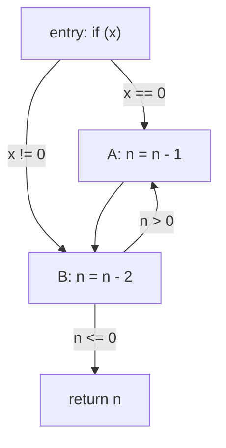
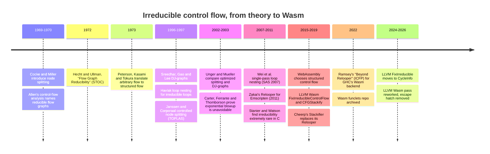
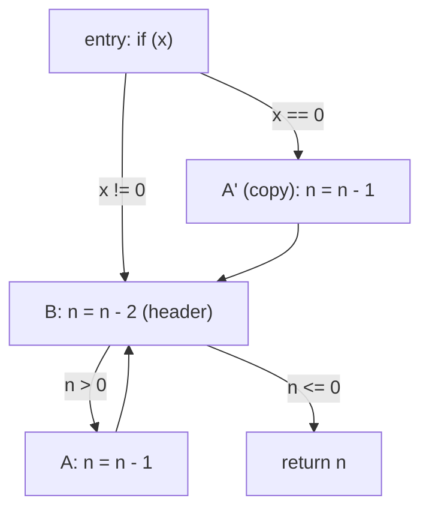
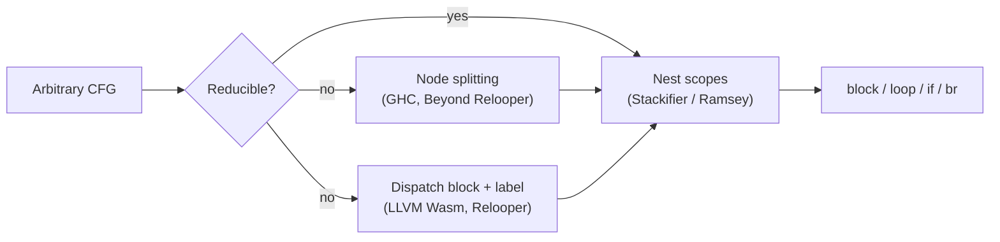

---
tags:
  - compilers
  - foundations
  - control-flow
  - cfg
  - loops
  - reducibility
  - webassembly
  - llvm
  - hotspot
  - node-splitting
  - relooper
status: complete
sources:
  - https://www.cs.cornell.edu/courses/cs6120/2023fa/lesson/5/
  - https://bibtex.github.io/STOC-1972-HechtU.html
  - https://maskray.me/blog/2026-07-12-irreducible-loops
  - https://www.cs.tufts.edu/~nr/cs257/archive/johan-jansson/node-splitting.pdf
  - https://www.cs.tufts.edu/~nr/cs257/archive/larry-carter/exponential-node-splitting.pdf
  - https://arcb.csc.ncsu.edu/~mueller/ftp/pub/mueller/papers/toplas2184.pdf
  - https://sro.sussex.ac.uk/id/eprint/27266/
  - https://www.cs.tufts.edu/~nr/cs257/archive/alon-zakai/emscripten.pdf
  - https://labs.leaningtech.com/blog/control-flow
  - https://dl.tufts.edu/concern/pdfs/8c97m4855
  - https://github.com/WebAssembly/design/blob/main/Rationale.md
  - https://github.com/WebAssembly/funclets
  - https://gist.github.com/conrad-watt/6a620cb8b7d8f0191296e3eb24dffdef
  - https://www.llvm.org/doxygen/WebAssemblyFixIrreducibleControlFlow_8cpp_source.html
  - https://llvm.org/doxygen/WebAssemblyCFGStackify_8cpp_source.html
  - https://lists.llvm.org/pipermail/llvm-commits/Week-of-Mon-20231016/1225970.html
  - https://lists.llvm.org/pipermail/llvm-commits/Week-of-Mon-20260216/1854779.html
  - https://app.semanticdiff.com/gh/llvm/llvm-project/pull/184441/overview
  - https://lists.llvm.org/pipermail/llvm-commits/Week-of-Mon-20260302/1867460.html
  - https://www.llvm.org/doxygen/FixIrreducible_8cpp_source.html
  - https://lists.llvm.org/pipermail/llvm-commits/Week-of-Mon-20240729/1417904.html
  - https://lists.llvm.org/pipermail/llvm-commits/Week-of-Mon-20210726/942312.html
  - https://llvm.googlesource.com/llvm-project/+/0ba7bfc34fa292a34b31f6338464744b5cad58a3
  - https://lists.llvm.org/pipermail/llvm-commits/Week-of-Mon-20251110/1775945.html
  - https://lists.llvm.org/pipermail/llvm-commits/Week-of-Mon-20251117/1783194.html
  - https://hackage.haskell.org/package/ghc-9.10.3/src/GHC/Cmm/Reducibility.hs
  - https://hackage.haskell.org/package/ghc-9.10.3/src/GHC/Wasm/ControlFlow/FromCmm.hs
  - https://mail.openjdk.org/pipermail/hotspot-compiler-dev/2023-January/061783.html
  - https://bugs.openjdk.org/browse/JDK-8348572
  - https://arxiv.org/pdf/1909.08815
  - https://bytecodealliance.github.io/zulip-archive/stream/217117-cranelift/topic/reducible.20cfgs.3F.html
  - https://bytecodealliance.github.io/zulip-archive/stream/225357-git-wasmtime/topic/wasmtime.20.2F.20PR.20.2313391.20Handle.20irreducible.20control.20flow.20in.20b.2E.2E.2E.html
created: 2026-11-28
updated: 2026-11-28
---

## Table Of Contents

- [[#TL;DR|TL;DR]]
- [[#The Problem|The Problem]]
- [[#Foundations|Foundations]]
    - [[#Back Edges, Dominators and Natural Loops|Back Edges, Dominators and Natural Loops]]
    - [[#Three Equivalent Tests for Reducibility|Three Equivalent Tests for Reducibility]]
    - [[#Where Irreducible Loops Come From|Where Irreducible Loops Come From]]
    - [[#What Breaks When a Loop Has Two Entries|What Breaks When a Loop Has Two Entries]]
- [[#How We Got Here|How We Got Here]]
- [[#How It Works|How It Works]]
    - [[#A Running Example|A Running Example]]
    - [[#Option 1 - Node Splitting|Option 1 - Node Splitting]]
    - [[#Option 2 - A Dispatch Block and a Label Variable|Option 2 - A Dispatch Block and a Label Variable]]
    - [[#Option 3 - Recognize the Loop and Live With It|Option 3 - Recognize the Loop and Live With It]]
    - [[#Option 4 - Bail Out|Option 4 - Bail Out]]
    - [[#From a Reducible CFG to Structured Code - Relooper, Stackifier, Beyond Relooper|From a Reducible CFG to Structured Code - Relooper, Stackifier, Beyond Relooper]]
- [[#Where It Is Now|Where It Is Now]]
- [[#Trade-offs & Open Problems|Trade-offs & Open Problems]]
- [[#Resources|Resources]]
- [[#Related Notes|Related Notes]]

## ***TL;DR***
---
*An irreducible loop is a cycle in the control-flow graph that can be entered at more than one block, so no single block "owns" the loop. Almost every loop analysis, every structured IR, and every OSR scheme assumes one entry, so compilers either rewrite these loops into single-entry form or quietly give up on them.*

- **What it is.** A control-flow graph (CFG) is *reducible* when every cycle has a header that dominates it, so every cycle is a [[Loop Optimizations|natural loop]]. A CFG is *irreducible* when "some cycle has two or more entries: nodes with a predecessor outside the cycle" ([MaskRay, Jul 2026](https://maskray.me/blog/2026-07-12-irreducible-loops)).
- **Why it matters.** Natural-loop analyses, loop-invariant code motion, [[SSA Form|SSA]] minimality, [[WebAssembly]]'s `block`/`loop` nesting, and loop-based [[On-Stack Replacement|OSR]] all assume a unique loop entry. Many optimizations "do not work when the loop is irreducible" ([Stanier and Watson, 2011](https://sro.sussex.ac.uk/id/eprint/27266/)).
- **Where it comes from.** Not from `while`, `for`, `break` and `continue`, which only produce reducible graphs. It comes from `goto`, from optimizer passes such as jump threading, from OSR entry points, and from machine code and decompiler output ([Cornell CS 6120](https://www.cs.cornell.edu/courses/cs6120/2023fa/lesson/5/), [LLVM DFA jump threading commit](https://lists.llvm.org/pipermail/llvm-commits/Week-of-Mon-20210726/942312.html), [OpenJDK C2](https://mail.openjdk.org/pipermail/hotspot-compiler-dev/2023-January/061783.html)).
- **The four fixes.** (1) **Node splitting**: copy blocks until each loop has one entry; fast code, but worst-case exponential size ([Carter, Ferrante, Thomborson, POPL 2003](https://www.cs.tufts.edu/~nr/cs257/archive/larry-carter/exponential-node-splitting.pdf)). (2) **Dispatch block**: route all entries through a new header that switches on a "label" variable; linear size, a little run-time cost. (3) **Recognize and optimize anyway** with irreducible-aware loop forests. (4) **Bail out** and leave the code unoptimized.
- **Who does what (late 2026).** LLVM's Wasm backend and Emscripten's Relooper use a dispatch block; GHC's Wasm backend and Ramsey's "Beyond Relooper" use node splitting; HotSpot C2 skips loop optimizations on irreducible loops; Sulong bails out of OSR; Cranelift's backend tolerates them ([[#Resources|Resources]]).

## ***The Problem***
---
*Compilers think about loops as "a header plus a body." A second entry point destroys the header, and with it the place where you hoist code, count iterations, enter compiled code, or open a `loop` scope in Wasm.*

Here is C that any C compiler must accept:

```c
int f(int x, int n) {
    if (x) goto B;
A:  n = n - 1;
B:  n = n - 2;
    if (n > 0) goto A;
    return n;
}
```

Its CFG has one cycle, `A → B → A`, but control can arrive at either `A` (fall-through from the entry) or `B` (the `goto`):



Ask "what is the loop header?" and there is no good answer. `A` does not dominate `B` (the entry reaches `B` directly), and `B` does not dominate `A` (the entry reaches `A` directly). This exact three-node shape, an entry branching into both nodes of a two-node cycle, is the "irreducible core"; Hecht and Ullman showed a CFG is irreducible exactly when it contains this pattern, with each edge allowed to be a path ([MaskRay](https://maskray.me/blog/2026-07-12-irreducible-loops)).

Now try to use this CFG:

- **Loop-invariant code motion** wants a preheader: one place outside the loop that runs before the loop starts. There are two ways in, so there is no single such place.
- **WebAssembly** has no `goto`. A `loop` instruction has exactly one entry, its top. LLVM's Wasm backend says its scope-marking pass works on arbitrary CFGs "provided that all loops are single-entry" ([WebAssemblyCFGStackify.cpp](https://llvm.org/doxygen/WebAssemblyCFGStackify_8cpp_source.html)), so this function cannot be emitted as is.
- **OSR in an LLVM interpreter** needs to rebuild loops from basic blocks before it can offer loop-level tier-up. Sulong simply says "we omit the handling of irreducible control flow and bail out" ([Mosaner et al., MPLR 2019](https://arxiv.org/pdf/1909.08815)).

So the question every compiler faces is: rewrite these loops into single-entry form (at a cost in code size or speed), teach the analyses to cope, or accept unoptimized code in the rare functions that have them.

## ***Foundations***
---
*Reducibility is a property of the graph's shape, not of the source language. These sections define it precisely, give the three classic tests, list where irreducible loops come from, and show which guarantees break.*

### Back Edges, Dominators and Natural Loops

*Natural loops are defined by back edges into a dominating header. Reducibility is exactly the condition under which every cycle is one of these.*

- **Dominance.** Block $d$ *dominates* block $n$ ($d \;\mathrm{dom}\; n$) if every path from the entry to $n$ passes through $d$. See [[Dataflow Analysis]] and [[SSA Form]] for how dominator trees are computed.
- **Back edge.** An edge $t \to h$ where $h \;\mathrm{dom}\; t$. Its *natural loop* is the smallest set containing $h$ and $t$ such that every predecessor of a member other than $h$ is also a member. "Natural loops are strongly connected components in the CFG with a single entry" ([CS 6120](https://www.cs.cornell.edu/courses/cs6120/2023fa/lesson/5/)).
- **Retreating edge.** In a depth-first search from the entry, an edge $u \to v$ where $v$ is an ancestor of $u$ on the current DFS path. Every cycle contains at least one retreating edge.

A back edge is always retreating. The converse is the whole story:

$$
G \text{ is reducible} \iff \text{for every DFS of } G,\ \text{every retreating edge } t \to h \text{ satisfies } h \;\mathrm{dom}\; t
$$

*In plain English: every time a depth-first walk jumps "backwards" to close a cycle, the block it jumps to must be one you cannot avoid on the way in. If some cycle can be entered without passing that block, the graph is irreducible.* CS 6120 states the same thing as "A CFG is reducible iff every backedge has a natural loop" ([CS 6120](https://www.cs.cornell.edu/courses/cs6120/2023fa/lesson/5/)). In the example above, a DFS that visits `A` first sees `B → A` as retreating, but `A` does not dominate `B`.

### Three Equivalent Tests for Reducibility

*The same property shows up three ways: as a graph rewrite that collapses to one node, as a forbidden subgraph, and as the back-edge condition above. Each test underlies a different fixing algorithm.*

| Test | Statement | Where it is used |
|---|---|---|
| **T1/T2 collapse** | Repeatedly apply T1 (delete a self-loop) and T2 (merge a node into its *sole* predecessor). The graph is reducible iff the result, the *limit flow graph*, is a single node. | Node splitting algorithms: when stuck, split a node (T3) and continue ([Janssen and Corporaal, 1997](https://www.cs.tufts.edu/~nr/cs257/archive/johan-jansson/node-splitting.pdf); GHC's [Reducibility.hs](https://hackage.haskell.org/package/ghc-9.10.3/src/GHC/Cmm/Reducibility.hs)) |
| **Forbidden subgraph** | Irreducible iff the CFG contains the irreducible core: an entry path to two nodes that lie on a common cycle, neither dominating the other (Hecht and Ullman). | Explaining and detecting irreducibility ([MaskRay](https://maskray.me/blog/2026-07-12-irreducible-loops)) |
| **Back-edge / DFS** | Every retreating edge is a back edge, for every DFS. | Loop-nesting forests (Havlak, Wei et al.), LLVM `CycleInfo` |

T1 and T2 come from interval analysis ([Unger and Mueller, 2002](https://arcb.csc.ncsu.edu/~mueller/ftp/pub/mueller/papers/toplas2184.pdf)). Janssen and Corporaal state the key theorem plainly: "A flow graph is reducible if and only if the limit flow graph contains a single node." Hecht later showed the limit graph does not depend on the order in which T1 and T2 are applied ([Unger and Mueller](https://arcb.csc.ncsu.edu/~mueller/ftp/pub/mueller/papers/toplas2184.pdf)), which is why the test is well defined.

Run T1/T2 on the example: `X` (return) merges into `B`, its sole predecessor. Now `entry` has two successors, `A` has predecessors `entry` and `B`, and `B` has predecessors `entry` and `A`. No node has a sole predecessor and there are no self-loops, so the limit graph has three nodes. Irreducible.

### Where Irreducible Loops Come From

*Humans rarely write them. Machines, optimizers and runtimes create most of them.*

| Source | Why it creates multiple entries | Evidence |
|---|---|---|
| `goto` in C, Fortran, generated C | Jumps into the middle of a loop | Only `goto`-like constructs can produce irreducible CFGs ([CS 6120](https://www.cs.cornell.edu/courses/cs6120/2023fa/lesson/5/)) |
| [[Jump Threading]] | Threading a branch around a loop header gives the loop a second way in | LLVM's ordinary JumpThreading skips loops "since it can result in irreducible control flow that harms other optimizations" ([2021 commit](https://lists.llvm.org/pipermail/llvm-commits/Week-of-Mon-20210726/942312.html)); Wasm CFGs typically become irreducible only after such transforms (Andy Wingo, [Cranelift Zulip, Dec 2021](https://bytecodealliance.github.io/zulip-archive/stream/217117-cranelift/topic/reducible.20cfgs.3F.html)) |
| State machines (`while (1) switch (state)`) | Hand-written or optimizer-threaded "goto the next state" jumps between case bodies | DFA jump threading turns CoreMark's `core_state_transition` switch loop into direct jumps ([LLVM commit](https://lists.llvm.org/pipermail/llvm-commits/Week-of-Mon-20210726/942312.html)) |
| OSR compilation | Entering compiled code at an inner loop's header jumps into the middle of the outer loop | C2 developers note OSR compilations "often have some irreducible loop in the graph" ([hotspot-compiler-dev, 2023](https://mail.openjdk.org/pipermail/hotspot-compiler-dev/2023-January/061783.html)); see [[On-Stack Replacement]] |
| Fuzzed or hand-made bytecode | JVM bytecode allows arbitrary branches; `javac` just never emits them | The C2 bug behind JDK-8280126 was "reported with a modified classfile" ([same thread](https://mail.openjdk.org/pipermail/hotspot-compiler-dev/2023-January/061783.html)) |
| Optimized machine code, decompilers | Branch layout and tail merging ignore source structure | "Optimized machine code and decompiler output routinely contain irreducible loops" ([MaskRay](https://maskray.me/blog/2026-07-12-irreducible-loops)); see [[Binary Lifting and Decompilation]] |
| Obfuscators | Deliberately irreducible graphs defeat analysis | The motivation of Carter et al.'s lower bound ([POPL 2003](https://www.cs.tufts.edu/~nr/cs257/archive/larry-carter/exponential-node-splitting.pdf)) |

How common is it in source code? Stanier and Watson surveyed open-source C and machine-generated C and found "irreducibility is extremely rare, and is becoming less common with time," concluding that leaving such loops unoptimized is "a perfectly feasible future-proof option" ([SP&E 2011](https://sro.sussex.ac.uk/id/eprint/27266/)). Sulong saw none in its benchmarks ([MPLR 2019](https://arxiv.org/pdf/1909.08815)), and bjorn3 reports rustc_codegen_cranelift has never had trouble passing rustc's possibly-irreducible MIR straight through ([Zulip](https://bytecodealliance.github.io/zulip-archive/stream/217117-cranelift/topic/reducible.20cfgs.3F.html)). The catch is that rare is not never, and every consumer that cannot represent them at all (Wasm, structured IRs) still needs a fallback.

### What Breaks When a Loop Has Two Entries

*A reducible graph gives you a tree of loops with obvious headers. An irreducible one gives you a choice of headers, and every analysis built on "the header" has to pick one or give up.*

- **The header is no longer intrinsic.** For an irreducible cycle "the header must be chosen"; the standard choice is the member the DFS reaches first, so the loop forest itself changes with DFS order ([MaskRay](https://maskray.me/blog/2026-07-12-irreducible-loops)). Different loop-nesting definitions (Steensgaard, Sreedhar-Gao-Lee, Havlak, Ramalingam) even disagree on how many loops a graph has.
- **Loop optimizations.** LICM, unrolling, induction-variable analysis and vectorization in [[Loop Optimizations]] all hang off a preheader and a header. LLVM's `LoopInfo` only models natural loops; irreducible cycles live in a separate `CycleInfo` analysis.
- **SSA construction.** Braun et al.'s on-the-fly construction is minimal only for reducible CFGs; irreducible ones can leave redundant φ cycles that need a clean-up pass (see [[SSA Form]]).
- **Dataflow cost.** Iterating in reverse postorder converges quickly for "well behaved (reducible)" CFGs ([CS 6120](https://www.cs.cornell.edu/courses/cs6120/2023fa/lesson/5/)); irreducible cycles need extra passes.
- **Structured targets.** Wasm, MLIR's `scf`, and GPU structurizers need single-entry loops by construction ([[Intermediate Representations]], [[MLIR]]).
- **Runtime machinery.** OSR entry, loop-based profiling counters and interpreter loop reconstruction all key on headers ([[On-Stack Replacement]], [[Tiering Policies and Warm-up]]).

## ***How We Got Here***
---
*The theory was settled by the mid-1970s, the size cost was proved unavoidable in 2003, and the practical work since has been about the web: getting arbitrary C into JavaScript and then WebAssembly.*



- **The theory (1969 to 1977).** Unger and Mueller credit Cocke and Miller (1969) with node splitting and Allen (1970) with first naming reducible flow graphs; Hecht and Ullman's STOC 1972 paper gave the characterizations ([Unger and Mueller](https://arcb.csc.ncsu.edu/~mueller/ftp/pub/mueller/papers/toplas2184.pdf), [Hecht and Ullman](https://bibtex.github.io/STOC-1972-HechtU.html)). In 1973 Peterson, Kasami and Tokura gave a three-pass translation from arbitrary to structured control flow, the algorithm Ramsey would later recast ([Ramsey 2022](https://dl.tufts.edu/concern/pdfs/8c97m4855)).
- **Making splitting practical (1997).** Plain splitting grew code by 235% per procedure on Janssen and Corporaal's benchmarks; their controlled splitting with a heuristic cut that to about 3% ([TOPLAS 1997](https://www.cs.tufts.edu/~nr/cs257/archive/johan-jansson/node-splitting.pdf)).
- **Living with it (1996 to 2002).** DJ-graphs (Sreedhar, Gao, Lee 1996) and Havlak's 1997 loop nesting let a compiler *recognize* irreducible loops and optimize them in place. Unger and Mueller measured 1 to 40% speedups over leaving them alone, and recommended optimized splitting for retrofitting old compilers and DJ-graphs for new designs ([TOPLAS 2002](https://arcb.csc.ncsu.edu/~mueller/ftp/pub/mueller/papers/toplas2184.pdf)).
- **The lower bound (2003).** Carter, Ferrante and Thomborson's "Folklore Confirmed" proved that "no node splitting technique can avoid this exponential blowup" ([POPL 2003](https://www.cs.tufts.edu/~nr/cs257/archive/larry-carter/exponential-node-splitting.pdf)).
- **The web era (2011 onward).** JavaScript has no `goto`, so Emscripten's Relooper turned LLVM's "soup of blocks" into JS loops and ifs, falling back on a `label` variable for awkward entries ([Zakai](https://www.cs.tufts.edu/~nr/cs257/archive/alon-zakai/emscripten.pdf)). WebAssembly then kept structured control flow on purpose, noting that "Any control flow--even irreducible--can be transformed into structured control flow with the Relooper" ([Wasm Rationale](https://github.com/WebAssembly/design/blob/main/Rationale.md)).

## ***How It Works***
---
*Every approach either changes the graph (splitting, dispatch), changes the analysis (irreducible-aware loop forests), or changes the expectation (bail out). Structured targets add a second step: turning the now-reducible graph into nested scopes.*

### A Running Example

*The same `goto` function from The Problem, fixed four ways.*

Recall the cycle `{A, B}` with entries `A` and `B`. The goal of the two rewriting fixes is to leave one block through which every entry passes.

### Option 1 - Node Splitting

*Copy a block so each copy has one kind of predecessor. Zero run-time overhead, but every copy is real code, and in the worst case the copies multiply.*

Duplicate `A`: one copy (`A'`) serves the entry path and sits outside the loop; the original stays inside. Now `B` is the only way into the cycle and becomes a proper header.



```c
int f(int x, int n) {
    if (!x) n = n - 1;        // A', the split copy, outside the loop
    for (;;) {                // single entry: B
        n = n - 2;            // B
        if (n <= 0) return n;
        n = n - 1;            // A
    }
}
```

**The T3 step.** In the T1/T2 picture, splitting is a third transformation: when no T1/T2 applies, pick a node with $k$ predecessors and replace it with $k$ copies, one per predecessor, each of which can now be merged by T2. Repeat until one node remains.

**Controlling the blowup.** Which node you split matters enormously. Janssen and Corporaal group candidate nodes into maximal *SED-sets* (nodes in a loop sharing an immediate dominator outside it) and show the minimum number of splits is

$$
\text{splits}_{\min} = \sum_i \left(k_i - 1\right)
$$

*where $k_i$ is the size of the $i$-th maximal SED-set. In plain English: each group of rival entry nodes needs all but one of its members copied, and splitting the wrong node can merge groups and force extra copies.* Their heuristic picks the node minimizing $Q(n)\times(\text{preds}(n)-1)$, where $Q$ is the size being minimized ([TOPLAS 1997](https://www.cs.tufts.edu/~nr/cs257/archive/johan-jansson/node-splitting.pdf)):

| Method | Basic-block growth per procedure | Instruction growth per procedure |
|---|---|---|
| Uncontrolled splitting | 241.7% | 235.5% |
| Controlled (CNS) | 26.2% | 30.1% |
| Controlled + heuristic (CNSH) | 3.1% | 2.9% |
| Exhaustive optimum | 3.0% | 2.9% |

**The unavoidable worst case.** For a CFG equivalent to the complete directed graph on $n$ nodes, Carter, Ferrante and Thomborson prove every reducible equivalent has

$$
|V_{\text{reducible}}| \;\ge\; 2^{\,n-1}
$$

*nodes, and the same bound holds for related graphs with out-degree 2. In plain English: when every block can jump to every other, the only way to give each loop one entry is to copy blocks for every possible history of how you got there, and there are exponentially many histories* ([POPL 2003](https://www.cs.tufts.edu/~nr/cs257/archive/larry-carter/exponential-node-splitting.pdf)).

### Option 2 - A Dispatch Block and a Label Variable

*Add one new block that every entry goes through, and tell it where to go with a variable. Linear code growth, at the price of a store, a load and an indirect branch on each entry.*

This is what Emscripten's Relooper did with its `label` variable ("we set label before we branch into it," [Zakai](https://www.cs.tufts.edu/~nr/cs257/archive/alon-zakai/emscripten.pdf)) and what LLVM's Wasm backend does today. In C:

```c
int f(int x, int n) {
    int label = x ? 1 : 0;           // 0 = go to A, 1 = go to B
    for (;;) {                       // the dispatch block is the single entry
        switch (label) {
        case 0: n = n - 1;           // A, falls through to B
        case 1: n = n - 2;           // B
                if (n > 0) { label = 0; continue; }
                return n;
        }
    }
}
```

The same function in WebAssembly text, roughly as a structured backend would emit it. The `loop` is the new header; `br_table` is the dispatch:

```wat
(local $label i32)
(local.set $label (select (i32.const 1) (i32.const 0) (local.get $x)))
(loop $dispatch
  (block $B
    (block $A
      (br_table $A $B (local.get $label)))   ;; 0 -> A, otherwise -> B
    ;; A:
    (local.set $n (i32.sub (local.get $n) (i32.const 1))))
  ;; B:
  (local.set $n (i32.sub (local.get $n) (i32.const 2)))
  (if (i32.gt_s (local.get $n) (i32.const 0))
    (then (local.set $label (i32.const 0))
          (br $dispatch))))
(local.get $n)
```

**LLVM's version.** `WebAssemblyFixIrreducibleControlFlow` works region by region (a region is the whole function or the body of a loop minus its back edges). In each region it finds strongly connected components, and for each multi-entry one it adds "a new block that can dispatch to each of the loop entries, based on the value of a label 'helper' variable," replacing direct branches to the entries with an assignment and a branch to the dispatcher. It recomputes SCCs after each fix and recurses into the now-reducible loops. It deliberately avoids duplication: "We also prioritize code size and do not duplicate code in order to resolve irreducibility," and "we only use the 'label' helper for the blocks we absolutely must" ([source](https://www.llvm.org/doxygen/WebAssemblyFixIrreducibleControlFlow_8cpp_source.html)).

**LLVM's generic version.** `FixIrreducible` (in `Transforms/Utils`, used on AMDGPU before [[Control-Flow Structurization|control-flow structurization]]) does the same thing in IR: add a node $N$, redirect every external entry edge and every edge into the old header $H$ through $N$, so $N$ dominates the cycle and becomes a natural-loop header. The routing is a `ControlFlowHub` of guard blocks, and φ nodes move into the hub so SSA stays valid ([FixIrreducible.cpp](https://www.llvm.org/doxygen/FixIrreducible_8cpp_source.html)). The Wasm pass's comment explains why it doesn't reuse this: the generic pass "linearizes control flow, turning diamonds into two triangles, which is both unnecessary and undesirable for WebAssembly."

**Cost.** Cheerp's write-up sums up the choice: block duplication has no run-time cost but can grow code exponentially, while the dispatcher grows code "only linearly in the worst case" ([Iozzelli, 2019](https://labs.leaningtech.com/blog/control-flow)). The Wasm design doc says the label approach has "typically minimal throughput overhead (except for pathological cases of irreducible control flow)" ([Rationale](https://github.com/WebAssembly/design/blob/main/Rationale.md)). Conrad Watt's 2024 summary for the Wasm CG only says it "incurs some overhead" and asks for real programs that would show more ([gist](https://gist.github.com/conrad-watt/6a620cb8b7d8f0191296e3eb24dffdef)).

### Option 3 - Recognize the Loop and Live With It

*Instead of changing the program, build a loop forest that includes irreducible loops and teach optimizations to work on them, or at least not crash on them.*

- **[[Loop-Nesting Forests|Loop-nesting forests]].** Havlak's definition takes outermost loops as maximal strongly connected regions and finds inner loops recursively after removing the chosen header ([MaskRay](https://maskray.me/blog/2026-07-12-irreducible-loops)). LLVM's `GenericCycleInfo` computes this forest and calls loops "cycles." Wei et al.'s single-DFS algorithm (SAS 2007) runs in $O(N + kE)$, where $k$ is an "unstructuredness coefficient" that is "empirically below 1.5" on real code.
- **DJ-graphs.** Sreedhar, Gao and Lee add join edges to the dominator tree to find loops of both kinds; Unger and Mueller found this path "barely" grows code, at the cost of more optimizer changes ([TOPLAS 2002](https://arcb.csc.ncsu.edu/~mueller/ftp/pub/mueller/papers/toplas2184.pdf)).
- **Backends that just cope.** Chris Fallin says Cranelift's register allocator and branch lowering were "explicitly designed to handle irreducible control flow" ([Zulip, Dec 2021](https://bytecodealliance.github.io/zulip-archive/stream/217117-cranelift/topic/reducible.20cfgs.3F.html)). This is the cheap end of "living with it": no rewriting, just backend passes that make no single-entry assumption.
- **Coping with bugs.** HotSpot C2 models irreducible loops as plain `RegionNode`s with several inputs, not `LoopNode`s, and has no loop optimizations for them. Because there is no single entry, C2 couldn't tell when the last entry died, so dead irreducible loops crashed the VM until JDK-8280126 (2023) marked each region `MaybeIrreducibleEntry`, `NeverIrreducibleEntry` or `Reducible` from `ciTypeFlow`'s detection, and disabled `split_flow_path` (which can create new irreducible loops) when they are present ([hotspot-compiler-dev](https://mail.openjdk.org/pipermail/hotspot-compiler-dev/2023-January/061783.html)). The stated long-term goal is "to remove irreducible loops from the graph" by splitting or dispatch. See [[Sea of Nodes]] for C2's region-based IR.

### Option 4 - Bail Out

*If irreducibility is rare, the cheapest correct answer is to compile those functions without the loop-dependent feature.*

Sulong detects loops still open at function entry, a sign of multiple entries, and runs such functions "without trying to reconstruct its loops," so they get no loop-level OSR ([MPLR 2019](https://arxiv.org/pdf/1909.08815)). Stanier and Watson argue the same policy is fine for loop optimizations in C compilers ([SP&E 2011](https://sro.sussex.ac.uk/id/eprint/27266/)). Bail-out is not an option when the target *cannot express* the loop at all, which is why Wasm producers must fix it.

### From a Reducible CFG to Structured Code - Relooper, Stackifier, Beyond Relooper

*Once every loop has one entry, a second algorithm still has to nest the blocks into `block`, `loop` and `if` scopes so every branch is a jump out of a scope or back to a loop top.*

| Algorithm | Who | How it nests | Irreducible input | Guarantees |
|---|---|---|---|---|
| **Relooper** | Emscripten (2011), Binaryen | Greedy shapes: *Simple* (one entry), *Loop* (all entries can be returned to), *Multiple* (entries reach disjoint sets) | Handled via `label` variable | Always terminates; may add "unnecessary label assignments" ([Iozzelli](https://labs.leaningtech.com/blog/control-flow)) |
| **Stackifier** | Cheerp (2019), LLVM Wasm `CFGStackify` | Topologically order blocks, wrap each loop in a `loop` scope and each forward-branch target in a `block` scope | Requires a prior fix-up pass (dispatch block) | No label variable for reducible CFGs; Cheerp saw 0 to 14% speedups over its old Relooper, up to 8% on real codebases |
| **Beyond Relooper** | Ramsey, ICFP 2022; GHC's Wasm backend | One recursive walk of the dominator tree; *merge nodes* (two or more forward in-edges) get a `block` after which they are placed; *loop headers* (a back in-edge) get a `loop`; reverse postorder orders siblings | Requires node splitting first (GHC's `Reducibility.hs`) | For reducible graphs, "no extra computation or duplicated code" |

Ramsey's formulation is the cleanest to state. A branch is backward when the target's reverse-postorder number is not greater than the source's; each `br` index is just the target's position in the list of enclosing scopes, innermost first ([Ramsey 2022](https://dl.tufts.edu/concern/pdfs/8c97m4855)). GHC's `GHC.Wasm.ControlFlow.FromCmm` "can translate any _reducible_ Cmm control-flow graph to the structured control flow" and calls `asReducible` first ([FromCmm.hs](https://hackage.haskell.org/package/ghc-9.10.3/src/GHC/Wasm/ControlFlow/FromCmm.hs)), which splits nodes with a simple greedy strategy that "can duplicate more code than necessary" but is expected to rarely run.



## ***Where It Is Now***
---
*As of November 2026 the theory is unchanged but the plumbing keeps moving: LLVM reworked both of its fix-up passes in 2024 to 2026, an optimizer pass that deliberately creates irreducible loops went on by default in LLVM, and Wasm still has no native multi-entry loop.*

- **LLVM Wasm backend (Feb to Mar 2026).** `WebAssemblyFixIrreducibleControlFlow` was reworked to compute SCCs per region and recompute them after each fix (PR #181755, Feb 20, 2026, reapplied as #184441 with a regression test and an `UnreachableMachineBlockElim` run before it, approved Mar 4 to 5, 2026) ([llvm-commits](https://lists.llvm.org/pipermail/llvm-commits/Week-of-Mon-20260216/1854779.html), [PR #184441](https://app.semanticdiff.com/gh/llvm/llvm-project/pull/184441/overview)). With that fix in, the hidden `wasm-disable-fix-irreducible-control-flow-pass` switch, added in Oct 2023 because the pass took some builds "from 30 minutes to ~6 seconds" when disabled, was removed on Mar 6, 2026 as "no longer necessary nor desirable" ([2023](https://lists.llvm.org/pipermail/llvm-commits/Week-of-Mon-20231016/1225970.html), [2026](https://lists.llvm.org/pipermail/llvm-commits/Week-of-Mon-20260302/1867460.html)).
- **LLVM generic pass (Aug 2024).** `FixIrreducible` switched from a custom SCC walk to `CycleInfo`, which finds all cycles in one pass, handles each irreducible cycle separately (fewer guard predecessors and φ operands), and keeps natural loops whose header is also an irreducible entry; AMDGPU's pipeline now computes CycleInfo before it ([PR #101386](https://lists.llvm.org/pipermail/llvm-commits/Week-of-Mon-20240729/1417904.html)).
- **CycleInfo internals (Jul 2026).** MaskRay describes `GenericCycleInfo` moving to a flat layout, where each cycle is a contiguous slice of one block array so containment is an interval check, and toward single-pass Wei-style construction (that section of the post is still marked TODO) ([MaskRay](https://maskray.me/blog/2026-07-12-irreducible-loops)).
- **Creating irreducible loops on purpose (Nov 2025).** DFA jump threading, which threads `switch`-in-a-loop state machines into direct jumps, was enabled by default on Nov 4, 2025, citing 13% on CoreMark on x86 ([commit](https://llvm.googlesource.com/llvm-project/+/0ba7bfc34fa292a34b31f6338464744b5cad58a3)). It was reverted within days and a reapply opened on Nov 22, 2025 ([revert](https://lists.llvm.org/pipermail/llvm-commits/Week-of-Mon-20251110/1775945.html), [reapply](https://lists.llvm.org/pipermail/llvm-commits/Week-of-Mon-20251117/1783194.html)); whether it is on by default in current releases is unconfirmed here. If it sticks, mainstream `-O2` pipelines will produce more irreducible loops than the source code contains.
- **Cranelift (May 2026).** A bug where the egraph pass dropped blocks reachable only through back edges in irreducible control flow was fixed in Wasmtime PR #13391 (merged May 18, 2026) by running `eliminate_unreachable_code` mid-pass ([Zulip](https://bytecodealliance.github.io/zulip-archive/stream/225357-git-wasmtime/topic/wasmtime.20.2F.20PR.20.2313391.20Handle.20irreducible.20control.20flow.20in.20b.2E.2E.2E.html)). "Designed to handle it" still leaves edge cases.
- **HotSpot C2.** Still no loop optimizations on irreducible loops; JDK-8348572 (Jan 2025) fixed another C2 assert "due to unexpected irreducible loop" ([JBS](https://bugs.openjdk.org/browse/JDK-8348572)).
- **WebAssembly.** Still structured-only. The funclets proposal repo was archived on Oct 31, 2022 ([repo](https://github.com/WebAssembly/funclets)); its successor idea, `multiloop` ("a loop... with multiple bodies"), was last summarized in a June 2024 gist as exploratory, waiting on evidence that real programs would gain ([Watt](https://gist.github.com/conrad-watt/6a620cb8b7d8f0191296e3eb24dffdef)).
- **GHC Wasm backend.** Uses Ramsey's translation with node splitting as the fallback, shipping in GHC 9.10.x ([FromCmm.hs](https://hackage.haskell.org/package/ghc-9.10.3/src/GHC/Wasm/ControlFlow/FromCmm.hs), [Reducibility.hs](https://hackage.haskell.org/package/ghc-9.10.3/src/GHC/Cmm/Reducibility.hs)).

| System | Strategy (late 2026) |
|---|---|
| LLVM → Wasm | Dispatch block per multi-entry SCC, then CFGStackify |
| LLVM → AMDGPU | `FixIrreducible` (guard hub) before structurization |
| Emscripten (asm.js era) / Binaryen | Relooper with `label` variable |
| Cheerp | Stackifier, dispatcher for irreducible parts |
| GHC → Wasm | Node splitting, then Beyond Relooper |
| HotSpot C2 | Keep them, skip loop opts, special-case dead-loop removal |
| Sulong (GraalVM LLVM runtime) | Bail out of loop reconstruction and OSR |
| Cranelift | Backend tolerates them; no rewriting |

## ***Trade-offs & Open Problems***
---
*Every fix trades code size, run-time speed or engineering effort, and nobody can prove which is best for a given graph without measuring.*

| Approach | Code size | Run-time cost | Analysis quality after | Engineering cost |
|---|---|---|---|---|
| Node splitting (naive) | Can explode (235% per procedure measured; exponential worst case) | None | Full: graph is reducible | Low |
| Controlled / optimized splitting | ~3% per procedure measured | None | Full | Medium (heuristics) |
| Dispatch block + label | Linear | Store, load, indirect branch per entry; may hide a loop's true header from later optimizations | Full but blurrier loops | Low |
| Irreducible-aware analyses (DJ-graphs, cycles) | None | None | Partial: each optimization must opt in | High |
| Bail out | None | Unoptimized loop, no OSR | None for that function | Lowest |

- **Size versus speed, unpredictably.** Splitting can run faster but bigger, dispatch smaller but slower. Unger and Mueller measured 1 to 40% gains from either fix over doing nothing, but code growth for the same function ranged from −1% to 28% ([TOPLAS 2002](https://arcb.csc.ncsu.edu/~mueller/ftp/pub/mueller/papers/toplas2184.pdf)). Choosing the optimal split order is still open; implementations use heuristics.
- **Optimizations that fight each other.** Jump threading and DFA jump threading make state machines fast precisely by creating multi-entry loops, which then disable LICM-style passes and, on Wasm, get undone by a dispatch block that looks a lot like the original `switch`. Whether the net is a win depends on the target, which is part of why LLVM's ordinary JumpThreading refuses to thread loops at all ([2021 commit](https://lists.llvm.org/pipermail/llvm-commits/Week-of-Mon-20210726/942312.html)).
- **Compile time.** The fix-up passes have quadratic-ish bounds in nesting depth times irreducible loops; LLVM's Wasm pass needed a kill switch for half-hour builds from 2023 until March 2026, and reviewers of the 2026 rework were still unsure of its exact big-O ([llvm-commits](https://lists.llvm.org/pipermail/llvm-commits/Week-of-Mon-20260216/1854779.html)).
- **No canonical loop forest.** For irreducible graphs, different definitions give different numbers of loops and the forest depends on DFS order ([MaskRay](https://maskray.me/blog/2026-07-12-irreducible-loops)), so analyses keyed on "the header" are not stable across compiler versions.
- **Correctness edge cases.** Code paths that only run on irreducible graphs are rarely tested; C2's dead-loop crashes and Cranelift's dropped-block bug were both found by fuzzers or modified inputs. See [[Compiler Testing and Fuzzing]].
- **Native support in structured IRs.** Should Wasm (or MLIR `scf`) grow a multi-entry loop form like `multiloop`? It would remove the dispatch overhead and make OSR-style entries expressible, but complicate validation and one-pass compilation, which is why Wasm chose structure in the first place ([Rationale](https://github.com/WebAssembly/design/blob/main/Rationale.md), [Watt](https://gist.github.com/conrad-watt/6a620cb8b7d8f0191296e3eb24dffdef)).
- **Decompilers and lifters** must emit structured source from optimized binaries full of irreducible loops, usually by falling back to `goto`; how to do this readably is still an active topic (see [[Binary Lifting and Decompilation]]).

## ***Resources***
---
*Primary papers for the theory, source files for what compilers actually do, and a few explainers.*

**Theory and classic papers**
- [Flow Graph Reducibility](https://bibtex.github.io/STOC-1972-HechtU.html): Hecht and Ullman, STOC 1972, pp. 238 to 250.
- [Making Graphs Reducible with Controlled Node Splitting](https://www.cs.tufts.edu/~nr/cs257/archive/johan-jansson/node-splitting.pdf): Janssen and Corporaal, TOPLAS 19(6), 1997.
- [Handling Irreducible Loops: Optimized Node Splitting vs. DJ-Graphs](https://arcb.csc.ncsu.edu/~mueller/ftp/pub/mueller/papers/toplas2184.pdf): Unger and Mueller, TOPLAS 2002.
- [Folklore Confirmed: Reducible Flow Graphs are Exponentially Larger](https://www.cs.tufts.edu/~nr/cs257/archive/larry-carter/exponential-node-splitting.pdf): Carter, Ferrante and Thomborson, POPL 2003.
- [A Study of Irreducibility in C Programs](https://sro.sussex.ac.uk/id/eprint/27266/): Stanier and Watson, Software: Practice and Experience 42(1), 2011.

**Structured control flow**
- [Emscripten: An LLVM-to-JavaScript Compiler](https://www.cs.tufts.edu/~nr/cs257/archive/alon-zakai/emscripten.pdf): Alon Zakai, the Relooper.
- [Solving the structured control flow problem once and for all](https://labs.leaningtech.com/blog/control-flow): Yuri Iozzelli (Cheerp), Apr 2019, the Stackifier.
- [Beyond Relooper](https://dl.tufts.edu/concern/pdfs/8c97m4855): Norman Ramsey, ICFP 2022 (functional pearl).
- [WebAssembly design Rationale: Control Flow](https://github.com/WebAssembly/design/blob/main/Rationale.md), [funclets repo](https://github.com/WebAssembly/funclets), and [multiloop follow-up](https://gist.github.com/conrad-watt/6a620cb8b7d8f0191296e3eb24dffdef) (Conrad Watt, 2024).

**Compiler sources and changes**
- [WebAssemblyFixIrreducibleControlFlow.cpp](https://www.llvm.org/doxygen/WebAssemblyFixIrreducibleControlFlow_8cpp_source.html) and [WebAssemblyCFGStackify.cpp](https://llvm.org/doxygen/WebAssemblyCFGStackify_8cpp_source.html): LLVM.
- [FixIrreducible.cpp](https://www.llvm.org/doxygen/FixIrreducible_8cpp_source.html) and [the CycleInfo rewrite, PR #101386](https://lists.llvm.org/pipermail/llvm-commits/Week-of-Mon-20240729/1417904.html), 2024.
- LLVM Wasm pass changes: [2023 kill switch](https://lists.llvm.org/pipermail/llvm-commits/Week-of-Mon-20231016/1225970.html), [SCC rework #181755](https://lists.llvm.org/pipermail/llvm-commits/Week-of-Mon-20260216/1854779.html), [reapply #184441](https://app.semanticdiff.com/gh/llvm/llvm-project/pull/184441/overview), [switch removal #185072](https://lists.llvm.org/pipermail/llvm-commits/Week-of-Mon-20260302/1867460.html).
- DFA jump threading: [original 2021 commit](https://lists.llvm.org/pipermail/llvm-commits/Week-of-Mon-20210726/942312.html), [enable by default (Nov 2025)](https://llvm.googlesource.com/llvm-project/+/0ba7bfc34fa292a34b31f6338464744b5cad58a3), [revert](https://lists.llvm.org/pipermail/llvm-commits/Week-of-Mon-20251110/1775945.html), [reapply](https://lists.llvm.org/pipermail/llvm-commits/Week-of-Mon-20251117/1783194.html).
- GHC: [GHC.Cmm.Reducibility](https://hackage.haskell.org/package/ghc-9.10.3/src/GHC/Cmm/Reducibility.hs) and [GHC.Wasm.ControlFlow.FromCmm](https://hackage.haskell.org/package/ghc-9.10.3/src/GHC/Wasm/ControlFlow/FromCmm.hs).
- HotSpot: [JDK-8280126 review thread](https://mail.openjdk.org/pipermail/hotspot-compiler-dev/2023-January/061783.html), [JDK-8348572](https://bugs.openjdk.org/browse/JDK-8348572).
- Cranelift: [reducible CFGs? (Zulip, 2021)](https://bytecodealliance.github.io/zulip-archive/stream/217117-cranelift/topic/reducible.20cfgs.3F.html), [PR #13391 (2026)](https://bytecodealliance.github.io/zulip-archive/stream/225357-git-wasmtime/topic/wasmtime.20.2F.20PR.20.2313391.20Handle.20irreducible.20control.20flow.20in.20b.2E.2E.2E.html).
- Sulong: [Supporting OSR in Unstructured Languages by Loop Reconstruction and Extraction](https://arxiv.org/pdf/1909.08815), MPLR 2019.

**Explainers**
- [Irreducible loops](https://maskray.me/blog/2026-07-12-irreducible-loops): MaskRay (Fangrui Song), Jul 2026; loop-nesting forests, Wei et al., LLVM CycleInfo.
- [CS 6120 Lesson 5: Global Analysis](https://www.cs.cornell.edu/courses/cs6120/2023fa/lesson/5/): Adrian Sampson, Cornell; natural loops and reducibility.

## ***Related Notes***
---
*Irreducibility is a shape problem that shows up wherever a compiler assumes loops have one door.*

- [[Loop Optimizations]] — Natural loops, preheaders and the passes that skip irreducible cycles.
- [[SSA Form]] — Dominance, φ placement, and why Braun's construction needs a clean-up pass on irreducible CFGs.
- [[Dataflow Analysis]] — Reverse-postorder iteration and dominator computation, fastest on reducible graphs.
- [[Intermediate Representations]] — Structured versus unstructured control flow in IR design.
- [[WebAssembly]] — The best-known structured target; Relooper and stackifier exist for it.
- [[On-Stack Replacement]] — OSR entries create irreducible loops, and loop reconstruction bails out on them.
- [[LLVM]] — FixIrreducible, CycleInfo and the Wasm backend's fix-up pass.
- [[MLIR]] — `scf` keeps control flow structured; `cf` does not.
- [[Classic Optimizations]] — CFG simplification, where jump threading lives.
- [[Jump Threading]] — Planned: the pass family that most often creates irreducible loops, including DFA jump threading.
- [[Loop-Nesting Forests]] — Planned: Havlak, DJ-graphs, Wei et al. and LLVM CycleInfo in depth.
- [[Control-Flow Structurization]] — Planned: GPU structurizers that need reducible input.
- [[GPU Kernel Compilers]] — GPU backends structurize control flow and must fix irreducibility first.
- [[Sea of Nodes]] — C2's region nodes and how irreducible loops appear in its graph.
- [[Tiering Policies and Warm-up]] — Back-edge counters that key on loop headers.
- [[JIT Compilation]] — JITs that build IR from bytecode must handle arbitrary branches.
- [[Partial Evaluation and Self-Specializing Interpreters]] — Truffle languages like Sulong rebuild loops for OSR.
- [[Compiler Testing and Fuzzing]] — Irreducible-loop crashes found with fuzzed bytecode.
- [[Binary Lifting and Decompilation]] — Recovering structure from machine code full of irreducible loops.
- [[Regular Expression Engines]] — DFAs and state machines, the code shape DFA jump threading targets.
