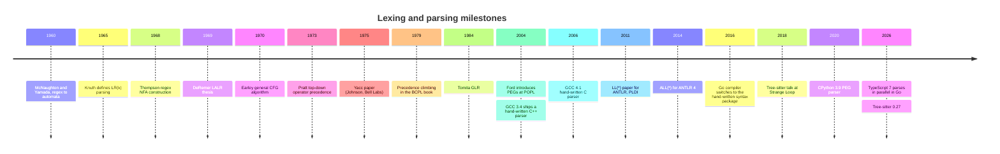

---
tags:
  - compilers
  - parsing
  - lexing
  - grammars
  - frontend
  - ide-tooling
status: complete
sources:
  - https://en.wikipedia.org/wiki/Thompson%27s_construction
  - https://re2c.org/
  - https://v8.dev/blog/scanner
  - https://v8.dev/blog/preparser
  - https://en.wikipedia.org/wiki/LALR_parser
  - https://en.wikipedia.org/wiki/Yacc
  - https://www.cs.utexas.edu/~novak/yaccpaper.htm
  - https://en.wikipedia.org/wiki/Earley_parser
  - https://en.wikipedia.org/wiki/GLR_parser
  - https://en.wikipedia.org/wiki/Operator-precedence_parser
  - https://www.crockford.com/javascript/tdop/tdop.html
  - https://matklad.github.io/2020/04/13/simple-but-powerful-pratt-parsing
  - https://matklad.github.io/2023/05/21/resilient-ll-parsing-tutorial.html
  - https://rust-analyzer.github.io/blog/2020/09/16/challeging-LR-parsing.html
  - https://fuchsia.googlesource.com/third_party/github.com/rust-lang/rust-analyzer/+/HEAD/docs/dev/syntax.md
  - https://ericlippert.com/2012/06/08/red-green-trees/
  - https://bford.info/pub/lang/peg/
  - https://peps.python.org/pep-617/
  - https://dx.doi.org/10.1145/1993316.1993548
  - https://2014.splashcon.org/details/oopsla2014/18/Adaptive-LL-Parsing-The-Power-of-Dynamic-Analysis
  - https://tratt.net/laurie/blog/2020/which_parsing_approach.html
  - https://tratt.net/laurie/blog/2024/structured_editing_and_incremental_parsing.html
  - https://arxiv.org/abs/1804.07133
  - https://eli.thegreenplace.net/2007/11/24/the-context-sensitivity-of-cs-grammar/
  - https://pdos.csail.mit.edu/archive/l/c/roskind.html
  - https://gcc.gnu.org/gcc-3.4/changes.html
  - https://developers.slashdot.org/story/03/01/13/194246/gcc-gets-pch-support-and-new-parser
  - https://www.linux-magazine.com/index.php/Issues/2006/68/GCC-4.1/(language)/eng-US
  - https://gcc.gnu.org/gcc-15/porting_to.html
  - https://clang.llvm.org/features.html
  - https://rustc-dev-guide.rust-lang.org/the-parser.html
  - https://groups.google.com/d/msg/golang-dev/yq-T_4i2o6U/OswsesVOAwAJ
  - https://thestrangeloop.com/2018/tree-sitter---a-new-parsing-system-for-programming-tools.html
  - https://tree-sitter.github.io/tree-sitter/creating-parsers/3-writing-the-grammar.html
  - https://www.github.com/tree-sitter/tree-sitter/releases
  - https://bugzilla.redhat.com/show_bug.cgi?id=2420305
  - https://dotfiles.substack.com/p/whats-new-in-neovim-012
  - https://github.blog/2021-12-09-introducing-stack-graphs/
  - https://lezer.codemirror.net/docs/guide
  - https://devblogs.microsoft.com/typescript/announcing-typescript-7-0/
  - https://github.com/guidance-ai/llguidance
  - https://arxiv.org/abs/2411.15100
  - https://arxiv.org/abs/2304.05276v3
  - https://pldi25.sigplan.org/details/pldi-2025-papers/32/Intrinsic-Verification-of-Parsers-and-Formal-Grammar-Theory-in-Dependent-Lambek-Calcu
  - https://2025.splashcon.org/details/OOPSLA/18/Static-Inference-of-Regular-Grammars-for-Ad-Hoc-Parsers
  - https://drops.dagstuhl.de/storage/00lipics/lipics-vol372-ecoop2026/LIPIcs.ECOOP.2026.30/LIPIcs.ECOOP.2026.30.pdf
  - https://mermaid.js.org/syntax/railroad.html
  - https://forums.swift.org/t/dropping-the-requirement-for-c-only-bootstrapping/87739/
created: 2026-11-26
updated: 2026-11-26
---

## Table Of Contents

- [[#TL;DR|TL;DR]]
- [[#The Problem|The Problem]]
- [[#Foundations|Foundations]]
    - [[#Tokens, Lexemes and Regular Languages|Tokens, Lexemes and Regular Languages]]
    - [[#From Regex to DFA|From Regex to DFA]]
    - [[#Context-Free Grammars and Ambiguity|Context-Free Grammars and Ambiguity]]
    - [[#The Parser Families|The Parser Families]]
- [[#How We Got Here|How We Got Here]]
- [[#How It Works|How It Works]]
    - [[#A Small Expression Grammar|A Small Expression Grammar]]
    - [[#Top-Down Parsing|Top-Down Parsing]]
    - [[#Bottom-Up Parsing|Bottom-Up Parsing]]
    - [[#LL vs LR Walk-Through|LL vs LR Walk-Through]]
    - [[#Pratt Parsing and Precedence Climbing|Pratt Parsing and Precedence Climbing]]
    - [[#PEGs and Packrat|PEGs and Packrat]]
    - [[#GLR and Earley|GLR and Earley]]
    - [[#The Lexer Hack and Context-Sensitive Lexing|The Lexer Hack and Context-Sensitive Lexing]]
    - [[#Error Recovery and Diagnostics|Error Recovery and Diagnostics]]
    - [[#Incremental, Lossless Trees for IDEs|Incremental, Lossless Trees for IDEs]]
- [[#Where It Is Now|Where It Is Now]]
    - [[#Production Compilers Parse by Hand|Production Compilers Parse by Hand]]
    - [[#Tree-sitter Everywhere|Tree-sitter Everywhere]]
    - [[#Parsers Inside LLM Serving|Parsers Inside LLM Serving]]
    - [[#Research in 2025 and 2026|Research in 2025 and 2026]]
- [[#Trade-offs & Open Problems|Trade-offs & Open Problems]]
- [[#Resources|Resources]]
- [[#Related Notes|Related Notes]]

## ***TL;DR***
---
*Lexing turns characters into tokens with finite automata; parsing turns tokens into a tree using a grammar. The theory (LL, LR, LALR, GLR, Earley, PEG) was mostly settled by the 1980s, yet nearly every major production compiler now uses a hand-written recursive descent parser, because diagnostics, error recovery and IDE use matter more than grammar purity.*

- **Two stages, two power levels.** Tokens are a *regular* language, so a lexer is a [[#From Regex to DFA|DFA]] built from regular expressions (Thompson's construction, subset construction, minimization), with the *maximal munch* rule picking the longest match. Program structure is *context-free*, so it needs a stack: a parser.
- **Two classic directions.** *Top-down* (LL, recursive descent) guesses the rule from the next token and expands it; *bottom-up* (LR, SLR, LALR) shifts tokens onto a stack and reduces them when a rule's right side is complete. Yacc and Bison made LALR(1) the textbook default ([Johnson, Yacc](https://www.cs.utexas.edu/~novak/yaccpaper.htm)).
- **What production compilers actually do.** GCC replaced its Yacc C++ parser with a hand-written recursive descent one in 3.4 ([GCC 3.4 changes](https://gcc.gnu.org/gcc-3.4/changes.html)) and its C parser in 4.1; Clang says a hand-built recursive descent parser is "the right parsing technology" for C-family languages ([Clang](https://clang.llvm.org/features.html)); rustc, rust-analyzer, Go and V8 are hand-written too. Expressions inside those parsers are usually handled by **Pratt parsing** (binding powers in a loop).
- **The IDE split.** Editors need trees for broken, half-typed code, re-parsed on every keystroke. That gave us lossless *green/red* syntax trees (Roslyn, rust-analyzer's rowan) and **tree-sitter**, an incremental GLR parser generator that by late 2026 underpins syntax features in Neovim, GitHub code navigation and many other editors.
- **New in 2025-2026.** Parsing moved into LLM inference: grammar-constrained decoding engines such as llguidance (Earley parser over a derivative-based lexer, about 50 μs per token) run inside vLLM, SGLang and llama.cpp ([llguidance](https://github.com/guidance-ai/llguidance)). TypeScript 7 (July 2026) parses files in parallel in its Go port ([Microsoft, 2026](https://devblogs.microsoft.com/typescript/announcing-typescript-7-0/)).

## ***The Problem***
---
*Source code arrives as a flat string. Every later stage of the [[Compiler Pipeline]] needs a tree that says which `+` applies to which operands, and it needs good errors when the string is not a program.*

The front end of a compiler must answer three questions, in order:

1. **What are the words?** `count1 >= 42` is twelve characters that group into three tokens: `IDENT(count1)`, `GE`, `INT(42)`. Whitespace and comments are dropped (or, in an IDE, kept as *trivia*).
2. **How do the words nest?** `a - b * c` must become `a - (b * c)`, and `a - b - c` must become `(a - b) - c`. Precedence and associativity are not visible in the token sequence; the grammar or the parser must impose them.
3. **What if it is wrong?** Real input is often invalid, especially in an editor, where the program is broken between almost every pair of keystrokes. A compiler must report the error at the right place, in words a human understands, and keep going to find the next error rather than produce a cascade of nonsense.

The output is a parse tree or an abstract syntax tree (AST), which feeds name resolution, [[Type Systems and Inference|type checking]], and lowering to [[Intermediate Representations]]. The owner's note [[Compiler, Assembler, Linker, and Loader]] places this stage inside the C build; this note zooms in on it.

Why it is still a live topic: the *theory* of parsing is old, but the *engineering* targets moved. Batch compilers in the 1970s cared about table size and speed on correct programs. Today the hard requirements are diagnostics, error tolerance, incremental re-parsing and lossless trees for refactoring tools, and those pushed most of the industry away from parser generators.

## ***Foundations***
---
*Lexers are finite automata over characters; parsers are pushdown automata over tokens. Knowing which class of grammar a technique accepts, and what it does with ambiguity, explains nearly every design choice later in the note.*

### Tokens, Lexemes and Regular Languages

*A token is a category, a lexeme is the text that matched it; token categories are regular languages, so a finite automaton recognizes them.*

Lexer specs are lists of regular expressions with priorities:

```text
IF      = "if"
IDENT   = [A-Za-z_][A-Za-z0-9_]*
INT     = [0-9]+
GE      = ">="
GT      = ">"
WS      = [ \t\n]+        (skip)
```

Two rules resolve overlaps:

- **Maximal munch (longest match).** Keep consuming while some token could still match, then emit the longest one. `>=` is one `GE`, not `GT` then `=`; in C, `x+++y` lexes as `x ++ + y`, never `x + ++y`, because the lexer grabs `++` first.
- **Priority on ties.** `if` matches both `IF` and `IDENT` with the same length; the earlier rule wins, so keywords are listed before identifiers.

Maximal munch needs bounded lookahead past the token. V8's JavaScript scanner looks ahead at most 4 characters, the longest ambiguous sequence in the language (for example, `<!--` starts an HTML-style comment but `<!-` is three tokens) ([V8, 2019](https://v8.dev/blog/scanner)).

### From Regex to DFA

*Regular expressions compile to an NFA in linear size, then to a DFA by subset construction; the DFA runs in one table lookup or branch per character.*

The classic pipeline, used by lex, flex and re2c, is regex rules → NFA → DFA → minimized DFA → table-driven or direct-coded lexer.

- **Thompson's construction** (Ken Thompson, CACM 1968; earlier McNaughton and Yamada, 1960) builds an NFA whose size is linear in the regex ([Wikipedia](https://en.wikipedia.org/wiki/Thompson%27s_construction)).
- **Subset (powerset) construction** makes it deterministic: each DFA state is a *set* of NFA states.

$$
\text{move}(S, a) = \varepsilon\text{-closure}\Big(\bigcup_{s \in S} \delta(s, a)\Big),
\qquad |Q_{\text{DFA}}| \le 2^{|Q_{\text{NFA}}|}
$$

**In plain English:** after reading character $a$, the DFA is in "every NFA state you could be in", including those reachable by free ε-moves. In the worst case that is every subset of NFA states, so the DFA can be exponentially larger, but for real token sets it stays small, and the work happens once at build time.

- **Emitting code.** Lex and flex emit tables; **re2c** emits the DFA as direct code (nested `switch`/`goto`), which it describes as "generally faster and easier to debug than their table-driven analogues", and uses lookahead *tagged* DFAs for submatch extraction. PHP and Ninja lex with it ([re2c](https://re2c.org/)).
- **Hand-written lexers** are the norm in big compilers anyway. rustc's `rustc_lexer` is hand-written ([rustc dev guide](https://rustc-dev-guide.rust-lang.org/the-parser.html)); V8's scanner uses a 128-entry ASCII flag table and a gperf perfect hash to test keywords in at most one string compare, and calls scanning "the cornerstone of parser performance" ([V8, 2019](https://v8.dev/blog/scanner)).

### Context-Free Grammars and Ambiguity

*A context-free grammar (CFG) can describe nesting; an ambiguous one gives some input two trees, and the fix is either rewriting the grammar or adding precedence rules.*

A CFG is a set of productions $A \to \alpha$ over terminals (tokens) and nonterminals. The naive expression grammar is ambiguous:

```text
E → E + E | E * E | ( E ) | num
```

`1 + 2 * 3` has two leftmost derivations: one where `*` is inside the right operand of `+` (correct), one where `+` is inside the left operand of `*`. Two standard fixes:

| Fix | How | Used by |
|---|---|---|
| **Stratify the grammar** | One nonterminal per precedence level: `E → E + T`, `T → T * F` | Textbook LR grammars, CPython's grammar |
| **Declare precedence** | Keep the ambiguous grammar, declare `%left '+'` then `%left '*'` so the generator resolves shift/reduce conflicts | Yacc and Bison ([Johnson](https://www.cs.utexas.edu/~novak/yaccpaper.htm)), tree-sitter's `prec.left` ([tree-sitter docs](https://tree-sitter.github.io/tree-sitter/creating-parsers/3-writing-the-grammar.html)) |
| **Binding powers in code** | A loop compares each operator's left and right binding power | Pratt parsers ([matklad, 2020](https://matklad.github.io/2020/04/13/simple-but-powerful-pratt-parsing)) |

Stratification scales badly: rust-analyzer's author notes Rust has 13 precedence levels, which would need 13 layered nonterminals, "a terrible UX for a human" ([rust-analyzer blog, 2020](https://rust-analyzer.github.io/blog/2020/09/16/challeging-LR-parsing.html)).

Deciding whether an arbitrary CFG is ambiguous is undecidable in general, which is why the grammar *classes* below matter: LL(1), LR(1) and LALR(1) grammars are unambiguous by construction, and a generator that reports "no conflicts" has proved it.

### The Parser Families

*The families differ in direction (top-down or bottom-up), in how much lookahead they use, and in what they do when the grammar is ambiguous.*

| Family | Direction | Grammars accepted | Time | Ambiguity handling |
|---|---|---|---|---|
| **LL(1) / recursive descent** | Top-down | LL(1): no left recursion, one-token choice | $O(n)$ | Grammar must be LL(1); hand-written code silently picks one |
| **LL(*) / ALL(*)** (ANTLR) | Top-down | Any non-left-recursive CFG (ALL(*)) | $O(n^4)$ worst, linear in practice | Resolves by alternative order |
| **LR(0), SLR(1), LALR(1), LR(1)** | Bottom-up | Increasingly large subsets of deterministic CFGs | $O(n)$ | Conflicts reported at build time |
| **GLR** | Bottom-up, forks | All CFGs | $O(n)$ deterministic, $O(n^3)$ worst | Returns all parses (a forest) |
| **Earley** | Chart | All CFGs | $O(n^3)$ worst, $O(n^2)$ unambiguous | Returns all parses |
| **PEG / packrat** | Top-down, backtracking | PEGs (ordered choice) | $O(n)$ with memoization | Impossible by definition: first match wins |
| **Pratt / precedence climbing** | Top-down loop | Expression sublanguage | $O(n)$ | Binding-power table |

Sources: [ALL(*), OOPSLA 2014](https://2014.splashcon.org/details/oopsla2014/18/Adaptive-LL-Parsing-The-Power-of-Dynamic-Analysis), [LALR](https://en.wikipedia.org/wiki/LALR_parser), [GLR](https://en.wikipedia.org/wiki/GLR_parser), [Earley](https://en.wikipedia.org/wiki/Earley_parser), [Ford, POPL 2004](https://bford.info/pub/lang/peg/).

## ***How We Got Here***
---
*Automata theory came first (1960s), LR and LALR made generators practical (1965 to 1975), general parsers followed (Earley, GLR), and from 2004 onward production compilers drifted back to hand-written parsers while IDE needs produced a new generation of incremental tools.*



- **LR and the memory problem.** Knuth's 1965 LR parsers recognize every deterministic context-free language but needed too much memory for the hardware of the time. DeRemer's 1969 thesis proposed LALR, which merges LR(0) states with the same kernel; DeRemer and Pennello gave the efficient lookahead algorithm in 1982 ([Wikipedia: LALR](https://en.wikipedia.org/wiki/LALR_parser)).
- **Yacc (described 1975).** Stephen Johnson's Bell Labs tool accepted "LALR(1) grammars with disambiguating rules": `%left`/`%right` precedence, shift preferred on shift/reduce conflicts, and an `error` token for recovery ([Johnson](https://www.cs.utexas.edu/~novak/yaccpaper.htm)). Paired with Lex (later Flex), and reimplemented as Berkeley Yacc and GNU Bison, it defined compiler front ends for decades ([Wikipedia: Yacc](https://en.wikipedia.org/wiki/Yacc)).
- **General parsing.** Earley (1968 thesis, 1970 paper) parses any CFG in cubic time; Leo (1991) made it linear for LR(k) grammars ([Wikipedia: Earley](https://en.wikipedia.org/wiki/Earley_parser)). Tomita's GLR (1984) runs an LR table but forks on conflicts, sharing stacks in a graph-structured stack ([Wikipedia: GLR](https://en.wikipedia.org/wiki/GLR_parser)).
- **Pratt (1973).** Vaughan Pratt's top-down operator precedence, written for CGOL, was "completely neglected" for decades; Pratt blamed "a preoccupation with BNF grammars" ([Crockford](https://www.crockford.com/javascript/tdop/tdop.html)). Crockford's JSLint revived it in 2007; precedence climbing (Richards and Whitby-Strevens, 1979) turned out to be a special case ([Wikipedia](https://en.wikipedia.org/wiki/Operator-precedence_parser)).
- **The C typedef problem.** C's grammar is not context-free without knowing which identifiers are types; Yacc C parsers relied on the *lexer hack* (see [[#The Lexer Hack and Context-Sensitive Lexing|below]]). Jim Roskind's 1992 comp.compilers post on his C/C++ Yacc grammar catalogs the cases ([Roskind, 1992](https://pdos.csail.mit.edu/archive/l/c/roskind.html)).
- **Back to hand-written.** GCC 3.4: "A hand-written recursive-descent C++ parser has replaced the YACC-derived C++ parser", for cleaner separation of parsing and semantics and better extension handling ([GCC 3.4 changes](https://gcc.gnu.org/gcc-3.4/changes.html)); the work by Mark Mitchell (CodeSourcery) fixed about 100 known bugs ([Slashdot, 2003](https://developers.slashdot.org/story/03/01/13/194246/gcc-gets-pch-support-and-new-parser)). GCC 4.1 did the same for C and Objective-C, "quicker" and easier to maintain ([Linux Magazine, 2006](https://www.linux-magazine.com/index.php/Issues/2006/68/GCC-4.1/(language)/eng-US)).
- **PEGs (2004).** Bryan Ford replaced CFG choice with *prioritized* choice, so a PEG never has two parses, and showed a linear-time parser exists for any PEG ([Ford, POPL 2004](https://bford.info/pub/lang/peg/)). CPython adopted a PEG parser in 3.9 and removed the old LL(1) parser in 3.10 ([PEP 617](https://peps.python.org/pep-617/)).
- **IDE era.** Roslyn's red-green trees ([Lippert, 2012](https://ericlippert.com/2012/06/08/red-green-trees/)), tree-sitter (Max Brunsfeld, GitHub, 2018) ([Strange Loop](https://thestrangeloop.com/2018/tree-sitter---a-new-parsing-system-for-programming-tools.html)) and rust-analyzer's rowan made incremental, error-tolerant trees mainstream; their roots go back to Tim Wagner's work on incremental LR and GLR parsing ([Tratt, 2024](https://tratt.net/laurie/blog/2024/structured_editing_and_incremental_parsing.html)).

## ***How It Works***
---
*One running example (a tiny expression language) carried through each technique, then the practical layers that real front ends add: lexer feedback, error recovery, and lossless incremental trees.*

### A Small Expression Grammar

*Integers, `+ - * /`, right-associative `^`, unary minus and parentheses: enough to show precedence and associativity.*

```mermaid
railroad-beta
title Expression grammar

expr = sequence(nonterminal("term"), zeroOrMore(sequence(choice(terminal("+"), terminal("-")), nonterminal("term")))) ;
term = sequence(nonterminal("unary"), zeroOrMore(sequence(choice(terminal("*"), terminal("/")), nonterminal("unary")))) ;
unary = choice(sequence(terminal("-"), nonterminal("unary")), nonterminal("power")) ;
power = sequence(nonterminal("atom"), optional(sequence(terminal("^"), nonterminal("unary")))) ;
atom = choice(terminal("num"), sequence(terminal("("), nonterminal("expr"), terminal(")"))) ;
```

The same language in EBNF (the repetition `{ }` is what a recursive descent parser turns into a `while` loop):

```text
expr  = term  { ("+" | "-") term } ;
term  = unary { ("*" | "/") unary } ;
unary = "-" unary | power ;
power = atom [ "^" unary ] ;       (* right-assoc: recurse on the right *)
atom  = num | "(" expr ")" ;
```

### Top-Down Parsing

*Start from the start symbol and expand rules left to right, choosing each rule by peeking at the next token; recursive descent is this, written as one function per nonterminal.*

An LL(1) parser must pick a production from one token of lookahead. For each nonterminal $A$ with alternatives $A \to \alpha \mid \beta$:

$$
\text{FIRST}(\alpha) \cap \text{FIRST}(\beta) = \varnothing,
\qquad
\beta \Rightarrow^{*} \varepsilon \;\implies\; \text{FIRST}(\alpha) \cap \text{FOLLOW}(A) = \varnothing
$$

**In plain English:** the tokens that can *start* each alternative must not overlap, and if one alternative can match nothing, its siblings must not start with a token that could legally come *after* $A$. Otherwise one token is not enough to decide.

Left recursion (`E → E + T`) breaks top-down parsing: `parse_E` would call itself before consuming anything. The textbook fix rewrites it with a helper nonterminal (`E → T E'`, `E' → + T E' | ε`), which loses the left-associative shape; hand-written parsers instead use a loop, which is why matklad calls the left-recursion problem "overstated" ([matklad, 2020](https://matklad.github.io/2020/04/13/simple-but-powerful-pratt-parsing)).

Beyond LL(1): **LL(k)** peeks $k$ tokens; ANTLR's **LL(*)** (PLDI 2011) allows arbitrary lookahead ([Parr and Fisher](https://dx.doi.org/10.1145/1993316.1993548)); **ALL(*)** in ANTLR 4 moves grammar analysis to parse time, accepts any non-left-recursive CFG (rewriting direct left recursion), is $O(n^4)$ in theory but "consistently performs linearly on grammars used in practice" ([Parr, Harwell and Fisher, OOPSLA 2014](https://2014.splashcon.org/details/oopsla2014/18/Adaptive-LL-Parsing-The-Power-of-Dynamic-Analysis)).

### Bottom-Up Parsing

*Shift tokens onto a stack; when the top of the stack matches the right side of a rule (a handle), reduce it to the left side. LR tables decide shift vs reduce from the parser state and one lookahead token.*

The LR variants share the same driver loop and differ in how the table is built:

| Variant | Items | Lookahead used to reduce | Size | Notes |
|---|---|---|---|---|
| **LR(0)** | $A \to \alpha \cdot \beta$ | None | Smallest | Too weak for most languages |
| **SLR(1)** | LR(0) items | FOLLOW($A$) | Same as LR(0) | Spurious conflicts when FOLLOW is too coarse |
| **LALR(1)** | LR(0) states, merged lookaheads | Per-state lookahead sets | Same as LR(0) | Yacc and Bison default; can add reduce/reduce conflicts |
| **Canonical LR(1)** | $[A \to \alpha \cdot \beta,\ a]$ | Exact | Much larger | Accepts every LR(1) grammar |

LALR's one weakness: merging states with equal kernels can merge their lookaheads. For `S → aEc | aFd | bFc | bEd`, `E → e`, `F → e`, the two states after `e` merge and both `E → e·` and `F → e·` want to reduce on `{c, d}`, a reduce/reduce conflict that canonical LR(1) does not have ([Wikipedia: LALR](https://en.wikipedia.org/wiki/LALR_parser)).

Yacc's disambiguation turns precedence into table edits: on a shift/reduce conflict between reducing `E + E` and shifting `*`, the higher-precedence `*` wins and the parser shifts ([Johnson](https://www.cs.utexas.edu/~novak/yaccpaper.htm)).

### LL vs LR Walk-Through

*The same input, `1 + 2 * 3`, parsed both ways. LL decides early (before seeing the operands), LR decides late (after the operands are on the stack).*

**LL(1)**, grammar `E → T E'`, `E' → + T E' | ε`, `T → F T'`, `T' → * F T' | ε`, `F → num | ( E )`. The stack holds what we still *expect*; top on the left.

| Step | Stack | Input | Action |
|---|---|---|---|
| 1 | `E $` | `1 + 2 * 3 $` | expand `E → T E'` |
| 2 | `T E' $` | `1 + 2 * 3 $` | expand `T → F T'` |
| 3 | `F T' E' $` | `1 + ...` | expand `F → num`, match `1` |
| 4 | `T' E' $` | `+ 2 * 3 $` | `+` is in FOLLOW(T'): `T' → ε` |
| 5 | `E' $` | `+ 2 * 3 $` | expand `E' → + T E'`, match `+` |
| 6 | `T E' $` | `2 * 3 $` | expand `T → F T'`, `F → num`, match `2` |
| 7 | `T' E' $` | `* 3 $` | expand `T' → * F T'`, match `*` |
| 8 | `F T' E' $` | `3 $` | `F → num`, match `3` |
| 9 | `T' E' $` | `$` | `T' → ε`, then `E' → ε` |
| 10 | `$` | `$` | accept |

**SLR(1)**, grammar `E → E + T | T`, `T → T * F | F`, `F → num | ( E )`. The stack holds what we have *seen* (states omitted).

| Step | Stack | Input | Action |
|---|---|---|---|
| 1 | (empty) | `1 + 2 * 3 $` | shift `1` |
| 2 | `num` | `+ 2 * 3 $` | reduce `F → num`, then `T → F` |
| 3 | `T` | `+ 2 * 3 $` | `+` in FOLLOW(E): reduce `E → T` |
| 4 | `E` | `+ 2 * 3 $` | shift `+`, shift `2` |
| 5 | `E + num` | `* 3 $` | reduce `F → num`, `T → F` |
| 6 | `E + T` | `* 3 $` | **shift `*`**: item `T → T · * F`; `*` not in FOLLOW(E), so no reduce |
| 7 | `E + T *` | `3 $` | shift `3`, reduce `F → num` |
| 8 | `E + T * F` | `$` | reduce `T → T * F` |
| 9 | `E + T` | `$` | reduce `E → E + T` |
| 10 | `E` | `$` | accept |

Step 6 is where precedence lives in an LR parser: with `E + T` on the stack, the lookahead `*` says "don't finish the addition yet". In the LL trace the same decision was made at step 7 by *choosing* `T' → * F T'` inside the right operand. Both build `1 + (2 * 3)`, but the LR parser built its tree bottom-up in reduce order (`F`, `T`, `E`...), which is also the order Yacc runs semantic actions.

### Pratt Parsing and Precedence Climbing

*Pratt parsing is recursive descent plus a loop driven by a binding-power table. It handles prefix, infix, postfix and mixfix operators with no grammar rewriting, which is why hand-written compilers use it for expressions.*

Each token has a *null denotation* (nud: how it starts an expression, for literals and prefix operators) and a *left denotation* (led: how it continues one, for infix and postfix) ([Crockford](https://www.crockford.com/javascript/tdop/tdop.html)). Each infix operator gets a pair of binding powers; associativity is just asymmetry ([matklad, 2020](https://matklad.github.io/2020/04/13/simple-but-powerful-pratt-parsing)).

```python
INFIX  = {"+": (1, 2), "-": (1, 2), "*": (3, 4), "/": (3, 4), "^": (6, 5)}
PREFIX = {"-": 5}   # binds tighter than * but looser than ^, so -2^2 == -(2^2)

def parse_expr(toks, min_bp=0):
    tok = toks.next()                       # nud: how can an expression start?
    if tok.kind == "num":
        lhs = Num(tok.value)
    elif tok.text == "(":
        lhs = parse_expr(toks, 0)
        toks.expect(")")
    elif tok.text in PREFIX:
        lhs = Unary(tok.text, parse_expr(toks, PREFIX[tok.text]))
    else:
        raise ParseError(f"expected expression, found {tok.text!r}", tok.span)

    while True:                             # led: can the expression continue?
        op = toks.peek()
        if op.text not in INFIX:
            break
        l_bp, r_bp = INFIX[op.text]
        if l_bp < min_bp:                   # op binds looser than our caller: stop
            break
        toks.next()
        lhs = Binary(op.text, lhs, parse_expr(toks, r_bp))
    return lhs
```

Trace for `1 - 2 * 3 - 4`:

| Call | Sees | Decision |
|---|---|---|
| `parse_expr(0)` | `1`, then `-` (1,2) | 1 ≥ 0: take it, parse right side with `min_bp = 2` |
| `parse_expr(2)` | `2`, then `*` (3,4) | 3 ≥ 2: take it, `2 * 3`; then `-` has l_bp 1 < 2: return `2*3` |
| back in `parse_expr(0)` | `lhs = 1 - (2*3)`, then `-` | 1 ≥ 0: take it, so `(1 - (2*3)) - 4` |

Left-associative operators have `r_bp > l_bp` (the right side refuses another operator of the same level); right-associative `^` has `r_bp < l_bp`. rust-analyzer's parser is "a boring hand-crafted recursive descent + pratt combination" ([rust-analyzer syntax doc](https://fuchsia.googlesource.com/third_party/github.com/rust-lang/rust-analyzer/+/HEAD/docs/dev/syntax.md)), and its author argues a Pratt table is *more* declarative than a stratified LR grammar for precedence ([rust-analyzer blog](https://rust-analyzer.github.io/blog/2020/09/16/challeging-LR-parsing.html)).

### PEGs and Packrat

*A PEG reads like a CFG but `/` means "try in order, take the first success". That removes ambiguity by fiat, and memoizing every (rule, position) result gives linear time.*

Ford's PEGs use "prioritized choice", so a PEG never yields more than one parse, and "a linear-time parser can be built for any PEG" ([Ford, POPL 2004](https://bford.info/pub/lang/peg/)). The linear-time version is *packrat* parsing: memoize each rule's result at each input position, trading memory for avoiding exponential backtracking ([PEP 617](https://peps.python.org/pep-617/)).

CPython is the largest deployment. Its old LL(1) grammar could not express parenthesized multi-line `with` statements and forbade left recursion, forcing post-processing for associativity. The PEG parser supports left recursion through the memo cache, compiled a canonical test file in 1.28 s and 681 MiB vs 1.44 s and 836 MiB for the old parser, became the default in 3.9 and replaced the old one entirely in 3.10 ([PEP 617](https://peps.python.org/pep-617/)).

The catch is that ordered choice *hides* ambiguity rather than reporting it. Tratt's example: with `r <- a / ab`, input `ab` fails, because `a` succeeds first and `b` is left unmatched, and no tool warns you ([Tratt, 2020](https://tratt.net/laurie/blog/2020/which_parsing_approach.html)).

### GLR and Earley

*General parsers accept any CFG, including ambiguous ones. They cost more in the worst case but are linear on near-deterministic grammars, which makes them good for grammars written by many people.*

- **GLR** runs an ordinary LR table; on a conflict it forks the stack, and a graph-structured stack shares the common parts. Deterministic input runs in $O(n)$, worst case $O(n^3)$ ([Wikipedia: GLR](https://en.wikipedia.org/wiki/GLR_parser)). Bison offers GLR mode; tree-sitter is "based on the GLR parsing algorithm" and lets grammar authors list intended conflicts (such as `[x, y]` being an array or a pattern) so the parser explores both ([tree-sitter docs](https://tree-sitter.github.io/tree-sitter/creating-parsers/3-writing-the-grammar.html)). CodeMirror's Lezer allows GLR only where the grammar explicitly marks it, to keep ambiguity from spreading ([Lezer guide](https://lezer.codemirror.net/docs/guide)).
- **Earley** keeps a set of dotted items per input position and applies *predict*, *scan* and *complete* until fixed point: $O(n^3)$ in general, $O(n^2)$ for unambiguous grammars, linear for most LR(k) grammars with Leo's 1991 fix ([Wikipedia: Earley](https://en.wikipedia.org/wiki/Earley_parser)). It handles left recursion and empty rules naturally, which is why it is popular for grammars users write at runtime (see [[#Parsers Inside LLM Serving|LLM decoding]]).

GLR does not make the C typedef problem go away: in `int T=100, a=(T)+1;` both the cast and the addition parse, so "the ambiguity in C is too great" for GLR alone ([Roskind, 1992](https://pdos.csail.mit.edu/archive/l/c/roskind.html)).

### The Lexer Hack and Context-Sensitive Lexing

*Some languages cannot be tokenized without knowing what the parser has already declared. The classic case is C's typedef names.*

```c
T * x;        /* declare x as pointer-to-T, or multiply T by x? */
T (x);        /* declare x of type T, or call function T?     */
f((T) * x);   /* cast of *x to T, or (T) times x?             */
```

Each line means different things depending on whether `T` is a typedef ([Bendersky, 2007](https://eli.thegreenplace.net/2007/11/24/the-context-sensitivity-of-cs-grammar/)). The **lexer hack**: the parser records typedef names in a symbol table as soon as each declaration is parsed, and the lexer checks the table, returning `TYPEDEF_NAME` instead of `IDENTIFIER`. The grammar then sees two distinct terminals and stays LALR(1). It is fragile: the table must be updated before the lexer reads the next identifier, which depends on where actions sit in the grammar, and scopes can redeclare a typedef name as a variable (`const T1 T1;`) ([Roskind, 1992](https://pdos.csail.mit.edu/archive/l/c/roskind.html)).

Modern variants of the same idea:

- **Parser-driven lexing.** Tree-sitter lexes on demand and only tries tokens valid at the current parse state, so `instanceofSomething` is not split into a keyword ([tree-sitter docs](https://tree-sitter.github.io/tree-sitter/creating-parsers/3-writing-the-grammar.html)).
- **Lexer and parser fused.** flap (PLDI 2023) compiles a combinator grammar into code with no token objects at all, 2 to 6 times faster than ocamlyacc ([Yallop, Xie and Krishnaswami](https://arxiv.org/abs/2304.05276v3)).
- **Keywords that move.** GCC 15 switched the C default to `-std=gnu23`, where `bool`, `true`, `false`, `nullptr` and `thread_local` are keywords, so `typedef int bool;` is now an error ([GCC 15 porting guide](https://gcc.gnu.org/gcc-15/porting_to.html)). Token sets are a function of language version, not a constant.

### Error Recovery and Diagnostics

*A parser's real job on bad input is to say one true thing about the first error and keep going without inventing more. Generators and hand-written parsers approach this very differently.*

| Approach | How it works | Strength | Weakness |
|---|---|---|---|
| **Panic mode** | Skip tokens until a synchronizing token (`;`, `}`) | Simple, never loops | Cascading bogus errors |
| **Yacc `error` token** | Pop states until one accepts `error`, then resume ([Johnson](https://www.cs.utexas.edu/~novak/yaccpaper.htm)) | Grammar-level control | Hard to tune; messages generic |
| **Minimum-cost repair (CPCT+)** | Search for the cheapest insert/delete/shift sequences, report all of them | Precise, fewer cascades | Needs a time budget |
| **Hand-written resilient parsing** | Each loop iteration consumes a token or breaks; follow sets decide where to stop; bad tokens wrapped in error nodes | Keeps as much tree as possible | All manual, no theory to check it |

- **CPCT+** (ECOOP 2020) repaired 98.37% of 200,000 real invalid Java files within 0.5 s, and reported 435,812 error locations where panic mode reported 981,628, meaning far fewer cascades ([Diekmann and Tratt](https://arxiv.org/abs/1804.07133)).
- **The IDE objection.** rust-analyzer argues repair is "focusing on a problem irrelevant for IDEs": an editor does not need the text fixed, it needs as many syntax nodes as possible, for example to stop a broken parameter list at `struct` and still recognize the struct that follows ([rust-analyzer blog](https://rust-analyzer.github.io/blog/2020/09/16/challeging-LR-parsing.html)).
- **Resilient LL in practice** ([matklad, 2023](https://matklad.github.io/2023/05/21/resilient-ll-parsing-tutorial.html)): a *fuel* counter that drains on lookahead without progress catches infinite loops; FIRST sets decide whether to try an element; FOLLOW sets of the enclosing nodes act as recovery sets; unexpected tokens go into `ErrorTree` nodes so the tree stays complete.
- **Diagnostics need spans.** Clang's selling point was diagnostics with a caret and ranges that show exactly which `+` is wrong ([Clang](https://clang.llvm.org/features.html)); that requires every token and node to carry a source range, which is easiest to guarantee in a hand-written parser.

### Incremental, Lossless Trees for IDEs

*An IDE re-parses on every keystroke and refactors by editing the tree. That needs a tree that keeps every byte (whitespace and comments included), shares unchanged subtrees, and still knows parents and absolute offsets.*

**Red-green trees.** Roslyn splits the tree in two ([Lippert, 2012](https://ericlippert.com/2012/06/08/red-green-trees/)):

| Layer | Built | Stores | Lifetime |
|---|---|---|---|
| **Green** | Bottom-up by the parser | Kind, *width* (not position), children; immutable and shareable | Persistent; after an edit "we rebuild only the portions of the green tree that were affected" |
| **Red** | Top-down, on demand | Parent pointer, absolute offset computed from widths while descending | Thrown away on every edit |

**rowan** (rust-analyzer) keeps the same two layers plus a typed AST on top. Only green nodes store data; identical subtrees and tokens are interned; trivia are ordinary tokens in the tree rather than Roslyn-style leading/trailing trivia lists; syntax errors are kept *out* of the tree in a side list; and red nodes are cheap cursors rather than memoized objects, because memoizing them "more than doubles the memory requirements". Incremental reparsing is a heuristic (re-parse the smallest enclosing `{}` block), since full re-parsing is already fast ([rust-analyzer syntax doc](https://fuchsia.googlesource.com/third_party/github.com/rust-lang/rust-analyzer/+/HEAD/docs/dev/syntax.md)).

**Tree-sitter** takes the generator route: a JavaScript grammar DSL compiles to a C GLR parser with incremental re-parsing and robust error recovery, behind one C API for every language ([Strange Loop, 2018](https://thestrangeloop.com/2018/tree-sitter---a-new-parsing-system-for-programming-tools.html)). Its matklad-noted weakness: GLR recovery finds many small valid fragments but can struggle to assemble incomplete larger constructs, where LL's left-to-right bias fits half-typed code better ([matklad, 2023](https://matklad.github.io/2023/05/21/resilient-ll-parsing-tutorial.html)).

## ***Where It Is Now***
---
*As of November 2026: compilers parse by hand, editors parse with tree-sitter, and the newest heavy user of parsing theory is LLM inference, where Earley and pushdown parsers constrain model output token by token.*

### Production Compilers Parse by Hand

| Compiler | Parser | Evidence |
|---|---|---|
| **GCC** | Hand-written recursive descent for C++ (since 3.4) and C/Objective-C (since 4.1) | [GCC 3.4](https://gcc.gnu.org/gcc-3.4/changes.html), [Linux Magazine](https://www.linux-magazine.com/index.php/Issues/2006/68/GCC-4.1/(language)/eng-US) |
| **Clang** | One hand-built recursive descent parser for C, C++, Objective-C and Objective-C++ | [Clang features](https://clang.llvm.org/features.html) |
| **rustc** | Hand-written `rustc_lexer` and `rustc_parse`; macro output is parsed again during expansion | [rustc dev guide](https://rustc-dev-guide.rust-lang.org/the-parser.html) |
| **rust-analyzer** | Hand-written recursive descent + Pratt over rowan trees | [syntax doc](https://fuchsia.googlesource.com/third_party/github.com/rust-lang/rust-analyzer/+/HEAD/docs/dev/syntax.md) |
| **Go (gc)** | Hand-written `syntax` package since late 2016, replacing a translation of the yacc parser; no compile-time change (-0.01% geomean); standalone, it parsed over 2 million lines/s running concurrently over the standard library | [golang-dev, 2016](https://groups.google.com/d/msg/golang-dev/yq-T_4i2o6U/OswsesVOAwAJ) |
| **V8** | Hand-written scanner, parser and a lighter *preparser* that checks lazily compiled functions; since V8 6.3 each function is preparsed at most once | [V8 preparser, 2019](https://v8.dev/blog/preparser) |
| **CPython** | Generated PEG parser (the main exception) | [PEP 617](https://peps.python.org/pep-617/) |
| **TypeScript 7** | Native Go port; parsing, checking and emit run in parallel across files | [Microsoft, July 2026](https://devblogs.microsoft.com/typescript/announcing-typescript-7-0/) |

V8's lesson is that the fastest parse is the one you skip: the preparser only validates syntax and records which variables inner functions capture, and a function is fully parsed when first called ([V8](https://v8.dev/blog/preparser)); see [[JIT Compilation]] for the tiers that follow. TypeScript 7.0 (July 8, 2026) reports full builds 8x to 12x faster than TypeScript 6 and time to first error in the VS Code codebase down from about 17.5 s to under 1.3 s; the post gives no parser-only numbers ([Microsoft](https://devblogs.microsoft.com/typescript/announcing-typescript-7-0/)).

### Tree-sitter Everywhere

- **Releases.** The 0.26 series ran from December 2025 (0.26.1) through 0.26.13 in August 2026; **0.27.0** shipped August 30, 2026 and **0.27.1** on October 8, 2026, adding UTF-16 highlighting support and a breaking `u32` return for `Node::child_count` in Rust ([GitHub releases](https://www.github.com/tree-sitter/tree-sitter/releases); [Fedora tracker](https://bugzilla.redhat.com/show_bug.cgi?id=2420305)).
- **Neovim 0.12** (March 29, 2026) enables tree-sitter Markdown highlighting by default and adds built-in syntax-node text objects (`an`/`in` to grow and shrink a selection, `]n`/`[n` to move between siblings) ([dotfiles, 2026](https://dotfiles.substack.com/p/whats-new-in-neovim-012)); Fedora packagers note tree-sitter 0.26 had to track Neovim 0.12 ([Fedora](https://bugzilla.redhat.com/show_bug.cgi?id=2420305)).
- **GitHub** builds precise code navigation on tree-sitter: a graph-construction language turns per-file trees into *stack graphs*, so navigation needs no build configuration ([GitHub, 2021](https://github.blog/2021-12-09-introducing-stack-graphs/)).
- **Lezer** carries the same design into the browser for CodeMirror, with smaller tables and opt-in GLR ([Lezer guide](https://lezer.codemirror.net/docs/guide)).

### Parsers Inside LLM Serving

*Constrained decoding needs a parser that, after every generated token, can say which of ~100k vocabulary tokens keep the output inside a grammar. That is an incremental parsing problem with a microsecond budget; see [[LLM Serving]].*

- **llguidance** combines a lexer "based on derivatives of regular expressions" with an Earley parser for the context-free layer, computing token masks by walking a trie of the vocabulary: about 50 μs of CPU per token for a 128k tokenizer, with under 1% of masks above 1 ms. It powers OpenAI's Structured Outputs (JSON Schema) and was merged into llama.cpp (February 2025), SGLang (February 2025) and vLLM (March 2025) ([llguidance](https://github.com/guidance-ai/llguidance)).
- **XGrammar** splits vocabulary tokens into *context-independent* ones that can be prechecked offline and *context-dependent* ones checked at runtime with a persistent stack, reporting up to 100x speedups over earlier engines ([XGrammar, arXiv 2024](https://arxiv.org/abs/2411.15100)).

The old lexer/parser split reappears exactly: regular token-level structure is precomputed as automata, and only the context-free remainder needs a stack at runtime.

### Research in 2025 and 2026

- **Verified parsing by typing.** Dependent Lambek Calculus (PLDI 2025) writes grammars as linear types and parsers as linear terms, so a parser can only return valid parse trees; prototyped in Agda for regular and context-free grammars ([Schaefer et al.](https://pldi25.sigplan.org/details/pldi-2025-papers/32/Intrinsic-Verification-of-Parsers-and-Formal-Grammar-Theory-in-Dependent-Lambek-Calcu)). Relevant to [[Verified Compilers]].
- **Grammars from ad hoc code.** PANINI (OOPSLA 2025) infers regular input grammars from unannotated string-munging parser code using [[Dependent and Refinement Types|refinement type]]s and [[Abstract Interpretation|abstract interpretation]], evaluated on 204 Python ad hoc parsers ([Schröder and Cito](https://2025.splashcon.org/details/OOPSLA/18/Static-Inference-of-Regular-Grammars-for-Ad-Hoc-Parsers)).
- **Pratt, again.** "A Simple Recipe for Writing Decent Recursive Descent Parsers" (ECOOP 2026) parses all of Caml Light with Pratt-style binding powers, derives default binding powers from an operator's first and last characters, and generates railroad diagrams and precedence tables from the parser's rules ([Cheng and Parreaux](https://drops.dagstuhl.de/storage/00lipics/lipics-vol372-ecoop2026/LIPIcs.ECOOP.2026.30/LIPIcs.ECOOP.2026.30.pdf)).
- **Not found.** My searches turned up no parser rewrite in GCC 15 or 16 or in recent LLVM releases; the visible front-end change is language-level (C23 by default in GCC 15) ([GCC 15 porting](https://gcc.gnu.org/gcc-15/porting_to.html)). On the Swift forums in June 2026, a question about removing the C++ parser in favor of swift-syntax got no timeline or confirmed plan ([Swift forums, 2026](https://forums.swift.org/t/dropping-the-requirement-for-c-only-bootstrapping/87739/)).

## ***Trade-offs & Open Problems***
---
*Parser generators give you a checked grammar; hand-written parsers give you control over errors and performance. The industry picked control, and pays for it with ambiguity that nobody is told about.*

| Choice | You get | You pay |
|---|---|---|
| **LALR/LR generator** (Bison) | Grammar proven unambiguous; conflicts at build time; spec doubles as documentation | Conflict messages hard to read; lexer hacks; weak, generic error messages |
| **Hand-written recursive descent + Pratt** | Best diagnostics and recovery, arbitrary context sensitivity, speed | No ambiguity checking; grammar lives only in code; "maximum flexibility, maximum performance, and maximum danger" ([Tratt](https://tratt.net/laurie/blog/2020/which_parsing_approach.html)) |
| **PEG / packrat** | Composable, never ambiguous, left recursion with memoization | Ordered choice silently hides ambiguity; memory for the memo table |
| **ALL(*)** (ANTLR 4) | Accepts almost any grammar; good tooling | Runtime analysis cost; generated code is large |
| **GLR / Earley** | Any CFG, including ambiguous; grammars by many authors | Worst case $O(n^3)$; you must disambiguate the forest yourself |
| **Tree-sitter** | Incremental, error-tolerant, one API for hundreds of languages | Concrete trees only; recovery can fragment incomplete constructs; not a compiler front end |
| **Lossless red-green trees** | Refactoring, formatting and IDE features on one tree | Two-layer complexity; memory if red nodes are memoized |

**Open problems.**

- **Specifying what the hand-written parser accepts.** Tratt argues language designers should keep an LR-checked reference grammar and make the real parser match it ([Tratt, 2020](https://tratt.net/laurie/blog/2020/which_parsing_approach.html)); few production languages do. Differential testing of parser vs grammar is a natural fit for [[Compiler Testing and Fuzzing]].
- **Recovery for IDEs.** Minimum-cost repair (CPCT+) and "keep as many nodes as possible" (rust-analyzer) optimize different things; no algorithm is standard for the second.
- **Incremental parsing in compilers, not just editors.** IDE parsers are incremental; batch compilers mostly are not, and rely on fast full parses, lazy parsing (V8) or file-level parallelism (TypeScript 7, Go).
- **Context-sensitive syntax.** C's typedefs, C++'s templates, Rust's macros and language-version keyword sets all need parser state or symbol tables that grammar formalisms do not model.
- **Grammar-constrained generation at scale.** Mask computation must keep pace with GPU decoding for large vocabularies and complex grammars; llguidance and XGrammar show it can, but grammar features such as context-sensitive lexing remain hard to support.

## ***Resources***
---
*Start with matklad's Pratt post and Tratt's "Which parsing approach?" for the practitioner view, the Yacc paper and PEP 617 for the generator view, and the rust-analyzer syntax doc plus Lippert's post for IDE trees.*

**Foundations and theory**
- [Yacc: Yet Another Compiler-Compiler](https://www.cs.utexas.edu/~novak/yaccpaper.htm): Johnson, Bell Labs.
- [Parsing Expression Grammars](https://bford.info/pub/lang/peg/): Ford, POPL 2004.
- [LL(*): the foundation of the ANTLR parser generator](https://dx.doi.org/10.1145/1993316.1993548): Parr and Fisher, PLDI 2011.
- [Adaptive LL(*) parsing](https://2014.splashcon.org/details/oopsla2014/18/Adaptive-LL-Parsing-The-Power-of-Dynamic-Analysis): Parr, Harwell and Fisher, OOPSLA 2014.
- [Don't Panic! Better, Fewer, Syntax Errors for LR Parsers](https://arxiv.org/abs/1804.07133): Diekmann and Tratt, ECOOP 2020.
- [flap: A Deterministic Parser with Fused Lexing](https://arxiv.org/abs/2304.05276v3): Yallop, Xie and Krishnaswami, PLDI 2023.

**Practitioners**
- [Simple but Powerful Pratt Parsing](https://matklad.github.io/2020/04/13/simple-but-powerful-pratt-parsing) and [Resilient LL Parsing Tutorial](https://matklad.github.io/2023/05/21/resilient-ll-parsing-tutorial.html): Aleksey Kladov.
- [Challenging LR Parsing](https://rust-analyzer.github.io/blog/2020/09/16/challeging-LR-parsing.html): rust-analyzer blog, 2020.
- [Which Parsing Approach?](https://tratt.net/laurie/blog/2020/which_parsing_approach.html) and [Structured Editing and Incremental Parsing](https://tratt.net/laurie/blog/2024/structured_editing_and_incremental_parsing.html): Laurence Tratt.
- [Top Down Operator Precedence](https://www.crockford.com/javascript/tdop/tdop.html): Douglas Crockford.
- [The context sensitivity of C's grammar](https://eli.thegreenplace.net/2007/11/24/the-context-sensitivity-of-cs-grammar/): Eli Bendersky; [Roskind on C ambiguity](https://pdos.csail.mit.edu/archive/l/c/roskind.html).
- [Red-green trees](https://ericlippert.com/2012/06/08/red-green-trees/): Eric Lippert, 2012.
- [Blazingly fast parsing: the scanner](https://v8.dev/blog/scanner) and [the preparser](https://v8.dev/blog/preparser): V8, 2019.

**Docs and projects**
- [rust-analyzer syntax design](https://fuchsia.googlesource.com/third_party/github.com/rust-lang/rust-analyzer/+/HEAD/docs/dev/syntax.md); [rustc dev guide: lexing and parsing](https://rustc-dev-guide.rust-lang.org/the-parser.html).
- [Tree-sitter: writing the grammar](https://tree-sitter.github.io/tree-sitter/creating-parsers/3-writing-the-grammar.html); [releases](https://www.github.com/tree-sitter/tree-sitter/releases); [Lezer guide](https://lezer.codemirror.net/docs/guide).
- [PEP 617](https://peps.python.org/pep-617/); [Clang features](https://clang.llvm.org/features.html); [GCC 3.4 changes](https://gcc.gnu.org/gcc-3.4/changes.html); [GCC 15 porting](https://gcc.gnu.org/gcc-15/porting_to.html); [re2c](https://re2c.org/).
- [llguidance](https://github.com/guidance-ai/llguidance); [XGrammar](https://arxiv.org/abs/2411.15100); [Mermaid railroad diagrams](https://mermaid.js.org/syntax/railroad.html).

## Related Notes

- [[Compiler Pipeline]] — Where lexing and parsing sit among the front, middle and back end.
- [[Compiler, Assembler, Linker, and Loader]] — The owner's note on the C build stages that start with this front end.
- [[Intermediate Representations]] — What the AST is lowered into next.
- [[Type Systems and Inference]] — Name resolution and checking that consume the parse tree.
- [[JIT Compilation]] — V8's lazy parsing feeds its interpreter and optimizing tiers.
- [[Compiler Testing and Fuzzing]] — Grammar-based fuzzing and checking hand-written parsers against a grammar.
- [[Verified Compilers]] — Verified parsers and lexers as the first verified pass.
- [[LLVM]] — Clang is LLVM's C-family front end.
- [[LLM Serving]] — Where grammar-constrained decoding runs.
- [[Formal Methods in Practice]] — Proving grammar and parser properties.
- [[Language Servers and IDE Tooling]] — Planned: LSP, rust-analyzer and how editors use incremental trees.
- [[Grammar-Constrained Decoding]] — Planned: Earley and pushdown parsing for structured LLM output.
- [[Abstract Interpretation]] — The general theory of sound static analysis over abstract domains.
- [[Dependent and Refinement Types]] — Types that depend on values, and SMT-checked refinements.
