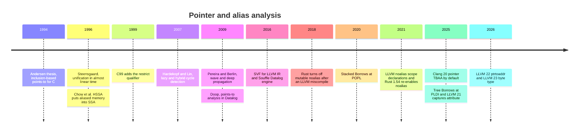
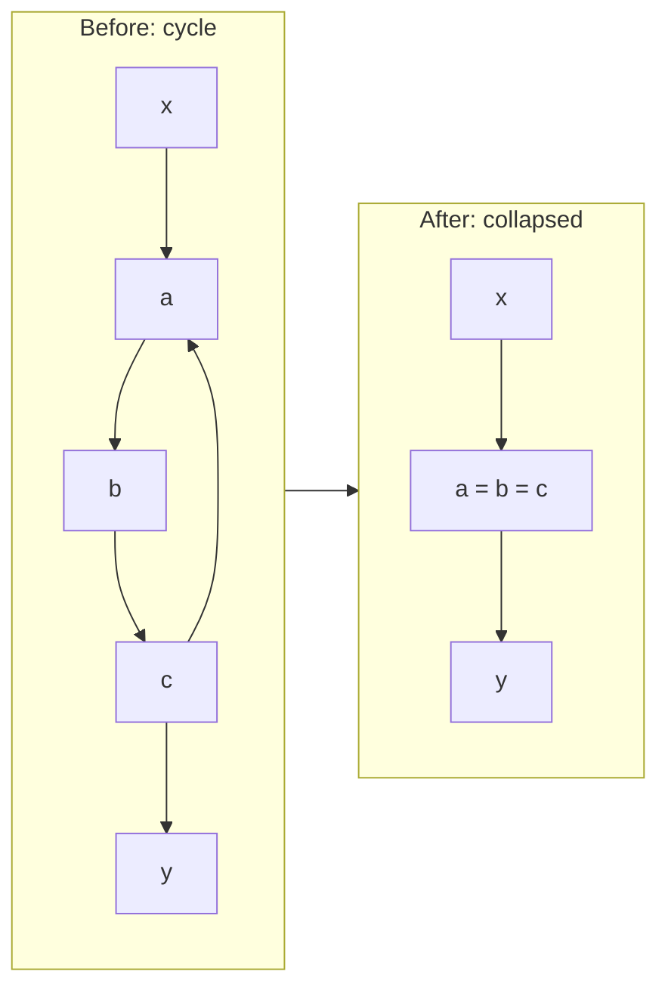
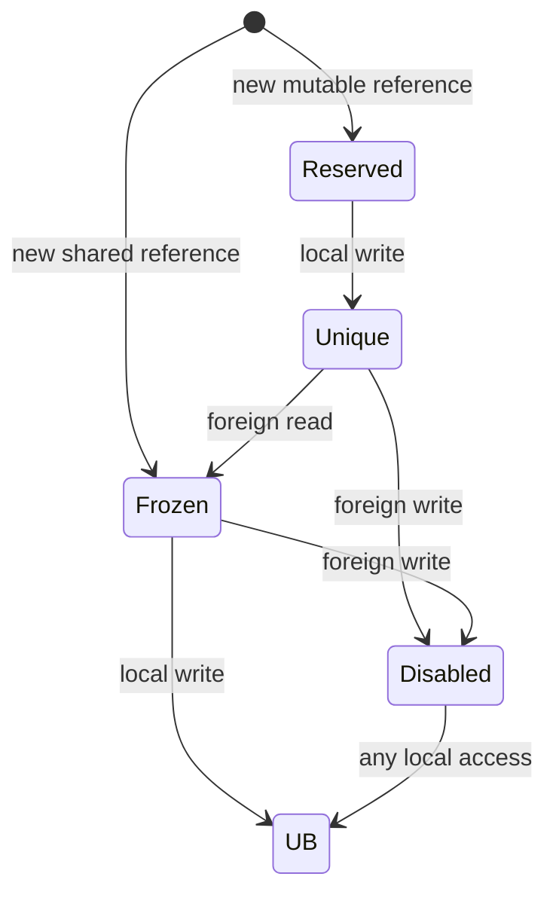

---
tags:
  - compilers
  - pointer-analysis
  - alias-analysis
  - points-to-analysis
  - static-analysis
  - llvm
  - rust
  - type-based-alias-analysis
status: complete
sources:
  - https://llvm.org/docs/AliasAnalysis.html
  - https://llvm.org/doxygen/TypeBasedAliasAnalysis_8cpp_source.html
  - https://reviews.llvm.org/D93039
  - https://releases.llvm.org/20.1.0/tools/clang/docs/ReleaseNotes.html
  - https://releases.llvm.org/21.1.0/docs/ReleaseNotes.html
  - https://releases.llvm.org/23.1.0/docs/ReleaseNotes.html
  - https://www.npopov.com/2026/01/31/This-year-in-LLVM-2025.html
  - https://gcc.gnu.org/onlinedocs/gccint/Alias-analysis.html
  - https://gnu.googlesource.com/gcc/+/refs/heads/master/gcc/tree-ssa-structalias.cc
  - https://cppreference.net/c/language/restrict.html
  - https://accu.org/journals/overload/28/160/anonymous
  - https://blog.llvm.org/2011/05/what-every-c-programmer-should-know.html
  - https://www.cmi.ac.in/~madhavan/courses/program-analysis-2014/papers/andersen-thesis94.pdf
  - https://www.cs.cornell.edu/courses/cs711/2005fa/papers/steensgaard-popl96.pdf
  - https://cs.utexas.edu/~lin/papers/pldi07.pdf
  - https://bibtex.github.io/CGO-2009-PereiraB.html
  - https://homepages.dcc.ufmg.br/%7Efernando/classes/dcc888/ementa/slides/PointerAnalysis.pdf
  - https://bibtex.github.io/CC-1996-ChowCLLS.html
  - https://inst.eecs.berkeley.edu/~cs294-260/sp24/papers/doop.pdf
  - https://souffle-lang.github.io/cav-paper
  - https://yanniss.github.io/choice-oopsla25.pdf
  - https://github.com/SVF-tools/SVF
  - https://arxiv.org/pdf/2512.07299
  - https://arxiv.org/pdf/2508.01974
  - https://arxiv.org/pdf/2608.04466
  - https://arxiv.org/pdf/2602.01720
  - https://www.github.com/rust-lang/rust/issues/54878
  - https://www.github.com/rust-lang/rust/pull/82834
  - https://plv.mpi-sws.org/rustbelt/stacked-borrows/
  - https://iris-project.org/pdfs/2025-pldi-treeborrows.pdf
  - https://pldi25.sigplan.org/details/pldi-2025-papers/42/Tree-Borrows
  - https://www.ralfj.de/blog/2025/07/07/tree-borrows-paper.html
  - https://www.ralfj.de/blog/2025/12/22/miri.html
created: 2026-11-26
updated: 2026-11-26
---

## Table Of Contents

- [[#TL;DR|TL;DR]]
- [[#The Problem|The Problem]]
- [[#Foundations|Foundations]]
    - [[#May, Must and No Alias|May, Must and No Alias]]
    - [[#Points-To Sets and Abstract Objects|Points-To Sets and Abstract Objects]]
    - [[#The Sensitivity Knobs|The Sensitivity Knobs]]
    - [[#Two Consumers, Two Styles|Two Consumers, Two Styles]]
- [[#How We Got Here|How We Got Here]]
- [[#How It Works|How It Works]]
    - [[#Constraints from Pointer Statements|Constraints from Pointer Statements]]
    - [[#Worked Example - Andersen vs Steensgaard|Worked Example - Andersen vs Steensgaard]]
    - [[#Making Andersen Scale - Cycles and Propagation Order|Making Andersen Scale - Cycles and Propagation Order]]
    - [[#Datalog Encodings|Datalog Encodings]]
    - [[#Type-Based Alias Analysis|Type-Based Alias Analysis]]
    - [[#LLVM's Alias Analysis Stack|LLVM's Alias Analysis Stack]]
    - [[#GCC's Points-To|GCC's Points-To]]
    - [[#Rust's &mut as noalias|Rust's &mut as noalias]]
    - [[#Stacked Borrows and Tree Borrows|Stacked Borrows and Tree Borrows]]
- [[#Where It Is Now|Where It Is Now]]
    - [[#Production Compilers|Production Compilers]]
    - [[#Rust's Aliasing Model|Rust's Aliasing Model]]
    - [[#Whole-Program Research|Whole-Program Research]]
- [[#Trade-offs & Open Problems|Trade-offs & Open Problems]]
- [[#Resources|Resources]]
- [[#Related Notes|Related Notes]]

## ***TL;DR***
---
*Alias analysis answers "can these two memory accesses touch the same bytes?" Without a confident "no", an optimizer must keep every load and store in order, so this one question gates load forwarding, LICM, dead store elimination and vectorization.*

- **Four answers.** NoAlias, MustAlias, PartialAlias, MayAlias; only the precise ones unlock rewrites, and MayAlias is always the safe default ([LLVM AA docs](https://llvm.org/docs/AliasAnalysis.html)).
- **Two classic algorithms.** Andersen's inclusion-based points-to (precise, cubic worst case) and Steensgaard's unification (near-linear, merges more); cycle collapsing and wave propagation made Andersen practical on million-line C ([Hardekopf and Lin](https://cs.utexas.edu/~lin/papers/pldi07.pdf); [Pereira and Berlin](https://bibtex.github.io/CGO-2009-PereiraB.html)).
- **Compilers stay local.** LLVM chains cheap analyses (BasicAA, TBAA, ScopedNoAlias, GlobalsAA) behind one interface; GCC adds a per-function field-sensitive inclusion solver. Whole-program points-to lives in SVF, Doop and Soufflé.
- **Language facts beat analysis.** `restrict`, C's strict aliasing rule (as `!tbaa` metadata) and Rust's `&mut` (as `noalias`) give NoAlias answers no analysis could prove; Rust's density of `noalias` exposed LLVM miscompiles and kept it disabled from 2018 to 2021.
- **As of November 2026.** LLVM is refining capture and provenance facts (`captures(...)`, `ptrtoaddr` in LLVM 22, an IR byte type in LLVM 23); Tree Borrows (PLDI 2025) rejects 54% fewer crate tests than Stacked Borrows but Rust's UB rules are still not stabilized; research focuses on sound analysis of incomplete programs (PIP) and faster flow sensitivity.

## ***The Problem***
---
*An optimizer that cannot tell whether two pointers name the same memory must assume they might, and then almost every rewrite involving loads and stores becomes illegal. Alias analysis is the cheap, conservative oracle that answers "can these two accesses overlap?" so passes can keep values in registers, reorder memory operations and vectorize.*

Here is the smallest case. Both functions store 1 through `a`, store 2 through `b`, then read `*a` back:

```c
int f(int *a, int *b) {            int g(int *restrict a, int *restrict b) {
  *a = 1;                            *a = 1;
  *b = 2;                            *b = 2;
  return *a;                         return *a;
}                                  }
```

Real output, `clang -O2 -masm=intel` (Ubuntu clang 18.1.3, x86-64), directives stripped:

```asm
f:                                 g:
  mov dword ptr [rdi], 1             mov dword ptr [rdi], 1
  mov dword ptr [rsi], 2             mov dword ptr [rsi], 2
  mov eax, dword ptr [rdi]  ; reload mov eax, 1               ; constant
  ret                                ret
```

In `f`, a caller may pass the same address twice (`f(&x, &x)` must return 2), so the compiler must reload `*a` after the store through `b`. In `g`, `restrict` (C99) is the programmer's promise that, during each execution of the block, if an object reachable through the pointer is modified, "all accesses to that object (both reads and writes) in that block must occur through" that pointer, "otherwise the behavior is undefined" ([cppreference](https://cppreference.net/c/language/restrict.html)); the compiler forwards the stored 1 straight to the return. GCC 13.3 at `-O2` produces the same two answers (it even moves `mov eax, 1` above the store to `b` in `g`). One reload is cheap; the same doubt applied to a loop body is what stops [[Loop Optimizations|LICM]] from hoisting a load, stops [[Vectorization]] without a runtime overlap check, and stops dead store elimination and [[Classic Optimizations|GVN]] from touching memory.

The questions passes ask fall into two kinds:

| Query | Who asks | Example |
|---|---|---|
| **alias(A, B)**: can memory locations A and B overlap? | DSE, GVN/load forwarding, LICM, scheduling, vectorizer dependence checks | Is the store to `*b` between `*a = 1` and the load of `*a`? |
| **mod/ref(I, L)**: can instruction I read or write location L? | Same passes, for calls and other opaque instructions | Can `printf(...)` change a global the loop keeps in a register? |

Exact answers are undecidable for any language with pointers and loops, so every real analysis is an approximation. The art is being **sound** (never say "no alias" when they can alias, since the optimizer will act on it) while being precise enough to unlock rewrites and cheap enough to run on millions of lines.

## ***Foundations***
---
*Alias analysis rests on a small vocabulary: the four-way alias answer, points-to sets over abstract memory objects, and a handful of "sensitivity" knobs that trade precision for cost. Learn these and every paper and compiler pass in this area reads as a choice of settings.*

### May, Must and No Alias

*An alias query compares two memory locations (pointer plus access size) and returns how sure the analysis is about their overlap.*

- **NoAlias**: the two locations never overlap. This is the answer that enables optimizations.
- **MustAlias**: they always start at the same address. Also useful: a load after a must-alias store can take the stored value directly.
- **MayAlias**: the analysis cannot rule overlap in or out. Every client must treat this as "assume they overlap".
- **PartialAlias** (LLVM's fourth value): they are known to overlap, but not to start at the same address, e.g. a 4-byte access at offset 4 and another at offset 6 into the same buffer.

LLVM's documentation defines them this way: MayAlias "is used whenever the two pointers might refer to the same object", PartialAlias when "the two memory objects are known to be overlapping in some way", and MustAlias only if the two objects "are guaranteed to always start" at the same location. Mod/ref answers are "always conservative: if an instruction might read or write a location, ModRef is returned" ([LLVM Alias Analysis Infrastructure](https://llvm.org/docs/AliasAnalysis.html)).

These form a tiny lattice. MayAlias is the conservative top; NoAlias and MustAlias are the precise, useful answers; combining two analyses means taking the more precise answer when either one is definite.

$$\text{alias}(p, q) = \text{NoAlias} \iff \forall\ \text{executions}:\ [p, p+|p|) \cap [q, q+|q|) = \emptyset$$

**In plain English:** "no alias" is a promise about every possible run: the byte ranges touched by the two accesses never share a byte, so the order of the two accesses cannot matter.

### Points-To Sets and Abstract Objects

*Most whole-program analyses compute, for each pointer variable, the set of abstract memory objects it may point to; alias questions are then answered by intersecting sets.*

A real program creates unboundedly many heap objects, so the analysis names them by an **abstraction**, almost always the *allocation site*: every object created by `malloc` on line 42 is the single abstract object `heap@42`. Globals and stack variables are their own objects. The analysis computes $\mathrm{pts}(p)$, the set of abstract objects `p` may point to, and then:

$$\mathrm{pts}(p) \cap \mathrm{pts}(q) = \emptyset \implies \text{NoAlias}(p, q)$$

**In plain English:** if no object is in both pointers' points-to sets, the pointers can never hold the same address. The converse fails: overlapping sets only mean "may alias", because `heap@42` stands for many concrete objects.

### The Sensitivity Knobs

*Precision comes from distinguishing more things: program points, calling contexts, fields, and heap objects. Each distinction multiplies the state the analysis must track.*

| Knob | Insensitive version | Sensitive version | Cost |
|---|---|---|---|
| **Flow** | One points-to set per variable for the whole program | One set per variable per program point (respects order of statements, kills on strong update) | Sets per point; usually done sparsely on SSA |
| **Context** | One analysis of each function, results merged across all callers | Function analyzed separately per call string (k-CFA) or per receiver object (object sensitivity) | Can blow up exponentially with k |
| **Field** | A struct is one blob: `s.f` and `s.g` alias | Each field is its own sub-object | More objects; C casts and pointer arithmetic complicate it |
| **Heap** | One object for all heap memory | One per allocation site, optionally cloned by context | More objects |

A **strong update** (overwriting a points-to set instead of adding to it) is only sound when the target is exactly one concrete location, which is why flow sensitivity buys less than it seems for heap-heavy code: stores through `p` with $|\mathrm{pts}(p)| > 1$ can only add. For Java, the common choice is *object sensitivity*, where a method's context is the allocation site of its receiver object (plus, in "H" variants, a context for heap objects); recent Doop work, for example, benchmarks a "2objH" analysis ([Antoniadis et al., OOPSLA 2025](https://yanniss.github.io/choice-oopsla25.pdf)).

### Two Consumers, Two Styles

*Compilers want fast, local, always-sound answers inside every function; bug finders and security tools want deep, whole-program answers and can afford minutes.*

LLVM's optimizer mostly uses cheap, local, stateless reasoning plus facts handed down by the language (types, `restrict`, Rust references); GCC adds a per-function inclusion-based points-to solver. Whole-program analyses (Andersen-style, flow-sensitive, Datalog) live in standalone frameworks: SVF for LLVM IR, which advertises field- and flow-sensitive whole-program analysis plus demand-driven flow- and context-sensitive points-to ([SVF](https://github.com/SVF-tools/SVF)), and Doop on Soufflé for Java ([Soufflé](https://souffle-lang.github.io/cav-paper)). Their clients are bug finders, call-graph builders and security tools that can afford minutes. The rest of this note covers both worlds.

## ***How We Got Here***
---
*The field split early into two algorithms (inclusion vs unification), then spent two decades making the precise one fast, while compilers went the other way and leaned on cheap local reasoning plus language-level guarantees.*



| Year | Event | Why it mattered |
|---|---|---|
| 1994 | Lars Ole Andersen's DIKU thesis, *Program Analysis and Specialization for the C Programming Language* ([PDF](https://www.cmi.ac.in/~madhavan/courses/program-analysis-2014/papers/andersen-thesis94.pdf)) | The inclusion-based formulation everyone still calls "Andersen" |
| 1996 | Steensgaard, *Points-to Analysis in Almost Linear Time*, POPL ([PDF](https://www.cs.cornell.edu/courses/cs711/2005fa/papers/steensgaard-popl96.pdf)) | Showed whole-program points-to could be nearly linear by giving up directionality |
| 1996 | Chow et al., HSSA, CC ([citation](https://bibtex.github.io/CC-1996-ChowCLLS.html)) | Memory and aliases enter SSA form, the ancestor of GCC virtual operands and LLVM MemorySSA |
| 1999 | `restrict` in C99 ([cppreference](https://cppreference.net/c/language/restrict.html)) | Programmer-supplied no-alias facts, "intended ... to promote optimization" |
| 2007 | Hardekopf and Lin, PLDI ([PDF](https://cs.utexas.edu/~lin/papers/pldi07.pdf)) | Cycle detection makes Andersen scale past a million lines |
| 2009 | Pereira and Berlin, CGO ([citation](https://bibtex.github.io/CGO-2009-PereiraB.html)); Bravenboer and Smaragdakis, Doop, OOPSLA | Faster propagation orders; declarative, deeply context-sensitive Java analysis |
| 2016 | SVF (CC 2016) ([repo](https://github.com/SVF-tools/SVF)); Soufflé (CAV 2016) | Reusable whole-program pointer analysis for LLVM IR; fast Datalog engine |
| 2018 to 2021 | Rust's mutable `noalias` disabled, then re-enabled for LLVM 12+ ([#54878](https://www.github.com/rust-lang/rust/issues/54878), [#82834](https://www.github.com/rust-lang/rust/pull/82834)) | A language using `noalias` everywhere exposed long-hidden optimizer bugs |
| 2020 | Stacked Borrows, POPL ([project page](https://plv.mpi-sws.org/rustbelt/stacked-borrows/)) | An operational aliasing model for unsafe Rust, checked in an interpreter |
| 2025 | Clang 20 pointer TBAA by default; Tree Borrows at PLDI; LLVM 21 `captures(none)` | Stronger type facts; a more permissive Rust model; finer capture facts |
| 2026 | LLVM 22 `ptrtoaddr`; LLVM 23 IR byte type; Miri paper at POPL 2026 | Groundwork for a precise provenance model ([Popov](https://www.npopov.com/2026/01/31/This-year-in-LLVM-2025.html); [LLVM 23 notes](https://releases.llvm.org/23.1.0/docs/ReleaseNotes.html); [Jung](https://www.ralfj.de/blog/2025/12/22/miri.html)) |

The pattern: research made precise whole-program analysis faster, while production optimizers mostly stayed local and instead got better *inputs*, from `restrict` and TBAA to Rust's borrow rules and capture attributes.

## ***How It Works***
---
*Six mechanisms cover the practical landscape: constraint-based points-to (Andersen and Steensgaard), graph tricks that make Andersen scale, Datalog encodings, type-based rules, LLVM's layered query stack, and language-level guarantees like `restrict` and Rust's `&mut`.*

### Constraints from Pointer Statements

*Every pointer statement in C reduces to one of four constraint forms; points-to analysis is solving that constraint system.*

| Statement | Andersen (inclusion) | Steensgaard (unification) |
|---|---|---|
| `p = &x` (address-of) | $x \in \mathrm{pts}(p)$ | $x$ joins the pointee class of $p$ |
| `p = q` (copy) | $\mathrm{pts}(q) \subseteq \mathrm{pts}(p)$ | pointee class of $p$ = pointee class of $q$ (merge) |
| `p = *q` (load) | $\forall v \in \mathrm{pts}(q):\ \mathrm{pts}(v) \subseteq \mathrm{pts}(p)$ | merge pointee of $p$ with pointee of pointee of $q$ |
| `*p = q` (store) | $\forall v \in \mathrm{pts}(p):\ \mathrm{pts}(q) \subseteq \mathrm{pts}(v)$ | merge pointee of pointee of $p$ with pointee of $q$ |

**In plain English:** Andersen lets information flow one way (a copy `p = q` makes `p` point to everything `q` points to, but not the reverse). Steensgaard treats every assignment as an equation and merges both sides into one equivalence class with union-find, so information flows both ways but each step is nearly constant time.

Load and store constraints are *complex*: which simple subset edges they create depends on the current solution, which is why Andersen is solved iteratively over a growing constraint graph.

### Worked Example - Andersen vs Steensgaard

*The same eight statements, solved both ways, show exactly where unification loses precision.*

```c
int a, b, c;
int *p, *q, *r, *s, *t, **pp;
p = &a;     // a ∈ pts(p)
q = &b;     // b ∈ pts(q)
pp = &p;    // p ∈ pts(pp)
*pp = q;    // store: for v in pts(pp): pts(q) ⊆ pts(v)
r = *pp;    // load:  for v in pts(pp): pts(v) ⊆ pts(r)
s = &c;     // c ∈ pts(s)
t = s;      // pts(s) ⊆ pts(t)
t = q;      // pts(q) ⊆ pts(t)
```

Real output of a 50-line Python solver written for this note (one naive fixed-point loop for Andersen, one union-find for Steensgaard; not a published tool), run on exactly these constraints:

```text
Andersen:                         Steensgaard:
  pts(p)  = ['a', 'b']              pts(p)  = ['a', 'b', 'c']
  pts(q)  = ['b']                   pts(q)  = ['a', 'b', 'c']
  pts(r)  = ['a', 'b']              pts(r)  = ['a', 'b', 'c']
  pts(s)  = ['c']                   pts(s)  = ['a', 'b', 'c']
  pts(t)  = ['b', 'c']              pts(t)  = ['a', 'b', 'c']
  pts(pp) = ['p']                   pts(pp) = ['p']
```

Walk through Andersen: `pts(pp) = {p}`, so the store `*pp = q` adds edge $q \to p$ and `p` gains `b`; the load `r = *pp` adds $p \to r$, so `r` gets `{a, b}`; `t` collects from both `s` and `q`. Steensgaard: the store unifies the pointees of `p` and `q` into one class `{a, b}`; then `t = s` and `t = q` force `s`'s pointee `{c}` into the same class. One shared "landing" variable (`t`) contaminated every pointer, so Steensgaard now says `s` may alias `q`, which Andersen proves false. That is the trade: Andersen's worst case is cubic in program size, Steensgaard's is almost linear (inverse-Ackermann union-find) ([Steensgaard, POPL 1996](https://www.cs.cornell.edu/courses/cs711/2005fa/papers/steensgaard-popl96.pdf); [Hardekopf and Lin, PLDI 2007](https://cs.utexas.edu/~lin/papers/pldi07.pdf)). The [[Dataflow Analysis]] note has a shorter version of this comparison and the original papers' timing numbers.

$$T_{\text{Andersen}} = O(n^3) \qquad T_{\text{Steensgaard}} = O(n\,\alpha(n))$$

**In plain English:** with $n$ constraint-graph nodes, Andersen may have to push up to $n$ objects across up to $n^2$ edges; Steensgaard does a near-constant amount of union-find work per statement ($\alpha$ is the inverse Ackermann function, which grows so slowly it is effectively a small constant). Pereira's course slides give the same two bounds: "The most efficient algorithm that we know about is O(n3)" for inclusion, and union-find in $\alpha(n)$ for Steensgaard ([DCC888](https://homepages.dcc.ufmg.br/%7Efernando/classes/dcc888/ementa/slides/PointerAnalysis.pdf)).

### Making Andersen Scale - Cycles and Propagation Order

*Constraint graphs contain cycles, and every node on a cycle ends up with the same points-to set; collapsing cycles and choosing a good propagation order took Andersen from too slow for large programs to millions of lines.*

The constraint graph has a node per variable and an edge $q \to p$ for each $\mathrm{pts}(q) \subseteq \mathrm{pts}(p)$. If $a \to b \to c \to a$, all three sets must be equal at the fixed point, so they can be merged into one node, saving both memory and repeated propagation.



The hard part is that cycles appear *during* solving, as load and store constraints add edges. The main techniques:

| Technique | Idea | Source |
|---|---|---|
| Static cycle elimination and offline variable substitution | Before solving, collapse cycles already visible among copy edges and merge variables that must end with equal sets | GCC's solver does both ([tree-ssa-structalias.cc](https://gnu.googlesource.com/gcc/+/refs/heads/master/gcc/tree-ssa-structalias.cc)) |
| Lazy cycle detection (LCD) | When an edge joins two nodes whose sets are already equal, search for a cycle from it; collapse on success, mark the edge on failure so the search is not repeated | [Hardekopf and Lin, PLDI 2007](https://cs.utexas.edu/~lin/papers/pldi07.pdf), as described in [Pereira's DCC888 slides](https://homepages.dcc.ufmg.br/%7Efernando/classes/dcc888/ementa/slides/PointerAnalysis.pdf) |
| Hybrid cycle detection (HCD) | Combines an offline pre-pass with cheap online collapsing | Same Hardekopf and Lin paper |
| Wave propagation | Repeat until no new edge: collapse SCCs, sweep nodes in topological order pushing only new facts, then let load/store constraints add edges | [Pereira and Berlin, CGO 2009](https://bibtex.github.io/CGO-2009-PereiraB.html); steps from the DCC888 slides |
| Deep propagation | The same paper's second algorithm (not detailed in the sources read for this note) | Pereira and Berlin, CGO 2009 |
| Selective cycle detection (SCD) | Another cycle-detection variant shipped in SVF as "SCD-ander" | [Gu, Yao and Ren, arXiv 2026](https://arxiv.org/pdf/2608.04466) |

Wave propagation, as Pereira's slides write it:

```text
repeat
  collapse strongly connected components of the constraint graph
  for v in topological order:            # WavePropagation
      new = Pcur(v) - Pold(v);  Pold(v) = Pcur(v)
      for each successor w of v:  Pcur(w) |= new
  for each load/store constraint:        # AddNewEdges
      add the copy edges implied by newly seen points-to facts
until no new edge was added
```

The slides' core observation is that "all the nodes in a cycle always have the same points-to set", so "the key idea to capitalize on cycles is to collapse them, once we find them" ([DCC888](https://homepages.dcc.ufmg.br/%7Efernando/classes/dcc888/ementa/slides/PointerAnalysis.pdf)). Hardekopf and Lin reported that LCD and HCD let inclusion-based analysis handle C programs from 169K to 2.17M lines, as quoted in [[Dataflow Analysis]]. The `Pcur(v) - Pold(v)` step is **difference propagation**: only push the objects that are *new* at a node since its last visit, the same idea as semi-naive evaluation in Datalog. SVF still ships Andersen variants built on these ideas ("DW-ander", Andersen with wave propagation, and "SCD-ander") alongside its flow-sensitive VSFS ([Gu, Yao and Ren](https://arxiv.org/pdf/2608.04466)).

### Datalog Encodings

*Points-to analysis is a set of recursive inclusion rules, which is exactly what Datalog computes; frameworks like Doop and Soufflé let analysis writers state the rules and leave join ordering and indexing to an engine.*

The [[Dataflow Analysis]] note shows Doop's four core rules (allocation, assignment, field load, field store). Two points matter here:

- **Context sensitivity becomes a column.** Adding a context argument to `VarPointsTo(ctx, var, hctx, heap)` and a rule that picks the callee context (call site, receiver object, or type) turns the same rules into a k-call-site or k-object-sensitive analysis. Doop reported being more than 15x faster than the Paddle framework for 1-call-site-sensitive analysis and running deeper contexts Paddle could not ([Bravenboer and Smaragdakis, OOPSLA 2009](https://inst.eecs.berkeley.edu/~cs294-260/sp24/papers/doop.pdf)).
- **Engines and budgets matter.** Soufflé compiles Datalog to parallel C++ and analyzed OpenJDK 7 in under a minute ([Soufflé](https://souffle-lang.github.io/cav-paper)). Recent work bounds how many facts a relation may hold per key to make deep context sensitivity terminate: on Doop with 2objH, Antoniadis et al. report a 23.29x average speedup while reachable application methods fell only from 62.99% to 59.96% ([OOPSLA 2025](https://yanniss.github.io/choice-oopsla25.pdf)). The [[Dataflow Analysis]] note covers incremental Datalog (LADDDER) and FlowLog.

### Type-Based Alias Analysis

*If the language says an object of one type cannot be accessed through an lvalue of an unrelated type, the compiler can answer NoAlias from the types alone, with no points-to analysis at all.*

C's "strict aliasing" rule (C11 6.5p7) says "an object shall have its stored value accessed only by an lvalue expression" of a type compatible with its effective type, a qualified or signed/unsigned variant of it, an aggregate or union containing such a member, or "a character type" ([ACCU Overload 160](https://accu.org/journals/overload/28/160/anonymous)). So an `int*` and a `float*` cannot legally point to the same object, and code that does it (type punning through pointer casts) has [[Undefined Behavior and Compiler Semantics|undefined behavior]].

```c
int h(int *i, float *x) {
  *i = 1;
  *x = 2.0f;
  return *i;
}
```

Real output, Ubuntu clang 18.1.3 at `-O2`, first with the default (strict aliasing on), then with `-fno-strict-aliasing`:

```asm
; default                          ; -fno-strict-aliasing
mov dword ptr [rdi], 1             mov dword ptr [rdi], 1
mov dword ptr [rsi], 1073741824    mov dword ptr [rsi], 1073741824
mov eax, 1                         mov eax, dword ptr [rdi]
ret                                ret
```

(1073741824 is `0x40000000`, the bit pattern of `2.0f`.) Clang communicates the rule to LLVM as `!tbaa` metadata on each access, forming a type tree in which "omnipotent char" sits just below the root and is the parent of the other types (because `char` may alias anything). Real IR from the same compile:

```llvm
store i32 1, ptr %0, align 4, !tbaa !5
store float 2.000000e+00, ptr %1, align 4, !tbaa !9
ret i32 1
!5 = !{!6, !6, i64 0}                  ; access tag: (base type, access type, offset)
!6 = !{!"int", !7, i64 0}               ; "int" is a child of char
!7 = !{!"omnipotent char", !8, i64 0}
!8 = !{!"Simple C/C++ TBAA"}            ; root
!9 = !{!10, !10, i64 0}
!10 = !{!"float", !7, i64 0}
```

LLVM's TBAA source states the rule: "A type is considered to alias all of its descendants and all of its ancestors in the tree"; if neither node is an ancestor of the other, "then we say NoAlias" (`int` and `float` are siblings under `char`, which as their ancestor aliases both). Types in trees with different roots always alias, so mixing front-ends stays conservative. Each access tag is (base type, access type, offset); the base can be a struct type, so `s->x` and `s->y` with the same scalar type can still be separated by offset. An optional flag marks constant memory ([TypeBasedAliasAnalysis.cpp](https://llvm.org/doxygen/TypeBasedAliasAnalysis_8cpp_source.html)). Code that type-puns through pointer casts gets "optimized" into surprises, which is why `-fno-strict-aliasing` exists ([Lattner, 2011](https://blog.llvm.org/2011/05/what-every-c-programmer-should-know.html)).

Clang 20 tightened this: it "now emits distinct type-based alias analysis tags for incompatible pointers by default" (objects of pointer type, such as an `int *` and a `float *`, now get different tags instead of one shared "any pointer" tag), warned that this "may silently change code behavior for code containing strict-aliasing violations", and added `-fno-pointer-tbaa` as the escape hatch. The same release added a sanitizer that "detects violations of C/C++ type-based aliasing rules" ([Clang 20.1.0 release notes](https://releases.llvm.org/20.1.0/tools/clang/docs/ReleaseNotes.html)). GCC's TBAA works on numbered alias sets: "Nodes in different alias sets are not allowed to alias", with each front end supplying its own set function ([GCC internals](https://gcc.gnu.org/onlinedocs/gccint/Alias-analysis.html)).

### LLVM's Alias Analysis Stack

*LLVM does not have one alias analysis; it has a chain of cheap analyses behind one query interface, and a precise answer from any of them is used.*

"Every alias analysis pass chains to another alias analysis implementation"; a query that one analysis cannot answer falls through to the next, and the conservative answer (MayAlias, ModRef) is the default ([LLVM AA docs](https://llvm.org/docs/AliasAnalysis.html)). Which analyses run at `-O2` is visible in the pass manager's log. Real output, `opt -passes='default<O2>' -debug-pass-manager` (LLVM 18.1.3), filtered to alias analyses:

```text
Running analysis: BasicAA on k
Running analysis: GlobalsAA on [module]
Running analysis: ScopedNoAliasAA on k
Running analysis: TypeBasedAA on k
```

| Analysis | What it knows |
|---|---|
| **BasicAA** | "An aggressive local analysis": distinct globals, stack and heap allocations never alias; none alias null; different struct fields and statically different array subscripts don't alias; constant memory; known C library calls; stack allocations that never escape ([docs](https://llvm.org/docs/AliasAnalysis.html)) |
| **TypeBasedAA** | The `!tbaa` type tree described above |
| **ScopedNoAliasAA** | `!alias.scope` / `!noalias` metadata, which keeps `noalias` facts alive after inlining (example below) |
| **GlobalsAA** | "A simple context-sensitive mod/ref and alias analysis for internal global variables" (docs) |
| **SCEV-AA** | Translates queries "into ScalarEvolution queries"; not in the `-O2` list above |

The same docs list the passes that consume these answers: LICM (hoisting, sinking and promoting memory to registers), GVN, MemCpyOpt, DSE, ArgPromotion and ADCE, with MemoryDependenceAnalysis being replaced by MemorySSA.

You can watch BasicAA work with `opt -passes=aa-eval -print-all-alias-modref-info`. Real output (LLVM 18.1.3) on this function:

```llvm
define void @k(ptr %p, ptr noalias %q, i64 %n) {
  %buf = alloca [8 x i32]
  %b1  = getelementptr [8 x i32], ptr %buf, i64 0, i64 1   ; byte offset 4
  %b1x = getelementptr i8, ptr %buf, i64 4                  ; byte offset 4
  %b1h = getelementptr i8, ptr %buf, i64 6                  ; byte offset 6
  %bn  = getelementptr [8 x i32], ptr %buf, i64 0, i64 %n   ; unknown
  ; ... one i32 store through each pointer ...
}
```

```text
  MustAlias:     i32* %b1, i32* %b1x
  PartialAlias:  i32* %b1, i32* %b1h
  MayAlias:      i32* %b1, i32* %bn
  NoAlias:       i32* %b1, i32* %p
  NoAlias:       i32* %p, i32* %q
  ...
  15 Total Alias Queries Performed
  9 no alias responses (60.0%)
  3 may alias responses (20.0%)
  2 partial alias responses (13.3%)
  1 must alias responses (6.6%)
```

Each answer has a reason: same base and same offset gives MustAlias; offsets 4 and 6 with 4-byte accesses overlap by two bytes, giving PartialAlias; an unknown index gives MayAlias; `%buf` is an alloca whose address never escapes, so no argument can point into it; and `%q` is `noalias`. None of this needed a whole-program points-to set.

**Keeping `noalias` through inlining.** A `restrict` or `noalias` argument means nothing once the callee is inlined and the argument boundary disappears, so the inliner turns it into *scopes*. Real output, clang 18 `-O2` on a `restrict` `axpy` helper inlined into a caller with plain pointers (unrolling and vectorization disabled to keep it short):

```c
static inline void axpy(int n, float *restrict y, const float *restrict x) {
  for (int i = 0; i < n; i++) y[i] += 2.0f * x[i];
}
void caller(float *a, float *b) { axpy(4, a, b); }
```

```llvm
tail call void @llvm.experimental.noalias.scope.decl(metadata !5)
tail call void @llvm.experimental.noalias.scope.decl(metadata !8)
%6 = load float, ptr %5, align 4, !tbaa !10, !alias.scope !8, !noalias !5   ; x[i]
%8 = load float, ptr %7, align 4, !tbaa !10, !alias.scope !5, !noalias !8   ; y[i]
store float %9, ptr %7, align 4, !tbaa !10, !alias.scope !5, !noalias !8    ; y[i]
!6 = distinct !{!6, !7, !"axpy: argument 0"}
!9 = distinct !{!9, !7, !"axpy: argument 1"}
```

Accesses through `y` are in scope `!5` and declared not to alias anything in scope `!8`, and vice versa, so ScopedNoAliasAA can still separate them in `caller`. The `llvm.experimental.noalias.scope.decl` intrinsic marks where a scope is declared, so that when code is duplicated (loop unrolling is the documented example), "the associated noalias scope must also be duplicated"; without that, a per-iteration guarantee would wrongly hold across iterations ([D93039](https://reviews.llvm.org/D93039), landed January 2021). That bug class matters for Rust below.

**MemorySSA and attributes.** Clients mostly reach alias analysis through MemorySSA, which threads memory operations into one SSA web of `MemoryDef`/`MemoryUse`/`MemoryPhi` nodes and asks alias queries in a "walker" to skip non-clobbering defs (see [[SSA Form]]). Function and parameter attributes feed the stack too: `noalias`, `readonly`, `writeonly`, and capture facts. LLVM 21 replaced the `nocapture` attribute with `captures(none)` ([LLVM 21.1.0 release notes](https://releases.llvm.org/21.1.0/docs/ReleaseNotes.html)), and capture tracking now distinguishes capturing a pointer's *address* from capturing its *provenance*, since only provenance capture can lead to memory effects the optimizer cannot analyze; alias analysis was changed to check only provenance captures ([Popov, This year in LLVM 2025](https://www.npopov.com/2026/01/31/This-year-in-LLVM-2025.html), paraphrased). Note the difference in the outputs in this note: clang 18 (LLVM 18) prints `nocapture`, rustc 1.97 (LLVM 22.1.6) prints `captures(none)`.

### GCC's Points-To

*GCC, unlike LLVM, runs a real inclusion-based points-to solver inside the optimizer, per function by default, with an interprocedural mode behind `-fipa-pta`.*

GCC's solver lives in `tree-ssa-structalias.cc`. Its header describes generating set constraints from the program and solving them; constraint expressions are DEREF, ADDRESSOF and SCALAR, each with an offset, and every structure field gets its own variable (field sensitivity). Address-of constraints seed solutions, copy constraints become graph edges, solutions propagate along edges until nothing changes, and complex constraints add edges as they fire; before propagation, "we perform static cycle elimination on the constraint graph, as well as off-line variable substitution." It cites Pearce, Kelly and Hankin's field-sensitive analysis and Heintze and Tardieu's CLA ([tree-ssa-structalias.cc](https://gnu.googlesource.com/gcc/+/refs/heads/master/gcc/tree-ssa-structalias.cc)). Solutions are stored per SSA pointer name (`SSA_NAME_PTR_INFO`), along with special sets such as `ESCAPED`, "all memory that has escaped the scope of analysis"; a separate *alias oracle* (`refs_may_alias_p`, `stmt_may_clobber_ref_p`) answers "may these two references alias?" and "may this statement clobber this reference?" ([GCC internals](https://gcc.gnu.org/onlinedocs/gccint/Alias-analysis.html)).

You can watch it with `-fdump-tree-alias`. Real output, GCC 13.3 at `-O2`:

```c
void sink(int *, int *);
int demo(int *q, int k) {
  int a = 0, b = 0, c = 0;
  int *s = &c;
  int *t = k ? s : &b;
  *t = 7;          /* may write b or c, never a */
  sink(&a, q);
  return b + c;
}
```

```text
Collapsing static cycles and doing variable substitution
Building predecessor graph
Detecting pointer and location equivalences
Rewriting constraints and unifying variables
Uniting pointer but not location equivalent variables
Finding indirect cycles
Solving graph
...
ESCAPED = { NULL ESCAPED NONLOCAL a }
q = { NONLOCAL }
k = { NONLOCAL } same as q
iftmp.0_3 = { b c }                 <- t after SSA: the PHI of &b and &c
...
ESCAPED, points-to non-local, points-to NULL, points-to vars: { D.2745 } (escaped)
```

The store `*t = 7` may touch `b` or `c` but never `a`; only `a` escapes into `sink`, so the call cannot clobber `b` or `c`. Flow sensitivity here comes for free from SSA: `t` is a single PHI value, not a variable reassigned over time. The `-fipa-pta` flag requests an interprocedural run of the same machinery (GCC 13 accepts it; its effect is not measured here).

### Rust's &mut as noalias

*Rust's borrow checker guarantees that a live `&mut T` is the only way to reach its target, which is exactly what LLVM's `noalias` means; emitting it was easy, but it took years because it exposed LLVM bugs that C code rarely triggered.*

Real output, rustc 1.97.0 at `-C opt-level=2`:

```rust
pub fn mut_refs(a: &mut i32, b: &mut i32) -> i32 { *a = 1; *b = 2; *a }
pub fn raw_ptrs(a: *mut i32, b: *mut i32) -> i32 { unsafe { *a = 1; *b = 2; *a } }
```

```llvm
define noundef i32 @mut_refs(ptr noalias noundef writeonly align 4 captures(none)
    dereferenceable(4) initializes((0, 4)) %a, ptr noalias noundef writeonly ... %b) {
  store i32 1, ptr %a, align 4
  store i32 2, ptr %b, align 4
  ret i32 1                       ; forwarded, like C's restrict
}
define noundef i32 @raw_ptrs(ptr noundef captures(none) initializes((0, 4)) %a, ...) {
  store i32 1, ptr %a, align 4
  store i32 2, ptr %b, align 4
  %_0 = load i32, ptr %a, align 4 ; must reload: raw pointers may alias
  ret i32 %_0
}
```

Every Rust function with `&mut` arguments is, in effect, a C function with `restrict` on every pointer, a density C code rarely has. That density found bugs:

- **October 2018.** Rust issue #54878 tracked "the undoing of the `-Zmutable-noalias=no` default introduced in #54639 on account of a bug in LLVM", and linked an earlier issue (#31681) with "Deja vu?", a previous round of the same story ([rust-lang/rust#54878](https://www.github.com/rust-lang/rust/issues/54878)).
- **The bug.** A small `copy()` function with `noalias` arguments was inlined into a loop, and the loop was unrolled. The unrolled copies kept the same alias scope IDs, so, as the issue puts it, "LLVM thinks *none* of the `a`'s can alias with *any* of the `b`'s, which is false." It was filed as LLVM PR39282; GCC miscompiled the equivalent C too (GCC bug 87609). A bisect pointed at a 2017 BasicAA change, though the bug may have existed earlier and only been unmasked by it.
- **January 2021.** LLVM gained `llvm.experimental.noalias.scope.decl`, and loop unrolling, loop rotation and the inliner learned to duplicate scopes with it ([D93039](https://reviews.llvm.org/D93039) and related revisions).
- **March 2021.** "Enable mutable noalias for LLVM >= 12" merged, noting "previously known miscompiles have been resolved"; it skips `noalias` for `!Unpin` types "as a heuristic for self-referential structures", and shipped in Rust 1.54. A new miscompile in the mutable-noalias logic (#84958) was linked within two months ([rust-lang/rust#82834](https://www.github.com/rust-lang/rust/pull/82834)).

The lesson for compiler writers: an annotation that is rare in C (`restrict`) can hide bugs for years until a language puts it on every function.

### Stacked Borrows and Tree Borrows

*`noalias` is only sound if `unsafe` Rust is forbidden from breaking it, so Rust needs an operational definition of which pointer uses are allowed; Stacked Borrows and its successor Tree Borrows are candidate definitions, checked dynamically by the Miri interpreter.*

`noalias` on `&mut` is a promise the compiler relies on, but `unsafe` code can create raw pointers and do anything. Rust therefore needs a precise rule for which unsafe pointer uses are undefined behavior (UB), so that the optimizations are sound and programmers know what is allowed.

**Stacked Borrows (POPL 2020).** Jung, Dang, Kang and Dreyer proposed "an operational semantics for memory accesses in Rust" that "declares programs violating it to have *undefined behavior*". They implemented it in an interpreter for Rust, ran large parts of the standard library's tests under it, and proved in Coq that it justifies reordering memory accesses around unknown code and function calls using only intraprocedural reasoning ([Stacked Borrows](https://plv.mpi-sws.org/rustbelt/stacked-borrows/)). Miri, the Rust UB-checking interpreter, still implements it alongside Tree Borrows ([Jung, December 2025](https://www.ralfj.de/blog/2025/12/22/miri.html)). Each memory location keeps a stack of pointer tags; using an older reference invalidates the newer ones above it, so uses must be well nested ([Tree Borrows paper](https://iris-project.org/pdfs/2025-pldi-treeborrows.pdf), section on Stacked Borrows).

**Tree Borrows (PLDI 2025).** Villani, Hostert, Dreyer and Jung replaced the stack with a tree: each new reference is a child of the one it came from, and each node has a per-location state machine ([Tree Borrows paper](https://iris-project.org/pdfs/2025-pldi-treeborrows.pdf)).



An access is *local* to a node if it comes from that node or a descendant, *foreign* if it comes from a parent or cousin. A `&mut` starts *Reserved* (reads are fine), becomes *Unique* on its first write, and is frozen or disabled when someone else touches the memory. Function arguments get *protectors* for the duration of the call, which make some foreign accesses UB outright; that is what licenses optimizations like moving a read across a call to unknown code. The paper fixed three Stacked Borrows pain points: adjacent reads could not be reordered, a reference's type fixed its accessible range (so a pointer from `&mut a[0]` could not reach `a[1]`, surprising C programmers), and two-phase borrows were handled awkwardly.

| | Stacked Borrows | Tree Borrows |
|---|---|---|
| Structure | Stack of tags per location | Tree of tags, state machine per node and location |
| Tests failing with aliasing violations (about 30,000 top crates, 674,748 tests) | 6,568 | 3,023 (54% fewer) |
| Tests passing under SB but failing under TB | n/a | 31, in 12 crates |
| Timeouts | 7 | 431 |
| Proved optimizations | Reordering around unknown code (Coq) | Read deletion across calls, write merging on protected refs, read-read reordering (Rocq, about 32,000 lines) |
| Gives up | Read-read reordering | Inserting writes before the first write; moving the activating write |

Numbers are from the [Tree Borrows paper](https://iris-project.org/pdfs/2025-pldi-treeborrows.pdf), which won a PLDI 2025 distinguished paper award ([Jung's blog](https://www.ralfj.de/blog/2025/07/07/tree-borrows-paper.html)). The authors note the comparison is biased against Tree Borrows, since crate authors had already been fixing code for Stacked Borrows.

## ***Where It Is Now***
---
*As of November 2026: production compilers still rely on fast local alias reasoning plus language facts, with steady work on making those facts richer (capture tracking, pointer TBAA, Rust's aliasing model); whole-program points-to lives in frameworks like SVF and Datalog tools, where the research is about incrementality, demand-driven queries and spending precision selectively.*

### Production Compilers

*The compiler-side story in 2025 and 2026 is richer facts and a firmer memory model, not a new points-to algorithm.*

- **Capture and provenance.** As of November 2026, LLVM distinguishes address captures from provenance captures; alias analysis checks only provenance captures and uses read-only captures, which let rustc mark non-mutable reference arguments as captured read-only, and `!captures` metadata on stores lets Rust say a store captures only read provenance (whether that is valid "depends on an open question in Rust's aliasing model") ([Popov, This year in LLVM 2025](https://www.npopov.com/2026/01/31/This-year-in-LLVM-2025.html), paraphrased).
- **`ptrtoaddr` and the byte type.** LLVM 22 added `ptrtoaddr`, which returns only a pointer's address and "does not expose the provenance of the pointer", unlike `ptrtoint`, whose exposure side effect LLVM currently ignores. A formal specification working group is targeting provenance, with an IR byte type as the prerequisite (same source). LLVM 23's release notes already mention GlobalISel support for "the LLVM IR byte type (`bN`)" ([LLVM 23 notes](https://releases.llvm.org/23.1.0/docs/ReleaseNotes.html)).
- **Lifetime markers.** Lifetime intrinsics may now only be used on allocas and lost their size argument; Popov notes remaining problems because it is hard to tell efficiently whether two allocas' lifetimes overlap ([Popov](https://www.npopov.com/2026/01/31/This-year-in-LLVM-2025.html)).
- **Type-based facts.** Clang 20's pointer TBAA is now the default and a type sanitizer exists to catch violations ([Clang 20 notes](https://releases.llvm.org/20.1.0/tools/clang/docs/ReleaseNotes.html)).
- **GCC** keeps its field-sensitive inclusion solver plus alias oracle and TBAA alias sets ([GCC internals](https://gcc.gnu.org/onlinedocs/gccint/Alias-analysis.html)).

### Rust's Aliasing Model

*Tree Borrows is the leading candidate, but nothing is normative yet.*

Miri, now the subject of a POPL 2026 paper ("Miri: Practical Undefined Behavior Detection for Rust"), implements both models. In late 2025 Tree Borrows gained precise `UnsafeCell` tracking by default, error messages "on par" with Stacked Borrows, and wildcard provenance so it can check integer-to-pointer casts. Ralf Jung is explicit that "Rust has not yet stabilized its definition of Undefined Behavior", so Miri checks today's de-facto UB ([Jung, December 2025](https://www.ralfj.de/blog/2025/12/22/miri.html)). The sources read here do not say which model Miri uses by default as of November 2026.

### Whole-Program Research

*The 2025 and 2026 papers push in three directions: soundness for real (incomplete) programs, faster flow sensitivity, and engineering frameworks.*

| Work | Claim | Status |
|---|---|---|
| **PIP** (Krogstie, Själander, Bahmann, Reissmann) | Andersen-style analysis that is sound for *incomplete* C programs (single files that call unknown code). Implicit pointee tracking makes the solver "15× faster" than combinations of five explicit-pointee techniques; PIP adds 1.9x more; it cuts MayAlias answers by 40% versus BasicAA alone, at an average 1.1 ms per file, which the authors call "practical for production compilers". 51% of pointers end up pointing to external memory | [arXiv, December 2025](https://arxiv.org/pdf/2512.07299) |
| **CG-FSPTA** (Zhang, Cheng, Lei) | Flow-sensitive points-to on a flow-sensitive *constraint graph* instead of the CFG; same points-to results as VSFS, 7.27x average speedup and 33.05% less memory on SPEC CPU 2017 (LLVM 16) | [arXiv, August 2025](https://arxiv.org/pdf/2508.01974) |
| **Offline simplification** (Gu, Yao, Ren) | Run semantics-preserving LLVM optimizations *before* pointer analysis: SVF's Andersen variants average 1.34x to 1.38x faster, up to 3.14x, with precision "largely unchanged" but occasionally worse; found 12 SVF bugs | [arXiv, 2026](https://arxiv.org/pdf/2608.04466) |
| **Phoenix** (Yao, Gu, Shi) | One stable interface over several C/C++ alias analyses; faster than SVF's flow- and context-insensitive analysis on all 28 coreutils programs (up to 2.88x) | [Draft, 2026](https://arxiv.org/pdf/2602.01720) |
| **SVF** | Still the reference framework for LLVM IR; now supports LLVM 22; adds abstract-execution work (OOPSLA 2025, ECOOP 2025) and on-demand slicing (ISSTA 2026) | [GitHub](https://github.com/SVF-tools/SVF) |
| **Bounded Datalog** (Antoniadis et al.) | Caps facts per key to make deep context sensitivity finish | [OOPSLA 2025](https://yanniss.github.io/choice-oopsla25.pdf) |

Demand-driven analysis (answer one query precisely instead of computing every set) and incremental analysis (update after an edit) remain the main routes to precision at IDE or compiler speed: SVF ships demand-driven flow- and context-sensitive points-to, and incremental Datalog solvers like LADDDER are covered in [[Dataflow Analysis]]. The PIP result is the most compiler-relevant: a sound Andersen analysis per translation unit, measured against BasicAA, at millisecond cost.

## ***Trade-offs & Open Problems***
---
*Every alias analysis is a point on a precision, speed and soundness triangle, and the language decides how much the compiler can know without analysis at all.*

| Choice | You gain | You pay |
|---|---|---|
| Steensgaard (unification) | Near-linear time, tiny memory | Merges unrelated pointers through any shared assignment (see the worked example) |
| Andersen (inclusion) | Much more precise points-to sets | Cubic worst case; needs cycle collapsing and good ordering to scale |
| Flow sensitivity | Strong updates, order-aware answers | Per-point state; gains limited where heap stores are weak updates |
| Context sensitivity | Separates callers, essential for Java containers and factories | Possible exponential blow-up; precision must be spent selectively |
| Type-based rules (TBAA) | Free NoAlias answers with no analysis | Breaks code that type-puns; the reason `-fno-strict-aliasing` exists |
| Language guarantees (`restrict`, `&mut`) | Strongest facts, local and cheap | Programmer promise in C (unchecked); in Rust, a formal model is needed for `unsafe` |
| Local stateless AA (BasicAA) | Always fresh, no invalidation, scales to any module | Gives up on anything that needs flow across functions or the heap |

Open problems:

- **Soundness for real programs.** A compiler sees one translation unit at a time, full of calls to unknown code. Classic Andersen assumes the whole program; PIP's finding that 51% of pointers end up pointing to external memory shows how much of a real file is "unknown" ([PIP](https://arxiv.org/pdf/2512.07299)). A compiler cannot use an unsound answer, which is one reason optimizers stay local.
- **Keeping facts alive across transformations.** Inlining and other rewrites destroy the structure (argument boundaries, types) that facts were attached to. Scoped `noalias` metadata exists to carry `restrict` and `&mut` facts through inlining; any new fact source (captures, provenance) needs the same care.
- **Provenance semantics.** Whether two pointers with the same address but different origins can be treated as non-aliasing is a question of the IR's memory model, not of an analysis. LLVM still ignores `ptrtoint`'s exposure side effect and is only now building a formal provenance model ([Popov](https://www.npopov.com/2026/01/31/This-year-in-LLVM-2025.html)); see [[Verified Compilers]] and [[Compiler Testing and Fuzzing]] for how memory-model miscompiles get found.
- **Unsafe code models.** Rust has "not yet stabilized its definition of Undefined Behavior" ([Jung](https://www.ralfj.de/blog/2025/12/22/miri.html)): choosing Stacked Borrows, Tree Borrows or a successor decides which optimizations are legal and which existing `unsafe` code is broken. Tree Borrows' 431 timeouts versus 7 also show that a more permissive model can cost checking time.
- **Cost under change.** Whole-program analysis is too slow to rerun on every edit, which pushes research toward incremental and demand-driven solving; compilers sidestep it by never computing whole-program sets at all.
- **Precision where it matters.** Most alias queries are easy; a few hard ones decide whether a hot loop vectorizes. Spending expensive analysis only on those queries (demand-driven, client-driven or ML-chosen precision, see [[ML-Guided Optimization]]) is an open design space.
- **Abstraction of the heap.** Allocation-site abstraction merges every object created at one site, so it cannot tell two nodes of a linked list apart; richer heap abstractions belong to [[Abstract Interpretation]] and cost far more.
- **Optimizations perturb analysis.** Running LLVM's own optimizations before SVF mostly speeds it up but can lose precision on some programs ([Gu, Yao and Ren](https://arxiv.org/pdf/2608.04466)), a reminder that analysis results depend on IR shape, not only on program meaning.

## ***Resources***
---
*Start with the LLVM alias analysis docs and Pereira's DCC888 slides for the mechanics, read Steensgaard and Hardekopf and Lin for the algorithms, then the Tree Borrows paper for how a language's aliasing rules become optimizer facts.*

**Docs and source**
- [LLVM Alias Analysis Infrastructure](https://llvm.org/docs/AliasAnalysis.html): AliasResult meanings, BasicAA facts, AA chaining, client passes, aa-eval.
- [TypeBasedAliasAnalysis.cpp](https://llvm.org/doxygen/TypeBasedAliasAnalysis_8cpp_source.html): the header comment is the clearest spec of LLVM's TBAA tree and struct-path tags.
- [D93039: llvm.experimental.noalias.scope.decl](https://reviews.llvm.org/D93039): Dobbelaere, 2021; why scopes must be duplicated with code.
- [GCC internals: Alias analysis](https://gcc.gnu.org/onlinedocs/gccint/Alias-analysis.html) and [tree-ssa-structalias.cc](https://gnu.googlesource.com/gcc/+/refs/heads/master/gcc/tree-ssa-structalias.cc): GCC's points-to, alias oracle and TBAA.
- [restrict type qualifier](https://cppreference.net/c/language/restrict.html): cppreference; formal meaning and the optimization example.
- [What is the Strict Aliasing Rule and Why Do We Care?](https://accu.org/journals/overload/28/160/anonymous): ACCU Overload 160; C and C++ aliasing rules with examples.

**Release notes and practitioners**
- [Clang 20.1.0 release notes](https://releases.llvm.org/20.1.0/tools/clang/docs/ReleaseNotes.html): pointer TBAA on by default, type sanitizer.
- [LLVM 21.1.0](https://releases.llvm.org/21.1.0/docs/ReleaseNotes.html) and [LLVM 23.1.0](https://releases.llvm.org/23.1.0/docs/ReleaseNotes.html) release notes: `captures(none)`; IR byte type.
- [This year in LLVM (2025)](https://www.npopov.com/2026/01/31/This-year-in-LLVM-2025.html): Nikita Popov, 2026; capture tracking, `ptrtoaddr`, provenance, lifetime markers.
- [What Every C Programmer Should Know About Undefined Behavior](https://blog.llvm.org/2011/05/what-every-c-programmer-should-know.html): Chris Lattner, 2011; why strict aliasing surprises people.
- [Tree Borrows paper announcement](https://www.ralfj.de/blog/2025/07/07/tree-borrows-paper.html) and [What's new in Miri](https://www.ralfj.de/blog/2025/12/22/miri.html): Ralf Jung, 2025.

**Primary papers**
- [Program Analysis and Specialization for the C Programming Language](https://www.cmi.ac.in/~madhavan/courses/program-analysis-2014/papers/andersen-thesis94.pdf): Andersen, DIKU PhD thesis, 1994.
- [Points-to Analysis in Almost Linear Time](https://www.cs.cornell.edu/courses/cs711/2005fa/papers/steensgaard-popl96.pdf): Steensgaard, POPL 1996.
- [Effective Representation of Aliases and Indirect Memory Operations in SSA Form](https://bibtex.github.io/CC-1996-ChowCLLS.html): Chow et al., CC 1996.
- [The Ant and the Grasshopper](https://cs.utexas.edu/~lin/papers/pldi07.pdf): Hardekopf and Lin, PLDI 2007. Lazy and hybrid cycle detection.
- [Wave Propagation and Deep Propagation for Pointer Analysis](https://bibtex.github.io/CGO-2009-PereiraB.html): Pereira and Berlin, CGO 2009.
- [Strictly Declarative Specification of Sophisticated Points-to Analyses](https://inst.eecs.berkeley.edu/~cs294-260/sp24/papers/doop.pdf): Bravenboer and Smaragdakis, OOPSLA 2009 (Doop).
- [Soufflé: On Synthesis of Program Analyzers](https://souffle-lang.github.io/cav-paper): CAV 2016.
- [Stacked Borrows: An Aliasing Model for Rust](https://plv.mpi-sws.org/rustbelt/stacked-borrows/): Jung, Dang, Kang and Dreyer, POPL 2020.
- [Tree Borrows](https://iris-project.org/pdfs/2025-pldi-treeborrows.pdf): Villani, Hostert, Dreyer and Jung, PLDI 2025 ([conference page](https://pldi25.sigplan.org/details/pldi-2025-papers/42/Tree-Borrows)). Distinguished paper.
- [Universal Scalability in Declarative Program Analysis](https://yanniss.github.io/choice-oopsla25.pdf): Antoniadis et al., OOPSLA 2025.

**Recent preprints and tools**
- [PIP: Making Andersen's Points-to Analysis Sound and Practical for Incomplete C Programs](https://arxiv.org/pdf/2512.07299): Krogstie, Själander, Bahmann and Reissmann, arXiv 2025. The most compiler-relevant recent result.
- [Flow Sensitivity without Control Flow Graph](https://arxiv.org/pdf/2508.01974): Zhang, Cheng and Lei, arXiv 2025.
- [Accelerating C/C++ Pointer Analysis via Compiler-Based Offline Simplifications](https://arxiv.org/pdf/2608.04466): Gu, Yao and Ren, arXiv 2026.
- [Phoenix: A Modular and Versatile Framework for C/C++ Pointer Analysis](https://arxiv.org/pdf/2602.01720): Yao, Gu and Shi, draft 2026.
- [SVF](https://github.com/SVF-tools/SVF): static value-flow analysis framework for LLVM IR (CC 2016 and follow-ups).
- [Rust issue #54878](https://www.github.com/rust-lang/rust/issues/54878) and [PR #82834](https://www.github.com/rust-lang/rust/pull/82834): the mutable-noalias saga.

**Courses**
- [DCC888 Pointer Analysis slides](https://homepages.dcc.ufmg.br/%7Efernando/classes/dcc888/ementa/slides/PointerAnalysis.pdf): Fernando Pereira, UFMG; constraints, cycle detection, wave propagation pseudocode.

## Related Notes

- [[Dataflow Analysis]] — The lattice and fixed-point framework underneath; has the short Andersen vs Steensgaard table and Doop's rules.
- [[SSA Form]] — MemorySSA, HSSA and GCC virtual operands, the main consumers of alias answers.
- [[Abstract Interpretation]] — Heap and pointer abstractions as abstract domains; soundness vocabulary.
- [[Classic Optimizations]] — GVN, DSE and load forwarding, the passes blocked by MayAlias.
- [[Loop Optimizations]] — LICM and dependence analysis need NoAlias to hoist and reorder.
- [[Vectorization]] — `restrict` versus runtime overlap checks.
- [[LLVM]] — Attributes (`noalias`, `captures`) and metadata (`!tbaa`, scopes) as IR features.
- [[Type Systems and Inference]] — Types as alias facts; strict aliasing.
- [[Verified Compilers]] — Memory models and provenance, where alias rules are made precise.
- [[Compiler Testing and Fuzzing]] — How aliasing miscompiles like the Rust noalias bugs are found.
- [[Escape Analysis]] — The capture question from the JIT and allocation side.
- [[Undefined Behavior and Compiler Semantics]] — What UB, poison and provenance let the optimizer assume.
- [[Memory Models and Pointer Provenance]] — The memory model behind NoAlias answers: exposure at casts, `ptrtoaddr`, Tree Borrows and CHERI.
