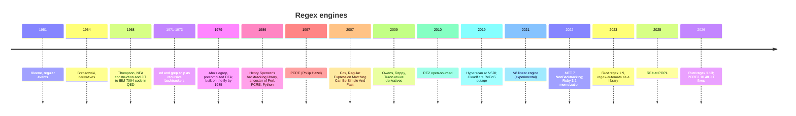
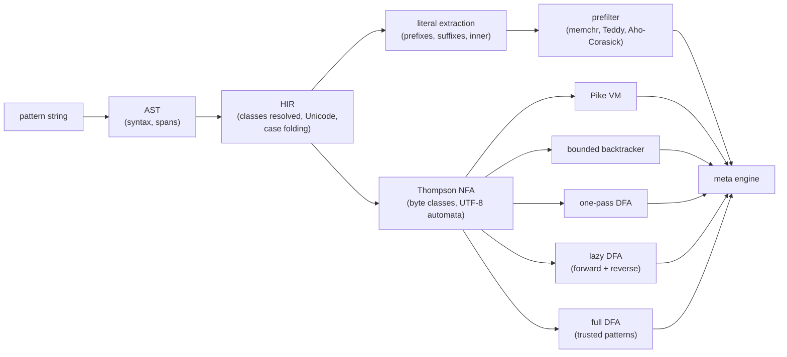
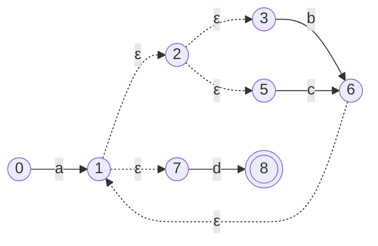
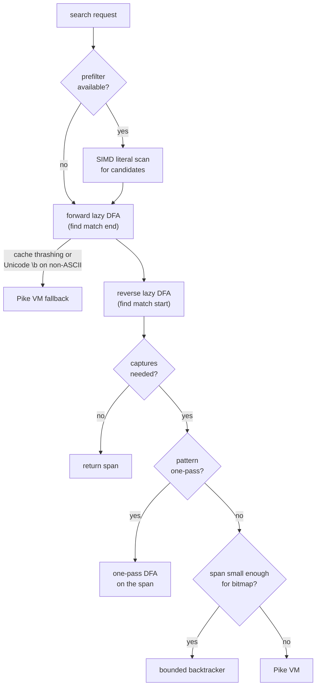

---
tags:
  - compilers
  - regular-expressions
  - automata
  - dfa
  - nfa
  - brzozowski-derivatives
  - redos
  - jit
  - string-matching
status: complete
sources:
  - https://swtch.com/~rsc/regexp/regexp1.html
  - https://swtch.com/~rsc/regexp/regexp3.html
  - https://research.swtch.com/regexp3
  - https://burntsushi.net/regex-internals/
  - https://github.com/rust-lang/regex/blob/master/CHANGELOG.md
  - https://www.khoury.northeastern.edu/home/turon/re-deriv.pdf
  - https://cflmark.nms.kcl.ac.uk/hg/regexp/raw-file/tip/Literature/p481-brzozowski.pdf
  - https://en.wikipedia.org/wiki/Brzozowski_derivative
  - https://en.wikipedia.org/wiki/Regular_expression
  - https://microsoft.com/en-us/research/uploads/prod/2023/04/pldi23main-p249-final.pdf
  - https://devblogs.microsoft.com/dotnet/regular-expression-improvements-in-dotnet-7
  - https://arxiv.org/abs/2407.20479
  - https://docs.rs/crate/resharp/latest
  - https://v8.dev/blog/non-backtracking-regexp
  - https://arxiv.org/html/2311.17620v2
  - https://tc39.es/proposal-linear-matching/
  - https://hacks.mozilla.org/2020/06/a-new-regexp-engine-in-spidermonkey
  - https://pkg.go.dev/regexp
  - https://usenix.org/system/files/nsdi19-wang-xiang.pdf
  - https://pipedot.org/6MPZT
  - https://lists.ipfire.org/development/20240514103956.3559-1-adolf.belka@ipfire.org/t
  - https://blog.cloudflare.com/details-of-the-cloudflare-outage-on-july-2-2019
  - https://bugs.ruby-lang.org/issues/19104
  - https://docs-origin.ruby-lang.org/ja/4.0/method/Regexp/s/linear_time=3f.html
  - https://fservant.github.io/papers/DavisServantLee-SelectiveMemo-IEEE-SP21.pdf
  - https://arxiv.org/html/2606.26678v1
  - https://raw.githubusercontent.com/PCRE2Project/pcre2/master/NEWS
  - https://openwall.com/lists/oss-security/2026/09/04/7
created: 2026-11-26
updated: 2026-11-26
---

## Table Of Contents

- [[#TL;DR|TL;DR]]
- [[#The Problem|The Problem]]
- [[#Foundations|Foundations]]
    - [[#Regular Languages and Automata|Regular Languages and Automata]]
    - [[#NFA vs DFA|NFA vs DFA]]
    - [[#Match Semantics|Match Semantics]]
    - [[#Brzozowski Derivatives|Brzozowski Derivatives]]
    - [[#What Is Not Regular|What Is Not Regular]]
- [[#How We Got Here|How We Got Here]]
- [[#How It Works|How It Works]]
    - [[#The Regex Compiler Pipeline|The Regex Compiler Pipeline]]
    - [[#Worked Example - Thompson NFA as a Program|Worked Example - Thompson NFA as a Program]]
    - [[#Backtracking and Why It Explodes|Backtracking and Why It Explodes]]
    - [[#NFA Simulation and the Pike VM|NFA Simulation and the Pike VM]]
    - [[#The Lazy DFA|The Lazy DFA]]
    - [[#Finding the Start - Reverse DFAs|Finding the Start - Reverse DFAs]]
    - [[#Derivative Engines|Derivative Engines]]
    - [[#Literal Prefilters|Literal Prefilters]]
    - [[#Meta Engines - Picking the Right Matcher|Meta Engines - Picking the Right Matcher]]
    - [[#Memoized Backtracking|Memoized Backtracking]]
- [[#Where It Is Now|Where It Is Now]]
    - [[#Rust regex and regex-automata|Rust regex and regex-automata]]
    - [[#Derivative Engines in Production|Derivative Engines in Production]]
    - [[#JavaScript - Irregexp and Linear Matching|JavaScript - Irregexp and Linear Matching]]
    - [[#PCRE2, Hyperscan and Vectorscan|PCRE2, Hyperscan and Vectorscan]]
- [[#Trade-offs & Open Problems|Trade-offs & Open Problems]]
- [[#Resources|Resources]]
- [[#Related Notes|Related Notes]]

## ***TL;DR***
---
*A regex engine is a small compiler: it parses a pattern, lowers it to an automaton or a bytecode program, optimizes it, and often JIT-compiles it. The one design choice that matters most is whether matching backtracks (fast on typical input, exponential in the worst case) or simulates automata (linear-time guarantee, fewer features).*

- **Two families.** *Backtracking* engines (Perl, PCRE2, Python `re`, Java, JavaScript's Irregexp, .NET's default) try one path at a time and back up on failure; they support backreferences and lookarounds but can take exponential time. *Automata* engines (RE2, Go `regexp`, Rust `regex`, .NET `NonBacktracking`) track every possible position at once and guarantee time linear in the input ([Cox, 2007](https://swtch.com/~rsc/regexp/regexp1.html)).
- **The cost of getting it wrong is real.** Cloudflare's global outage of July 2, 2019 was one WAF rule containing `.*(?:.*=.*)` running on PCRE, which "has no mechanism to protect against a runaway expression"; every HTTP-serving CPU core worldwide was exhausted for 27 minutes ([Cloudflare](https://blog.cloudflare.com/details-of-the-cloudflare-outage-on-july-2-2019)).
- **Modern linear engines are hybrids.** RE2 and Rust's `regex` combine a lazily built DFA (fast, no captures), a Pike VM (captures, slow), a bounded backtracker and a one-pass DFA, plus SIMD literal prefilters, under a "meta" engine that picks the cheapest one per search ([Cox, regexp3](https://swtch.com/~rsc/regexp/regexp3.html); [Gallant, 2023](https://burntsushi.net/regex-internals/)).
- **Derivatives came back.** Brzozowski's 1964 idea (the derivative of a regex by a character is another regex) builds DFA states directly from regexes, handles intersection and complement for free, and now powers .NET 7's `NonBacktracking` engine (PLDI 2023) and the RE# engine (POPL 2025) ([Moseley et al.](https://microsoft.com/en-us/research/uploads/prod/2023/04/pldi23main-p249-final.pdf); [Varatalu et al.](https://arxiv.org/abs/2407.20479)).
- **As of November 2026.** Rust `regex` is at 1.13.1 (July 2026, which fixed unsound reverse-suffix and inner-literal optimizations); RE#'s Rust crate `resharp` reached 0.7.5 in September 2026; JavaScript's linear-matching proposal sits at TC39 Stage 1 while V8 ships an opt-in linear engine; PCRE2 10.48 and 10.49 (Aug to Sep 2026) were largely JIT security fixes; and Hyperscan went proprietary in 2024, leaving the Vectorscan fork as the open-source line ([Rust CHANGELOG](https://github.com/rust-lang/regex/blob/master/CHANGELOG.md); [resharp](https://docs.rs/crate/resharp/latest); [TC39](https://tc39.es/proposal-linear-matching/); [PCRE2 NEWS](https://raw.githubusercontent.com/PCRE2Project/pcre2/master/NEWS)).

## ***The Problem***
---
*Every regex engine has to balance three demands that pull against each other: rich Perl-style features, a worst-case time guarantee, and raw throughput on ordinary input. No engine wins all three, so the choice of algorithm decides which one you give up.*

A regex is a tiny programming language, and the engine is its compiler and runtime. Users want:

| Demand | What it means | What it costs |
|---|---|---|
| **Features** | Capture groups, lazy quantifiers, backreferences `\1`, lookahead and lookbehind, atomic groups, Unicode classes | Backreferences are not regular at all, and matching with them is NP-hard ([Barrière and Pit-Claudel, PLDI 2024](https://arxiv.org/html/2311.17620v2)) |
| **Worst-case guarantee** | Time grows linearly with input, whatever the pattern | Rules out naive backtracking, so the non-regular features must go |
| **Throughput** | Gigabytes per second on logs, source code or packets | Needs DFAs, SIMD literal search and JIT compilation, which cost memory and compile time |

The worst case is not academic. Russ Cox's 2007 benchmark matched `a?ⁿaⁿ` against `aⁿ`: Perl took over sixty seconds at n = 29, while a Thompson NFA took about twenty microseconds; at n = 100 the NFA needs under 200 µs and backtracking would need "over 10¹⁵ years" ([Cox, 2007](https://swtch.com/~rsc/regexp/regexp1.html)). When a pattern or its input comes from an attacker, this becomes **ReDoS** (regular expression denial of service). Cloudflare's 2019 outage, caused by its own rule rather than an attacker, shows how one pattern can take down a global network ([Cloudflare](https://blog.cloudflare.com/details-of-the-cloudflare-outage-on-july-2-2019)).

The compiler framing matters because the same toolbox applies: a front end (regex syntax to an AST), a mid-level [[Intermediate Representations|IR]] (an NFA or a bytecode program), optimizations (literal extraction, byte-class compression, state minimization), and a back end that may [[JIT Compilation|JIT-compile]] the matcher to native code. Lexer generators in [[Lexing and Parsing]] and token masks in [[Grammar-Constrained Decoding]] are this same machinery used offline.

## ***Foundations***
---
*Five ideas cover the theory: regular languages and their automata, the NFA-to-DFA trade, what "the match" even means, Brzozowski derivatives, and where real-world regexes stop being regular.*

### Regular Languages and Automata

*A regular expression is built from characters, concatenation, alternation and repetition, and it describes exactly the languages a finite automaton can recognize.*

Kleene introduced "regular events" in 1951 to describe early neural-network models ([Wikipedia](https://en.wikipedia.org/wiki/Regular_expression)). The core grammar is:

$$
r ::= \varnothing \mid \varepsilon \mid a \mid r_1 r_2 \mid r_1 \,|\, r_2 \mid r^*
$$

*In plain English: a regex is nothing, the empty string, one character, two regexes in sequence, a choice between two, or zero-or-more repeats of one.* Everything else (`+`, `?`, `{m,n}`, `[a-z]`, `\d`) is shorthand for these. Kleene's theorem says these describe exactly the languages that finite automata recognize, which is why an engine can compile any of them into a machine with a fixed number of states.

### NFA vs DFA

*An NFA can be in many states at once and is small; a DFA is in exactly one state and is fast, but can be exponentially larger. Engines trade between them.*

| | NFA (nondeterministic) | DFA (deterministic) |
|---|---|---|
| Built by | Thompson's construction, O(m) states for a pattern of size m | Subset construction from the NFA |
| States | Linear in the pattern | Up to 2^m |
| Work per input byte | Up to O(m): advance every active state | O(1): one table lookup |
| Total match time | O(m·n) | O(n), after up to O(2^m) construction |
| Captures | Possible (Pike VM) | Only match start and end, not submatches |

Sources: [Wikipedia](https://en.wikipedia.org/wiki/Regular_expression); [Gallant, 2023](https://burntsushi.net/regex-internals/).

The blow-up is not theoretical. For "the n-th character from the end is `a`", written `(a|b)*a(a|b){n-1}`, the NFA has about n+2 states but the minimal DFA must remember the last n characters, so it needs 2ⁿ states. That is why production engines rarely build a full DFA up front for untrusted patterns: Gallant warns the fully compiled DFA is "unsafe for untrusted patterns" for exactly this reason ([Gallant, 2023](https://burntsushi.net/regex-internals/)).

### Match Semantics

*"Does it match?" has one answer; "which substring matched, and what did each group capture?" has several, and engines disagree.*

- **Leftmost-first** (Perl, PCRE, Python, JavaScript, Go's default, Rust): among matches starting at the leftmost position, take the one a backtracker would find first, so alternation order matters. `sam|samwise` on `samwise` matches `sam`. Go's docs call this "the same semantics that Perl, Python, and other implementations use" ([Go regexp](https://pkg.go.dev/regexp)).
- **Leftmost-longest** (POSIX, Go's `Longest()`, RE#): take the longest match at the leftmost position, so `sam|samwise` matches `samwise`. Natural for DFAs and lexers; RE#'s README lists it as a deliberate difference from PCRE ([resharp](https://docs.rs/crate/resharp/latest)).
- **Captures** record where each group matched. A DFA only knows "I am in an accepting state"; it does not know which path got there, which is why capture extraction needs a slower engine or extra machinery (tags).

Leftmost-first is a *backtracking* definition, so a linear-time engine has to emulate a backtracker's priorities without backtracking. That emulation is where many engine bugs live (see [[#Trade-offs & Open Problems|Trade-offs & Open Problems]]).

### Brzozowski Derivatives

*The derivative of a regex r by a character a is the regex for "what is left of r after reading a". Taking derivatives character by character is matching; collecting the distinct derivatives is building a DFA.*

Brzozowski's 1964 *J. ACM* paper "Derivatives of Regular Expressions" defined, for a language L, $\partial_a L = \{\, v \mid a v \in L \,\}$ ([Brzozowski, 1964](https://cflmark.nms.kcl.ac.uk/hg/regexp/raw-file/tip/Literature/p481-brzozowski.pdf); [Wikipedia](https://en.wikipedia.org/wiki/Brzozowski_derivative)). It is computed syntactically with a nullability test $\nu$ (does r accept the empty string?):

$$
\begin{aligned}
\partial_a(a) &= \varepsilon & \partial_a(b) &= \varnothing \;(b \ne a) \\
\partial_a(r \,|\, s) &= \partial_a r \,|\, \partial_a s & \partial_a(r^*) &= (\partial_a r)\, r^* \\
\partial_a(r\,s) &= (\partial_a r)\, s \;\big|\; \nu(r)\,\partial_a s & & \\
\partial_a(r \,\&\, s) &= \partial_a r \,\&\, \partial_a s & \partial_a(\neg r) &= \neg(\partial_a r)
\end{aligned}
$$

*In plain English: after reading `a`, a sequence continues with the rest of its first part, or, if the first part could have been empty, with the derivative of the second part. A star unrolls one copy. Intersection and complement just pass the derivative through, which is why derivative engines get them for free.* A string u matches r exactly when $\nu(\partial_u r) = \varepsilon$ ([Owens, Reppy and Turon, JFP 2009](https://www.khoury.northeastern.edu/home/turon/re-deriv.pdf)).

**Worked example.** Let $r = a(b|c)^*d$.

| State (regex) | on `a` | on `b` | on `c` | on `d` | Accepting? |
|---|---|---|---|---|---|
| r0 = `a(b\|c)*d` | r1 | ∅ | ∅ | ∅ | no |
| r1 = `(b\|c)*d` | ∅ | r1 | r1 | r2 | no |
| r2 = ε | ∅ | ∅ | ∅ | ∅ | yes |

The three distinct derivatives (plus the dead state ∅) *are* the minimal DFA. Termination depends on recognizing when two derivatives are "the same": Owens, Reppy and Turon use cheap similarity rules (`r|r ≈ r`, commutativity of `|`, `(r*)* ≈ r*`), and their ml-ulex lexer generator produced the minimal DFA in most tests (194 states vs ml-lex's 324 for a Scheme lexer). They also compute derivatives per *character class* rather than per character, touching only 2 to 4% of the possible derivatives on 7-bit ASCII ([Owens et al.](https://www.khoury.northeastern.edu/home/turon/re-deriv.pdf)).

### What Is Not Regular

*Backreferences make matching NP-hard; lookarounds stay regular in theory but are hard to support in linear time with captures.*

- **Backreferences** (`(a+)b\1`) match "whatever group 1 matched", which no finite automaton can remember. Cox: "regular expressions with backreferences are not regular expressions", and matching with them is NP-complete ([Cox, 2007](https://swtch.com/~rsc/regexp/regexp1.html)).
- **Lookarounds** (`(?=…)`, `(?<=…)`) are regular (they are intersections in disguise), but combining them with captures and leftmost-first priority in linear time was only shown in 2024 ([Barrière and Pit-Claudel](https://arxiv.org/html/2311.17620v2)).
- **Atomic groups and possessive quantifiers** (`(?>…)`, `a*+`) are defined in terms of backtracking ("commit, never retry"), so automata engines usually reject them ([Cox, regexp3](https://swtch.com/~rsc/regexp/regexp3.html); [.NET 7 post](https://devblogs.microsoft.com/dotnet/regular-expression-improvements-in-dotnet-7)).

## ***How We Got Here***
---
*Automata came first, then Unix tools quietly switched to backtracking, Perl turned that into a feature-rich standard, and from 2007 onward the field swung back to automata as ReDoS became a security problem.*



Sources for the timeline: [Wikipedia](https://en.wikipedia.org/wiki/Regular_expression); [Cox, 2007](https://swtch.com/~rsc/regexp/regexp1.html); [Cox, regexp3](https://swtch.com/~rsc/regexp/regexp3.html); [Gallant](https://burntsushi.net/regex-internals/); the papers and changelogs cited below.

- **Thompson knew the fast way and did not ship it.** He described his construction in CACM in 1968 and used it in the QED editor, compiling patterns to IBM 7094 machine code: arguably the first regex JIT. Yet `ed` (1971) and `grep` (1973) used recursive backtracking, tolerable because their syntax was tiny ([Cox, 2007](https://swtch.com/~rsc/regexp/regexp1.html); [Wikipedia](https://en.wikipedia.org/wiki/Regular_expression)).
- **egrep went the other way.** Aho's `egrep` (Seventh Edition Unix, 1979) used a precomputed DFA and by 1985 built it on the fly, the ancestor of today's lazy DFAs. Awk and GNU grep stayed in the automata camp ([Cox, 2007](https://swtch.com/~rsc/regexp/regexp1.html)).
- **Spencer and Perl made backtracking the norm.** Henry Spencer's 1986 library became the basis of Perl's engine and, through PCRE (1997), of Python, PHP and Apache, all backtracking ([Wikipedia](https://en.wikipedia.org/wiki/Regular_expression)). Backreferences, lookarounds and lazy quantifiers followed because a backtracker makes them easy.
- **Code Search forced the return.** Cox built Google Code Search (2006), which accepted regexes from anyone; PCRE's exponential cases made that unsafe, so he wrote RE2, open-sourced in March 2010 with a linear-time guarantee ([Cox, regexp3](https://swtch.com/~rsc/regexp/regexp3.html)). Go's `regexp` and Rust's `regex` follow its design ([Go regexp](https://pkg.go.dev/regexp); [Gallant](https://burntsushi.net/regex-internals/)).
- **ReDoS made it a security topic.** After incidents like Cloudflare's, backtracking engines added mitigations (backtrack limits, memoization, opt-in linear modes) rather than switching wholesale.

## ***How It Works***
---
*Follow one pattern from source to matcher, then look at each engine strategy in turn: backtracking, Pike VM, lazy DFA, reverse DFA, derivatives, prefilters, and the meta engine that chooses among them.*

### The Regex Compiler Pipeline

*Production engines look like small optimizing compilers, with an AST, a high-level IR, an NFA as the central IR, and several back ends.*



This is the structure of Rust's `regex-syntax` and `regex-automata` crates ([Gallant, 2023](https://burntsushi.net/regex-internals/)). Three compiler-style optimizations stand out:

- **Byte classes.** The 256 byte values are partitioned into equivalence classes that no transition distinguishes, shrinking every DFA transition table. This is the same idea as derivative classes and .NET's minterms (see [[#Derivative Engines|Derivative Engines]]).
- **UTF-8 automata.** Unicode classes are compiled to byte-level automata over UTF-8 sequences. Unicode `\w` covers 139,612 code points versus 63 for ASCII; Rust's older compiler produced 3,564 NFA states for `\w`, the 2023 rewrite about 312 by building minimal UTF-8 automata (Daciuk's algorithm) ([Gallant](https://burntsushi.net/regex-internals/)).
- **Literal tries.** An alternation of literals (`foo|foobar|bar`) becomes a trie that still preserves leftmost-first priority, which Gallant calls "the key trick" ([Gallant](https://burntsushi.net/regex-internals/)).

### Worked Example - Thompson NFA as a Program

*Thompson's construction turns each operator into a small NFA fragment with epsilon edges; written as a program, it is bytecode for a tiny VM.*

For `a(b|c)*d`, the NFA as a graph:



The same NFA as a program for a regex VM, in the style Cox uses for the Pike VM (`split x, y` means "try x first, then y"; the order encodes leftmost-first priority):

```text
0: char a
1: split 2, 7      ; loop: another (b|c), or leave
2: split 3, 5      ; b first, then c
3: char b
4: jmp 6
5: char c
6: jmp 1
7: char d
8: match
```

Every engine below runs this one program differently. A backtracker follows one `split` branch and pushes the other on a stack. A Pike VM runs all branches in lockstep. A DFA precomputes which sets of program counters can be live together. Modern compilers also remove the epsilon chains: Rust's rewrite replaces `split` cascades for a class like `[A-Za-z0-9]` with one sparse state that has "zero" epsilon transitions ([Gallant](https://burntsushi.net/regex-internals/)).

### Backtracking and Why It Explodes

*A backtracker explores one path depth-first; when patterns allow many ways to match the same text and the overall match fails, it tries all of them.*

Take `^(a|a)*$` against `aaaa…ab`. Each `a` can be consumed by either branch, and only the final `b` reveals failure. With n `a`s, there are 2ⁿ ways to split them between branches, and a plain backtracker tries every one before giving up. Ruby measured exactly this pattern on `"a" * 28 + "b"`: 8.663 s without protection, 0.310 s with its memoization fix ([Ruby #19104](https://bugs.ruby-lang.org/issues/19104)).

Cloudflare's pattern hit a gentler but still super-linear form. Simplified to `.*.*=.*`, matching `x=x` takes 23 steps, `x=` followed by 20 `x`s takes 555, and adding a trailing semicolon pushes it to 5,353 ([Cloudflare](https://blog.cloudflare.com/details-of-the-cloudflare-outage-on-july-2-2019)). The three `.*` can divide the input among themselves in roughly n² ways, and each split is retried.

Why keep backtracking at all? Because on ordinary patterns it is very fast and simple to JIT. V8's Irregexp compiles each regex to native code (or bytecode), and V8 calls it "orders of magnitude faster than the new engine on most common patterns" ([V8, 2021](https://v8.dev/blog/non-backtracking-regexp)). In .NET 7, on `a.*b` against 1,000 `a`s ending in `b`, the backtracking engine took 43 ns and `NonBacktracking` 5,541 ns; without the `b`, backtracking took 44,889 ns and `NonBacktracking` 5,514 ns ([.NET 7 post](https://devblogs.microsoft.com/dotnet/regular-expression-improvements-in-dotnet-7)). Backtracking wins the common case and loses the bad one.

### NFA Simulation and the Pike VM

*Run every NFA thread in lockstep over the input, one character at a time, deduplicating threads by program counter. Work per character is bounded by the program size.*

The key insight, in Cox's words: "The efficiency comes from tracking the set of reachable states but *not* which paths were used to reach them." An NFA with m states has at most m live states per step, so the whole scan is O(m·n) and reads the input once ([Cox, 2007](https://swtch.com/~rsc/regexp/regexp1.html)).

The **Pike VM** (named for Rob Pike) extends this to captures: each thread carries its own capture registers, and threads are kept in priority order so that, when two reach the same program counter, the higher-priority one wins, reproducing leftmost-first. It is the engine of last resort: it "can never return an error under any circumstances" but is the slowest, because it shuffles many threads and their capture slots per byte ([Gallant](https://burntsushi.net/regex-internals/)).

Two specialized relatives cover common cases faster:

- **Bounded backtracker** (RE2's BitState): a backtracker with a visited bitmap over (program counter, input position), so no pair is explored twice. It is "usually about twice as fast" as the Pike VM but needs memory proportional to pattern × haystack, so it only runs on short inputs; RE2 caps the bitmap at 32 KB ([Gallant](https://burntsushi.net/regex-internals/); [Cox, regexp3](https://swtch.com/~rsc/regexp/regexp3.html)).
- **One-pass DFA**: for patterns where each input byte has only one sensible next step, captures can be tracked with a constant number of instructions per byte. Anchored searches only ([Gallant](https://burntsushi.net/regex-internals/)).

### The Lazy DFA

*Build DFA states only as the input demands them, cache them, and throw the cache away when it gets too big. This gets DFA speed without the exponential up-front cost.*

Each DFA state is a set of NFA states. The lazy (or hybrid) DFA computes a state the first time the input reaches it and stores its outgoing transitions; after warm-up, each byte is one memory lookup ([Cox, 2007](https://swtch.com/~rsc/regexp/regexp1.html)). Awk did a version of this with a 32-state cap.

RE2 treats the state set as a cache with a memory budget: when full, it frees everything and starts over, and "If it must discard the DFA too often, it will fall back on an NFA search" ([Cox, regexp3](https://swtch.com/~rsc/regexp/regexp3.html)). Rust's lazy DFA has the same shape and "lacks the downside of O(2^m) worst case construction", but reports only match boundaries, not captures, and can give up on Unicode word boundaries (`\b`) when it meets non-ASCII text, handing the search to another engine ([Gallant](https://burntsushi.net/regex-internals/)). .NET's `NonBacktracking` also starts as a lazy DFA and "if the graph gets too big, it switches over dynamically to NFA-based processing" ([.NET 7 post](https://devblogs.microsoft.com/dotnet/regular-expression-improvements-in-dotnet-7)).

### Finding the Start - Reverse DFAs

*A forward DFA scan finds where a match ends; compiling the reversed pattern and scanning backward from there finds where it starts.*

A DFA scanning left to right knows when it is in an accepting state, which gives the match *end*. RE2 then compiles a reversed version of the pattern and runs that DFA backward from the end to find the leftmost start ([Cox, regexp3](https://swtch.com/~rsc/regexp/regexp3.html)). Only if captures are needed does a slower engine (one-pass, bounded backtracker or Pike VM) run, and only on the matched span, so most of the input is touched only by the fast DFA. Rust's meta engine does the same: "starts by looking for an overall match using a DFA engine, and then once a match is found, an anchored search is used on only the matched part" ([Gallant](https://burntsushi.net/regex-internals/)).

Reverse scans also power the **reverse suffix** and **reverse inner** optimizations: find a required literal with SIMD, then run a reverse DFA backward from it to find the start. These are subtle enough that Rust `regex` 1.13.1 (July 2026) had to fix "previously unsound reverse suffix and inner optimizations" that could report wrong offsets, though yes/no answers were unaffected ([Rust CHANGELOG](https://github.com/rust-lang/regex/blob/master/CHANGELOG.md)).

### Derivative Engines

*Instead of building an NFA, compute derivatives of the regex itself; each distinct derivative is a DFA state. With symbolic character classes and careful priority rules, this gives linear-time matching with backtracking-compatible results.*

.NET 7's `RegexOptions.NonBacktracking` is the first industrial derivative engine, built from Microsoft Research's Symbolic Regex Matcher (Moseley, Nishio, Perez Rodriguez, Saarikivi, Toub, Veanes, Wan, Xu, PLDI 2023) ([paper](https://microsoft.com/en-us/research/uploads/prod/2023/04/pldi23main-p249-final.pdf)). Its key moves:

1. **Minterms instead of characters.** The engine collects every character predicate in the pattern, splits Unicode into the minimal regions none of them distinguishes (minterms), and maps each input character to a small integer. Derivatives are computed and cached per (anchor context, regex, minterm). This is byte-class compression generalized to Unicode.
2. **Location derivatives.** Anchors like `^` and `\b` depend on the surrounding characters, so derivatives are taken with respect to a *location*, not just a character.
3. **Priority-preserving derivatives.** Alternation is ordered and a pruning step removes alternatives a backtracker would never reach, so results match backtracking semantics "without actually backtracking".
4. **Three phases.** A forward pass finds the match end; a reverse pass on the reversed pattern finds the earliest start; a third pass, only when there are groups, computes captures with tagged derivatives. At most two passes over the input for the match itself.

The authors claim the first industrial regex matcher with a formal correctness proof, and note that cross-engine testing "helped uncover multiple bugs in both implementation and theory" ([Moseley et al.](https://microsoft.com/en-us/research/uploads/prod/2023/04/pldi23main-p249-final.pdf)). It does not support lookarounds, atomic groups, backreferences, balancing groups or conditionals ([.NET 7 post](https://devblogs.microsoft.com/dotnet/regular-expression-improvements-in-dotnet-7)).

**RE#** (Varatalu, Veanes and Ernits, POPL 2025) pushes derivatives further: intersection (`&`), complement (`~`) and lookarounds compiled into the automaton, still non-backtracking, with input-linear matching. On the authors' baseline benchmarks it is "over 71% faster than the next fastest regex engine in Rust", and much faster on the extended benchmarks that use the new operators ([Varatalu et al.](https://arxiv.org/abs/2407.20479); these are the authors' own figures). Intersection makes some patterns dramatically simpler: "a password containing a digit and a letter and no spaces" is three constraints joined with `&` rather than a lookahead tangle.

### Literal Prefilters

*Most regexes contain literal text; finding that text with SIMD and only then running the real engine is often ten times faster than any automaton.*

Gallant notes the gap between literal search and general regex search is often "at least one order of magnitude" ([Gallant](https://burntsushi.net/regex-internals/)). So engines extract literals from the pattern and search for them first:

| Literal set | Algorithm | Notes |
|---|---|---|
| One byte | `memchr` | RE2's original prefix acceleration ([Cox, regexp3](https://swtch.com/~rsc/regexp/regexp3.html)) |
| One string | `memmem`: Two-Way, Rabin-Karp for short needles, SIMD on two "rare" bytes | O(n) worst case, constant space ([Gallant](https://burntsushi.net/regex-internals/)) |
| A few strings | **Teddy**, SIMD multi-substring search "ported out of Hyperscan" | Packed shuffles test many short fingerprints at once ([Gallant](https://burntsushi.net/regex-internals/)) |
| Tens of thousands of strings | Aho-Corasick | Beats a lazy DFA only at very large literal counts ([Gallant](https://burntsushi.net/regex-internals/)) |

A prefilter is a guess: for `foo\w+`, find `foo`, then confirm with the full engine from there. Extraction has to be careful: if literals are too common (Gallant singles out the ASCII space as "unusually common") the prefilter fires constantly and slows things down, so the extractor makes the literal set "inexact" or drops it.

**Hyperscan** (Intel, NSDI 2019) generalizes this into *regex decomposition*: graph analyses of the Glushkov NFA split each pattern into string parts and automaton parts, a SIMD shift-or matcher (FDR) finds the strings, and automata run only around string hits. It uses a DFA when a pattern has at most 16,384 states and a bit-parallel SIMD NFA otherwise. On the Talos ruleset (1,300 regexes) it was 40.1x faster than PCRE, 10.3x faster than RE2 and 2.3x faster than PCRE2 JIT; ported into Snort it raised throughput from 113 to 986 Mbps on a real web trace ([Wang et al., NSDI 2019](https://usenix.org/system/files/nsdi19-wang-xiang.pdf)). It also has a streaming mode for matches that span packets.

### Meta Engines - Picking the Right Matcher

*No single engine is best, so RE2 and Rust compose them: fastest engine that can answer the question, slower ones only on the matched span.*



This is the selection order RE2 describes (DFA first, then OnePass if the pattern qualifies, BitState for small inputs, NFA otherwise) and the overall shape of Rust's meta engine ([Cox, regexp3](https://swtch.com/~rsc/regexp/regexp3.html); [Gallant](https://burntsushi.net/regex-internals/)). Gallant is candid that the real selection logic is "complicated" and hard to predict, which is the price of composing five engines.

RE2's own numbers show the trade: compiling is about 3 to 4x slower than PCRE (14.1 µs vs 5.8 µs), a tiny ambiguous match is slower (2.1 µs vs 0.3 µs), but large searches are much faster and never exponential; each regex costs about 10 KB of memory against PCRE's half a kilobyte ([Cox, regexp3](https://swtch.com/~rsc/regexp/regexp3.html)).

### Memoized Backtracking

*A backtracker that remembers which (state, position) pairs already failed never repeats work, which makes it linear-time without giving up its fast common case.*

Davis, Servant and Lee (IEEE S&P 2021) showed that memoizing only selected NFA states is enough to stop exponential blow-up: either the states with in-degree above one (where paths converge) or the targets of back-edges (loop heads). Selective schemes can use "an order of magnitude" less space than full memoization, and run-length encoding the memo table makes it near-constant for most regexes; lookarounds keep linearity (with an extra factor of |Q|), backreferences do not. They prototyped it in Cox's re1 backtracker ([Davis et al.](https://fservant.github.io/papers/DavisServantLee-SelectiveMemo-IEEE-SP21.pdf)). Ruby 3.2 (December 2022) shipped a cache of visited (position, state) pairs: "the matching time is linear to the input size" for supported patterns, with a table sized by "the product of the number of cache points of regex and input size"; backreferences, lookarounds, atomic groups, absent operators and possessive quantifiers disable it ([Ruby #19104](https://bugs.ruby-lang.org/issues/19104)). Ruby also added [`Regexp.linear_time?`](https://docs-origin.ruby-lang.org/ja/4.0/method/Regexp/s/linear_time=3f.html) so code can check whether a pattern qualifies. A 2026 paper by Berglund, van der Merwe and le Roux picks the memoized states as a minimum feedback vertex set of the NFA, using fewer cache entries than earlier schemes with "negligible impact on matching time", and notes that Java 9 memoizes only top-level loops while Python's `re` memoizes nothing ([Berglund et al., 2026](https://arxiv.org/html/2606.26678v1)).

## ***Where It Is Now***
---
*As of November 2026, linear-time engines are the default in systems languages, derivative engines have reached production, and backtracking engines are hardening themselves with fallbacks and memoization rather than being replaced.*

| Engine | Strategy | Linear-time? | Notable late-2025/2026 state |
|---|---|---|---|
| Rust `regex` | Meta engine over lazy DFA, Pike VM, backtracker, one-pass | Yes | 1.13.0 (Jul 9, 2026) added a `regex!` macro; 1.13.1 (Jul 15) fixed unsound reverse-suffix/inner optimizations |
| RE2 / Go `regexp` | DFA + NFA family | Yes | Go: "guaranteed to run in time linear in the size of the input" |
| .NET | Interpreter, `Compiled` (IL), source generator, `NonBacktracking` | Only `NonBacktracking` | Four engines behind one API |
| RE# (`resharp`) | Symbolic derivatives with `&`, `~`, lookarounds | Yes (hardened mode for `find_all`) | 0.7.5, September 16, 2026 |
| V8 Irregexp / SpiderMonkey | Backtracking, bytecode then native JIT | No (opt-in linear engine) | TC39 linear matching at Stage 1 |
| PCRE2 | Backtracking interpreter + JIT | No | 10.48 (Aug 31) and 10.49 (Sep 28, 2026), JIT security fixes |
| Hyperscan / Vectorscan | Decomposition, SIMD literals, bit-parallel NFA | Yes (no captures) | Hyperscan proprietary from 5.5; Vectorscan is the open fork |

Sources: [Rust CHANGELOG](https://github.com/rust-lang/regex/blob/master/CHANGELOG.md); [Go regexp](https://pkg.go.dev/regexp); [.NET 7 post](https://devblogs.microsoft.com/dotnet/regular-expression-improvements-in-dotnet-7); [resharp](https://docs.rs/crate/resharp/latest); [TC39](https://tc39.es/proposal-linear-matching/); [PCRE2 NEWS](https://raw.githubusercontent.com/PCRE2Project/pcre2/master/NEWS); [IPFire](https://lists.ipfire.org/development/20240514103956.3559-1-adolf.belka@ipfire.org/t).

### Rust regex and regex-automata

*The 2023 rewrite exposed the whole engine stack as a library, which is now the best place to study a production meta engine.*

`regex` 1.9 (July 2023) shipped a rewrite begun in March 2020, with the internals published as the separately versioned `regex-automata` crate; the `regex` crate is now "a thin wrapper around the meta regex engine" ([Gallant](https://burntsushi.net/regex-internals/)). Releases since then are incremental: 1.12.0 (October 2025), a faster compile for huge character classes in 1.12.4 (June 2026), the `regex!` macro for compile-once regexes in 1.13.0, and the 1.13.1 offset-correctness fix ([CHANGELOG](https://github.com/rust-lang/regex/blob/master/CHANGELOG.md)). The 1.13.1 bug is a useful reminder that the optimizations, not the core automata, are where correctness risk sits.

### Derivative Engines in Production

*Derivatives moved from lexer generators into a shipping runtime and then into the fastest research engine.*

.NET exposes four engines behind one `Regex` API: the default interpreter, `RegexOptions.Compiled` (emits pattern-specific IL), the `[GeneratedRegex]` source generator (emits readable C# at build time) and `NonBacktracking`. Microsoft's own pitch for `NonBacktracking` is to be "fast (but not necessarily the fastest) for all cases, especially worst-case"; on `^(\w\d|\w\d){n}$` the backtracking engines took over two and a half minutes at 30 alternations while `NonBacktracking` stayed near 0.1 to 0.17 ms ([.NET 7 post](https://devblogs.microsoft.com/dotnet/regular-expression-improvements-in-dotnet-7)).

RE# now ships as the Rust crate `resharp` (0.7.5, September 2026). Its README is measured: on standard patterns it "matches" `regex` throughput, winning big on some (`.*` at 2.27 GiB/s vs 186.8 MiB/s) and losing on pure literals (`test` at 12.06 vs 17.89 GiB/s). It is leftmost-longest, makes lazy quantifiers a parse error, has no general single-match `find`/`captures` API yet, and fails loudly with an error on capacity limits rather than slowing down ([resharp](https://docs.rs/crate/resharp/latest); single-machine numbers from the project's own script).

### JavaScript - Irregexp and Linear Matching

*Browsers still backtrack, because the language's regex semantics are defined by a backtracking specification; the linear path is opt-in and being standardized slowly.*

V8's Irregexp is shared by Chrome and, since Firefox 78 (2020), by SpiderMonkey through a shim; both interpret a regex as bytecode on first use and JIT it to native code when hot ([Mozilla Hacks](https://hacks.mozilla.org/2020/06/a-new-regexp-engine-in-spidermonkey)). Since V8 8.8 (2021) there is an experimental linear engine, based on the RE2/Rust algorithm, behind flags: an `l` flag that forces it, and a fallback after 50,000 backtracks by default. It rejects backreferences, lookarounds, large bounded repetitions and (at launch) the `u` and `i` flags ([V8, 2021](https://v8.dev/blog/non-backtracking-regexp)).

Barrière and Pit-Claudel (PLDI 2024) found that JavaScript's semantics for nullable quantifiers and capture resets break the textbook NFA simulation, that V8's linear engine "would sometimes return a different result than specified", and that its `e+` expansion was exponential. Three of their fixes (nullable quantifiers, linear `+`, captureless lookbehind) were merged into V8; they also gave the first linear algorithms for lookarounds with captures. In a corpus of 1.5 million real regexes, 5.19% use lookarounds and 26.38% use non-nullable `+` ([Barrière and Pit-Claudel](https://arxiv.org/html/2311.17620v2)). The TC39 Linear Matching proposal (champions Michael Ficarra, Aurèle Barrière, Clément Pit-Claudel) is at **Stage 1**, with "the design space is still very open" and an `l` flag only one option ([TC39](https://tc39.es/proposal-linear-matching/)).

### PCRE2, Hyperscan and Vectorscan

*The backtracking reference implementation keeps evolving and keeps paying a JIT security tax; the fastest multi-pattern engine changed hands.*

- **PCRE2.** 10.47 (October 2025) added a `pcre2_next_match()` iterator and recursion that returns captures; 10.48 (August 31, 2026) fixed several JIT bugs (prefix scanning with repeats, variable-length lookbehind, character advancement on invalid UTF) and moved to Unicode 17; 10.49 (September 28, 2026) was a security-only release for a JIT out-of-bounds write in the growable-stack APIs ([PCRE2 NEWS](https://raw.githubusercontent.com/PCRE2Project/pcre2/master/NEWS); [oss-security](https://openwall.com/lists/oss-security/2026/09/04/7)). A regex JIT is a code generator fed by untrusted input, with the same risk profile as any [[JIT Compilation|JIT]].
- **Hyperscan.** In May 2024 Intel moved Hyperscan "from BSD-licensed open-source software to now the Intel Proprietary License" ([Phoronix via Pipedot](https://pipedot.org/6MPZT)). Distributions such as IPFire replaced it with **Vectorscan**, an open fork that also builds on aarch64 ([IPFire](https://lists.ipfire.org/development/20240514103956.3559-1-adolf.belka@ipfire.org/t)). Its home turf is deep packet inspection, where the NSDI paper evaluated it on Snort and Suricata rulesets.

## ***Trade-offs & Open Problems***
---
*The open problems are about closing the feature gap between linear and backtracking engines, keeping clever optimizations correct, and making ReDoS impossible by default rather than by discipline.*

| Approach | Strength | Weakness |
|---|---|---|
| Backtracking + JIT (Irregexp, PCRE2 JIT) | Fastest on typical patterns; every Perl feature | Exponential worst case; JIT bugs are memory-safety bugs |
| Backtracking + memoization (Ruby 3.2) | Keeps backtracking semantics and speed; linear for most patterns | Memory grows with input × cache points; features like backreferences opt out |
| Lazy DFA meta engine (RE2, Rust) | Linear, fast, SIMD prefilters | No backreferences or lookarounds; complicated engine selection |
| Derivatives (.NET `NonBacktracking`, RE#) | Linear; intersection, complement and (in RE#) lookarounds; proofs | Captures need extra passes; semantics differ (RE# is leftmost-longest, no lazy quantifiers) |
| Hyperscan-style decomposition | Thousands of patterns at line rate | No captures; long compile; license split |

- **Feature gap.** Lookarounds with captures in linear time now have algorithms (PLDI 2024) and an implementation path (RE#), but no mainstream linear engine supports all of them with leftmost-first captures yet. Backreferences will never be linear: they are NP-hard ([Barrière and Pit-Claudel](https://arxiv.org/html/2311.17620v2)).
- **Semantic fidelity.** Linear engines must reproduce priority rules defined by backtracking. V8's linear engine, Rust's reverse optimizations and .NET's derivatives all had correctness bugs found by careful testing or formalization ([Barrière and Pit-Claudel](https://arxiv.org/html/2311.17620v2); [Rust CHANGELOG](https://github.com/rust-lang/regex/blob/master/CHANGELOG.md); [Moseley et al.](https://microsoft.com/en-us/research/uploads/prod/2023/04/pldi23main-p249-final.pdf)). Differential testing across engines is the regex version of [[Compiler Testing and Fuzzing]].
- **Compile time vs match time.** Full DFAs and Hyperscan databases are expensive to build; lazy DFAs shift cost to first use; RE2 compiles 3 to 4x slower than PCRE ([Cox, regexp3](https://swtch.com/~rsc/regexp/regexp3.html)). For one-shot regexes on short strings, a backtracker can be the right engine.
- **Defaults decide security.** Backtracking engines mostly rely on limits (V8's fallback threshold, PCRE2 match limits) or opt-in modes. Cloudflare's own conclusion after its outage was that the "only real solution" was an engine without backtracking, and it moved to RE2 or Rust's engine ([Cloudflare](https://blog.cloudflare.com/details-of-the-cloudflare-outage-on-july-2-2019)). Language-level adoption (TC39 Stage 1) is slow.
- **Unicode cost.** Byte-level automata for Unicode classes are large (hundreds of NFA states for `\w`), and Unicode word boundaries force lazy DFAs to bail out on non-ASCII text ([Gallant](https://burntsushi.net/regex-internals/)).
- **Regexes as a compilation target.** [[Grammar-Constrained Decoding]] engines compile regexes and grammars into token masks over LLM vocabularies, with derivative-based lexers (llguidance's `derivre`); regex compilation speed now matters at LLM serving time.

## ***Resources***
---
*Read Cox's three articles first, then Gallant's regex-internals post; Owens, Reppy and Turon for derivatives; Moseley et al. and RE# for the modern derivative engines.*

**Foundational articles and papers**
- [Regular Expression Matching Can Be Simple And Fast](https://swtch.com/~rsc/regexp/regexp1.html): Russ Cox, January 2007. Thompson NFA vs backtracking, with the history.
- [Regular Expression Matching in the Wild](https://swtch.com/~rsc/regexp/regexp3.html): Russ Cox, March 2010. RE2's engines and how it picks among them.
- [Derivatives of Regular Expressions](https://cflmark.nms.kcl.ac.uk/hg/regexp/raw-file/tip/Literature/p481-brzozowski.pdf): Janusz Brzozowski, J. ACM, 1964.
- [Regular-expression derivatives re-examined](https://www.khoury.northeastern.edu/home/turon/re-deriv.pdf): Owens, Reppy and Turon, JFP 2009. Practical derivative-based DFA construction.

**Modern engines**
- [Regex engine internals as a library](https://burntsushi.net/regex-internals/): Andrew Gallant, July 2023. The Rust meta engine, NFA compiler and prefilters.
- [Derivative Based Nonbacktracking Real-World Regex Matching with Backtracking Semantics](https://microsoft.com/en-us/research/uploads/prod/2023/04/pldi23main-p249-final.pdf): Moseley et al., PLDI 2023. .NET's `NonBacktracking`.
- [RE#: High Performance Derivative-Based Regex Matching with Intersection, Complement and Lookarounds](https://arxiv.org/abs/2407.20479): Varatalu, Veanes and Ernits, POPL 2025; crate at [docs.rs/resharp](https://docs.rs/crate/resharp/latest).
- [Linear Matching of JavaScript Regular Expressions](https://arxiv.org/html/2311.17620v2): Barrière and Pit-Claudel, PLDI 2024.
- [Hyperscan: A Fast Multi-pattern Regex Matcher for Modern CPUs](https://usenix.org/system/files/nsdi19-wang-xiang.pdf): Wang et al., NSDI 2019.

**Engineering posts and docs**
- [An additional non-backtracking RegExp engine](https://v8.dev/blog/non-backtracking-regexp): Martin Bidlingmaier, V8 blog, January 2021.
- [Regular Expression Improvements in .NET 7](https://devblogs.microsoft.com/dotnet/regular-expression-improvements-in-dotnet-7): Stephen Toub, May 2022. The four .NET engines.
- [A New RegExp Engine in SpiderMonkey](https://hacks.mozilla.org/2020/06/a-new-regexp-engine-in-spidermonkey): Iain Ireland, Mozilla Hacks, June 2020.
- [Go regexp package docs](https://pkg.go.dev/regexp): linear-time guarantee, leftmost-first vs `Longest`.
- [Rust regex CHANGELOG](https://github.com/rust-lang/regex/blob/master/CHANGELOG.md) and [PCRE2 NEWS](https://raw.githubusercontent.com/PCRE2Project/pcre2/master/NEWS): current release state.

**ReDoS**
- [Details of the Cloudflare outage on July 2, 2019](https://blog.cloudflare.com/details-of-the-cloudflare-outage-on-july-2-2019): Cloudflare blog. The canonical case study.
- [Using Selective Memoization to Defeat ReDoS](https://fservant.github.io/papers/DavisServantLee-SelectiveMemo-IEEE-SP21.pdf): Davis, Servant and Lee, IEEE S&P 2021.
- [Ruby Feature #19104](https://bugs.ruby-lang.org/issues/19104): cache-based optimization in Ruby 3.2, with benchmarks.
- [Selective Memoization for Efficient Backtracking Regular Expression Matching](https://arxiv.org/html/2606.26678v1): Berglund, van der Merwe and le Roux, 2026.
- [TC39 Linear Matching proposal](https://tc39.es/proposal-linear-matching/): Stage 1.

**Background**
- [Regular expression](https://en.wikipedia.org/wiki/Regular_expression) and [Brzozowski derivative](https://en.wikipedia.org/wiki/Brzozowski_derivative): Wikipedia. History and algorithm families.

## Related Notes

- [[Lexing and Parsing]] — Lexer generators are offline regex engines: regex to NFA to minimized DFA.
- [[Grammar-Constrained Decoding]] — Compiles regexes and grammars to token masks; Outlines' FSM index and llguidance's derivative lexer.
- [[JIT Compilation]] — Irregexp, PCRE2 JIT and .NET `Compiled` are run-time specializers for one pattern.
- [[Intermediate Representations]] — The Thompson NFA is the regex compiler's central IR; HIR sits above it.
- [[Compiler Pipeline]] — The parse, lower, optimize, emit structure regex engines reuse.
- [[Classic Optimizations]] — Literal extraction and byte-class compression are regex-specific analogs of constant propagation and strength reduction.
- [[Vectorization]] — SIMD literal search (Teddy, FDR) is where most regex throughput comes from.
- [[Compiler Testing and Fuzzing]] — Differential testing across regex engines found bugs in .NET, V8 and Rust.
- [[Verified Compilers]] — .NET's derivative engine is the first industrial matcher with a formal correctness proof.
- [[Program Synthesis]] — FlashFill-style string synthesis targets regex-like token languages.
- [[Software Fault Isolation]] — Regex JITs compile untrusted input to machine code, the same threat model SFI addresses.
- [[Partial Evaluation and Self-Specializing Interpreters]] — A compiled regex is the interpreter specialized to one pattern.
