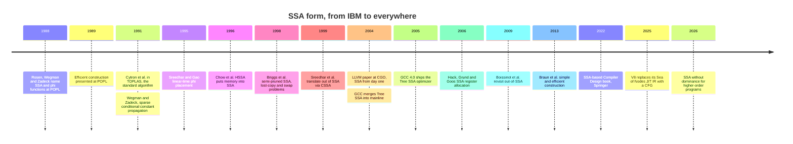
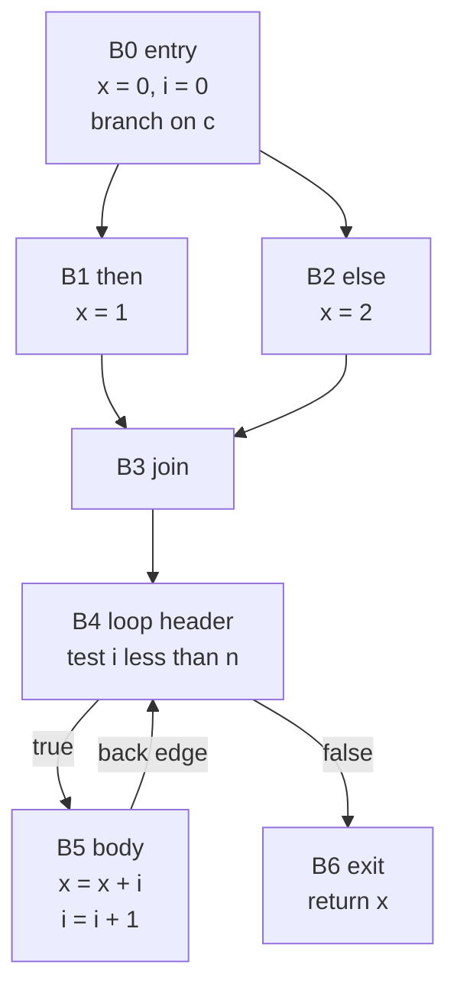

---
tags:
  - compilers
  - ssa
  - intermediate-representation
  - dataflow-analysis
  - register-allocation
  - compiler-foundations
status: complete
sources:
  - https://bernsteinbear.com/assets/img/cytron-ssa.pdf
  - https://bernsteinbear.com/assets/img/zadeck-gvn.pdf
  - https://bernsteinbear.com/assets/img/braun13cc.pdf
  - https://compilers.cs.uni-saarland.de/projects/ssaconstr/
  - https://web.eecs.umich.edu/~mahlke/courses/583f23/reading/briggs_spe_98.pdf
  - https://bibtex.github.io/SAS-1999-SreedharJGS.html
  - https://bernsteinbear.com/assets/img/boissinot-out-ssa.pdf
  - https://bernsteinbear.com/assets/img/ra-programs-ssa.pdf
  - https://compilers.cs.uni-saarland.de/projects/ssara/
  - https://link.springer.com/doi/10.1007/11688839_20
  - https://bibtex.github.io/CC-1996-ChowCLLS.html
  - https://llvm.org/docs/MemorySSA.html
  - https://gcc.gnu.org/onlinedocs/gccint/SSA-Operands.html
  - https://reviews.llvm.org/rL235406
  - https://www.cs.tufts.edu/comp/150FP/archive/keith-cooper/dom14.pdf
  - https://www.cs.utexas.edu/~pingali/CS380C/2007fa/papers/ssa.pdf
  - https://cs.brown.edu/research/pubs/techreports/reports/CS-91-22.html
  - https://www.cs.cornell.edu/courses/cs6120/2025fa/lesson/6/
  - https://www.cs.cornell.edu/courses/cs6120/2025sp/blog/efficient-ssa/
  - https://www.cs.princeton.edu/courses/archive/spring26/cos320/lectures/ssa.pdf
  - https://bernsteinbear.com/blog/ssa/
  - https://en.wikipedia.org/wiki/SSA_form
  - https://gcc.gnu.org/projects/tree-ssa/index.html
  - https://gcc.gnu.org/gcc-4.0/changes.html
  - https://llvm.org/pubs/2004-01-30-CGO-LLVM.html
  - https://mlir.llvm.org/docs/Rationale/Rationale/
  - https://cocalc.com/github/bytecodealliance/wasmtime/blob/main/cranelift/docs/ir.md
  - https://docs.rs/crate/cranelift-frontend/latest/source/src/ssa.rs
  - https://bytecodealliance.github.io/zulip-archive/stream/206238-general/topic/Why.20block.20parameters.20instead.20of.20phi.20nodes.20for.20SSA.20IR.3F.html
  - https://www.llvm.org/devmtg/2023-10/slides/techtalks/Degioanni-GeneralizedMem2RegForMLIR.pdf
  - https://gist.github.com/pizlonator/cf1e72b8600b1437dda8153ea3fdb963
  - https://www.dcs.gla.ac.uk/~jsinger/ssa16_bib.html
  - https://dspace.mit.edu/handle/1721.1/86578
  - https://link.springer.com/book/9783030805142
  - https://v8.dev/blog/leaving-the-sea-of-nodes
  - https://arxiv.org/pdf/2604.09961
  - https://arxiv.org/pdf/2606.26977
  - https://www.isa-afp.org/browser_info/current/AFP/Formal_SSA/outline.pdf
  - https://www.isa-afp.org/browser_info/current/AFP/Minimal_SSA/outline.pdf
created: 2026-11-26
updated: 2026-11-26
---

## Table Of Contents

- [[#TL;DR|TL;DR]]
- [[#The Problem|The Problem]]
- [[#Foundations|Foundations]]
    - [[#One Name, One Definition|One Name, One Definition]]
    - [[#Phi Functions and What They Mean|Phi Functions and What They Mean]]
    - [[#Dominance and the Dominator Tree|Dominance and the Dominator Tree]]
    - [[#Dominance Frontiers|Dominance Frontiers]]
    - [[#Why Sparse Beats Dense|Why Sparse Beats Dense]]
- [[#How We Got Here|How We Got Here]]
- [[#How It Works|How It Works]]
    - [[#Cytron Construction Step by Step|Cytron Construction Step by Step]]
    - [[#Minimal, Semi-Pruned and Pruned|Minimal, Semi-Pruned and Pruned]]
    - [[#Worked Example|Worked Example]]
    - [[#Braun On-the-Fly Construction|Braun On-the-Fly Construction]]
    - [[#Memory SSA|Memory SSA]]
    - [[#Getting Out of SSA|Getting Out of SSA]]
    - [[#SSA and Register Allocation|SSA and Register Allocation]]
    - [[#Block Arguments Instead of Phi|Block Arguments Instead of Phi]]
    - [[#Gated SSA and SSI|Gated SSA and SSI]]
- [[#Where It Is Now|Where It Is Now]]
    - [[#The Reference Book|The Reference Book]]
    - [[#Production Compilers|Production Compilers]]
    - [[#Recent Research|Recent Research]]
- [[#Trade-offs & Open Problems|Trade-offs & Open Problems]]
- [[#Resources|Resources]]
- [[#Related Notes|Related Notes]]

## ***TL;DR***
---
*Static single assignment (SSA) form is an [[Intermediate Representations|IR]] discipline where every variable has exactly one definition in the program text. Wherever control flow merges two versions of a variable, a φ (phi) function picks the right one. Almost every serious optimizing compiler since the mid-2000s runs its middle end on SSA.*

- **The rule.** Each name is assigned once, statically. A statement inside a loop still runs many times; "static" means one assignment *site*, not one execution ([Cornell CS 6120](https://www.cs.cornell.edu/courses/cs6120/2025fa/lesson/6/)).
- **Why it pays.** With one definition per name, the use-def chain is the name itself, so analyses can follow data flow directly instead of iterating over every block. This is what makes *sparse* analyses such as sparse conditional constant propagation and global value numbering cheap ([[Dataflow Analysis]], [[Classic Optimizations]]).
- **Where φs go.** At the *iterated dominance frontier* of the blocks that assign a variable, a result proven by Cytron et al. in their 1991 TOPLAS paper, the standard construction ([Cytron et al., 1991](https://bernsteinbear.com/assets/img/cytron-ssa.pdf)).
- **Two ways to build it.** Cytron's two-phase algorithm on an existing CFG (dominators, frontiers, φ insertion, renaming), or Braun et al.'s 2013 on-the-fly algorithm that builds SSA straight from an AST or bytecode with no dominance computation, used by Cranelift and libFirm ([Braun et al., CC 2013](https://bernsteinbear.com/assets/img/braun13cc.pdf)).
- **Getting out is the hard part.** Turning φs back into copies naively breaks after optimization (the *lost-copy* and *swap* problems); correct translation goes through *conventional SSA* and parallel copies ([Boissinot et al., CGO 2009](https://bernsteinbear.com/assets/img/boissinot-out-ssa.pdf)).
- **A bonus for [[Register Allocation]].** Interference graphs of SSA programs are *chordal*, so they can be colored optimally in polynomial time ([Hack, Grund and Goos, CC 2006](https://bernsteinbear.com/assets/img/ra-programs-ssa.pdf)).
- **Modern spelling.** [[MLIR]], Cranelift and Swift SIL replace φ instructions with *block arguments*: values passed along each branch like function arguments ([MLIR Rationale](https://mlir.llvm.org/docs/Rationale/Rationale/)).

## ***The Problem***
---
*In ordinary code a variable like `x` is a mutable box that can be written in many places. Every analysis must first work out which write a given read sees, and that question gets expensive and imprecise as programs grow.*

Consider a variable `x` assigned in two branches and read after the join, and again in a loop. To optimize a read of `x`, a compiler needs the set of *reaching definitions*: which assignments might have produced the value. In classic [[Dataflow Analysis]] that is a dense, iterative problem: compute a set for every block, for every variable, until nothing changes.

Three things go wrong:

- **Def-use chains blow up.** If $D$ definitions of `x` can all reach $U$ uses through a join, explicit def-use chains need $D \times U$ edges. SSA puts one φ at the join: $D$ edges in, one value out to $U$ uses.
- **Names mean different things in different places.** `x` at line 3 and `x` at line 30 may hold unrelated values. Optimizations like value numbering want "same name, same value", which mutable variables cannot promise.
- **Dense analyses waste work.** A constant-propagation fact about `x` is carried through every block, even blocks that never mention `x`.

SSA fixes all three by splitting each variable into versions, one per assignment, and making merges explicit. Wegman and Zadeck's sparse conditional constant propagation, for example, was presented as an SSA-based algorithm in 1991 ([Wegman and Zadeck, 1991](https://cs.brown.edu/research/pubs/techreports/reports/CS-91-22.html)).

## ***Foundations***
---
*Five ideas carry the whole topic: single definitions, φ semantics, dominance, dominance frontiers, and the sparse-versus-dense distinction. Everything else is an algorithm for one of these.*

### One Name, One Definition

*Rename every assignment to a fresh version, and each use names exactly the definition it reads.*

```c
// before                     // after (straight-line, no phi needed)
a = 4;                        a1 = 4;
b = a + 1;                    b1 = a1 + 1;
a = b * 2;                    a2 = b1 * 2;
use(a, b);                    use(a2, b1);
```

Cornell's CS 6120 sums up the SSA view: definitions are variables, instructions are values, and arguments are data-flow edges. In [[LLVM]] an instruction's operand *is* a pointer to its defining instruction ([Cornell CS 6120](https://www.cs.cornell.edu/courses/cs6120/2025fa/lesson/6/)).

A *strict* SSA program also requires that every definition dominates all its uses ([Hack et al.](https://bernsteinbear.com/assets/img/ra-programs-ssa.pdf)). Cranelift states the same rule: "every value is defined exactly once, and every use of a value must be dominated by the definition" ([Cranelift IR reference](https://cocalc.com/github/bytecodealliance/wasmtime/blob/main/cranelift/docs/ir.md)).

### Phi Functions and What They Mean

*A φ at the top of a join block selects the value that arrived along the edge actually taken.*

```llvm
merge:
  %x3 = phi i32 [ %x1, %then ], [ %x2, %else ]
```

The semantics are subtle in two ways:

1. **The read happens on the edge, not in the block.** Operand `%x1` is conceptually read at the end of `%then`. That's why φ operands are paired with predecessor blocks.
2. **All φs in a block execute at once.** They behave like one *parallel copy* per incoming edge: every source is read before any destination is written ([Hack et al.](https://bernsteinbear.com/assets/img/ra-programs-ssa.pdf); [Briggs et al., 1998](https://web.eecs.umich.edu/~mahlke/courses/583f23/reading/briggs_spe_98.pdf)). MLIR's designers call this atomic execution "surprising and super confusing to compiler engineers" ([MLIR Rationale](https://mlir.llvm.org/docs/Rationale/Rationale/)).

The name: Rosen picked "Φ-function" as a more publishable form of "phony function" ([Wikipedia, SSA form](https://en.wikipedia.org/wiki/SSA_form)).

### Dominance and the Dominator Tree

*Block d dominates block n if every path from entry to n goes through d. Dominance tells you where a definition is guaranteed to be available.*

- **Dominates:** every path from the start to n passes through d; every block dominates itself.
- **Strictly dominates:** d dominates n and d ≠ n.
- **Immediate dominator (idom):** the closest strict dominator. Linking each block to its idom gives the *dominator tree* ([Princeton COS 320, 2026](https://www.cs.princeton.edu/courses/archive/spring26/cos320/lectures/ssa.pdf)).

Dominators are the solution of a simple dataflow equation:

$$
\mathrm{Dom}(\text{entry}) = \{\text{entry}\}, \qquad
\mathrm{Dom}(n) = \{n\} \;\cup \bigcap_{p \,\in\, \mathrm{pred}(n)} \mathrm{Dom}(p)
$$

**In plain English:** a block's dominators are itself plus whatever dominates *all* of its predecessors. Iterate until nothing changes. Cooper, Harvey and Kennedy's "simple, fast" algorithm solves this iteratively over a dominator-tree array with very little code ([Cooper, Harvey and Kennedy](https://www.cs.tufts.edu/comp/150FP/archive/keith-cooper/dom14.pdf)).

### Dominance Frontiers

*The dominance frontier of X is where X's dominance stops: the first blocks reachable from X that X does not strictly dominate. Those are exactly the merge points where another definition might compete.*

$$
DF(X) = \{\, Y \;\mid\; \exists P \in \mathrm{pred}(Y):\ X \text{ dom } P \ \wedge\ \neg (X \text{ sdom } Y) \,\}
$$

**In plain English:** Y is on X's frontier if X dominates one of Y's predecessors but does not strictly dominate Y itself. A definition in X "leaks" into Y alongside values from paths that skip X, so Y needs a φ ([Cytron et al.](https://bernsteinbear.com/assets/img/cytron-ssa.pdf)).

Placing a φ in Y is itself a new definition, which can require more φs further on. Hence the *iterated* frontier:

$$
DF_1 = DF(S), \qquad DF_{i+1} = DF(S \cup DF_i), \qquad DF^+(S) = \lim_{i\to\infty} DF_i
$$

**In plain English:** keep adding frontier blocks of everything you've placed so far until the set stops growing. Cytron's Theorem 2: the blocks that need φs for variable V are exactly $DF^+(S)$, where S is the set of blocks that assign V (with entry counted as an assignment) ([Cytron et al.](https://bernsteinbear.com/assets/img/cytron-ssa.pdf)).

Cooper, Harvey and Kennedy compute frontiers with a short loop: for every join block b, walk up the dominator tree from each predecessor until reaching idom(b), adding b to the frontier of each block passed ([Cooper, Harvey and Kennedy](https://www.cs.tufts.edu/comp/150FP/archive/keith-cooper/dom14.pdf)):

```python
for b in blocks:
    if len(preds[b]) >= 2:
        for p in preds[b]:
            runner = p
            while runner != idom[b]:
                DF[runner].add(b)
                runner = idom[runner]
```

How big can frontiers get? Cytron et al. proved that for programs built only from straight-line code, if-then-else and while-do, no frontier has more than two blocks; the worst case is quadratic (nested repeat-until loops). On 221 Fortran procedures, total frontier size grew roughly linearly with program size, at 0.6 to 2.1 times ([Cytron et al.](https://bernsteinbear.com/assets/img/cytron-ssa.pdf)).

### Why Sparse Beats Dense

*In SSA, a fact about a value is attached to the value, not copied into every block. Analyses visit def-use edges instead of (block × variable) pairs.*

| | Dense (classic dataflow) | Sparse (on SSA) |
|---|---|---|
| Where facts live | A set per block per variable | One lattice value per SSA name |
| What propagates a change | Every CFG edge | The def-use edges of the changed value |
| Merging | Meet at every join, for every variable | Only at φs, only for variables that actually merge |
| Example | Iterative reaching definitions, then constant prop | Sparse conditional constant propagation, GVN |

SSA does not make flow-sensitive questions free. Facts that depend on *which branch* was taken (say, `x > 0` inside the `then` arm) are not attached to a name, which is why extensions like SSI exist (see [[#Gated SSA and SSI|Gated SSA and SSI]]).

## ***How We Got Here***
---
*SSA came out of IBM Research in the late 1980s, got its efficient construction in 1989 to 1991, and spent the next fifteen years moving from papers into production compilers. GCC switched in 2005; LLVM was SSA from its first paper.*



- **Precursors.** Shapiro and Saint's *pseudoassignments* marked where a variable's values merge; Cytron, Lowry and Zadeck later attached new names to those points but without explicit φs ([Cytron et al., §9.2](https://bernsteinbear.com/assets/img/cytron-ssa.pdf)). IBM researchers introduced renaming to single static assignments in 1986, and Ferrante and Cytron showed in 1987 that it removes false dependences for scalars ([Wikipedia](https://en.wikipedia.org/wiki/SSA_form)).
- **The name (1988).** Rosen, Wegman and Zadeck's POPL paper on global value numbering: "Our transformation puts the program into static single assignment form, which we will abbreviate to SSA form," adding "a new type of assignment statement ... at join nodes" ([Rosen, Wegman and Zadeck, 1988](https://bernsteinbear.com/assets/img/zadeck-gvn.pdf)). Alpern, Wegman and Zadeck used it the same year for equality detection.
- **The algorithm (1989/1991).** Cytron, Ferrante, Rosen, Wegman and Zadeck presented efficient construction at POPL in January 1989; the journal version is TOPLAS 13(4), October 1991, pp. 451 to 490, and also builds the control dependence graph from the same frontiers ([Cytron et al.](https://bernsteinbear.com/assets/img/cytron-ssa.pdf)).
- **Refinements (1995 to 1999).** Sreedhar and Gao gave linear-time φ placement with DJ graphs; Click and Paleczny's *Sea of Nodes* made SSA the whole IR; Kelsey and Appel tied SSA to [[CPS and ANF|continuation-passing]] style and functional programs, with Appel introducing block arguments ([Bernstein's catalog, 2025](https://bernsteinbear.com/blog/ssa/)). Briggs et al. exposed the out-of-SSA bugs, and Sreedhar et al. fixed them ([Briggs et al.](https://web.eecs.umich.edu/~mahlke/courses/583f23/reading/briggs_spe_98.pdf); [Sreedhar et al., SAS 1999](https://bibtex.github.io/SAS-1999-SreedharJGS.html)).
- **Production (2004 onward).** LLVM's 2004 CGO paper defined "a common, low-level code representation in Static Single Assignment (SSA) form" ([Lattner and Adve, 2004](https://llvm.org/pubs/2004-01-30-CGO-LLVM.html)). GCC's Tree SSA branch merged into mainline on 13 May 2004 ([GCC Tree SSA project](https://gcc.gnu.org/projects/tree-ssa/index.html)) and shipped in GCC 4.0 as "a completely new optimization framework based on a higher level intermediate representation" ([GCC 4.0 changes](https://gcc.gnu.org/gcc-4.0/changes.html)), released April 2005 ([Wikipedia](https://en.wikipedia.org/wiki/SSA_form)). Go adopted an SSA backend in 1.7 (x86-64) and 1.8 (all targets); V8's Crankshaft brought SSA to JavaScript JITs in 2010 ([Wikipedia](https://en.wikipedia.org/wiki/SSA_form)).

## ***How It Works***
---
*Building SSA means deciding where φs go and then renaming every def and use. Leaving SSA means turning φs back into copies without breaking anything. In between, SSA changes how memory, register allocation and even the IR's syntax are handled.*

### Cytron Construction Step by Step

*Compute dominators and frontiers, place φs at iterated frontiers, then rename with a walk over the dominator tree.*

1. **Dominator tree** and **dominance frontiers** for the CFG.
2. **φ insertion**, per variable, with a worklist that computes $DF^+$ implicitly:

```python
for v in variables:
    work = set(defs[v])           # blocks that assign v
    has_phi = set()
    while work:
        d = work.pop()
        for y in DF[d]:
            if y not in has_phi:
                insert_phi(y, v)  # v = phi(v, v, ...) with one operand per pred
                has_phi.add(y)
                if y not in defs[v]:
                    work.add(y)   # the phi is a new definition of v
```

3. **Renaming**, a pre-order walk of the dominator tree with one stack of current names per variable ([Cornell CS 6120](https://www.cs.cornell.edu/courses/cs6120/2025fa/lesson/6/)):
   - in each block, rewrite every use to the top of its variable's stack, then give each definition a fresh name and push it;
   - for each CFG successor, fill in this block's operand of each φ with the top of the stack;
   - recurse into dominator-tree children;
   - pop everything this block pushed.

Walking the *dominator* tree is what makes renaming correct: when you're in block B, every name on the stacks was defined in a block that dominates B. LLVM's `mem2reg` follows this scheme, but its frontier step uses Sreedhar and Gao's linear-time placement, factored out in 2015 as `IDFCalculator` so MemorySSA could reuse it, and pruned with live-in information so dead φs aren't placed ([LLVM r235406](https://reviews.llvm.org/rL235406)).

### Minimal, Semi-Pruned and Pruned

*Minimal SSA has the fewest φs that frontiers alone justify; pruned SSA also drops φs whose result is dead; semi-pruned is a cheap approximation.*

| Flavor | φ placed for v at block Y when | Extra analysis | Notes |
|---|---|---|---|
| **Minimal** | Y ∈ DF⁺(defs(v)) | None | Cytron's target; can include dead φs ([Cytron et al.](https://bernsteinbear.com/assets/img/cytron-ssa.pdf)) |
| **Semi-pruned** | Same, but only if v is *non-local* (live into some block) | One pass per block | Skips block-local temporaries ([Briggs et al.](https://web.eecs.umich.edu/~mahlke/courses/583f23/reading/briggs_spe_98.pdf)) |
| **Pruned** | Same, and v is live on entry to Y | Full liveness | Fewest φs ([Wikipedia](https://en.wikipedia.org/wiki/SSA_form)) |

It matters: in Briggs et al.'s Table I, the routine `twldrv` needs 73,778 φs minimal, 11,989 semi-pruned and 9,886 pruned; in the multi-block routines in that table, semi-pruned removes 74 to 89% of minimal's φs for the price of one linear scan ([Briggs et al.](https://web.eecs.umich.edu/~mahlke/courses/583f23/reading/briggs_spe_98.pdf)).

### Worked Example

*An if/else feeding a loop: three φs, placed by the frontier table and named by the renaming walk.*

```c
int f(int n, int c) {
    int x = 0, i = 0;
    if (c) x = 1; else x = 2;
    while (i < n) {
        x = x + i;
        i = i + 1;
    }
    return x;
}
```



**Dominators and frontiers.** Join blocks are B3 (preds B1, B2) and B4 (preds B3, B5). Running the runner loop: from B1 and B2 up to idom(B3) = B0 adds B3 to DF(B1) and DF(B2); from B5 up to idom(B4) = B3 adds B4 to DF(B5), then to DF(B4) itself.

| Block | idom | Defines | DF |
|---|---|---|---|
| B0 | none | x, i | ∅ |
| B1 | B0 | x | {B3} |
| B2 | B0 | x | {B3} |
| B3 | B0 | | ∅ |
| B4 | B3 | | {B4} |
| B5 | B4 | x, i | {B4} |
| B6 | B4 | | ∅ |

**φ placement.**
- `x`: defs {B0, B1, B2, B5} → DF gives {B3, B4}; adding those, DF(B3) = ∅ and DF(B4) = {B4}. So DF⁺ = {B3, B4}: two φs.
- `i`: defs {B0, B5} → DF⁺ = {B4}: one φ.

**Renaming** in dominator-tree order B0, B1, B2, B3, B4, B5, B6 gives (after `mem2reg`-style folding of constants into φ operands):

```llvm
define i32 @f(i32 %n, i1 %c) {
entry:                                   ; x0 = 0 has no uses: dead
  br i1 %c, label %then, label %else
then:
  br label %join
else:
  br label %join
join:
  %x3 = phi i32 [ 1, %then ], [ 2, %else ]
  br label %header
header:
  %x4 = phi i32 [ %x3, %join ], [ %x5, %body ]
  %i1 = phi i32 [ 0, %join ], [ %i2, %body ]
  %cmp = icmp slt i32 %i1, %n
  br i1 %cmp, label %body, label %exit
body:
  %x5 = add i32 %x4, %i1
  %i2 = add i32 %i1, 1
  br label %header
exit:
  ret i32 %x4
}
```

Notice what SSA made obvious: the original `x = 0` has zero uses (dead code, found without any liveness pass), and `exit` returns `%x4`, the header's φ, not anything from the body.

### Braun On-the-Fly Construction

*Build SSA while translating from the AST: look up a variable's value only when it's read, ask predecessors recursively, and delete φs that turn out to be trivial.*

Braun, Buchwald, Hack, Leißa, Mallon and Zwinkau (CC 2013) skip dominators and frontiers entirely ([Braun et al.](https://bernsteinbear.com/assets/img/braun13cc.pdf)):

```python
def write_variable(var, block, value):
    current_def[var][block] = value

def read_variable(var, block):
    if block in current_def[var]:
        return current_def[var][block]          # local value numbering
    return read_variable_recursive(var, block)  # global lookup

def read_variable_recursive(var, block):
    if block not in sealed:                     # more preds may still arrive
        val = new_phi(block)
        incomplete_phis[block][var] = val
    elif len(preds[block]) == 1:
        val = read_variable(var, preds[block][0])
    else:
        val = new_phi(block)
        write_variable(var, block, val)         # break cycles through loops
        val = add_phi_operands(var, val)        # read from each pred, then simplify
    write_variable(var, block, val)
    return val
```

- **Sealing.** A block is *sealed* once all its predecessors are known. A loop header can't be sealed until its back edge exists, so reads there create placeholder φs that are completed by `seal_block`.
- **Trivial φs.** A φ that "just references itself and one other value v any number of times" is replaced by v, and its φ users are rechecked recursively.
- **Guarantees.** Always *pruned* (φs are created only on demand); *minimal* for reducible CFGs. Irreducible CFGs can leave redundant φ cycles, removed by a post-pass over strongly connected components of the φ graph.
- **Cost.** In LLVM 3.1 on SPEC CINT2000, the compiler executed about 0.28% fewer instructions than with LLVM's tuned Cytron-style construction. In libFirm, running local optimizations during construction shrank the graph to 88.2% of its nodes and made whole compilation 1.49 s faster ([Braun et al.](https://bernsteinbear.com/assets/img/braun13cc.pdf); [Saarland project page](https://compilers.cs.uni-saarland.de/projects/ssaconstr/)).

Cranelift's `cranelift-frontend` crate is "A SSA-building API that handles incomplete CFGs," and says it is based on Braun et al. 2013; it fills in block parameters when a block is sealed ([cranelift-frontend ssa.rs](https://docs.rs/crate/cranelift-frontend/latest/source/src/ssa.rs)). Cytron remains the default in LLVM and rustc, partly from a long head start ([Cornell CS 6120 blog](https://www.cs.cornell.edu/courses/cs6120/2025sp/blog/efficient-ssa/)).

### Memory SSA

*Scalars get SSA names easily; memory doesn't, because a store through a pointer may touch many locations. Memory SSA gives memory itself versions, so loads and stores get def-use chains too.*

Chow et al.'s HSSA (CC 1996) was an early design for representing aliases and indirect memory operations in SSA form ([Chow et al., 1996](https://bibtex.github.io/CC-1996-ChowCLLS.html)). GCC uses *virtual operands*: a store that may modify `a` gets `# a = VDEF <a>`, a load gets `# VUSE <a>` ([GCC internals](https://gcc.gnu.org/onlinedocs/gccint/SSA-Operands.html)). LLVM's MemorySSA is the same idea with all of memory as one variable:

```llvm
; 1 = MemoryDef(liveOnEntry)
store i8 0, ptr %a
; 2 = MemoryDef(1)
store i8 0, ptr %b
```

- **MemoryDef**: stores, calls, fences, volatile accesses; each creates a new version of all memory.
- **MemoryUse**: loads and read-only calls.
- **MemoryPhi**: merges at joins. Unlike ordinary φs, which merge *must*-reach values, these merge *may*-reach definitions.
- **liveOnEntry**: memory as it was when the function started.

One partition keeps the form small; precision comes from a *walker* that asks [[Pointer and Alias Analysis|alias analysis]] for the nearest real clobber (above, store 2's clobber is `liveOnEntry`, since `%a` and `%b` don't alias). LLVM notes that GCC also moved from many memory partitions to one. GVNHoist, LICM and DSE are MemorySSA clients ([LLVM MemorySSA](https://llvm.org/docs/MemorySSA.html)). MLIR has a generic `mem2reg` driven by interfaces (`PromotableAllocationOpInterface` and friends) so any dialect can promote memory slots to SSA values ([Degioanni, LLVM Dev Meeting 2023](https://www.llvm.org/devmtg/2023-10/slides/techtalks/Degioanni-GeneralizedMem2RegForMLIR.pdf)).

### Getting Out of SSA

*Machines have no φ. The obvious fix, a copy in each predecessor, is wrong once optimizations have moved things around.*

The naive rule replaces `v = φ(x from L1, y from L2)` with `v = x` at the end of L1 and `v = y` at the end of L2 ([Cornell CS 6120](https://www.cs.cornell.edu/courses/cs6120/2025fa/lesson/6/)). Briggs et al. showed two ways it fails after copy folding ([Briggs et al.](https://web.eecs.umich.edu/~mahlke/courses/583f23/reading/briggs_spe_98.pdf)):

**Lost-copy problem.** The loop should return the value from the *previous* iteration:

```text
        x1 = 1
loop:   x2 = phi(x1, x3)
        x3 = x2 + 1
        if p goto loop
        return x2        ; was "y = x2" before copy folding
```

The copy `x2 = x3` must go on the back edge, but `loop` has two successors, so it lands at the end of `loop`, where it overwrites `x2` before `return x2` reads it. Fixes: split the critical edge, or copy `x2` to a temporary when it's live past the insertion point.

**Swap problem.** After copy folding a swap loop leaves only:

```text
loop:   a2 = phi(a1, b2)
        b2 = phi(b1, a2)
        if p goto loop
```

Sequential copies `a2 = b2; b2 = a2` lose the old `a2`. The φs are a *parallel* copy, and a cycle in a parallel copy needs a temporary or a swap instruction: `t = a2; a2 = b2; b2 = t`.

**The principled fix.** Sreedhar et al. (SAS 1999) convert to *conventional SSA* (CSSA): insert copies around every φ so that all names connected by φs have non-overlapping live ranges and can share one variable ([Sreedhar et al.](https://bibtex.github.io/SAS-1999-SreedharJGS.html)). Boissinot et al. (CGO 2009) made this simple and fast: always insert parallel copies to reach CSSA, then coalesce aggressively, using an interference test that also treats two names holding the *same value* as non-interfering, and fast SSA liveness checks instead of an interference graph. They report about 2× the speed and a tenth of the memory of Sreedhar's Method III, with equal or better copy removal ([Boissinot et al.](https://bernsteinbear.com/assets/img/boissinot-out-ssa.pdf)).

### SSA and Register Allocation

*SSA interference graphs are chordal, so the number of registers needed equals the maximum number of values live at once, and a greedy walk of the dominator tree colors them optimally.*

Around 2005 three groups independently showed that interference graphs of strict SSA programs are *chordal* ([Saarland SSA-RA project](https://compilers.cs.uni-saarland.de/projects/ssara/)). Chordal graphs are perfect: their chromatic number equals their largest clique, and in SSA every clique is a set of values live at one program point ([Hack, Grund and Goos, CC 2006](https://link.springer.com/doi/10.1007/11688839_20)):

$$
\chi(G_{\text{SSA}}) = \omega(G_{\text{SSA}}) = \max_{\ell} \,\lvert \mathrm{live}(\ell) \rvert
$$

**In plain English:** the registers you need equal the peak register pressure. If pressure is at most k everywhere, k registers suffice, and coloring in dominator-tree order never gets stuck.

This decouples the classic [[Register Allocation]] loop: first *spill* until pressure ≤ k everywhere, then *color* without iteration, then *coalesce*. The catch is φs: at each block entry they become a parallel copy, which in registers is a permutation implemented with moves (given a free register) or swaps ([Hack et al.](https://bernsteinbear.com/assets/img/ra-programs-ssa.pdf)). Optimal coalescing is NP-complete, so it's done by heuristics such as recoloring. libFirm has a fully SSA-based backend built this way ([Saarland SSA-RA project](https://compilers.cs.uni-saarland.de/projects/ssara/)); LLVM instead keeps scalar values in SSA *until* register allocation and leaves SSA first ([Wikipedia](https://en.wikipedia.org/wiki/SSA_form)).

### Block Arguments Instead of Phi

*Give blocks parameters and make branches pass arguments. It is the same information as φ, written where the data actually flows.*

The worked example as MLIR, using the `cf` dialect:

```mlir
func.func @f(%n: i32, %c: i1) -> i32 {
  %c0 = arith.constant 0 : i32
  %c1 = arith.constant 1 : i32
  %c2 = arith.constant 2 : i32
  cf.cond_br %c, ^then, ^else
^then:
  cf.br ^join(%c1 : i32)
^else:
  cf.br ^join(%c2 : i32)
^join(%x3: i32):
  cf.br ^header(%x3, %c0 : i32, i32)
^header(%x4: i32, %i1: i32):
  %cmp = arith.cmpi slt, %i1, %n : i32
  cf.cond_br %cmp, ^body, ^exit
^body:
  %x5 = arith.addi %x4, %i1 : i32
  %i2 = arith.addi %i1, %c1 : i32
  cf.br ^header(%x5, %i2 : i32, i32)
^exit:
  return %x4 : i32
}
```

MLIR's rationale: the two forms are "representationally identical," but block arguments remove the "φs must come first" rule, make the entry block's arguments double as function arguments, avoid φ's atomic-execution confusion and the lost-copy problem, and avoid unordered φ operand lists that are scanned linearly in blocks with thousands of predecessors. They can also express a value available on only one outgoing edge, which Swift SIL uses for `switch_enum` and which LLVM has to fake with `landingpad` ([MLIR Rationale](https://mlir.llvm.org/docs/Rationale/Rationale/)). Cranelift "does not have phi instructions but uses BB parameters instead" ([Cranelift IR](https://cocalc.com/github/bytecodealliance/wasmtime/blob/main/cranelift/docs/ir.md)). Its developers note the trade: removing an unused value is easier with φs (edit one φ), removing a dead block is easier with block parameters (no φ to fix), and branch arguments put each use exactly where it happens; the cost is extra critical-edge handling ([Bytecode Alliance Zulip](https://bytecodealliance.github.io/zulip-archive/stream/206238-general/topic/Why.20block.20parameters.20instead.20of.20phi.20nodes.20for.20SSA.20IR.3F.html)). The idea goes back to Appel's 1998 "SSA is functional programming" and to CPS ([Bernstein's catalog](https://bernsteinbear.com/blog/ssa/)); MLton uses it too ([Wikipedia](https://en.wikipedia.org/wiki/SSA_form)).

A third spelling, *Pizlo form*, splits φ into a `Phi` that reads a hidden shadow variable and `Upsilon` instructions that write it, so blocks need no SSA-specific structure at all. Its author reports that WebKit's B3 JIT, built this way, generated better code than LLVM for WebKit's purposes ([Pizlo](https://gist.github.com/pizlonator/cf1e72b8600b1437dda8153ea3fdb963)).

### Gated SSA and SSI

*Plain φ says "one of these values"; gated SSA says which one and why, and SSI also splits names at branches so each arm can know more.*

- **Gated SSA (GSA).** φs carry the predicate that selects them: a γ (gamma) at an if-join, μ at a loop header, η at a loop exit. Introduced with the *program dependence web* (Ballance, Maccabe and Ottenstein, PLDI 1990) and made efficient by Tu and Padua (PLDI 1995) ([SSA bibliography](https://www.dcs.gla.ac.uk/~jsinger/ssa16_bib.html)). The program dependence web was designed to support control-, data- and demand-driven interpretation of imperative programs.
- **Static single information (SSI).** Adds σ functions at branch points (the post-dominance frontier), so `x` gets a fresh name in each arm and a test like `if x > 0` can attach a fact to the new name ([Wikipedia](https://en.wikipedia.org/wiki/SSA_form); [Ananian, MIT thesis](https://dspace.mit.edu/handle/1721.1/86578)). Branch-dependent facts get their own names; the cost is many more names.

## ***Where It Is Now***
---
*As of November 2026, SSA is the default middle-end form in production compilers. The live questions are representation (φ vs block arguments vs graph IRs), construction outside first-order CFGs, and keeping SSA invariants correct under testing.*

### The Reference Book

*One edited volume now covers the field end to end.*

*SSA-based Compiler Design*, edited by Fabrice Rastello and Florent Bouchez Tichadou, was published by Springer in December 2022 (softcover December 2023). Its 24 chapters are in three parts: Vanilla SSA, Analysis, and Extensions ([Springer](https://link.springer.com/book/9783030805142)). It is not open access. Cornell's CS 6120 SSA lesson (Fall 2025) is the best free hands-on path: implement into-SSA and out-of-SSA for the Bril IR and check them by round-tripping ([Cornell CS 6120](https://www.cs.cornell.edu/courses/cs6120/2025fa/lesson/6/)).

### Production Compilers

*Every major toolchain uses SSA; they differ in how they spell φ and how they treat memory.*

| Compiler | SSA form | Construction | Memory |
|---|---|---|---|
| [[LLVM]] | φ instructions; scalars in SSA until regalloc | `mem2reg`/SROA, Cytron-style with Sreedhar–Gao IDF | MemorySSA, one partition |
| GCC | SSA on GIMPLE since 4.0 | — | Virtual operands (VDEF/VUSE), one partition |
| [[MLIR]] | Block arguments | Generic interface-driven `mem2reg` | Per dialect |
| Cranelift ([[WebAssembly]]) | Block parameters | Braun et al. via `cranelift-frontend` | — |
| Swift SIL | Block arguments | — | — |
| libFirm | SSA throughout, SSA-based register allocation | Braun et al. | — |
| V8 Turboshaft | CFG-based IR (left Sea of Nodes in 2025) | — | — |

Sources: [LLVM MemorySSA](https://llvm.org/docs/MemorySSA.html), [LLVM r235406](https://reviews.llvm.org/rL235406), [GCC internals](https://gcc.gnu.org/onlinedocs/gccint/SSA-Operands.html), [MLIR Rationale](https://mlir.llvm.org/docs/Rationale/Rationale/), [cranelift-frontend](https://docs.rs/crate/cranelift-frontend/latest/source/src/ssa.rs), [Saarland](https://compilers.cs.uni-saarland.de/projects/ssaconstr/), [V8](https://v8.dev/blog/leaving-the-sea-of-nodes).

The biggest recent representation change was V8's. In March 2025 the V8 team described replacing TurboFan's Sea of Nodes IR, a graph form of SSA where pure nodes float free of blocks, with Turboshaft's conventional CFG. In JavaScript most nodes ended up pinned to effect or control chains anyway, so the freedom bought little; the CFG IR halved compile time, and Sea of Nodes had about 3× more L1 data-cache misses ([V8 blog, 2025](https://v8.dev/blog/leaving-the-sea-of-nodes)). See [[JIT Compilation]].

### Recent Research

*Construction for higher-order IRs, SSA-aware fuzzing, and a steady stream of explainers.*

- **SSA without dominance (April 2026).** Leißa and Griebler argue that dominance is only well defined for first-order CFGs and that "control flow overapproximates data flow." Their MimIR compiler (Thorin's successor) uses lazily computed free-variable sets and a *nesting tree* in place of the dominator tree, and proves that nesting implies dominance. LLVM's dominance analysis is still several times faster than their free-variable analysis ([Leißa and Griebler, arXiv 2604.09961](https://arxiv.org/pdf/2604.09961)).
- **Fuzzing SSA backends (June 2026).** CLIR generates Cranelift IR that respects SSA dominance and wires block parameters so values stay live, and found 24 unique bugs (21 confirmed, 9 fixed) across x86-64, AArch64, RISC-V 64 and s390x in 72 hours ([Cao et al., arXiv 2606.26977](https://arxiv.org/pdf/2606.26977)). See [[Compiler Testing and Fuzzing]].
- **Explainers.** Max Bernstein's February 2025 catalog lists about fifteen construction methods, from Cytron and Braun to Aycock–Horspool, Pizlo form and SSA as [[Abstract Interpretation|abstract interpretation]] ([Bernstein, 2025](https://bernsteinbear.com/blog/ssa/)).

## ***Trade-offs & Open Problems***
---
*SSA buys cheap, precise data flow at the price of a construction step, a destruction step, and invariants every pass must preserve.*

| Choice | You get | You pay |
|---|---|---|
| Cytron construction | Proven, minimal φs; works on any CFG | Needs dominators, frontiers and (for pruned) liveness first |
| Braun construction | No dominance; prunes and optimizes as it goes | Front end must track sealing; extra pass for irreducible CFGs |
| φ instructions | Easy to delete one unused merge | Atomic semantics, φs-first rule, unordered operand lists |
| Block arguments | Uses sit on the edges; entry args are function args | Critical edges must be split more often; every jump must match |
| One memory partition | Small, fast MemorySSA | Precision moved into an alias-analysis walker |
| SSA register allocation | Optimal coloring, spilling decoupled | Parallel copies at joins; coalescing is NP-complete |
| Graph IRs (Sea of Nodes) | Free code motion | Scheduling cost and cache misses (V8's reason to leave) |

**Open problems.**

- **Keeping SSA valid.** Every transformation must update φs or block arguments and preserve "definition dominates use"; these are common sources of verifier failures and the target of fuzzers like CLIR. Incremental SSA repair after CFG edits is its own literature ([Bernstein's catalog](https://bernsteinbear.com/blog/ssa/)).
- **Higher-order and structured IRs.** Dominance assumes a flat CFG; closures, regions and nested ops (as in MLIR) strain it, which is the motivation for [[#Recent Research|SSA without dominance]].
- **Memory precision versus cost.** A single memory variable makes MemorySSA cheap but pushes work into alias queries; finer partitions were tried and abandoned ([LLVM MemorySSA](https://llvm.org/docs/MemorySSA.html)).
- **Out-of-SSA quality.** Correctness is solved (CSSA plus parallel copies); the remaining question is how many copies survive coalescing, which interacts with [[Instruction Selection]] and two-address constraints.
- **Flow-sensitive facts.** Facts that depend on a branch outcome don't attach to SSA names; SSI fixes that at the cost of many more names.
- **Verified construction.** Formal proofs of SSA construction exist, for example the [Formal SSA](https://www.isa-afp.org/browser_info/current/AFP/Formal_SSA/outline.pdf) and [Minimal SSA](https://www.isa-afp.org/browser_info/current/AFP/Minimal_SSA/outline.pdf) entries in Isabelle's Archive of Formal Proofs, but production compilers' versions are not verified; see [[Verified Compilers]].

## ***Resources***
---
*Read the CS 6120 lesson to implement it, Cytron for the theory, Braun for the modern construction, Boissinot for leaving SSA, and the SSA book for everything else.*

**Primary papers**
- [Global Value Numbers and Redundant Computations](https://bernsteinbear.com/assets/img/zadeck-gvn.pdf): Rosen, Wegman and Zadeck, POPL 1988. Names SSA.
- [Efficiently Computing Static Single Assignment Form and the Control Dependence Graph](https://bernsteinbear.com/assets/img/cytron-ssa.pdf): Cytron, Ferrante, Rosen, Wegman and Zadeck, TOPLAS 1991.
- [Constant Propagation with Conditional Branches](https://cs.brown.edu/research/pubs/techreports/reports/CS-91-22.html): Wegman and Zadeck, 1991.
- [Effective Representation of Aliases and Indirect Memory Operations in SSA Form](https://bibtex.github.io/CC-1996-ChowCLLS.html): Chow et al., CC 1996.
- [Practical Improvements to the Construction and Destruction of SSA Form](https://web.eecs.umich.edu/~mahlke/courses/583f23/reading/briggs_spe_98.pdf): Briggs, Cooper, Harvey and Simpson, SPE 1998.
- [Translating Out of Static Single Assignment Form](https://bibtex.github.io/SAS-1999-SreedharJGS.html): Sreedhar, Ju, Gillies and Santhanam, SAS 1999.
- [A Simple, Fast Dominance Algorithm](https://www.cs.tufts.edu/comp/150FP/archive/keith-cooper/dom14.pdf): Cooper, Harvey and Kennedy.
- [Algorithms for Computing the Static Single Assignment Form](https://www.cs.utexas.edu/~pingali/CS380C/2007fa/papers/ssa.pdf): Bilardi and Pingali, JACM 2003.
- [Register Allocation for Programs in SSA-Form](https://bernsteinbear.com/assets/img/ra-programs-ssa.pdf): Hack, Grund and Goos, CC 2006 ([Springer](https://link.springer.com/doi/10.1007/11688839_20)).
- [Revisiting Out-of-SSA Translation for Correctness, Code Quality, and Efficiency](https://bernsteinbear.com/assets/img/boissinot-out-ssa.pdf): Boissinot et al., CGO 2009.
- [Simple and Efficient Construction of Static Single Assignment Form](https://bernsteinbear.com/assets/img/braun13cc.pdf): Braun et al., CC 2013.
- [SSA without Dominance for Higher-Order Programs](https://arxiv.org/pdf/2604.09961): Leißa and Griebler, 2026.

**Books and courses**
- [SSA-based Compiler Design](https://link.springer.com/book/9783030805142): Rastello and Bouchez Tichadou (eds.), Springer 2022.
- [Cornell CS 6120, Lesson 6: Static Single Assignment](https://www.cs.cornell.edu/courses/cs6120/2025fa/lesson/6/) and the [course blog on Braun's algorithm](https://www.cs.cornell.edu/courses/cs6120/2025sp/blog/efficient-ssa/).
- [Princeton COS 320 SSA lecture, Spring 2026](https://www.cs.princeton.edu/courses/archive/spring26/cos320/lectures/ssa.pdf).
- [The Static Single Information Form](https://dspace.mit.edu/handle/1721.1/86578): Ananian, MIT thesis.
- [SSA bibliography](https://www.dcs.gla.ac.uk/~jsinger/ssa16_bib.html): Jeremy Singer's list.

**Docs, code and explainers**
- [LLVM MemorySSA](https://llvm.org/docs/MemorySSA.html) and the [IDFCalculator commit](https://reviews.llvm.org/rL235406).
- [GCC SSA operands](https://gcc.gnu.org/onlinedocs/gccint/SSA-Operands.html), [Tree SSA project](https://gcc.gnu.org/projects/tree-ssa/index.html), [GCC 4.0 changes](https://gcc.gnu.org/gcc-4.0/changes.html).
- [MLIR Rationale: block arguments vs PHI nodes](https://mlir.llvm.org/docs/Rationale/Rationale/) and [Generalized Mem2Reg for MLIR](https://www.llvm.org/devmtg/2023-10/slides/techtalks/Degioanni-GeneralizedMem2RegForMLIR.pdf).
- [Cranelift IR reference](https://cocalc.com/github/bytecodealliance/wasmtime/blob/main/cranelift/docs/ir.md), [cranelift-frontend ssa.rs](https://docs.rs/crate/cranelift-frontend/latest/source/src/ssa.rs), [Zulip: why block parameters](https://bytecodealliance.github.io/zulip-archive/stream/206238-general/topic/Why.20block.20parameters.20instead.20of.20phi.20nodes.20for.20SSA.20IR.3F.html).
- [A catalog of ways to generate SSA](https://bernsteinbear.com/blog/ssa/): Max Bernstein, 2025.
- [Pizlo SSA form](https://gist.github.com/pizlonator/cf1e72b8600b1437dda8153ea3fdb963): Filip Pizlo.
- [Land ahoy: leaving the Sea of Nodes](https://v8.dev/blog/leaving-the-sea-of-nodes): V8, March 2025.
- [CLIR: fuzzing Cranelift](https://arxiv.org/pdf/2606.26977): Cao et al., 2026.
- [LLVM 2004 CGO paper](https://llvm.org/pubs/2004-01-30-CGO-LLVM.html) and [Wikipedia: SSA form](https://en.wikipedia.org/wiki/SSA_form).

## Related Notes

- [[Intermediate Representations]] — Where SSA sits among ASTs, three-address code, CFGs and graph IRs.
- [[Dataflow Analysis]] — The dense analyses SSA makes sparse; dominators as a dataflow problem.
- [[Classic Optimizations]] — SCCP, GVN, DCE and copy propagation, all built on SSA.
- [[Loop Optimizations]] — LICM and induction-variable analysis read loop-header φs.
- [[Register Allocation]] — Chordal SSA interference graphs and out-of-SSA coalescing.
- [[Instruction Selection]] — Runs on SSA machine IR before φs are eliminated.
- [[LLVM]] — φ-based SSA, mem2reg and MemorySSA in practice.
- [[MLIR]] — Block arguments, regions and interface-driven mem2reg.
- [[JIT Compilation]] — V8, JavaScriptCore and Cranelift build SSA under tight time budgets.
- [[WebAssembly]] — Cranelift compiles Wasm through block-parameter SSA.
- [[Compiler Pipeline]] — Where into-SSA and out-of-SSA happen.
- [[Compiler Testing and Fuzzing]] — Generating valid SSA to find backend bugs.
- [[Verified Compilers]] — Proving SSA construction and destruction correct.
- [[E-Graphs and Equality Saturation]] — Another value-centric IR that builds on SSA's "names are values" view.
- [[Compiler, Assembler, Linker, and Loader]] — The owner's note on the C build stages around the middle end.
- [[Sea of Nodes]] — Planned: Click and Paleczny's graph-based SSA IR, used by V8's TurboFan until 2025.
- [[Abstract Interpretation]] — The general theory of sound static analysis over abstract domains.
- [[Pointer and Alias Analysis]] — Which pointers may refer to the same memory, and how optimizers use it.
- [[CPS and ANF]] — The functional-compiler cousins of SSA.
