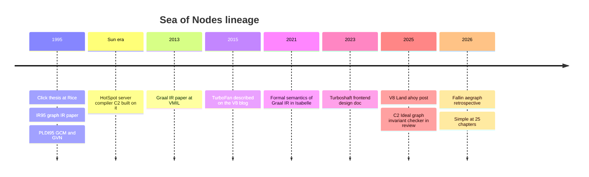
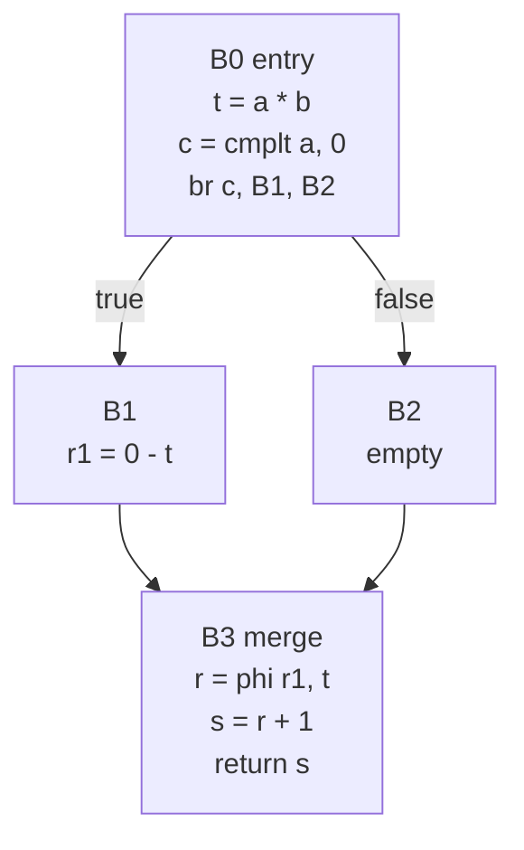
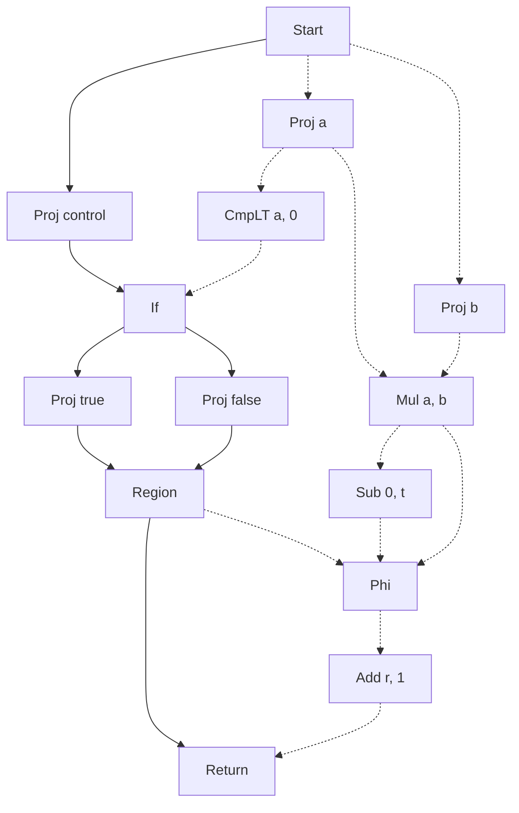
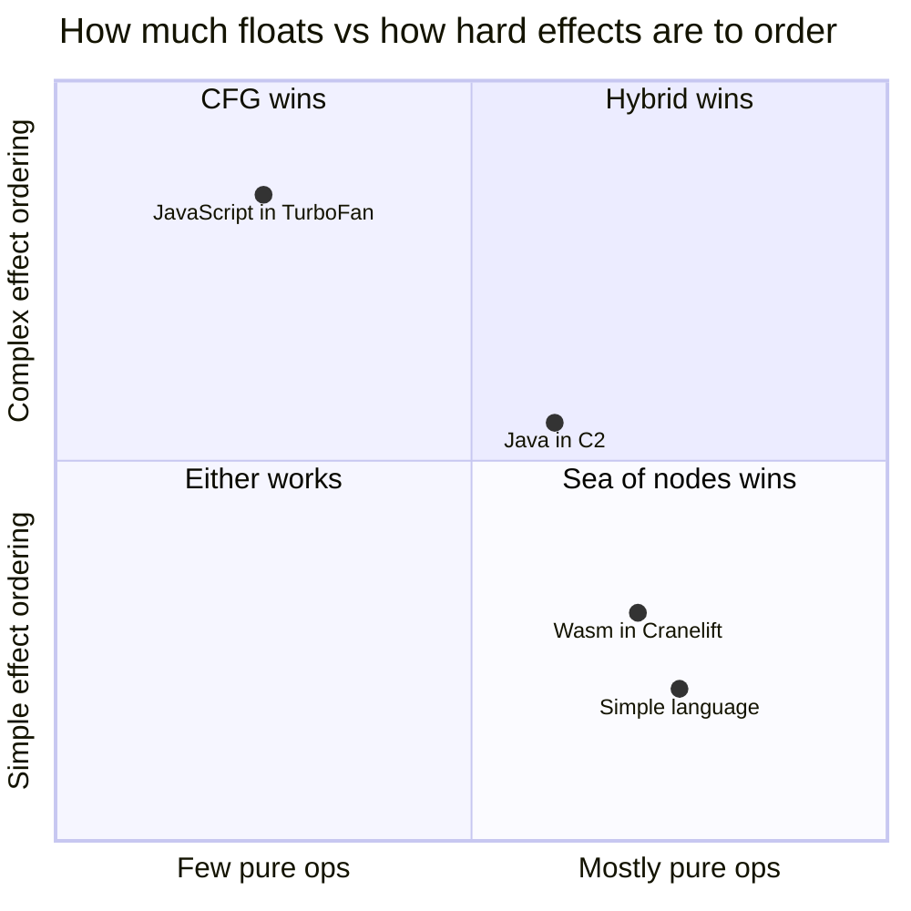

---
tags:
  - compilers
  - sea-of-nodes
  - intermediate-representation
  - ssa
  - global-code-motion
  - value-numbering
  - jit
  - hotspot
  - v8
status: complete
sources:
  - https://bernsteinbear.com/assets/img/click-ssa.pdf
  - https://bernsteinbear.com/assets/img/click-gvn.pdf
  - https://en.wikipedia.org/wiki/Sea_of_nodes
  - https://en.wikipedia.org/wiki/Cliff_Click
  - https://wiki.openjdk.org/x/4YC0
  - https://mail.openjdk.org/pipermail/hotspot-compiler-dev/2025-September/096310.html
  - https://lafo.ssw.uni-linz.ac.at/pub/papers/2013_VMIL_GraalIR.pdf
  - https://pldi17.sigplan.org/event/pldi-2017-papers-practical-partial-evaluation-for-high-performance-dynamic-language-runtimes
  - https://arxiv.org/pdf/2107.01815
  - https://v8.dev/blog/turbofan-jit
  - https://v8.dev/blog/leaving-the-sea-of-nodes
  - https://docs.google.com/document/d/1vL1_1g4sY4WbTgbirKBq-40_zsrhI-zM0ZiioC_ahl8/export?format=pdf
  - https://www.cfallin.org/blog/2026/04/09/aegraph
  - https://github.com/SeaOfNodes
  - https://github.com/SeaOfNodes/Simple
  - https://github.com/SeaOfNodes/Simple/blob/main/chapter09/README.md
  - https://github.com/SeaOfNodes/Simple/blob/main/chapter13/README.md
  - https://discourse.julialang.org/t/sea-of-nodes-ir/131171
created: 2026-11-26
updated: 2026-11-26
---

## Table Of Contents

- [[#TL;DR|TL;DR]]
- [[#The Problem|The Problem]]
- [[#Foundations|Foundations]]
    - [[#Nodes, Edges and Values|Nodes, Edges and Values]]
    - [[#Control as a Value|Control as a Value]]
    - [[#Floating and Pinned Nodes|Floating and Pinned Nodes]]
    - [[#Memory and Effect Chains|Memory and Effect Chains]]
- [[#How We Got Here|How We Got Here]]
- [[#How It Works|How It Works]]
    - [[#A Small Function as a Graph|A Small Function as a Graph]]
    - [[#Peephole Optimization While Parsing|Peephole Optimization While Parsing]]
    - [[#Iterating to a Fixed Point|Iterating to a Fixed Point]]
    - [[#Global Code Motion|Global Code Motion]]
    - [[#Worked Example - Scheduling a Loop|Worked Example - Scheduling a Loop]]
    - [[#Memory Slices and Anti-Dependences|Memory Slices and Anti-Dependences]]
    - [[#HotSpot C2|HotSpot C2]]
    - [[#Graal IR and Truffle|Graal IR and Truffle]]
    - [[#V8 TurboFan|V8 TurboFan]]
- [[#Where It Is Now|Where It Is Now]]
    - [[#Why V8 Left|Why V8 Left]]
    - [[#Cranelift's Aegraph|Cranelift's Aegraph]]
    - [[#The Simple Teaching Compiler|The Simple Teaching Compiler]]
    - [[#C2, Graal and Formal Work|C2, Graal and Formal Work]]
- [[#Trade-offs & Open Problems|Trade-offs & Open Problems]]
- [[#Resources|Resources]]
- [[#Related Notes|Related Notes]]

## ***TL;DR***
---
*Sea of nodes is Cliff Click's 1995 intermediate representation in which data, control and memory are all edges in one SSA graph, and instructions have no fixed order until a late scheduling pass picks one. It powers HotSpot's C2 and (in a modified form) Graal, it ran V8's TurboFan for about a decade, and V8's 2025 retreat from it is the clearest field report on where the idea pays off and where it does not.*

- **One graph, no instruction list.** Each node is one operation; edges point from a use to the definition it needs. Control flow is just another value: `If` produces a tuple, `Proj` nodes pick the true or false control, `Region` merges control (replacing basic blocks) and `Phi` merges data at a `Region` ([Click and Paleczny, IR'95](https://bernsteinbear.com/assets/img/click-ssa.pdf)).
- **Optimize while you build.** Every node is constant-folded, algebraically simplified and hash-consed (value numbered) before anything else can point at it, so the parser emits an already-cleaned graph. In Click's 1995 measurements this parse-time pass plus scheduling came within about 2% (total) of a full global optimizer ([IR'95](https://bernsteinbear.com/assets/img/click-ssa.pdf)).
- **Schedule last.** Pure nodes "float". Click's *Global Code Motion* places each one between its earliest legal block (inputs dominate it) and its latest (the dominator-tree LCA of its uses), choosing the block with the shallowest loop nest, which gives loop-invariant code motion and partial dead-code sinking for free ([Click, PLDI'95](https://bernsteinbear.com/assets/img/click-gvn.pdf)).
- **Memory is the hard part.** Loads and stores are ordered by a memory (or "effect") value threaded through them. C2 slices memory by alias class; V8 found that in JavaScript almost everything ends up on the effect chain, so "only pure nodes actually float freely" ([OpenJDK wiki](https://wiki.openjdk.org/x/4YC0); [V8, 2025](https://v8.dev/blog/leaving-the-sea-of-nodes)).
- **As of November 2026.** HotSpot C2 still uses it and is adding graph-invariant checkers; V8 has moved TurboFan's backend and its whole Wasm pipeline to the CFG-based Turboshaft, with compile time "divided by 2"; Cranelift's aegraph floats only pure ops over a CFG skeleton; and the open-source *Simple* compiler (SeaOfNodes on GitHub) teaches the full design in 25 chapters with Rust, C++ and Go ports ([V8, 2025](https://v8.dev/blog/leaving-the-sea-of-nodes); [Fallin, 2026](https://www.cfallin.org/blog/2026/04/09/aegraph); [SeaOfNodes/Simple](https://github.com/SeaOfNodes/Simple)).

## ***The Problem***
---
*A conventional [[Intermediate Representations|IR]] stores a total order of instructions inside basic blocks, even when the program only needs a partial order. Every optimization then has to respect, repair or deliberately move that order, which costs compile time and makes passes interact badly.*

Take two independent multiplications, `a * 2` and `b * 2`. In a control-flow graph (CFG) one of them must come first, even though nothing in the program says so; in a sea of nodes they are two unordered nodes that get an order only when assembly is emitted ([V8, 2025](https://v8.dev/blog/leaving-the-sea-of-nodes)). Multiply that by a whole function and the consequences show up in three places:

- **Code motion is its own pass.** In a CFG, hoisting a loop invariant ([[Loop Optimizations|LICM]]) or sinking a computation into the only branch that uses it means physically moving instructions between blocks and keeping SSA valid while doing it. See [[Classic Optimizations]].
- **Value numbering is block-bound.** Classic local value numbering resets at block boundaries; making it global needs dominator-scoped tables. Click's GVN instead says "basic blocks play no part in this phase" ([Click, PLDI'95](https://bernsteinbear.com/assets/img/click-gvn.pdf)).
- **Compile time matters in a JIT.** Click and Paleczny's stated goal was a representation that is "simple and light weight while allowing easy expression of fast optimizations" ([IR'95](https://bernsteinbear.com/assets/img/click-ssa.pdf)). A [[JIT Compilation|JIT]] pays for every pass at run time.

Sea of nodes answers all three by deleting the instruction order. The price, as later sections show, is that the order has to be rebuilt (scheduling), and side effects still need an order of their own.

## ***Foundations***
---
*Four ideas carry the whole design: nodes are values, control is a value, most nodes float, and memory is a value too. Once these click, C2, Graal, TurboFan and Simple read as variations on one theme.*

### Nodes, Edges and Values

*A node is an operation that defines one value; its inputs are ordered edges to the nodes that define its operands.*

The IR'95 paper defines the graph precisely: labeled vertices, ordered inputs, unordered outputs; the label is the operation, and each node "defines a value available on all its output edges". In the C++ implementation each opcode is a subclass of `Node`, edges are plain pointers from use to def, and the vtable pointer doubles as the opcode, so a node holds almost no data ([IR'95](https://bernsteinbear.com/assets/img/click-ssa.pdf)).

Because every value has exactly one defining node, the graph is in [[SSA Form]] by construction. There are no variable names at all: a source variable is just "whatever node currently holds its value" in the parser's symbol table.

### Control as a Value

*Control dependences "have the same form and implementation" as data dependences, so branches and merges are ordinary nodes.*

| Node | Inputs | Produces | Role |
|---|---|---|---|
| `Start` | none | tuple: control, parameters, initial memory, initial I/O | Function entry |
| `If` | control, predicate | tuple: true control, false control | Two-way branch |
| `Proj` | a tuple-producing node | one field of the tuple | Picks `IfTrue`, `IfFalse`, a parameter, memory |
| `Region` | one control per predecessor | merged control | Replaces a basic block header |
| `Phi` | its `Region`, then one value per `Region` input | merged value | SSA merge; the i-th data input matches the i-th control input |
| `Return` / `Stop` | control, value | end of execution | Exit |

All from [Click and Paleczny](https://bernsteinbear.com/assets/img/click-ssa.pdf), who note that `Phi` and `Proj` "have no run-time operation and do not correspond to a machine instruction". The paper gives control a token semantics like a Petri net: one control token moves between `Start`, `If` and `Region` nodes, data values propagate until stable, and a `Phi` latches its input when the token enters its `Region`. Irreducible loops need no special handling.

### Floating and Pinned Nodes

*A node with no control input belongs to no block; the scheduler decides where it runs.*

Each primitive node has an optional control input. If it is present, it records which block the node must stay in (or below); if it is absent, the node **floats**. Click notes the trade-off directly: dropping the control edge "enables more global optimizations but complicates serialization" ([IR'95](https://bernsteinbear.com/assets/img/click-ssa.pdf)). In the GCM paper, `Phi`, branches and returns are pinned to their blocks, and instructions that can fault (loads, stores, division, calls) carry an explicit control input so they cannot move above the test that guards them ([Click, PLDI'95](https://bernsteinbear.com/assets/img/click-gvn.pdf)).

HotSpot C2 puts this control edge at input slot 0 of every node: "By setting input 0 to point at a particular control flow node" a node is constrained, and "Control gives only the earliest evaluation point. Data and memory dependence tend to constrain the latest" ([OpenJDK wiki](https://wiki.openjdk.org/x/4YC0)).

### Memory and Effect Chains

*Memory is a value: stores consume a memory state and produce a new one, and loads read one.*

In IR'95 the whole heap is one value called the `STORE`: a `Load` takes a store and an address; a `Store` takes a store, an address and a value and produces a new store; `Phi` merges stores like any other value ([IR'95](https://bernsteinbear.com/assets/img/click-ssa.pdf)). The paper itself calls one global store "very coarse" and suggests splitting it per variable or array with pointer analysis. Memory-mapped I/O is a separate `READ` / `WRITE` chain that fully serializes I/O.

Every production descendant made memory finer or more explicit:

- **C2** splits memory into slices, one per alias class, and gathers them into a `MergeMem` where everything must agree, such as at calls ([OpenJDK wiki](https://wiki.openjdk.org/x/4YC0)).
- **TurboFan** added two extra edge kinds on top of value edges: *control edges* ordering branches, gotos and returns, and *effect edges* ordering loads, stores and other side effects ([V8, 2025](https://v8.dev/blog/leaving-the-sea-of-nodes)).
- **Graal** keeps side-effecting nodes on a fixed control backbone and lets the rest float ([Duboscq et al., 2013](https://lafo.ssw.uni-linz.ac.at/pub/papers/2013_VMIL_GraalIR.pdf)).

How fine the memory edges are decides how much actually floats. That single fact explains most of the design's later history (see [[#Why V8 Left|Why V8 Left]] and [[Pointer and Alias Analysis]]).

## ***How We Got Here***
---
*The idea came out of a 1995 Rice thesis on combining analyses, became the server JIT of the JVM, spread to Graal and V8, and in the 2020s split into "keep it" (C2), "leave it" (V8) and "float only the pure part" (Cranelift).*



- **1995, the thesis.** Click's Rice PhD, *Combining Analyses, Combining Optimizations* (advisor Keith Cooper), is the origin; the representation "enables the simultaneous execution of multiple optimizations" ([Wikipedia: Cliff Click](https://en.wikipedia.org/wiki/Cliff_Click)), for example running dead-code elimination and constant propagation together ([Wikipedia: Sea of nodes](https://en.wikipedia.org/wiki/Sea_of_nodes)). The same year produced the IR'95 workshop paper with Michael Paleczny (January, San Francisco) and the PLDI'95 GCM/GVN paper (La Jolla) ([IR'95](https://bernsteinbear.com/assets/img/click-ssa.pdf); [PLDI'95](https://bernsteinbear.com/assets/img/click-gvn.pdf)).
- **HotSpot C2.** Click "was the primary architect of the HotSpot Server Compiler at Sun Microsystems" ([Wikipedia: Cliff Click](https://en.wikipedia.org/wiki/Cliff_Click)). When V8 chose the design for TurboFan, C2 had used it "for more than 10 years" ([V8, 2025](https://v8.dev/blog/leaving-the-sea-of-nodes)).
- **2013, Graal.** The Graal IR paper describes a graph "close to the graph IR presented by Click", with a fixed control backbone and floating data nodes, tuned for speculation and deoptimization ([Duboscq et al., VMIL 2013](https://lafo.ssw.uni-linz.ac.at/pub/papers/2013_VMIL_GraalIR.pdf)).
- **TurboFan, described in 2015.** V8 replaced Crankshaft (a CFG compiler with too much hand-written assembly, no try-catch and performance cliffs) with TurboFan on sea of nodes ([V8, 2025](https://v8.dev/blog/leaving-the-sea-of-nodes)). Ben Titzer's 2015 post called its IR "a relaxed variant of sea-of-nodes" ([V8, 2015](https://v8.dev/blog/turbofan-jit)).
- **2021, formal semantics.** Webb, Utting and Hayes gave what they call the "first formal semantics of a sea-of-nodes IR that covers method calls", for Graal IR in Isabelle/HOL ([arXiv 2107.01815](https://arxiv.org/pdf/2107.01815)). See [[Verified Compilers]].
- **2022 to 2025, V8 turns back.** Wikipedia dates V8's decision to 2022 ([Wikipedia](https://en.wikipedia.org/wiki/Sea_of_nodes)); a public November 2023 design doc by Darius Mercadier planned a Turboshaft frontend ([Turboshaft Frontend, 2023](https://docs.google.com/document/d/1vL1_1g4sY4WbTgbirKBq-40_zsrhI-zM0ZiioC_ahl8/export?format=pdf)); the full rationale came in "Land ahoy: leaving the Sea of Nodes" on 25 March 2025 ([V8, 2025](https://v8.dev/blog/leaving-the-sea-of-nodes)).
- **By 2026, the hybrid.** Cranelift runs a "sea-of-nodes with CFG" mid-end; Chris Fallin's April 2026 retrospective judges that part "more fundamental" than its e-graph machinery ([Fallin, 2026](https://www.cfallin.org/blog/2026/04/09/aegraph)).

## ***How It Works***
---
*Build the graph from the parser with peepholes applied to every new node, iterate peepholes to a fixed point, then run global code motion to turn the graph back into blocks. Production compilers add memory slicing, speculation and deoptimization state on top.*

### A Small Function as a Graph

*The same function drawn as a CFG and as a sea of nodes: blocks and an order on the left, only dependences on the right.*

```c
int f(int a, int b) {
    int t = a * b;
    int r;
    if (a < 0) r = 0 - t;
    else       r = t;
    return r + 1;
}
```

As a CFG (hand sketch), four blocks fix an order for every instruction, including `t = a * b` in the entry block even though only the merge needs it:



As a sea of nodes (hand sketch in Click's style; solid arrows are control, dotted are data, all drawn from definition to use, constants shown as nodes):



Notice what is missing: `Mul`, `Sub` and `CmpLT` have no control input, so no block owns them. `Sub 0, t` is only needed on the true path, and the scheduler is free to sink it into the block that `Proj true` starts. Nothing in the graph says `Mul` must run before `CmpLT`. The `Phi` reads its `Region` to know which input belongs to which path.

### Peephole Optimization While Parsing

*Every node is simplified and value-numbered before any other node can use it, so the parser never builds the unoptimized program.*

IR'95 runs these checks on each node as the parser creates it ([Click and Paleczny](https://bernsteinbear.com/assets/img/click-ssa.pdf)):

1. **Constant folding.** A virtual function asks the node whether it computes a constant; if so it is replaced by a constant node.
2. **Identities.** A virtual `Identity()` returns an existing equivalent node, as in `x - 0` becoming `x`.
3. **Value numbering.** A hash table keyed by opcode and inputs (the opcode is the address of the class's virtual `Name()` function) finds an existing identical node. Each class supplies its own hash and compare, so `Add` can ignore input order. Nodes that cannot raise exceptions are hashed without their control input, so equal computations in different branches merge.
4. **Cheap undo.** Arena allocation makes "build, then discard because a better node exists" nearly free: deleting the most recently allocated node just pushes the high-water mark back.

Because the rest of the program has not been parsed yet, these optimizations are **pessimistic** and look through a small window; the paper calls them essentially a local, peephole analysis. That was enough: on 52 mostly-FORTRAN routines, the peephole pass "saved 6.3% on total compile times" by shrinking what later passes see, and the paper concludes that "most constants and common subexpressions are easy to find" ([IR'95](https://bernsteinbear.com/assets/img/click-ssa.pdf)).

The shape of one peephole step, as a simplified hand sketch in Java (Simple's real code splits these pieces across `compute`, `idealize` and the GVN table, and differs in detail):

```java
Node peephole(Node n) {
    Type t = n.compute();                 // fold over the type lattice
    if (t.isConstant() && !(n instanceof ConstantNode))
        return replace(n, new ConstantNode(t).peephole());
    Node better = n.idealize();           // algebra: x - x => 0, c * x => x * c
    if (better != null)
        return replace(n, better.peephole());
    Node old = GVN.putIfAbsent(n);        // hash-cons: same op, same inputs
    if (old != null)
        return replace(n, old);           // reuse, kill the new node
    return n;
}
```

A trace for `return (1 + 2) * arg - arg * 3;` (hand sketch of the behavior described in Simple's chapters 2, 4 and 9, not tool output):

| Parser builds | Peephole result | Why |
|---|---|---|
| `Add(1, 2)` | `Con 3` | Constant fold; the `Add` never reaches the graph |
| `Mul(3, arg)` | `Mul(arg, 3)` | Canonicalize constants to the right |
| `Mul(arg, 3)` (second one) | the first `Mul` node | GVN hit; new node discarded |
| `Sub(m, m)` | `Con 0` | Identity `x - x = 0`, visible only because GVN made both operands the same node |
| `Return(ctl, 0)` | `Return(ctl, 0)` | Nothing left to do |

Simple's chapter 9 gives the real versions of the last two rows: `arg + arg` becomes `arg*2` and then "the `arg*2` expression is now reused rather than appearing twice", and in `arg*arg - arg*arg` GVN makes both products the same node so the subtraction visibly cancels ([Simple ch. 9](https://github.com/SeaOfNodes/Simple/blob/main/chapter09/README.md)).

### Iterating to a Fixed Point

*Parse-time peepholes miss facts that only appear later, such as a loop variable that turns out constant, so a worklist pass repeats them until nothing changes.*

Simple's `IterPeeps` runs after parsing: when a node changes, its uses and defs go back on the worklist, and the invariant is that every node is either on the worklist or has no applicable peephole ([Simple ch. 9](https://github.com/SeaOfNodes/Simple/blob/main/chapter09/README.md)). Three details are worth stealing:

- **Edge lock.** Editing a node's inputs changes its hash, so a node must leave the GVN table first. Simple's `_hash` field is both the cached hash and the lock: "If zero the Node is unlocked and NOT in `GVN`."
- **Distant dependencies.** A peephole that inspects a node two hops away registers with `addDep` so it is retried when that node changes, for example `(Add (Phi (Add x 2) self) 1)` waiting for the `Phi` to simplify.
- **Monotone types.** Types only move up the lattice during peepholes, and when GVN merges two nodes their types are joined, which is what makes the iteration terminate. This is the [[Abstract Interpretation]] view of constant propagation; Simple's chapter 24 adds full sparse conditional constant propagation ([Simple](https://github.com/SeaOfNodes/Simple)).

The payoff example from chapter 9: `arg = arg + step + 1` in a loop where `step = 1` only becomes `arg + 2` after the loop's `Phi` for `step` is known constant, which parsing alone could not see.

### Global Code Motion

*GCM turns the floating graph back into a CFG: compute the earliest and latest legal block for each node, then pick the block in between that runs least often.*

Click's PLDI'95 algorithm runs on a CFG built from the control nodes plus its dominator tree and loop nesting depths ([Click, PLDI'95](https://bernsteinbear.com/assets/img/click-gvn.pdf)):

1. **Pin.** `Phi`, branches and returns stay in their blocks; faulting operations cannot rise above their control input.
2. **Schedule early.** Walk from the pinned nodes up through inputs (post-order DFS). Each node goes to the deepest block, in dominator-tree terms, among the blocks of its inputs: the first point where all inputs are available. Taken alone this gives maximally speculative code with long live ranges.
3. **Schedule late.** Walk the other way. Each node goes to the lowest common ancestor (LCA) in the dominator tree of the blocks of all its uses. A use by a `Phi` counts as a use at the end of the matching predecessor block, not in the `Phi`'s own block.
4. **Select.** Walk from the late block up the dominator tree to the early block and keep the block with the smallest loop depth, breaking ties toward the deepest (most control-dependent) block. In the paper's words: "place code outside as many loops as possible, then on as few execution paths as possible."

$$
\text{late}(n) = \mathrm{LCA}_{\mathrm{dom}}\{\, \text{useblock}(u) : u \in \text{uses}(n) \,\}
$$
$$
\text{place}(n) = \arg\min_{b \,\in\, \text{domPath}(\text{late}(n) \to \text{early}(n))} \big(\text{loopdepth}(b),\; -\text{domdepth}(b)\big)
$$

**In plain English:** the latest legal spot is the closest block that dominates every use; among the blocks on the dominator-tree path between latest and earliest, choose the one inside the fewest loops, and if several tie, the one that runs on the fewest paths.

The paper calls the algorithm "near-linear-time"; the LCA search is linear per node in the worst case but "in practice it is a small constant". GCM never changes the CFG or removes code, it only places it, which is why Click pairs it with GVN: GVN can merge equal computations from different blocks into one node that belongs to no block, and GCM finds a block that dominates all of its uses. Together they gave about a 5.9% total speedup over one pass of classic global constant folding, PRE and conditional constant propagation on his ILOC benchmark set, with some individual routines slower (the figure comes from a scanned table, so treat the exact digits with care) ([Click, PLDI'95](https://bernsteinbear.com/assets/img/click-gvn.pdf)). See [[Instruction Scheduling]] for the separate, later problem of ordering nodes *within* a block.

### Worked Example - Scheduling a Loop

*Applying GCM by hand to a loop shows LICM and code sinking falling out of one rule.*

```c
int g(int x, int n) {
    int s = 0;
    for (int i = 0; i < n; i = i + 1) {
        if (i == 7)
            s = s + x * 3;    // x*3 is loop-invariant but used on a rare path
    }
    return s + (x + 1);       // x+1 is only needed after the loop
}
```

The control nodes give this CFG (hand sketch): `B0` entry, `B1` loop header (`Phi i`, `Phi s`, test `i < n`), `B2` body (test `i == 7`), `B3` then-branch, `B4` latch (merges `s`, computes `i + 1`), `B5` exit. Dominator tree: `B0 → B1 → {B2, B5}`, `B2 → {B3, B4}`. Loop depth is 1 for `B1` to `B4` and 0 for `B0` and `B5`.

| Node | Early | Uses (use block) | Late (LCA) | Dominator path, with loop depth | Placed in |
|---|---|---|---|---|---|
| `m = x * 3` | B0 (`x` from Start) | `s + m` in B3 | B3 | B3 (1), B2 (1), B1 (1), B0 (0) | **B0**: hoisted out of the loop |
| `p = x + 1` | B0 | `Add` before return in B5 | B5 | B5 (0), B1 (1), B0 (0) | **B5**: tie at depth 0, deepest wins, so it sinks after the loop |
| `a = s + m` | B1 (`Phi s` lives in B1) | latch `Phi s` via edge from B3 | B3 | B3 (1), B2 (1), B1 (1) | **B3**: stays on the rare path |
| `k = i == 7` | B1 | `If` in B2 | B2 | B2 (1), B1 (1) | **B2** |
| `j = i + 1` | B1 | header `Phi i` via back edge from B4 | B4 | B4 (1), B2 (1), B1 (1) | **B4** |

Two things to notice. First, `m = x * 3` was hoisted even though it is only used on one path inside the loop: Click's rule ranks "outside loops" above "on few paths", so it accepts some speculation (safe because `Mul` cannot fault). Second, the `Phi`-use rule is what keeps `s + m` in `B3`: had the use counted in the latch `B4`, the add would have run on every iteration. Simple's chapter 13 shows the same effects on its own example, where a store moves from the loop header into the True branch of an `if` and `i/3` is computed outside the loop ([Simple ch. 13](https://github.com/SeaOfNodes/Simple/blob/main/chapter13/README.md)).

### Memory Slices and Anti-Dependences

*Loads float between stores of the same memory state, so the scheduler must add "this store waits for that load" edges that the graph never stored.*

IR'95 already noticed the problem: the memory model "lacks anti-dependences", so a schedule could keep two stores' memory states alive at once, which would mean copying memory; its fix was to treat memory "like a type of unique machine register with infinite spill cost" ([IR'95](https://bernsteinbear.com/assets/img/click-ssa.pdf)).

Simple makes this explicit in its scheduler ([Simple ch. 13](https://github.com/SeaOfNodes/Simple/blob/main/chapter13/README.md)):

- Memory is split into alias slices (one per struct field), packaged by a `MemMerge` node; "MemMerge only packages slices; it does not overwrite any of them."
- A load "also waits for memory users that can overwrite or merge its alias". The anti-dependence edge from a store to an earlier load ("the Store must wait for the earlier Load") is computed during schedule-late, after the load's own uses are placed, and is a scheduling constraint only, not a data edge.
- Memory `Phi`s are handled per incoming path, exactly like the data `Phi` rule above.
- Infinite loops are unreachable from `Stop`, so `LoopNode.forceExit()` inserts a `Never` node and a never-taken exit to keep the graph connected.

In C2, the same structure appears as memory slices "which correspond to aliases classes": operations within a slice are ordered, slices are unordered relative to each other, and they meet in a `MergeMem` at barriers such as calls and volatile accesses ([OpenJDK wiki](https://wiki.openjdk.org/x/4YC0)). The finer the alias classes, the more loads and stores float; see [[Pointer and Alias Analysis]].

### HotSpot C2

*C2's "Ideal" graph is the longest-running production sea of nodes, a mid-level IR that is lowered to machine nodes late.*

From the OpenJDK wiki's description of C2's IR ([OpenJDK wiki](https://wiki.openjdk.org/x/4YC0)):

- **No basic blocks.** The IR is a program dependence graph. Control-producing nodes are `If`, `Call`, `Region`, `Halt` and `Return`; `If` splits through `IfTrue` / `IfFalse` projection nodes, and multi-valued nodes such as calls expose control, memory and return value through `Proj`s.
- **Typed opcodes.** Operators carry type suffixes (`AddI`, `CmpP`); loads distinguish signedness (`LoadC`, `LoadS`) while stores differ only by size. Most nodes map to one machine instruction; high-level nodes such as `Allocate` and `Lock` / `Unlock` are expanded near the end.
- **Heavy sharing.** Global value numbering means, for example, a single copy of each constant, and nodes keep def-use edges so all users can be visited cheaply.
- **Memory slices** as described above, gathered at calls by a `MergeMem`.

The graph's flexibility makes malformed graphs a real bug source. In September 2025 the C2 team was reviewing JDK-8350864, a debug-only checker (`VerifyIdealStructuralInvariants`) that runs after iterative GVN and checks local invariants such as "an `If` has an `IfTrue` and an `IfFalse` output", "`Phi` arity matches its `Region`", and counted-loop backedge shapes, so that broken graphs are caught "closer to the source" ([hotspot-compiler-dev, Sep 2025](https://mail.openjdk.org/pipermail/hotspot-compiler-dev/2025-September/096310.html)). I did not confirm whether it was integrated. See [[Compiler Testing and Fuzzing]].

### Graal IR and Truffle

*Graal keeps Click's floating data nodes but pins every side effect to a fixed control backbone, and carries deoptimization state as graph nodes.*

The 2013 Graal IR paper describes the IR as "a superposition of two directed graphs": data-flow edges point "upwards" to operand producers, control-flow successor edges point "downwards" ([Duboscq et al., VMIL 2013](https://lafo.ssw.uni-linz.ac.at/pub/papers/2013_VMIL_GraalIR.pdf)). The differences from Click's design are all about speculation:

| Feature | What Graal does | Why |
|---|---|---|
| Fixed vs floating | Control splits, merges and side effects are fixed; most other nodes float, limited by data and memory dependences | Keeps side-effect order simple while value nodes still move |
| `FrameState` nodes | Each state-split (memory write, call, monitor) references a `FrameState` (method, bytecode index, locals, stack); pure nodes use the last dominating one | Deoptimization can rebuild the interpreter frame |
| Guards | Speculative checks (receiver type, non-null) float, anchored to the furthest dominating `Begin` after a split, and are value-numbered | Only about 49.7% of guards are actually created, the rest coalesce |
| Exception edges | Mostly omitted; exceptions deoptimize and the interpreter rethrows | Only 0.55% of 3.2 million potential exception edges were made explicit on DaCapo |

Scheduling happens just before code emission, when every node is assigned to a block. Webb, Utting and Hayes describe the same IR as a "sea-of-nodes" graph where side-effect-free expressions form acyclic data-flow subgraphs and nodes with possible side effects sit in the control-flow graph ([arXiv 2107.01815](https://arxiv.org/pdf/2107.01815)).

**Truffle** comes from the same Oracle Labs group (Würthinger, Duboscq, Simon and Stadler are authors on both lines of work): a language is defined by writing an AST interpreter, and "compiled code is derived automatically using partial evaluation (the first Futamura projection)" ([Würthinger et al., PLDI 2017](https://pldi17.sigplan.org/event/pldi-2017-papers-practical-partial-evaluation-for-high-performance-dynamic-language-runtimes)). The page I read does not spell out that the partially evaluated code is a Graal IR graph, so treat that link as widely stated but unconfirmed here. See [[JIT Compilation]] and [[Escape Analysis]].

### V8 TurboFan

*TurboFan made the effect chain explicit as a third edge type and used the graph's freedom to keep backends small.*

Titzer's 2015 post presents TurboFan's IR as "a relaxed variant of sea-of-nodes" that "allows more effective reordering and optimization", where most rewrites are "simple local reductions" testable on their own. After optimization a scheduler uses the graph's freedom to "move code out of loops and into less frequently executed paths". The layered design kept each of seven backends under "3,000 lines of platform-specific code", against 13,000 to 16,000 in Crankshaft ([V8, 2015](https://v8.dev/blog/turbofan-jit)).

The effect chain is where JavaScript bit. A property load must stay after the map check that justifies it and before any call that might change the object, so it sits on the effect chain; a `Store` might trigger a setter, so it does too. The next section is what ten years of this taught V8.

## ***Where It Is Now***
---
*As of November 2026: HotSpot C2 still runs on sea of nodes, V8 has moved most of TurboFan to the CFG-based Turboshaft and reports halved compile times, and the influential new designs (Cranelift's aegraph) float only pure operations over a CFG. The open-source Simple compiler is the best place to learn the full design.*

### Why V8 Left

*V8's 2025 post is the most detailed public critique of sea of nodes from a team that ran it in production for about a decade.*

Darius Mercadier's "Land ahoy: leaving the Sea of Nodes" (25 March 2025) sorts the problems into "too complex", "too limited" and "too slow" ([V8, 2025](https://v8.dev/blog/leaving-the-sea-of-nodes)). The [[Intermediate Representations]] note has a summary table; here are the mechanisms behind each item:

- **Nodes do not float.** In the `a.str + b.str` example "almost all nodes are on the effect chain": map checks, field loads, string checks and the concatenation itself. In the `arr[0]` / `arr[1]` example both loads are pinned before a branch because the effect chain mirrors the control chain. Verdict: "SoN is just CFG where pure nodes are floating."
- **Chains are maintained by hand.** `JSNativeContextSpecialization` manages three effect chains; the team "got it wrong initially" and found out "after a few months".
- **The scheduler undoes optimizations.** Two identical divisions in different `switch` cases are merged by redundancy elimination into one floating node, and the scheduler must then duplicate it back: two, one, two.
- **Control-flow-sensitive typing is awkward.** In `if (x < 42) return x + 1;` a CFG compiler sees that the `CheckedAdd` cannot overflow inside the branch. In sea of nodes the pure `CheckedAdd` floats free of the branch, so the fact is unusable until there is a schedule; adding a control input to fix it re-pins a pure node.
- **No natural visiting order.** Peepholes revisit nodes repeatedly: "on average, nodes are changed only once every 20 visits!" State-tracking analyses suffer too: the old load elimination bailed out on large graphs, and the new CFG-based one is "up to 190 times faster".
- **Cache misses.** Lowering creates new nodes far from the originals in memory; sea of nodes had "about 3 times more L1 dcache misses" on average and "up to 7 times in some phases", which the post estimates (calling it "a bit handwavy") at up to 5% of compile time.
- **Wasm.** WebAssembly arrives already scheduled by an ahead-of-time toolchain; sea of nodes throws that schedule away and a JIT scheduler may do worse. A separate Wasm compiler was ruled out because JS-to-Wasm inlining needs one compiler. See [[WebAssembly]].

**Status as of the post:** TurboFan's JavaScript backend and the whole Wasm pipeline run on **Turboshaft**; builtins are moving gradually; the JavaScript frontend is being replaced by **Maglev**'s CFG IR; and "compile time got divided by 2 compared to SoN". The 2023 design doc shows why the frontend is the slow part: TurboFan's frontend phases were about 28,878 lines, and whole-graph analyses (typing, load elimination, escape analysis) cannot reuse Maglev's one-pass approach because "loops would need to be revisited" ([Turboshaft Frontend, 2023](https://docs.google.com/document/d/1vL1_1g4sY4WbTgbirKBq-40_zsrhI-zM0ZiioC_ahl8/export?format=pdf)). I found no later V8 post confirming that the frontend migration is finished, so treat it as in progress.

### Cranelift's Aegraph

*Cranelift kept the part of sea of nodes that works (floating pure ops, scheduling by elaboration) and kept a CFG for everything with effects.*

Fallin's April 2026 retrospective calls Cranelift's mid-end a "sea-of-nodes with CFG": side-effecting instructions stay in a CFG "side-effect skeleton"; pure operators are lifted out, hash-consed and rewritten; then *elaboration* schedules them back, demand-driven from the skeleton and scoped by the dominator tree ([Fallin, 2026](https://www.cfallin.org/blog/2026/04/09/aegraph)). Compared with Click's GCM:

| Concern | Click GCM | Cranelift elaboration |
|---|---|---|
| What floats | Every node without a control input; memory ops ordered by memory edges | Only pure operators; all effects stay in the CFG |
| Placement | Between early and late, shallowest loop depth | Demand-driven from uses; loop-invariant values can go to the preheader |
| Duplication | Placement only, one copy per node | May recompute a value in sibling dominator subtrees, the "dual" of canonicalization; can rematerialize cheap values |
| Dead code | Unreachable from `Stop` | Never elaborated, so removed for free |

Fallin cites V8's post as support for not going "pure Sea-of-Nodes", and reports that the sea-of-nodes-with-CFG part "works great" (about 2% faster code than the classical pipeline for "about 7-8% more compile time"), while the multi-representation e-graph part adds only about 0.1% with an average e-class size of 1.13 ([Fallin, 2026](https://www.cfallin.org/blog/2026/04/09/aegraph)). See [[E-Graphs and Equality Saturation]].

### The Simple Teaching Compiler

*The open-source Simple compiler builds a sea-of-nodes compiler one chapter at a time, from returning a constant to ELF output.*

The SeaOfNodes GitHub organization ("A Sea of Nodes IR Tutorial") hosts *Simple*, "A Simple showcase for the Sea-of-Nodes compiler IR", in Java under Apache-2.0, plus ports in Rust, C++ and Go ([SeaOfNodes org](https://github.com/SeaOfNodes); [Simple](https://github.com/SeaOfNodes/Simple)). It is commonly attributed to Cliff Click, but the repo and organization pages I read name no individual authors (the organization lists no public members). The language is a small, strongly typed, C/Java-like one. Chapters as listed in the README when I read it:

| Chapters | Topic |
|---|---|
| 1 to 4 | Return a constant; arithmetic with constant folding; locals and SSA; an external input with algebraic simplification |
| 5 to 8 | `if` and control flow; dead control flow; `while` with eager phis; lazy phis, `break`, `continue` |
| 9 | Global value numbering and iterative peepholes |
| 10 to 12 | Structs, pointers and null analysis; memory aliasing with lazy partitioning; reference fields |
| 13 | Global code motion and scheduling |
| 14 to 18 | Floats, narrow ints and ranges; arrays; constructors; mutability and syntax sugar; functions and calls |
| 19 to 22 | Instruction selection for x86-64, RISC-V and ARM64; graph-coloring [[Register Allocation]]; encodings and ELF; "Hello, World!" |
| 23 to 25 | Methods and types; chained conditionals and SCCP; modules, separate compilation and SSA with incomplete types |

The README notes that chapters 10 to 14 were recently regrouped, and at the time of reading the repo had 801 commits on `main` and about 918 stars, with CI on JDK 21 ([Simple](https://github.com/SeaOfNodes/Simple)). The chapter READMEs are the most concrete public description of GVN locking, worklist invariants and anti-dependence scheduling that I know of, and the chapter 13 README points to two Coffee Compiler Club videos that walk through the scheduler ([Simple ch. 13](https://github.com/SeaOfNodes/Simple/blob/main/chapter13/README.md)). See [[Instruction Selection]] and [[Lexing and Parsing]] for the stages around it.

### C2, Graal and Formal Work

*The JVM side shows no sign of leaving; the active work is on checking graphs and proving rewrites.*

- **C2.** I found no announcement of HotSpot leaving its Ideal graph. The 2025 structural-invariant checker review above is typical of current work: making a flexible graph harder to corrupt ([hotspot-compiler-dev, Sep 2025](https://mail.openjdk.org/pipermail/hotspot-compiler-dev/2025-September/096310.html)).
- **Graal.** The Isabelle/HOL semantics covers 45 node classes (over 85% of the nodes used compiling DaCapo), was validated by running over 1,400 translated GraalVM unit tests, and was used to prove canonicalization and conditional-elimination rewrites correct ([arXiv 2107.01815](https://arxiv.org/pdf/2107.01815)). Wikipedia also lists Demange, Fernández de Retana and Pichardie's "Semantic reasoning about the sea of nodes" (CC 2018) and a 2023 POPL paper by Lemerre among formal treatments ([Wikipedia](https://en.wikipedia.org/wiki/Sea_of_nodes)); I did not read those papers.
- **Community view.** A July 2025 Julia discourse thread on adopting sea of nodes ended skeptical: V8's move was cited, and one participant said "a language has to be designed with that in mind" ([Julia discourse, 2025](https://discourse.julialang.org/t/sea-of-nodes-ir/131171)). That matches V8's experience: the idea pays off in proportion to how much of the program is pure.

## ***Trade-offs & Open Problems***
---
*Sea of nodes trades a fixed order for freedom of motion. That freedom is worth a lot when most operations are pure and memory is well partitioned, and little when nearly everything is an effect.*



*(Placements are my qualitative reading of the sources above, not measurements.)*

| Benefit | Cost |
|---|---|
| GVN, constant folding and dead-code elimination work across blocks with no extra machinery | The graph is "a messy soup of nodes" to read and debug, compared with a CFG close to source and assembly ([V8, 2025](https://v8.dev/blog/leaving-the-sea-of-nodes)) |
| LICM and code sinking come free from GCM | Scheduling is a mandatory, non-trivial pass, and it can undo merges (V8's divisions) |
| Optimizing during parsing shrinks the graph early and cheaply | Pessimistic, windowed; needs a fixed-point pass for loop facts |
| Precise dependences expose parallelism to the scheduler | Effect chains must be maintained by hand; mistakes are silent |
| Compact nodes (vtable as opcode, pointer edges) | Poor memory locality after lowering; up to 7x L1 misses in V8 phases |

Open problems:

- **Memory precision.** How much floats is set by alias information. C2's per-alias-class slices and Simple's lazy per-field partitioning work for Java-like languages; JavaScript's dynamic objects defeat them. Better [[Pointer and Alias Analysis]] in the IR is the lever.
- **Control-sensitive facts on floating nodes.** V8's `CheckedAdd` example has no clean answer: pinning a node to use a branch fact gives back the freedom. Graal's anchored guards are one partial answer.
- **Visit order.** CFG IRs can process in reverse postorder and analyses can carry state forward; a graph with no order makes "once every 20 visits" peephole efficiency and expensive state tracking likely.
- **Already-scheduled input.** For Wasm or other pre-optimized input, discarding the schedule may cost more than motion gains; Cranelift's choice to keep the CFG skeleton fits this.
- **Hybrid boundaries.** The live design question in 2026 is not "sea of nodes or CFG" but "what floats": all pure ops (Cranelift), pure ops plus guards (Graal), or everything with fine memory slices (C2).
- **Verification.** Flexible graphs make malformed IR easy; invariant checkers (C2) and mechanized semantics (Graal in Isabelle) are both still growing. See [[Verified Compilers]].

## ***Resources***
---
*Read Click's two 1995 papers first, then Simple's chapters 9 and 13, then V8's post as the counterargument and Fallin's as the synthesis.*

**Primary papers**
- [A Simple Graph-Based Intermediate Representation](https://bernsteinbear.com/assets/img/click-ssa.pdf): Cliff Click and Michael Paleczny, IR'95 workshop, January 1995. The IR, parse-time peepholes, memory as a value.
- [Global Code Motion / Global Value Numbering](https://bernsteinbear.com/assets/img/click-gvn.pdf): Cliff Click, PLDI 1995. Schedule early, schedule late, shallowest loop.
- [An Intermediate Representation for Speculative Optimizations in a Dynamic Compiler](https://lafo.ssw.uni-linz.ac.at/pub/papers/2013_VMIL_GraalIR.pdf): Duboscq et al., VMIL 2013. Graal IR, FrameStates, guards.
- [A Formal Semantics of the GraalVM Intermediate Representation](https://arxiv.org/pdf/2107.01815): Webb, Utting and Hayes, 2021. Sea of nodes in Isabelle/HOL.
- [Practical Partial Evaluation for High-Performance Dynamic Language Runtimes](https://pldi17.sigplan.org/event/pldi-2017-papers-practical-partial-evaluation-for-high-performance-dynamic-language-runtimes): Würthinger et al., PLDI 2017. Truffle.

**Engineering posts and docs**
- [Land ahoy: leaving the Sea of Nodes](https://v8.dev/blog/leaving-the-sea-of-nodes): Darius Mercadier, V8 blog, March 2025. The critique.
- [Digging into the TurboFan JIT](https://v8.dev/blog/turbofan-jit): Ben Titzer, V8 blog, July 2015. Why V8 chose it.
- [Turboshaft Frontend, Preliminary](https://docs.google.com/document/d/1vL1_1g4sY4WbTgbirKBq-40_zsrhI-zM0ZiioC_ahl8/export?format=pdf): V8 design doc, November 2023. Planning the frontend replacement.
- [The acyclic e-graph: Cranelift's mid-end optimizer](https://www.cfallin.org/blog/2026/04/09/aegraph): Chris Fallin, April 2026. The hybrid that kept the good part.
- [C2 IR overview](https://wiki.openjdk.org/x/4YC0): OpenJDK wiki. Ideal graph, control at input 0, memory slices.
- [8350864: C2: verify structural invariants of the Ideal graph](https://mail.openjdk.org/pipermail/hotspot-compiler-dev/2025-September/096310.html): hotspot-compiler-dev review, September 2025.

**Courses and tutorials**
- [SeaOfNodes/Simple](https://github.com/SeaOfNodes/Simple): SeaOfNodes organization, ongoing. Build a sea-of-nodes compiler in 25 chapters; [chapter 9 (GVN)](https://github.com/SeaOfNodes/Simple/blob/main/chapter09/README.md) and [chapter 13 (GCM)](https://github.com/SeaOfNodes/Simple/blob/main/chapter13/README.md) pair with this note.
- [SeaOfNodes organization](https://github.com/SeaOfNodes): Rust, C++ and Go ports.

**Background**
- [Sea of nodes](https://en.wikipedia.org/wiki/Sea_of_nodes) and [Cliff Click](https://en.wikipedia.org/wiki/Cliff_Click): Wikipedia. History and the list of formal papers.
- [Sea of Nodes IR thread](https://discourse.julialang.org/t/sea-of-nodes-ir/131171): Julia discourse, July 2025. A language community weighing it after V8.

## Related Notes

- [[Intermediate Representations]] — The survey this note deepens; has the IR comparison and V8 summary table.
- [[SSA Form]] — Sea of nodes is SSA with the blocks removed; Phi and dominance carry over directly.
- [[JIT Compilation]] — C2, Graal and TurboFan are JIT tiers where compile time drove the design.
- [[Classic Optimizations]] — GVN, constant folding, DCE and LICM, which sea of nodes gets almost for free.
- [[Dataflow Analysis]] — The lattice-based analyses that peepholes and SCCP run on the graph.
- [[Abstract Interpretation]] — Monotone type lattices behind iterative peepholes and combined analyses.
- [[Loop Optimizations]] — GCM's loop-depth rule is LICM; V8 found loop bodies hard to identify in the graph.
- [[Instruction Scheduling]] — Ordering inside a block, the step after GCM picks blocks.
- [[Pointer and Alias Analysis]] — Alias classes decide how far memory operations can float.
- [[Escape Analysis]] — A key whole-graph pass in C2, Graal and TurboFan's frontend.
- [[E-Graphs and Equality Saturation]] — Cranelift's aegraph, the hybrid descendant.
- [[WebAssembly]] — Pre-scheduled input that pushed V8 toward a CFG IR.
- [[Register Allocation]] — Where schedule-induced live ranges are paid for; Simple's chapter 20.
- [[Instruction Selection]] — Lowering Ideal or Simple nodes to machine nodes.
- [[Verified Compilers]] — Formal semantics of Graal's sea-of-nodes IR.
- [[Compiler Testing and Fuzzing]] — Graph-invariant checkers like C2's catch malformed IR early.
- [[Lexing and Parsing]] — Sea of nodes is built directly by the parser with peepholes applied.
