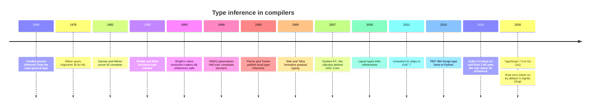
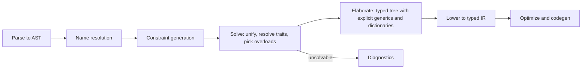

---
tags:
  - compilers
  - type-systems
  - type-inference
  - hindley-milner
  - generics
  - gradual-typing
  - compiler-foundations
status: complete
sources:
  - https://classes.cs.uchicago.edu/archive/2012/spring/22300-1/papers/Milner78.pdf
  - https://classes.cs.uchicago.edu/archive/2012/spring/22300-1/papers/Damas-Milner.pdf
  - https://en.wikipedia.org/wiki/Hindley%E2%80%93Milner_type_system
  - https://en.wikipedia.org/wiki/Value_restriction
  - https://www.cs.tufts.edu/~nr/cs257/archive/andrew-wright/imperative-poly.pdf
  - https://www.cs.tufts.edu/~nr/cs257/archive/phil-wadler/class.pdf
  - https://flint.cs.yale.edu/spam/abstract/martin.html
  - https://www.cis.upenn.edu/%7Ebcpierce/papers/lti-toplas.pdf
  - https://arxiv.org/abs/1908.05839
  - https://www.microsoft.com/en-us/research/publication/outsideinx-modular-type-inference-with-local-assumptions/
  - https://www.microsoft.com/en-us/research/publication/system-f-with-type-equality-coercions/
  - https://hackage.haskell.org/package/ghc-9.14.1/src/GHC/Core/Lint.hs
  - https://www.schemeworkshop.org/2006/13-siek.pdf
  - https://typescriptlang.org/docs/handbook/type-compatibility
  - https://gavinbierman.github.io/assets/pdf/ecoop2014.pdf
  - https://microsoft.github.io/TypeScript-New-Handbook/chapters/narrowing
  - https://peps.python.org/pep-0484/
  - https://goto.ucsd.edu/~rjhala/papers/liquid_types.html
  - https://ucsd-progsys.github.io/liquidhaskell-tutorial/Tutorial_02_Logic.html
  - https://arxiv.org/abs/2104.00480v1
  - https://docs.oracle.com/javase/specs/jls/se17/html/jls-4.html
  - https://rustc-dev-guide.rust-lang.org/backend/monomorph.html
  - https://rustc-dev-guide.rust-lang.org/solve/trait-solving.html
  - https://llvm.org:443/devmtg/2017-10/slides/Pestov-McCall-ImplementingGenerics.pdf
  - https://blog.jetbrains.com/kotlin/2024/05/celebrating-kotlin-2-0-fast-smart-and-multiplatform/
  - https://blog.rust-lang.org/2026/08/21/enabling-next-solver-on-nightly/
  - https://goals.rust-lang.org/2026/next-solver.html
  - https://github.com/rust-lang/rust-project-goals/issues/113
  - https://github.com/rust-lang/trait-system-refactor-initiative/blob/main/notes/stabilization-report/meta.md
  - https://hackmd.io/@rust-types-team/SJQA-dGsGg
  - https://devblogs.microsoft.com/typescript/announcing-typescript-7-0/
  - https://visualstudiomagazine.com/articles/2026/06/22/typescript-7-0-rc-moves-microsofts-go-rewrite-into-the-mainline-compiler.aspx
  - https://devblogs.microsoft.com/typescript/announcing-typescript-7-1-beta/
  - https://astral.sh/blog/ty
  - https://docs.astral.sh/ty/features/type-system/
  - https://github.com/astral-sh/ty/
  - https://github.com/astral-sh/ty/releases/tag/0.0.110
  - https://pyrefly.org/blog/v1.0/
  - https://forums.swift.org/t/roadmap-for-improving-the-type-checker/82952
  - https://forums.swift.org/t/recent-improvements-to-the-type-checker/87048
  - https://www.infoq.com/news/2026/09/swift-6-4-released/
created: 2026-11-26
updated: 2026-11-26
---

## Table Of Contents

- [[#TL;DR|TL;DR]]
- [[#The Problem|The Problem]]
- [[#Foundations|Foundations]]
    - [[#What a Type Checker Buys a Compiler|What a Type Checker Buys a Compiler]]
    - [[#Static vs Dynamic, Nominal vs Structural|Static vs Dynamic, Nominal vs Structural]]
    - [[#Soundness|Soundness]]
    - [[#Judgments and Rules|Judgments and Rules]]
- [[#How We Got Here|How We Got Here]]
- [[#How It Works|How It Works]]
    - [[#Where the Checker Sits|Where the Checker Sits]]
    - [[#Unification|Unification]]
    - [[#Worked Example, Inferring twice|Worked Example, Inferring twice]]
    - [[#Let-Polymorphism and the Value Restriction|Let-Polymorphism and the Value Restriction]]
    - [[#Constraint-Based Inference|Constraint-Based Inference]]
    - [[#Bidirectional Checking and Local Inference|Bidirectional Checking and Local Inference]]
    - [[#Compiling Generics|Compiling Generics]]
    - [[#Trait and Typeclass Resolution|Trait and Typeclass Resolution]]
    - [[#Gradual Typing and Narrowing|Gradual Typing and Narrowing]]
    - [[#Dependent and Refinement Types|Dependent and Refinement Types]]
    - [[#Typed IRs|Typed IRs]]
- [[#Where It Is Now|Where It Is Now]]
    - [[#Rust's Next-Generation Trait Solver|Rust's Next-Generation Trait Solver]]
    - [[#TypeScript 7 in Go|TypeScript 7 in Go]]
    - [[#Python Checkers Written in Rust|Python Checkers Written in Rust]]
    - [[#Swift Expression Checking|Swift Expression Checking]]
- [[#Trade-offs & Open Problems|Trade-offs & Open Problems]]
- [[#Resources|Resources]]
- [[#Related Notes|Related Notes]]

## ***TL;DR***
---
*The type checker is the front-end pass that turns a parsed program into one whose every expression has a known type, rejecting what it can't make sense of. Inference fills in the types the programmer left out; the algorithm chosen decides how much can be left out, how good the errors are, and how fast the compiler runs.*

- **What it does for a compiler.** Types rule out whole classes of crashes, pick which code runs (overloads, trait methods), fix data layout and calling conventions, and give the optimizer facts it would otherwise have to prove. Everything after the front end in the [[Compiler Pipeline]] consumes the typed program.
- **Hindley-Milner (HM).** Generate equations between type variables, solve them by *unification*, and generalize at `let`. It infers the most general type of any well-typed ML program with no annotations at all ([Damas & Milner, POPL 1982](https://classes.cs.uchicago.edu/archive/2012/spring/22300-1/papers/Damas-Milner.pdf)).
- **Bidirectional / local inference.** Push known types *down* into expressions (checking) and pull types *up* out of them (synthesis), using only nearby information ([Pierce & Turner, TOPLAS 2000](https://www.cis.upenn.edu/%7Ebcpierce/papers/lti-toplas.pdf); [Dunfield & Krishnaswami survey](https://arxiv.org/abs/1908.05839)). Rust, Swift, Kotlin, TypeScript and Scala 3 all take this road because it copes with subtyping, overloading and higher-rank types where full HM can't, and errors stay local.
- **Generics cost something.** Monomorphization (Rust, C++) gives fast code but more compile time and binary size; erasure (Java, TypeScript) gives one copy and no runtime type info; dictionary passing (Haskell, unspecialized Swift) gives one copy plus indirect calls.
- **As of November 2026:** Rust's new trait solver is on by default in nightly and heading for stabilization; TypeScript 7.0 shipped as a Go port about 10x faster than 6.0; Astral's ty (beta) and Meta's Pyrefly (1.0) are Rust-written Python checkers; Swift 6.3 and 6.4 rebuilt how the expression solver orders and prunes overload choices.

## ***The Problem***
---
*Source code says `x + y`; the machine needs to know whether that is an integer add, a float add, a string concat or a method call, how many bytes `x` occupies, and whether the call can fail. The type checker answers these before code generation, and inference answers them without making the programmer write every type down.*

Three tensions shape every design:

- **Annotation burden vs decidability.** Full inference (no annotations) is decidable for HM but becomes undecidable or loses principal types once you add subtyping, higher-rank polymorphism, GADTs or dependent types. OutsideIn(X), GHC's inference engine, notes that "local type assumptions often result in the lack of principal types" ([Vytiniotis et al., JFP 2011](https://www.microsoft.com/en-us/research/publication/outsideinx-modular-type-inference-with-local-assumptions/)).
- **Expressiveness vs compile time.** HM inference is DEXPTIME-complete in the worst case, though near-linear on real programs ([Wikipedia, citing Mairson 1990 and Kfoury et al. 1990](https://en.wikipedia.org/wiki/Hindley%E2%80%93Milner_type_system)). Swift's overload resolution is exponential in the worst case and is capped by a counter of one million disjunction attempts ([Pestov, Swift Forums, Oct 2025](https://forums.swift.org/t/roadmap-for-improving-the-type-checker/82952)).
- **Safety vs adoption.** A sound checker rejects some correct programs. TypeScript's designers "made a conscious decision not to insist on static soundness" so that existing JavaScript could be typed ([Bierman, Abadi & Torgersen, ECOOP 2014](https://gavinbierman.github.io/assets/pdf/ecoop2014.pdf)).

## ***Foundations***
---
*A type system is a set of rules relating expressions to types; a type checker is an algorithm that decides those rules; type inference is the part that invents the types nobody wrote. Read the rules first: the algorithms are just ways to run them.*

### What a Type Checker Buys a Compiler

*Safety is the headline, but layout, dispatch and optimization facts are why compilers need types even when the language is "dynamic".*

| Use | What the type gives the back end | Example |
|---|---|---|
| **Safety** | Proof that no operation is applied to the wrong kind of value | No "call an integer" at run time in a sound language |
| **Dispatch** | Which function body a name or operator refers to | `a + b` on `Int` vs `String`; a Rust trait method resolved to one `impl` |
| **Layout** | Size, alignment, field offsets, calling convention | Swift must instantiate `Pair<T>` metadata "to compute field offsets" in unspecialized code ([Pestov & McCall, LLVM Dev Mtg 2017](https://llvm.org:443/devmtg/2017-10/slides/Pestov-McCall-ImplementingGenerics.pdf)) |
| **Optimization** | Aliasing, purity and range facts for free | Distinct types can't alias under type-based alias rules; a refined `Nat` needs no negative check |

[[JIT Compilation|JITs]] for dynamic languages rebuild the same information at run time from type feedback; a static checker gets it before the program runs.

### Static vs Dynamic, Nominal vs Structural

*Two independent axes: when types are checked, and what makes two types compatible.*

| | Nominal (compatible if declared related) | Structural (compatible if shapes match) |
|---|---|---|
| **Static** | Java, C#, Rust, Swift classes | TypeScript ("based on structural subtyping", [TS Handbook](https://typescriptlang.org/docs/handbook/type-compatibility)), OCaml objects, Go interfaces |
| **Dynamic** | Python `isinstance` on classes | Python duck typing, `typing.Protocol` checks |

*Gradual* systems sit between static and dynamic: some parts of a type are known at compile time and some aren't ([Siek & Taha, 2006](https://www.schemeworkshop.org/2006/13-siek.pdf)).

### Soundness

*A sound type system's promise is that a well-typed program never hits a type error at run time. Milner put it as "well-typed programs cannot go wrong".*

Soundness is usually proved as two lemmas: *progress* (a well-typed term is a value or can take a step) and *preservation* (a step keeps the type). Milner's 1978 paper introduced the slogan and Algorithm W together ([Milner, JCSS 1978](https://classes.cs.uchicago.edu/archive/2012/spring/22300-1/papers/Milner78.pdf)).

Unsoundness is sometimes a deliberate choice. TypeScript checks function parameters *bivariantly* by default, which its handbook calls "unsound because a caller might end up being given a function that takes a more specialized type"; `strictFunctionTypes` turns this off ([TS Handbook](https://typescriptlang.org/docs/handbook/type-compatibility)). Because TypeScript erases all types, "there are no run-time representations of types, and hence no run-time type checking" ([Bierman et al.](https://gavinbierman.github.io/assets/pdf/ecoop2014.pdf)), so a compiler cannot use TypeScript types to optimize. A compiler can only exploit types it can trust.

### Judgments and Rules

*A typing judgment $\Gamma \vdash e : \tau$ reads "in context $\Gamma$, expression $e$ has type $\tau$". Rules say when a judgment holds; premises above the line, conclusion below.*

HM distinguishes *monotypes* $\tau$ (like `int -> int` or $\alpha \to \alpha$) from *type schemes* $\sigma = \forall \bar\alpha.\,\tau$. Four core rules:

$$
\frac{x : \sigma \in \Gamma \qquad \tau = \mathrm{inst}(\sigma)}{\Gamma \vdash x : \tau}\;\text{(Var)}
\qquad\qquad
\frac{\Gamma \vdash e_1 : \tau_1 \to \tau_2 \qquad \Gamma \vdash e_2 : \tau_1}{\Gamma \vdash e_1\,e_2 : \tau_2}\;\text{(App)}
$$

**In plain English:** a variable has any instance of the scheme the context gives it (fresh type variables for each $\forall$). An application is well typed if the function's parameter type matches the argument's type, and the result has the function's return type.

$$
\frac{\Gamma,\, x : \tau_1 \vdash e : \tau_2}{\Gamma \vdash \lambda x.\,e : \tau_1 \to \tau_2}\;\text{(Abs)}
\qquad\qquad
\frac{\Gamma \vdash e_1 : \tau_1 \qquad \Gamma,\, x : \mathrm{gen}_\Gamma(\tau_1) \vdash e_2 : \tau_2}{\Gamma \vdash \mathbf{let}\ x = e_1\ \mathbf{in}\ e_2 : \tau_2}\;\text{(Let)}
$$

$$
\mathrm{gen}_\Gamma(\tau) = \forall\,(\mathrm{ftv}(\tau) \setminus \mathrm{ftv}(\Gamma)).\;\tau
$$

**In plain English:** a lambda's parameter enters the context with a single *monotype*, so inside the body it can be used at only one type. A `let`-bound name, by contrast, is *generalized*: every type variable not pinned down by the surrounding context gets a $\forall$, so each use can instantiate it differently. That asymmetry is let-polymorphism.

## ***How We Got Here***
---
*Inference started as a logic result, became a practical algorithm for ML, and then spent forty years being bent to fit classes, subtyping, effects and existing untyped code.*



Sources: [Wikipedia on HM](https://en.wikipedia.org/wiki/Hindley%E2%80%93Milner_type_system), [Wadler & Blott, POPL 1989](https://www.cs.tufts.edu/~nr/cs257/archive/phil-wadler/class.pdf), [Wright 1995](https://www.cs.tufts.edu/~nr/cs257/archive/andrew-wright/imperative-poly.pdf), [Odersky, Sulzmann & Wehr](https://flint.cs.yale.edu/spam/abstract/martin.html), [Sulzmann et al., TLDI 2007](https://www.microsoft.com/en-us/research/publication/system-f-with-type-equality-coercions/), [Rondon, Kawaguchi & Jhala, PLDI 2008](https://goto.ucsd.edu/~rjhala/papers/liquid_types.html), [PEP 484](https://peps.python.org/pep-0484/), [Kotlin 2.0](https://blog.jetbrains.com/kotlin/2024/05/celebrating-kotlin-2-0-fast-smart-and-multiplatform/), [Rust next-solver goal](https://goals.rust-lang.org/2026/next-solver.html).

The arc: ML proved inference could be total and principal. Type classes showed overloading could be inferred too, by turning constraints into passed dictionaries. Industrial languages then wanted subtyping and overloading, which break principality, so Pierce and Turner's *local* inference won: infer type arguments and lambda parameter types from neighbours, require annotations on top-level signatures. Gradual typing then let Python and JavaScript grow types without a rewrite.

## ***How It Works***
---
*Most checkers do the same three things: walk the tree generating constraints, solve them (by unification plus whatever extra solver the language needs), and write the solved types back into a typed tree the rest of the compiler consumes.*

### Where the Checker Sits

*Type checking runs after name resolution and before lowering; its output, not the AST, is what the middle end sees.*



Parsing is covered in [[Lexing and Parsing]]; the typed IR side in [[Intermediate Representations]]. *Elaboration* is the step people forget: the checker doesn't just say yes or no, it inserts type applications, dictionary arguments, coercions and implicit conversions the source never spelled out.

### Unification

*Unification finds a substitution for type variables that makes two types equal, or reports that none exists. It is the engine of HM.*

```python
def unify(a, b, subst):
    a, b = resolve(a, subst), resolve(b, subst)   # follow existing bindings
    if a == b:
        return subst
    if is_var(a):
        if occurs(a, b, subst):                     # alpha = alpha -> beta has no finite solution
            raise TypeError(f"infinite type {a} ~ {b}")
        return {**subst, a: b}
    if is_var(b):
        return unify(b, a, subst)
    if a.ctor == b.ctor and len(a.args) == len(b.args):   # e.g. both are '->'
        for x, y in zip(a.args, b.args):
            subst = unify(x, y, subst)
        return subst
    raise TypeError(f"cannot unify {a} with {b}")
```

Algorithm W threads explicit substitutions like this; Milner himself called it "hardly an efficient algorithm; substitutions are applied too often" and gave Algorithm J, which uses mutable type variables and union-find ([Wikipedia](https://en.wikipedia.org/wiki/Hindley%E2%80%93Milner_type_system)). Production compilers use the J style: a type variable is a mutable cell that gets filled in.

### Worked Example, Inferring twice

*Infer `twice = fun f -> fun x -> f (f x)` with no annotations.*

| Step | Expression | Action | Result |
|---|---|---|---|
| 1 | `f`, `x` | Fresh variables (Abs) | `f : α`, `x : β` |
| 2 | `f x` | App: unify `α ~ β -> γ` | `α := β -> γ`; `f x : γ` |
| 3 | `f (f x)` | App: unify `β -> γ ~ γ -> δ` | `β := γ`, then `γ := δ`; result `δ` |
| 4 | whole lambda | Abs, apply substitution | `(δ -> δ) -> δ -> δ` |
| 5 | `let twice = ...` | Generalize free `δ` | `twice : ∀a. (a -> a) -> a -> a` |

Step 3 is the interesting one: using `f` on its own output forces its input and output types to be equal. Now try `fun x -> x x`: `x : α` and the App rule demands `α ~ α -> β`, which fails the occurs check. HM rejects self-application because no finite type describes it.

### Let-Polymorphism and the Value Restriction

*Generalizing at `let` is what makes `twice` usable at many types; generalizing too eagerly in the presence of mutation is unsound.*

```ocaml
let c = ref (fun x -> x)     (* naive HM: c : ∀a. (a -> a) ref *)
let () = c := (fun x -> x + 1)
let _  = !c true             (* applies an int function to a bool *)
```

Plain HM accepts this, because `c` is instantiated separately at each use ([Wikipedia, Value restriction](https://en.wikipedia.org/wiki/Value_restriction)). Wright's fix: generalize a `let` only when its right-hand side is a *syntactic value* (constant, variable, lambda, constructor applied to values). `ref (...)` is an application, so `c`'s type variable stays monomorphic, the assignment fixes it to `int -> int`, and `!c true` is rejected ([Wright 1995](https://www.cs.tufts.edu/~nr/cs257/archive/andrew-wright/imperative-poly.pdf)). The rule is crude but cheap; the same article points to SML 97's version of it and to Garrigue's 2004 relaxation used in OCaml.

GHC went further the other way: OutsideIn(X) argues "for abandoning local let-binding generalisation" when type families and GADTs are on, because local generalization interacts badly with local equality assumptions ([Vytiniotis et al.](https://www.microsoft.com/en-us/research/publication/outsideinx-modular-type-inference-with-local-assumptions/)).

### Constraint-Based Inference

*Separate "walk the tree and write down what must be true" from "solve it". The solver can then be swapped or extended without touching the walker.*

HM(X) makes this formal: a Hindley-Milner system parameterized by a constraint domain X, with conditions on X under which principal types survive ([Odersky, Sulzmann & Wehr](https://flint.cs.yale.edu/spam/abstract/martin.html)). For `twice`, generation emits `α ~ β -> γ` (from `f x`), `α ~ γ -> δ` (from `f (f x)`) and `result ~ α -> β -> δ`; solving them in any order gives the same answer. The payoffs in a real compiler:

- **Better errors.** All constraints are visible at once, so the checker can blame the least-trusted one instead of whichever came last.
- **Richer domains.** Type class constraints (`Eq a`), subtyping (`α <: Animal`), and GHC's *implication constraints* (assumptions that hold only inside a GADT match) all fit. OutsideIn(X) solves implications on top of a solver for X, and shipped in GHC 7 ([Vytiniotis et al.](https://www.microsoft.com/en-us/research/publication/outsideinx-modular-type-inference-with-local-assumptions/)).
- **Deferral.** Swift's checker builds a constraint system per expression, with *disjunction constraints* for overloaded names, and searches it ([Pestov, Oct 2025](https://forums.swift.org/t/roadmap-for-improving-the-type-checker/82952)).

### Bidirectional Checking and Local Inference

*Split the judgment in two: checking ($e \Leftarrow A$, "does $e$ have this known type?") and synthesis ($e \Rightarrow A$, "what type does $e$ have?"). Information flows down from annotations and up from variables.*

$$
\frac{\Gamma,\, x : A \vdash e \Leftarrow B}{\Gamma \vdash \lambda x.\,e \Leftarrow A \to B}
\qquad
\frac{\Gamma \vdash f \Rightarrow A \to B \qquad \Gamma \vdash e \Leftarrow A}{\Gamma \vdash f\,e \Rightarrow B}
\qquad
\frac{\Gamma \vdash e \Rightarrow A \qquad A <: B}{\Gamma \vdash e \Leftarrow B}
$$

**In plain English:** a lambda can only be *checked*: you need its expected type to know what `x` is. An application *synthesizes*: work out the function's type first, then check the argument against its parameter type. The last rule switches modes: if you can synthesize a type that is a subtype of the expected one, the check passes. An annotation `(e : A)` turns a checking position into a synthesizing one.

Dunfield and Krishnaswami's survey summarizes the payoff: checking handles features "where inference is undecidable" while synthesis keeps annotations few, and errors point at the right place ([Dunfield & Krishnaswami, ACM CSUR 2021](https://arxiv.org/abs/1908.05839)). Pierce and Turner's motivation was empirical: in a large ML corpus, polymorphic instantiation appeared roughly every third line, anonymous functions once per 10 to 100 lines, and local bindings about every 12 lines, so inferring *those* removes most annotations ([Pierce & Turner](https://www.cis.upenn.edu/%7Ebcpierce/papers/lti-toplas.pdf)). Signatures of top-level functions are rare by comparison and also serve as documentation.

```rust
fn apply<F: Fn(i32) -> i32>(f: F, x: i32) -> i32 { f(x) }  // signature: required
let v = apply(|n| n * 2, 21);   // closure param n: checked against Fn(i32)
let xs: Vec<_> = (0..3).collect();  // annotation flows down to pick collect's target
```

This is the shape of Rust, Swift, Kotlin, TypeScript and Scala 3: annotate function boundaries, infer inside bodies. Each adds unification variables for type arguments within a body, so it is "local HM plus bidirectional", not one or the other.

### Compiling Generics

*Once the checker proves `fn max<T: Ord>(a: T, b: T)` is safe for every `T`, the back end still has to produce machine code, and there are three ways.*

| Strategy | How | Code size | Compile time | Run time | Who |
|---|---|---|---|---|---|
| **Monomorphization** | Copy the body per concrete type | Grows with instantiations | High: every copy is optimized | Fastest: inlining, no indirection | Rust, C++ templates, specialized Swift |
| **Erasure** | Replace type variables by a bound, one copy | Smallest | Low | Boxing, casts; no runtime type info | Java, TypeScript |
| **Dictionary passing** | One copy; pass type metadata and method tables as hidden arguments | Small | Low | Indirect calls unless specialized | Haskell type classes, unspecialized Swift |

- **Rust** "monomorphizes all generic types": fast programs "at the cost of compile time", plus larger binaries. The collector walks from `main` to find every needed instance, e.g. `[main, banana, peach::<u64>]` ([rustc dev guide](https://rustc-dev-guide.rust-lang.org/backend/monomorph.html)).
- **Java** defines *erasure* as a mapping to types "that are never parameterized types or type variables" ([JLS §4.6](https://docs.oracle.com/javase/specs/jls/se17/html/jls-4.html)), which is why `List<int>` is impossible and `new T[]` is illegal.
- **Swift** compiles generics unspecialized first, passing type metadata (with a value witness table for size, alignment, copy and destroy) and protocol witness tables as hidden arguments, so a precompiled library works with types it has never seen; specialization is an optimization that "completely avoid[s] passing type metadata" ([Pestov & McCall](https://llvm.org:443/devmtg/2017-10/slides/Pestov-McCall-ImplementingGenerics.pdf)).

The choice leaks into [[Linking and LTO|linking]] (duplicate instances across crates), [[Classic Optimizations|inlining]] budgets, and separate compilation.

### Trait and Typeclass Resolution

*Bounded generics turn into a logic-programming problem: prove `Vec<T>: Clone` from the impls in scope and the assumptions in the signature.*

Wadler and Blott's type classes translate each constraint `Eq a` into an extra *dictionary* argument whose fields are the methods ([Wadler & Blott, POPL 1989](https://www.cs.tufts.edu/~nr/cs257/archive/phil-wadler/class.pdf)). Resolution is a search: given goal `Eq [Int]`, find instance `Eq a => Eq [a]`, then prove subgoal `Eq Int`; the proof tree *is* the dictionary expression.

Rust's solver works the same way. A *goal* pairs a predicate with the `ParamEnv` it must hold in; the solver tries each *candidate* (mainly user `impl`s and `ParamEnv` assumptions) and recursively proves nested goals, returning success, ambiguity or error ([rustc dev guide](https://rustc-dev-guide.rust-lang.org/solve/trait-solving.html)). Two things make this hard in practice:

- **Normalization of associated types** (`<T as Iterator>::Item`) is interleaved with solving, and the answer may depend on inference variables not yet known.
- **Cycles.** Auto traits like `Send` on recursive types produce cyclic goals; the new solver reruns cycles "until a fixpoint is reached" ([stabilization report](https://github.com/rust-lang/trait-system-refactor-initiative/blob/main/notes/stabilization-report/meta.md)).

*Coherence* (at most one impl applies to any type) is what lets the compiler pick an impl without the programmer naming it; it is why Rust has orphan rules.

### Gradual Typing and Narrowing

*Gradual typing adds an unknown type that is compatible with everything; flow-sensitive narrowing refines a variable's type along each control-flow path.*

Siek and Taha introduce `?` and replace equality with *consistency* $\sim$: two types are consistent if their known parts match, `?` is consistent with any type, and the relation is not transitive (otherwise everything would be consistent with everything). The compiler inserts runtime casts only where types are consistent but not equal, so "the cost of dynamism is pay-as-you-go" ([Siek & Taha 2006](https://www.schemeworkshop.org/2006/13-siek.pdf)).

$$
\frac{}{\;? \sim T\;} \qquad \frac{}{\;T \sim ?\;} \qquad \frac{A_1 \sim B_1 \qquad A_2 \sim B_2}{A_1 \to A_2 \;\sim\; B_1 \to B_2}
$$

**In plain English:** the unknown type fits anywhere, and function types fit if their parts fit. `int ~ ?` and `? ~ string` both hold, but `int ~ string` does not.

TypeScript and Python's checkers (mypy, Pyright, ty, Pyrefly) use the `Any` half of this but **erase** types instead of inserting casts, so nothing is enforced at run time ([PEP 484](https://peps.python.org/pep-0484/); [Bierman et al.](https://gavinbierman.github.io/assets/pdf/ecoop2014.pdf)). What makes them usable on real code is *narrowing*, a [[Dataflow Analysis|dataflow analysis]] over the CFG. TypeScript calls it control flow analysis: after `typeof value === "number"`, `value` is `number` in that branch and the rest of the union in the other, and a shared literal field (`kind: "circle"`) narrows a discriminated union ([TS Handbook](https://microsoft.github.io/TypeScript-New-Handbook/chapters/narrowing)). ty builds narrowing on intersection types:

```python
def greet(being: Person | Animal | None) -> None:
    if hasattr(being, "name"):
        # ty: being is Person | (Animal & <Protocol with members 'name'>)
        print(being.name)
```

`None` drops out because it is final and lacks `name`; `Person` already has it ([ty docs](https://docs.astral.sh/ty/features/type-system/)).

### Dependent and Refinement Types

*Let types mention values ("a vector of length n", "an int greater than 0"). The checker then proves program properties, at the price of decidability or annotations.*

- **Dependent types** (Lean 4, Idris, Agda): types are terms, so checking may require evaluation, and full inference is out of reach. Idris 2's core is Quantitative Type Theory, which tracks how often a variable is used and lets the type say which data is "erased at run time" ([Brady, ECOOP 2021](https://arxiv.org/abs/2104.00480v1)). For a compiler builder this is the key point: erasure analysis decides which proof terms cost nothing.
- **Refinement types** keep an ordinary type and attach a predicate: `{v:Int | v > 0}`. Liquid types combine "Hindley-Milner type inference with Predicate Abstraction" to infer them, cutting the manual annotation needed for bounds-safety proofs "from 31% of program text to under 1%" ([Rondon, Kawaguchi & Jhala, PLDI 2008](https://goto.ucsd.edu/~rjhala/papers/liquid_types.html)). LiquidHaskell turns code and types into verification conditions and asks an SMT solver to discharge them ([LiquidHaskell tutorial](https://ucsd-progsys.github.io/liquidhaskell-tutorial/Tutorial_02_Logic.html)).

```haskell
{-@ safeDiv :: Int -> {d:Int | d /= 0} -> Int @-}
safeDiv n d = n `div` d   -- callers must prove d /= 0; no runtime check needed
```

See [[Formal Methods in Practice]] and [[Verified Compilers]] for where these meet proof assistants.

### Typed IRs

*Keeping types after the front end lets each pass be checked, and lets later passes trust what earlier ones established.*

GHC's Core is based on System FC, a variant of System F whose core idea is "to pass around explicit evidence for type equalities, just like System F passes types explicitly" ([Sulzmann et al., TLDI 2007](https://www.microsoft.com/en-us/research/publication/system-f-with-type-equality-coercions/)). All of Haskell's surface features (type classes, GADTs, type families) elaborate into that small calculus, where type arguments are explicit: a call to `twice` becomes `twice @Int (+ 1) 3`. Core Lint is "the type-checker for Core", run between optimization passes under `-dcore-lint` to catch type errors, out-of-scope variables, ill-kinded types and bad coercions introduced by a buggy pass ([GHC source](https://hackage.haskell.org/package/ghc-9.14.1/src/GHC/Core/Lint.hs)).

Lower down the types get simpler but don't vanish: [[LLVM]] IR and [[MLIR]] values are typed, and a [[WebAssembly]] module is type-checked at validation time. A typed IR doubles as a cheap test oracle for the optimizer ([[Compiler Testing and Fuzzing]]).

## ***Where It Is Now***
---
*As of November 2026 the action is in engineering, not theory: rewriting checkers for speed and incrementality (TypeScript, Python), and replacing ad-hoc solvers with principled ones (Rust, Swift).*

### Rust's Next-Generation Trait Solver

*Nearly four years of work, now default on nightly and proposed for stable.*

- **History.** Work began at the end of 2022; coherence checking has used the new solver since Rust 1.84 (late 2024), and it replaced `chalk` in rust-analyzer ([Rust project goal](https://goals.rust-lang.org/2026/next-solver.html)).
- **August 2026.** Enabled by default on nightly. The team calls it "the largest single change to the Rust compiler since its initial release"; it fixes more than 200 tracked issues, reworks opaque (`impl Trait`) types, and is the prerequisite for fixing "the remaining type system unsoundnesses" and for TAIT and RTN ([Rust Blog, Aug 2026](https://blog.rust-lang.org/2026/08/21/enabling-next-solver-on-nightly/)). On the top 20,000 crates performance was "effectively the same" for nearly all; `datafusion` compiles over 8x faster.
- **Remaining issues.** Memory use is effectively quadratic in nested goals for deep auto-trait proofs (`bevy_render`, `zerocopy`), with one reproducer still running out of memory ([goal tracking issue](https://github.com/rust-lang/rust-project-goals/issues/113)). The stabilization report lists 413 crater failures, 114 non-spurious, and mixed performance: 422 of the top 10k crates over 10% slower and 96 over 10x faster ([stabilization report](https://github.com/rust-lang/trait-system-refactor-initiative/blob/main/notes/stabilization-report/meta.md)).
- **Timing.** At the 6 October 2026 types-team meeting the plan was to start the final comment period soon and aim for Rust 1.101 (shipping just before Christmas 2026), with "a couple of soundness issues" still open and Polonius readiness tied in ([types meeting notes](https://hackmd.io/@rust-types-team/SJQA-dGsGg)). I could not confirm from an official source that the FCP has started or finished.

### TypeScript 7 in Go

*Same checker logic, new language, shared-memory parallelism.*

- **Released July 8, 2026.** A port done "as faithfully as possible", keeping the original structure so results match 6.0. Build of the VS Code repo: 125.7 s to 10.6 s (11.9x); Sentry 8.9x; Playwright 8.7x; memory down 6% to 26% ([TypeScript blog](https://devblogs.microsoft.com/typescript/announcing-typescript-7-0/)).
- **Parallel checking.** A fixed pool of type-checker workers (default 4, `--checkers`) that "will always divide [files] identically and produce the same results"; `--checkers 8` takes VS Code to 7.51 s. Determinism matters because checker results can depend on the order types are first seen. `strict` is now on by default ([RC coverage, VS Magazine](https://visualstudiomagazine.com/articles/2026/06/22/typescript-7-0-rc-moves-microsofts-go-rewrite-into-the-mainline-compiler.aspx)).
- **7.1 beta (October 20, 2026)** brings back a programmatic API, split into `typescript/sync`, `typescript/async` and AST entry points, with objects living "between the Go and JavaScript runtimes"; it also tightens checking of distributive conditional types ([TypeScript blog](https://devblogs.microsoft.com/typescript/announcing-typescript-7-1-beta/)).

### Python Checkers Written in Rust

*Two new checkers built around the language server, where incremental re-checking speed matters more than batch speed.*

| | ty (Astral) | Pyrefly (Meta) |
|---|---|---|
| Status, Nov 2026 | Beta since Dec 16, 2025; "currently in beta" with no stable API; release 0.0.110 on Nov 25, 2026 ([GitHub](https://github.com/astral-sh/ty/), [release](https://github.com/astral-sh/ty/releases/tag/0.0.110)) | 1.0 on May 12, 2026 ([Pyrefly blog](https://pyrefly.org/blog/v1.0/)) |
| Speed claims | 10x to 60x faster than mypy and Pyright uncached; 4.7 ms to re-check after an edit in PyTorch ([Astral](https://astral.sh/blog/ty)) | PyTorch full check 34% faster than its beta; 19 ms after an edit, down from 2.4 s |
| Type-system notes | First-class intersection types, intersection-based narrowing, reachability via inference ([ty docs](https://docs.astral.sh/ty/features/type-system/)) | Shared engine for CLI and IDE; `pyrefly infer` drafts annotations; experimental tensor-shape checking |
| Users named | Astral's own projects | Instagram, PyTorch, NumPy, JAX |

Each project's numbers come from its own benchmarks, measured at different times, so compare with care.

### Swift Expression Checking

*Swift's bidirectional constraint solver with heavy overloading has long been its compile-time weak spot; 2025 and 2026 brought a sustained fix.*

- **Swift 6.2 to 6.3.** Slava Pestov's roadmap (Oct 30, 2025) moved disjunction selection into the solver, replacing "pre-solving" hacks. One project went from 42 s (6.1 era) to 34 s in 6.2, then 12 s and 10 s on the 6.3 branch, more than 4x faster than 6.1. The guiding idea: "attempt disjunction choices in the right order", and use operation counts, not wall-clock time, as the limit so results are deterministic ([Swift Forums](https://forums.swift.org/t/roadmap-for-improving-the-type-checker/82952)).
- **Swift 6.4.** Overload choices are now marked favored, not favored, or "cannot possibly succeed" and pruned; binding inference reasons about each type variable's possible domain. A `filter`/`map`/`reduce` example fell from 300 ms to 4 ms, and several expressions that hit the "too complex" error in 6.3 now check in milliseconds ([Pestov, June 2026](https://forums.swift.org/t/recent-improvements-to-the-type-checker/87048)). Swift 6.4 was out by late September 2026 ([InfoQ](https://www.infoq.com/news/2026/09/swift-6-4-released/)). The diagnostic path does not use the new pruning yet.

## ***Trade-offs & Open Problems***
---
*Every design picks a point between annotation burden, error quality, compile time and guarantees; none wins on all four.*

| Choice | Gains | Costs |
|---|---|---|
| Global HM inference | No annotations, principal types | Errors far from the cause; breaks with subtyping, overloading, higher rank |
| Bidirectional / local | Local errors, scales to rich features | Annotations at boundaries; inference order matters |
| Overloading in the solver (Swift) | Natural operator syntax, literals of many types | Exponential search; needs heuristics and limits |
| Monomorphization | Fastest code | Compile time, binary size, slow incremental builds |
| Dictionary passing / erasure | Separate compilation, small code | Indirection, boxing; erasure loses runtime type info |
| Unsound by design (TypeScript) | Can type existing code | Types can't be trusted for optimization |
| Dependent / refinement types | Prove properties statically | Annotation or solver cost; undecidable in general |

Open problems:

- **Error messages.** Constraint solvers know *that* constraints conflict, not which one the programmer got wrong. Rust lists diagnostics as unfinished work for the new solver ([Rust Blog](https://blog.rust-lang.org/2026/08/21/enabling-next-solver-on-nightly/)); Swift's new pruning doesn't yet reach its diagnostic mode.
- **Predictable performance.** Worst cases are exponential (HM, overloads, trait search), so compilers ship counters, depth limits and heuristics that make acceptance depend on implementation details.
- **Incrementality.** Language servers re-check on every keystroke; ty and Pyrefly were designed around this, and TypeScript's parallel checker had to guarantee deterministic file partitioning.
- **Soundness debt.** Rust still has known type-system unsoundness that the new solver is meant to unblock fixing; TypeScript and Python checkers trade soundness for adoption, and different Python checkers can disagree on the same code.

## ***Resources***
---
*Start with the Damas-Milner paper and the bidirectional survey for theory, the Rust and Swift posts for what production solvers actually fight with.*

**Primary papers**
- *HM core:* [Milner, JCSS 1978](https://classes.cs.uchicago.edu/archive/2012/spring/22300-1/papers/Milner78.pdf); [Damas & Milner, POPL 1982](https://classes.cs.uchicago.edu/archive/2012/spring/22300-1/papers/Damas-Milner.pdf); [Wright, Simple Imperative Polymorphism, 1995](https://www.cs.tufts.edu/~nr/cs257/archive/andrew-wright/imperative-poly.pdf); [Odersky, Sulzmann & Wehr, HM(X)](https://flint.cs.yale.edu/spam/abstract/martin.html).
- *Classes and constraints:* [Wadler & Blott, POPL 1989](https://www.cs.tufts.edu/~nr/cs257/archive/phil-wadler/class.pdf); [OutsideIn(X), JFP 2011](https://www.microsoft.com/en-us/research/publication/outsideinx-modular-type-inference-with-local-assumptions/); [System FC, TLDI 2007](https://www.microsoft.com/en-us/research/publication/system-f-with-type-equality-coercions/).
- *Bidirectional:* [Pierce & Turner, Local Type Inference, TOPLAS 2000](https://www.cis.upenn.edu/%7Ebcpierce/papers/lti-toplas.pdf); [Dunfield & Krishnaswami, Bidirectional Typing](https://arxiv.org/abs/1908.05839).
- *Gradual:* [Siek & Taha, 2006](https://www.schemeworkshop.org/2006/13-siek.pdf); [Bierman, Abadi & Torgersen, Understanding TypeScript, ECOOP 2014](https://gavinbierman.github.io/assets/pdf/ecoop2014.pdf).
- *Refinement and dependent:* [Liquid Types, PLDI 2008](https://goto.ucsd.edu/~rjhala/papers/liquid_types.html); [Brady, Idris 2, ECOOP 2021](https://arxiv.org/abs/2104.00480v1).

**Docs and explainers**
- [Wikipedia on HM](https://en.wikipedia.org/wiki/Hindley%E2%80%93Milner_type_system) and [the value restriction](https://en.wikipedia.org/wiki/Value_restriction); [JLS §4.6 Type Erasure](https://docs.oracle.com/javase/specs/jls/se17/html/jls-4.html); [PEP 484](https://peps.python.org/pep-0484/).
- [rustc dev guide on trait solving](https://rustc-dev-guide.rust-lang.org/solve/trait-solving.html) and [monomorphization](https://rustc-dev-guide.rust-lang.org/backend/monomorph.html); [Implementing Swift Generics, LLVM Dev Mtg 2017](https://llvm.org:443/devmtg/2017-10/slides/Pestov-McCall-ImplementingGenerics.pdf); [GHC Core Lint source](https://hackage.haskell.org/package/ghc-9.14.1/src/GHC/Core/Lint.hs).
- [TypeScript Handbook on type compatibility](https://typescriptlang.org/docs/handbook/type-compatibility) and [narrowing](https://microsoft.github.io/TypeScript-New-Handbook/chapters/narrowing); [LiquidHaskell tutorial on logic and SMT](https://ucsd-progsys.github.io/liquidhaskell-tutorial/Tutorial_02_Logic.html).

**Where it is now (2024 to 2026)**
- Rust: [nightly announcement, Aug 2026](https://blog.rust-lang.org/2026/08/21/enabling-next-solver-on-nightly/), [project goal](https://goals.rust-lang.org/2026/next-solver.html), [tracking issue](https://github.com/rust-lang/rust-project-goals/issues/113), [stabilization report](https://github.com/rust-lang/trait-system-refactor-initiative/blob/main/notes/stabilization-report/meta.md), [types meeting, Oct 2026](https://hackmd.io/@rust-types-team/SJQA-dGsGg).
- TypeScript: [7.0](https://devblogs.microsoft.com/typescript/announcing-typescript-7-0/), [7.0 RC coverage](https://visualstudiomagazine.com/articles/2026/06/22/typescript-7-0-rc-moves-microsofts-go-rewrite-into-the-mainline-compiler.aspx), [7.1 Beta](https://devblogs.microsoft.com/typescript/announcing-typescript-7-1-beta/).
- Python: [ty announcement](https://astral.sh/blog/ty), [ty type system](https://docs.astral.sh/ty/features/type-system/), [ty repo](https://github.com/astral-sh/ty/), [ty 0.0.110](https://github.com/astral-sh/ty/releases/tag/0.0.110), [Pyrefly v1.0](https://pyrefly.org/blog/v1.0/).
- Swift and Kotlin: [type checker roadmap](https://forums.swift.org/t/roadmap-for-improving-the-type-checker/82952), [recent improvements](https://forums.swift.org/t/recent-improvements-to-the-type-checker/87048), [Swift 6.4 on InfoQ](https://www.infoq.com/news/2026/09/swift-6-4-released/), [Kotlin 2.0](https://blog.jetbrains.com/kotlin/2024/05/celebrating-kotlin-2-0-fast-smart-and-multiplatform/).

## Related Notes

- [[Compiler Pipeline]] — Where type checking sits between parsing and lowering.
- [[Lexing and Parsing]] — Produces the AST the checker walks.
- [[Intermediate Representations]] — Typed IRs and what types survive lowering.
- [[Dataflow Analysis]] — Flow-sensitive narrowing is a dataflow problem over the CFG.
- [[Classic Optimizations]] — Inlining and specialization that monomorphization enables.
- [[Linking and LTO]] — Duplicate generic instances across compilation units.
- [[LLVM]] — A typed low-level IR fed by many front ends.
- [[MLIR]] — Dialects with their own type systems and verifiers.
- [[JIT Compilation]] — Recovering types at run time for dynamic languages.
- [[WebAssembly]] — Type-checked at module validation.
- [[Verified Compilers]] — Proof assistants built on dependent type theory.
- [[Compiler Testing and Fuzzing]] — Typed IR checkers like Core Lint as oracles.
- [[ML Compilers]] — Shape and dtype inference, related to Pyrefly's tensor-shape checking.
- [[Formal Methods in Practice]] — Refinement types and SMT-backed verification.
- [[Dependent and Refinement Types]] — Planned: Lean, Idris, Agda and LiquidHaskell in depth.
