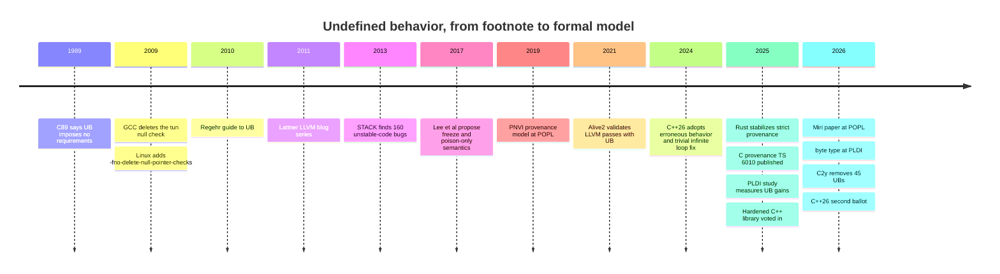
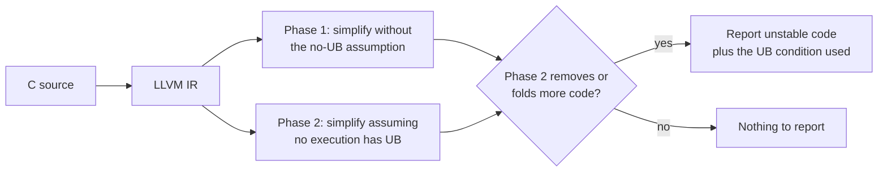

---
tags:
  - compilers
  - undefined-behavior
  - language-semantics
  - c
  - cpp
  - rust
  - llvm
  - pointer-provenance
  - sanitizers
status: complete
sources:
  - https://www.open-std.org/jtc1/sc22/wg14/www/docs/n3220.pdf
  - https://open-std.org/jtc1/sc22/wg14/www/docs/n3957.pdf
  - https://open-std.org/Jtc1/sc22/wg14/www/docs/n3529.pdf
  - https://www.open-std.org/JTC1/SC22/wg14/www/docs/n3128.pdf
  - https://lwn.net/SubscriberLink/1095811/cee1f42ac01e5fbc/
  - https://open-std.org/JTC1/SC22/WG21/docs/papers/2024/p1494r4.html
  - https://open-std.org/JTC1/SC22/WG21/docs/papers/2024/p2795r5.html
  - https://open-std.org/JTC1/SC22/WG21/docs/papers/2024/p2809r3.html
  - https://eel.is/c++draft/intro.progress
  - https://libcxx.llvm.org/Status/Cxx26.html
  - https://clang.llvm.org/cxx_status.html
  - https://gcc.gnu.org/gcc-16/changes.html
  - https://lists.llvm.org/pipermail/cfe-commits/Week-of-Mon-20260413/834958.html
  - https://herbsutter.com/2026/03/
  - https://herbsutter.com/category/c/
  - https://blog.llvm.org/2011/05/what-every-c-programmer-should-know.html
  - https://blog.regehr.org/archives/213/embed
  - https://pdos.csail.mit.edu/papers/stack%3Asosp13.pdf
  - https://lwn.net/Articles/342330/
  - https://lkml.iu.edu/hypermail/linux/kernel/0907.2/00714.html
  - https://www-old.cs.utah.edu/~regehr/papers/undef-pldi17.pdf
  - https://llvm.org/docs/UndefinedBehavior.html
  - https://llvm.org/docs/LangRef.html
  - https://web.ist.utl.pt/nuno.lopes/pubs/byte-type-pldi26.pdf
  - https://web.ist.utl.pt/nuno.lopes/pubs/ub-pldi25.pdf
  - https://www.cl.cam.ac.uk/~km569/exploring_provenance.pdf
  - https://www.open-std.org/JTC1/SC22/WG14/www/docs/n2624.pdf
  - https://www.iso.org/standard/81899.html
  - https://www.npopov.com/2026/01/31/This-year-in-LLVM-2025.html
  - https://doc.rust-lang.org/std/ptr/fn.with_exposed_provenance.html
  - https://lwn.net/Articles/1004656
  - https://doc.rust-lang.org/reference/behavior-considered-undefined.html
  - https://research.ralfj.de/papers/2026-popl-miri.pdf
  - https://clang.llvm.org/docs/UndefinedBehaviorSanitizer.html
  - https://arxiv.org/pdf/2606.12064
  - https://releases.llvm.org/20.1.0/tools/clang/docs/ReleaseNotes.html
created: 2026-11-26
updated: 2026-11-26
---

## Table Of Contents

- [[#TL;DR|TL;DR]]
- [[#The Problem|The Problem]]
- [[#Foundations|Foundations]]
    - [[#Four Kinds of Behavior|Four Kinds of Behavior]]
    - [[#Why the Standards Leave Holes|Why the Standards Leave Holes]]
    - [[#UB as a Refinement Contract|UB as a Refinement Contract]]
    - [[#Immediate and Deferred UB|Immediate and Deferred UB]]
- [[#How We Got Here|How We Got Here]]
- [[#How It Works|How It Works]]
    - [[#Signed Overflow and Induction Variable Widening|Signed Overflow and Induction Variable Widening]]
    - [[#Null Check Deletion and the tun Bug|Null Check Deletion and the tun Bug]]
    - [[#Infinite Loops and Forward Progress|Infinite Loops and Forward Progress]]
    - [[#Time Travel|Time Travel]]
    - [[#Strict Aliasing|Strict Aliasing]]
    - [[#STACK and Unstable Code|STACK and Unstable Code]]
    - [[#LLVM IR - undef, poison and freeze|LLVM IR - undef, poison and freeze]]
    - [[#Pointer Provenance|Pointer Provenance]]
    - [[#Rust - No UB in Safe Code|Rust - No UB in Safe Code]]
    - [[#Escape Hatches and Sanitizers|Escape Hatches and Sanitizers]]
    - [[#C++26 - Erroneous Behavior and Hardening|C++26 - Erroneous Behavior and Hardening]]
- [[#Where It Is Now|Where It Is Now]]
    - [[#Standards|Standards]]
    - [[#Compilers and IR|Compilers and IR]]
    - [[#Rust and Tooling|Rust and Tooling]]
- [[#Trade-offs & Open Problems|Trade-offs & Open Problems]]
- [[#Resources|Resources]]
- [[#Related Notes|Related Notes]]

## ***TL;DR***
---
*Undefined behavior (UB) is the part of a language contract where the standard "imposes no requirements", and optimizers read it as "this never happens". That one reading powers real optimizations, causes real security bugs, and forces compiler IRs to carry a precise model of what "never happens" means.*

- **UB is a promise the programmer makes.** C defines UB as behavior "for which this document imposes no requirements" ([N3220, 3.5.3](https://www.open-std.org/jtc1/sc22/wg14/www/docs/n3220.pdf)). A compiler may assume a correct program never executes it, so code that would only matter in the UB case (an overflow check, a null check, a loop exit) can be deleted.
- **The wins are real but smaller than the folklore.** Signed-overflow UB lets Clang drop a sign extension from every loop iteration (real output below). But a 2025 study that switched off 18 kinds of UB exploitation in LLVM found "the end-to-end performance gains are minimal" across 129 tests, with outliers such as simdjson losing 13% ([Popescu and Lopes, PLDI 2025](https://web.ist.utl.pt/nuno.lopes/pubs/ub-pldi25.pdf)).
- **The costs are security bugs.** GCC deleting a null check that followed a dereference turned a Linux `tun` driver bug into a root exploit in 2009 ([LWN](https://lwn.net/Articles/342330/)); the STACK checker found 160 such bugs and estimated that 40% of Debian Wheezy's C/C++ packages contain "unstable code" ([Wang et al., SOSP 2013](https://pdos.csail.mit.edu/papers/stack%3Asosp13.pdf)).
- **IRs model UB precisely.** LLVM separates *immediate* UB from *deferred* UB (`poison`), uses `freeze` to stop poison from spreading, and has deprecated `undef`; a PLDI 2026 byte type attacks its last big use, loads of uninitialized memory ([Lobo et al.](https://web.ist.utl.pt/nuno.lopes/pubs/byte-type-pldi26.pdf)).
- **A pointer is more than an address.** Two pointers with identical bits can legally behave differently because of *provenance*. C has a provenance Technical Specification (PNVI-ae-udi), Rust has strict provenance APIs on stable, and LLVM is building a formal provenance model.
- **As of November 2026**, the C2y draft has voted out 45 UB items ([Uecker, N3957](https://open-std.org/jtc1/sc22/wg14/www/docs/n3957.pdf)); C++26 makes uninitialized reads *erroneous* instead of undefined and adds a hardened standard library, and is in a second approval ballot after the first failed over contracts ([Sutter](https://herbsutter.com/category/c/)); Rust keeps UB out of safe code and checks unsafe code with Miri ([Jung et al., POPL 2026](https://research.ralfj.de/papers/2026-popl-miri.pdf)).

## ***The Problem***
---
*Programmers read C as "portable assembly", where `x + 1` does whatever the CPU does. Optimizers read it as a contract whose fine print says some programs have no meaning at all. When the two readings disagree, code that "obviously" checks for an error silently disappears.*

A short example makes the gap concrete. On x86-64, `INT_MAX + 1` wraps to `INT_MIN` in hardware. But the C standard says signed overflow is undefined, so a compiler may assume it never happens, and then `x + 1 > x` is simply true:

```c
int inc_gt(int x) { return x + 1 > x; }   // called with x == INT_MAX
```

Real results on this machine (Ubuntu clang 18.1.3, GCC 13.3): `clang -O0` prints `0` (the add wrapped), `clang -O2` prints `1` (the comparison was folded away), and GCC prints `1` even at `-O0`. Same source, same CPU, different answers, and all of them are "correct", because a program that overflows a signed `int` has no required behavior.

That is harmless in a toy. It is not harmless when the deleted comparison was a bounds check or a null check in a kernel. Three groups pull in different directions:

| Who | Wants | Pain point |
|---|---|---|
| Optimizer writers | Maximal freedom: assume no overflow, no null deref, no aliasing across types | Every assumption must be justified by a precise semantics, or passes contradict each other |
| Systems programmers | Predictable, "what the hardware does" semantics | Checks written after the fact get deleted; old code breaks on new compilers |
| Language designers | Portability across odd hardware and cheap implementations | Hundreds of UB cases, many nobody remembers |

The rest of this note is about how each group's demands got encoded: in the standards (C, C++, Rust), in compiler IRs (LLVM's poison and `freeze`), and in tools (UBSan, Miri, STACK). For how the same semantics drives everyday rewrites, see [[Classic Optimizations]]; for how it decides whether a fuzzer's test is even valid, see [[Compiler Testing and Fuzzing]].

## ***Foundations***
---
*C and C++ sort behavior into well-defined, implementation-defined, unspecified and undefined. Only the last one lets the compiler assume something "can't happen", and modern IRs split it further into immediate UB and deferred UB.*

### Four Kinds of Behavior

*The standards give compilers different amounts of freedom depending on which category an operation falls into.*

The C23 working draft defines three of the four terms in clause 3.5 ([N3220](https://www.open-std.org/jtc1/sc22/wg14/www/docs/n3220.pdf)); C++26 adds a fifth:

| Category | Definition (C23 wording unless noted) | Standard's example | What the compiler may do |
|---|---|---|---|
| Well-defined | The standard says exactly what happens | `unsigned` overflow wraps modulo $2^N$ | Nothing surprising |
| Implementation-defined | "unspecified behavior where each implementation documents how the choice is made" | Right-shifting a negative signed integer | Pick one behavior, document it, stick to it |
| Unspecified | "two or more possibilities and imposes no further requirements on which is chosen in any instance" | Order of evaluating function arguments | Pick any listed option, possibly differently each time, no documentation |
| Undefined | "behavior, upon use of a nonportable or erroneous program construct or of erroneous data, for which this document imposes no requirements" | Dereferencing a null pointer | Anything; in practice, assume it never happens |
| Erroneous (C++26) | "well-defined behavior that the implementation is recommended to diagnose" ([P2795R5](https://open-std.org/JTC1/SC22/WG21/docs/papers/2024/p2795r5.html)) | Reading an uninitialized local | Produce a fixed value, should diagnose, may not assume it never happens |

A note in the C definition of UB says the possible outcomes range "from ignoring the situation completely with unpredictable results" to behaving "in a documented manner characteristic of the environment" to terminating with a diagnostic. Annex J.2 lists the cases. The modern compiler reading takes the first option literally: ignoring the situation means generating code as though it could not occur.

### Why the Standards Leave Holes

*UB exists for portability across very different hardware and for speed: defining the behavior would cost a check, an extra instruction, or an ABI change.*

Chris Lattner's 2011 series gives the standard list of reasons, each tied to a cost ([LLVM blog](https://blog.llvm.org/2011/05/what-every-c-programmer-should-know.html)):

- **Uninitialized variables**: defining them would force zeroing stack arrays and `malloc` memory that is usually overwritten anyway.
- **Signed overflow**: lets `X+1 > X` fold to true, and lets the compiler assume `for (i = 0; i <= N; ++i)` runs exactly $N+1$ times. With wrapping, the loop is infinite when `N == INT_MAX`, which blocks loop optimizations.
- **Oversized shifts**: CPUs disagree on `x << 32`, so defining it would cost an extra instruction on every variable shift.
- **Out-of-bounds and wild pointers**: defining them would need a range check on every access and an ABI change.
- **Null dereference**: not defined to trap, which lets scalar optimizations exposed by inlining and macro expansion run freely.
- **Type rule violations**: accessing an `int` through a `float*` is UB, which enables type-based alias analysis; Lattner's example turns a 10,000-iteration float-zeroing loop into one `memset`.

Two different motives are mixed in that list. Some UB is about **portability** (CPUs really do disagree about oversized shifts), and some is about **optimization** (nothing in hardware forces type-based aliasing; the rule exists so the compiler can assume it). Once compilers exploit a rule, removing it has a performance cost, which is why UB accumulates. Martin Uecker's WG14 status papers now sort the 200-plus entries in Annex J.2 by remedy, and the first color, green, is "items which could be defined or made a constraint violation" with no run-time cost at all ([N3529](https://open-std.org/Jtc1/sc22/wg14/www/docs/n3529.pdf)).

### UB as a Refinement Contract

*A compiler is correct if every behavior of the compiled program is a behavior the source program was allowed to have; UB means "every behavior is allowed", so anything refines it.*

Formally, write $\mathrm{Beh}(P, i)$ for the set of behaviors (outputs, traces) program $P$ may show on input $i$. A transformation from source $S$ to target $T$ is correct when

$$\forall i.\;\; \mathrm{Beh}(T, i) \subseteq \mathrm{Beh}(S, i), \qquad \text{and if } S \text{ has UB on } i \text{ then } \mathrm{Beh}(S, i) = \text{everything}.$$

**In plain English:** the compiled code may only do things the source was allowed to do. On inputs where the source hits UB, the source was allowed to do anything, so the compiler owes nothing on those inputs and can pick whichever code is fastest for the other inputs. This is the definition [[Verified Compilers]] and Alive2 use.

That is why UB enables optimization: it shrinks the set of inputs the compiler must care about. `x + 1 > x` must equal `true` on every input where it is defined, which is every input except `INT_MAX`; for that one input anything goes, so `true` is a valid answer everywhere.

### Immediate and Deferred UB

*Real IRs need two strengths of UB: one that fires immediately (a trap-like "no meaning from here on") and one that is a poisoned value, harmless until it is used in a way that matters.*

If an IR treated every overflowing add as immediate UB, it could not hoist an `add` out of a branch (speculation), because the hoisted add might overflow on a path where the original never ran. LLVM therefore has "two forms of undefined behavior ... immediate UB and deferred UB" ([LLVM UB manual](https://llvm.org/docs/UndefinedBehavior.html)):

- **Immediate UB**: division by zero, dereferencing an invalid pointer, branching on poison. The program has no meaning from here.
- **Deferred UB**: the values `poison` and (deprecated) `undef`. An `add nsw` that overflows produces poison, which propagates through arithmetic and only becomes immediate UB when it reaches a branch, an address, or another place where it matters.

The manual orders them by how much freedom each gives:

$$\text{immediate UB} \;>\; \text{poison} \;>\; \text{undef} \;>\; \text{freeze(poison)} \;>\; \text{concrete value}$$

**In plain English:** a transformation may replace something on the left with something on its right (turn poison into a concrete number), never the reverse. [[Classic Optimizations]] covers how InstCombine uses this; [[#LLVM IR - undef, poison and freeze|below]] covers why `undef` is being removed.

## ***How We Got Here***
---
*UB went from a portability footnote to an optimization contract (2000s), then to a source of security bugs (2009 to 2013), then to something compilers and standards model formally and actively shrink (2017 onward).*



| Year | Event | Why it mattered |
|---|---|---|
| 1989 | ANSI C defines UB as imposing "no requirements" (wording kept through C23, per [LWN](https://lwn.net/SubscriberLink/1095811/cee1f42ac01e5fbc/) and [N3220](https://www.open-std.org/jtc1/sc22/wg14/www/docs/n3220.pdf)) | The legal basis for every later optimization |
| 2009 | GCC removes the `!tun` check in `tun_chr_poll()`; the kernel adds `-fno-delete-null-pointer-checks` ([LWN](https://lwn.net/Articles/342330/), [patch](https://lkml.iu.edu/hypermail/linux/kernel/0907.2/00714.html)) | The standard cautionary tale of an optimization turning a bug into an exploit |
| 2010 | John Regehr's three-part guide to UB in C and C++ ([Regehr](https://blog.regehr.org/archives/213/embed)) | The programmer's-side explanation |
| 2011 | Chris Lattner's "What Every C Programmer Should Know About Undefined Behavior" ([LLVM blog](https://blog.llvm.org/2011/05/what-every-c-programmer-should-know.html)) | The compiler writer's side: what each UB buys |
| 2013 | STACK (SOSP) formalizes "unstable code" and finds 160 bugs ([Wang et al.](https://pdos.csail.mit.edu/papers/stack%3Asosp13.pdf)) | Showed the problem was systemic, not anecdotal |
| 2017 | Lee et al., "Taming Undefined Behavior in LLVM" (PLDI): `undef` and poison were inconsistent; `freeze` proposed ([paper](https://www-old.cs.utah.edu/~regehr/papers/undef-pldi17.pdf)) | Turned LLVM's UB into a coherent semantics |
| 2019 | Memarian et al., "Exploring C Semantics and Pointer Provenance" (POPL) ([paper](https://www.cl.cam.ac.uk/~km569/exploring_provenance.pdf)) | The PNVI family that became C's provenance TS |
| 2023 | Uecker's N3128 proposes that UB must not erase earlier I/O or volatile accesses ([N3128](https://www.open-std.org/JTC1/SC22/wg14/www/docs/n3128.pdf)) | "No time travel" enters the standards debate |
| 2024 | C++26 adopts erroneous behavior (P2795R5) and "trivial infinite loops are not UB" (P2809R3) | First C++ steps to shrink UB rather than add to it |
| 2025 | Rust 1.84 stabilizes strict provenance APIs ([Rust docs](https://doc.rust-lang.org/std/ptr/fn.with_exposed_provenance.html)); ISO publishes TS 6010, C's provenance model, in May ([ISO](https://www.iso.org/standard/81899.html)); C++26 votes in library hardening and observable checkpoints ([libc++ status](https://libcxx.llvm.org/Status/Cxx26.html)); Popescu and Lopes measure UB's payoff ([PLDI 2025](https://web.ist.utl.pt/nuno.lopes/pubs/ub-pldi25.pdf)) | Provenance and hardening reach production; evidence that UB buys little on average |
| 2026 | Miri paper (POPL); "Towards Removing Undef Values from LLVM IR" (PLDI); C2y at 45 UBs removed; C++26 finished in March, first DIS ballot fails, finished again in November | See [[#Where It Is Now|Where It Is Now]] |

## ***How It Works***
---
*Each classic exploitation follows the same pattern: the compiler proves that some path would execute UB, concludes the path is impossible, and deletes or simplifies whatever only mattered on that path. The examples below are real compiler output unless marked as a sketch.*

All assembly below is from Ubuntu clang 18.1.3 or GCC 13.3.0 on x86-64, compiled with `-O2 -fno-asynchronous-unwind-tables -fcf-protection=none` and assembler directives removed.

### Signed Overflow and Induction Variable Widening

*Because a signed loop counter "cannot" overflow, the compiler can keep it in a 64-bit register and skip re-sign-extending it every iteration.*

```c
void scale(float *a, int n, int k) {
    for (int i = 0; i < n; i += k)
        a[i] *= 2.0f;
}
```

On x86-64, `a[i]` needs a 64-bit index, but `i` is a 32-bit `int`. If `i` were allowed to wrap, the compiler would have to sign-extend it again after every `i += k`. Clang lowers C's signed `+` to `add nsw` ("no signed wrap"; overflow gives poison), and induction variable simplification uses that flag to widen `i` to 64 bits:

```asm
; clang -O2 -fno-unroll-loops (default)          ; clang -O2 -fno-unroll-loops -fwrapv
scale:                                           scale:
    testl   %esi, %esi                               testl   %esi, %esi
    jle     .LBB0_3                                  jle     .LBB0_3
    movslq  %edx, %rax       ; sext k once           xorl    %eax, %eax
    movl    %esi, %ecx                           .LBB0_2:
    xorl    %edx, %edx                               cltq                     ; sext i EVERY iteration
.LBB0_2:                                             movss   (%rdi,%rax,4), %xmm0
    movss   (%rdi,%rdx,4), %xmm0                     addss   %xmm0, %xmm0
    addss   %xmm0, %xmm0                             movss   %xmm0, (%rdi,%rax,4)
    movss   %xmm0, (%rdi,%rdx,4)                     addl    %edx, %eax       ; 32-bit add
    addq    %rax, %rdx       ; 64-bit add            cmpl    %esi, %eax
    cmpq    %rcx, %rdx                               jl      .LBB0_2
    jl      .LBB0_2                              .LBB0_3:
.LBB0_3:                                             retq
    retq
```

The IR shows the cause. At `-O0` the increment is `add nsw i32` by default and plain `add i32` under `-fwrapv`; after `-O2` the default loop's induction variable is an `i64` phi, while the `-fwrapv` loop keeps an `i32` phi plus `sext i32 %7 to i64` inside the loop body. One `cltq` per iteration looks cheap, but Lee et al. report that justifying this widening "improves performance by up to 39%" ([PLDI 2017](https://www-old.cs.utah.edu/~regehr/papers/undef-pldi17.pdf)); [[Loop Optimizations]] covers induction variable passes in general.

### Null Check Deletion and the tun Bug

*If a pointer has already been dereferenced, a later null check is "dead": either the pointer was non-null, or the program already had UB.*

The Linux 2.6.30 `tun` driver started like this ([LWN, July 2009](https://lwn.net/Articles/342330/)):

```c
struct sock *sk = tun->sk;    /* dereference first */
unsigned int mask = 0;
if (!tun)                     /* check second */
    return POLLERR;
```

GCC reasoned that `tun` had already been dereferenced, so it could not be NULL, and removed the check. In the kernel, page zero can be mapped (here, via an SELinux policy that allowed it, or via a setuid program run under the SVR4 personality), so the dereference does not fault. The exploit used the now-unchecked path to flip a bit in the driver's `file_operations`, then got the kernel to jump into attacker code at address zero ([LWN](https://lwn.net/Articles/342330/)). It became CVE-2009-1897, and STACK later used it as a motivating example ([Wang et al.](https://pdos.csail.mit.edu/papers/stack%3Asosp13.pdf)).

A minimal reproduction, real output:

```c
struct sock; struct tun_struct { struct sock *sk; int flags; };
unsigned int tun_chr_poll(struct tun_struct *tun) {
    struct sock *sk = tun->sk;   /* dereference first */
    if (!tun)                    /* null check after */
        return 1;                /* POLLERR stand-in */
    return sk ? 4 : 0;
}
```

```asm
; gcc -O2: check gone             ; gcc -O2 -fno-delete-null-pointer-checks
tun_chr_poll:                     tun_chr_poll:
    xorl    %eax, %eax                testq   %rdi, %rdi      ; if (!tun)
    cmpq    $0, (%rdi)                je      .L3
    setne   %al                       xorl    %eax, %eax
    sall    $2, %eax                  cmpq    $0, (%rdi)
    ret                               setne   %al
                                      sall    $2, %eax
                                      ret
                                  .L3:
                                      movl    $1, %eax
                                      ret
```

Clang 18 produces the same two shapes. The kernel's response was a one-line `Makefile` change adding `-fno-delete-null-pointer-checks` to `KBUILD_CFLAGS`, next to the `-fno-strict-aliasing` already there; the commit message calls the real fix "to stop using dev before it is tested" but says the flag "at least makes it harder to abuse" ([patch, July 2009](https://lkml.iu.edu/hypermail/linux/kernel/0907.2/00714.html)).

### Infinite Loops and Forward Progress

*C++ lets the compiler assume that a loop with no side effects terminates; an infinite empty loop therefore "can't happen", and Clang used to delete it along with the function's return.*

C++'s forward progress rule lets the implementation assume "that any thread will eventually" terminate, call a library I/O function, access a volatile glvalue, perform an atomic or synchronization operation, call `std::this_thread::yield`, or (new in C++26) "continue execution of a trivial infinite loop" ([intro.progress](https://eel.is/c++draft/intro.progress)). C has a narrower rule: an implementation may assume termination only for a loop whose controlling expression is *not* a constant expression, so `while (1) {}` is fine in C ([P2809R3](https://open-std.org/JTC1/SC22/WG21/docs/papers/2024/p2809r3.html)). The difference is visible with the paper's own example:

```cpp
#include <cstdio>
int main() {
    while (1) { }          // no I/O, no volatile, no atomics
}
void unreachable() { std::puts("Hello world!"); }
```

```asm
; clang++ 18 -O2 -std=c++20               ; clang 18 -O2, same code compiled as C
main:                                      main:
_Z11unreachablev:                          .LBB0_1:
    leaq    .L.str(%rip), %rdi                 jmp     .LBB0_1
    jmp     puts@PLT                       unreachable:
                                               leaq    .L.str(%rip), %rdi
                                               jmp     puts@PLT
```

In C++ mode `main` is *empty*: no loop, no `ret`. Execution falls through into the next function. Running the binary really prints `Hello world!` and exits with status 13 (whatever `puts` returned). GCC 13 keeps the loop (`.L2: jmp .L2`) in both languages; it is allowed to, since UB permits any behavior including the "expected" one.

P2809R3 fixes the most common case for C++26: a *trivial infinite loop* (an iteration statement with an empty body and a condition that is a constant expression converting to true) is replaced by repeated calls to `std::this_thread::yield`, and the forward-progress note gains "An affordance is made for trivial infinite loops, which cannot be removed nor reordered" ([P2809R3](https://open-std.org/JTC1/SC22/WG21/docs/papers/2024/p2809r3.html)). Clang lists it as implemented in Clang 19 and applies it as a defect report to older modes ([Clang C++ status](https://clang.llvm.org/cxx_status.html)). Non-trivial side-effect-free loops (with a non-constant condition, or a non-empty body) are still assumed to terminate.

### Time Travel

*UB on a later path can change the meaning of code that runs before it, because the compiler reasons about whole executions, not about the moment the bad operation happens.*

```c
int table[4];
int exists_in_table(int v) {
    for (int i = 0; i <= 4; i++)      /* off by one: reads table[4] */
        if (table[i] == v) return 1;
    return 0;
}
```

```asm
; gcc 13 -O2
exists_in_table:
    movl    $1, %eax
    ret
```

The reasoning: if the loop reaches `i == 4` it reads out of bounds, which is UB. So in any defined execution, one of `table[0..3]` matched and the function returned 1 first. Therefore "return 1" is a valid compilation for every defined execution, and the comparisons that run *before* the bad read are gone too. (Clang 18 keeps the comparisons, vectorizes the first four and still loads `table+16`; both are allowed.)

Whether UB may also erase *observable* effects that already happened is where standards and compilers now draw a line:

- **LLVM** says immediate UB can move above observable effects only when the function is marked `willreturn`; otherwise UB "does not time-travel" ([LLVM UB manual](https://llvm.org/docs/UndefinedBehavior.html)).
- **C**: Uecker's N3128 proposed a note that "all observable behavior, i.e. I/O or volatile accesses, shall appear as specified" even if a later operation has UB, using a reactor-shutdown controller as the motivating example ([N3128](https://www.open-std.org/JTC1/SC22/wg14/www/docs/n3128.pdf)). LWN's 2026 report of Uecker's talk says C23 includes a "no time travel" stipulation of this kind ([LWN](https://lwn.net/SubscriberLink/1095811/cee1f42ac01e5fbc/)); the definition of UB itself in N3220 has no such note, so the exact place of the wording is not confirmed here.
- **C++26** adopted P1494R5 "Partial program correctness": execution is split into epochs at *observable checkpoints*, and if an epoch completes without UB its observable behavior must happen ([P1494R4](https://open-std.org/JTC1/SC22/WG21/docs/papers/2024/p1494r4.html)). P3641R0 renamed the library function to `std::observable_checkpoint()` ([libc++ status](https://libcxx.llvm.org/Status/Cxx26.html)).

`__builtin_unreachable()` (C23 `unreachable()`) is the explicit version of the same trick: the programmer asserts a path is UB, and the compiler deletes everything that only leads there.

### Strict Aliasing

*Type-based alias analysis assumes an `int*` and a `float*` never point at the same object; code that type-puns through casts has UB and can read stale values.*

This is covered in depth, with real Clang 18 output and the LLVM `!tbaa` type tree, in [[Pointer and Alias Analysis]]. The UB-relevant summary: C's effective-type rule (C11 6.5p7) makes type punning through incompatible pointers undefined, so compilers attach type tags to memory accesses and answer "NoAlias" for incompatible types. Clang 20 made the rule *stricter* by giving distinct tags to different pointer types, added `-fno-pointer-tbaa` as an escape hatch, and shipped a type sanitizer to catch violations ([Clang 20 notes](https://releases.llvm.org/20.1.0/tools/clang/docs/ReleaseNotes.html)). Code that must pun uses `memcpy`, a `union` in C, or `std::bit_cast` in C++; the Linux kernel simply builds with `-fno-strict-aliasing` ([patch context](https://lkml.iu.edu/hypermail/linux/kernel/0907.2/00714.html)).

### STACK and Unstable Code

*STACK finds code that a UB-exploiting optimizer could delete but a "UB means wrap/trap" compiler could not, and reports it as a likely bug.*

Wang, Zeldovich, Kaashoek and Solar-Lezama defined **unstable code** as "code that is unexpectedly discarded by compiler optimizations due to undefined behavior in the program" ([SOSP 2013](https://pdos.csail.mit.edu/papers/stack%3Asosp13.pdf)). Their canonical example is a pointer-overflow check (sketch after the paper's Figure 1):

```c
char *buf = ...; unsigned int len = ...;
if (buf + len < buf)    /* "did the pointer wrap?" */
    return;             /* but pointer overflow is UB, so this is always false */
```

STACK runs the optimizer's reasoning twice, once without and once with the **well-defined program assumption** (no execution hits UB), and asks a solver (Boolector) whether a branch becomes unreachable or an expression becomes simpler only under the second assumption:



Results: 160 new bugs confirmed and fixed (32 in the Linux kernel, 9 in Postgres, 21 in FFmpeg and Libav, 11 in Kerberos, among others), unstable code in 3,471 of 8,575 Debian Wheezy packages (about 40%), and every one of the 12 compilers they tested discarded at least one unstable example at some optimization level ([Wang et al.](https://pdos.csail.mit.edu/papers/stack%3Asosp13.pdf)). The lesson: UB bugs are not exotic; they are ordinary defensive checks written in the wrong order.

### LLVM IR - undef, poison and freeze

*LLVM had two kinds of "deferred UB" value that did not agree with each other; the fix was to make poison the main one, add `freeze` to stop it, and retire `undef`.*

The semantics, from the [LLVM UB manual](https://llvm.org/docs/UndefinedBehavior.html):

- **`undef`** "represents any value of a given type", and each *use* may see a different value, so `add i32 %v, %v` is not guaranteed to be even when `%v` is undef.
- **`poison`** is "a stronger form of deferred UB than undef": it taints everything computed from it, except that "`select` acts as a barrier for poison propagation".
- **`freeze`** picks one arbitrary but fixed value: "the value returned by `freeze` is the same for all users". On a concrete value it does nothing.
- **Branching on poison or undef is immediate UB.**

Why `undef` is a problem: because each use can differ, even simple rewrites break. Replacing `y * 2` with `y + y` is invalid when `y` is undef, since `y + y` could be odd while `2 * y` is always even ([Lobo et al., PLDI 2026](https://web.ist.utl.pt/nuno.lopes/pubs/byte-type-pldi26.pdf)). Lee et al. showed LLVM's passes had assumed contradictory semantics (GVN wanted "branch on poison is UB", loop unswitching assumed the opposite) and fixed it with `freeze` ([PLDI 2017](https://www-old.cs.utah.edu/~regehr/papers/undef-pldi17.pdf)); [[Classic Optimizations]] tells that story.

You can watch both rules in today's optimizer. Real `opt` 18 output:

```llvm
; input                                  ; opt -passes=instcombine
define i1 @src(i32 %a, i32 %b) {         define i1 @src(i32 %a, i32 %b) {
  %s = add nsw i32 %a, %b                  %c = icmp sgt i32 %b, 0
  %c = icmp sgt i32 %s, %a                 ret i1 %c
  ret i1 %c                              }
}
```

`a + b > a` became `b > 0`, which is only valid because the `nsw` overflow case is poison. And loop unswitching, which hoists a branch on `%c` out of a loop that may run zero times, must freeze the condition first, since the original program never branched on `%c` when the loop did not run:

```llvm
; opt -passes='loop-mssa(simple-loop-unswitch<nontrivial>)' on a loop that
; tests %c inside the body and may execute zero times (real output, first lines)
define void @f(ptr %a, i32 %n, i1 %c) {
entry:
  %c.fr = freeze i1 %c
  br i1 %c.fr, label %entry.split.us, label %entry.split
```

When the loop is guaranteed to run at least once, the same pass emits no `freeze`, because the original already branched on `%c`. Front ends reduce the need for freezes by marking values `noundef`, a promise that they hold no undef or poison bits ([LangRef](https://llvm.org/docs/LangRef.html)); compiling the same function from C, Clang 18 marks all three parameters `noundef` (and at `-O2` turns the branch into a `select` rather than unswitching).

**Removing `undef`.** The UB manual now says "Undef values are deprecated and should be used only when strictly necessary", essentially for loads of uninitialized memory. The PLDI 2026 paper reports that from LLVM 10 to 21 the community removed 302 (58%) of LLVM's `undef` uses and 51 (66%) of Clang's. The remaining big use is uninitialized memory, plus `memcpy` lowered to integer loads and stores, which loses provenance and per-bit poison. Their fix is a **byte type** `bN` whose bits are each an integer bit, a pointer bit (with provenance), or poison, plus a "freezing load" (`load i32, ptr %v, !freeze`) so loads of uninitialized memory can return poison. Measured over 20 programs (6.0 million lines), the byte type cost 1.6% run time on average (worst 6.4%), falling to 0.8% with new optimizations and 0.2% once loads may type-pun; 11 LLVM unit tests that Alive2 had flagged as unsound now pass ([Lobo et al.](https://web.ist.utl.pt/nuno.lopes/pubs/byte-type-pldi26.pdf)). LLVM 23's release notes already mention backend support for the IR byte type ([[Pointer and Alias Analysis]] has the details).

### Pointer Provenance

*A pointer carries an invisible "which allocation am I allowed to touch" tag; two pointers with equal bits can therefore be different values to the optimizer.*

Real output, GCC 13 at `-O2` (whether the `if` is taken depends on where the linker places `x` and `y`; with this declaration order it is):

```c
int y = 2, x = 1;
int main(void) {
    int *p = &x + 1;          /* one past x: a valid pointer, but not to y */
    int *q = &y;
    if (memcmp(&p, &q, sizeof p) == 0) {   /* same address bits? */
        *p = 11;              /* UB: p's provenance is x, not y */
        printf("x=%d y=%d *p=%d *q=%d\n", x, y, *p, *q);
    }
}
```

```text
$ gcc -O2 prov.c && ./a.out
x=1 y=2 *p=11 *q=2
```

`p` and `q` have the same bits, the program wrote 11 through `p`, yet `*q` and `y` read 2. GCC's points-to analysis knows `p` is derived from `&x`, so a store through `p` cannot change `y`. This exact test is in Memarian et al.'s POPL 2019 study, which reported the same `x=1 y=2 *p=11 *q=2` from GCC 8.1 at `-O2` and concluded the compiler "is reasoning that *p does not alias with y or *q"; the paper argues the program should therefore have UB ([paper](https://www.cl.cam.ac.uk/~km569/exploring_provenance.pdf)). That work led to the **PNVI** family: *Provenance Not Via Integers*. Pointers carry provenance; integers do not, and an integer-to-pointer cast recovers provenance from whatever live object contains the address. The variant WG14 chose, **PNVI-ae-udi**, adds two refinements ([N2624](https://www.open-std.org/JTC1/SC22/WG14/www/docs/n2624.pdf)):

- **ae, address exposed**: a cast may "recreate provenance only for storage instances that have previously been exposed", where exposure means casting a pointer to an integer, reading its bytes as a non-pointer type, or printing it with `%p`.
- **udi, user disambiguation**: an integer that could be one-past-the-end of one object *or* the start of the next gets a provenance left "unknown until the first operation" (an access, arithmetic, a comparison) that disambiguates it.

ISO published this in May 2025 as Technical Specification TS 6010, "A provenance-aware memory object model for C", which "builds upon ISO/IEC 9899:2018 by constraining and clarifying the Memory Object Model" ([ISO](https://www.iso.org/standard/81899.html)). The full model deserves its own note, [[Memory Models and Pointer Provenance]].

The same split appears in the other two worlds:

- **LLVM**: LLVM 22 added `ptrtoaddr`, which returns only a pointer's address and "does not expose the provenance of the pointer", unlike `ptrtoint`, whose exposure side effect LLVM currently ignores; a formal-specification group is targeting provenance with the byte type as a prerequisite ([Popov, This year in LLVM 2025](https://www.npopov.com/2026/01/31/This-year-in-LLVM-2025.html)).
- **Rust**: Rust 1.84 (January 2025) stabilized the **strict provenance** and **exposed provenance** APIs ([Rust docs](https://doc.rust-lang.org/std/ptr/fn.with_exposed_provenance.html); [LWN discussion](https://lwn.net/Articles/1004656)). Code does address arithmetic while keeping provenance (`addr`, `with_addr`, `map_addr`), or opts into the PNVI-ae-style escape hatch explicitly (`expose_provenance`, `with_exposed_provenance`). The docs warn that the exposed form "may not be supported by tools that help you to stay conformant with the Rust memory model" and recommend `with_addr` wherever possible. Real run on rustc 1.97:

```rust
let x = [10u32, 20, 30];
let p: *const u32 = x.as_ptr();
let tagged = p.map_addr(|a| a | 1);          // stash a tag bit, keep provenance
let back = tagged.map_addr(|a| a & !1);      // clear it again
println!("{}", unsafe { *back.add(2) });     // prints 30
let addr: usize = p.expose_provenance();     // explicit: this allocation is exposed
let q: *const u32 = std::ptr::with_exposed_provenance(addr);
println!("{}", unsafe { *q });               // prints 10
```

The lints that flag old-style `as` casts between integers and pointers (`fuzzy_provenance_casts`, `lossy_provenance_casts`) are still unstable on 1.97: rustc reports them as unknown lints on the stable channel.

### Rust - No UB in Safe Code

*Rust keeps UB in the language but fences it inside `unsafe`: safe code cannot cause it, and unsafe code must make sure safe callers never can.*

The Rust Reference is blunt: "`unsafe` only means that avoiding undefined behavior is on the programmer; it does not change anything about the fact that Rust programs must never cause undefined behavior." Unsafe code that no safe client can drive into UB is called **sound**; otherwise it is **unsound**. The list of UB (data races, dangling or misaligned access, breaking the aliasing rules, producing an invalid value such as a `bool` that is not 0 or 1, and more) "is not exhaustive", because "there is no formal model of Rust's semantics" yet ([Rust Reference](https://doc.rust-lang.org/reference/behavior-considered-undefined.html)).

Things that are UB in C are often defined in Rust. Integer overflow is the clearest case. Real runs on rustc 1.97:

```text
$ rustc of.rs && ./of          # debug: overflow check panics
thread 'main' panicked at of.rs:1:73:
attempt to add with overflow
$ rustc -O of.rs && ./of       # release: wraps, defined, no UB
-2147483648
```

Either way the optimizer may not assume "no overflow". The LLVM IR shows it (real `rustc -O --emit=llvm-ir` output): a plain `a + b` on `i32` becomes `add i32 %b, %a`, while the unsafe `a.unchecked_add(b)`, whose overflow *is* UB, becomes `add nsw i32 %b, %a`. Rust code that wants Clang-style overflow facts has to ask for them in `unsafe`. In exchange, Rust hands LLVM much stronger *aliasing* facts (`noalias` on `&mut`), which is where its UB rules really bite. Which aliasing model applies (Stacked Borrows or Tree Borrows) is still not settled; see [[Pointer and Alias Analysis]].

**Miri** is the enforcement tool: an interpreter for Rust's MIR that checks each executed operation against the rules. The POPL 2026 paper describes it as "the first tool that can find all de-facto Undefined Behavior in deterministic Rust programs" ([Jung et al.](https://research.ralfj.de/papers/2026-popl-miri.pdf)). It detects uninitialized reads, out-of-bounds and use-after-free, data races (vector clocks), weak-memory outcomes, invalid values, provenance and alignment violations, and aliasing violations. Running it over 59,136 crates took about 1.9 CPU-years and found UB in 4,595 of them (7.8%); 21.7% hit unsupported operations, mostly foreign code. It costs about 3,000 to 7,000 times native speed, it only checks executions it actually runs, and integer-to-pointer casts get "wildcard" provenance, so some bugs slip through ([Jung et al.](https://research.ralfj.de/papers/2026-popl-miri.pdf)).

### Escape Hatches and Sanitizers

*Every UB rule has a flag that turns it into defined behavior, and a sanitizer that turns it into a runtime error; neither is a substitute for fixing the code.*

| Flag (GCC and Clang) | Turns this UB into | Cost |
|---|---|---|
| `-fwrapv` | Signed overflow wraps (two's complement) | Loses IV widening and `x+1>x` folds (see the `cltq` above) |
| `-fno-strict-aliasing` | Type punning through pointers allowed | Loses TBAA; Lattner's `memset` example becomes 10,000 stores |
| `-fno-delete-null-pointer-checks` | Null checks after dereference are kept | Small; the Linux kernel has built with it since 2009 |
| `-ftrivial-auto-var-init=zero` or `=pattern` | Uninitialized locals get a known value | Extra stores; C++26 makes this behavior standard-sanctioned |
| `-fno-pointer-tbaa` (Clang 20+) | Pointer-typed objects share one alias tag | Loses Clang 20's stricter pointer TBAA |

**UndefinedBehaviorSanitizer** (UBSan) instruments the program to check for UB at run time: signed overflow, oversized shifts, misaligned or null access, out-of-range enum and `bool` loads, unreachable code reached, and more ([Clang UBSan docs](https://clang.llvm.org/docs/UndefinedBehaviorSanitizer.html)). Real runs, with the overflow behind `argc` so it is not constant-folded:

```text
$ gcc -O2 -fsanitize=undefined ov2.c && ./a.out
ov2.c:3:28: runtime error: signed integer overflow: 2147483647 + 1 cannot be represented in type 'int'
-2147483648
$ clang -O2 -fsanitize=signed-integer-overflow -fsanitize-trap=signed-integer-overflow ov.c && ./a.out
Illegal instruction          # SIGILL, exit status 132: the check trapped
```

Two lessons from the same session. First, UBSan only sees UB that survives to instrumentation: compiling `return x + 1 > x;` with `gcc -O0 -fsanitize=undefined` gave no report at all, because GCC folds the comparison to `1` before the instrumentation ever sees it (it prints `1` even at `-O0`). Second, trap mode "doesn't require UBSan run-time support" (the Clang install used here lacked UBSan's runtime, so only trap mode linked), and the docs also offer a minimal runtime "suitable for use in production environments". A clean sanitizer run never proves a program is UB-free ([[Compiler Testing and Fuzzing]] makes the same point for fuzzers); the planned [[Sanitizers]] note covers ASan, MSan, TSan and their implementation.

How common is sanitizer-visible UB in real software? A May 2026 experiment built a Gentoo GNOME desktop with GCC 15.2.1 and UBSan, ran 59 ordinary desktop tasks, and logged 10,914 unique warnings from 32 programs and libraries; 36 of 59 tasks produced at least one, and Mesa's `libgallium` alone accounted for about 98% ([Ruohonen and Sierszecki](https://arxiv.org/pdf/2606.12064)).

### C++26 - Erroneous Behavior and Hardening

*C++26 shrinks UB in two pragmatic ways: a new category for "wrong but bounded" behavior, and a standard library that checks its own preconditions.*

**Erroneous behavior (P2795R5).** Reading an uninitialized automatic variable used to be UB. In C++26 a default-initialized local gets a fixed, implementation-chosen value, and reading it is *erroneous*: "well-defined behavior that the implementation is recommended to diagnose" ([P2795R5](https://open-std.org/JTC1/SC22/WG21/docs/papers/2024/p2795r5.html)). Implementations are encouraged to diagnose the read, but the compiler may no longer assume it never happens, so none of the time-travel reasoning above applies. Code that cannot afford the initializing store opts out:

```cpp
// Sketch, C++26 semantics per P2795R5
void f(int);
void g() {
    int x;                   // erroneous value: reading it is erroneous, not UB
    f(x);                    // implementation is encouraged to diagnose; may NOT be optimized as UB
    int buf [[indeterminate]] [4096];   // opt out: reading before writing is UB again
}
```

The paper notes that `-ftrivial-auto-var-init=zero` already gives the run-time behavior; what is new is the standard's blessing plus the recommendation to diagnose. Herb Sutter summarizes the effect as: recompiling existing code as C++26 removes this vulnerability category ([Sutter, March 2026](https://herbsutter.com/2026/03/)).

**Library hardening (P3471R4)** makes dozens of bounded operations on `vector`, `span`, `string`, `string_view` and friends check their preconditions in a hardened mode instead of having UB. Sutter's March 2026 report quotes Google's deployment: over 1,000 bugs fixed, 1,000 to 2,000 projected to be prevented per year, a 30% drop in the production segfault rate, about 0.3% average overhead, and only five services opting out; Apple and Google have deployed it across hundreds of millions of lines ([Sutter](https://herbsutter.com/2026/03/)).

**Profiles** (opt-in sets of safety rules, such as Bjarne Stroustrup's P3984 type-safety profile) did not make C++26 and are C++29 work ([Sutter](https://herbsutter.com/2026/03/)).

## ***Where It Is Now***
---
*As of November 2026 the direction everywhere is "less UB, more precisely specified": C2y is deleting UB entries, C++26 adds erroneous behavior and hardening, LLVM is retiring `undef`, and Rust has a practical UB checker while its formal rules are still unsettled.*

### Standards

*Both committees (WG14 for C, WG21 for C++) are now actively removing UB rather than only documenting it.*

- **C2y.** Uecker's status paper of 2026-08-23 classifies all of Annex J.2 (core language items 1 to 87, preprocessor 88 to 98, library 99 to 221) and reports: "For 45 items a change that removes the UB was voted into C2Y as of 2026/08." Items are colored by remedy: green (can be defined or made a constraint violation), orange (detectable at run time), red (memory-safety issues needing new annotations or an opt-in memory-safety mode) ([N3957](https://open-std.org/jtc1/sc22/wg14/www/docs/n3957.pdf)). Examples: a source file not ending in a newline is now defined (N3411); some sequencing UB is replaced by a defined order (N3203, N3585). WG14 runs three study groups on the memory object model, memory safety and UB ([LWN, September 2026](https://lwn.net/SubscriberLink/1095811/cee1f42ac01e5fbc/)).
- **C++26.** Technical work finished in March 2026 (114 for, 12 against, 3 abstaining). The first DIS ballot then failed, with five national bodies disapproving over contracts; at the November 2026 Búzios meeting the committee adopted one contracts extension (P4451R2), kept contracts, and voted 111 to 9 (8 abstaining) to send a second DIS ballot ([Sutter, November 2026](https://herbsutter.com/category/c/)). The UB-relevant content is unchanged: erroneous behavior for uninitialized reads, trivial infinite loops, observable checkpoints, library hardening and contracts. Further UB reduction is being considered for C++29 ([Sutter, March 2026](https://herbsutter.com/2026/03/)).
- **Provenance.** C's provenance model is an ISO Technical Specification, TS 6010, rather than part of the main standard ([ISO](https://www.iso.org/standard/81899.html)).

### Compilers and IR

*Compiler support for the C++26 UB changes is uneven as of November 2026.*

| Feature | Clang | GCC |
|---|---|---|
| Trivial infinite loops not UB (P2809R3) | Clang 19, as a DR | Not checked here |
| Erroneous behavior (P2795R5) | "No" on the status page; an implementation PR (#177614, opened January 2026) was still in review in April 2026 | Listed as implemented in GCC 16 |
| Partial program correctness (P1494R5) | "No" | Listed in GCC 16 |
| Contracts (P2900R14) | "No" | Listed in GCC 16 |

Sources: [Clang C++ status](https://clang.llvm.org/cxx_status.html), [GCC 16 changes](https://gcc.gnu.org/gcc-16/changes.html), [cfe-commits](https://lists.llvm.org/pipermail/cfe-commits/Week-of-Mon-20260413/834958.html). In that Clang PR, erroneous values are lowered to zero rather than `undef` "to avoid reintroducing undefined behavior in LLVM IR". GCC 16's C front end also gained "many diagnostics ... for situations that have undefined behavior in previous language modes".

In LLVM IR: `undef` is deprecated; the byte type and freezing loads from the PLDI 2026 paper are being upstreamed (with `bytecast` dropped in favor of `bitcast` during review); `ptrtoaddr` exists; provenance and capture tracking are being formalized ([Lobo et al.](https://web.ist.utl.pt/nuno.lopes/pubs/byte-type-pldi26.pdf); [Popov](https://www.npopov.com/2026/01/31/This-year-in-LLVM-2025.html)). Every InstCombine change must come with an Alive2 proof, which is only possible because the UB semantics is now precise ([[Classic Optimizations]], [[Verified Compilers]]).

### Rust and Tooling

*Rust has a practical checker for its UB but still no normative definition of it.*

Miri is used by the standard library and "many prominent Rust libraries" and is described in a POPL 2026 paper; Tree Borrows is the leading aliasing model but nothing is stabilized ([Jung et al.](https://research.ralfj.de/papers/2026-popl-miri.pdf); [[Pointer and Alias Analysis]]). Strict provenance APIs are stable; the lints that enforce them are not. On the C side, the evidence base grew: the PLDI 2025 study weakens the *performance* case for exploiting UB, and the 2026 desktop UBSan survey shows UB is routine in shipped desktop software.

## ***Trade-offs & Open Problems***
---
*Every UB rule trades a measurable but usually small speedup against a class of bugs that are hard to see and sometimes exploitable; the open problems are which rules are worth keeping and how to specify the ones that are.*

| Approach | Gains | Costs |
|---|---|---|
| Exploit UB aggressively (C/C++ default) | IV widening, null-check folding, TBAA, loop termination assumptions | Unstable code, time travel, security bugs (tun, STACK's 160) |
| Define the behavior (`-fwrapv`, erroneous behavior, Rust overflow) | Predictable programs; no time travel | Small speed loss; Popescu and Lopes measured most losses as minimal or recoverable with LTO |
| Check at run time (UBSan trap, hardened library) | Bugs become crashes, not exploits | Overhead (Google: about 0.3% for hardening); coverage only where checks exist |
| Fence UB behind `unsafe` (Rust) | Safe code has no UB; unsafe obligations are local | Needs a precise model of what unsafe may do, still unsettled |
| Model UB precisely in the IR (poison, freeze, bytes) | Sound optimizations; tools like Alive2 can verify them | Complexity and years of migration (the byte type alone costs 0.2% to 1.6% run time on average) |

Open problems:

- **Is the speed worth it?** The PLDI 2025 study found end-to-end gains "minimal" for most categories, but outliers (simdjson -13%, jpegxl -4%) show some code really relies on UB facts ([Popescu and Lopes](https://web.ist.utl.pt/nuno.lopes/pubs/ub-pldi25.pdf)). The case for each remaining UB has to be made rule by rule.
- **Finishing `undef` removal.** Some optimizations, such as folding stores of `undef`, "likely" require removing undef entirely, and whether bitwise operations should work on bytes was still debated ([Lobo et al.](https://web.ist.utl.pt/nuno.lopes/pubs/byte-type-pldi26.pdf)).
- **Provenance everywhere.** C has a TS, LLVM a working group, Rust a stable API; none of the three is a finished, formally agreed semantics, and they must agree with each other when Rust and C share LLVM. See [[Memory Models and Pointer Provenance]].
- **Rust's UB is not normative.** The Reference list "is not exhaustive", Miri checks "de-facto" UB, and the aliasing model decides which existing unsafe code is broken.
- **Memory safety in C and C++.** The "red" items in Uecker's classification (out-of-bounds, use-after-free) cannot be defined without new annotations, ABI changes or opt-in modes ([N3957](https://open-std.org/jtc1/sc22/wg14/www/docs/n3957.pdf)); C++ profiles are the analogous C++29 effort.
- **Sanitizers are partial.** UBSan misses UB the front end folds first (shown above), and fuzzers and reducers must avoid UB to produce meaningful bug reports ([[Compiler Testing and Fuzzing]]).

## ***Resources***
---
*Start with Regehr's and Lattner's posts for intuition, then the STACK and "Taming UB" papers, then the LLVM UB manual; for the current state, read Uecker's N3957, P2795R5 and the Miri paper.*

**Primary papers**
- [Towards Optimization-Safe Systems: Analyzing the Impact of Undefined Behavior](https://pdos.csail.mit.edu/papers/stack%3Asosp13.pdf): Wang, Zeldovich, Kaashoek, Solar-Lezama, SOSP 2013. STACK and "unstable code".
- [Taming Undefined Behavior in LLVM](https://www-old.cs.utah.edu/~regehr/papers/undef-pldi17.pdf): Lee, Kim, Song, Hur, Das, Majnemer, Regehr, Lopes, PLDI 2017. Poison, `freeze`.
- [Towards Removing Undef Values from LLVM IR](https://web.ist.utl.pt/nuno.lopes/pubs/byte-type-pldi26.pdf): Lobo, McIver, Mitenkov, Lee, Sundararajah, Lopes, PLDI 2026. Byte type and freezing loads.
- [Exploiting Undefined Behavior in C/C++ Programs for Optimization: A Study on the Performance Impact](https://web.ist.utl.pt/nuno.lopes/pubs/ub-pldi25.pdf): Popescu and Lopes, PLDI 2025. How much UB actually buys.
- [Exploring C Semantics and Pointer Provenance](https://www.cl.cam.ac.uk/~km569/exploring_provenance.pdf): Memarian et al., POPL 2019. The PNVI models.
- [Miri: Practical Undefined Behavior Detection for Rust](https://research.ralfj.de/papers/2026-popl-miri.pdf): Jung et al., POPL 2026.
- [Undefined Behavior in C and C++: An Experiment With Desktop Use Cases](https://arxiv.org/pdf/2606.12064): Ruohonen and Sierszecki, 2026. UBSan on a whole desktop.

**Standards documents**
- [N3220](https://www.open-std.org/jtc1/sc22/wg14/www/docs/n3220.pdf): C23 working draft; definitions in 3.5, UB list in Annex J.2.
- [N3957: Ghosts and Demons, UB in C2Y (status 2026-08-23)](https://open-std.org/jtc1/sc22/wg14/www/docs/n3957.pdf) and [N3529](https://open-std.org/Jtc1/sc22/wg14/www/docs/n3529.pdf): Martin Uecker. The C2y UB cleanup.
- [N3128: Taming the Demons](https://www.open-std.org/JTC1/SC22/wg14/www/docs/n3128.pdf): Uecker, 2023. UB and observable behavior.
- [P2795R5: Erroneous behaviour for uninitialized reads](https://open-std.org/JTC1/SC22/WG21/docs/papers/2024/p2795r5.html): Köppe, 2024.
- [P2809R3: Trivial infinite loops are not Undefined Behavior](https://open-std.org/JTC1/SC22/WG21/docs/papers/2024/p2809r3.html): Bastien.
- [P1494R4: Partial program correctness](https://open-std.org/JTC1/SC22/WG21/docs/papers/2024/p1494r4.html): Herring, 2024. Observable checkpoints.
- [ISO/IEC TS 6010](https://www.iso.org/standard/81899.html): A provenance-aware memory object model for C.

**Docs**
- [LLVM IR Undefined Behavior Manual](https://llvm.org/docs/UndefinedBehavior.html): immediate vs deferred UB, undef, poison, freeze.
- [Clang UndefinedBehaviorSanitizer](https://clang.llvm.org/docs/UndefinedBehaviorSanitizer.html): checks, trap mode, minimal runtime.
- [Rust Reference: Behavior considered undefined](https://doc.rust-lang.org/reference/behavior-considered-undefined.html).
- [Clang C++ status](https://clang.llvm.org/cxx_status.html), [libc++ C++26 status](https://libcxx.llvm.org/Status/Cxx26.html), [GCC 16 changes](https://gcc.gnu.org/gcc-16/changes.html).

**Practitioners**
- [A Guide to Undefined Behavior in C and C++](https://blog.regehr.org/archives/213/embed): John Regehr, 2010 (three parts).
- [What Every C Programmer Should Know About Undefined Behavior](https://blog.llvm.org/2011/05/what-every-c-programmer-should-know.html): Chris Lattner, 2011 (three parts).
- [Fun with NULL pointers, part 1](https://lwn.net/Articles/342330/): Jonathan Corbet, LWN, 2009. The tun exploit.
- [Reducing undefined behavior in the C language](https://lwn.net/SubscriberLink/1095811/cee1f42ac01e5fbc/): LWN, September 2026, on Uecker's Kernel Recipes talk.
- [This year in LLVM (2025)](https://www.npopov.com/2026/01/31/This-year-in-LLVM-2025.html): Nikita Popov. Provenance, `ptrtoaddr`, captures.
- Herb Sutter's trip reports for [March 2026](https://herbsutter.com/2026/03/) and [November 2026](https://herbsutter.com/category/c/): C++26 status, hardening numbers.

## Related Notes

- [[Classic Optimizations]] — InstCombine, `nsw` and poison in everyday folds; the Lee et al. story in more detail.
- [[Pointer and Alias Analysis]] — Strict aliasing with real output, TBAA, Stacked and Tree Borrows, LLVM capture and provenance work.
- [[Memory Models and Pointer Provenance]] — PNVI-ae-udi, C++29 provenance, LLVM's `ptrtoaddr` and byte type, Rust's strict provenance and CHERI in full.
- [[Sanitizers]] — Planned: how UBSan, ASan, MSan and TSan are implemented.
- [[Compiler Testing and Fuzzing]] — Why test programs must be UB-free; Csmith, Rustlantis and Miri as an oracle.
- [[Verified Compilers]] — Refinement, CompCert's "goes wrong" behavior, Alive2.
- [[Translation Validation]] — Planned: checking each compilation against a UB-aware semantics.
- [[Loop Optimizations]] — Induction variable widening and loop assumptions that rely on UB.
- [[LLVM]] — The IR whose UB semantics this note describes.
- [[Rust in the Linux Kernel]] — Where Rust's no-UB-in-safe-code contract meets C's UB-heavy kernel code.
