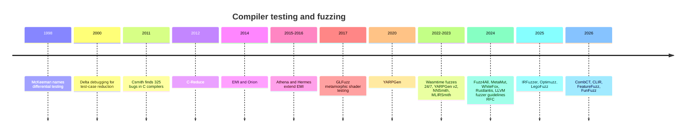
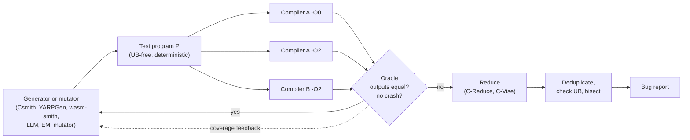
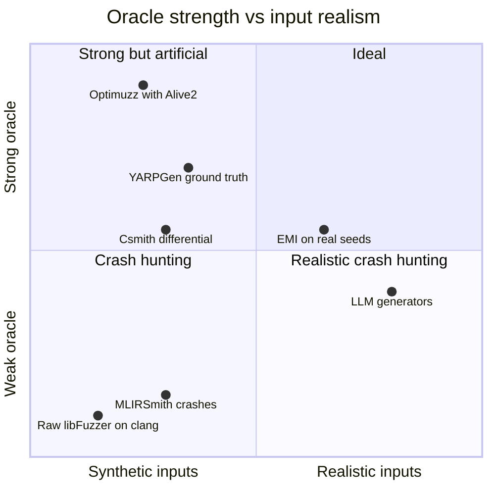

---
tags:
  - compilers
  - testing
  - fuzzing
  - differential-testing
  - test-case-reduction
  - miscompilation
  - undefined-behavior
status: complete
sources:
  - https://en.wikipedia.org/wiki/Differential_testing
  - https://users.cs.utah.edu/~regehr/papers/pldi11-preprint.pdf
  - https://www-old.cs.utah.edu/~regehr/papers/pldi12-preprint.pdf
  - https://blog.regehr.org/archives/1678
  - https://www.cs.ucdavis.edu/~su/publications/emi.pdf
  - https://web.cs.ucdavis.edu/~su/emi-project/
  - https://www.cs.ucdavis.edu/~su/publications/oopsla15-compiler.pdf
  - https://www.cs.ucdavis.edu/~su/publications/oopsla16.pdf
  - https://www.microsoft.com/en-us/research/publication/finding-compiler-bugs-via-live-code-mutation/
  - https://users.cs.utah.edu/~regehr/yarpgen-oopsla20.pdf
  - https://www-old.cs.utah.edu/~regehr/pldi23.pdf
  - https://www.doc.ic.ac.uk/~afd/papers/2017/OOPSLA.pdf
  - https://src.rcs.uwaterloo.ca/xref/llvm-project/llvm/docs/FuzzingLLVM.rst
  - https://conf.researchr.org/details/icse-2025/icse-2025-research-track/135/IRFuzzer-Specialized-Fuzzing-for-LLVM-Backend-Code-Generation
  - http://prosys.kaist.ac.kr/publications/pldi25.pdf
  - https://fitzgen.com/2022/09/13/security-and-correctness-in-wasmtime.html
  - https://cdn.jsdelivr.net/npm/@candlecorp/browser_wasi_shim@0.2.16/wasmtime/fuzz/README.md
  - https://docs.wasmtime.dev/api/src/wasmtime_fuzzing/oracles/diff_spec.rs.html
  - https://arxiv.org/abs/2606.26977
  - https://arxiv.org/abs/2207.13066v2
  - https://zenodo.org/records/7222132
  - https://tjusail.github.io/people/papers/MLIRSmith_CameraReady.pdf
  - https://conf.researchr.org/profile/ase-2023/junjiechen1
  - https://2024.issta.org/details/issta-2024-papers/103/Fuzzing-MLIR-Compiler-Infrastructure-via-Operation-Dependency-Analysis
  - https://arxiv.org/html/2504.01379v1
  - https://arxiv.org/html/2601.17450v1
  - https://www.research-collection.ethz.ch/server/api/core/bitstreams/c518c0cc-effc-4da2-8c86-55cac62e017c/content
  - https://ralfj.de/blog/2024/11/25/rustlantis.html
  - https://arxiv.org/html/2605.00413v1
  - https://arxiv.org/abs/2308.04748
  - https://conf.researchr.org/details/icse-2024/icse-2024-research-track/119/Fuzz4All-Universal-Fuzzing-with-Large-Language-Models
  - https://arxiv.org/abs/2310.15991v3
  - https://experts.illinois.edu/en/publications/whitefox-white-box-compiler-fuzzing-empowered-by-large-language-m/
  - https://cs.nju.edu.cn/changxu/1_publications/24/ASPLOS24.pdf
  - https://arxiv.org/html/2508.18955
  - https://arxiv.org/pdf/2601.12360
  - https://arxiv.org/html/2605.02789
  - https://conf.researchr.org/details/icse-2026/icse-2026-research-track/31/CombCT-Compiler-Testing-via-Combinatorial-Testing
  - https://discourse.llvm.org/t/rfc-guidelines-for-fuzzer-generated-issues/82556
  - https://www.llvm.org/devmtg/2025-10
  - https://2026.ecoop.org/details/ICOOOLPS-2026-icooolps-2026/1/Pragmatic-Approaches-to-Improving-Compiler-Correctness
created: 2026-11-26
updated: 2026-11-26
---

## Table Of Contents

- [[#TL;DR|TL;DR]]
- [[#The Problem|The Problem]]
- [[#Foundations|Foundations]]
    - [[#The Test Oracle Problem|The Test Oracle Problem]]
    - [[#Undefined Behavior Makes Tests Lie|Undefined Behavior Makes Tests Lie]]
    - [[#Three Kinds of Oracle|Three Kinds of Oracle]]
- [[#How We Got Here|How We Got Here]]
- [[#How It Works|How It Works]]
    - [[#The Fuzzing Loop|The Fuzzing Loop]]
    - [[#Generators That Avoid UB|Generators That Avoid UB]]
    - [[#EMI Mutation|EMI Mutation]]
    - [[#Coverage-Guided Fuzzing of Compiler Internals|Coverage-Guided Fuzzing of Compiler Internals]]
    - [[#Test-Case Reduction|Test-Case Reduction]]
    - [[#Worked Example|Worked Example]]
- [[#Where It Is Now|Where It Is Now]]
    - [[#LLM-Based Generators|LLM-Based Generators]]
    - [[#MLIR and ML Compilers|MLIR and ML Compilers]]
    - [[#Rust, Wasm and Cranelift|Rust, Wasm and Cranelift]]
    - [[#Triage in LLVM and Elsewhere|Triage in LLVM and Elsewhere]]
- [[#Trade-offs & Open Problems|Trade-offs & Open Problems]]
- [[#Resources|Resources]]
- [[#Related Notes|Related Notes]]

## ***TL;DR***
---
*Compilers are tested mostly by machines: a generator writes random but well-defined programs, several compilers (or one compiler at several settings) run them, and any disagreement is a bug candidate that a reducer shrinks to a few lines. The hard parts are knowing the right answer (the oracle) and keeping [[Undefined Behavior and Compiler Semantics|undefined behavior]] out of the tests.*

- **The oracle is the problem.** Nobody knows what a random 80 KB C program should print. *Differential testing* (McKeeman, 1998) sidesteps this by comparing implementations against each other; *metamorphic testing* and **EMI** compare a program with transformed versions of itself ([Le, Afshari and Su, PLDI 2014](https://www.cs.ucdavis.edu/~su/publications/emi.pdf)).
- **UB poisons everything.** If the test program has undefined behavior, two different outputs are both "correct". Csmith (PLDI 2011) wraps arithmetic in safe functions and analyzes pointers to stay UB-free, and found **325 bugs**, 202 in LLVM and 79 in GCC ([Yang et al.](https://users.cs.utah.edu/~regehr/papers/pldi11-preprint.pdf)). YARPGen tracks values statically instead and later grew loop generation for loop optimizers ([PLDI 2023](https://www-old.cs.utah.edu/~regehr/pldi23.pdf)).
- **Reduction makes bugs fixable.** C-Reduce shrank wrong-code triggers from a median of about 56 KB to about 200 bytes, while checking that no UB crept in ([Regehr et al., PLDI 2012](https://www-old.cs.utah.edu/~regehr/papers/pldi12-preprint.pdf)).
- **Fuzzing is now continuous infrastructure.** LLVM runs libFuzzer-based IR fuzzers on OSS-Fuzz ([LLVM docs](https://src.rcs.uwaterloo.ca/xref/llvm-project/llvm/docs/FuzzingLLVM.rst)); Wasmtime fuzzes 24/7 with wasm-smith and compares against V8 and the Wasm spec interpreter ([Fitzgerald, 2022](https://fitzgen.com/2022/09/13/security-and-correctness-in-wasmtime.html)); research generators cover rustc (Rustlantis), MLIR (MLIRSmith) and ML compilers (NNSmith).
- **Late 2026: LLMs write the tests, translation validators judge them.** LLM generators (Fuzz4All, WhiteFox, MetaMut, LegoFuzz, FeatureFuzz) each report dozens to a hundred-plus bugs, and Optimuzz pairs directed fuzzing with Alive2 to find **55 new LLVM miscompilations** ([PLDI 2025](http://prosys.kaist.ac.kr/publications/pldi25.pdf)). The bottleneck has moved to triage, and LLVM has set out explicit expectations for fuzzer-generated reports (2024 RFC).

## ***The Problem***
---
*A compiler bug that crashes is annoying; a compiler bug that silently emits wrong code (a miscompilation) breaks every program that trips it, and nobody notices. Hand-written test suites only check what their authors thought of.*

A modern optimizing compiler is millions of lines of transformations, each with side conditions ("this is safe only if the loop has no aliasing stores", "only if this value is never `INT_MIN`"). The [[Compiler Pipeline]] chains hundreds of passes, and a bug usually needs a specific combination of passes, types and constants to show up. Regression suites in GCC and [[LLVM]] are huge, but they test the cases someone already wrote down.

Bugs come in three flavours, in order of how bad they are:

| Kind | Symptom | Why it matters |
|---|---|---|
| **Crash / ICE** | Compiler asserts, segfaults or reports an internal compiler error | Annoying, easy to detect, always a bug |
| **Hang / performance** | Compilation never ends, or generated code is far slower | Detectable with timeouts and baselines |
| **Wrong code (miscompilation)** | Compiled program silently computes a different result | Invisible without a reference answer; in sandboxes like Wasmtime it can be a security hole |

Testing for the first kind only needs a generator and a way to watch for crashes. Testing for the third kind needs to know what the program *should* do, which is the central problem of the field. These are not corner cases nobody cares about: Csmith's GCC reports included 25 bugs marked P1, the highest release-blocking priority ([Yang et al., PLDI 2011](https://users.cs.utah.edu/~regehr/papers/pldi11-preprint.pdf)). Verified compilers remove whole classes of these ([[Verified Compilers]]), but every production compiler still depends on testing.

## ***Foundations***
---
*Three ideas carry the whole field: you rarely have a ground-truth oracle, undefined behavior makes "different output" meaningless, and so every technique is really a choice of oracle plus a way to generate UB-free inputs.*

### The Test Oracle Problem

*An oracle is whatever tells you a test passed; for random programs, no human can write one.*

A unit test has an expected value written next to it. A fuzzer generates thousands of programs per hour, so expected outputs must come from somewhere automatic. The options are:

- **Ground truth from the generator.** If the generator computes the result while it generates the program, it knows the answer. YARPGen v2 does this alongside differential checks ([Livinskii, Babokin and Regehr, PLDI 2023](https://www-old.cs.utah.edu/~regehr/pldi23.pdf)).
- **Another implementation.** Compare GCC against Clang, `-O0` against `-O2`, or a JIT against an interpreter.
- **A relation the output must satisfy.** Run the program and a transformed copy; they must agree.
- **Implicit oracles.** Crashes, assertion failures, sanitizer reports, IR verifier failures and timeouts need no expected value at all.

Wrong-code bugs need one of the first three. Crash bugs only need the fourth, which is why crash-finding fuzzers are much easier to build and dominate many bug counts.

### Undefined Behavior Makes Tests Lie

*If a test program has undefined behavior, the compiler is allowed to do anything, so a disagreement between two compilers proves nothing.*

C and C++ leave signed overflow, out-of-bounds access, unsequenced side effects and many other things undefined, and optimizers exploit this ([[Classic Optimizations]] covers the poison and `undef` semantics in LLVM). So a generator must produce programs that are not just syntactically valid and type-correct ([[Type Systems and Inference]]) but *dynamically* UB-free. Csmith's answer, as described in the paper ([Yang et al.](https://users.cs.utah.edu/~regehr/papers/pldi11-preprint.pdf)):

- **Arithmetic:** "a family of wrapper functions for arithmetic operators whose (promoted) operands might overflow".
- **Pointers:** dynamic null checks, plus a whole-program pointer analysis so that pointers to dead stack variables are never dereferenced or compared.
- **Ordering and arrays:** an effect analysis to avoid conflicting reads and writes between sequence points, and in-bounds array indices.

A hand sketch of what the arithmetic wrappers look like (the real ones are generated per type in Csmith's runtime header):

```c
/* Hand sketch, not Csmith's exact source. */
static int32_t safe_add_int32(int32_t a, int32_t b) {
    if ((b > 0 && a > INT32_MAX - b) || (b < 0 && a < INT32_MIN - b))
        return a;          /* would overflow: return something defined */
    return a + b;
}
```

The cost is that the wrappers are themselves code the optimizer sees, which biases what gets tested. YARPGen avoids runtime checks: it tracks concrete values during generation and rewrites an operation that would be UB into a safe equivalent, for example turning `-a` into `+a` when `a` is the minimum value; the rewrite rules were checked exhaustively at 4 bits and partly verified with Z3 at 32 and 64 bits ([Livinskii, Babokin and Regehr, OOPSLA 2020](https://users.cs.utah.edu/~regehr/yarpgen-oopsla20.pdf)).

UB returns during reduction, too: a reducer that deletes an initializer can create an uninitialized read that "explains" the bug away (see [[#Test-Case Reduction|Test-Case Reduction]]).

### Three Kinds of Oracle

*Differential testing compares implementations, metamorphic testing compares inputs, and [[Translation Validation|translation validation]] proves each compilation individually.*

**Differential testing.** William McKeeman's 1998 paper "Differential testing for software" (*Digital Technical Journal* 10(1)) named the idea: feed the same input to several implementations and flag any difference ([Wikipedia summary](https://en.wikipedia.org/wiki/Differential_testing)). For compilers $C_1, C_2$ and a UB-free, deterministic program $P$ with input $i$:

$$
\text{bug candidate} \iff C_1(P)(i) \neq C_2(P)(i)
$$

**In plain English:** if two compilers (or one compiler at two optimization levels) build the same well-defined program and the binaries print different things, at least one compiler is wrong. With three or more, Csmith used majority voting to guess which one ([Yang et al.](https://users.cs.utah.edu/~regehr/papers/pldi11-preprint.pdf)).

**Metamorphic testing.** Instead of a second compiler, use a second *program*: one that must behave the same as the first. **Equivalence modulo inputs** makes this precise. Programs $P$ and $Q$ are EMI with respect to an input set $I$ when

$$
P \equiv_I Q \iff \forall i \in I.\; [\![P]\!](i) = [\![Q]\!](i)
$$

**In plain English:** $Q$ may differ from $P$ anywhere, as long as it gives the same output on the inputs we actually test. If the compiled $P$ and compiled $Q$ disagree on some $i \in I$, the compiler miscompiled one of them ([Le, Afshari and Su, PLDI 2014](https://www.cs.ucdavis.edu/~su/publications/emi.pdf)). The big win is that this works with *one* compiler, so it also tests vendors with no rival implementation. Graphics drivers are the extreme case: GLSL leaves floating-point precision underspecified, so different GPUs legitimately render different images and cross-vendor comparison is unreliable. GLFuzz instead compares a shader with semantics-preserving variants of itself on the same device ([Donaldson et al., OOPSLA 2017](https://www.doc.ic.ac.uk/~afd/papers/2017/OOPSLA.pdf)).

**Translation validation.** Check each individual compilation with a solver. Alive2 checks that optimized LLVM IR *refines* the original ([[Classic Optimizations]] has the details). This is a much stronger oracle than differential testing (it covers all inputs, and it sees a bug even if the final output happens to match), but it is bounded and covers only what its semantics model. Its formal cousins live in [[Verified Compilers]] and [[Formal Methods in Practice]].

| Oracle | Needs | Catches | Misses |
|---|---|---|---|
| Crash / assertion | Nothing | ICEs, verifier failures | All wrong code |
| Differential | ≥2 implementations or configs | Wrong code that changes output | Bugs shared by all implementations; bugs masked by the checksum |
| EMI / metamorphic | Profiling inputs, a mutator | Wrong code in one compiler | Bugs in code the mutation never perturbs |
| Ground truth | A generator that computes results | Wrong code, even if all compilers agree | Anything outside the generator's subset |
| Translation validation | A formal IR semantics (Alive2) | Wrong IR transforms, even unobserved ones | Unmodelled features; solver timeouts |

## ***How We Got Here***
---
*From one 1998 paper to a research industry: Csmith proved random testing finds real miscompilations, reduction and EMI made it scale, and since 2023 language models have become generators.*



- **1998, differential testing.** McKeeman's *Digital Technical Journal* paper names the technique: give several implementations the same input and treat any difference as a bug candidate ([Wikipedia summary](https://en.wikipedia.org/wiki/Differential_testing)).
- **2000, delta debugging.** Hildebrandt and Zeller's greedy chunk-removal algorithm becomes the starting point for test-case reducers ([Regehr, "Design and Evolution of C-Reduce"](https://blog.regehr.org/archives/1678)).
- **2011, Csmith (PLDI).** Yang, Chen, Eide and Regehr at Utah run a three-year campaign: 325 bugs across tested compilers (79 GCC, 202 LLVM). CompCert's verified middle end was the one part where no wrong-code bug was found; the bugs they found in CompCert were in unverified parts such as the front end ([PLDI 2011](https://users.cs.utah.edu/~regehr/papers/pldi11-preprint.pdf)).
- **2012, C-Reduce (PLDI).** Regehr et al. compare three reducers and show that C-Reduce gets wrong-code test cases down to roughly 200 bytes ([PLDI 2012](https://www-old.cs.utah.edu/~regehr/papers/pldi12-preprint.pdf)).
- **2014-2016, EMI.** Zhendong Su's group at UC Davis introduces EMI with Orion (PLDI 2014, 147 confirmed bugs), then Athena (OOPSLA 2015, MCMC-guided insertion and deletion in dead code) and Hermes (OOPSLA 2016, mutation of *live* code). The project page now lists **1,602** reported GCC and LLVM bugs, **1,007** fixed ([EMI project](https://web.cs.ucdavis.edu/~su/emi-project/)).
- **2017, metamorphic shader testing.** GLFuzz finds more than 60 distinct bugs across all seven major GPU designers, including security bugs such as CVE-2017-2424 on iPhone ([Donaldson et al., OOPSLA 2017](https://www.doc.ic.ac.uk/~afd/papers/2017/OOPSLA.pdf)). The same year, LLVM's FuzzMutate library for structured IR mutation is presented at EuroLLVM ([LLVM docs](https://src.rcs.uwaterloo.ca/xref/llvm-project/llvm/docs/FuzzingLLVM.rst)).
- **2020, YARPGen (OOPSLA).** Utah and Intel: static UB avoidance plus *generation policies* that bias programs toward optimizer patterns. 83 GCC, 62 LLVM and 76 Intel C++ compiler bugs ([OOPSLA 2020](https://users.cs.utah.edu/~regehr/yarpgen-oopsla20.pdf)).
- **2022-2023, infrastructure and new targets.** Wasmtime describes continuous OSS-Fuzz fuzzing as "probably the biggest single contributing factor towards Wasmtime's code quality" ([Fitzgerald, 2022](https://fitzgen.com/2022/09/13/security-and-correctness-in-wasmtime.html)). YARPGen v2 targets loop optimizers (PLDI 2023). NNSmith (ASPLOS 2023) and MLIRSmith (ASE 2023) bring generators to ML compilers and MLIR.
- **2024, LLMs arrive.** Fuzz4All (ICSE 2024), MetaMut (ASPLOS 2024) and WhiteFox (OOPSLA 2024) use LLMs as generators or to write mutators. Rustlantis (OOPSLA 2024) does randomized differential testing of rustc. Nikita Popov proposes rules for fuzzer-generated LLVM bug reports ([RFC](https://discourse.llvm.org/t/rfc-guidelines-for-fuzzer-generated-issues/82556)).
- **2025-2026, specialization.** Fuzzers aim at one layer: LLVM backends (IRFuzzer, ICSE 2025), single optimizations with Alive2 as oracle (Optimuzz, PLDI 2025), optimization sequences (CombCT, ICSE 2026), Cranelift's SSA IR (CLIR, June 2026).

## ***How It Works***
---
*Every compiler fuzzer is the same loop with different parts swapped in: generate or mutate a program, compile it under several configurations, consult an oracle, reduce what fails, deduplicate, report.*

### The Fuzzing Loop

*Generation is cheap; reduction and triage are where human time goes.*



Two families differ in how they choose the next input:

- **Generative fuzzers** (Csmith, YARPGen, Rustlantis, wasm-smith, NNSmith) build each program from scratch, using knowledge of the language to keep it valid and UB-free. They are usually *black-box*: no feedback from inside the compiler.
- **Mutational, coverage-guided fuzzers** (libFuzzer targets, IRFuzzer, Optimuzz, EMI tools in a sense) start from seeds and mutate them, keeping inputs that reach new compiler code. They are *grey-box*.

Both benefit from **swarm testing**: randomly turning whole features on or off per run so that each test is less "average". Wasmtime uses it to let the fuzzer configure the kinds of modules wasm-smith generates ([Fitzgerald](https://fitzgen.com/2022/09/13/security-and-correctness-in-wasmtime.html)), and YARPGen randomizes 23 generation parameters per test ([OOPSLA 2020](https://users.cs.utah.edu/~regehr/yarpgen-oopsla20.pdf)).

### Generators That Avoid UB

*A generator must make programs that are valid, UB-free, terminating and deterministic, and still interesting enough to trigger optimizations.*

| Generator | Target | How it stays well-defined | How it aims at optimizations |
|---|---|---|---|
| **Csmith** (2011) | C | Safe-math wrappers, dynamic null checks, pointer and effect analysis | Rich C subset: pointers, structs, unions, globals |
| **YARPGen v1** (2020) | C, C++ | Static value tracking; UB-producing ops rewritten | Generation policies (constant choices, reused subexpressions); up to 1.4× more targeted optimizations in GCC |
| **YARPGen v2** (2023) | C++, ISPC, SYCL | Every loop iteration sees the same values, or iteration space split into even and odd halves | Loop nests and sequences as first-class IR; stencils, reductions, memset/memcpy idioms; 71 of 72 LLVM loop counters hit more often (geomean 9.14×) |
| **Rustlantis** (2024) | Rust MIR | Place graph tracks initialization and pointer targets; simplified Stacked Borrows; Miri as reference | Generates MIR directly, after borrow-checking |
| **wasm-smith** | WebAssembly | Modules "guaranteed valid"; optional trap avoidance | Swarm-configured feature sets |
| **NNSmith** (2023) | ONNX models for DL compilers | Operator specifications for valid graphs; gradient search for inputs without NaN/Inf | Diverse operator graphs |
| **MLIRSmith** (2023) | MLIR (12 dialects) | Context-sensitive grammar with type-matched operands | Samples rarely used operations; random pass pipelines |

Sources: [Csmith](https://users.cs.utah.edu/~regehr/papers/pldi11-preprint.pdf), [YARPGen](https://users.cs.utah.edu/~regehr/yarpgen-oopsla20.pdf), [YARPGen v2](https://www-old.cs.utah.edu/~regehr/pldi23.pdf), [Rustlantis](https://www.research-collection.ethz.ch/server/api/core/bitstreams/c518c0cc-effc-4da2-8c86-55cac62e017c/content), [Wasmtime](https://fitzgen.com/2022/09/13/security-and-correctness-in-wasmtime.html), [NNSmith](https://arxiv.org/abs/2207.13066v2), [MLIRSmith](https://tjusail.github.io/people/papers/MLIRSmith_CameraReady.pdf).

Loops are the hard case. YARPGen v1's generator was loop-free; an experimental loop mode only checked UB in the first iteration and forced later iterations to see the same values ([OOPSLA 2020](https://users.cs.utah.edu/~regehr/yarpgen-oopsla20.pdf)). YARPGen v2's main contribution is *loop partitioning*: split the iteration space into even and odd subsets, possibly behind an opaque variable, so the body sees varied values while UB is still ruled out statically, and compile the tricks separately so the optimizer cannot see through them. It found 122 bugs: 66 GCC, 28 LLVM, 16 in Intel's DPC++ and 12 in ISPC ([PLDI 2023](https://www-old.cs.utah.edu/~regehr/pldi23.pdf)). This is the testing side of [[Loop Optimizations]] and [[Vectorization]].

A Csmith program ends by hashing its globals; a hand sketch of the shape (not real output):

```c
/* Hand sketch of a Csmith-style test's tail */
int main(void) {
    func_1();                                  /* thousands of lines of random code */
    transparent_crc(g_5, "g_5", print_hash);    /* fold every global into a checksum */
    transparent_crc(g_17.f0, "g_17.f0", print_hash);
    platform_main_end(crc32_context ^ 0xFFFFFFFFUL, print_hash);
    return 0;
}
```

The single checksum line is the whole oracle: compile with `gcc -O0`, `gcc -O3`, `clang -O2`, and compare one number.

### EMI Mutation

*Profile a program, then change only what the profile says doesn't matter (or change live code in ways you can prove are neutral).*

Orion's procedure ([Le, Afshari and Su, PLDI 2014](https://www.cs.ucdavis.edu/~su/publications/emi.pdf)):

1. **Profile.** Compile the seed without optimization, instrument it with gcov, run it on the inputs, record the output and which statements never execute.
2. **Prune.** Randomly delete unexecuted statements (and their subtrees). Deleting dead code cannot change output on those inputs, and cannot add UB if the seed had none.
3. **Test.** Compile each variant under each configuration; any output that differs from the reference is a miscompilation.

Why does deleting *dead* code find bugs in *live* code? Because the optimizer does not know it is dead. Removing a statement changes what the compiler sees: which variables escape, how big a function is, whether inlining fires, what [[Pointer and Alias Analysis|alias analysis]] concludes. The live code then flows through a different optimization path.

The follow-ups widen the mutation space:

| Tool | Venue | Mutation | Bugs (reported) |
|---|---|---|---|
| **Orion** | PLDI 2014 | Delete unexecuted statements | 147 confirmed (79 GCC, 68 LLVM); 95 wrong-code |
| **Athena** | OOPSLA 2015 | Delete *and insert* in dead regions, guided by MCMC toward variants whose CFG differs from the seed | 72 valid of 83 reported over 19 months; 17 GCC P1 |
| **Hermes** | OOPSLA 2016 | Synthesize code in *live* regions: always-false blocks, always-true guards, and always-true blocks that save and restore what they touch, using profiled values | 168 confirmed of 217 over 13 months; 76 miscompilations |

Sources: [Orion](https://www.cs.ucdavis.edu/~su/publications/emi.pdf), [Athena](https://www.cs.ucdavis.edu/~su/publications/oopsla15-compiler.pdf), [Hermes](https://www.cs.ucdavis.edu/~su/publications/oopsla16.pdf) ([venue](https://www.microsoft.com/en-us/research/publication/finding-compiler-bugs-via-live-code-mutation/)).

GLFuzz applies the same idea to shaders with *opaque values*: a uniform `injSwitch` set to `(0.0, 1.0)` at runtime, so the compiler cannot fold `injSwitch.x > injSwitch.y` and must keep injected dead code ([Donaldson et al.](https://www.doc.ic.ac.uk/~afd/papers/2017/OOPSLA.pdf)).

### Coverage-Guided Fuzzing of Compiler Internals

*Skip the front end, mutate the IR directly, and let coverage of the optimizer or instruction selector steer the search.*

Feeding raw bytes to a C compiler mostly exercises the lexer and parser ([[Lexing and Parsing]]). To reach the optimizer and backend, LLVM's fuzzers take **IR** as input ([LLVM docs, FuzzingLLVM](https://src.rcs.uwaterloo.ca/xref/llvm-project/llvm/docs/FuzzingLLVM.rst)):

- `clang-fuzzer` and `clang-proto-fuzzer` (the latter generates valid C++ from a protobuf description).
- `llvm-opt-fuzzer` runs a chosen pass pipeline on mutated IR; `llvm-isel-fuzzer` targets instruction selection. Both use the **FuzzMutate** library to mutate IR structurally rather than as bits.
- `llvm-mc-assemble-fuzzer` / `llvm-mc-disassemble-fuzzer`, demangler, DWARF and lldb fuzzers.

A hand sketch of running one (flags follow the docs' description that a triple and a new-pass-manager pipeline are required; check `-help` on your build):

```sh
# Hand sketch: fuzz InstCombine on x86-64 starting from a seed corpus of .bc files
llvm-opt-fuzzer corpus/ -mtriple x86_64 -passes instcombine
```

The docs note that LLVM is moving from a public fuzzing buildbot to **OSS-Fuzz** because the buildbot's findings were not reported in an actionable way, and that options can be encoded in the binary name because OSS-Fuzz struggles with required arguments.

Plain edge coverage is a weak signal for backends: the same matcher code runs for every target. **IRFuzzer** adds *matcher table coverage* for instruction selection and constrained mutations for control flow, vectors and functions; across 29 LLVM backends it found **78 confirmed new bugs**, 57 fixed ([ICSE 2025](https://conf.researchr.org/details/icse-2025/icse-2025-research-track/135/IRFuzzer-Specialized-Fuzzing-for-LLVM-Backend-Code-Generation)). **Optimuzz** goes further: pick a source line of one optimization (say, a new InstCombine fold), use *directed* grey-box fuzzing with a distance metric to generate IR that reaches it, and check every result with **Alive2**. It found 55 new LLVM miscompilations; in one case a just-committed `foldSelectIntoOp` change had an incomplete NaN check that the developers' eight Alive2-checked unit tests missed, and Optimuzz found it in about an hour ([Kwon et al., PLDI 2025](http://prosys.kaist.ac.kr/publications/pldi25.pdf)). This is the "continuous translation validation" idea: fuzz each commit's changed code with a formal oracle. See [[Instruction Selection]] for why backend bugs are hard to reach.

### Test-Case Reduction

*A 80 KB random program is useless in a bug report; reduction turns it into a few lines a developer can read.*

**Delta debugging** removes chunks of the input and keeps the result if it still fails, shrinking chunk size as it goes. C-Reduce kept delta's idea of an external *interestingness test* but replaced line-based deletion, which got stuck far above hand-reduced sizes, with many C-aware passes ([Regehr, "Design and Evolution of C-Reduce"](https://blog.regehr.org/archives/1678)):

- 35 Perl passes (delete lines, balanced delimiters, shrink integers), 6 passes using external tools (a token-level lexer, `unifdef`, pretty-printers) and 69 Clang-based source-to-source passes (inlining, copy propagation and so on).
- A small core runs the pass list to a **global fixpoint**: no pass can make the file smaller. High-payoff passes (delete whole functions) run first, integer shrinking last.

The interestingness test is a script that exits 0 if a candidate still shows the bug. For a miscompilation it must check that the candidate is well-defined, or reduction will happily produce UB that "explains" the difference. A hand sketch:

```sh
#!/bin/sh
# Hand sketch of a C-Reduce interestingness test for a wrong-code bug.
gcc -O0 -fsanitize=undefined,address -w t.c -o san && ./san >/dev/null 2>&1 || exit 1   # reject UB we can see
gcc -O0 -w t.c -o ref && timeout 5 ./ref > ref.out || exit 1
clang -O2 -w t.c -o opt && timeout 5 ./opt > opt.out || exit 1
! cmp -s ref.out opt.out      # interesting only if outputs differ
```

Sanitizers are not enough. In the PLDI 2012 study, without the KCC semantic interpreter or Frama-C's value analysis, **12 of 41** reduced wrong-code cases (29%) still executed UB. With them, C-Reduce got a median wrong-code case from about 56 KB to roughly 190-200 bytes, versus about 6.5 KB for Berkeley delta ([Regehr et al., PLDI 2012](https://www-old.cs.utah.edu/~regehr/papers/pldi12-preprint.pdf)). Regehr's warning applies to every interestingness test: "it is easy to accidentally write a test which believes that the empty file is interesting." Reducers are still being extended for new language features: a 2025 LLVM Developers' Meeting talk added C++ modules support to the C-Vise reducer ([LLVM Dev Meeting 2025](https://www.llvm.org/devmtg/2025-10)).

### Worked Example

*A reduced Orion test case: twelve lines that made Clang print the wrong answer.*

This is LLVM bug 17781 as reduced in the EMI paper (Figure 6e). Clang trunk at the time, at `-Os`, printed `0` instead of `1` ([Le, Afshari and Su, PLDI 2014](https://www.cs.ucdavis.edu/~su/publications/emi.pdf)):

```c
int printf(const char *, ...);
struct S0 { int f0, f1, f2, f3, f4 }
b = {0,0,1,0,0};
int a;
void foo(struct S0 p) {
  b.f2 = 0;
  if (p.f2) a = 1;
}
int main() {
  foo(b);
  printf("%d\n", a);
  return 0;
}
```

Reading it as the C standard requires:

1. `foo(b)` passes the struct **by value**, so `p` is a copy of `b` taken at the call: `p.f2 == 1`.
2. Inside `foo`, `b.f2 = 0` changes the global, not the copy.
3. `p.f2` is still `1`, so `a = 1`, and the program prints `1`.

Printing `0` means the optimized code's read of `p.f2` saw the store to `b.f2`. The only way that happens is if the compiler treated the parameter's memory and the global `b` as the same location (for example, by passing a pointer to `b` instead of a copy, or by mis-ordering the copy and the store). That is our reading of the symptom, not the bug report's root-cause analysis, but it shows what a good reduced test does: every line is needed, there is no UB (no overflow, no uninitialized read, a fully initialized global), and the expected output can be worked out by hand in ten seconds. The program also shows why struct copies, by-value arguments and aliasing ([[SSA Form]] does not cover memory) are a perennial bug source.

What EMI contributed: the original seed was a large random program where this struct path was surrounded by code that never ran. Deleting some of that dead code changed what the optimizer could prove about `b`, and the variant's output differed from the seed's on the same input.

## ***Where It Is Now***
---
*As of November 2026, compiler fuzzing is split between continuous production fuzzing (OSS-Fuzz, Wasmtime, rustc) and a fast-moving research stream where LLMs generate programs and solvers judge them. The scarce resource is developer triage time.*

### LLM-Based Generators

*LLMs replace hand-written grammars: they produce realistic, feature-rich programs, and the research question is how to keep them diverse, valid and cheap.*

| Tool | Venue | Idea | Reported bugs |
|---|---|---|---|
| **Fuzz4All** | ICSE 2024 | Autoprompting plus an LLM fuzzing loop that keeps updating the prompt; one fuzzer for C, C++, Go, SMT2, Java, Python | 98 bugs across GCC, Clang, Z3, CVC5, OpenJDK, Qiskit; 64 confirmed new |
| **MetaMut** | ASPLOS 2024 | GPT-4 *writes mutators*, about $0.5 each, then a classic fuzzer uses them | 131 in GCC and Clang (81 Clang, 50 GCC); 129 confirmed or fixed |
| **WhiteFox** | OOPSLA 2024 | White-box: an analysis agent reads an optimization's source and writes requirements; a generation agent writes tests that trigger it | 101 bugs in PyTorch Inductor, TF-XLA, TF Lite; 92 confirmed new, 70 fixed |
| **LegoFuzz** | OOPSLA 2025 | LLM converts real functions into about 553,000 small, sanitizer-checked C functions *offline*; online fuzzing composes them with no LLM calls | 66 in GCC and LLVM, 30 miscompilations; 56 fixed |
| **FeatureFuzz** | CCS 2026 | Mines bug-prone features from GCC bug reports; one fine-tuned LLM groups features, another writes programs; coverage feedback | 122 bugs in 72 h (60 GCC, 62 LLVM); 106 confirmed zero-days |
| **FunFuzz** | 2026 preprint | Multi-island evolutionary loop; LLM generates C/C++ ranked by new coverage; tested GCC 16 and Clang 23 | 119 unique bugs, 80 confirmed |

Sources: [Fuzz4All](https://arxiv.org/abs/2308.04748) ([ICSE](https://conf.researchr.org/details/icse-2024/icse-2024-research-track/119/Fuzz4All-Universal-Fuzzing-with-Large-Language-Models)), [MetaMut](https://cs.nju.edu.cn/changxu/1_publications/24/ASPLOS24.pdf), [WhiteFox](https://arxiv.org/abs/2310.15991v3) ([OOPSLA](https://experts.illinois.edu/en/publications/whitefox-white-box-compiler-fuzzing-empowered-by-large-language-m/)), [LegoFuzz](https://arxiv.org/html/2508.18955), [FeatureFuzz](https://arxiv.org/pdf/2601.12360), [FunFuzz](https://arxiv.org/html/2605.02789).

Two design trends stand out. First, **move the LLM offline**: MetaMut and LegoFuzz pay for the model once (to write mutators or a function corpus) and then fuzz at classic speeds. Second, **mine history**: FeatureFuzz and ClozeMaster (below) seed generation with past bug reports, betting that bugs cluster around the same language features. Bug counts are not directly comparable across papers (different compilers, durations, and definitions of "confirmed"); several papers' own tables disagree slightly with their abstracts, as noted for FunFuzz and DESIL.

Non-LLM work continues too. **CombCT** (ICSE 2026) applies combinatorial testing to *optimization sequences* rather than programs, finding 14 new GCC and LLVM bugs that need specific pass orders ([CombCT](https://conf.researchr.org/details/icse-2026/icse-2026-research-track/31/CombCT-Compiler-Testing-via-Combinatorial-Testing)).

### MLIR and ML Compilers

*Tensor compilers have no C standard to lean on and many frontends, so generators target graph validity and numerical stability.*

- **NNSmith** (ASPLOS 2023) generates valid DNN graphs from lightweight operator specifications, uses gradient-based search to pick inputs that avoid NaN and infinity (a major source of false alarms), and tests by differential comparison. It found 72 new bugs in TVM, TensorRT, ONNXRuntime and PyTorch; 58 confirmed, 51 fixed ([arXiv](https://arxiv.org/abs/2207.13066v2), [artifact](https://zenodo.org/records/7222132)).
- **WhiteFox** (above) targets the optimizations inside PyTorch Inductor and XLA directly.
- **MLIRSmith** (ASE 2023) builds templates from 12 dialects and fills them with a context-sensitive grammar, then runs random pass pipelines: 53 new bugs, 49 confirmed, mostly crashes in conversion and dialect-specific passes ([paper](https://tjusail.github.io/people/papers/MLIRSmith_CameraReady.pdf), [ASE listing](https://conf.researchr.org/profile/ase-2023/junjiechen1)). An ISSTA 2024 follow-up adds an *operation dependency coverage* metric and dependency-targeted mutations, finding 63 new bugs ([ISSTA 2024](https://2024.issta.org/details/issta-2024-papers/103/Fuzzing-MLIR-Compiler-Infrastructure-via-Operation-Dependency-Analysis)).
- **DESIL** (2025 preprint) goes after *silent* MLIR bugs, not crashes: it removes UB with rules derived from the dialect docs (shape mismatches, out-of-bounds indexing) and compares executables built with different optimization sequences; 42 new bugs, 23 silent ([arXiv 2504.01379](https://arxiv.org/html/2504.01379v1)).
- **One framework per stage** (ICSE Companion 2026): a single-author overview by Qingchao Shen splits AI-compiler testing into model loading (OPERA), high-level graph optimization (OATest) and low-level IR (HARMONY, LLM-generated seeds), for 266 new bugs in TVM, TensorRT, OpenVINO and ONNXRuntime ([arXiv 2601.17450](https://arxiv.org/html/2601.17450v1)).

Most MLIR fuzzing still uses crashes as the oracle; wrong-code detection there is where C fuzzing was around 2011. See [[MLIR]] and [[ML Compilers]].

### Rust, Wasm and Cranelift

*Memory-safe front ends do not make backends safe: rustc and Wasmtime both rely on generators plus a reference interpreter.*

**Rustlantis** (Qian Wang and Ralf Jung, OOPSLA 2024) generates MIR directly and injects it after borrow-checking using rustc's "custom MIR" feature. It compares four configurations: MIR optimizations plus LLVM, LLVM only, Cranelift, and the **Miri** interpreter, which is also the reference for what counts as UB (using Tree Borrows where the spec is silent). It found 22 new bugs, 16 miscompilations: 12 in LLVM, 8 in rustc and 2 in Cranelift ([paper](https://www.research-collection.ethz.ch/server/api/core/bitstreams/c518c0cc-effc-4da2-8c86-55cac62e017c/content)). Jung notes that 12 were in LLVM, "which prior work had already fuzzed extensively" ([blog](https://ralfj.de/blog/2024/11/25/rustlantis.html)): plausibly because a new front end hands LLVM IR shapes that C generators rarely produce. One example was a rustc ConstProp bug that propagated a field's old constant value past a write through a raw pointer to that field. **ClozeMaster** takes the LLM route for rustc: mask the bracketed parts of programs from historical rustc bug reports and have a fine-tuned code model fill them in, finding 27 confirmed ICE and hang bugs in rustc and mrustc ([arXiv 2605.00413](https://arxiv.org/html/2605.00413v1)).

**Wasmtime and Cranelift** are the clearest production example ([Fitzgerald, 2022](https://fitzgen.com/2022/09/13/security-and-correctness-in-wasmtime.html); [fuzz targets README](https://cdn.jsdelivr.net/npm/@candlecorp/browser_wasi_shim@0.2.16/wasmtime/fuzz/README.md)):

- `differential`: generate a module with wasm-smith, call each export with random arguments, and compare against the **Wasm spec reference interpreter** (an OCaml implementation), `wasmi`, V8, or Wasmtime under another configuration. The spec-interpreter oracle disables proposals it cannot run (relaxed SIMD, threads, reference types, memory64 and others) and caps memories and tables at one ([diff_spec.rs](https://docs.wasmtime.dev/api/src/wasmtime_fuzzing/oracles/diff_spec.rs.html)).
- `cranelift-fuzzgen`: generate a Cranelift IR function and check native execution against the **Cranelift interpreter**.
- `cranelift-icache`: mutate a function slightly and check that incremental compilation gives the same machine code as a fresh compile.
- The register allocator is fuzzed against a **symbolic checker** that proves an allocation implements the input program ([[Register Allocation]]).

**CLIR** (June 2026) targets Cranelift's SSA IR specifically: hierarchical generation that respects dominance, liveness-guided refinement so computed values are actually used, and cross-architecture diagnosis. 24 bugs in 72 hours (21 confirmed, 9 fixed) across x86-64, AArch64, s390x and RISC-V 64 ([arXiv 2606.26977](https://arxiv.org/abs/2606.26977)). In a sandbox like Wasmtime, a miscompilation can be a sandbox escape, which is why this matters for [[WebAssembly]] and [[MicroVMs and Sandboxing]].

### Triage in LLVM and Elsewhere

*Fuzzers produce reports faster than maintainers can read them, so projects now set rules for what a fuzzer report must contain.*

LLVM has OSS-Fuzz findings mailed to `llvm-bugs` and filed on the issue tracker ([LLVM docs](https://src.rcs.uwaterloo.ca/xref/llvm-project/llvm/docs/FuzzingLLVM.rst)). In October 2024 Nikita Popov proposed developer-policy guidelines for fuzzer-generated issues ([RFC](https://discourse.llvm.org/t/rfc-guidelines-for-fuzzer-generated-issues/82556)):

- Say it is fuzzer-generated (or maintainers apply the `fuzzer-generated` label).
- Include a **reduced** reproducer with command line, plus a godbolt.org link.
- Deduplicate likely shared root causes; test against current `main`; say when it regressed if you can (regressions from the last release get priority).
- For miscompilations, confirm the code is well-defined and deterministic; "a clean sanitizer run does not prove absence of UB". Fast-math reports need a credible root-cause analysis.
- Crashes on valid code beat crashes on invalid code. **Missed optimizations** from random code are not accepted without evidence of real-world relevance, a rule also written into the InstCombine contributor guide ([[Classic Optimizations]]).

Formal oracles are entering the triage loop: a 2025 LLVM Developers' Meeting talk applied Alive2 to validate RISC-V backend lowering, paired with fuzzing, and reported AArch64 backend miscompiles found the same way ([LLVM Dev Meeting 2025](https://www.llvm.org/devmtg/2025-10)). Outside LLVM, a June 2026 ECOOP workshop keynote by CF Bolz-Tereick described how PyPy combines testing, fuzzing, translation validation and SMT checks to find miscompilations in its [[JIT Compilation|JIT]] ([ICOOOLPS 2026](https://2026.ecoop.org/details/ICOOOLPS-2026-icooolps-2026/1/Pragmatic-Approaches-to-Improving-Compiler-Correctness)).

## ***Trade-offs & Open Problems***
---
*Each technique trades oracle strength against input realism and cost; the open problems are deeper oracles, loops and memory, and not drowning maintainers.*



*(Positions are a qualitative sketch, not measured.)*

| Choice | Gains | Costs |
|---|---|---|
| Generative, UB-free by construction | Every failure is real; wrong-code bugs findable | Generator restricts the language; safe wrappers bias code shape |
| Mutating real or LLM-written code | Realistic programs, rich features | UB must be ruled out after the fact; many false alarms |
| Differential oracle | Cheap, no semantics needed | Blind to bugs all compilers share; needs a second implementation |
| EMI / metamorphic | Works with one compiler | Only perturbs what profiling shows; needs inputs |
| Translation validation | Catches unobserved wrong code | Bounded; only for modelled IR; solver cost |
| Coverage guidance | Reaches deep code | Coverage is a weak proxy for "interesting optimizer state" (YARPGen v2's authors call code coverage a weak metric for their fuzzer) |

Open problems as of late 2026:

- **Oracles for unspecified semantics.** Floating point under fast-math, GPU shaders and tensor compilers often have no exact expected output. NNSmith's NaN-avoiding inputs and GLFuzz's same-device comparison are workarounds, not solutions. See [[GPU Kernel Compilers]].
- **Loops, memory and concurrency.** YARPGen v2 made loops tractable; aliasing-heavy code, atomics and memory models remain thin in generators. Rustlantis shows an aliasing model (Stacked or Tree Borrows) can be built into a generator.
- **UB in LLM-written tests.** LLM generators produce realistic code but cannot promise UB-freedom; LegoFuzz filters with sanitizers and profiling, and LLVM's fuzzer-report guidelines say outright that a clean sanitizer run is not proof.
- **Triage and deduplication.** Bug counts in papers keep rising; maintainer time does not. Clustering by root cause, automatic bisection and Alive2 explanations help; papers that report "confirmed" counts measure maintainer attention as much as fuzzer quality.
- **Missed optimizations.** Fuzzers can find code the optimizer *should* have improved, but LLVM rejects such reports from random code unless they matter in practice. Finding the ones that do is close to [[Superoptimization]] and [[ML-Guided Optimization]].
- **Testing versus proving.** Csmith found no wrong-code bugs in CompCert's verified middle end. Proofs for selected components (Alive2 for InstCombine, verified ISLE rules in Cranelift) plus fuzzing for the rest is the 2026 mainstream; [[Verified Compilers]] and [[E-Graphs and Equality Saturation]] cover the proof side, and [[Deterministic Simulation Testing]] is the analogous story for distributed systems.

## ***Resources***
---
*Read Csmith and the C-Reduce paper first, then EMI and YARPGen v2 for technique, then LLVM's fuzzing docs and the Wasmtime post for practice.*

**Primary papers (classic)**
- [Finding and Understanding Bugs in C Compilers](https://users.cs.utah.edu/~regehr/papers/pldi11-preprint.pdf): Yang, Chen, Eide and Regehr, PLDI 2011. Csmith.
- [Test-Case Reduction for C Compiler Bugs](https://www-old.cs.utah.edu/~regehr/papers/pldi12-preprint.pdf): Regehr et al., PLDI 2012. C-Reduce and UB during reduction.
- [Compiler Validation via Equivalence Modulo Inputs](https://www.cs.ucdavis.edu/~su/publications/emi.pdf): Le, Afshari and Su, PLDI 2014. Orion.
- [Finding Deep Compiler Bugs via Guided Stochastic Program Mutation](https://www.cs.ucdavis.edu/~su/publications/oopsla15-compiler.pdf): Le, Sun and Su, OOPSLA 2015. Athena.
- [Finding Compiler Bugs via Live Code Mutation](https://www.cs.ucdavis.edu/~su/publications/oopsla16.pdf): Sun, Le and Su, OOPSLA 2016. Hermes.
- [Automated Testing of Graphics Shader Compilers](https://www.doc.ic.ac.uk/~afd/papers/2017/OOPSLA.pdf): Donaldson et al., OOPSLA 2017. Metamorphic testing.
- [Random Testing for C and C++ Compilers with YARPGen](https://users.cs.utah.edu/~regehr/yarpgen-oopsla20.pdf): Livinskii, Babokin and Regehr, OOPSLA 2020.
- [Fuzzing Loop Optimizations in Compilers for C++ and Data-Parallel Languages](https://www-old.cs.utah.edu/~regehr/pldi23.pdf): Livinskii, Babokin and Regehr, PLDI 2023. YARPGen v2.
- McKeeman, "Differential Testing for Software", *Digital Technical Journal* 10(1), 1998 (cited via [Wikipedia](https://en.wikipedia.org/wiki/Differential_testing)).

**Primary papers (2023-2026)**
- [NNSmith](https://arxiv.org/abs/2207.13066v2): Liu et al., ASPLOS 2023.
- [MLIRSmith](https://tjusail.github.io/people/papers/MLIRSmith_CameraReady.pdf): Wang et al., ASE 2023; [MLIR operation dependency fuzzing](https://2024.issta.org/details/issta-2024-papers/103/Fuzzing-MLIR-Compiler-Infrastructure-via-Operation-Dependency-Analysis), ISSTA 2024; [DESIL](https://arxiv.org/html/2504.01379v1), 2025.
- [Fuzz4All](https://arxiv.org/abs/2308.04748): Xia et al., ICSE 2024.
- [The Mutators Reloaded (MetaMut)](https://cs.nju.edu.cn/changxu/1_publications/24/ASPLOS24.pdf): Ou et al., ASPLOS 2024.
- [WhiteFox](https://arxiv.org/abs/2310.15991v3): Yang et al., OOPSLA 2024.
- [Rustlantis](https://www.research-collection.ethz.ch/server/api/core/bitstreams/c518c0cc-effc-4da2-8c86-55cac62e017c/content): Wang and Jung, OOPSLA 2024.
- [IRFuzzer](https://conf.researchr.org/details/icse-2025/icse-2025-research-track/135/IRFuzzer-Specialized-Fuzzing-for-LLVM-Backend-Code-Generation): Rong et al., ICSE 2025.
- [Optimization-Directed Compiler Fuzzing for Continuous Translation Validation](http://prosys.kaist.ac.kr/publications/pldi25.pdf): Kwon et al., PLDI 2025. Optimuzz.
- [Interleaving Large Language Models for Compiler Testing](https://arxiv.org/html/2508.18955): Ni and Li, OOPSLA 2025. LegoFuzz.
- [CombCT](https://conf.researchr.org/details/icse-2026/icse-2026-research-track/31/CombCT-Compiler-Testing-via-Combinatorial-Testing): Luo et al., ICSE 2026.
- [FeatureFuzz](https://arxiv.org/pdf/2601.12360): He et al., CCS 2026.
- [CLIR](https://arxiv.org/abs/2606.26977): Cao et al., 2026. Cranelift.
- [Data-driven Test Generation for Fuzzing AI Compiler](https://arxiv.org/html/2601.17450v1): Shen, ICSE Companion 2026.
- [ClozeMaster](https://arxiv.org/html/2605.00413v1) and [FunFuzz](https://arxiv.org/html/2605.02789): 2026 preprints.

**Docs and project pages**
- [Fuzzing LLVM libraries and tools](https://src.rcs.uwaterloo.ca/xref/llvm-project/llvm/docs/FuzzingLLVM.rst): LLVM docs. Fuzzer list, FuzzMutate, OSS-Fuzz.
- [RFC: Guidelines for fuzzer-generated issues](https://discourse.llvm.org/t/rfc-guidelines-for-fuzzer-generated-issues/82556): Nikita Popov, LLVM Discourse, 2024.
- [Wasmtime fuzz targets README](https://cdn.jsdelivr.net/npm/@candlecorp/browser_wasi_shim@0.2.16/wasmtime/fuzz/README.md) and [spec-interpreter oracle](https://docs.wasmtime.dev/api/src/wasmtime_fuzzing/oracles/diff_spec.rs.html).
- [EMI project page](https://web.cs.ucdavis.edu/~su/emi-project/): UC Davis. Cumulative bug counts.

**Practitioners**
- [Design and Evolution of C-Reduce](https://blog.regehr.org/archives/1678): John Regehr. Why C-Reduce looks the way it does.
- [Security and Correctness in Wasmtime](https://fitzgen.com/2022/09/13/security-and-correctness-in-wasmtime.html): Nick Fitzgerald, 2022.
- [Rustlantis announcement](https://ralfj.de/blog/2024/11/25/rustlantis.html): Ralf Jung, 2024.
- [2025 US LLVM Developers' Meeting](https://www.llvm.org/devmtg/2025-10): talks on Alive2 for RISC-V, C-Vise and MLIR crash reproducers.
- [Pragmatic Approaches to Improving Compiler Correctness](https://2026.ecoop.org/details/ICOOOLPS-2026-icooolps-2026/1/Pragmatic-Approaches-to-Improving-Compiler-Correctness): CF Bolz-Tereick, ICOOOLPS 2026 keynote.

## Related Notes

- [[Classic Optimizations]] — UB, poison and Alive2, the semantics that decide whether a test is valid and the gate on InstCombine changes.
- [[Verified Compilers]] — The proof-based alternative; Csmith found nothing in CompCert's verified middle end.
- [[Formal Methods in Practice]] — SMT solvers behind translation validation.
- [[LLVM]] — Home of llvm-opt-fuzzer, llvm-isel-fuzzer, OSS-Fuzz integration and the fuzzer-report policy.
- [[MLIR]] — Target of MLIRSmith, dependency-guided fuzzing and DESIL.
- [[ML Compilers]] — NNSmith, WhiteFox and AI-compiler testing.
- [[WebAssembly]] — wasm-smith and Wasmtime's differential fuzzing.
- [[Register Allocation]] — regalloc2's symbolic checker as a fuzzing oracle.
- [[Instruction Selection]] — IRFuzzer's matcher-table coverage for backends.
- [[SSA Form]] — Why IR fuzzers like CLIR must respect dominance.
- [[Loop Optimizations]] — What YARPGen v2 targets.
- [[Vectorization]] — Loop and SIMD paths exercised by YARPGen v2 and ISPC testing.
- [[Compiler Pipeline]] — Pass ordering bugs and CombCT.
- [[Lexing and Parsing]] — Where raw-byte fuzzers spend their time.
- [[JIT Compilation]] — PyPy's and Wasmtime's JIT-style compilers under fuzzing.
- [[E-Graphs and Equality Saturation]] — Rewrite rules whose soundness fuzzing and verification must check.
- [[Superoptimization]] — Finding missed optimizations, the flip side of finding wrong ones.
- [[Deterministic Simulation Testing]] — The same generate-check-reduce loop applied to distributed systems.
- [[MicroVMs and Sandboxing]] — Why miscompilations in Wasm compilers are security bugs.
- [[Pointer and Alias Analysis]] — Which pointers may refer to the same memory, and how optimizers use it.
- [[Translation Validation]] — Checking each compiler run instead of proving the compiler.
- [[Undefined Behavior and Compiler Semantics]] — What UB, poison and provenance let the optimizer assume.
