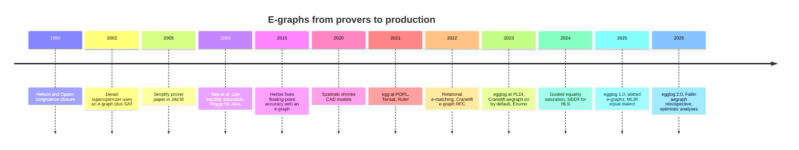
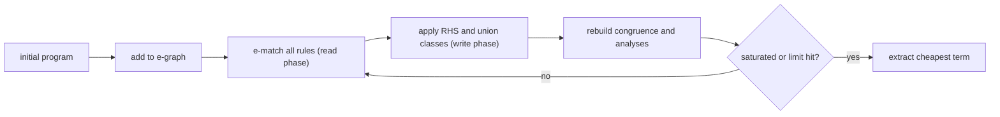
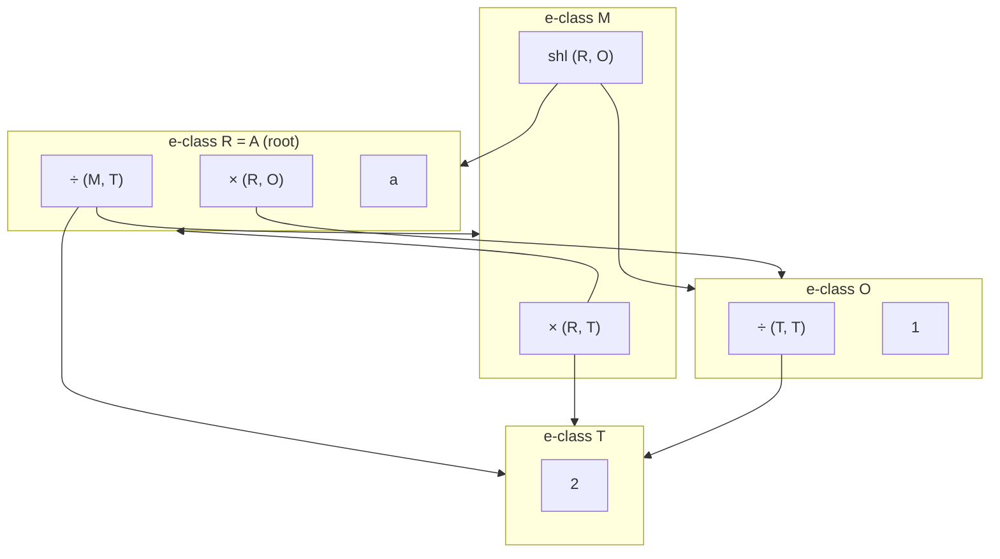

---
tags:
  - compilers
  - e-graphs
  - equality-saturation
  - term-rewriting
  - optimization
  - program-synthesis
status: complete
sources:
  - https://web.eecs.umich.edu/~weimerw/2011-6610/reading/nelson-oppen-congruence.pdf
  - https://courses.cs.washington.edu/courses/cse599f/06sp/papers/p365-detlefs.pdf
  - https://people.csail.mit.edu/randall/papers/abstracts/denali.html
  - https://cseweb.ucsd.edu/~rtate/publications/eqsat/
  - https://arxiv.org/abs/1012.1802
  - https://arxiv.org/abs/2004.03082v3
  - https://ar5iv.labs.arxiv.org/html/2004.03082
  - https://arxiv.org/abs/2304.04332v3
  - https://arxiv.org/abs/2108.02290v2
  - https://docs.rs/crate/egglog/2.0.0/source/CHANGELOG.md
  - https://www.cfallin.org/blog/2026/04/09/aegraph
  - https://github.com/bytecodealliance/rfcs/pull/27
  - https://bytecodealliance.org/articles/cranelift-progress-2022
  - https://fpbench.cs.washington.edu/pldi15-paper.pdf
  - https://arxiv.org/abs/2101.01332v1
  - https://arxiv.org/pdf/2108.10436
  - https://par.nsf.gov/biblio/10510243-equality-saturation-theory-exploration-la-carte
  - https://arxiv.org/abs/1909.12252
  - https://arxiv.org/pdf/2308.07654
  - https://arxiv.org/pdf/2505.09363
  - https://arxiv.org/abs/2602.16707v1
  - https://cse.hkust.edu.hk/~parreaux/publication/oopsla24a/
  - https://www.csl.cornell.edu/~zhiruz/pdfs/smoothe-asplos2025.pdf
  - https://arxiv.org/html/2508.13020v2
  - https://arxiv.org/pdf/2408.17042
  - https://arxiv.org/pdf/2610.01198
  - https://arxiv.org/pdf/2511.20782
  - https://dl.acm.org/doi/10.1145/3632900
  - https://pldi25.sigplan.org/details/pldi-2025-papers/77/Slotted-E-Graphs-First-Class-Support-for-Bound-Variables-in-E-Graphs
  - https://pldi25.sigplan.org/program/program-egraphs-2025
  - https://pldi26.sigplan.org/home/egraphs-2026
  - https://pldi26.sigplan.org/details/pldi-2026-papers/56/Improving-Equality-Saturation-for-EDA-via-Semantic-E-Graphs
  - https://arxiv.org/abs/2511.00403v1
  - https://arxiv.org/abs/2604.17364
  - https://api.crossref.org/works/10.1145%2F3776667
  - https://isa-afp.org/entries/Equality_Saturation_Checker.html
  - https://arxiv.org/abs/2510.09932
created: 2026-11-26
updated: 2026-11-26
---

## Table Of Contents

- [[#TL;DR|TL;DR]]
- [[#The Problem|The Problem]]
- [[#Foundations|Foundations]]
    - [[#E-Nodes, E-Classes and Congruence|E-Nodes, E-Classes and Congruence]]
    - [[#Union-Find and the Hashcons|Union-Find and the Hashcons]]
    - [[#Cost Functions|Cost Functions]]
- [[#How We Got Here|How We Got Here]]
- [[#How It Works|How It Works]]
    - [[#The Saturation Loop|The Saturation Loop]]
    - [[#Worked Example|Worked Example]]
    - [[#Rebuilding|Rebuilding]]
    - [[#E-Class Analyses|E-Class Analyses]]
    - [[#Relational E-Matching and egglog|Relational E-Matching and egglog]]
    - [[#Extraction|Extraction]]
    - [[#The Example in egglog and egg|The Example in egglog and egg]]
    - [[#Taming Blowup|Taming Blowup]]
- [[#Where It Is Now|Where It Is Now]]
    - [[#Cranelift's Acyclic E-Graph|Cranelift's Acyclic E-Graph]]
    - [[#Tools and Releases|Tools and Releases]]
    - [[#Applications|Applications]]
    - [[#Recent Research and Workshops|Recent Research and Workshops]]
    - [[#E-Graphs and LLMs|E-Graphs and LLMs]]
- [[#Trade-offs & Open Problems|Trade-offs & Open Problems]]
- [[#Resources|Resources]]
- [[#Related Notes|Related Notes]]

## ***TL;DR***
---
*An e-graph stores many equivalent programs at once by sharing their common parts, and equality saturation fills one with every rewrite it can find before picking the cheapest program. Because rewrites only add facts and never erase the original, the order they run in stops mattering, which sidesteps the phase-ordering problem.*

- **The data structure.** An *e-graph* is a set of *e-classes*; each e-class is a set of *e-nodes* (an operator plus child e-classes) that all mean the same value. A union-find records which classes have been merged, and a *congruence* invariant keeps `f(a)` and `f(b)` together once `a ≡ b` ([Willsey et al., POPL 2021](https://arxiv.org/abs/2004.03082v3)).
- **The algorithm.** *Equality saturation* repeats: match every rule's left side, add the right side, merge the classes. Stop at a fixpoint (saturation) or a limit, then *extract* the best term with a cost function ([Tate et al., POPL 2009](https://cseweb.ucsd.edu/~rtate/publications/eqsat/)).
- **Lineage.** Born in theorem provers (Nelson-Oppen congruence closure, 1980; Simplify), used for superoptimization in Denali (2002), turned into a compiler technique by Tate et al. (2009), and made practical by **egg** (2021) and **egglog** (2023), which recasts e-graphs as a Datalog database ([Zhang et al., PLDI 2023](https://arxiv.org/abs/2304.04332v3)).
- **Production.** Cranelift (the code generator behind Wasmtime) runs an *acyclic e-graph* mid-end. Chris Fallin's April 2026 retrospective finds the design sound and about 2% faster code than its classical pipeline, but the "multi-representation" part averages **1.13 e-nodes per e-class** and buys only about **0.1%** ([Fallin, 2026](https://www.cfallin.org/blog/2026/04/09/aegraph)).
- **The catch.** E-graphs blow up (a sum of *n* variables under associativity and commutativity makes $2^n-1$ e-classes), and optimal extraction is NP-hard. Most 2025-2026 research is about those two problems.

## ***The Problem***
---
*Ordinary optimizers rewrite the program in place, so each rewrite destroys the form that another rewrite needed. Which result you get depends on the order the passes or rules fire, and no single order is best for every program.*

A classic pass pipeline (see [[Classic Optimizations]] and [[Compiler Pipeline]]) or a peephole rewriter applies a rule and throws the old term away. That is *destructive rewriting*. It is fast and it is how almost every production compiler works, but it means rules compete:

```c
int f(int a) { return (a * 2) / 2; }
```

Suppose the rules are strength reduction `x*2 → x<<1`, reassociation `(x*y)/z → x*(y/z)`, `x/x → 1` and `x*1 → x`. If strength reduction fires first, the program becomes `(a << 1) / 2`, and reassociation never matches again because there is no `*` left. If reassociation fires first, the chain `a*(2/2) → a*1 → a` finishes. Same rules, different answer, purely because of order. (Over machine integers `(a*2)/2` is not always `a`, since `a*2` can overflow and `x/x` needs `x ≠ 0`; the example treats the operators as exact arithmetic, as the egg paper's version does.)

Real compilers face this at scale. GCC and [[LLVM]] run cleanup passes many times and tune their order by hand; picking orders automatically is its own research area ([[ML-Guided Optimization]]). The deeper issue: a greedy rewriter must decide *now* whether a rewrite is profitable, using only local information. Equality saturation defers that choice until every alternative is known ([Tate et al., 2009](https://arxiv.org/abs/1012.1802)).

## ***Foundations***
---
*Three ideas carry the whole field: a graph whose nodes are equivalence classes, a congruence rule that keeps those classes consistent, and a cost function that turns "everything equivalent" back into one program.*

### E-Nodes, E-Classes and Congruence

*An e-node points to e-classes, not to other nodes, and that one indirection lets a small graph represent exponentially many terms.*

In egg's terms, an **e-node** is a function symbol with a list of child **e-class** ids, and has no identity of its own; an **e-class** is "a set of e-nodes representing equivalent terms" ([Willsey et al.](https://ar5iv.labs.arxiv.org/html/2004.03082)). A term is *represented* by an e-class if you can pick one e-node in that class, then one e-node in each child class, and so on down to leaves. Since each class may offer several choices at each level, the number of represented terms multiplies; if merging creates a cycle, it can be infinite.

The invariant that makes an e-graph more than a bag of equalities is **congruence**:

$$
a_1 \equiv b_1,\ \dots,\ a_k \equiv b_k \;\Longrightarrow\; f(a_1,\dots,a_k) \equiv f(b_1,\dots,b_k)
$$

**In plain English:** if you learn that two things are equal, every expression built the same way from them is also equal. Learn `2/2 = 1` and the e-graph must also know `a*(2/2) = a*1`. Computing the smallest relation closed under this rule is *congruence closure*, which Nelson and Oppen gave fast algorithms for in 1980 ([Nelson & Oppen, JACM 1980](https://web.eecs.umich.edu/~weimerw/2011-6610/reading/nelson-oppen-congruence.pdf)).

### Union-Find and the Hashcons

*Two classic structures do the bookkeeping: a union-find for "which classes are the same" and a hash table for "does this e-node already exist".*

| Structure | Maps | Used for |
|---|---|---|
| **Union-find** `U` | e-class id → canonical id | Merging classes in near-constant time; `find(id)` gives the representative |
| **Hashcons** `H` | canonical e-node → e-class id | *Hash-consing*: adding an e-node that already exists returns its class instead of duplicating it |
| **Parent lists** | e-class → e-nodes that use it | Finding which e-nodes may become congruent after a merge |

An e-node is *canonical* when all its children are canonical ids. After `union(c1, c2)`, e-nodes that pointed at `c1` and `c2` may now be identical once canonicalized, so they must be merged too. Keeping `H` and congruence correct after merges is the expensive part, and egg's main trick (rebuilding, below) is about doing it lazily.

### Cost Functions

*Extraction needs a number per term; the simplest cost functions add up a per-operator cost.*

Most systems use a *local, additive* cost: each operator has a cost, and a term costs its operator plus its children.

$$
\text{cost}(c) \;=\; \min_{n \in c}\Big(\text{op}(n) + \sum_{c' \in \text{children}(n)} \text{cost}(c')\Big)
$$

**In plain English:** the cheapest way to compute an e-class is its cheapest e-node, where an e-node costs its own operator plus the cheapest way to compute each child. This is a shortest-path style fixpoint, so it works even on cyclic e-graphs. It ignores *sharing*: if two parents use the same child, the child is counted twice, which overestimates the cost of a DAG. Getting sharing right is what makes optimal extraction hard.

## ***How We Got Here***
---
*E-graphs began as the equality engine inside automated theorem provers, were borrowed for superoptimization, became a compiler technique in 2009, and became a library ecosystem after egg in 2021.*



- **Provers.** Nelson and Oppen's congruence closure became the equality reasoning in the Simplify theorem prover, which called the structure an *E-graph* and used it with pattern matching ("matching" over equivalence classes, now *e-matching*) to instantiate quantifiers ([Detlefs, Nelson & Saxe, JACM 2005](https://courses.cs.washington.edu/courses/cse599f/06sp/papers/p365-detlefs.pdf)). SMT solvers such as Z3 inherited this.
- **Denali (2002).** Joshi, Nelson and Randall built a *goal-directed superoptimizer*: fill an e-graph with machine-level identities for a code fragment, then use a SAT solver to find the shortest Alpha instruction sequence it contains ([Joshi, Nelson & Randall, PLDI 2002](https://people.csail.mit.edu/randall/papers/abstracts/denali.html)). See [[Superoptimization]].
- **Equality saturation (2009).** Tate, Stepp, Tatlock and Lerner applied the idea to whole programs. They represent a function as a *Program Expression Graph* (PEG), a value-based IR with loop operators, build an *E-PEG* by saturating with axioms, and pick a result with a global profitability heuristic; the Peggy tool did this for Java bytecode ([Tate et al., POPL 2009](https://cseweb.ucsd.edu/~rtate/publications/eqsat/); journal version [LMCS 2011](https://arxiv.org/abs/1012.1802)).
- **egg (2021).** Willsey et al. made e-graphs fast and reusable: *rebuilding* (amortized invariant repair) and *e-class analyses* (domain facts attached to classes), shown on three previously published applications ([Willsey et al., POPL 2021](https://arxiv.org/abs/2004.03082v3)). It became the default substrate for research tools.
- **egglog (2023).** Zhang et al. unified equality saturation with Datalog, reimplementing a pointer analysis and Herbie's rewriter and reporting both faster, simpler and with bugs fixed ([Zhang et al., PLDI 2023](https://arxiv.org/abs/2304.04332v3)).

## ***How It Works***
---
*Equality saturation is a loop of search, apply and repair over the e-graph, followed by extraction. The engineering is in making each step cheap and keeping the graph from exploding.*

### The Saturation Loop

*Read-only matching, then batched writes, then one repair pass per iteration.*



Each iteration searches *every* rule against the *whole* e-graph before changing anything, so results don't depend on rule order. If an iteration adds nothing new, the graph is **saturated**: it now represents every term reachable with the rules, and extraction is guaranteed to see the best one. In practice most runs stop at an iteration, node or time limit instead.

### Worked Example

*Running the four rules from The Problem on `(a * 2) / 2`: the e-graph keeps both branches, so it never gets stuck.*

Start: four e-classes, one per subterm. Write classes as capital letters.

| Iteration | Matches found | Effect |
|---|---|---|
| 0 | none yet | `A={a}`, `T={2}`, `M={A*T}`, `R={M/T}` |
| 1 | `x*2→x<<1` on `M`; `(x*y)/z→x*(y/z)` on `R` | New `O={1}`, `D={T/T}`, `P={A*D}`; `M={A*T, A<<O}`; union `R` with `P`, so `R={M/T, A*D}` |
| 2 | `x/x→1` on `D` | Union `D` with `O`: now `O={T/T, 1}` |
| 3 | `x*1→x` on `A*O` in `R` (congruence made `A*D` read as `A*1`) | Union `R` with `A`: `R={M/T, A*O, a}` |
| 4 | nothing new | Saturated |

The destructive rewriter that fired strength reduction first got stuck at `(a<<1)/2`; here `a<<1` and `a*2` coexist in class `M`, so reassociation still matched in iteration 1. Iteration 3 shows congruence doing work: no rule ever saw the literal term `a*1`, but once `2/2 ≡ 1`, the e-node `A*D` *is* `A*1`. The final e-graph is also cyclic: `M` contains `A*T`, and `A` is now the root class, which contains `M/T`.



**Extraction** with cost = number of AST nodes: `T` costs 1 (`2`), `O` costs 1 (`1` beats `2/2` at 3), `R` costs 1 (`a` beats `÷` at 1+3+1 and `×` at 1+1+1). The answer is `a`. Note the cycle (`R` reaches `M`, which reaches `R`): extraction must not pick a node that leads back to its own class, which the min-cost fixpoint avoids because a cycle never lowers cost.

### Rebuilding

*egg's key speed trick: let merges break the invariants, then fix them all at once.*

Earlier e-graphs restored congruence immediately after every `union`, walking up parent lists ("upward merging"). egg instead has `merge` put the merged class on a **worklist**; a separate `rebuild` call drains it, deduplicating ids so many merges are repaired together. Calling `rebuild` after every operation reproduces the old behaviour; equality saturation calls it once per iteration, after the write phase. The paper gives cases where eager repair does $O(n^2)$ hashcons updates but deferred rebuilding does $O(n)$ ([Willsey et al.](https://ar5iv.labs.arxiv.org/html/2004.03082)). The read/write split of the loop is what makes deferral safe: matching never runs on a half-repaired graph.

### E-Class Analyses

*Attach a fact from a lattice to every e-class and keep it up to date through merges.*

An e-class analysis "annotates each e-class ... with facts drawn from a semilattice domain" ([Willsey et al.](https://ar5iv.labs.arxiv.org/html/2004.03082)). The user supplies how to compute a fact for a new e-node from its children's facts (*make*), how to combine facts when two classes merge (*merge*, the lattice join), and optionally how to change the class in response (*modify*). Constant folding is the standard example: the fact is "this class equals constant *k*, or unknown"; when a class learns it is `6`, modify adds the e-node `6`. Analyses also guard conditional rules, for example allowing `x/x → 1` only when the analysis proves `x ≠ 0`. This is [[Dataflow Analysis]] run over an e-graph instead of a CFG. Because classic e-class analyses are *pessimistic*, they lose precision on loops; the PLDI 2026 paper on optimism addresses that (see below).

### Relational E-Matching and egglog

*Treat the e-graph as database tables and e-matching becomes a join.*

**E-matching** finds all ways a pattern like `(/ (* ?x ?y) ?z)` matches. The classic algorithm backtracks top-down through e-nodes, which can be slow for patterns with shared variables. Zhang et al. observed that each operator's e-nodes form a relation (for `*`: rows of `(child1, child2, eclass)`), so a pattern is a *conjunctive query* and can be answered with worst-case optimal join algorithms from databases ([Zhang et al., POPL 2022](https://arxiv.org/abs/2108.02290v2)).

```text
(/ (* ?x ?y) ?z)   ==>   Mul(x, y, m) ⋈ Div(m, z, root)
```

**egglog** takes the next step: the whole e-graph is a Datalog database whose functions are tables, rules are Datalog rules whose heads can `union`, and rebuilding is part of the fixpoint. That brings Datalog's semi-naive (incremental) evaluation, multiple cooperating analyses and lattice-valued functions to equality saturation ([Zhang et al., PLDI 2023](https://arxiv.org/abs/2304.04332v3)).

### Extraction

*Picking the best term is easy if you ignore sharing and NP-hard if you don't.*

| Approach | How | Quality | Cost |
|---|---|---|---|
| **Greedy bottom-up** | The min-cost fixpoint from [[#Cost Functions\|Cost Functions]] | Optimal for tree cost; overcounts shared subterms | Linear-ish, used by egg and Cranelift |
| **ILP / pseudo-boolean** | One 0/1 variable per e-node; solver minimizes total cost | Optimal DAG cost (with acyclicity constraints) | Solver time grows quickly on big graphs; Peggy used a pseudo-boolean solver ([Tate et al.](https://arxiv.org/abs/1012.1802)) |
| **Treewidth / circuits** | View the e-graph as a circuit; dynamic programming over a tree decomposition | Optimal; fast when the graph is "tree-like" | Exponential in treewidth ([Goharshady et al., OOPSLA 2024](https://cse.hkust.edu.hk/~parreaux/publication/oopsla24a/); [Sun et al., 2024](https://arxiv.org/pdf/2408.17042)) |
| **Differentiable** | SmoothE relaxes choices to probabilities and optimizes by gradient on a GPU | Near-optimal, handles non-linear costs | GPU time ([Cai et al., ASPLOS 2025](https://www.csl.cornell.edu/~zhiruz/pdfs/smoothe-asplos2025.pdf)) |
| **Hybrid** | e-boost prunes with heuristics, then solves exactly | Aims for near-ILP quality in less time | [ICCAD 2025](https://arxiv.org/html/2508.13020v2) |

The ILP for DAG cost, roughly:

$$
\min \sum_{n} \text{op}(n)\, x_n \quad \text{s.t.}\quad \sum_{n \in \text{root}} x_n \ge 1,\qquad x_n \le \sum_{m \in c} x_m \;\;\forall c \in \text{children}(n),\qquad x_n \in \{0,1\}
$$

**In plain English:** choose a set of e-nodes, paying for each once (so shared subterms are paid once); pick at least one node in the root class; and any chosen node forces a chosen node in each of its child classes. Extra constraints forbid choosing a cycle. Fallin notes the NP-hardness of sharing-aware extraction follows by reduction from weighted set cover ([Fallin, 2026](https://www.cfallin.org/blog/2026/04/09/aegraph)).

### The Example in egglog and egg

*The same four rules, first as an egglog program, then as a Rust program using egg.*

```lisp
; egglog (2.x: globals take a $ prefix)
(datatype Math
  (Num i64) (Var String)
  (Mul Math Math) (Div Math Math) (Shl Math Math))

(rewrite (Mul x (Num 2))     (Shl x (Num 1)))
(rewrite (Div (Mul x y) z)   (Mul x (Div y z)))
(rewrite (Div x x)           (Num 1))     ; unsound if x = 0
(rewrite (Mul x (Num 1))     x)

(let $e (Div (Mul (Var "a") (Num 2)) (Num 2)))
(run 10)
(check (= $e (Var "a")))
(extract $e)                               ; => (Var "a")
```

```rust
use egg::{rewrite as rw, *};

let rules: &[Rewrite<SymbolLang, ()>] = &[
    rw!("mul2-shl";   "(* ?x 2)"         => "(<< ?x 1)"),
    rw!("reassoc";    "(/ (* ?x ?y) ?z)" => "(* ?x (/ ?y ?z))"),
    rw!("div-self";   "(/ ?x ?x)"        => "1"),
    rw!("mul-one";    "(* ?x 1)"         => "?x"),
];
let start: RecExpr<SymbolLang> = "(/ (* a 2) 2)".parse().unwrap();
let runner = Runner::default().with_expr(&start).run(rules);
let (cost, best) = Extractor::new(&runner.egraph, AstSize).find_best(runner.roots[0]);
assert_eq!(best.to_string(), "a"); // cost == 1
```

In egg, the `Runner` drives the loop and stops at saturation or a limit; `Extractor` with `AstSize` is the greedy extractor. A real optimizer would use an `Analysis` (for constant folding and the `x ≠ 0` guard) and a cost function that knows `<<` is cheaper than `*`.

### Taming Blowup

*Rules like associativity and commutativity make e-graphs grow exponentially, so every real system limits or steers the search.*

Rosin, Ullrich and Hack count it exactly: saturating `x1 + ... + xn` under associativity and commutativity yields $2^n - 1$ e-classes and $3^n - 2^{n+1} + n + 1$ e-nodes ([Rosin et al., 2026](https://arxiv.org/pdf/2610.01198)). Rules that build bigger terms (`x → x*1`, distributivity) can grow the graph without bound. The common defences:

- **Limits.** Stop after a fixed number of iterations, e-nodes or seconds; you lose the "saw everything" guarantee.
- **Rule scheduling.** egg's backoff scheduler temporarily bans a rule that matches far more often than others, so one explosive rule can't starve the rest; egglog adds named rulesets and, since 1.0, a custom scheduler interface ([egglog changelog](https://docs.rs/crate/egglog/2.0.0/source/CHANGELOG.md)).
- **Guidance.** *Guided equality saturation* lets a user or tool give *sketches* of intermediate goals and saturate toward each in turn ([Koehler et al., POPL 2024](https://dl.acm.org/doi/10.1145/3632900)); ML and LLM guidance are newer (below).
- **Better representations.** Build theories into the e-graph instead of encoding them as rules: AC-aware matching stores sums as multisets and drops the sum example to $O(n)$ ([Rosin et al.](https://arxiv.org/pdf/2610.01198)); *slotted e-graphs* treat bound variables up to renaming ([Schneider et al., PLDI 2025](https://pldi25.sigplan.org/details/pldi-2025-papers/77/Slotted-E-Graphs-First-Class-Support-for-Bound-Variables-in-E-Graphs)).
- **Give up non-destructiveness selectively.** Cranelift rewrites eagerly with no saturation at all; *Destructive E-Graph Rewrites* (EGRAPHS 2025) lets some rules delete what they replace ([EGRAPHS 2025 program](https://pldi25.sigplan.org/program/program-egraphs-2025)).

## ***Where It Is Now***
---
*As of November 2026, e-graphs ship in one production code generator (Cranelift), egglog has reached 2.0, and research is focused on scale, extraction, loops and learned guidance. The honest production verdict so far: the framework pays off, the "many alternatives" part only modestly.*

### Cranelift's Acyclic E-Graph

*The one mainstream compiler mid-end built on e-graphs, and its author's own assessment.*

Cranelift proposed an e-graph mid-end in 2022 ([Bytecode Alliance RFC #27](https://github.com/bytecodealliance/rfcs/pull/27); [Cranelift progress, 2022](https://bytecodealliance.org/articles/cranelift-progress-2022)), and switched to it in 2023 once performance was "more or less at parity". Fallin's April 2026 retrospective describes it ([Fallin, 2026](https://www.cfallin.org/blog/2026/04/09/aegraph)):

- **Shape.** Side-effecting instructions stay in a CFG "skeleton"; pure operators are lifted out, hash-consed and rewritten, then *elaborated* back into blocks by a scoped walk over the dominator tree. GVN, LICM, rematerialization and DCE fall out of that (see [[SSA Form]], [[Intermediate Representations]]).
- **Acyclic by construction.** Nodes never change after creation; an e-class is a binary tree of append-only "union" nodes, so there are no parent pointers and no rebuild step. Rules fire eagerly as each node is created instead of saturating.
- **Extraction.** A bottom-up dynamic program that ignores sharing.
- **Numbers.** Average e-class size after rewriting is **1.13 e-nodes**. The aegraph pipeline gives about **2%** faster code than the classical pipeline (which repeating the classical passes didn't match) for about **7-8%** more compile time. Keeping multiple representations rather than picking one eagerly is worth only about **0.1%** run time; across about 4 million value nodes, eager choice picked a worse option twice.
- **Verdict.** The sea-of-nodes-with-CFG design works, but the multi-representation part "may not (yet?) be pulling its weight", likely because Wasm input is already optimized and the rules omit associativity and commutativity. Planned next: sharing-aware extraction, rewriting the CFG skeleton itself, and folding backend lowering rules into the aegraph.

### Tools and Releases

*egglog is the reference engine; several others target speed or memory.*

| Tool | Status as of November 2026 |
|---|---|
| **egglog** (Rust, with Python bindings) | 1.0.0 (2025-10-18) moved to a "database-first, highly parallel backend" with a scheduler API; 2.0.0 (2026-02-11) added proof preparation and term encoding, faster rebuilding and `$`-prefixed globals ([changelog](https://docs.rs/crate/egglog/2.0.0/source/CHANGELOG.md)) |
| **egg** | Still widely used; the Isabelle checker below validates egg 0.11.0's explanations |
| **Oatlog** | Ahead-of-time compiled e-graph engine (EGRAPHS 2025) |
| **CERES** | Memory-scalable equality saturation (EGRAPHS 2026) |
| **slotted-egraphs** | Rust crate for the PLDI 2025 slotted design |

### Applications

*Wherever a domain has many algebraic identities and a clear cost model.*

| Domain | System | What the e-graph does |
|---|---|---|
| Floating point | Herbie ([Panchekha et al., PLDI 2015](https://fpbench.cs.washington.edu/pldi15-paper.pdf)) | Simplifies candidate rewrites while searching for more accurate formulas; an egg case study, and egglog's paper reimplemented its rewriter |
| Tensor graphs | Tensat ([Yang et al., MLSys 2021](https://arxiv.org/abs/2101.01332v1)) | Up to 16% faster graphs than the prior state of the art with 48× less optimization time on average; see [[ML Compilers]] |
| Rule synthesis | Ruler ([Nandi et al., OOPSLA 2021](https://arxiv.org/pdf/2108.10436)), Enumo ([Pal et al., OOPSLA 2023](https://par.nsf.gov/biblio/10510243-equality-saturation-theory-exploration-la-carte)) | Use saturation to infer small, sound rule sets from enumerated terms |
| CAD | Szalinski ([Nandi et al., PLDI 2020](https://arxiv.org/abs/1909.12252)) | Recovers loops and structure from flat CAD meshes |
| Hardware and HLS | SEER ([Cheng et al., ASPLOS 2024](https://arxiv.org/pdf/2308.07654)); semantic e-graphs for EDA ([PLDI 2026](https://pldi26.sigplan.org/details/pldi-2026-papers/56/Improving-Equality-Saturation-for-EDA-via-Semantic-E-Graphs)) | Explore datapath and control rewrites before synthesis |
| Accelerator back ends | ACT ([arXiv 2025](https://arxiv.org/abs/2510.09932)) | Instruction selection for tensor accelerators by saturation; see [[Instruction Selection]], [[AI Accelerators]] |
| MLIR | eqsat dialect ([Merckx et al., EGRAPHS 2025](https://arxiv.org/pdf/2505.09363)); persistent e-graphs ([Merckx et al., Feb 2026](https://arxiv.org/abs/2602.16707v1)) | Stores e-classes as IR ops in xDSL so equalities survive across passes and abstraction levels; see [[MLIR]] |
| Proof assistants | Lean tactic ([Rossel et al., POPL 2026](https://api.crossref.org/works/10.1145%2F3776667)) | Treats theorems as conditional rewrites; unproved side conditions become proof goals |

**Verified equality saturation.** Correctness is usually argued per rule (Ruler and Enumo check rule soundness). End-to-end checking is arriving: an Isabelle AFP entry (July 2026) checks egg 0.11.0's merge explanations and proves its extractor returns a minimum-cost term ([Ramos et al., 2026](https://isa-afp.org/entries/Equality_Saturation_Checker.html)); egglog 2.0's proof work points the same way. See [[Verified Compilers]] and [[Formal Methods in Practice]].

### Recent Research and Workshops

*The EGRAPHS workshop at PLDI is where the field meets; its 2025 and 2026 programs show the agenda.*

- **EGRAPHS 2025** (Seoul, 17 June 2025): 12 talks, including the MLIR eqsat dialect, destructive rewrites, incremental equality saturation, Oatlog, LLM- and ML-guided saturation, e-graphs modulo theories, and applications from FHE circuits to molecular dynamics ([program](https://pldi25.sigplan.org/program/program-egraphs-2025)).
- **EGRAPHS 2026** (Boulder, 15 June 2026): 15 talks, including CERES (memory scaling), AC-aware saturation, Knuth-Bendix completion of rule sets, answer-set programming for extraction, relational e-matching in an SMT solver, predicate e-graphs, joint instruction scheduling and rewriting, and "Stochastic Search vs. EqSat" ([workshop page](https://pldi26.sigplan.org/home/egraphs-2026)).
- **Optimism in Equality Saturation** (PLDI 2026): an optimistic e-class analysis for loops in SSA form, sound on well-formed cycles, that alternates with saturation and fully optimizes examples that GCC, Clang and pessimistic analyses can't; typically about three fixpoint iterations ([Arbore, Cheung & Willsey, 2026](https://arxiv.org/pdf/2511.20782)).
- **AC in equality saturation** (Saarland, 2026): multiset e-nodes plus AC congruence closure; preliminary, still exponential in the worst case ([Rosin et al.](https://arxiv.org/pdf/2610.01198)).

### E-Graphs and LLMs

*Two directions: LLMs steering the search, and e-graphs checking or structuring what models produce.*

- **LLM-guided saturation.** Peng, Ji and Xiong use an LLM to propose intermediate steps that guide saturation past blowup (EGRAPHS 2025; [arXiv 2511.00403](https://arxiv.org/abs/2511.00403v1)). *EggMind* has an LLM write reusable saturation *strategies* in a small DSL; on [[Vectorization|vectorization]] benchmarks it reports 45.1% lower final cost and 69.1% lower peak memory than full saturation ([Yin et al., Apr 2026](https://arxiv.org/abs/2604.17364)).
- **Why the pairing fits.** An LLM is good at guessing a promising direction and bad at guaranteeing equivalence; an e-graph is the reverse. Every term in an e-graph is equal by construction, so a model's suggestions can only change *which* equal programs get explored. Learned guidance in general is covered in [[ML-Guided Optimization]].

## ***Trade-offs & Open Problems***
---
*Equality saturation trades compile time and memory for freedom from phase ordering. Whether that trade wins depends on how rich the rule set is and how good the cost model is.*

| Benefit | Cost |
|---|---|
| Rule order doesn't matter; no phase ordering among rules | Memory and time can grow exponentially; real runs stop at limits, so "saturation" is often not reached |
| Rules are small, local and checkable one by one | Global optimizations (loops, control flow, memory) are hard to express as term rewrites |
| Extraction sees all alternatives at once | Optimal extraction is NP-hard; greedy extraction ignores sharing |
| Analyses and rewrites cooperate | Classic e-class analyses are pessimistic on cycles |

Open problems as of late 2026:

- **Control flow and effects.** E-graphs handle pure expressions well. Cranelift keeps a CFG skeleton outside the e-graph; Peggy encoded loops in PEGs; RVSDG-style IRs and optimistic analyses are the current attempts to bring loops and effects inside.
- **Cost models.** Additive costs ignore sharing, register pressure and scheduling. Fallin wants backend lowering costs in extraction; an EGRAPHS 2026 talk does joint instruction scheduling and rewriting.
- **Scale.** Memory (CERES), parallel and database-style engines (egglog 1.0), incremental saturation, and theory-aware e-graphs (AC, bound variables) all target blowup.
- **Production value.** Cranelift's 1.13 e-nodes per class suggests that with simple cleanup rules, a good eager rewriter gets most of the benefit. The open question is which workloads (tensor graphs, hardware, numerics) need the full search; so far those are the domain-specific tools, not general-purpose compilers.
- **Trust.** Unsound rules (like `x/x → 1` without `x ≠ 0`) make *every* derived equality suspect. Rule synthesis with checking (Ruler, Enumo), checked explanations, and proofs in egglog 2.0 are the responses; see [[Compiler Testing and Fuzzing]] for how rule bugs get found.

## ***Resources***
---
*Start with the egg paper and the egg tutorial, then Fallin's retrospective for a production view.*

**Primary papers**
- [Fast Decision Procedures Based on Congruence Closure](https://web.eecs.umich.edu/~weimerw/2011-6610/reading/nelson-oppen-congruence.pdf): Nelson and Oppen, JACM 1980.
- [Denali: A Goal-directed Superoptimizer](https://people.csail.mit.edu/randall/papers/abstracts/denali.html): Joshi, Nelson and Randall, PLDI 2002.
- [Simplify: A Theorem Prover for Program Checking](https://courses.cs.washington.edu/courses/cse599f/06sp/papers/p365-detlefs.pdf): Detlefs, Nelson and Saxe, JACM 2005.
- [Equality Saturation: A New Approach to Optimization](https://cseweb.ucsd.edu/~rtate/publications/eqsat/): Tate, Stepp, Tatlock and Lerner, POPL 2009; [LMCS 2011 version](https://arxiv.org/abs/1012.1802).
- [egg: Fast and Extensible Equality Saturation](https://arxiv.org/abs/2004.03082v3): Willsey et al., POPL 2021.
- [Relational E-Matching](https://arxiv.org/abs/2108.02290v2): Zhang et al., POPL 2022.
- [Better Together: Unifying Datalog and Equality Saturation](https://arxiv.org/abs/2304.04332v3): Zhang et al., PLDI 2023.
- [Guided Equality Saturation](https://dl.acm.org/doi/10.1145/3632900): Koehler et al., POPL 2024.
- [Optimism in Equality Saturation](https://arxiv.org/pdf/2511.20782): Arbore, Cheung and Willsey, PLDI 2026.
- [Associativity and Commutativity in Equality Saturation](https://arxiv.org/pdf/2610.01198): Rosin, Ullrich and Hack, 2026.

**Extraction**
- [Fast and Optimal Extraction for Sparse Equality Graphs](https://cse.hkust.edu.hk/~parreaux/publication/oopsla24a/): OOPSLA 2024.
- [E-Graphs as Circuits, and Optimal Extraction via Treewidth](https://arxiv.org/pdf/2408.17042): 2024.
- [SmoothE](https://www.csl.cornell.edu/~zhiruz/pdfs/smoothe-asplos2025.pdf): ASPLOS 2025; [e-boost](https://arxiv.org/html/2508.13020v2): ICCAD 2025.

**Applications**
- [Herbie](https://fpbench.cs.washington.edu/pldi15-paper.pdf) (PLDI 2015), [Tensat](https://arxiv.org/abs/2101.01332v1) (MLSys 2021), [Ruler](https://arxiv.org/pdf/2108.10436) (OOPSLA 2021), [Enumo](https://par.nsf.gov/biblio/10510243-equality-saturation-theory-exploration-la-carte) (OOPSLA 2023), [Szalinski](https://arxiv.org/abs/1909.12252) (PLDI 2020), [SEER](https://arxiv.org/pdf/2308.07654) (ASPLOS 2024), [ACT](https://arxiv.org/abs/2510.09932) (2025).
- MLIR: [eqsat dialect](https://arxiv.org/pdf/2505.09363) (2025) and [E-Graphs as a Persistent Compiler Abstraction](https://arxiv.org/abs/2602.16707v1) (2026).
- Proofs: [Lean tactic, POPL 2026](https://api.crossref.org/works/10.1145%2F3776667); [Isabelle certificate checker](https://isa-afp.org/entries/Equality_Saturation_Checker.html) (2026).
- LLMs: [Equality Saturation Guided by LLMs](https://arxiv.org/abs/2511.00403v1); [EggMind](https://arxiv.org/abs/2604.17364).

**Practitioners**
- [The acyclic e-graph: Cranelift's mid-end optimizer](https://www.cfallin.org/blog/2026/04/09/aegraph): Chris Fallin, Apr 2026.
- [Cranelift RFC #27: e-graphs for verified, cooperating mid-end optimizations](https://github.com/bytecodealliance/rfcs/pull/27) and [Cranelift progress in 2022](https://bytecodealliance.org/articles/cranelift-progress-2022).
- [egglog changelog](https://docs.rs/crate/egglog/2.0.0/source/CHANGELOG.md).
- Workshops: [EGRAPHS 2025 program](https://pldi25.sigplan.org/program/program-egraphs-2025), [EGRAPHS 2026](https://pldi26.sigplan.org/home/egraphs-2026).

## Related Notes

- [[Classic Optimizations]] — The destructive passes and the phase-ordering problem equality saturation sidesteps.
- [[Compiler Pipeline]] — Pass managers and why their order is hand-tuned.
- [[Intermediate Representations]] — Sea of nodes, PEGs and the IR shape behind Cranelift's aegraph.
- [[SSA Form]] — The value-based view that e-graphs extend; elaboration rebuilds SSA.
- [[Dataflow Analysis]] — Lattices and fixpoints, the basis of e-class analyses.
- [[Superoptimization]] — Denali and other searches for the optimal instruction sequence.
- [[Instruction Selection]] — ISLE lowering rules and saturation-based selection (ACT).
- [[MLIR]] — Where the eqsat dialect lives.
- [[ML Compilers]] — Tensor-graph rewriting in Tensat and successors.
- [[WebAssembly]] — Wasmtime, the main user of Cranelift's mid-end.
- [[ML-Guided Optimization]] — Learned and LLM guidance for rule search.
- [[Verified Compilers]] — Checking rewrite rules and extraction.
- [[Compiler Testing and Fuzzing]] — Finding unsound rules.
- [[Formal Methods in Practice]] — Congruence closure in SMT solvers and proof assistants.
- [[AI Accelerators]] — Targets for saturation-based instruction selection.
