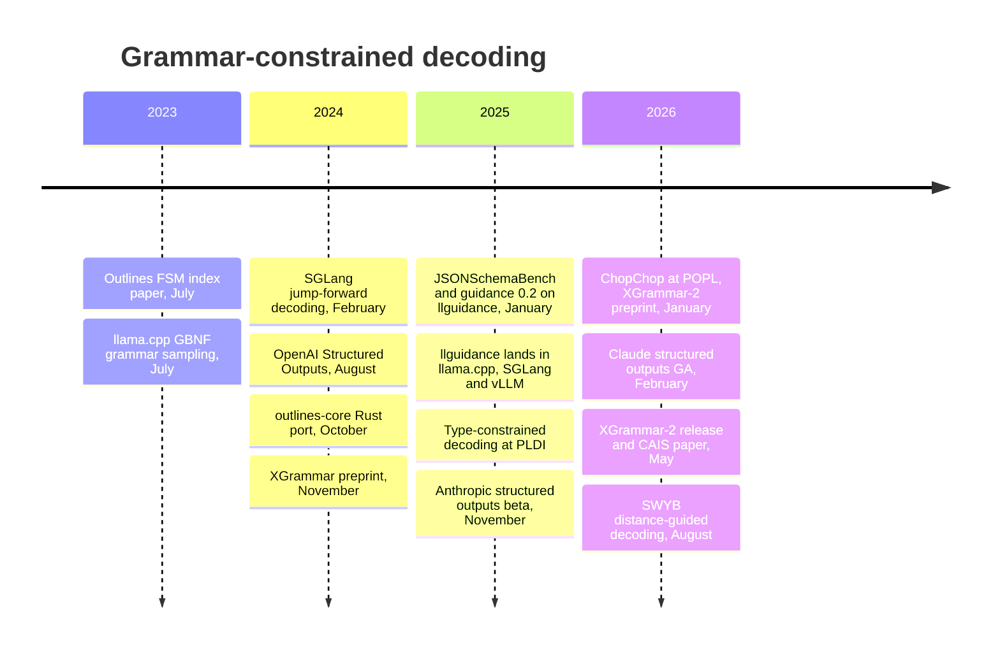
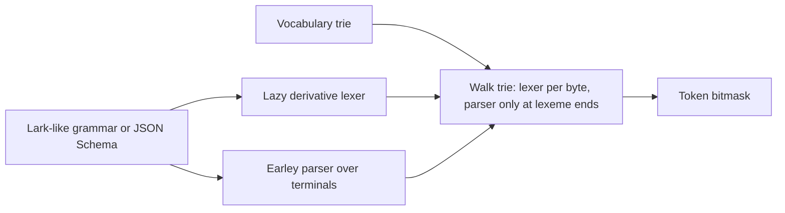
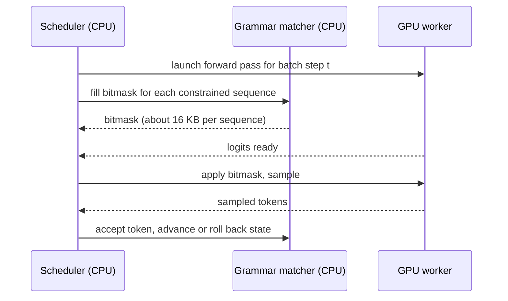

---
tags:
  - compilers
  - grammar-constrained-decoding
  - structured-outputs
  - constrained-decoding
  - parsing
  - llm-inference
  - json-schema
status: complete
sources:
  - https://arxiv.org/abs/2307.09702
  - https://ar5iv.labs.arxiv.org/html/2307.09702
  - https://github.com/ggerganov/llama.cpp/pull/1773
  - https://github.com/ggml-org/llama.cpp/blob/master/grammars/README.md
  - https://github.com/guidance-ai/llguidance
  - https://arxiv.org/abs/2411.15100
  - https://arxiv.org/html/2411.15100
  - https://arxiv.org/html/2601.04426v3
  - https://blog.mlc.ai/2026/05/04/xgrammar-2-fast-customizable-structured-generation
  - https://lmsys.org/blog/2024-02-05-compressed-fsm/
  - https://guidance.readthedocs.io/en/latest/example_notebooks/art_of_prompt_design/prompt_boundaries_and_token_healing.html
  - https://github.com/guidance-ai/guidance
  - https://huggingface.co/blog/outlines-core
  - https://vllm.ai/blog/2025-01-14-struct-decode-intro
  - https://docs.vllm.ai/en/latest/features/structured_outputs/
  - https://docs.sglang.io/advanced_features/structured_outputs.html
  - https://nvidia.github.io/TensorRT-LLM/latest/features/guided-decoding.html
  - https://openai.com/index/introducing-structured-outputs-in-the-api/
  - https://developers.openai.com/cookbook/examples/gpt-5/gpt-5_new_params_and_tools
  - https://claude.com/blog/structured-outputs-on-the-claude-developer-platform
  - https://platform.claude.com/docs/en/build-with-claude/structured-outputs
  - https://arxiv.org/abs/2408.02442
  - https://blog.dottxt.ai/say-what-you-mean.html
  - https://arxiv.org/abs/2501.10868
  - https://arxiv.org/html/2501.10868v3
  - https://arxiv.org/abs/2405.21047
  - https://arxiv.org/abs/2403.06988
  - https://arxiv.org/abs/2502.09061
  - https://arxiv.org/pdf/2502.05111v2
  - https://arxiv.org/html/2506.01151v1
  - https://pldi25.sigplan.org/details/pldi-2025-papers/25/Type-Aware-Constraining-for-LLM-Code-Generation
  - https://arxiv.org/pdf/2509.00360
  - https://arxiv.org/pdf/2603.05540
  - https://arxiv.org/pdf/2608.28229
created: 2026-11-26
updated: 2026-11-26
---

## Table Of Contents

- [[#TL;DR|TL;DR]]
- [[#The Problem|The Problem]]
- [[#Foundations|Foundations]]
    - [[#Logits, Masks and Sampling|Logits, Masks and Sampling]]
    - [[#Regular vs Context-Free Constraints|Regular vs Context-Free Constraints]]
    - [[#The Token-Character Mismatch|The Token-Character Mismatch]]
    - [[#Masking Is Not Conditioning|Masking Is Not Conditioning]]
- [[#How We Got Here|How We Got Here]]
- [[#How It Works|How It Works]]
    - [[#A Worked Example: One Mask, One Step|A Worked Example: One Mask, One Step]]
    - [[#Regex to FSM Index (Outlines)|Regex to FSM Index (Outlines)]]
    - [[#Pushdown Grammars: GBNF in llama.cpp|Pushdown Grammars: GBNF in llama.cpp]]
    - [[#Earley Over a Lexer: llguidance|Earley Over a Lexer: llguidance]]
    - [[#XGrammar: Precompute What You Can|XGrammar: Precompute What You Can]]
    - [[#Token Healing and Fast-Forwarding|Token Healing and Fast-Forwarding]]
    - [[#Compiling JSON Schema to a Grammar|Compiling JSON Schema to a Grammar]]
    - [[#Inside the Serving Engine|Inside the Serving Engine]]
    - [[#Speed Numbers Side by Side|Speed Numbers Side by Side]]
- [[#Where It Is Now|Where It Is Now]]
    - [[#Hosted Structured Outputs|Hosted Structured Outputs]]
    - [[#Open Engines and Backends|Open Engines and Backends]]
    - [[#XGrammar-2 and Agentic Workloads|XGrammar-2 and Agentic Workloads]]
    - [[#Research in 2025 and 2026|Research in 2025 and 2026]]
- [[#Trade-offs & Open Problems|Trade-offs & Open Problems]]
- [[#Resources|Resources]]
- [[#Related Notes|Related Notes]]

## ***TL;DR***
---
*Grammar-constrained decoding runs a parser inside the LLM's sampling loop: after every token it computes which of ~100k vocabulary tokens keep the output a valid prefix of a grammar (or JSON Schema) and sets every other logit to $-\infty$. The parsing theory is old; the hard part is that LLM tokens do not line up with lexer tokens, and the mask has to be ready in tens of microseconds.*

- **The mechanism is a mask.** Each decode step, a CPU-side matcher produces a bitmask over the vocabulary; the engine applies it to the logits before sampling, then advances the matcher with the chosen token. Output is valid by construction (barring early stops like `max_tokens` or a refusal) ([OpenAI, 2024](https://openai.com/index/introducing-structured-outputs-in-the-api/); [Anthropic docs](https://platform.claude.com/docs/en/build-with-claude/structured-outputs)).
- **Tokens span lexer boundaries.** A BPE token like `",` closes a string *and* emits a comma; `,1]` crosses three grammar terminals. So a token's validity cannot be read off one lexer state, and naive checks must walk every token's characters through the grammar at every step. Every engine is a different answer to that cost.
- **Three generations of engines.** Regex to FSM with a precomputed state-to-tokens index (Outlines, [Willard and Louf, 2023](https://arxiv.org/abs/2307.09702)); pushdown grammars checked token by token (llama.cpp GBNF, [July 2023](https://github.com/ggerganov/llama.cpp/pull/1773)); and fast CFG engines: **llguidance** (Earley parser over a derivative-based lexer, about 50 μs per token for a 128k vocabulary, no precompute ([llguidance](https://github.com/guidance-ai/llguidance))) and **XGrammar** (pushdown automaton with a cache of *context-independent* tokens and a persistent stack, under 40 μs per token for JSON ([Dong et al., MLSys 2025](https://arxiv.org/html/2411.15100))).
- **It is everywhere in serving.** vLLM, SGLang, TensorRT-LLM and llama.cpp all ship XGrammar and/or llguidance backends; OpenAI's Structured Outputs uses llguidance for JSON Schema, and Anthropic's structured outputs went GA in February 2026 using "compiled grammar artifacts" ([Claude blog](https://claude.com/blog/structured-outputs-on-the-claude-developer-platform)).
- **Quality is contested, not settled.** "Let Me Speak Freely?" reported reasoning drops under format restrictions ([Tam et al., 2024](https://arxiv.org/abs/2408.02442)); re-runs with matched prompts found the opposite ([.txt](https://blog.dottxt.ai/say-what-you-mean.html); [JSONSchemaBench](https://arxiv.org/html/2501.10868v3)). Greedy masking also *distorts* the model's distribution ([Park et al., NeurIPS 2024](https://arxiv.org/abs/2405.21047)).
- **Late 2026 frontier:** dynamic grammars for agents and tool calls (XGrammar-2, compile in ~10 ms instead of over a second ([Li et al., 2026](https://arxiv.org/html/2601.04426v3))), and constraints beyond syntax: types and semantics ([PLDI 2025](https://pldi25.sigplan.org/details/pldi-2025-papers/25/Type-Aware-Constraining-for-LLM-Code-Generation); [ChopChop, POPL 2026](https://arxiv.org/pdf/2509.00360)).

## ***The Problem***
---
*Programs that consume LLM output need it to parse: JSON that matches a schema, a tool call with the right argument types, SQL, a DSL. Prompting and fine-tuning make valid output likely; only constraining the sampler makes it certain.*

An LLM emits one token at a time by sampling from a probability distribution over its whole vocabulary (see [[Tokenization and Embeddings]]). Nothing in that process knows about JSON. A model that is 99% reliable per field still breaks a pipeline that makes millions of calls, and the failures are the annoying kind: a trailing comma, a missing brace, an enum value in the wrong case, prose before the `{`.

OpenAI's launch post puts numbers on the gap: on its complex JSON Schema eval, `gpt-4-0613` scored under 40%; training alone brought `gpt-4o-2024-08-06` to 93%; training plus constrained decoding reached 100% ([OpenAI, 2024](https://openai.com/index/introducing-structured-outputs-in-the-api/)). XGrammar reports Llama-3.1-8B going from 62% to 100% on a function-calling task and from 80% to 100% on XML generation once constrained ([Dong et al.](https://arxiv.org/html/2411.15100)).

The fix is a compiler-shaped problem. Take a specification (a regex, a [[Lexing and Parsing|context-free grammar]], a JSON Schema), compile it into an automaton, and at each decoding step ask: *which vocabulary tokens, appended to what has been generated so far, still leave a string that can be completed into a member of the language?* That is a viable-prefix question, the same one an incremental parser answers, but asked of every token in a 128k-entry vocabulary, once per generated token, for every sequence in the batch, inside the latency budget of a GPU forward pass (see [[LLM Serving]]).

Three things make it hard:

1. **Tokens are not lexemes.** The model's tokenizer was trained for compression, not for your grammar, so tokens straddle terminal boundaries.
2. **Budget.** A decode step on a GPU is milliseconds; the mask must be computed in tens of microseconds per sequence, on the CPU, or it becomes the bottleneck.
3. **Faithfulness.** A mask guarantees syntax. It does not guarantee the output is what the model "would have said" given the constraint, and it can push the model into worse answers.

## ***Foundations***
---
*Three ideas carry the whole topic: a mask over logits, the regular-vs-context-free split from parsing theory, and the mismatch between subword tokens and grammar terminals. A fourth, that masking is not true conditioning, explains the quality debate.*

### Logits, Masks and Sampling

*The model produces a score per vocabulary token; constraining means zeroing the probability of illegal ones before sampling.*

At step $t$ the model outputs logits $z \in \mathbb{R}^{V}$. A grammar engine supplies a mask $m \in \{0,1\}^V$. The constrained distribution is:

$$
\tilde z_i = \begin{cases} z_i & m_i = 1 \\ -\infty & m_i = 0 \end{cases}
\qquad
p(i) = \frac{e^{\tilde z_i}}{\sum_{j} e^{\tilde z_j}}
$$

**In plain English:** illegal tokens get probability zero, and the legal ones are renormalized among themselves. Temperature, top-p and the rest of the sampler then run as usual on what is left.

Three facts follow:

- The mask is a **bitmask**: for a vocabulary of about 128k tokens it is about 16 KB per sequence per step, cheap to ship to the GPU and apply with one small kernel.
- The engine must be **told which token was chosen** so it can advance its state (llama.cpp calls this `llama_grammar_accept_token` ([PR #1773](https://github.com/ggerganov/llama.cpp/pull/1773))).
- The engine needs **cheap rollback** if speculative decoding or jump-forward rewinds tokens (see [[Speculative Decoding]]).

### Regular vs Context-Free Constraints

*Regexes compile to finite automata with no memory; nested structures like JSON need a stack.*

The same split as in a compiler front end ([[Lexing and Parsing]]):

| Constraint | Automaton | State size | Can express |
|---|---|---|---|
| Choice, regex, flat JSON with bounded nesting | DFA / FSM | One integer | Phone numbers, enums, dates, a fixed-depth object |
| CFG, recursive JSON Schema, code | Pushdown automaton (PDA) | State plus a stack | Arbitrarily nested arrays and objects, `$ref` recursion, expressions |

A JSON Schema without recursion can be flattened to a (possibly huge) regex; OpenAI's post notes that converting schemas to a context-free grammar lets them express recursive schemas that FSM approaches cannot ([OpenAI](https://openai.com/index/introducing-structured-outputs-in-the-api/)).

For the CFG case there are two parser families in use. **Pushdown / LR-like** engines track one or more explicit stacks of grammar positions (llama.cpp keeps N stacks for a nondeterministic PDA ([PR #1773](https://github.com/ggerganov/llama.cpp/pull/1773)); XGrammar uses a PDA with a persistent stack). **Earley** engines (llguidance, Formatron) keep a chart of partially matched rules, which handles any CFG including ambiguous ones without grammar rewriting.

### The Token-Character Mismatch

*This is the hard part: grammar terminals are defined over characters, the model emits multi-character tokens that start and end anywhere.*

Consider JSON. A grammar sees `"name"`, then `:`, then a value. A byte-level BPE vocabulary (see [[Tokenization and Embeddings]]) happily contains tokens like `":`, `",`, `"}` or `\n  "`. The SGLang team hit exactly this: the model merges a closing quote and a comma into one token, and if the constraint does not admit that token, generation can run forever ([LMSYS, 2024](https://lmsys.org/blog/2024-02-05-compressed-fsm/)).

Consequences:

- **A token's validity depends on where in a terminal you are.** The Outlines paper notes that vocabulary strings "could match arbitrary parts of a regular expression," so the index must consider starting a token in every viable FSM state ([Willard and Louf](https://ar5iv.labs.arxiv.org/html/2307.09702)).
- **A token can cross several terminals,** so checking it means running the lexer *and* the parser across the boundary. In the CFG case, crossing a boundary may pop and push the stack, which is why some tokens can only be judged with the full stack in hand (XGrammar's "context-dependent" tokens).
- **Many token sequences spell the same string.** Forcing text in one tokenization the model rarely saw in training shifts its distribution; DOMINO's authors argue many methods lose accuracy precisely when they fail to align subword vocabularies with the constraint ([Beurer-Kellner et al., 2024](https://arxiv.org/abs/2403.06988)), and token healing (below) exists for the same reason.

The naive algorithm is: for each of $V$ tokens, run its characters through the parser from the current state. That costs $O(V \cdot \bar{L})$ parser steps per generated token ($\bar L$ = mean token length), and the Outlines paper calls out exactly this fixed $O(N)$ per-token cost in earlier tools ([Willard and Louf](https://ar5iv.labs.arxiv.org/html/2307.09702)). Every engine below is a way to avoid most of that work: precompute (Outlines, XGrammar), share prefixes in a trie (llguidance, XGrammar), or both.

### Masking Is Not Conditioning

*Greedy per-step masking gives a valid string, but not one drawn from "the model's distribution restricted to the grammar".*

What we usually want is the model's distribution conditioned on the output being in the language $L$:

$$
P(y \mid y \in L) = \frac{P(y)\,[y \in L]}{\sum_{y' \in L} P(y')}
$$

**In plain English:** take the model's probability for every valid output and rescale so the valid ones sum to 1.

What per-step masking produces is:

$$
P_{\text{mask}}(y) = \prod_t \frac{P(y_t \mid y_{<t})\,m_t(y_t)}{\sum_{v} P(v \mid y_{<t})\,m_t(v)}
$$

**In plain English:** masking renormalizes locally at each step, so a prefix the model liked early keeps its probability even if almost all of its continuations are illegal. The true conditional would down-weight that prefix.

A hand-made two-step example (not from a paper): $L = \{\texttt{ab}, \texttt{c}\}$. The model gives $P(\texttt{a}) = 0.6$, $P(\texttt{c}) = 0.4$, and after `a` it gives `b` only 0.1 (the other 0.9 goes to illegal tokens). True conditioning: $P(\texttt{ab}) \propto 0.06$, $P(\texttt{c}) \propto 0.4$, so `ab` gets about 13%. Masking: step one allows both, step two forces `b`, so `ab` gets 60%.

Park et al. name this the distortion problem: outputs are "grammatical but appear with likelihoods that are not proportional to the ones given by the LLM," and propose ASAp, which uses earlier samples to over-approximate each prefix's future grammaticality and converge toward the true conditional ([Grammar-Aligned Decoding, NeurIPS 2024](https://arxiv.org/abs/2405.21047)). A 2026 theory paper bounds the one-step KL distortion from hard masking by the log of the spread in "survival probability" among admissible tokens ([Alpay and Senturk, 2026](https://arxiv.org/pdf/2603.05540)).

## ***How We Got Here***
---
*Library hacks in 2023, the FSM-index paper the same summer, serving-engine integration in 2024, hosted APIs and microsecond CFG engines from late 2024, and in 2025 to 2026 a shift to dynamic, agentic grammars and semantic constraints.*



| When | What | Why it mattered |
|---|---|---|
| Jul 2023 | Willard and Louf, *Efficient Guided Generation* ([arXiv](https://arxiv.org/abs/2307.09702)) | Precompute a map from FSM states to legal tokens; O(1) average lookup per step instead of scanning the vocabulary |
| Jul 24, 2023 | llama.cpp PR #1773 merges grammar-based sampling ([PR](https://github.com/ggerganov/llama.cpp/pull/1773)) | GBNF: CFG constraints for local models via a nondeterministic PDA with N stacks |
| Feb 5, 2024 | SGLang compressed FSM ([LMSYS](https://lmsys.org/blog/2024-02-05-compressed-fsm/)) | Jump-forward over forced text; up to 2x lower latency, 2.5x throughput |
| Feb 2024 | DOMINO ([arXiv](https://arxiv.org/abs/2403.06988)) | Names subword misalignment as an accuracy problem; claims near-zero overhead |
| May 2024 | Grammar-Aligned Decoding ([arXiv](https://arxiv.org/abs/2405.21047)) | Formalizes distortion from masking |
| Aug 5 to 6, 2024 | "Let Me Speak Freely?" ([arXiv](https://arxiv.org/abs/2408.02442)); OpenAI Structured Outputs ([OpenAI](https://openai.com/index/introducing-structured-outputs-in-the-api/)) | Quality debate starts the same week hosted CFG decoding ships |
| Oct 22, 2024 | outlines-core 0.1.0 in Rust ([HF blog](https://huggingface.co/blog/outlines-core)) | About 2x faster index compilation, no Numba JIT warm-up |
| Nov 22, 2024 | XGrammar ([arXiv](https://arxiv.org/abs/2411.15100)), MLSys 2025 | Context-independent token cache; up to 100x faster than prior engines |
| Jan 2025 | vLLM structured decoding post ([vLLM](https://vllm.ai/blog/2025-01-14-struct-decode-intro)); JSONSchemaBench ([arXiv](https://arxiv.org/abs/2501.10868)) | XGrammar in vLLM (up to 5x TPOT under load); first broad engine benchmark on 10k real schemas |
| Feb to Mar 2025 | llguidance merged into llama.cpp (Feb 1), SGLang (Feb 26), vLLM (Mar 25) ([llguidance](https://github.com/guidance-ai/llguidance)) | Second fast CFG backend everywhere |
| May 20, 2025 | llguidance ships in OpenAI for JSON Schema ([llguidance](https://github.com/guidance-ai/llguidance)) | Same engine in open and hosted stacks |
| Jun 2025 | Type-constrained code generation, PLDI 2025 ([PLDI](https://pldi25.sigplan.org/details/pldi-2025-papers/25/Type-Aware-Constraining-for-LLM-Code-Generation)) | Constraints move from syntax to types |
| Nov 14, 2025 | Claude structured outputs public beta ([Claude blog](https://claude.com/blog/structured-outputs-on-the-claude-developer-platform)) | OpenAI and Anthropic both ship constrained decoding (Gemini's structured outputs are also benchmarked in JSONSchemaBench) |
| Jan to May 2026 | ChopChop (POPL 2026); XGrammar-2 preprint, blog and CAIS paper | Semantic pruning; dynamic grammars for tool calls |

## ***How It Works***
---
*Start with one mask computed by hand, then see how each engine avoids recomputing it from scratch: an FSM index, explicit PDA stacks, an Earley chart walked over a token trie, or a precomputed cache plus a persistent stack. Then the glue: token healing, JSON Schema compilation and the serving loop.*

### A Worked Example: One Mask, One Step

*A tiny nested-list grammar, a 13-token vocabulary, and the exact mask after a five-character prefix.*

Grammar (GBNF-style):

```
root  ::= value
value ::= "[" ( value ( "," value )* )? "]"
        | "0" | "1"
```

The model has generated `[[1,0`. The parser is inside two open arrays, so its stack is (outer list, inner list) and the inner list has just finished an element: the grammar now allows `,` or `]`.

The mask below was computed by brute force with a short Python pushdown recognizer written for this note (append the token, ask "is this still a viable prefix?"). It is a hand-built illustration, not output of a production engine.

| Token | Allowed? | Why |
|---|---|---|
| `[` | 0 | After an element, need `,` or `]` |
| `]` | **1** | Closes inner list; outer list still open |
| `]]` | **1** | Closes both lists; string is complete. Legal *only because depth is 2* |
| `]]]` | 0 | Would close a third list that does not exist |
| `,` | **1** | Another element follows |
| `,[` | **1** | Comma, then a new nested list: crosses two terminals |
| `0`, `1` | 0 | Elements are one character; `00` is not a value |
| `10` | 0 | Same |
| `1]` | 0 | Starts with a digit, already illegal |
| `,1]` | **1** | Comma, element, close: **three terminals in one token** |
| `a` | 0 | Not in the alphabet |
| `<eos>` | 0 | Two lists still open |

As a bitmask in vocabulary order: `0110110000100`. The engine sets the logits of the eight zero positions to $-\infty$, samples among `]`, `]]`, `,`, `,[`, `,1]`, then feeds the chosen token back to the matcher.

The two important lessons sit in the rows for `0` and `]]`:

- `0` is rejected **regardless of the stack**: from "just finished an element" no digit may follow. A precomputed table keyed by grammar position alone can answer that. XGrammar calls such tokens *context-independent*.
- `]]` is accepted here but would be rejected after `[1`, where depth is 1. Its answer depends on what is *below* the top of the stack, so it must be checked at runtime against the full stack. These are *context-dependent* tokens, and the whole game for a fast CFG engine is to make them rare.

The brute-force check itself is a few lines:

```python
def mask(prefix, vocab, viable):        # viable(s): can s be extended to a member of L?
    return [1 if (t == EOS and complete(prefix)) or (t != EOS and viable(prefix + t)) else 0
            for t in vocab]
```

That loop is the $O(V \cdot \bar L)$ cost per step that every real engine exists to avoid.

### Regex to FSM Index (Outlines)

*Compile the regex to an FSM (see [[Regular Expression Engines]]), then precompute for every FSM state the set of vocabulary tokens that can be read from it. Decoding becomes a dictionary lookup.*

Willard and Louf's paper ([arXiv 2307.09702](https://ar5iv.labs.arxiv.org/html/2307.09702)) does two passes before generation starts:

1. **`find_sub_sequences`**: for one vocabulary string, try every FSM state that can read its first character, walk the FSM over the rest of its characters, and record each successful walk's state sequence.
2. **`map_states_to_vocab`**: run step 1 over the whole vocabulary and add each token to the set $\sigma(q)$ for every start state $q$ where it succeeded.

At decode time the mask for state $q$ is just $\sigma(q)$, and after sampling token $v$ the new state is the end of $v$'s walk from $q$. The paper describes this as O(1) average cost per step with a hash map, versus the "fixed O(N) cost for each token generated" of scanning the vocabulary.

The paper's own example: regex `([0-9]*)?\.?[0-9]*` (a float) with vocabulary `A`, `.`, `42`, `.2`, `1`. In the start state, `A` is masked; once `.2` has been sampled, only digit tokens (`42`, `1`) remain legal because a second `.` would break the pattern.

Costs and limits:

- **All the work moves to compile time.** JSONSchemaBench measured a median grammar compilation time of 3.48 s for Outlines on its GlaiveAI schemas and 8.05 s on GitHub Medium, against near zero for llguidance-based Guidance ([JSONSchemaBench](https://arxiv.org/html/2501.10868v3)). That compile sits on time-to-first-token for every new schema.
- **Regular only, in the core algorithm.** The paper sketches a CFG extension: a lexer yields candidate terminals, each parser state gets the union FSM of its terminals, and LALR reductions need the index to become a trie over stack values; it is "mostly a sketch" with no full algorithm.
- **Memory grows with states.** The authors report naive indices for an augmented Python grammar of "around 50 MB."

outlines-core, the Rust rewrite with Hugging Face (October 2024), reports about 2x faster index compilation and removes the Numba JIT warm-up ([HF blog](https://huggingface.co/blog/outlines-core)).

### Pushdown Grammars: GBNF in llama.cpp

*Write a BNF grammar over Unicode code points, keep a set of parser stacks, and filter candidate tokens against them each step.*

GBNF ("GGML BNF") arrived in llama.cpp with PR #1773, merged July 24, 2023 ([PR](https://github.com/ggerganov/llama.cpp/pull/1773)). The sampler "models a nondeterministic pushdown automaton, maintaining N stacks for the possible parse states": `llama_sample_grammar` drops candidates that match no stack, and `llama_grammar_accept_token` advances the stacks with the chosen token. The author flagged at the time that "the 1-char lookahead sampling is probably biasing generations in a weird way," an early sighting of the distortion problem.

Syntax ([GBNF guide](https://github.com/ggml-org/llama.cpp/blob/master/grammars/README.md)): `name ::= sequence`, alternatives with `|`, grouping with `()`, repetition `* + ? {m} {m,} {m,n}`, character classes like `[1-9]` and `[^\n]`, and a mandatory `root` rule. The guide's list example:

```
root ::= ("- " item)+
item ::= [^\n]+ "\n"
```

Practical notes from the same guide:

- **Token-level terminals.** `<[id]>` or `<text>` match a whole vocabulary token, and `!` negates, so reasoning blocks can be bracketed by real special tokens: `root ::= <think> thinking </think> .*` with `thinking ::= !</think>*`.
- **Performance traps.** Writing `x? x? ... x?` N times "may result in extremely slow sampling"; use `x{0,N}` instead.
- **JSON Schema.** `llama-server` accepts `json_schema` and `response_format`; `--json` on the CLI. Known gaps include broken `prefixItems` and nested `$ref`, numeric bounds only for integers, and silently skipped unsupported keywords such as `patternProperties`, `uniqueItems` and conditionals.

GBNF's cost profile is the opposite of Outlines: no precompute, but per-step checking that JSONSchemaBench measured at a median 29.98 ms time per output token on Llama-3.1-8B versus 15.40 ms unconstrained ([JSONSchemaBench](https://arxiv.org/html/2501.10868v3)). Since February 2025 (build b4613) llama.cpp can also use llguidance instead ([llguidance](https://github.com/guidance-ai/llguidance)).

### Earley Over a Lexer: llguidance

*Split the grammar back into a lexer and a parser, make the lexer lazy and derivative-based, and walk a trie of the vocabulary so shared prefixes are checked once.*

llguidance, from Microsoft's Guidance team, is built from three pieces ([llguidance](https://github.com/guidance-ai/llguidance)):

- a **lexer** based on derivatives of regular expressions (the `derivre` crate), whose automata are built lazily, so there is essentially no startup cost;
- an **Earley parser** for the context-free layer, so any CFG works without left-recursion removal or LR conflict resolution (see [[Lexing and Parsing]] for Earley);
- a **token trie**: mask computation traverses a prefix tree of all vocabulary tokens, so `"`, `",` and `",\n` share the work for their common prefix, and a whole subtree is pruned the moment the lexer rejects a prefix.



The design restores the compiler split from [[Lexing and Parsing]]: most bytes only move the lexer DFA; the Earley parser is consulted only when a lexeme completes. Grammars come as JSON Schema (a large subset), regexes, or a Lark-like CFG format that can embed both.

Reported performance (README, single core, 128k tokenizer): about **50 μs** per mask on average; on JSONSchemaBench's 2.5M tokens across 10k schemas, under 1% of masks take over 1 ms and 0.001% over 10 ms, all under 30 ms. The README estimates that 16 cores could keep up with batch sizes up to 3200 at a 10 ms forward pass. It contrasts this with XGrammar, whose precomputation it says "often runs into seconds, and sometimes minutes."

Adoption, per the README: Guidance 0.2.0 (January 7, 2025), llama.cpp (February 1), SGLang (February 26), vLLM 0.8.2 (March 25), Chromium for `window.ai` JSON Schema (April 11), OpenAI for JSON Schema Structured Outputs (May 20), and "v1.0.0" on June 23, 2025. OpenAI's GPT-5 cookbook says custom tools that take a Lark or regex grammar also use "LLGuidance under the hood" ([OpenAI cookbook](https://developers.openai.com/cookbook/examples/gpt-5/gpt-5_new_params_and_tools)). Its advice reads like a lexer manual: terminals are matched first and "longest match wins," so keep free text in one bounded terminal between fixed anchors.

### XGrammar: Precompute What You Can

*Classify every (grammar position, token) pair offline as accept, reject, or "needs the stack," store the cheap answers compactly, and check only the rare stack-dependent tokens at runtime against a persistent stack.*

XGrammar (Dong et al., CMU, NVIDIA, SJTU and UC Berkeley; MLSys 2025) compiles EBNF and JSON Schema to a pushdown automaton and attacks the per-token cost with five tricks ([paper](https://arxiv.org/html/2411.15100)):

1. **Context-independent vs context-dependent tokens.** A token is context-independent at a PDA node if the node's position alone decides it: the token never runs past the end of the current rule. If it would finish the rule and return into a parent rule (like `]]` in the worked example), the answer depends on the rest of the stack. For Llama-3.1 on a JSON grammar, only **1,134 of about 128k** tokens are context-dependent.
2. **Adaptive token mask cache.** Per node, store whichever of the accepted or rejected context-independent sets is smaller (or a bitset when they are similar), plus the context-dependent list. For Llama-3.1 JSON this cuts memory from **160 MB to 0.46 MB**.
3. **Context expansion.** Precompute for each rule what can follow it in any parent; context-dependent tokens that cannot match that suffix are rejected offline. This cuts the runtime list by 90%, **1,134 to 120**.
4. **Persistent execution stack.** All stacks, including earlier steps', live in one tree; a stack is a path from the root and a "current stack" is a pointer. Branching for nondeterminism and rolling back (for speculative decoding or jump-forward) are pointer moves. Sorting tokens lexicographically and rolling back to shared prefixes cuts characters checked during preprocessing to 30%.
5. **Grammar inlining and node merging,** plus **overlap with the GPU**: the CPU computes the next mask while the GPU runs the forward pass; they sync before sampling, and grammar preprocessing overlaps with prefill.

The ablation on a CFG task shows where the time goes (per-token mask latency):

| Step added | Latency | 
|---|---|
| Plain PDA baseline | 65.776 ms |
| + node merging | 38.280 ms |
| + adaptive token mask cache | 0.154 ms |
| + rule inlining | 0.035 ms |
| + context expansion | 0.018 ms |

**In plain English:** the cache is the 250x win; the rest shaves the remaining stack checks.

Headline results: under **40 μs** per token for JSON Schema and JSON CFG, under **200 μs** for XML and a Python DSL (Llama-3.1-8B tokenizer, RTX 4090); up to 3x faster than the best baseline on JSON Schema and over 100x on CFGs. End to end in SGLang on an H100, time per output token with a JSON Schema fell from 44.2 ms (Outlines) to 6.8 ms for Llama-3.1-8B; in MLC-LLM, enabling XGrammar moved TPOT from 6.2 to 6.3 ms at batch 1.

The trade, which llguidance's README pokes at and XGrammar-2 later addressed, is the up-front compile.

### Token Healing and Fast-Forwarding

*Prompt boundaries and forced text both put the model at token boundaries it never saw in training; healing backs up and lets the model re-choose, fast-forwarding skips the model entirely where the grammar has no choice.*

**Token healing.** Guidance's tutorial example: the prompt `The link is <a href="http:` ends with `:` as its own token, but in training the model almost always saw `://` as one token after `http`. Generation continues with `http: //www...`, a broken URL. Token healing backs up one token (removing the `:`) and constrains the first generated token to start with the removed text, so the model can pick `://` itself ([Guidance docs](https://guidance.readthedocs.io/en/latest/example_notebooks/art_of_prompt_design/prompt_boundaries_and_token_healing.html)). It is a grammar constraint of its own: "the next token must begin with this string." JSONSchemaBench credits Guidance's token healing for its roughly 3-point edge on reasoning tasks ([JSONSchemaBench](https://arxiv.org/html/2501.10868v3)).

**Fast-forward / jump-forward.** When the grammar allows exactly one continuation (`{"name": "` after `{`), there is nothing to sample. SGLang's compressed FSM finds chains of single-successor edges and prefills the forced string in one step, reusing the KV cache via RadixAttention (see [[KV Cache]]); it reported up to 2x lower latency and 2.5x higher throughput, and that constrained decoding can then beat unconstrained ([LMSYS, 2024](https://lmsys.org/blog/2024-02-05-compressed-fsm/)). The catch is tokenization: forced text tokenized differently from what the model would have produced shifts its distribution, so SGLang re-tokenizes the whole text after a jump, at about 4% overhead. Guidance calls the same idea "fast-forwarding" and inserts forced tokens without a forward pass ([Guidance](https://github.com/guidance-ai/guidance)); JSONSchemaBench attributes Guidance's lower time per output token to it, and found constrained decoding about 50% faster than unconstrained in its setup.

### Compiling JSON Schema to a Grammar

*JSON Schema is a validation language, not a grammar; turning it into one forces decisions about key order, whitespace, numeric ranges and which keywords to drop.*

A hand-written sketch (not any engine's real output) of a two-field schema and the grammar an engine might build:

```json
{"type": "object",
 "properties": {"name": {"type": "string"},
                "age":  {"type": "integer", "minimum": 0}},
 "required": ["name", "age"], "additionalProperties": false}
```

```
root   ::= "{" ws "\"name\"" ws ":" ws string ws "," ws "\"age\"" ws ":" ws uint ws "}"
string ::= "\"" ( [^"\\\x00-\x1f] | "\\" escape )* "\""
uint   ::= "0" | [1-9] [0-9]*
ws     ::= [ \t\n]*
```

Decisions hidden in that sketch, each of which real engines make differently:

- **Key order is fixed.** Claude's structured outputs emit required properties first, then optional ones ([Anthropic docs](https://platform.claude.com/docs/en/build-with-claude/structured-outputs)).
- **`additionalProperties` defaults to false** in llama.cpp's converter ([GBNF guide](https://github.com/ggml-org/llama.cpp/blob/master/grammars/README.md)); Anthropic requires it to be false, so arbitrary-key maps must become arrays of `{key, value}`.
- **Numeric bounds** become digit grammars; `minimum: 0` here just removes the minus sign. General ranges and `minLength`/`maxLength` are often unsupported: Anthropic's SDK moves them into descriptions and validates after the fact.
- **Whitespace** is a free choice inside the grammar; vLLM long exposed a `guided_whitespace_pattern` to override the default, folded into `structured_outputs` in v0.12.0 ([vLLM docs](https://docs.vllm.ai/en/latest/features/structured_outputs/)).
- **Repetition counts** (`minItems`/`maxItems`) can blow up state counts; XGrammar-2 added a repeat counter that cut one preprocessing time from 534.80 ms to 5.37 ms ([XGrammar-2](https://arxiv.org/html/2601.04426v3)).

Coverage varies a lot. On JSONSchemaBench (Llama-3.2-1B), empirical coverage on the GitHub Hard split was 0.41 for Guidance, 0.39 llama.cpp, 0.28 XGrammar and 0.03 Outlines; on Kubernetes schemas XGrammar scored 0.07 against Guidance's 0.91. OpenAI and Gemini had low coverage but near-100% compliance, which the authors attribute to accepting only a conservative subset; on the official JSON Schema Test Suite, XGrammar was the most permissive, under-constraining in 38 categories ([JSONSchemaBench](https://arxiv.org/html/2501.10868v3)).

Compilation latency is the hosted providers' main caveat. OpenAI: typical schemas take under 10 seconds the first time, complex ones up to a minute, then are cached ([OpenAI](https://openai.com/index/introducing-structured-outputs-in-the-api/)). Anthropic: grammars cached 24 hours from last use, a 180-second compile timeout, and per-request limits of 20 strict tools, 24 optional parameters and 16 union-typed parameters ([Anthropic docs](https://platform.claude.com/docs/en/build-with-claude/structured-outputs)).

### Inside the Serving Engine

*The grammar matcher lives on the CPU next to the scheduler; the bitmask crosses to the GPU once per step and is applied just before sampling.*



Details per engine, as documented:

- **vLLM.** V0 ran constraints as per-request logit processors on the sampling critical path, so a slow FSM compile or mask blocked the whole batch; the V1 plan moved them to the scheduler, computing the bitmask once and broadcasting it to GPU workers ([vLLM blog](https://vllm.ai/blog/2025-01-14-struct-decode-intro)). Today requests put `choice`, `regex`, `json`, `grammar` or `structural_tag` under `structured_outputs`, the backend defaults to `auto` (choosing among `xgrammar`, `guidance` and `outlines` per request), the old `guided_*` fields were removed in v0.12.0, and `lm-format-enforcer` was removed in v0.35.0 ([vLLM docs](https://docs.vllm.ai/en/latest/features/structured_outputs/)).
- **Reasoning models in vLLM.** With a reasoning parser, `enable_in_reasoning` controls whether constraints also apply inside the thinking section; grammars that mention boundary tokens such as `</think>` need real token IDs with the XGrammar backend.
- **SGLang.** XGrammar is the default; `--grammar-backend outlines` or `llguidance` switch it; EBNF needs XGrammar or llguidance ([SGLang docs](https://docs.sglang.io/advanced_features/structured_outputs.html)).
- **TensorRT-LLM.** `guided_decoding_backend: xgrammar | llguidance`; JSON, regex and EBNF on both, structural tags only with XGrammar ([TRT-LLM docs](https://nvidia.github.io/TensorRT-LLM/latest/features/guided-decoding.html)).
- **Speculative decoding.** A draft tree must be checked against the grammar too; XGrammar-2 exposes `traverse_draft_tree` and batch matchers for this ([MLC blog](https://blog.mlc.ai/2026/05/04/xgrammar-2-fast-customizable-structured-generation)), and the persistent stack makes rejecting a draft cheap. See [[Speculative Decoding]].

### Speed Numbers Side by Side

*Numbers come from different papers, hardware and workloads; read them as orders of magnitude.*

| Engine | Approach | Up-front cost | Per-token mask | Source |
|---|---|---|---|---|
| Outlines (2023 to 2024) | Regex to FSM index | Seconds (median 3.48 s, GlaiveAI) | O(1) lookup, but JSONSchemaBench TPOT 30.33 ms vs 15.40 ms unconstrained | [Willard and Louf](https://ar5iv.labs.arxiv.org/html/2307.09702); [JSONSchemaBench](https://arxiv.org/html/2501.10868v3) |
| llama.cpp GBNF | N-stack PDA, per-token check | ~0.05 s | TPOT 29.98 ms vs 15.40 ms | [JSONSchemaBench](https://arxiv.org/html/2501.10868v3) |
| llguidance | Earley + lazy derivative lexer + trie | Essentially none | ~50 μs average, <1% over 1 ms | [README](https://github.com/guidance-ai/llguidance) |
| XGrammar | PDA + context-independent cache + persistent stack | 0.12 s median (GlaiveAI, HF backend); over 1 s for large tool sets | <40 μs JSON, <200 μs XML/DSL | [Dong et al.](https://arxiv.org/html/2411.15100) |
| GreatGramma | Precomputed token spanner table | ~17.7x faster than SynCode, ~30x slower than Outlines | 5 to 32 ms | [Park et al., ICML 2025](https://arxiv.org/pdf/2502.05111v2) |
| XGrammar-2 | Earley-based cache, JIT, cross-grammar cache | ~10 ms (tool calling) | 126 μs on JSONSchemaBench ablation; llguidance ~250 μs to >1 ms on tool-call formats | [Li et al.](https://arxiv.org/html/2601.04426v3) |

## ***Where It Is Now***
---
*As of November 2026, constrained decoding is a default feature of every major hosted API and open serving engine, two engines (XGrammar and llguidance) power most of it, and the action has moved to dynamic tool-calling grammars and to constraints that understand types and semantics.*

### Hosted Structured Outputs

*Every large API now guarantees schema-valid JSON and tool calls by constraining the sampler.*

- **OpenAI.** Structured Outputs launched August 6, 2024 via `response_format: json_schema` and `strict: true` tools, converting schemas to a CFG with cached preprocessing ([OpenAI](https://openai.com/index/introducing-structured-outputs-in-the-api/)); llguidance powers it for JSON Schema since May 2025 ([llguidance](https://github.com/guidance-ai/llguidance)). GPT-5-era custom tools accept a Lark or regex grammar, enforced by LLGuidance ([cookbook](https://developers.openai.com/cookbook/examples/gpt-5/gpt-5_new_params_and_tools)).
- **Anthropic.** Public beta November 14, 2025 for Sonnet 4.5 and Opus 4.1, Haiku 4.5 on December 4, and **GA on February 4, 2026** with support for more complex schemas ([Claude blog](https://claude.com/blog/structured-outputs-on-the-claude-developer-platform)). The current docs describe "constrained sampling with compiled grammar artifacts," JSON outputs via `output_config.format` plus strict tool use, availability on all models, and the old `structured-outputs-2025-11-13` beta header kept only for the deprecated `output_format` parameter ([docs](https://platform.claude.com/docs/en/build-with-claude/structured-outputs)).
- **Browsers.** Chromium merged llguidance in April 2025 to enforce JSON Schema for `window.ai` ([llguidance](https://github.com/guidance-ai/llguidance)).
- **Caveats all providers state:** refusals and `max_tokens` stops can still leave non-conforming output, and values can be valid but wrong.

### Open Engines and Backends

*Engines plug in grammar backends behind an OpenAI-compatible `response_format`.*

| Serving engine | Backends (late 2026 docs) | Default |
|---|---|---|
| vLLM | `xgrammar`, `guidance` (llguidance), `outlines` | `auto` |
| SGLang | XGrammar, llguidance, Outlines | XGrammar |
| TensorRT-LLM | XGrammar, llguidance | Set in config |
| llama.cpp | Native GBNF, llguidance | GBNF |

Sources: [vLLM](https://docs.vllm.ai/en/latest/features/structured_outputs/), [SGLang](https://docs.sglang.io/advanced_features/structured_outputs.html), [TRT-LLM](https://nvidia.github.io/TensorRT-LLM/latest/features/guided-decoding.html), [GBNF guide](https://github.com/ggml-org/llama.cpp/blob/master/grammars/README.md). The "structural tag" (constrain only the spans between given tags, free text elsewhere) is now a first-class request type in vLLM, SGLang and TensorRT-LLM.

### XGrammar-2 and Agentic Workloads

*Agents broke the "one static schema, compiled once" assumption: every request brings a different tool set, and the structure switches mid-response.*

XGrammar-2 (Li, Dong et al., SJTU, CMU and NVIDIA; ACM CAIS 2026, revised May 25, 2026) targets two kinds of dynamism ([paper](https://arxiv.org/html/2601.04426v3)): *inter-request* (each request has its own tools and permissions, so whole grammars rarely repeat and compiling them inflates TTFT) and *intra-request* (a tool name decides the argument schema; a channel tag such as OpenAI's Harmony format switches the output mode). Its techniques:

- **TagDispatch:** free text until an Aho-Corasick automaton sees a trigger tag, then a tag-specific sub-grammar. Compile time with 100 tags: 2,002 ms vs 15,484 ms as plain EBNF.
- **Earley-based adaptive token mask cache,** keeping accept/reject/context-dependent classes but only for scannable Earley states.
- **JIT mask compilation** during prefill and decode instead of all up front.
- **Cross-grammar cache** keyed by structural hashes of sub-FSMs, so tool schemas shared across requests reuse masks.
- **Repetition compression** for bounded repeats.

Results reported: compile around 10 ms vs over 1,000 ms for XGrammar on tool calling; end-to-end latency about 7x lower than XGrammar and within 6% of unconstrained decoding; at batch 128 on Llama-3.1-8B, 1,938 vs 738 tokens/s. The paper reports llguidance at about 250 μs per token on Harmony and over 1,000 μs on the Llama tool format. The May 4, 2026 release post adds the composable **Structural Tag** JSON format (Sequence, Tag, AnyText, TriggeredTags, JSONSchema), built-in tool formats for DeepSeek V4, Qwen 3.6 and GPT-OSS, up to 80x faster compilation than XGrammar from 10 to 500 tools, integration in SGLang, vLLM, TensorRT-LLM and MLC-LLM, and claims adoption by xAI, Databricks and DeepSeek ([MLC blog](https://blog.mlc.ai/2026/05/04/xgrammar-2-fast-customizable-structured-generation)). Those adoption claims are the vendor's own.

### Research in 2025 and 2026

*Faster masks, better-aligned sampling, and constraints that know about types and meaning.*

- **Faster masking.** GreatGramma precomputes a "token spanner table" mapping each subword token to the lexer-terminal sequences it can produce (ICML 2025; 5 to 32 ms per token, ~550x faster online than Outlines on its grammars, and it reports XGrammar failing all its test grammars) ([Park et al.](https://arxiv.org/pdf/2502.05111v2)). ZapFormat prunes dead Earley items to shrink memory and enable a state cache, in the Formatron engine; its tables show up to several times XGrammar's throughput on some JSON Schema workloads and lower on others (ICML 2025) ([Sun et al.](https://arxiv.org/html/2506.01151v1)).
- **Reasoning vs constraints.** CRANE argues theoretically that very restrictive output grammars reduce reasoning ability, and that augmenting the grammar to allow reasoning preserves it; up to 10 points better than both constrained and unconstrained decoding on GSM-Symbolic and FOLIO ([Banerjee et al., 2025](https://arxiv.org/abs/2502.09061)). See [[Reasoning Models]].
- **Types.** Type-constrained decoding builds prefix automata for a typed language and TypeScript, more than halving compilation errors on HumanEval and MBPP (PLDI 2025) ([Mündler et al.](https://pldi25.sigplan.org/details/pldi-2025-papers/25/Type-Aware-Constraining-for-LLM-Code-Generation)). Compare [[Type Systems and Inference]].
- **Semantics.** ChopChop (POPL 2026) lexes and parses prefixes with Brzozowski derivatives into "program spaces" stored as regular codata, then runs user-written semantic pruners and a fixpoint emptiness check to decide realizability; with e-graph pruning it enabled equivalence-guided refactoring, and it raised type-safe TypeScript success rates by 10 to 28% on average, at tens to ~200 ms per token ([Nagy et al.](https://arxiv.org/pdf/2509.00360)). See [[E-Graphs and Equality Saturation]].
- **Theory.** "Attention Meets Reachability" (March 2026) shows language-equivalent grammars give identical masks but can differ hugely in engine cost: per-token parse-forest growth O(1) for a right-recursive grammar vs $\Theta(t^2)$ for an equivalent concatenative one ([Alpay and Senturk](https://arxiv.org/pdf/2603.05540)). Theory only; no experiments.
- **Finishing within budget.** SWYB (arXiv 2608.28229, August 2026) adds offline token-distance bounds to acceptance so a beam search avoids prefixes that cannot close before `max_tokens`, a failure plain masking cannot see; 100% schema validity on JSON for Llama-3.1-8B, Llama-3.2-3B and Qwen2.5-7B, at moderate overhead ([Collura et al.](https://arxiv.org/pdf/2608.28229)).
- **Distortion, still open.** The Grammar-Aligned Decoding paper was revised again in September 2026 ([arXiv](https://arxiv.org/abs/2405.21047)); none of the engine docs read for this note describe a distortion-correcting sampler.

## ***Trade-offs & Open Problems***
---
*The engineering trade is compile time vs mask time vs grammar coverage; the open scientific question is whether constraining changes what the model thinks, and how to sample faithfully when it does.*

| Choice | You get | You pay |
|---|---|---|
| **Precomputed FSM index** (Outlines) | Trivial per-step lookup | Seconds of compile per new schema; regular languages only; memory per state |
| **Per-step PDA check** (GBNF) | No compile; simple; any CFG | Slow per token; known biasing from 1-char lookahead |
| **Earley + lazy lexer + trie** (llguidance) | No compile, ~50 μs masks, any CFG, broad JSON Schema coverage | Long-tail masks up to tens of ms; Earley memory |
| **PDA + mask cache** (XGrammar) | Lowest steady-state mask time | Up-front compile; weak on dynamic or very large schemas (addressed by XGrammar-2) |
| **Hosted structured outputs** | Zero ops, near-100% compliance | Conservative JSON Schema subset; first-call compile latency; complexity limits |
| **Semantic constraints** (types, ChopChop) | Fewer type and logic errors | 10 to 1000x the per-token cost of syntax masks |

**Open problems.**

- **Does constraining hurt reasoning?** The evidence splits by methodology. "Let Me Speak Freely?" found "a significant decline in LLMs reasoning abilities under format restrictions" ([Tam et al.](https://arxiv.org/abs/2408.02442)). .txt's re-run on Llama-3-8B-Instruct, with prompts that actually describe the schema and a fixed parser, found structured output matched or beat free text: GSM8K 0.77 vs 0.78, Last Letter 0.73 vs 0.77, Shuffled Objects 0.41 vs 0.44 ([.txt](https://blog.dottxt.ai/say-what-you-mean.html)). JSONSchemaBench found every constrained engine at or above unconstrained on all three tasks, Guidance best at 83.8% GSM8K vs 80.1% ([JSONSchemaBench](https://arxiv.org/html/2501.10868v3)). CRANE's view is that the grammar must leave room to think. Engine features support the pattern of reasoning freely and constraining only the answer: vLLM's `enable_in_reasoning` switch, structural tags, and GBNF's `<think>` example.
- **Faithful sampling.** Masking is not conditioning; ASAp-style correction needs repeated sampling and is not in production engines.
- **Tokenization artifacts.** Forced text in non-canonical tokenizations, prompt boundaries, and closing tokens that merge punctuation still cause subtle quality loss; token healing and re-tokenization are patches, not a theory.
- **Coverage vs safety.** Supporting more of JSON Schema risks under-constraining (XGrammar's 38 permissive categories); supporting less pushes developers into weaker schemas. Silent dropping of unsupported keywords (llama.cpp) is the worst of both.
- **Grammar shape matters.** Equivalent grammars can differ from O(1) to $\Theta(t^2)$ per-token cost; grammar optimization for decoding (inlining, merging, recursion direction) is an underexplored compiler problem.
- **Running out of budget.** A valid prefix is not a valid output if `max_tokens` hits first; SWYB's distance bounds are one answer.
- **Beyond syntax.** Types, scoping and program equivalence need semantic analysis per token; making that as cheap as a bitmask is open. This connects grammar-constrained decoding back to the rest of the compiler: [[Type Systems and Inference]], [[Abstract Interpretation]] style over-approximation of "can this prefix still succeed," and [[Verified Compilers]] if you want the guarantee proven.

## ***Resources***
---
*Read Willard and Louf for the FSM idea, the XGrammar paper and llguidance README for the two production designs, JSONSchemaBench for a sober comparison, and the "Speak Freely" exchange for the quality debate.*

**Primary papers**
- [Efficient Guided Generation for Large Language Models](https://arxiv.org/abs/2307.09702): Willard and Louf, arXiv, 2023. The FSM vocabulary index behind Outlines.
- [XGrammar: Flexible and Efficient Structured Generation Engine](https://arxiv.org/abs/2411.15100): Dong et al., MLSys 2025. Context-independent token cache, persistent stack.
- [XGrammar-2: Dynamic and Efficient Structured Generation Engine for Agentic LLMs](https://arxiv.org/html/2601.04426v3): Li, Dong et al., ACM CAIS 2026. TagDispatch, JIT and cross-grammar caching.
- [Guiding LLMs The Right Way (DOMINO)](https://arxiv.org/abs/2403.06988): Beurer-Kellner, Fischer and Vechev, 2024. Subword alignment.
- [Grammar-Aligned Decoding](https://arxiv.org/abs/2405.21047): Park et al., NeurIPS 2024. Distortion and ASAp.
- [Flexible and Efficient Grammar-Constrained Decoding](https://arxiv.org/pdf/2502.05111v2): Park, Zhou and D'Antoni, ICML 2025. Token spanner tables.
- [Earley-Driven Dynamic Pruning for Efficient Structured Decoding](https://arxiv.org/html/2506.01151v1): Sun et al., ICML 2025. ZapFormat in Formatron.
- [CRANE: Reasoning with constrained LLM generation](https://arxiv.org/abs/2502.09061): Banerjee et al., 2025.
- [Type-Constrained Code Generation with Language Models](https://pldi25.sigplan.org/details/pldi-2025-papers/25/Type-Aware-Constraining-for-LLM-Code-Generation): Mündler et al., PLDI 2025.
- [ChopChop](https://arxiv.org/pdf/2509.00360): Nagy, Zhou, Polikarpova and D'Antoni, POPL 2026. Semantic constraints via program spaces.
- [Attention Meets Reachability](https://arxiv.org/pdf/2603.05540): Alpay and Senturk, arXiv, 2026. Grammar shape vs decoding cost (theory).
- [Stay Within Your Bounds (SWYB)](https://arxiv.org/pdf/2608.28229): Collura, Tit et al., arXiv, 2026. Distance-guided CFG decoding.

**Benchmarks and the quality debate**
- [JSONSchemaBench](https://arxiv.org/abs/2501.10868): Geng et al. (EPFL, Microsoft), 2025. 10k real schemas; coverage, speed, quality ([HTML with results](https://arxiv.org/html/2501.10868v3)).
- [Let Me Speak Freely?](https://arxiv.org/abs/2408.02442): Tam et al., 2024.
- [Say What You Mean](https://blog.dottxt.ai/say-what-you-mean.html): Will Kurt, .txt. Rebuttal with matched prompts.

**Engines and docs**
- [llguidance README](https://github.com/guidance-ai/llguidance): Microsoft. Architecture, timings, adoption dates.
- [GBNF guide](https://github.com/ggml-org/llama.cpp/blob/master/grammars/README.md) and [PR #1773](https://github.com/ggerganov/llama.cpp/pull/1773): llama.cpp, 2023 onward.
- [Releasing outlines-core](https://huggingface.co/blog/outlines-core): .txt and Hugging Face, 2024.
- [XGrammar-2 release post](https://blog.mlc.ai/2026/05/04/xgrammar-2-fast-customizable-structured-generation): MLC, May 2026.
- [vLLM structured outputs](https://docs.vllm.ai/en/latest/features/structured_outputs/); [SGLang structured outputs](https://docs.sglang.io/advanced_features/structured_outputs.html); [TensorRT-LLM guided decoding](https://nvidia.github.io/TensorRT-LLM/latest/features/guided-decoding.html).
- [Guidance: prompt boundaries and token healing](https://guidance.readthedocs.io/en/latest/example_notebooks/art_of_prompt_design/prompt_boundaries_and_token_healing.html); [Guidance repo](https://github.com/guidance-ai/guidance).

**Practitioners and providers**
- [LMSYS: compressed FSM and jump-forward decoding](https://lmsys.org/blog/2024-02-05-compressed-fsm/): Yin, Sheng and Zheng, LMSYS, 2024. Jump-forward and re-tokenization.
- [Structured Decoding in vLLM: a gentle introduction](https://vllm.ai/blog/2025-01-14-struct-decode-intro): BentoML and Red Hat, 2025. V0 bottlenecks, V1 design.
- [Introducing Structured Outputs in the API](https://openai.com/index/introducing-structured-outputs-in-the-api/): OpenAI, 2024; [GPT-5 new params and tools](https://developers.openai.com/cookbook/examples/gpt-5/gpt-5_new_params_and_tools): OpenAI cookbook (CFG custom tools).
- [Structured outputs on the Claude Developer Platform](https://claude.com/blog/structured-outputs-on-the-claude-developer-platform) and [docs](https://platform.claude.com/docs/en/build-with-claude/structured-outputs): Anthropic, 2025 to 2026.

## Related Notes

- [[Lexing and Parsing]] — The foundation: DFAs, pushdown automata, Earley; this note runs that machinery once per generated token.
- [[Tokenization and Embeddings]] — Why BPE tokens straddle grammar terminals, the root of the hard part.
- [[LLM Serving]] — Where the mask is computed and applied in the scheduler loop.
- [[Speculative Decoding]] — Draft trees must also be grammar-checked; persistent stacks make rollback cheap.
- [[KV Cache]] — Jump-forward decoding reuses cached prefixes when it inserts forced text.
- [[Reasoning Models]] — Constraining only the answer, not the thinking, is a common pattern.
- [[Type Systems and Inference]] — Type-constrained decoding extends masks from syntax to types.
- [[E-Graphs and Equality Saturation]] — ChopChop uses e-graphs to constrain decoding to equivalent programs.
- [[Abstract Interpretation]] — Over-approximating whether a prefix can still succeed is the same move.
- [[Compiler Testing and Fuzzing]] — Grammar-based generators are the classical cousin of constrained sampling.
- [[Verified Compilers]] — Where a proven-correct grammar engine would belong.
- [[Language Servers and IDE Tooling]] — Planned: incremental parsing of incomplete programs, the same viable-prefix problem.
- [[Regular Expression Engines]] — Regex to automaton compilation, derivatives and lazy DFAs in general.
