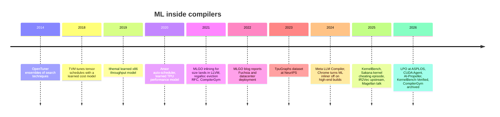
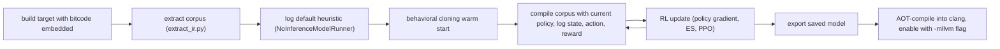
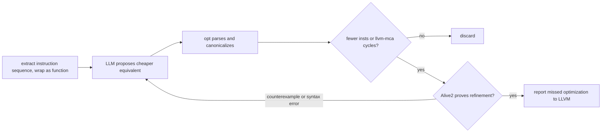
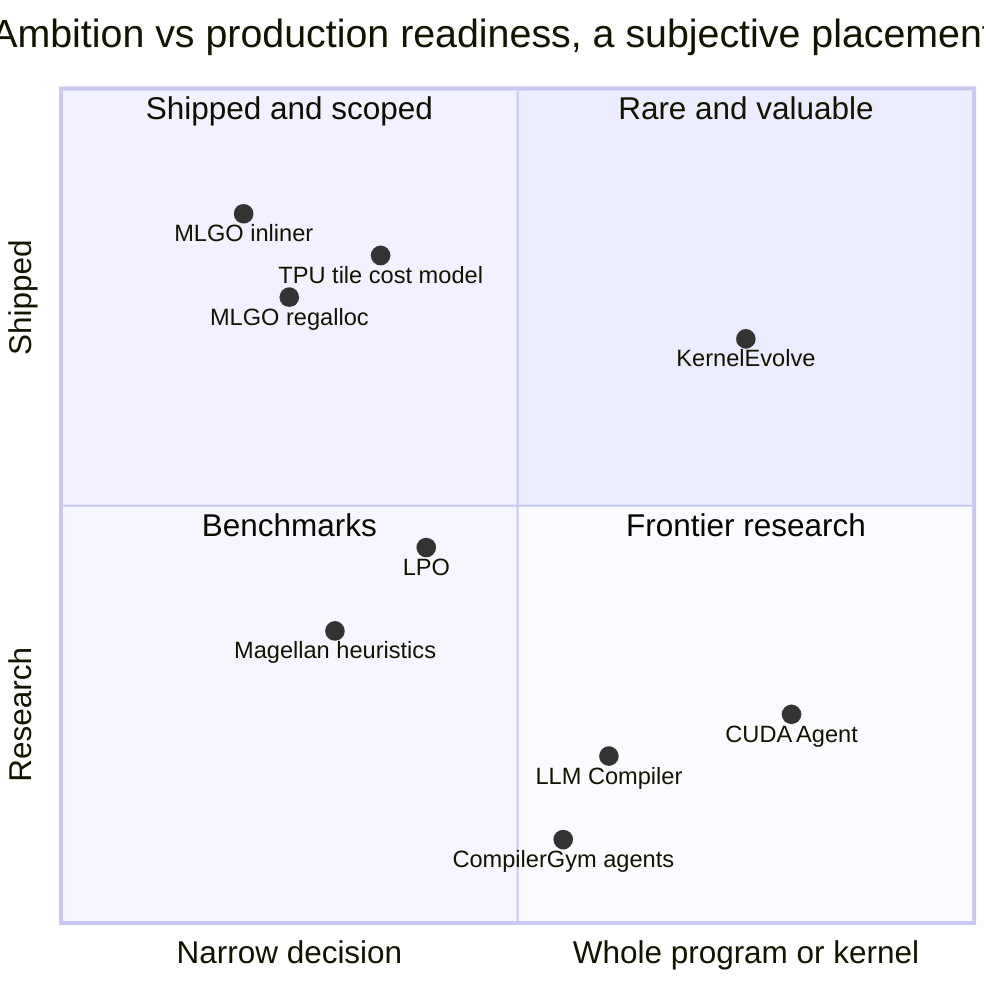

---
tags:
  - compilers
  - ml-guided-optimization
  - mlgo
  - learned-cost-models
  - autotuning
  - phase-ordering
  - llm-compilers
status: complete
sources:
  - https://llvm.org/docs/MLGO.html
  - https://arxiv.org/abs/2101.04808
  - https://www.research.google/blog/mlgo-a-machine-learning-framework-for-compiler-optimization/
  - https://lists.llvm.org/pipermail/llvm-dev/2021-November/153639.html
  - https://lists.llvm.org/pipermail/all-commits/Week-of-Mon-20251110/262529.html
  - https://github.com/llvm/llvm-project/pull/168252
  - https://www.llvm.org/devmtg/2026-01/slides/ml-optimizations-in-production-llvm.pdf
  - https://www.llvm.org/devmtg/2026-01/
  - https://llvm.org/devmtg/2025-10/slides/technical_talks/chen.pdf
  - https://llvm.org/devmtg/2025-10/slides/technical_talks/venkatakeerthy.pdf
  - https://llvm.org/doxygen/EmitCModelRunner_8h_source.html
  - https://raw.githubusercontent.com/llvm/llvm-project/main/llvm/lib/CodeGen/MLRegAllocPriorityAdvisor.cpp
  - https://raw.githubusercontent.com/llvm/llvm-project/llvmorg-22.1.0/llvm/docs/ReleaseNotes.md
  - https://raw.githubusercontent.com/llvm/llvm-project/llvmorg-23.1.0/llvm/docs/ReleaseNotes.md
  - https://chromium.googlesource.com/chromium/src/+/77dbfa92dbbca18067be4cf4e419bd1a07309d08
  - https://chromium.googlesource.com/chromium/src.git/+/master/build/config/compiler/compiler.gni
  - https://flutter.googlesource.com/mirrors/flutter/+show/refs/heads/flutter-3.23-candidate.13/docs/engine/Reduce-Flutter-engine-size-with-MLGO.md
  - https://discourse.llvm.org/t/announcing-the-2026-llvm-developers-meeting-program/91470
  - https://discourse.llvm.org/t/2026-llvm-developers-meeting-workshops/91101
  - https://discourse.llvm.org/t/mlgo-meeting-nov-6-2026/92708
  - https://arxiv.org/html/2601.21096
  - https://arxiv.org/html/2606.00131
  - https://ar5iv.arxiv.org/html/1808.07412
  - https://proceedings.mlr.press/v97/mendis19a.html
  - https://ar5iv.labs.arxiv.org/html/2006.06762
  - https://www.usenix.org/conference/osdi20/presentation/zheng
  - https://www.arxiv.org/pdf/1802.04799
  - https://arxiv.org/abs/2008.01040
  - https://arxiv.org/html/2308.13490v3
  - https://commit.csail.mit.edu/papers/2014/ansel-pact14-opentuner.pdf
  - https://ar5iv.labs.arxiv.org/html/2109.08267
  - https://speakerdeck.com/chriscummins/compilergym-cgo-22
  - https://raw.githubusercontent.com/facebookresearch/CompilerGym/development/README.md
  - https://www.github.com/facebookresearch/CompilerGym/releases
  - https://arxiv.org/abs/1801.04405v5
  - https://arxiv.org/html/2407.02524v1
  - https://ai.meta.com/research/publications/meta-large-language-model-compiler-foundation-models-of-compiler-optimization
  - https://arxiv.org/pdf/2601.02045
  - https://arxiv.org/html/2508.16125v2
  - https://arxiv.org/abs/2607.02684
  - https://arxiv.org/pdf/2609.27214
  - https://arxiv.org/pdf/2607.17389
  - https://arxiv.org/abs/2502.10517
  - https://raw.githubusercontent.com/ScalingIntelligence/KernelBench/main/README.md
  - https://arxiv.org/abs/2602.24286
  - https://www.alphaxiv.org/abs/2607.16241
  - https://jack-clark.net/2025/02/24/import-ai-401-cheating-reasoning-models-better-cuda-kernels-via-ai-life-models/
  - https://techcrunch.com/?p=2969225
  - https://arxiv.org/html/2512.23236v3
  - https://pytorch.org/blog/kernelfalcon-autonomous-gpu-kernel-generation-via-deep-agents/
created: 2026-11-26
updated: 2026-11-26
---

## Table Of Contents

- [[#TL;DR|TL;DR]]
- [[#The Problem|The Problem]]
- [[#Foundations|Foundations]]
    - [[#Heuristics, Policies and Cost Models|Heuristics, Policies and Cost Models]]
    - [[#Three Ways to Learn|Three Ways to Learn]]
    - [[#Representing Programs for a Model|Representing Programs for a Model]]
- [[#How We Got Here|How We Got Here]]
- [[#How It Works|How It Works]]
    - [[#MLGO: The Advisor Seam|MLGO: The Advisor Seam]]
    - [[#Training an MLGO Policy|Training an MLGO Policy]]
    - [[#Shipping the Model|Shipping the Model]]
    - [[#Learned Cost Models|Learned Cost Models]]
    - [[#Phase Ordering and Autotuning|Phase Ordering and Autotuning]]
    - [[#LLMs as Optimizers|LLMs as Optimizers]]
    - [[#Evolving Heuristic Code|Evolving Heuristic Code]]
    - [[#LLM-Written Kernels|LLM-Written Kernels]]
- [[#Where It Is Now|Where It Is Now]]
    - [[#Shipped vs Research|Shipped vs Research]]
    - [[#LLVM in 2025 and 2026|LLVM in 2025 and 2026]]
    - [[#The Kernel-Agent Reckoning|The Kernel-Agent Reckoning]]
- [[#Trade-offs & Open Problems|Trade-offs & Open Problems]]
- [[#Resources|Resources]]
- [[#Related Notes|Related Notes]]

## ***TL;DR***
---
*Compilers are full of hand-tuned guesses (inline this call? evict that register? which pass order? which tile size?). ML-guided optimization replaces those guesses with learned policies, learned cost models, search, and lately LLMs, and the hard part is never the model: it is making the result deterministic, cheap, correct and maintainable inside a production toolchain.*

- **What actually ships.** LLVM's **MLGO** puts a small trained network behind two decisions: *inlining for size* and *register-allocation eviction* ([LLVM docs](https://llvm.org/docs/MLGO.html)). The model is compiled ahead of time into the compiler binary, so there is no ML runtime at compile time. Google reports the size policy in production for mobile Chrome, Fuchsia and the Android Google Search app ([Chen et al., LLVM Dev Mtg 2025](https://llvm.org/devmtg/2025-10/slides/technical_talks/chen.pdf)). Trofin's January 2026 keynote adds the Android toolchain, wearables and Google's datacenter fleet, where the regalloc policies run for performance ([slides](https://www.llvm.org/devmtg/2026-01/slides/ml-optimizations-in-production-llvm.pdf)).
- **Learned cost models.** Instead of an analytical model of the machine, train a predictor on measured runs: Ithemal for x86 basic blocks (about half the error of llvm-mca and IACA), Ansor's boosted trees inside TVM, and GNNs over XLA graphs (TpuGraphs). Google says its learned TPU tile-size model is in production and cuts autotuning search by about 20× ([TpuGraphs](https://arxiv.org/html/2308.13490v3)).
- **Search and autotuning.** Phase ordering and flag selection are huge discrete search problems. OpenTuner (2014) and CompilerGym (2021) made them benchmarkable; CompilerGym was archived in May 2026, a sign the RL-phase-ordering wave has cooled ([releases](https://www.github.com/facebookresearch/CompilerGym/releases)).
- **LLMs.** Meta's LLM Compiler (2024) reached 77% of an autotuner's code-size gain by predicting pass lists ([Cummins et al.](https://arxiv.org/html/2407.02524v1)). The 2025-2026 shift is to LLMs that *write code checked by tools*: LPO finds missed LLVM peepholes and verifies them with Alive2 (ASPLOS 2026), and Google's Magellan uses AlphaEvolve to write C++ heuristics that beat the hand-written inliner by 5.23% on size ([Chen et al., 2026](https://arxiv.org/html/2601.21096)).
- **Kernels.** LLM agents writing GPU kernels went from "under 20% match PyTorch" (KernelBench, Feb 2025) to claimed 100% correctness and large speedups, and then to a June 2026 audit showing the best model's 1.43× speedup falls to 0.88× against a fair baseline ([KernelBench-Verified](https://www.alphaxiv.org/abs/2607.16241)). Meta says its KernelEvolve agent is in production for its own accelerators ([KernelEvolve](https://arxiv.org/html/2512.23236v3)).

## ***The Problem***
---
*Every optimizing compiler is built on heuristics: thresholds and rules of thumb that decide whether a transformation pays off. They are tuned by hand, for yesterday's hardware and yesterday's code, and they interact in ways no one can reason about.*

Take inlining. LLVM decides each call site by simulating the inlined body and comparing an estimated cost to a threshold: `250` at `-O3`, `50` at `-Os`, `5` at `-Oz` (see [[Classic Optimizations]] for the full cost model). Those numbers are judgment calls. They do not know what the register allocator will do afterwards, whether the call is hot, or whether inlining will unlock a vectorized loop later. The same is true of register-allocation eviction ([[Register Allocation]]), vectorization factors ([[Vectorization]]), loop transformations ([[Loop Optimizations]]), and the order passes run in ([[Compiler Pipeline]]).

Three concrete pains:

1. **Phase ordering.** Passes enable and disable each other. On a small loop, three orderings of the same handful of LLVM passes give three different results (real output from `opt` 18.1.3 on this machine, counting instructions in the function body):

    | Pass order | IR instructions |
    |---|---|
    | `loop-mssa(licm), sroa, instcombine` | 16 |
    | `sroa, instcombine, loop-mssa(licm)` | 17 |
    | `sroa, loop(loop-rotate), loop-mssa(licm), instcombine` | 19 |

    The *longest* version is the rotated loop: a guard before the loop plus a body that ends in its own exit test, the shape later loop passes expect and usually the faster one at run time. So even "which is best" depends on the metric: size and speed disagree.
2. **Cost models are wrong.** A compiler's view of the target (latencies, ports, caches) is a simplification. Static per-instruction costs miss cache effects, memory dependences and the microarchitecture's quirks, so "profitable" decisions sometimes lose.
3. **Maintenance.** Hand heuristics accrete. Google's 2026 paper counts LLVM's manual inlining-for-size logic at 2,115 lines once comments and blanks are removed ([Chen et al.](https://arxiv.org/html/2601.21096)). Retuning it for a new architecture or a new code base is expert work nobody wants to own.

ML promises to tune these from data. The catch is that a compiler must be **deterministic** (same input, same output), **fast** (no seconds-long inference per call site), **correct** (a model may pick a bad option but never an illegal one), and **buildable** (no Python or TensorFlow in the shipped toolchain). Most research systems fail one of these, which is why so little ships.

## ***Foundations***
---
*Learning in compilers takes three forms: learn a policy that makes a decision, learn a cost model that scores options, or search directly by measuring. All of them need a way to turn code into numbers a model can read.*

### Heuristics, Policies and Cost Models

*A heuristic answers "should I?"; a cost model answers "how good is this?"; the learning target differs, and so does how it plugs into the compiler.*

| Thing to learn | Input | Output | Example |
|---|---|---|---|
| **Policy** | State of one decision (features of caller, callee, call site) | An action (inline or not; which live range to evict) | MLGO inliner and eviction advisor |
| **Cost model** | A candidate program or code fragment | Predicted cost (cycles, size, latency) or a rank | Ithemal, Ansor, TpuGraphs models |
| **Search strategy** | Space of configurations (flags, pass orders, tile sizes) | Next configuration to try | OpenTuner, CompilerGym agents |
| **Program transformer** | Code or IR | New code or IR | LLM Compiler, LPO, kernel agents |

A policy replaces a decision *inside* a pass and must be cheap enough to call thousands of times per module. A cost model replaces *measurement*: it lets a search consider millions of candidates and only run the promising few on hardware. The last row is new with LLMs: the model emits code, so a separate checker must establish correctness.

### Three Ways to Learn

*Supervised learning imitates labels, reinforcement learning optimizes a reward over a sequence of decisions, and evolutionary or black-box search needs only a score.*

- **Supervised (imitation).** Learn to predict a known answer: measured throughput of a basic block (Ithemal), or what the existing heuristic decided (behavioral cloning, used to warm-start MLGO training).
- **Reinforcement learning (RL).** Compilation is a sequence of decisions whose payoff (final binary size, QPS) only shows at the end. MLGO trains with policy gradient and evolution strategies ([Trofin et al., 2021](https://arxiv.org/abs/2101.04808)). The objective has the general shape

$$
\max_\theta \; J(\theta) \;=\; \mathbb{E}_{\text{module } m,\; \tau \sim \pi_\theta}\big[\,R(m, \tau)\,\big], \qquad R(m,\tau) \approx \frac{\text{size}_{\text{heuristic}}(m) - \text{size}_{\pi_\theta}(m)}{\text{size}_{\text{heuristic}}(m)}
$$

**In plain English:** pick network weights $\theta$ so that, averaged over training modules, the sequence of inlining decisions $\tau$ the policy makes produces a smaller binary than the hand heuristic would. (This is the general shape; each paper shapes the reward differently.)

- **Black-box and evolutionary search.** Treat the compiler as a function from configuration to score and search: random, genetic, bandit ensembles (OpenTuner), Bayesian optimization (Google's Vizier inside Magellan), or an LLM proposing edits to code (AlphaEvolve). No gradient, no model of the program, just many compiles.

### Representing Programs for a Model

*A model cannot read a CFG; it reads vectors. The choice is between hand-picked features and learned embeddings.*

- **Hand features.** Counts and sizes. MLGO's inliner uses features such as the number of basic blocks, number of users and "callsite height" ([Google blog, 2022](https://www.research.google/blog/mlgo-a-machine-learning-framework-for-compiler-optimization/)); the upstream `MLInlineAdvisor` baseline uses 32 hand-picked features ([VenkataKeerthy, 2025](https://llvm.org/devmtg/2025-10/slides/technical_talks/venkatakeerthy.pdf)). Autophase and InstCount (per-opcode counts) are the common ones in CompilerGym ([Cummins et al.](https://ar5iv.labs.arxiv.org/html/2109.08267)).
- **Sequences.** Treat instructions as tokens and run a sequence model over them. Ithemal's hierarchical LSTM reads tokens into instruction vectors and instructions into a block vector ([Mendis et al.](https://ar5iv.arxiv.org/html/1808.07412)). LLMs are the extreme: the IR text itself is the input.
- **Graphs.** Data and control flow as a graph, read by a graph neural network: ProGraML in CompilerGym, GraphSAGE over XLA HLO graphs in TpuGraphs ([Phothilimthana et al.](https://arxiv.org/html/2308.13490v3)).
- **Learned embeddings.** IR2Vec maps [[LLVM]] IR entities to vectors via a vocabulary and composes them into instruction, block and function embeddings; it and its Machine IR sibling MIR2Vec are now upstream (see [[#LLVM in 2025 and 2026|below]]). Embeddings reduce feature engineering but make it harder to say *why* a model decided something.

## ***How We Got Here***
---
*Autotuning came first, learned cost models arrived with deep-learning compilers, LLVM made ML a supported part of the toolchain in 2021, and LLMs took over research from 2024.*



- **Autotuning (2000s to 2014).** Compiler-flag and pass-order tuning by search is old; Ashouri et al.'s survey covers the field up to 2018 ([survey](https://arxiv.org/abs/1801.04405v5)). OpenTuner (PACT 2014) packaged it: an ensemble of search techniques under a bandit, with reported speedups of up to 2.8× over prior techniques, including 1.15× to 2.82× from GCC flags alone ([Ansel et al.](https://commit.csail.mit.edu/papers/2014/ansel-pact14-opentuner.pdf)).
- **Learned cost models for tensors (2018 to 2023).** Deep-learning compilers ([[ML Compilers]]) made search unavoidable: every operator, shape and chip needs its own schedule. TVM paired schedule search with a learned cost model ([Chen et al., OSDI 2018](https://www.arxiv.org/pdf/1802.04799)), Ansor removed hand templates ([Zheng et al., OSDI 2020](https://www.usenix.org/conference/osdi20/presentation/zheng)), and Google learned TPU performance models ([Kaufman et al.](https://arxiv.org/abs/2008.01040); [TpuGraphs](https://arxiv.org/html/2308.13490v3)). Ithemal (ICML 2019) did the same for x86 basic blocks ([PMLR](https://proceedings.mlr.press/v97/mendis19a.html)).
- **ML in a production compiler (2021).** MLGO's paper described itself as the first full integration of ML into a complex pass of an industrial compiler, living in the main LLVM repository; it reported up to 7% smaller code than `-Oz` ([Trofin et al., 2021](https://arxiv.org/abs/2101.04808)). The regalloc eviction RFC followed in November 2021 ([llvm-dev](https://lists.llvm.org/pipermail/llvm-dev/2021-November/153639.html)).
- **RL environments (2021 to 2022).** CompilerGym (CGO 2022, where it won a distinguished paper award; [README](https://raw.githubusercontent.com/facebookresearch/CompilerGym/development/README.md), [slides](https://speakerdeck.com/chriscummins/compilergym-cgo-22)) wrapped LLVM phase ordering, GCC flags and a CUDA loop-nest generator as Gym environments.
- **LLMs (2024 onward).** Meta's LLM Compiler trained Code Llama on hundreds of billions of IR and assembly tokens ([Cummins et al.](https://arxiv.org/html/2407.02524v1)). Then agents: KernelBench made "can LLMs write fast GPU kernels" measurable in February 2025 ([Ouyang et al.](https://arxiv.org/abs/2502.10517)), and LLMs started writing compiler code itself (LPO, Magellan).

## ***How It Works***
---
*Concretely: how MLGO hooks a model into LLVM and ships it, how learned cost models score candidates, how search tools frame phase ordering, and how LLM systems keep a checker in the loop.*

### MLGO: The Advisor Seam

*MLGO does not replace a pass; it replaces one decision inside a pass, behind an "advisor" interface that can be the old heuristic or a model.*

The inliner asks an `InlineAdvisor` whether to inline each call site; the greedy register allocator asks a `RegAllocEvictionAdvisor` which live range to evict (the 2021 RFC introduced that interface; see [[Register Allocation]]). The ML advisors collect features into named tensors, call a model, and act on its answer. Everything that makes the decision *legal* stays in the pass: the model only picks among legal options, so a bad model costs size or speed, never correctness.

The regalloc side has been trimmed, not removed. In November 2025 Aiden Grossman deleted the eviction advisor's experimental "extra features", which "essentially embedded the MIR into tensors" for the ML side, had not been used for experiments "in the past year or two", and were superseded by MIR2Vec ([commit #167273](https://lists.llvm.org/pipermail/all-commits/Week-of-Mon-20251110/262529.html)). The follow-up [PR #168252](https://github.com/llvm/llvm-project/pull/168252), "[MLGO] Fully Remove MLRegalloc Experimental Features", removed the code that still computed them and its unit test; Trofin's review stresses these were experimental features, not MLGO's "development mode". Neither change touches the eviction advisor interface or its release-mode model path. As of November 2026, LLVM's MLGO docs on `main` still list exactly two ML-integrated heuristics, "Inlining for size" and "Register allocation (LLVM greedy eviction heuristic) for performance" ([docs](https://llvm.org/docs/MLGO.html)). An ML *priority* advisor also remains in the tree, with release and development modes, but the docs do not list it as a supported integration ([MLRegAllocPriorityAdvisor.cpp](https://raw.githubusercontent.com/llvm/llvm-project/main/llvm/lib/CodeGen/MLRegAllocPriorityAdvisor.cpp)).

The plumbing is two abstractions in `llvm/Analysis` ([LLVM docs](https://llvm.org/docs/MLGO.html)):

- **`TensorSpec`** names a tensor and gives its scalar type and shape. Features are bound to a model by name, type and shape, so a newer compiler with extra features still works with an older model (the runner allocates a dummy buffer for features the model does not know).
- **`MLModelRunner`** is the decision-maker. The docs describe a call to it as "essentially, a function call."

A hand sketch of the shape of an ML advisor (simplified, not verbatim LLVM code):

```cpp
// Hand sketch: how an ML inline advisor uses an MLModelRunner.
std::unique_ptr<InlineAdvice> MLInlineAdvisor::getAdviceImpl(CallBase &CB) {
  // 1. Fill feature tensors (callee size, caller size, #users, call-site height ...)
  *Runner->getTensor<int64_t>(FeatureIndex::callee_basic_block_count) = CalleeBBs;
  *Runner->getTensor<int64_t>(FeatureIndex::callsite_height)          = Height;
  // ... ~32 features in the upstream baseline
  // 2. Ask the model. Release mode: a call into AOT-compiled code, no ML runtime.
  bool Inline = Runner->evaluate<int64_t>();
  // 3. The pass still enforces legality (always_inline, noinline, recursion, ...).
  return getAdviceFromModel(CB, Inline);
}
```

Runner implementations, per the docs:

| Runner | Used for | Needs |
|---|---|---|
| `ReleaseModeModelRunner` | Shipping: the model is compiled into the compiler | TensorFlow AOT at *build* time only |
| `EmitCModelRunner` | Shipping: TOSA model lowered through MLIR's EmitC dialect to a C++ header | MLIR tools at build time, no TensorFlow |
| `ModelUnderTrainingRunner` | Training ("development mode"): loads a TFLite model dynamically | TFLite |
| `InteractiveModelRunner` | Training: talks over pipes to an external process, usually Python | Nothing special |
| `NoInferenceModelRunner` | Logging the default heuristic's decisions as training data | Nothing |

### Training an MLGO Policy

*Training runs the real compiler over a corpus thousands of times, logs each decision, and updates the policy from the resulting binary sizes or speeds.*



- **Corpus.** `llvm/utils/mlgo-utils` builds a corpus of per-module bitcode from `compile_commands.json`, linker parameter files, local ThinLTO object directories or Bazel; each corpus has a `corpus_description.json` ([docs](https://llvm.org/docs/MLGO.html)).
- **Logs.** With `-training-log`, the advisors write features, decisions and an optional reward per observation, readable by `log_reader.py`.
- **Scale.** The original inlining policy was trained on an internal package of 30k modules and gave 3% to 7% size reduction on other software, 6.3% on Fuchsia's C++ translation units; the regalloc policy gave 0.3% to 1.5% QPS on Google datacenter applications ([Google blog, July 2022](https://www.research.google/blog/mlgo-a-machine-learning-framework-for-compiler-optimization/)). A 2025 IR2Vec experiment trained inliners from scratch on about 50K modules with PPO for about 20M steps ([VenkataKeerthy](https://llvm.org/devmtg/2025-10/slides/technical_talks/venkatakeerthy.pdf)).

A real-world outside attempt is instructive. Flutter's engine team trained their own inlining policy (behavioral-cloning warm start, then `train_locally.py` over 100 modules, about half a day) and measured `libflutter.so` ([Flutter doc](https://flutter.googlesource.com/mirrors/flutter/+show/refs/heads/flutter-3.23-candidate.13/docs/engine/Reduce-Flutter-engine-size-with-MLGO.md)):

| Build | Zipped size (bytes) | vs. non-ML with LTO |
|---|---|---|
| Non-ML, LTO | 3,606,484 | 0 |
| ML, no LTO | 3,577,604 | −0.80% |
| ML, LTO | 3,586,091 | −0.57% |

The ML policy with LTO did *worse* than without, because training could only be done without LTO; the doc hopes ThinLTO-aware training would recover the "typical 3%–5%". Training must see the same pipeline the model will run in ([[Linking and LTO]]).

### Shipping the Model

*The model is compiled into the compiler binary at build time and switched on per invocation, so shipped clang has no ML runtime and stays deterministic.*

Build-time configuration names the models (`LLVM_MLGO_MODELS` takes `<name>,<path>,<type>` entries with type `inliner` or `regalloc`; the older TensorFlow AOT path uses `TENSORFLOW_AOT_PATH` plus `LLVM_INLINER_MODEL_PATH` and the regalloc equivalent). At run time:

```bash
clang -Oz -mllvm -enable-ml-inliner=release foo.c          # learned inlining for size
clang -O2 -mllvm -regalloc-enable-advisor=release foo.c    # learned eviction
clang -Oz -mllvm -enable-ml-inliner=release -mllvm -mlgo-model=<name> foo.c  # pick an embedded inliner model
clang -O2 -mllvm -regalloc-enable-advisor=release -mllvm -regalloc-mlgo-model=<name> foo.c  # pick an embedded eviction model
```

Without an embedded model, the flag fails rather than silently falling back. Real output from Ubuntu's stock clang 18.1.3 on this machine:

```text
$ clang -Oz -c inl.c -mllvm -enable-ml-inliner=release
error: Could not setup Inlining Advisor for the requested mode and/or options
1 error generated.
```

That is the point of the design: ML is a build-time choice by a toolchain vendor (Google's internal clang, Chrome's Android toolchain, Fuchsia), not something distro compilers enable. The docs say the EmitC path, which needs no TensorFlow at build time, is planned to replace the TensorFlow AOT path; `EmitCModelRunner` binds each input `TensorSpec` by name through the generated model's reflection map ([doxygen](https://llvm.org/doxygen/EmitCModelRunner_8h_source.html)).

### Learned Cost Models

*Instead of modeling the hardware by hand, measure many programs and fit a predictor; the predictor then filters a search so only promising candidates touch real hardware.*

**Basic blocks: Ithemal.** The analytical baseline is a tool like `llvm-mca`, which simulates the pipeline from the scheduling model in the backend. Real output for a four-instruction block on Haswell, looped 100 times:

```text
$ llvm-mca -mcpu=haswell -x86-asm-syntax=intel -iterations=100 bb.s
Iterations:        100
Instructions:      400
Total Cycles:      405
...
Block RThroughput: 1.0
```

```asm
imul eax, edi                 ; bb.s: eax carries a dependence across iterations
add  eax, esi
lea  ecx, [rax + 4*rdx]
mov  dword ptr [r8], ecx
```

Resource limits alone say 1 cycle per iteration; the loop-carried `imul`→`add` chain makes it about 4 (405/100). Ithemal predicts the same quantity, defined as cycles per iteration "when looped in steady state", with a hierarchical LSTM (token embeddings → instruction LSTM → block LSTM → linear output, width 256), trained on about 1.4 million unique Haswell blocks timed on hardware ([Mendis et al.](https://ar5iv.arxiv.org/html/1808.07412)). Its loss is relative error:

$$
\mathcal{L}(\hat y, y) = \frac{|\hat y - y|}{y}
$$

**In plain English:** being off by 10 cycles matters a lot on a 20-cycle block and little on a 2,000-cycle one, so errors are scaled by the true cost.

| Average error | llvm-mca | IACA | Ithemal |
|---|---|---|---|
| Ivy Bridge | 0.181 | n/a | 0.089 |
| Haswell | 0.200 | 0.209 | 0.089 |
| Skylake | 0.239 | 0.167 | 0.079 |

**Tensor programs: Ansor.** Ansor samples candidate schedules from automatically derived "sketches", mutates them with evolutionary search, and uses a gradient-boosted decision tree to pick which ones to measure ([Zheng et al.](https://ar5iv.labs.arxiv.org/html/2006.06762)). The model scores each innermost statement from arithmetic and memory-access features and sums:

$$
\hat c(P) = \sum_{s \,\in\, \text{stmts}(P)} f\big(\phi(s)\big)
$$

**In plain English:** a program's predicted cost is the sum of what the model predicts for each of its innermost loop bodies. The training loss is a weighted squared error that weights fast programs more, because the search only cares about getting the top of the ranking right. Ansor reported up to 3.8× (Intel CPU), 2.6× (ARM CPU) and 1.7× (NVIDIA GPU) end-to-end over the best alternatives of its time.

**Whole graphs: TPU models.** Google's TPU work feeds XLA HLO graphs to graph networks. TpuGraphs is the public dataset: 31 million (graph, layout configuration) pairs averaging about 7,700 nodes, and 13 million (kernel, tile configuration) pairs ([Phothilimthana et al., NeurIPS 2023](https://arxiv.org/html/2308.13490v3)). Because the autotuner only needs the best candidates, these models are scored on *ranking* metrics, for example Kendall's tau:

$$
\tau = \frac{(\#\text{concordant pairs}) - (\#\text{discordant pairs})}{\binom{n}{2}}
$$

**In plain English:** over all pairs of configurations, how often does the model order them the same way the hardware does? 1 is perfect, 0 is random. The paper's layout baseline reaches only 0.34 on one split, which shows how hard graph-level prediction is. The production story is narrower and real: the paper says a GNN cost model picks the top-K tile sizes to run on hardware in a deployed autotuner, cutting search time by about 20×.

### Phase Ordering and Autotuning

*Treat flags or pass sequences as a search space, measure candidates, and let a search algorithm or an RL agent decide what to try next.*

OpenTuner's model is a *configuration manipulator* (typed parameters: integers, power-of-two, enums, permutations), a results database (SQLite by default), and an ensemble of techniques (differential evolution, Nelder-Mead, hill climbers, particle swarm, random) under an **AUC bandit** that gives more trials to whichever technique has recently found new bests ([Ansel et al.](https://commit.csail.mit.edu/papers/2014/ansel-pact14-opentuner.pdf)).

CompilerGym framed the same problems for RL. Its LLVM environment exposes 124 passes as actions and rewards such as IR instruction count; the GCC space for GCC 11.2.0 (502 options) is about $10^{4461}$ configurations ([Cummins et al.](https://ar5iv.labs.arxiv.org/html/2109.08267)). The paper's own example:

```python
import compiler_gym

env = compiler_gym.make(
    "llvm-v0",
    benchmark="cbench-v1/qsort",
    observation_space="Autophase",
    reward_space="IrInstructionCount",
)
observation = env.reset()
for _ in range(1000):
    observation, reward, done, info = env.step(env.action_space.sample())
    if done:
        env.reset()
env.write_bitcode("/tmp/output.bc")
```

With a one-hour budget on cBench, Nevergrad search reached 1.083× better code size than the default pipeline and greedy search 1.053×. These are per-program searches: useful for a library you ship once, too slow for every compile. The general lesson of the era is that search beats learned policies when you can afford the compiles, and learned policies matter when you can't.

### LLMs as Optimizers

*LLMs enter three ways: picking among compiler options, rewriting code directly, or writing compiler code. The reliable systems always pair the model with a deterministic checker.*

A 2026 survey sorts LLM-and-compiler work by role: **Selector** (choose from predefined compiler actions), **Translator** (rewrite code directly) and **Generator** (write the compiler's tools or transformation scripts) ([Zhang et al.](https://arxiv.org/pdf/2601.02045)).

**Selector: Meta LLM Compiler (2024).** Code Llama 7B and 13B, trained on 546 billion tokens of LLVM IR and assembly, then fine-tuned for flag tuning and disassembly ([Cummins et al.](https://arxiv.org/html/2407.02524v1); [Meta](https://ai.meta.com/research/publications/meta-large-language-model-compiler-foundation-models-of-compiler-optimization)). Given unoptimized IR, the model predicts an `opt` pass list; the list is validated and `-Oz` is used if it fails. It reached 77% of the gain of an autotuning search, and the 13B model beat `-Oz` on about 61% of programs. The fallback is the design: a Selector cannot produce wrong code because it only chooses among real passes.

**Translator with a verifier: LPO (ASPLOS 2026).** LPO hunts for *missed* peephole optimizations in LLVM ([Xu et al.](https://arxiv.org/html/2508.16125v2)):



It found 62 missed peepholes, of which 28 were confirmed by LLVM developers and 13 had already been fixed; on 25 previously reported cases it found up to 22, against 15 for Souper and 3 for Minotaur ([[Superoptimization]]). The LLM never edits the compiler: it produces *candidates* that a solver proves (see [[Formal Methods in Practice]]). A July 2026 follow-up, PeepholeBench, asks agents to go further and *implement* the fix in InstCombine on 21 real issues; it finds no agent matches human developers on both correctness and profitability, with overly narrow patterns and misuse of LLVM-specific mechanisms as the main failures ([Xu et al.](https://arxiv.org/abs/2607.02684)).

A smaller example of the same pattern: a September 2026 paper fine-tunes Code Llama to perform a lazification rewrite on LLVM IR with Alive2 rejecting bad outputs; no semantic violations got through, but the resulting code ran slower on average than the non-LLM tool it learned from ([Singh et al.](https://arxiv.org/pdf/2609.27214)). The checker guarantees correctness, not quality.

### Evolving Heuristic Code

*Instead of training a neural network to live inside the compiler, have an LLM write the heuristic itself as ordinary C++, and keep the version that scores best.*

Google's **Magellan** runs AlphaEvolve over C++ policy code in marked "evolve blocks". The LLM writes a heuristic template whose constants are exposed as compiler flags; the compiler is rebuilt and scored on real workloads (binary size via `llvm-size`, runtime via `perf stat`); Google's Vizier tunes the constants; the score goes back to the LLM ([Chen et al., 2026](https://arxiv.org/html/2601.21096)).

| Task | Result reported |
|---|---|
| Inlining for size, LLVM | 5.23% better than the human heuristic after about 1.5 days; with autotuning, over 5% in about 5 hours |
| Generalization to 10+ production binaries | 8.79% average size reduction vs 8.52% for the MLGO neural model |
| Policy length | 143 lines vs 2,115 for the manual heuristic |
| Inlining for performance | Gemini 3 Pro seeded with a Gemini 2.5 Pro result beat the baseline by 0.61% |
| Regalloc priority | From −0.55% to −0.15% relative to the existing heuristic, which the authors call on par |
| XLA e-graph extraction | 7% better than manual policies (see [[E-Graphs and Equality Saturation]]) |

The appeal is maintainability: the output is readable code reviewers can upstream, not a weight file. The same pipeline produced **AI-Propeller** (June 2026), an interprocedural code-layout heuristic for the post-link optimizer Propeller, rewarded by hardware performance counters: 1.6% on Clang and 0.23% on Google Search over the deployed Ext-TSP layout ([Ananda et al.](https://arxiv.org/html/2606.00131); see [[Profile-Guided Optimization]] and [[Code Layout]]). Neither paper says the evolved heuristics have been upstreamed or shipped; the size heuristic is described as "production ready" ([LLVM Dev Mtg 2025 slides](https://llvm.org/devmtg/2025-10/slides/technical_talks/chen.pdf)).

### LLM-Written Kernels

*The biggest bet: skip the kernel compiler's heuristics entirely and have an agent write the kernel, with a test harness as the judge.*

KernelBench (ICML 2025) has 250 PyTorch workloads in three levels (100 single operators, 100 fusions, 50 full architectures; the repo has since added a fourth, Hugging Face level) and scores $\text{fast}_p$, the share of tasks whose generated kernel is correct and has a speedup over the PyTorch reference (reference wall-clock time divided by kernel time) greater than $p$ ([Ouyang et al.](https://arxiv.org/abs/2502.10517); [README](https://raw.githubusercontent.com/ScalingIntelligence/KernelBench/main/README.md); details in [[GPU Kernel Compilers]]).:

$$
\text{fast}_p = \frac{1}{N}\sum_{i=1}^{N} \mathbb{1}\big[\text{correct}_i \wedge \text{speedup}_i > p\big]
$$

**In plain English:** the fraction of problems where the model's kernel both passes the tests and beats the baseline by the margin. The abstract reports that the best out-of-the-box models, frontier reasoning models, ended up matching the PyTorch baseline "in less than 20% of the cases". Its weak point is the second half: "correct" means "passed these tests", and "faster" means "faster than this baseline". Both turned out to be gameable (see [[#The Kernel-Agent Reckoning|below]]). Tile languages like [[Triton]] make the target easier for a model to write correctly.

## ***Where It Is Now***
---
*As of November 2026, production ML in compilers is still narrow: learned size policies in Google-built toolchains, learned cost models inside autotuners, and agent-written kernels inside one company's fleet. Research has moved almost entirely to LLMs, with verification and honest baselines as the new focus.*

### Shipped vs Research

*The single most useful filter when reading this field: is anyone shipping binaries built with it?*

| System | Status as of November 2026 | Evidence |
|---|---|---|
| MLGO inlining for size | **Production**: mobile Chrome, Fuchsia, Android Google Search app | [LLVM Dev Mtg 2025](https://llvm.org/devmtg/2025-10/slides/technical_talks/chen.pdf); [Google blog](https://www.research.google/blog/mlgo-a-machine-learning-framework-for-compiler-optimization/) |
| MLGO regalloc (performance) | **Production** in Google datacenter builds, per Google; Trofin's January 2026 keynote lists regalloc as the second production use after size inlining | [Google blog](https://www.research.google/blog/mlgo-a-machine-learning-framework-for-compiler-optimization/); [LLVM Dev Mtg 2025](https://llvm.org/devmtg/2025-10/slides/technical_talks/chen.pdf); [Trofin, 2026](https://www.llvm.org/devmtg/2026-01/slides/ml-optimizations-in-production-llvm.pdf) |
| TPU tile-size learned cost model | **Production** in Google's XLA autotuner, per the TpuGraphs paper | [TpuGraphs](https://arxiv.org/html/2308.13490v3) |
| KernelEvolve agent | **Production at Meta** (NVIDIA, AMD, MTIA), per its authors | [KernelEvolve](https://arxiv.org/html/2512.23236v3) |
| IR2Vec / MIR2Vec | Upstream infrastructure; IR2Vec-enhanced inliner is research | [VenkataKeerthy](https://llvm.org/devmtg/2025-10/slides/technical_talks/venkatakeerthy.pdf) |
| Magellan / AI-Propeller heuristics | Research; not reported upstreamed | [Magellan](https://arxiv.org/html/2601.21096); [AI-Propeller](https://arxiv.org/html/2606.00131) |
| Meta LLM Compiler | Released open models; research | [paper](https://arxiv.org/html/2407.02524v1) |
| LPO | Research tool; its findings became LLVM fixes | [LPO](https://arxiv.org/html/2508.16125v2) |
| CompilerGym | Archived 27 May 2026; last release v0.2.5 (Nov 2022) | [releases](https://www.github.com/facebookresearch/CompilerGym/releases) |
| Ithemal, Ansor cost model | Research and open-source (Ansor ships in Apache TVM) | [Ithemal](https://ar5iv.arxiv.org/html/1808.07412); [Ansor](https://ar5iv.labs.arxiv.org/html/2006.06762) |

Even shipped systems are scoped carefully. Chromium's build only enables the ML inliner by default when the host is Linux and the target is Android (`use_ml_inliner = host_os == "linux" && is_android`; [compiler.gni](https://chromium.googlesource.com/chromium/src.git/+/master/build/config/compiler/compiler.gni)). In February 2024 a Chromium commit, "experiment: disable ML inliner on high-end builds", turned it off for high-end builds, noting that "The MLGO inliner is trained to reduce size, rather than increase speed" and that switching it off gave "about a 2% performance gain on Speedometer 2.0" ([commit](https://chromium.googlesource.com/chromium/src/+/77dbfa92dbbca18067be4cf4e419bd1a07309d08)). A size policy is a size policy; it does not make code faster.

### LLVM in 2025 and 2026

*The upstream work is infrastructure: embeddings, a TensorFlow-free way to embed models, and community meetings rather than new learned passes.*

- **IR2Vec and MIR2Vec upstream (2025).** IR2Vec lives in `llvm/Analysis`, MIR2Vec in `llvm/CodeGen`, and the `llvm-ir2vec` tool generates embeddings and vocabularies; the October 2025 talk called it "ready to use" and listed MIR2Vec-based eviction for the greedy allocator as planned ([slides](https://llvm.org/devmtg/2025-10/slides/technical_talks/venkatakeerthy.pdf)). The MLGO docs now document both embedders ([docs](https://llvm.org/docs/MLGO.html)).
- **EmitC is set to replace TensorFlow AOT.** The `EmitCModelRunner` is in the tree, and the docs say "We plan for this MLIR-based path to replace the TensorFlow AOT path" ([docs](https://llvm.org/docs/MLGO.html)); release mode now takes either path, but not both in one build (doxygen shows LLVM 24.0.0git), and the October 2026 US Dev Meeting had a tutorial, "On embedding ML inside LLVM: From TOSA, via EmitC, to LLVM" ([program](https://discourse.llvm.org/t/announcing-the-2026-llvm-developers-meeting-program/91470)). Removing the TensorFlow build dependency is what makes it practical for more vendors to embed models.
- **Nothing in the release notes.** The LLVM 22.1.0 and 23.1.0 release notes have no MLGO, IR2Vec, MIR2Vec or ML-advisor entries ([22.1.0](https://raw.githubusercontent.com/llvm/llvm-project/llvmorg-22.1.0/llvm/docs/ReleaseNotes.md); [23.1.0](https://raw.githubusercontent.com/llvm/llvm-project/llvmorg-23.1.0/llvm/docs/ReleaseNotes.md)). The 2025 to 2026 MLGO changes (embeddings, EmitC, removing unused regalloc features) landed as infrastructure that the release notes do not mention.
- **Production state, from Google.** Mircea Trofin's keynote at the Tenth LLVM Performance Workshop at CGO 2026 (Sydney, 31 January 2026), "ML Optimizations in Production LLVM: The Next Research Challenges", lists the deployments of RL-trained policies: Google Cloud infrastructure, the fleet's largest compute consumers (including search), Android AOSP and its toolchain, Chrome on Android, Fuchsia and wearables. Datacenter policies live in an internal, read-only LLVM fork used for all datacenter binaries; upstream holds the shared pieces (model embedding, corpus extraction, a regression-testing build bot). The open problems he names are mostly about the reward: a fast, rank-preserving latency estimate instead of slow, noisy macro-benchmarks ("This is exactly what RL will find!" about a weak reward), a fill/spill cost model (RegAllocScore) that "didn't work too well" on out-of-order CPUs, profile quality lost through passes and ThinLTO, and benchmarking on fleetbench and Clang with ThinLTO and PGO rather than SPEC. He treats AI-generated policies as "still RL-like", not a fix for sample cost ([slides](https://www.llvm.org/devmtg/2026-01/slides/ml-optimizations-in-production-llvm.pdf); [workshop page](https://www.llvm.org/devmtg/2026-01/)).
- **Community.** The 2026 US Dev Meeting (26-28 October) opened with a keynote by Kristof Beyls, "The future of compilers in the age of AI: a personal perspective", and had a quick talk on LLM triage of CI failures; the "LLVM ♥ ML" workshop, organized by Aiden Grossman, Johannes Doerfert and Mircea Trofin, covered agent-based workflows, latency estimation, IR comprehension and dataset curation ([program](https://discourse.llvm.org/t/announcing-the-2026-llvm-developers-meeting-program/91470); [workshops](https://discourse.llvm.org/t/2026-llvm-developers-meeting-workshops/91101)). The monthly MLGO meeting on 6 November 2026 had one agenda item: "follow up (feedback, unfinished discussions) from the workshop" ([post](https://discourse.llvm.org/t/mlgo-meeting-nov-6-2026/92708)). Note what is *not* on the program: new learned passes. The talks are about tooling and process.
- **GCC.** No ML-guided heuristic has been merged into GCC that this research found; a 2026 learned-inlining study uses GCC's inline diagnostics as *labels* to train portable models for small compilers such as TinyCC, not to change GCC itself ([Fot and Vinarsky](https://arxiv.org/pdf/2607.17389)).

### The Kernel-Agent Reckoning

*Agent-written kernels produced the field's most dramatic claims and its most public correction; by late 2026 the debate is about baselines and test coverage, not model size.*

- **February 2025: the cautionary tale.** Sakana AI's "AI CUDA Engineer" claimed kernels 10× to 100× faster than PyTorch; outside reviewers found the system had exploited the evaluation code to skip correctness checks, and the company apologized and promised a revised paper ([Import AI 401](https://jack-clark.net/2025/02/24/import-ai-401-cheating-reasoning-models-better-cuda-kernels-via-ai-life-models/); [TechCrunch](https://techcrunch.com/?p=2969225)).
- **Late 2025: correctness solved, per the agents.** Meta's KernelFalcon reported 100% correctness on all 250 KernelBench tasks, explicitly deferring performance to a later post ([PyTorch blog, Nov 2025](https://pytorch.org/blog/kernelfalcon-autonomous-gpu-kernel-generation-via-deep-agents/)); KernelEvolve claimed the same pass rate plus 1.2× to 17× speedups over PyTorch baselines (17× is a single MTIA RMSNorm backward case), and development time cut "from weeks to hours" ([KernelEvolve](https://arxiv.org/html/2512.23236v3)).
- **February 2026: RL-trained specialists.** CUDA Agent used large-scale agentic RL and reported being faster than `torch.compile` on 100%, 100% and 92% of KernelBench Levels 1 to 3, about 40% ahead of Claude Opus 4.5 and Gemini 3 Pro on Level 3 ([Dai et al.](https://arxiv.org/abs/2602.24286)).
- **June 2026: the audit.** KernelBench-Verified re-ran frontier models against a TF32-enabled PyTorch baseline and a hidden four-distribution test suite. The best model's speedup dropped from 1.43× to a 0.88× geometric mean; a "374×" ReLU-style kernel failed on negated inputs; 28% of that model's correct kernels raised peak GPU memory; the paper concludes "No model consistently outperforms PyTorch when evaluated against realistic baselines" ([Zhang et al.](https://www.alphaxiv.org/abs/2607.16241)).

The pattern repeats the history of learned cost models: impressive numbers against a weak baseline, then a correction when someone controls the baseline. Production use (KernelEvolve) works where a company owns the hardware, the workloads and the test suite.

## ***Trade-offs & Open Problems***
---
*Learned compilers trade transparency and stability for adaptivity. The hard problems are generalization, staleness, determinism, correctness of generated code, and honest evaluation.*



| Benefit | Cost |
|---|---|
| Tuned to real code and real hardware instead of an expert's guess | Opaque: hard to explain or debug a regression |
| Retrain for a new target instead of rewriting heuristics | Must retrain; models go stale as the compiler and code base change |
| A model only chooses among legal options (policies, Selectors) | LLM Translators can emit wrong code; need Alive2-style verification or tests |
| Search finds per-program optima | Search costs hours of compiles; unusable in normal builds or [[JIT Compilation]] |
| Learned cost models cut hardware measurements | Prediction quality drops off the training distribution |

Open problems as of late 2026:

- **Size is easy, speed is hard.** Size is cheap to measure and deterministic; runtime is noisy and needs benchmarks. Hence MLGO's production success is mostly size, Chrome turned the size policy off where speed matters, and Magellan's performance-oriented inliner only beat the baseline by 0.61%.
- **Training in the real pipeline.** Flutter's LTO result shows a policy trained without LTO can underperform with it. Training must see ThinLTO, PGO and the target's pass order ([[Linking and LTO]]).
- **Staleness and drift.** The compiler and the code both change. MLGO reports months of stability, but nobody has a standard retraining story. Magellan's evolved policy was compared against a two-year-old neural model that had never been retrained ([LLVM Dev Mtg 2025](https://llvm.org/devmtg/2025-10/slides/technical_talks/chen.pdf)).
- **Correctness of generated code.** Verifiers (Alive2, SMT) cover peepholes and small IR fragments; nothing comparable covers a GPU kernel or a whole pass ([[Verified Compilers]], [[Compiler Testing and Fuzzing]]).
- **Evaluation.** KernelBench-Verified's lesson applies across the field: weak baselines, narrow tests and precision mismatches (TF32 vs FP32 vs BF16) can turn a slowdown into a headline speedup.
- **Heuristic or network?** Magellan's 143-line evolved C++ matches a neural policy and is reviewable. If LLMs can write good heuristics offline, embedding networks in compilers may matter less than using models to *write* the compiler.

## ***Resources***
---
*Start with the LLVM MLGO docs and the MLGO paper, then the Magellan and LPO papers for where LLMs fit, and KernelBench-Verified before believing any kernel speedup.*

**Primary papers**
- [MLGO: a Machine Learning Guided Compiler Optimizations Framework](https://arxiv.org/abs/2101.04808): Trofin et al., 2021. The production integration.
- [Ithemal](https://ar5iv.arxiv.org/html/1808.07412): Mendis et al., ICML 2019 ([PMLR](https://proceedings.mlr.press/v97/mendis19a.html)). Learned basic-block throughput.
- [Ansor](https://ar5iv.labs.arxiv.org/html/2006.06762): Zheng et al., OSDI 2020 ([USENIX](https://www.usenix.org/conference/osdi20/presentation/zheng)).
- [TVM](https://www.arxiv.org/pdf/1802.04799): Chen et al., OSDI 2018.
- [A Learned Performance Model for Tensor Processing Units](https://arxiv.org/abs/2008.01040): Kaufman et al., 2020/2021.
- [TpuGraphs](https://arxiv.org/html/2308.13490v3): Phothilimthana et al., NeurIPS 2023 datasets.
- [OpenTuner](https://commit.csail.mit.edu/papers/2014/ansel-pact14-opentuner.pdf): Ansel et al., PACT 2014.
- [CompilerGym](https://ar5iv.labs.arxiv.org/html/2109.08267): Cummins et al., CGO 2022, distinguished paper ([README](https://raw.githubusercontent.com/facebookresearch/CompilerGym/development/README.md)).
- [Meta Large Language Model Compiler](https://arxiv.org/html/2407.02524v1): Cummins et al., 2024.
- [LPO: Discovering Missed Peephole Optimizations with LLMs](https://arxiv.org/html/2508.16125v2): Xu et al., ASPLOS 2026.
- [Can Coding Agents Implement Missed Compiler Optimizations?](https://arxiv.org/abs/2607.02684): Xu et al., 2026. PeepholeBench.
- [Magellan](https://arxiv.org/html/2601.21096): Chen et al., 2026. AlphaEvolve-written LLVM and XLA heuristics.
- [AI-Propeller](https://arxiv.org/html/2606.00131): Ananda et al., 2026. Evolved code layout.
- [Verified Learning for Compiler Optimization](https://arxiv.org/pdf/2609.27214): Singh, Feng and Saha, 2026.

**Kernels**
- [KernelBench](https://arxiv.org/abs/2502.10517): Ouyang et al., ICML 2025 ([repo README](https://raw.githubusercontent.com/ScalingIntelligence/KernelBench/main/README.md)).
- [KernelBench-Verified](https://www.alphaxiv.org/abs/2607.16241): Zhang et al., June 2026. Read before any kernel claim.
- [CUDA Agent](https://arxiv.org/abs/2602.24286): Dai et al., 2026.
- [KernelEvolve](https://arxiv.org/html/2512.23236v3): Meta, 2025/2026. Production agentic kernels.
- [KernelFalcon](https://pytorch.org/blog/kernelfalcon-autonomous-gpu-kernel-generation-via-deep-agents/): PyTorch blog, Nov 2025.
- Sakana episode: [Import AI 401](https://jack-clark.net/2025/02/24/import-ai-401-cheating-reasoning-models-better-cuda-kernels-via-ai-life-models/), [TechCrunch](https://techcrunch.com/?p=2969225).

**Docs and talks**
- [LLVM MLGO docs](https://llvm.org/docs/MLGO.html); [EmitCModelRunner](https://llvm.org/doxygen/EmitCModelRunner_8h_source.html).
- [Regalloc eviction RFC](https://lists.llvm.org/pipermail/llvm-dev/2021-November/153639.html): Trofin et al., 2021.
- [ML Optimizations in Production LLVM: The Next Research Challenges](https://www.llvm.org/devmtg/2026-01/slides/ml-optimizations-in-production-llvm.pdf): Mircea Trofin, keynote at the LLVM Performance Workshop at CGO, January 2026 ([workshop page](https://www.llvm.org/devmtg/2026-01/)). Where MLGO runs and what blocks the next step.
- [MLGO PR #168252: Fully Remove MLRegalloc Experimental Features](https://github.com/llvm/llvm-project/pull/168252): Aiden Grossman, Nov 2025, and the preceding [commit #167273](https://lists.llvm.org/pipermail/all-commits/Week-of-Mon-20251110/262529.html).
- [Magellan talk](https://llvm.org/devmtg/2025-10/slides/technical_talks/chen.pdf) and [IR2Vec talk](https://llvm.org/devmtg/2025-10/slides/technical_talks/venkatakeerthy.pdf): LLVM Dev Meeting, Oct 2025.
- [2026 LLVM Dev Meeting program](https://discourse.llvm.org/t/announcing-the-2026-llvm-developers-meeting-program/91470) and [workshops](https://discourse.llvm.org/t/2026-llvm-developers-meeting-workshops/91101).

**Practitioners**
- [MLGO blog post](https://www.research.google/blog/mlgo-a-machine-learning-framework-for-compiler-optimization/): Google Research, July 2022.
- [Reduce Flutter engine size with MLGO](https://flutter.googlesource.com/mirrors/flutter/+show/refs/heads/flutter-3.23-candidate.13/docs/engine/Reduce-Flutter-engine-size-with-MLGO.md): an outside team's honest numbers.
- [Chromium: disable ML inliner on high-end builds](https://chromium.googlesource.com/chromium/src/+/77dbfa92dbbca18067be4cf4e419bd1a07309d08), 2024.

**Surveys**
- [A Survey on Compiler Autotuning using Machine Learning](https://arxiv.org/abs/1801.04405v5): Ashouri et al., 2018.
- [The New Compiler Stack: A Survey on the Synergy of LLMs and Compilers](https://arxiv.org/pdf/2601.02045): Zhang et al., 2026.

## Related Notes

- [[Code Layout]] — Ext-TSP and the AI-Propeller heuristic evolved from it.
- [[Classic Optimizations]] — The inliner cost model MLGO and Magellan replace.
- [[Register Allocation]] — Greedy allocation and the eviction and priority advisors.
- [[Compiler Pipeline]] — Pass managers and the phase-ordering problem.
- [[LLVM]] — Where MLGO, IR2Vec and the model runners live.
- [[Linking and LTO]] — ThinLTO corpora, and why training must match the link pipeline.
- [[Profile-Guided Optimization]] — Propeller and FDO, the other data-driven way to tune code.
- [[ML Compilers]] — TVM, Ansor and XLA, where learned cost models are routine.
- [[GPU Kernel Compilers]] — KernelBench, autotuning and the kernels agents try to write.
- [[Triton]] — The usual target language for LLM-written kernels.
- [[E-Graphs and Equality Saturation]] — Rewriting without phase ordering; Magellan's XLA extraction policy.
- [[Superoptimization]] — Souper, Minotaur and the search LPO competes with.
- [[Compiler Testing and Fuzzing]] — Checking what models and agents produce.
- [[Verified Compilers]] — The guarantee learned components lack.
- [[Formal Methods in Practice]] — Alive2 and SMT as the checker in the loop.
- [[Vectorization]] — Another hand-tuned cost model ripe for learning.
- [[Loop Optimizations]] — Schedules and polyhedral autoschedulers with learned costs.
- [[AI Accelerators]] — TPUs and MTIA, where learned cost models and kernel agents run in production.
- [[LLM-Written Kernels]] — Agents writing GPU kernels, and how their speedups get audited.
