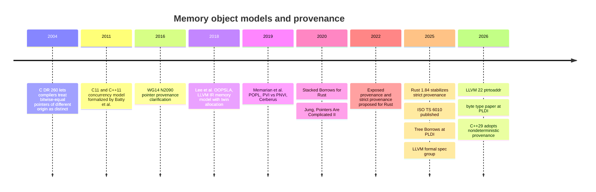
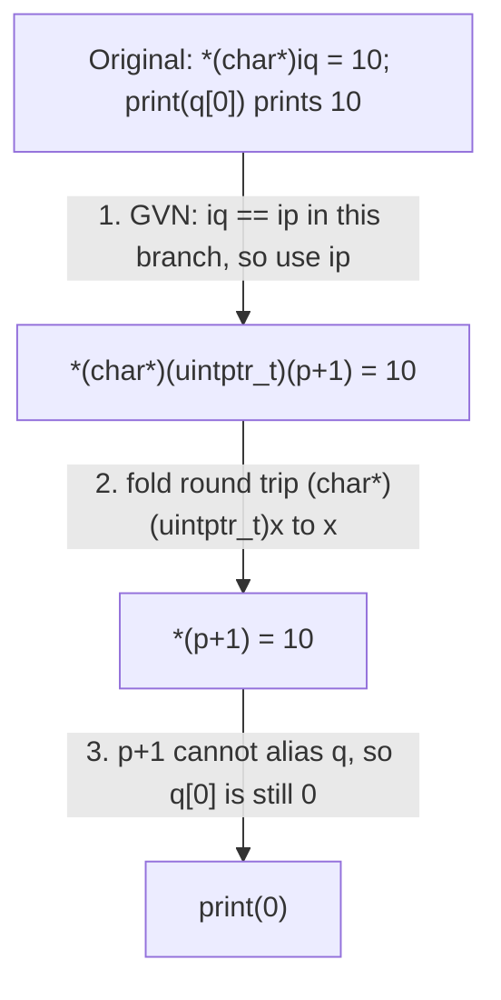
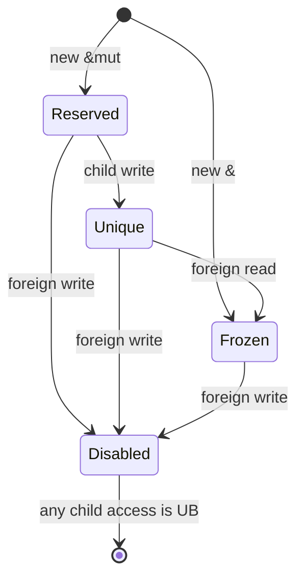

---
tags:
  - compilers
  - memory-model
  - pointer-provenance
  - language-semantics
  - c
  - cpp
  - rust
  - llvm
  - cheri
status: complete
sources:
  - https://www.ralfj.de/blog/2020/12/14/provenance.html
  - https://www.ralfj.de/blog/2022/04/11/provenance-exposed.html
  - https://users.cs.utah.edu/~regehr/oopsla18.pdf
  - https://www.cl.cam.ac.uk/~km569/exploring_provenance.pdf
  - https://www.cl.cam.ac.uk/~pes20/papers/topic.WG14_abstracts.html
  - https://www.open-std.org/jtc1/sc22/wg14/www/docs/n3231.pdf
  - https://www.open-std.org/JTC1/SC22/WG14/www/docs/n2624.pdf
  - https://www.open-std.org/jtc1/sc22/wg14/www/projects
  - https://www.open-std.org/jtc1/sc22/wg14/www/wg14_document_log
  - https://www.open-std.org/JTC1/SC22/wg21/docs/papers/2026/p2434r5.html
  - https://www.open-std.org/jtc1/sc22/wg21/docs/papers/2026/p2414r11.pdf
  - https://people.kernel.org/paulmck/c-pointer-zap-and-oota-progress
  - https://www.npopov.com/2026/01/31/This-year-in-LLVM-2025.html
  - https://discourse.llvm.org/t/clarifiying-the-semantics-of-ptrtoint/83987
  - https://lists.llvm.org/pipermail/llvm-commits/Week-of-Mon-20250519/1637190.html
  - https://lists.llvm.org/pipermail/llvm-commits/Week-of-Mon-20250929/1746180.html
  - https://releases.llvm.org/23.1.0/docs/ReleaseNotes.html
  - https://llvm.org/docs/LangRef.html
  - https://web.ist.utl.pt/nuno.lopes/pubs/byte-type-pldi26.pdf
  - https://doc.rust-lang.org/std/ptr/index.html
  - https://blog.rust-lang.org/2025/01/09/Rust-1.84.0/
  - https://iris-project.org/pdfs/2025-pldi-treeborrows.pdf
  - https://www.ralfj.de/blog/2025/07/07/tree-borrows-paper.html
  - https://research.ralfj.de/papers/2026-popl-miri.pdf
  - https://goals.rust-lang.org/2026/executable-spec.html
  - https://discourse.llvm.org/t/rfc-upstream-target-support-for-cheri-enabled-architectures/87623
  - https://www.llvm.org/devmtg/2026-04/slides/keynote/keynote_anderson.pdf
  - https://www.cl.cam.ac.uk/~pes20/cpp/
  - https://open-std.org/JTC1/SC22/wg14/www/docs/dr_260.htm
  - https://lists.llvm.org/pipermail/llvm-bugs/2026-July/142056.html
created: 2026-11-26
updated: 2026-11-26
---

## Table Of Contents

- [[#TL;DR|TL;DR]]
- [[#The Problem|The Problem]]
- [[#Foundations|Foundations]]
    - [[#Two Meanings of Memory Model|Two Meanings of Memory Model]]
    - [[#What a Memory Object Model Answers|What a Memory Object Model Answers]]
    - [[#Provenance|Provenance]]
    - [[#Abstract Bytes|Abstract Bytes]]
    - [[#Choosing at Casts - Angelic Nondeterminism|Choosing at Casts - Angelic Nondeterminism]]
- [[#How We Got Here|How We Got Here]]
- [[#How It Works|How It Works]]
    - [[#Three Correct-Looking Optimizations|Three Correct-Looking Optimizations]]
    - [[#The Same Bug in Real LLVM Output|The Same Bug in Real LLVM Output]]
    - [[#C - PNVI-ae-udi and TS 6010|C - PNVI-ae-udi and TS 6010]]
    - [[#C++ - Nondeterministic Provenance and Pointer Zap|C++ - Nondeterministic Provenance and Pointer Zap]]
    - [[#LLVM IR - ptrtoint, ptrtoaddr, Captures and Bytes|LLVM IR - ptrtoint, ptrtoaddr, Captures and Bytes]]
    - [[#Rust - Strict and Exposed Provenance|Rust - Strict and Exposed Provenance]]
    - [[#Rust - Aliasing Models as Provenance|Rust - Aliasing Models as Provenance]]
    - [[#CHERI - Provenance in Hardware|CHERI - Provenance in Hardware]]
- [[#Where It Is Now|Where It Is Now]]
- [[#Trade-offs & Open Problems|Trade-offs & Open Problems]]
- [[#Resources|Resources]]
- [[#Related Notes|Related Notes]]

## ***TL;DR***
---
*A memory model says what memory is in a language's abstract machine: what a pointer holds, what a byte holds, and when an access is allowed. The modern answer in C, C++, LLVM and Rust is the same: a pointer is an address plus provenance, and getting that answer right is what lets optimizers be both aggressive and correct.*

- **A pointer is not just an address.** It also carries *provenance*, an invisible record of which allocation it came from and therefore what it may access. Two pointers with identical bits can be different values. Rust's docs put it plainly: a pointer holds an address and "the provenance it has, defining the memory it has permission to access" ([Rust `std::ptr`](https://doc.rust-lang.org/std/ptr/index.html)).
- **Integers are the hard part.** Pointers carry provenance and integers do not, so a pointer-to-integer-to-pointer round trip has to get provenance back from somewhere. Getting this wrong makes three individually reasonable optimizations combine into a miscompilation; the one at fault is folding `(char*)(uintptr_t)p` back to `p` ([Jung, 2020](https://www.ralfj.de/blog/2020/12/14/provenance.html)).
- **The shared fix is "exposure".** Casting a pointer to an integer *exposes* its allocation; casting an integer back picks a provenance from the exposed ones, chosen "maximally in the programmer's favor" ([Jung, 2022](https://www.ralfj.de/blog/2022/04/11/provenance-exposed.html)). C's PNVI-ae-udi (ISO TS 6010, May 2025), C++'s nondeterministic provenance (voted into C++29 in June 2026), Rust's exposed-provenance APIs and LLVM's direction all follow this shape.
- **Better still: don't round-trip.** Rust's *strict provenance* APIs (stable since 1.84) and LLVM's `ptrtoaddr` (LLVM 22) read or change an address *without* exposing anything, which keeps alias analysis precise.
- **Memory holds more than numbers.** A byte in the abstract machine can be a number, a fragment of a pointer with provenance, or uninitialized. LLVM is adding a *byte type* to model this; LLVM 23's GlobalISel already supports it.
- **CHERI makes provenance physical.** On CHERI hardware a pointer is a tagged capability that "can't be created from thin air", and LLVM's provenance clean-up is partly driven by upstreaming CHERI support ([EuroLLVM 2026 keynote](https://www.llvm.org/devmtg/2026-04/slides/keynote/keynote_anderson.pdf)).
- **As of November 2026**, no language has a finished formal memory object model in its normative standard: C's lives in a separate Technical Specification, C++'s pieces target C++29, LLVM's is being written by a working group, and Rust's is defined in practice by Miri and MiniRust rather than a spec.

## ***The Problem***
---
*Programmers think of memory as one big array of bytes indexed by integer addresses. Optimizers cannot work with that picture, because it would make every store a potential write to every object. The tension between the two pictures is the whole subject.*

Take the simplest optimization an alias analysis enables:

```c
int f(void) {
    int x = 1, y = 2;
    int *p = &x;
    *p = 10;         // can this change y?
    return y;        // compiler wants to fold this to 2
}
```

Every C compiler folds `return y` to `return 2`. The reasoning is "`p` points to `x`, so writing through it cannot touch `y`". In the flat-array picture that reasoning is unjustified: `x` and `y` sit next to each other on the stack, and `p + 1` might have the same address as `&y`. The compiler is relying on a rule the flat picture does not have: **a pointer derived from `&x` may only access `x`**, whatever its numeric value happens to be. That rule is provenance.

Once provenance exists, a pile of questions follows, and every compiler, standard and verification tool needs the same answers:

| Question | Why it matters |
|---|---|
| If two pointers have the same address, are they equal? Interchangeable? | GVN replaces values that compare equal ([[Classic Optimizations]]) |
| What does `(uintptr_t)p` give, and what does `(T*)i` give back? | Low-level code (allocators, tagged pointers, kernels) round-trips through integers |
| What does a byte of a pointer hold after `memcpy`? | `memcpy` is lowered to integer loads and stores in IRs |
| What is in uninitialized memory? | Struct padding, `MaybeUninit`, partial copies |
| When does a pointer stop being usable? | Freed memory can be reused at the same address |

Different answers to these questions are not just different styles. As shown below, an IR where some passes assume one answer and other passes assume another produces wrong code, and LLVM, GCC and Rust have all shipped such bugs ([Lee et al., OOPSLA 2018](https://users.cs.utah.edu/~regehr/oopsla18.pdf)). For how alias analysis uses these facts, see [[Pointer and Alias Analysis]]; for the wider undefined-behavior contract they sit inside, see [[Undefined Behavior and Compiler Semantics]].

## ***Foundations***
---
*A memory object model is a precise description of the abstract machine's memory: allocations, pointer values with provenance, abstract bytes, and the rules for casts. Its job is to make every optimization either provably correct or provably wrong.*

### Two Meanings of Memory Model

*"Memory model" names two related but separate things; this note is about the first.*

| | Memory **object** model | **Concurrency** memory model |
|---|---|---|
| Question | What is a pointer, a byte, an allocation; which accesses are allowed? | Which values may a load see when threads race on shared memory? |
| Typical rules | Provenance, exposure, uninitialized bytes, lifetime end | Happens-before, `memory_order`, data races, fences |
| Classic work | Memarian et al. POPL 2019, TS 6010, Stacked and Tree Borrows | Batty et al. POPL 2011 formalized the C11/C++11 model and found "subtle semantic flaws" in the drafts, whose fixes went into the standards ([Cambridge](https://www.cl.cam.ac.uk/~pes20/cpp/)) |
| Open problem | Integer-pointer casts, uninitialized memory | Out-of-thin-air values (C++29 adopted a recipe for avoiding them, [McKenney](https://people.kernel.org/paulmck/c-pointer-zap-and-oota-progress)) |

The two meet in a few places (atomics holding pointers, pointers to freed memory in lock-free code, below), and the concurrency side deserves its own note: [[Concurrency Memory Models]].

### What a Memory Object Model Answers

*Every serious model gives the same four ingredients, even when it names them differently.*

1. **Allocations.** Memory is a set of separate allocations (C calls them *storage instances*), each with a base address, a size, and a lifetime. TS 6010 says storage instances "have identities which are unique across the program execution" ([N3231](https://www.open-std.org/jtc1/sc22/wg14/www/docs/n3231.pdf)), so an allocation freed and recreated at the same address is a *different* allocation.
2. **Pointer values.** A pointer is a pair (address, provenance). Provenance is usually an allocation ID, sometimes with extra permission information.
3. **Bytes.** Memory stores abstract bytes, not 8-bit integers (below).
4. **Operations.** Load, store, pointer arithmetic, comparison, and the two casts: pointer to integer and integer to pointer. Each operation says how it uses and produces provenance, and when it is undefined behavior.

### Provenance

*Provenance is the permission a pointer carries. Optimizers rely on it; hardware usually does not see it.*

Rust's standard library gives the clearest informal definition. Provenance has three parts ([Rust `std::ptr`](https://doc.rust-lang.org/std/ptr/index.html)):

- **Spatial**: "The set of memory addresses that the pointer is allowed to access."
- **Temporal**: "The timespan during which the pointer is allowed to access those memory addresses."
- **Mutability**: "Whether the pointer may only access the memory for reads, or also access it for writes."

Two rules make it useful. First, "It is undefined behavior to access memory through a pointer that does not have provenance over that memory." Second, provenance only shrinks: "no operation can ever *grow* the permissions of the derived provenance" (same source). Pointer arithmetic keeps provenance; a pointer computed from `&x` is still an `&x` pointer even when it wanders to `y`'s address.

Written as a rule, with $\mathrm{alloc}(p)$ the allocation in $p$'s provenance:

$$\text{access}(p, n) \text{ is defined} \iff [\,\mathrm{addr}(p),\ \mathrm{addr}(p)+n\,) \subseteq \mathrm{range}(\mathrm{alloc}(p)) \ \wedge\ \mathrm{alloc}(p) \text{ is live}$$

In words: an access of $n$ bytes is allowed only if every byte lies inside the allocation the pointer came from, and that allocation has not been freed. The numeric address of some *other* allocation that happens to be there does not count.

This is what lets alias analysis answer "no alias" for two pointers into different allocations without knowing any addresses ([[Pointer and Alias Analysis]], [[Escape Analysis]]).

### Abstract Bytes

*If memory held only integers, copying a pointer byte by byte would destroy its provenance and loading uninitialized memory would invent numbers; both break optimizations.*

So the abstract machine's bytes are richer than hardware bytes. A typical definition (the shape used by MiniRust and by LLVM's proposed byte type):

| Abstract byte | What it holds | Produced by |
|---|---|---|
| `Init(n)` | A number 0 to 255 | Storing an integer |
| `Ptr(prov, i)` | Byte $i$ of a pointer, with its provenance | Storing a pointer |
| `Uninit` | Nothing; reading it as an integer is UB or poison | Fresh allocation, padding |

The C TS gets the same effect differently: bytes carry no provenance, but copying a pointer's representation with a "copying function" gives a copy with "the same provenance as the original", and character types "have no non-value representation", so reading any byte of a live object is defined ([N3231](https://www.open-std.org/jtc1/sc22/wg14/www/docs/n3231.pdf)).

The IR consequence is concrete. LLVM lowers small `memcpy` calls to integer loads and stores, and an integer cannot hold provenance or "per-bit poison", so the lowering is wrong under any precise model. The PLDI 2026 byte-type paper fixes this with a type `bN` whose bits are each "an integer bit, a pointer bit (with provenance), or poison" ([Lobo et al.](https://web.ist.utl.pt/nuno.lopes/pubs/byte-type-pldi26.pdf); details in [[Undefined Behavior and Compiler Semantics]]).

### Choosing at Casts - Angelic Nondeterminism

*An integer-to-pointer cast has to pick a provenance. Every modern model lets it pick whichever one makes the program defined, but only among allocations that were exposed.*

When `(T*)i` runs, there may be several allocations whose address range contains `i` (the classic case: one past the end of `x` and the start of `y`), or none. Models make two choices:

- **Which allocations are candidates.** Only those that were *exposed* earlier, meaning some pointer to them was cast to an integer (or otherwise leaked as bytes). Unexposed allocations stay private, so the optimizer can still reason about them.
- **How to pick.** *Angelically*: if any candidate makes the program's behavior defined, that one is used; only if every choice leads to UB is the program undefined. Jung's wording is that "the guess will be maximally in the programmer's favor" ([2022](https://www.ralfj.de/blog/2022/04/11/provenance-exposed.html)), and C++'s P2434 says "if any pointer value exists that corresponds to the integer and gives the program defined behavior, one such value is the result" ([P2434R5](https://www.open-std.org/JTC1/SC22/wg21/docs/papers/2026/p2434r5.html)).

The price is that **pointer-to-integer casts have a side effect**: exposure. The compiler may not delete an unused `(uintptr_t)p`, because deleting it could make a later integer-to-pointer cast UB ([Jung, 2022](https://www.ralfj.de/blog/2022/04/11/provenance-exposed.html)). The model is still local: only code that actually does such casts pays for it.

## ***How We Got Here***
---
*Provenance was implicit in compilers for decades before anyone wrote it down. It became explicit around 2015 to 2020 when formal-methods groups found real miscompilations that no informal rule could explain.*



| Year | Milestone | Why it mattered |
|---|---|---|
| 2001 to 2004 | C Defect Report 260: implementations "may also treat pointers based on different origins as distinct even though they are bitwise identical" ([DR 260](https://open-std.org/JTC1/SC22/wg14/www/docs/dr_260.htm)) | The committee's first explicit nod to provenance |
| 2016 to 2018 | WG14 papers N2090, N2219, N2263 ask the provenance questions Q1 to Q46 ([Cambridge list](https://www.cl.cam.ac.uk/~pes20/papers/topic.WG14_abstracts.html)) | First systematic list of what the C standard leaves unclear |
| 2018 | Lee et al., "Reconciling High-level Optimizations and Low-level Code in LLVM" (OOPSLA) | Showed that LLVM "miscompiles certain programs in C, C++, and Rust" because "the memory model for LLVM's intermediate representation (IR) is informal"; proposed a formal model costing about 0.2% on SPEC CPU 2017 ([paper](https://users.cs.utah.edu/~regehr/oopsla18.pdf)) |
| 2019 | Memarian et al., "Exploring C Semantics and Pointer Provenance" (POPL) | Two coherent models, PVI and PNVI, made executable in the Cerberus C semantics with 54 provenance tests ([paper](https://www.cl.cam.ac.uk/~km569/exploring_provenance.pdf)) |
| 2020 | Jung, "Pointers Are Complicated II" | The three-optimization argument (below): popularized that integers must not carry provenance ([blog](https://www.ralfj.de/blog/2020/12/14/provenance.html)) |
| 2020 to 2022 | TS drafts N2577, N2676, N3005 | PNVI-ae-udi becomes the WG14 choice ([Cambridge list](https://www.cl.cam.ac.uk/~pes20/papers/topic.WG14_abstracts.html)) |
| 2022 | Jung, "Pointers Are Complicated III" | Exposed provenance plus strict provenance as the plan for Rust ([blog](https://www.ralfj.de/blog/2022/04/11/provenance-exposed.html)) |
| Jan 2025 | Rust 1.84 stabilizes strict and exposed provenance APIs ([release post](https://blog.rust-lang.org/2025/01/09/Rust-1.84.0/)) | First mainstream language with explicit provenance in its API |
| May 2025 | ISO/IEC TS 6010 published ([WG14 projects](https://www.open-std.org/jtc1/sc22/wg14/www/projects)) | C's provenance model is an ISO document, though not part of the C standard |
| 2025 | Tree Borrows (PLDI, distinguished paper) ([Jung](https://www.ralfj.de/blog/2025/07/07/tree-borrows-paper.html)); LLVM separates address and provenance capture; LLVM formal specification working group forms ([Popov](https://www.npopov.com/2026/01/31/This-year-in-LLVM-2025.html)) | Rust's aliasing model matures; LLVM starts fixing the model at the IR level |
| 2026 | LLVM 22 `ptrtoaddr`; byte type paper (PLDI 2026); LLVM 23 GlobalISel handles `bN`; C++29 adopts P2434 and pointer-zap papers ([McKenney](https://people.kernel.org/paulmck/c-pointer-zap-and-oota-progress)) | The model moves from papers into compilers and standards |

## ***How It Works***
---
*This section walks the canonical miscompilation, reproduces it on real LLVM, and then shows how each of C, C++, LLVM, Rust and CHERI answers the same questions.*

### Three Correct-Looking Optimizations

*Each step below is something a production compiler does. Together they change what the program prints, so at least one step is wrong, and deciding which one forces you to pick a memory model.*

The example from Jung's "Pointers Are Complicated II" ([blog](https://www.ralfj.de/blog/2020/12/14/provenance.html)). Assume `q` happens to be placed right after `p`, so `p+1` and `q` have the same address:

```c
char p[1], q[1] = {0};
uintptr_t ip = (uintptr_t)(p+1);
uintptr_t iq = (uintptr_t)q;
if (iq == ip) {
  *(char*)iq = 10;
  print(q[0]);        // prints 10: we wrote through a pointer made from q's address
}
```



1. **Replace equal integers.** Inside the `if`, `iq == ip`, so `iq` can be replaced by `ip`. For *integers* this is always fine, because integers are just numbers.
2. **Remove the round trip.** `(char*)(uintptr_t)x` is folded to `x`.
3. **Use provenance.** `p+1` is derived from `p`, so a store through it cannot change `q`, and `q[0]` is still its initial `0`.

The program now prints `0`, a result the original could never produce. Jung's verdict: "pointers have provenance but integers do not, which means that it is the second optimization that is wrong." Step 1 is valid because integers carry no provenance; step 3 is the whole point of provenance; so the round-trip fold must go. Lee et al. reached the same conclusion two years earlier: InstSimplify's rewrite of `inttoptr(ptrtoint p)` to `p` is unsound under their model and was removed from their prototype ([OOPSLA 2018](https://users.cs.utah.edu/~regehr/oopsla18.pdf)).

The alternative (integers *do* carry provenance, the PVI model) makes step 1 wrong instead, which would forbid GVN on integers, a far bigger loss. Memarian et al. compared the two and judged PNVI preferable ([POPL 2019](https://www.cl.cam.ac.uk/~km569/exploring_provenance.pdf)).

### The Same Bug in Real LLVM Output

*LLVM 18 still performs the unsound round-trip fold, and when given the output of step 1 it produces a program that contradicts itself.*

Real `opt -O2` output from LLVM 18.1.3 on this machine. First the round trip on its own:

```llvm
; input
define ptr @roundtrip(ptr %x) {
  %i = ptrtoint ptr %x to i64
  %y = inttoptr i64 %i to ptr
  ret ptr %y
}
; after opt -passes=instcombine (LLVM 18)
define ptr @roundtrip(ptr %x) {
  ret ptr %x
}
```

Now the program after step 1, written as IR with `p` marked `noalias` (the IR form of C's `restrict`) and `q` an ordinary argument:

```llvm
define void @after_opt1(ptr noalias %p, ptr %q) {
  store i8 0, ptr %q
  %p1 = getelementptr i8, ptr %p, i64 1
  %ip = ptrtoint ptr %p1 to i64
  %iq = ptrtoint ptr %q to i64
  %eq = icmp eq i64 %iq, %ip
  br i1 %eq, label %then, label %end
then:
  %r = inttoptr i64 %ip to ptr       ; step 1 already swapped %iq for %ip
  store i8 10, ptr %r
  %v = load i8, ptr %q
  call void @print(i8 %v)
  br label %end
end:
  ret void
}
```

```llvm
; opt -O2, LLVM 18.1.3 (real output, trimmed)
then:
  store i8 10, ptr %q, align 1
  tail call void @print(i8 0)
```

The optimized code stores `10` to `q` and then prints `0` for `q`'s value. InstCombine folded the round trip (step 2), alias analysis used `noalias` to forward the earlier `store i8 0` to the load (step 3), and a later equality-based rewrite turned the store target back into `%q`. The same input with the original `inttoptr i64 %iq` compiles to `print(i8 10)`, correctly.

Two caveats keep this honest. Step 1 here was applied by hand: on the C version of Jung's example (his `uwu` function with `restrict` pointers), Clang 18 at `-O0` and `-O2` and GCC 13 at `-O2` and `-O3` print the correct `1` on this machine, so the full chain did not fire end to end. And the fold has been challenged upstream: a pull request titled "Disable unsound inttoptr(ptrtoint(p)) to p fold" (#161662) was under review in October 2025 ([llvm-commits](https://lists.llvm.org/pipermail/llvm-commits/Week-of-Mon-20250929/1746180.html)); the sources read here do not show whether it merged.

A related real output shows the other side of the model, a fold that *is* justified. With `p` and `q` as two local arrays (`alloca`s), LLVM 18 folds `ptrtoint(p+1) == ptrtoint(q)` to false and deletes the whole branch. That is allowed because the compiler chooses where locals live, so the program "cannot guess an object's address"; Lee et al. formalize this with *twin allocation*, where each allocation conceptually reserves extra blocks so no address can be predicted ([OOPSLA 2018](https://users.cs.utah.edu/~regehr/oopsla18.pdf)).

### C - PNVI-ae-udi and TS 6010

*C's model: integers carry no provenance, a cast back to a pointer recovers it from an exposed live allocation, and ambiguous one-past-the-end cases are settled by the program's first use.*

The name spells the rules: **P**rovenance **N**ot **V**ia **I**ntegers, **a**ddress **e**xposed, **u**ser **d**isambiguation ([N2624](https://www.open-std.org/JTC1/SC22/WG14/www/docs/n2624.pdf)). The TS wording ([N3231 draft](https://www.open-std.org/jtc1/sc22/wg14/www/docs/n3231.pdf)):

- **Valid pointers.** A pointer value "is valid if and only if it has non-empty provenance".
- **Exposure.** "a storage instance becomes exposed when a pointer value p" is used in certain ways, including when "p is converted to an integer". "Exposure of a storage instance is irreversible."
- **Integer to pointer.** The integer must be "an abstract address within or one past a live or exposed storage instance" whose "exposure happened before this integer-to-pointer conversion"; "The conversion synthesizes a pointer value with that address, provenance and target type."
- **User disambiguation.** "If the address corresponds to more than one provenance, only one of those shall be used in the sequel": the program may use the result as a `p+1` pointer *or* as a `q` pointer, but not as both.
- **Comparisons.** Equality compares "the same abstract address", so `p+1 == q` can be true. Relational comparison (`<`) requires both pointers to "have the same provenance".
- **Bytes.** Reading a pointer through a same-representation pointer type keeps provenance "and the provenance does not thereby become exposed"; a pointer copied by a copying function such as `memcpy` "has the same provenance as the original".

How common low-level idioms fare, from the POPL 2019 comparison ([Memarian et al.](https://www.cl.cam.ac.uk/~km569/exploring_provenance.pdf)):

| Idiom | PVI (integers carry provenance) | PNVI (C's choice) |
|---|---|---|
| Pointer tagging in low bits via `uintptr_t` | Allowed | Allowed: provenance recovered at the cast back |
| XOR linked list (`prev ^ next` stored as integer) | UB: the XOR has empty provenance | Allowed |
| `memcpy` of a pointer | Allowed | Allowed |
| Copying a pointer byte by byte through control flow | UB | Allowed |
| Reading a pointer's bytes as `unsigned char` | Allowed | Allowed |

Cerberus, the Cambridge executable C semantics, implements both models and serves as a test oracle: it gives the intended result on all 54 provenance tests except three that need file I/O (same source).

### C++ - Nondeterministic Provenance and Pointer Zap

*C++ reaches nearly the same model as C, and in 2026 also fixed the rule that made lock-free code with reused memory technically undefined.*

**Round trips.** Davis Herring's P2434, "Nondeterministic pointer provenance", adopts user disambiguation through angelic choice: "if any pointer value exists that corresponds to the integer and gives the program defined behavior, one such value is the result." It also makes pointers to allocations created *after* the integer was produced ("anti-causal" pointers) UB, and says its results are "almost exactly the same" as PNVI-ae-udi except that exposures that cannot affect observable behavior may be ignored ([P2434R5](https://www.open-std.org/JTC1/SC22/wg21/docs/papers/2026/p2434r5.html)). Its example of a store with no possible provenance:

```cpp
*(int*)8675309 = 1;   // UB: no pointer value with this address gives defined behavior
```

**Pointer zap.** The standard said "all pointers to an object become invalid at the end of its lifetime" ([P2414R11](https://www.open-std.org/jtc1/sc22/wg21/docs/papers/2026/p2414r11.pdf)). That makes a classic lock-free stack push undefined: a thread reads the head `X1`, another thread pops and frees `X1` and pushes a new node `X3` that the allocator places at `X1`'s old address, and the first thread's compare-and-swap then compares against a "zombie" pointer. P2414 makes atomic operations produce *prospective* pointer values ("Atomic operations have the side effect of producing prospective pointer values, thus forgiving pointer invalidity"), so the existing code is correct with no source changes.

**Status.** At the June 2026 Brno meeting, successors of P2434, P2414 and P3347 ("Invalid/Prospective Pointer Operations") were voted into C++29, together with P3692's recipe for avoiding out-of-thin-air values; a fourth paper, P3790 (a "bag-of-bits" pointer class), was expected at the November 2026 meeting ([McKenney, June 2026](https://people.kernel.org/paulmck/c-pointer-zap-and-oota-progress)).

### LLVM IR - ptrtoint, ptrtoaddr, Captures and Bytes

*LLVM is the place where C, C++ and Rust semantics meet, so its model has to be at least as precise as all three. The 2025 and 2026 work splits each overloaded operation into a provenance-exposing and a provenance-free version.*

| Operation | Meaning as of LLVM 22/23 | Source |
|---|---|---|
| `ptrtoint` | All pointer representation bits as an integer ("equivalent to a `bitcast`"), and it "always captures address and provenance" of its argument | [LangRef commit, May 2025](https://lists.llvm.org/pipermail/llvm-commits/Week-of-Mon-20250519/1637190.html) |
| `ptrtoaddr` (LLVM 22) | Only the address bits; does not expose provenance, so it can be treated as pure (pointer subtraction, SCEV) | [Popov](https://www.npopov.com/2026/01/31/This-year-in-LLVM-2025.html) |
| `inttoptr` | Gets provenance from exposed allocations (the model under development) | [Popov](https://www.npopov.com/2026/01/31/This-year-in-LLVM-2025.html) |
| `captures(...)` attribute | Separate components: `address`, `address_is_null`, `provenance`, `read_provenance` | [LangRef](https://llvm.org/docs/LangRef.html) |
| `bN` byte type | Memory-typed value that can hold integer bits, pointer bits with provenance, or poison | [Lobo et al.](https://web.ist.utl.pt/nuno.lopes/pubs/byte-type-pldi26.pdf); [LLVM 23 notes](https://releases.llvm.org/23.1.0/docs/ReleaseNotes.html) |
| `getelementptr` | Being canonicalized to a single offset, moving toward a `ptradd` instruction | [Popov](https://www.npopov.com/2026/01/31/This-year-in-LLVM-2025.html) |

Why split `ptrtoint`? The January 2025 Discourse thread "Clarifying the semantics of ptrtoint" started from fat pointers (CHERI capabilities, GPU address spaces), where "the address" and "the bits" differ. Nikita Popov described `ptrtoint` as "essentially a bitcast that also exposes the pointer provenance" and suggested splitting it into two instructions; Nuno Lopes objected that "Integers must be integers only" ([Discourse](https://discourse.llvm.org/t/clarifiying-the-semantics-of-ptrtoint/83987)). `ptrtoaddr` is the result: code that only needs the address (computing an alignment, subtracting two pointers) no longer pays for exposure.

**Captures.** The capture split means a function that only *compares* a pointer, or stores its address but never dereferences it later, no longer pessimizes alias analysis: "we now distinguish between capturing the address of a pointer, and its provenance", and only provenance captures can cause unanalyzable memory effects ([Popov](https://www.npopov.com/2026/01/31/This-year-in-LLVM-2025.html); [[Escape Analysis]]).

**The working group.** A formal specification working group formed in late 2025 "aims to close long standing correctness gaps in LLVM, especially relating to the provenance model"; Popov wrote a draft provenance model for it, and its current focus is the byte type (same source). The byte type paper measured a 1.6% average run-time cost over 20 programs, falling to 0.8% with new optimizations and 0.2% once loads may type-pun ([Lobo et al.](https://web.ist.utl.pt/nuno.lopes/pubs/byte-type-pldi26.pdf)), and LLVM 23's release notes list GlobalISel support for "the LLVM IR byte type (`bN`)" ([LLVM 23](https://releases.llvm.org/23.1.0/docs/ReleaseNotes.html)). [[Translation Validation]] tools such as Alive2 are only as good as this model, since they check each rewrite against it ([[Verified Compilers]]).

### Rust - Strict and Exposed Provenance

*Rust exposes provenance in its API: code that keeps provenance explicit is easy to analyze and check, and code that needs C-style casts says so.*

Rust 1.84 (January 2025) stabilized two families of APIs ([release post](https://blog.rust-lang.org/2025/01/09/Rust-1.84.0/); [`std::ptr` docs](https://doc.rust-lang.org/std/ptr/index.html)):

| API | What it does | Exposes? |
|---|---|---|
| `p.addr()` | The address as `usize`; "not part of a pointer-integer-pointer roundtrip" | No |
| `p.with_addr(a)` / `p.map_addr(f)` | New address, *same provenance as `p`* | No |
| `ptr::without_provenance(a)` | A pointer with no provenance: fine as a sentinel, UB to dereference | No |
| `p.expose_provenance()` | Address, and adds `p`'s provenance to a "global list of 'exposed' provenances" | Yes |
| `ptr::with_exposed_provenance(a)` | Pointer with "one of these previously 'exposed' provenances"; UB if none justifies its use | Picks one |

Real run, rustc 1.97 on this machine:

```rust
let x = [10u32, 20, 30];
let p: *const u32 = x.as_ptr();

// Strict provenance: change the address, keep p's provenance.
let third = p.map_addr(|a| a + 2 * core::mem::size_of::<u32>());
println!("strict:  {}", unsafe { *third });         // strict:  30

// Exposed provenance: round trip through usize, the old `as` way.
let a: usize = p.expose_provenance();
let q: *const u32 = core::ptr::with_exposed_provenance(a + 4);
println!("exposed: {}", unsafe { *q });             // exposed: 20

// No provenance: fine as a sentinel, UB to dereference.
let s: *const u32 = core::ptr::without_provenance(0x1000);
println!("sentinel addr = {:#x}", s.addr());       // sentinel addr = 0x1000
```

The docs are frank that the exposed form is the weak spot: "currently we cannot provide any guarantees about which provenance the resulting pointer will have" ([`std::ptr`](https://doc.rust-lang.org/std/ptr/index.html)). That is why the strict APIs are preferred, and why Miri, Rust's UB checker, gives integer-to-pointer casts "wildcard" provenance and can miss bugs through them ([Jung et al., POPL 2026](https://research.ralfj.de/papers/2026-popl-miri.pdf)). Transmuting (bit-casting) a pointer to an integer is stricter still: per Jung's 2022 post, as later updated, it strips provenance without exposing it, so a transmute-based round trip is UB ([blog](https://www.ralfj.de/blog/2022/04/11/provenance-exposed.html)).

### Rust - Aliasing Models as Provenance

*Rust's references add a second layer of provenance: not just which allocation, but which borrow, and whether it is still alive.*

Rust tells LLVM that `&mut T` is `noalias` and `&T` points to unchanging memory. To make that sound for unsafe code, Rust's aliasing models attach a *tag* to every pointer (its finer-grained provenance) and track, per memory location, which tags are still usable. Stacked Borrows (2020) keeps a stack of tags per location; Tree Borrows replaces "the stack at the heart of Stacked Borrows with a tree" ([PLDI 2025](https://iris-project.org/pdfs/2025-pldi-treeborrows.pdf)): every reference is a child of the one it was reborrowed from, and each node has a permission per location. A simplified view of one node's state machine (ignoring protectors and interior mutability), where "child" accesses come through this reference or its descendants and "foreign" accesses through anything else:



The `Reserved` state lets a `&mut` be created and read before its first write (two-phase borrows), which Stacked Borrows handled badly. On the 30,000 most-used crates (674,748 tests), Stacked Borrows reported 6,568 aliasing-UB failures and Tree Borrows 3,023, a 54% reduction, with only 31 tests newly failing; the Rocq proofs show it keeps most Stacked Borrows optimizations and adds read-read reordering, while allowing slightly fewer write optimizations ([Villani et al.](https://iris-project.org/pdfs/2025-pldi-treeborrows.pdf)). Details and the LLVM side are in [[Pointer and Alias Analysis]].

### CHERI - Provenance in Hardware

*On CHERI, provenance is not a compiler fiction: each pointer is a capability with bounds and permissions, and integers cannot become pointers at all.*

A CHERI capability carries "a 1-bit tag, an address, compressed bounds, an object type (otype), and permissions"; tags "Can be cleared, not set", bounds "Can be shrunk, not expanded", and using an integer where a capability is needed traps ([EuroLLVM 2026 keynote](https://www.llvm.org/devmtg/2026-04/slides/keynote/keynote_anderson.pdf)). That is exactly Rust's "provenance can only shrink" rule, enforced by the CPU. It is also why LLVM's assumption that pointers and integers convert losslessly breaks: on RISC-V CHERI, `ptrtoint` "returns the address component of a CHERI capability" and converting it back does not give a dereferenceable pointer ([CHERI RFC](https://discourse.llvm.org/t/rfc-upstream-target-support-for-cheri-enabled-architectures/87623)).

The July 2025 RFC by Owen Anderson, Jessica Clarke, Alex Richardson and David Chisnall proposed moving roughly 40,000 lines from the CHERI and CHERIoT forks into LLVM, and named `ptrtoaddr` as "an explicitly non-provenance-preserving operation to extract an address" (same source). As of the April 2026 keynote, calling-convention enums, capability machine types, CHERIoT relocations and the RISC-V Y register file had landed, with non-integral pointer and address-space fixes done; the RISC-V Y instructions were next, and only the pure-capability ABI is being upstreamed ([keynote](https://www.llvm.org/devmtg/2026-04/slides/keynote/keynote_anderson.pdf)). So the abstract-machine model and the hardware are converging from both sides. Compare the software approach in [[Software Fault Isolation]].

## ***Where It Is Now***
---
*As of November 2026, every major ecosystem has adopted the "address plus provenance, exposure at casts" model in some form, but none has it fully specified in its normative standard.*

| Ecosystem | State, November 2026 |
|---|---|
| **C** | PNVI-ae-udi is ISO/IEC TS 6010, published May 2025 ([WG14](https://www.open-std.org/jtc1/sc22/wg14/www/projects)), separate from the C standard. WG14's 2025 and 2026 document log has no paper whose title proposes moving it into C2y ([log](https://www.open-std.org/jtc1/sc22/wg14/www/wg14_document_log)). |
| **C++** | Nondeterministic provenance (P2434), pointer-zap fixes (P2414, P3347) and an out-of-thin-air recipe (P3692) voted into the C++29 working draft in June 2026 ([McKenney](https://people.kernel.org/paulmck/c-pointer-zap-and-oota-progress)). |
| **LLVM** | `ptrtoaddr` since LLVM 22; address vs provenance captures; byte type partly upstream (LLVM 23 GlobalISel); a formal-spec working group drafting the provenance model ([Popov](https://www.npopov.com/2026/01/31/This-year-in-LLVM-2025.html); [LLVM 23](https://releases.llvm.org/23.1.0/docs/ReleaseNotes.html)). LLVM 18 still folds `inttoptr(ptrtoint p)` to `p` (real output above). |
| **Rust** | Strict and exposed provenance stable since 1.84. Tree Borrows is the leading aliasing model, nothing normative. A 2026 project goal aims at an "end-to-end executable" spec built on MiniRust, which "focuses on runtime aka dynamic semantics, for the purpose of defining what is/isn't UB" ([Rust goals 2026](https://goals.rust-lang.org/2026/executable-spec.html)). |
| **CHERI** | Upstreaming into LLVM in progress; pure-capability ABI only ([keynote](https://www.llvm.org/devmtg/2026-04/slides/keynote/keynote_anderson.pdf)). |

The practical takeaway for compiler writers in late 2026: treat `ptrtoint` as a side effect, prefer `ptrtoaddr` when only the address is needed, never fold an integer-to-pointer round trip back into the original pointer, and lower `memcpy` with types that can carry provenance.

## ***Trade-offs & Open Problems***
---
*Every model trades optimization power against how much existing low-level code it calls undefined. The open problems sit at the edges: casts, uninitialized memory, freed memory, and agreement between languages that share one backend.*

| Choice | Gains | Costs |
|---|---|---|
| Integers carry provenance (PVI) | Round trips keep provenance precisely | Breaks integer GVN and arithmetic laws; XOR lists become UB ([Memarian et al.](https://www.cl.cam.ac.uk/~km569/exploring_provenance.pdf)) |
| No provenance via integers, exposure at casts (PNVI-ae, Rust exposed, C++29) | Integer optimizations stay valid; old code keeps working | Pointer-to-integer casts become side effects; any exposed allocation is harder to analyze |
| Strict provenance only (no integer-to-pointer casts) | Best analysis, checkable by Miri, maps onto CHERI | Rules out some idioms; needs new APIs and code migration |
| Flat byte memory in the IR | Simple; matches hardware | Unsound for `memcpy` lowering and uninitialized loads |
| Abstract bytes / byte type | Sound `memcpy` and uninitialized memory | New IR type, years of migration, 0.2% to 1.6% measured run-time cost ([Lobo et al.](https://web.ist.utl.pt/nuno.lopes/pubs/byte-type-pldi26.pdf)) |

Open problems:

- **Defining `inttoptr` precisely.** Angelic choice is easy to state and hard to check: a checker would have to try every exposed provenance. Miri's "wildcard" provenance is a practical approximation that can miss UB ([Jung et al., POPL 2026](https://research.ralfj.de/papers/2026-popl-miri.pdf)).
- **Pointer equality.** C lets `p+1 == q` be true; GVN wants to replace a pointer with an equal one, which is exactly the unsound step when provenance differs ([Lee et al.](https://users.cs.utah.edu/~regehr/oopsla18.pdf)). Compilers must restrict equality propagation for pointers.
- **One backend, several languages.** Rust and C both compile through LLVM, and code calls across them. Their models must agree on what crosses the boundary, yet one is a C TS, one is Rust's de-facto rules and one is an LLVM draft.
- **Freed memory and concurrency.** Pointer zap shows provenance's temporal part interacts with lock-free algorithms; C++29 fixed the main cases, C has not adopted the equivalent, and the concurrency model's own open problem (out-of-thin-air) is only now getting a practical recipe ([McKenney](https://people.kernel.org/paulmck/c-pointer-zap-and-oota-progress)). See [[Concurrency Memory Models]].
- **Unsound folds still shipping.** The round-trip fold persists in widely deployed LLVM versions (real LLVM 18 output above), and related lowering bugs keep surfacing; a July 2026 LLVM bug is titled "[InstCombine] memcpy -> ptrtoint lose provenance" ([llvm-bugs](https://lists.llvm.org/pipermail/llvm-bugs/2026-July/142056.html)).
- **Testing.** Fuzzers and reducers must generate programs that are defined under the model, or their "miscompilations" are false alarms ([[Compiler Testing and Fuzzing]]).

## ***Resources***
---
*Read Jung's two blog posts first for intuition, then the POPL 2019 paper for C, the OOPSLA 2018 paper for LLVM, and the Tree Borrows paper for Rust; use the TS draft and P2434 when you need exact rules.*

- [Pointers Are Complicated II, or: We need better language specs](https://www.ralfj.de/blog/2020/12/14/provenance.html): Ralf Jung, 2020. The three-optimization example.
- [Pointers Are Complicated III, or: Pointer-integer casts exposed](https://www.ralfj.de/blog/2022/04/11/provenance-exposed.html): Ralf Jung, 2022. Exposure, angelic choice, strict provenance.
- [Reconciling High-level Optimizations and Low-level Code in LLVM](https://users.cs.utah.edu/~regehr/oopsla18.pdf): Lee, Hur, Jung, Liu, Regehr, Lopes, OOPSLA 2018. Formal LLVM memory model, twin allocation, SPEC costs.
- [Exploring C Semantics and Pointer Provenance](https://www.cl.cam.ac.uk/~km569/exploring_provenance.pdf): Memarian et al., POPL 2019. PVI vs PNVI, Cerberus.
- [WG14 provenance papers](https://www.cl.cam.ac.uk/~pes20/papers/topic.WG14_abstracts.html): Cambridge index of N2090 to N3005.
- [TS 6010 working draft N3231](https://www.open-std.org/jtc1/sc22/wg14/www/docs/n3231.pdf) and [N2624](https://www.open-std.org/JTC1/SC22/WG14/www/docs/n2624.pdf): the C rules.
- [P2434R5, Nondeterministic pointer provenance](https://www.open-std.org/JTC1/SC22/wg21/docs/papers/2026/p2434r5.html) and [P2414R11, Pointer lifetime-end zap](https://www.open-std.org/jtc1/sc22/wg21/docs/papers/2026/p2414r11.pdf): the C++ rules.
- [C++ Lifetime-End Pointer-Zap and OOTA Progress](https://people.kernel.org/paulmck/c-pointer-zap-and-oota-progress): Paul McKenney, June 2026. What was voted into C++29.
- [This year in LLVM (2025)](https://www.npopov.com/2026/01/31/This-year-in-LLVM-2025.html): Nikita Popov. `ptrtoaddr`, captures, working group, `ptradd`.
- [Clarifying the semantics of ptrtoint](https://discourse.llvm.org/t/clarifiying-the-semantics-of-ptrtoint/83987): LLVM Discourse, 2025. The design debate behind `ptrtoaddr`.
- [A Byte Type for LLVM](https://web.ist.utl.pt/nuno.lopes/pubs/byte-type-pldi26.pdf): Lobo et al., PLDI 2026.
- [Rust `std::ptr` module docs](https://doc.rust-lang.org/std/ptr/index.html): the best short explanation of provenance anywhere.
- [Tree Borrows](https://iris-project.org/pdfs/2025-pldi-treeborrows.pdf): Villani, Hostert, Dreyer, Jung, PLDI 2025.
- [Miri: Practical Undefined Behavior Detection for Rust](https://research.ralfj.de/papers/2026-popl-miri.pdf): Jung et al., POPL 2026.
- [RFC: Upstream target support for CHERI-enabled architectures](https://discourse.llvm.org/t/rfc-upstream-target-support-for-cheri-enabled-architectures/87623) and [Capabilities great and small (EuroLLVM 2026 keynote)](https://www.llvm.org/devmtg/2026-04/slides/keynote/keynote_anderson.pdf).
- [Mathematizing C++ Concurrency](https://www.cl.cam.ac.uk/~pes20/cpp/): Batty et al., the concurrency-model counterpart.

## ***Related Notes***
---
*The neighbors: the UB contract this model lives inside, the analyses that consume provenance, and the tools that check it.*

- [[Undefined Behavior and Compiler Semantics]]: poison, `freeze`, the byte type and the first look at provenance.
- [[Pointer and Alias Analysis]]: how compilers use provenance; Stacked and Tree Borrows in depth.
- [[Escape Analysis]]: capture tracking, now split into address and provenance captures.
- [[Classic Optimizations]]: GVN and InstCombine, where the unsound folds live.
- [[Translation Validation]] and [[Verified Compilers]]: Alive2 and CompCert depend on a precise memory model.
- [[Compiler Testing and Fuzzing]]: generating programs that are defined under the model.
- [[Software Fault Isolation]]: memory safety in software, compared with CHERI's hardware capabilities.
- [[LLVM]] and [[Intermediate Representations]]: where the IR-level model is being written.
- [[Garbage Collection]]: non-integral pointers and address spaces also serve GC'd languages.
- [[Concurrency Memory Models]]: planned; the other meaning of "memory model".
- [[Sanitizers]]: run-time checking of memory errors with shadow memory and pointer tags (ASan, HWASan, MSan, TSan, MTE).
