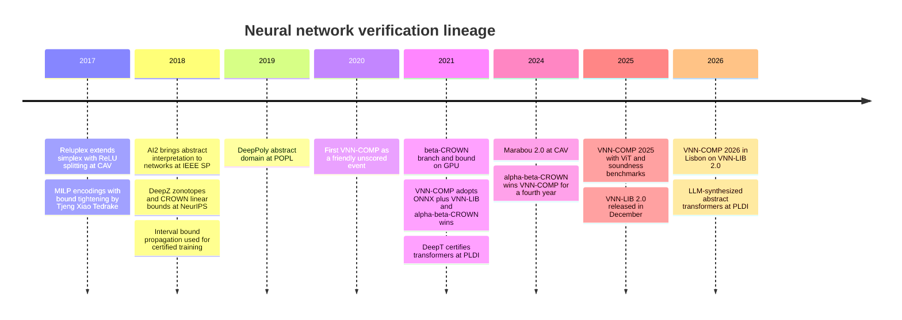
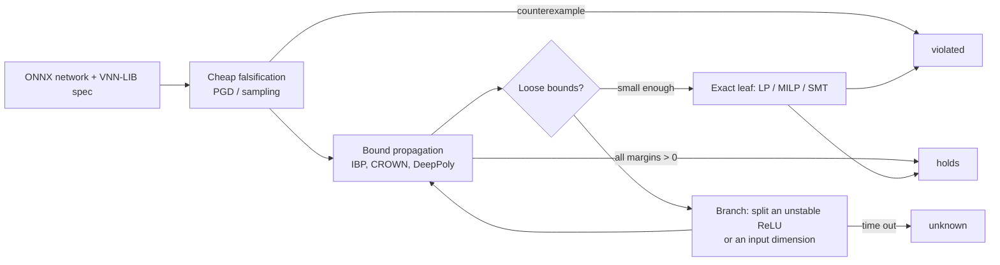
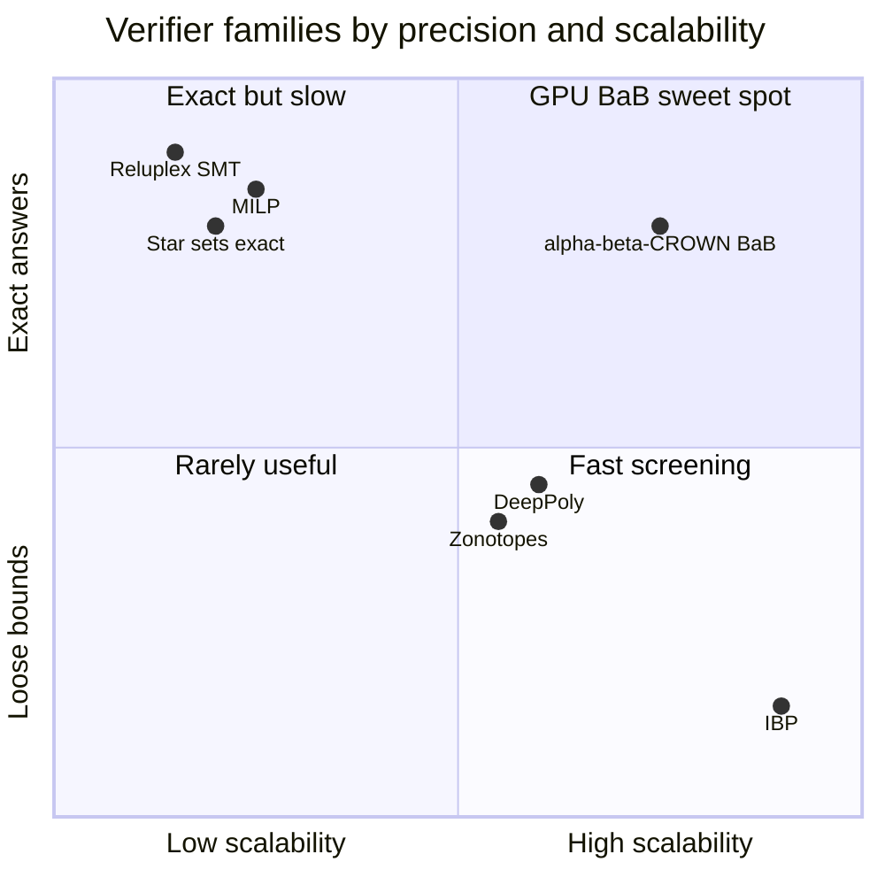

---
tags:
  - compilers
  - neural-network-verification
  - formal-verification
  - abstract-interpretation
  - bound-propagation
  - smt
  - milp
  - robustness
  - ml-safety
status: complete
sources:
  - https://theory.stanford.edu/~barrett/pubs/KBD+17-abstract.html
  - https://ar5iv.labs.arxiv.org/html/1702.01135
  - https://theory.stanford.edu/~barrett/pubs/WIZ+24-abstract.html
  - https://arxiv.org/html/1711.07356v3
  - https://www.ieee-security.org/TC/SP2018/poster-abstracts/oakland2018-paper50-poster-abstract.pdf
  - https://papers.nips.cc/paper/2018/hash/f2f446980d8e971ef3da97af089481c3-Abstract.html
  - https://papers.nips.cc/paper/2018/hash/d04863f100d59b3eb688a11f95b0ae60-Abstract.html
  - https://popl19.sigplan.org/details/POPL-2019-Research-Papers/58/An-Abstract-Domain-for-Certifying-Neural-Networks
  - https://github.com/eth-sri/eran
  - https://export.arxiv.org/abs/2103.06624
  - https://github.com/Verified-Intelligence/alpha-beta-CROWN
  - https://ar5iv.labs.arxiv.org/html/1810.12715
  - https://proceedings.mlr.press/v267/mao25a.html
  - https://pldi21.sigplan.org/details/pldi-2021-papers/31/Fast-and-Precise-Certification-of-Transformers
  - https://arxiv.org/html/2605.14294
  - https://arxiv.org/abs/2605.10974
  - https://arxiv.org/html/2606.09377
  - https://conf.researchr.org/details/sas-2021/sas-2021-papers/4/Exploiting-Verified-Neural-Networks-via-Floating-Point-Numerical-Error
  - https://ar5iv.labs.arxiv.org/html/2003.03021
  - https://arxiv.org/abs/2506.01054
  - https://arxiv.org/abs/2510.23389
  - https://arxiv.org/abs/2501.05867
  - https://arxiv.org/abs/2505.06958
  - https://ojs.aaai.org/index.php/AAAI/article/view/16496
  - https://par.nsf.gov/biblio/10568086-tensorright-automated-verification-tensor-graph-rewrites
  - https://arxiv.org/abs/2511.13663
  - https://groups.google.com/g/vnn-list/c/yVd-2KZDsD0
  - https://ar5iv.labs.arxiv.org/html/2109.00498
  - https://ar5iv.labs.arxiv.org/html/2412.19985
  - https://arxiv.org/abs/2512.19007
  - https://arxiv.org/pdf/2512.19007
  - https://arxiv.org/html/2611.24114
  - https://vnn-comp.github.io
  - https://groups.google.com/g/vnn-list/c/YxFl5y4S37k
  - https://github.com/VNN-COMP/vnncomp2026_results
  - https://news.stonybrook.edu/university/baks-team-places-second-wins-best-newcomer-award-at-2026-vnn-comp/
  - https://www.caisar-platform.com/2026/07/25/pyrat-vnncomp.html
  - https://ece.illinois.edu/news/huan-zhang-neural-networks
  - https://www.easa.europa.eu/en/downloads/144162/en
  - https://theaircurrent.com/tac-explains/glossary-ai-ml-terms-aircraft-certification/
created: 2026-11-26
updated: 2026-11-27
---

## Table Of Contents

- [[#TL;DR|TL;DR]]
- [[#The Problem|The Problem]]
- [[#Foundations|Foundations]]
    - [[#A Network Is a Straight-Line Program|A Network Is a Straight-Line Program]]
    - [[#Specifications - Robustness and Safety|Specifications - Robustness and Safety]]
    - [[#Soundness, Completeness and Hardness|Soundness, Completeness and Hardness]]
    - [[#Relaxing a ReLU|Relaxing a ReLU]]
- [[#How We Got Here|How We Got Here]]
- [[#How It Works|How It Works]]
    - [[#The Verifier Landscape|The Verifier Landscape]]
    - [[#Complete Methods - SMT and MILP|Complete Methods - SMT and MILP]]
    - [[#Incomplete Methods - Abstract Domains|Incomplete Methods - Abstract Domains]]
    - [[#Linear Bound Propagation|Linear Bound Propagation]]
    - [[#Worked Example - A Two-Input ReLU Network|Worked Example - A Two-Input ReLU Network]]
    - [[#Branch and Bound on the GPU|Branch and Bound on the GPU]]
    - [[#Inputs and Outputs - ONNX and VNN-LIB|Inputs and Outputs - ONNX and VNN-LIB]]
    - [[#Certified Training|Certified Training]]
    - [[#Transformers and LLM Components|Transformers and LLM Components]]
    - [[#Floating-Point Soundness|Floating-Point Soundness]]
    - [[#The Compiler Connection|The Compiler Connection]]
- [[#Where It Is Now|Where It Is Now]]
    - [[#VNN-COMP 2025 and 2026|VNN-COMP 2025 and 2026]]
    - [[#Research Frontier|Research Frontier]]
    - [[#Industry and Standards|Industry and Standards]]
- [[#Trade-offs & Open Problems|Trade-offs & Open Problems]]
- [[#Resources|Resources]]
- [[#Related Notes|Related Notes]]

## ***TL;DR***
---
*Neural network verification treats a trained network as a straight-line program over reals and proves properties of it for every input in a region, not just the ones you tested. It is [[Abstract Interpretation]] and SMT solving pointed at a new kind of program, and the hard parts (non-convex ReLUs, scale, floating point) look a lot like the hard parts of compiler verification.*

- **The question.** "For every input within $\epsilon$ of this image (an $L_\infty$ ball), does the label stay the same?" or "for every sensor reading in this box, is the collision-avoidance advisory never X?" Checking even simple properties of ReLU networks is NP-complete ([Katz et al., CAV 2017](https://ar5iv.labs.arxiv.org/html/1702.01135)).
- **Two families.** *Complete* verifiers (Reluplex/Marabou as SMT with ReLU case splits, MILP encodings) answer exactly but scale badly. *Incomplete* verifiers (intervals, zonotopes/DeepZ, DeepPoly, CROWN linear bound propagation) are abstract interpreters: sound, fast, and sometimes answer "unknown".
- **The winning recipe is both.** Run a cheap GPU bound propagation, and where it is too loose, *branch* on unstable ReLUs and bound each half again. α,β-CROWN, which does exactly this, has won every scored VNN-COMP from 2021 through 2026 ([README](https://github.com/Verified-Intelligence/alpha-beta-CROWN); [Stony Brook, Sep 2026](https://news.stonybrook.edu/university/baks-team-places-second-wins-best-newcomer-award-at-2026-vnn-comp/)).
- **The proof is about a model, not the binary.** Most verifiers reason over real arithmetic on an ONNX graph. Floating-point rounding, evaluation order and quantization can make "verified" networks wrong in deployment, and researchers have built backdoors that exploit exactly this ([Jia and Rinard, SAS 2021](https://ar5iv.labs.arxiv.org/html/2003.03021); [Szász et al., 2025](https://arxiv.org/abs/2506.01054)). That is a compiler problem.
- **As of November 2026.** VNN-COMP 2026 (Lisbon, July 2026) moved to the new VNN-LIB 2.0 format; α,β-CROWN won again, a newcomer tool largely written with an AI assistant placed second, and PyRAT third. Transformers are verified only at small scale; whole-LLM verification remains out of reach.

## ***The Problem***
---
*Testing a network on a million images says nothing about the image next to them. Verification asks for a proof over an infinite set of inputs, for a program with millions of non-linear branches.*

A trained classifier is a function $f : \mathbb{R}^n \to \mathbb{R}^k$ that we did not write and cannot read. Adversarial examples showed that tiny, invisible input changes can flip its output. For safety-critical uses we want guarantees like these:

| Who asks | Property | Shape of the input set |
|---|---|---|
| Image classifier | Label unchanged under small pixel noise (local robustness) | $L_\infty$ ball around one image |
| ACAS Xu collision avoidance | "If the intruder is distant and much slower, the clear-of-conflict score stays below a threshold" ([Katz et al.](https://ar5iv.labs.arxiv.org/html/1702.01135)) | Box over 5 sensor inputs |
| Learned controller | Closed-loop state stays safe, Lyapunov conditions hold | Box over state space |
| NLP model | Prediction unchanged when words are swapped for synonyms ([DeepT, PLDI 2021](https://pldi21.sigplan.org/details/pldi-2021-papers/31/Fast-and-Precise-Certification-of-Transformers)) | Product of synonym sets, or norm balls in embedding space |

Why it is hard:

- **Infinite input sets.** An $\epsilon$-ball around a 32x32x3 image is a 3072-dimensional box. Sampling is testing, not proof.
- **Piecewise-linear explosion.** A ReLU network with $N$ ReLUs is linear on each of up to $2^N$ activation patterns. The worst case is exponential, and the problem is NP-complete ([Katz et al.](https://ar5iv.labs.arxiv.org/html/1702.01135)).
- **Scale.** Real networks have $10^5$ to $10^9$ neurons. Solvers built for hardware or software verification were not designed for dense matrices.
- **The implementation gap.** The network that runs is compiled, quantized, fused and evaluated in floating point on some accelerator. A proof about the real-valued ONNX graph is a proof about an idealization ([Cordeiro et al., 2025](https://arxiv.org/abs/2501.05867)).

For a compiler person, the framing is familiar: a network is a program in a tiny language (affine maps plus elementwise non-linearities), the property is a postcondition, and the tools are the same ones used in [[Formal Methods in Practice]]: abstract interpretation, SMT, integer programming and case splitting.

## ***Foundations***
---
*Four ideas carry the whole field: the network as a straight-line program, the specification as a pre/postcondition pair, the soundness/completeness trade, and convex relaxations of the ReLU.*

### A Network Is a Straight-Line Program

*No loops, no heap, no aliasing: just a DAG of affine maps and elementwise non-linear functions, which is the friendliest possible input for an abstract interpreter.*

A feed-forward ReLU network with $L$ layers computes

$$
z^{(0)} = x,\qquad \hat z^{(i)} = W^{(i)} z^{(i-1)} + b^{(i)},\qquad z^{(i)} = \mathrm{ReLU}(\hat z^{(i)}),\qquad f(x) = W^{(L)} z^{(L-1)} + b^{(L)}
$$

**In plain English:** multiply by a matrix, add a bias, clamp negatives to zero, repeat. Convolutions, batch norm (at inference) and residual adds are all affine, so they fit the same shape.

Written as code it is SSA-like straight-line code with one kind of branch:

```c
// hand sketch: the 2-input network used in the worked example below
float net(float x1, float x2) {
    float h1 = x1 + x2;          // affine layer
    float h2 = x1 - x2;
    float r1 = h1 > 0 ? h1 : 0;  // ReLU = a data-dependent branch
    float r2 = h2 > 0 ? h2 : 0;
    return r1 + r2;              // output layer
}
```

Each ReLU is a branch whose direction depends on the input. If every branch direction is fixed (an *activation pattern*), the network is a single linear function, and questions about it are linear programs. All the difficulty lives in not knowing which way the branches go. In the language of [[Dataflow Analysis]], there is no fixpoint to compute (the CFG is acyclic), so precision is lost only in the transfer functions for the non-linear operations.

### Specifications - Robustness and Safety

*A specification is a precondition on inputs (usually a box) and a postcondition on outputs (usually a conjunction of linear inequalities).*

Local $L_\infty$ robustness around an input $x_0$ with correct class $c$:

$$
\forall x.\ \ \|x - x_0\|_\infty \le \epsilon \implies \min_{j \ne c}\ \big(f_c(x) - f_j(x)\big) > 0
$$

**In plain English:** every input whose pixels each differ from $x_0$ by at most $\epsilon$ must still give class $c$ a strictly higher score than every other class. Verifiers prove this by computing a *lower bound* on each margin $f_c - f_j$ over the box; if every lower bound is positive, the property holds.

Global safety properties, as in ACAS Xu, use a box over the whole operating region rather than a ball around one point. The Reluplex paper verified properties of 45 ACAS Xu networks, each with 5 inputs, 5 outputs and 6 hidden layers totalling 300 ReLU nodes ([Katz et al.](https://ar5iv.labs.arxiv.org/html/1702.01135)). These small networks are still a standard benchmark: VNN-COMP 2021's ACAS Xu category alone had 186 instances ([VNN-COMP 2021](https://ar5iv.labs.arxiv.org/html/2109.00498)).

The verifier's possible answers are three, and competitions score them that way: *holds* (proof), *violated* (a concrete counterexample input), or *unknown/timeout*.

### Soundness, Completeness and Hardness

*Sound means "never says holds when it does not"; complete means "never says unknown". You can have both only by paying exponential worst-case time.*

| Property | Meaning | Who has it |
|---|---|---|
| Sound | A "holds" answer is always right | Every serious verifier (modulo floating point, see below) |
| Complete | Always answers holds or violated, given enough time | Reluplex, Marabou, MILP, BaB with exact leaves |
| Incomplete | May answer "unknown" when the over-approximation is too loose | Intervals, DeepZ, DeepPoly, CROWN alone |

Katz et al. proved that verifying even simple properties of ReLU networks is NP-complete, by reduction from 3-SAT ([CAV 2017](https://ar5iv.labs.arxiv.org/html/1702.01135)). So complete methods are exponential in the worst case, and incomplete methods trade answers for speed. The interesting engineering is in how to mix the two.

### Relaxing a ReLU

*Every incomplete method replaces the non-convex ReLU graph with something convex that contains it; the art is in how tight that convex set is.*

For a pre-activation $h$ with known bounds $l \le h \le u$, a ReLU $r = \max(h, 0)$ falls into three cases ([Tjeng et al., ICLR 2019](https://arxiv.org/html/1711.07356v3)):

- $u \le 0$: *stably inactive*, $r = 0$.
- $l \ge 0$: *stably active*, $r = h$.
- $l < 0 < u$: *unstable*. This is the only case that costs anything.

For an unstable ReLU the tightest convex over-approximation is the *triangle*:

$$
r \ge 0,\qquad r \ge h,\qquad r \le \frac{u\,(h - l)}{u - l}
$$

**In plain English:** the true graph is a hinge (flat, then the diagonal). The triangle is the region under the straight chord from $(l, 0)$ to $(u, u)$ and above both arms of the hinge. Any point the real ReLU can produce is inside it.

The triangle relaxation is what you get by relaxing the MILP encoding's binary variable to $[0, 1]$ (Tjeng et al. attribute this convex formulation to Ehlers, 2017). Single-neuron linear bound propagation methods (DeepPoly, CROWN) keep only *one* lower line ($r \ge \alpha h$ with $\alpha \in [0,1]$) and the upper chord, which makes them cheaper still. The important corollary is that **tight bounds on $l$ and $u$ make everything better**: a neuron proven stable needs no relaxation and no binary variable at all ([Tjeng et al.](https://arxiv.org/html/1711.07356v3)).

## ***How We Got Here***
---
*The field went from SMT on 300-neuron networks in 2017, through a burst of abstract domains in 2018-2019, to GPU bound propagation plus branch and bound dominating an annual competition from 2021 onward.*



| Year | Milestone | Why it mattered |
|---|---|---|
| 2017 | Reluplex: simplex extended to ReLU constraints, verified ACAS Xu properties on networks "an order of magnitude larger" than prior methods could handle ([CAV 2017](https://theory.stanford.edu/~barrett/pubs/KBD+17-abstract.html)) | First practical complete verifier; NP-completeness proof |
| 2017-2019 | MILP with progressive bound tightening, two to three orders of magnitude faster than Reluplex on minimum-distortion queries, handling networks with over 100,000 ReLUs ([Tjeng et al., ICLR 2019](https://arxiv.org/html/1711.07356v3)) | Showed bounds, not solvers, are the bottleneck |
| 2018 | AI2 ([IEEE S&P 2018](https://www.ieee-security.org/TC/SP2018/poster-abstracts/oakland2018-paper50-poster-abstract.pdf)); DeepZ, floating-point-sound zonotopes for ReLU, tanh, sigmoid ([NeurIPS 2018](https://papers.nips.cc/paper/2018/hash/f2f446980d8e971ef3da97af089481c3-Abstract.html)); CROWN, adaptive linear bounds for general activations ([NeurIPS 2018](https://papers.nips.cc/paper/2018/hash/d04863f100d59b3eb688a11f95b0ae60-Abstract.html)) | Incomplete, scalable verification as abstract interpretation |
| 2018 | Interval bound propagation used to *train* verifiable networks ([Gowal et al.](https://ar5iv.labs.arxiv.org/html/1810.12715)) | Verification as a training loss |
| 2019 | DeepPoly: floating-point polyhedra plus intervals, transformers for affine, ReLU, sigmoid, tanh, maxpool ([POPL 2019](https://popl19.sigplan.org/details/POPL-2019-Research-Papers/58/An-Abstract-Domain-for-Certifying-Neural-Networks)) | The canonical single-neuron relational domain |
| 2020 | First VNN-COMP, a friendly event with no scored ranking ([VNN-COMP 2021 report](https://ar5iv.labs.arxiv.org/html/2109.00498)) | Community starts comparing tools |
| 2021 | β-CROWN: split constraints encoded as optimizable β parameters, "up to three orders of magnitude faster than LP-based BaB" ([arXiv](https://export.arxiv.org/abs/2103.06624)); VNN-COMP standardizes ONNX and VNN-LIB, α,β-CROWN wins ([report](https://ar5iv.labs.arxiv.org/html/2109.00498)) | GPU BaB becomes the dominant design |
| 2021 | DeepT: multi-norm zonotopes with softmax and dot-product transformers ([PLDI 2021](https://pldi21.sigplan.org/details/pldi-2021-papers/31/Fast-and-Precise-Certification-of-Transformers)) | Transformers enter scope |
| 2021 | Bit-precise verification of quantized networks is PSPACE-hard ([AAAI 2021](https://ojs.aaai.org/index.php/AAAI/article/view/16496)); floating-point exploits of verified networks ([SAS 2021](https://conf.researchr.org/details/sas-2021/sas-2021-papers/4/Exploiting-Verified-Neural-Networks-via-Floating-Point-Numerical-Error)) | The implementation gap becomes a research topic |
| 2024 | Marabou 2.0 system description ([CAV 2024](https://theory.stanford.edu/~barrett/pubs/WIZ+24-abstract.html)); α,β-CROWN's fourth straight VNN-COMP win ([UIUC](https://ece.illinois.edu/news/huan-zhang-neural-networks)) | SMT and bound propagation both mature |
| 2025-2026 | VNN-LIB 2.0 (Dec 2025), VNN-COMP 2026 on it; LLM-synthesized transformers ([SAIL, PLDI 2026](https://arxiv.org/abs/2511.13663)) | Formats get formal semantics; tool building gets automated |

## ***How It Works***
---
*Every modern verifier is some mix of three moves: propagate bounds through the graph, relax the ReLUs that bounds cannot settle, and split on those ReLUs when the relaxation is too loose.*

### The Verifier Landscape

*Tools differ in which abstract domain they propagate, what they do when it is too loose, and whether they run on a GPU.*

The VNN-COMP 2025 field is a good map of the design space ([VNN-COMP 2025](https://arxiv.org/pdf/2512.19007)):

| Tool | Core technique | Complete? | Notes |
|---|---|---|---|
| α,β-CROWN | GPU linear bound propagation + BaB, cutting planes, MIP for small nets | Yes (via BaB) | Winner 2021-2026 |
| NeuralSAT | CDCL (DPLL(T)) with an abstraction-based DNN theory solver | Yes | Python, Gurobi, no tuning |
| PyRAT (CEA) | Abstract interpretation with multiple zonotopic domains + BaB on inputs or ReLUs, GPU | Yes (via BaB) | Claims floating-point soundness |
| CORA (TUM) | Zonotope reachability on GPU, input and neuron splitting, specification-driven input refinement | Via splitting | |
| NNV (Vanderbilt) | Star-set reachability (MATLAB), staged over-approximation, simulation-guided falsification, plus a conformal-prediction mode | Depends on mode | Conformal mode gives only probabilistic guarantees |
| nnenum (Stony Brook) | Star-set reachability for ReLU networks with ImageStar, LP via GLPK or Gurobi, CPU only | Via exact star sets | |
| SobolBox | Black-box falsification (Sobol sampling, L-BFGS-B, Z3) | No | Its "unsat" is explicitly unsound |
| Marabou | SMT: simplex with ReLU splitting, plus abstraction | Yes | 2.0 described at [CAV 2024](https://theory.stanford.edu/~barrett/pubs/WIZ+24-abstract.html) |



### Complete Methods - SMT and MILP

*Complete verifiers decide the problem exactly by encoding each ReLU as a disjunction and letting a solver search, which is exact but exponential.*

**Reluplex and Marabou (SMT).** The property's negation plus the network becomes a conjunction of linear constraints and ReLU constraints; satisfiable means "counterexample exists". Reluplex extends the simplex method: each ReLU is split into a backward-facing variable $h$ and a forward-facing variable $r$, and the solver lets the pair *temporarily violate* $r = \max(h, 0)$ while it pivots, repairing violations with update and pivot steps. It only case-splits a ReLU (active or inactive) after the pair has been repaired too many times, using a threshold of 5 in the paper ([Katz et al.](https://ar5iv.labs.arxiv.org/html/1702.01135)). Lazy splitting is the key trick: in the ACAS Xu runs the depth of nested splits stayed far below the 300 ReLUs. On 8 simple properties, Reluplex solved all 8 (2 to 93 seconds), Gurobi 3, Yices and MathSat 2 each, and CVC4 and Z3 none; but the full ACAS Xu properties took from about 460 seconds to about 394,500 seconds (roughly 110 hours) of total time, and one property timed out ([Katz et al.](https://ar5iv.labs.arxiv.org/html/1702.01135)). Marabou is the successor framework; version 2.0 was described at CAV 2024 ([Wu et al.](https://theory.stanford.edu/~barrett/pubs/WIZ+24-abstract.html)).

**MILP.** Encode each unstable ReLU with a binary indicator $a$ ([Tjeng et al.](https://arxiv.org/html/1711.07356v3)):

$$
r \le h - l\,(1 - a),\qquad r \ge h,\qquad r \le u\,a,\qquad r \ge 0,\qquad a \in \{0, 1\}
$$

**In plain English:** when $a = 1$ the constraints squeeze $r$ to equal $h$; when $a = 0$ they force $r = 0$. The pre-activation bounds $l, u$ appear as "big-M" constants, so loose bounds make a weak formulation, and stable neurons need no binary at all. Then minimize the margin $f_c - f_j$ with an off-the-shelf solver (Gurobi); a positive optimum is a proof.

Tjeng et al.'s insight was mostly about *presolve*: compute $l, u$ with cheap interval arithmetic first and only use LP when a tighter bound could change the formulation. With that, they reported certifying all but the 4.38% of MNIST test points for which they found real adversarial examples at $\epsilon = 0.1$ for one robustly trained classifier ([Tjeng et al.](https://arxiv.org/html/1711.07356v3)). This is a compiler lesson in disguise: a better *analysis* (bounds) simplifies the *program* (fewer binaries) before the expensive backend (MILP) ever runs.

### Incomplete Methods - Abstract Domains

*Incomplete verifiers are abstract interpreters for networks: choose a domain, write a sound transformer per layer type, run the network once on abstract values.*

All the theory in [[Abstract Interpretation]] applies directly: concretization $\gamma$, sound transformers $f \circ \gamma \subseteq \gamma \circ f^\sharp$, and the precision/cost ladder of domains. Because the graph is acyclic, there is no widening; precision is lost only in the non-linear transformers.

| Domain | Representation | Affine layer | ReLU | Cost |
|---|---|---|---|---|
| Intervals (IBP) | $[l_i, u_i]$ per neuron | Center/radius: $\mu' = W\mu + b,\ r' = \lvert W\rvert r$ | Exact on the box: $[\max(l,0), \max(u,0)]$ | Two matmuls per layer |
| Zonotopes (DeepZ) | $x = c + \sum_k g_k \varepsilon_k,\ \varepsilon_k \in [-1,1]$ | Exact | Parallelogram relaxation, adds one fresh $\varepsilon$ per unstable neuron | Grows with number of noise symbols |
| DeepPoly | Per neuron: one symbolic lower and one upper linear bound over earlier neurons, plus an interval | Exact | Upper chord, one lower line | Back-substitution to inputs, quadratic-ish |
| Star sets (NNV, nnenum) | Linear map of a polytope | Exact | Exact by splitting stars, or over-approximate | Exponential in exact mode |

Interval propagation for an affine layer, in center/radius form ([Gowal et al.](https://ar5iv.labs.arxiv.org/html/1810.12715)):

$$
\mu_k = W\mu_{k-1} + b,\qquad r_k = |W|\,r_{k-1},\qquad [\underline z_k, \overline z_k] = [\mu_k - r_k,\ \mu_k + r_k]
$$

**In plain English:** move the center through the layer normally, and grow the radius by the absolute value of the weights, since a noise term can push in either direction. Its weakness is that it forgets correlations: if two neurons both depend on $x_2$, intervals cannot see that $x_2$ cancels when they are added, exactly the classic $x - x$ problem of non-relational domains.

Zonotopes and DeepPoly keep those correlations by tracking each neuron as an affine expression of shared noise symbols or earlier neurons. ERAN, the ETH reference implementation, packages DeepZ (NeurIPS 2018), DeepPoly (POPL 2019), GPUPoly (MLSys 2021, DeepPoly on the GPU), and refinements that add MILP/LP solving (RefineZono, RefinePoly with PRIMA multi-neuron constraints). It claims soundness under floating-point arithmetic except for the (MI)LP solver parts ([ERAN](https://github.com/eth-sri/eran)). DeepZ reported 97% verified accuracy on a network with 88,500 hidden units at $\epsilon = 0.1$, averaging 133 seconds ([NeurIPS 2018](https://papers.nips.cc/paper/2018/hash/f2f446980d8e971ef3da97af089481c3-Abstract.html)).

### Linear Bound Propagation

*CROWN-style methods bound every neuron by two linear functions of the input and push the output's coefficients backward through the network, like reverse-mode autodiff with inequalities.*

The idea: find $\underline a, \underline b, \overline a, \overline b$ so that for every $x$ in the input box,

$$
\underline a^\top x + \underline b \ \le\ f_j(x) \ \le\ \overline a^\top x + \overline b
$$

Start from the output, which is linear in the last hidden layer. Walk backward. At an affine layer, substitute the layer's definition (exact). At a ReLU, replace $r$ with its upper chord or a lower line depending on the sign of its coefficient (for an upper bound, positive coefficients take the upper chord, negative ones take the lower line). After reaching the input, the bound is linear in $x$, and its maximum over an $L_\infty$ ball is closed-form:

$$
\max_{\|x - x_0\|_\infty \le \epsilon} \overline a^\top x + \overline b \;=\; \overline a^\top x_0 + \epsilon\,\|\overline a\|_1 + \overline b
$$

**In plain English:** a linear function on a box is maximized at a corner, and the best corner just pushes every input coordinate $\epsilon$ in the direction of its coefficient's sign. No solver needed, only matrix multiplications, which is why it runs well on GPUs.

The CROWN family, as listed by the α,β-CROWN authors ([README](https://github.com/Verified-Intelligence/alpha-beta-CROWN)):

- **CROWN** (NeurIPS 2018): adaptive linear (and quadratic) bounds for general activations (ReLU, tanh, sigmoid, arctan), improving on Fast-Lin at similar cost ([NeurIPS 2018](https://papers.nips.cc/paper/2018/hash/d04863f100d59b3eb688a11f95b0ae60-Abstract.html)).
- **auto_LiRPA** (NeurIPS 2020): bound propagation for general computational graphs, the library under the verifier.
- **α-CROWN** (ICLR 2021): treat each ReLU's lower slope $\alpha \in [0,1]$ as a parameter and optimize it by gradient descent to tighten the final bound.
- **β-CROWN** (NeurIPS 2021): add Lagrange-style $\beta$ multipliers for branch-and-bound split constraints, staying "as efficient and parallelizable as CROWN on GPUs" ([arXiv](https://export.arxiv.org/abs/2103.06624)).
- **GCP-CROWN** (NeurIPS 2022) and **BICCOS** (NeurIPS 2024): general cutting planes, and cutting planes harvested during branch and bound.
- **GenBaB** (TACAS 2025): branch and bound for general non-linearities, which is what transformers need.
- **Clip-and-Verify** (NeurIPS 2025): prunes BaB subproblems; new in the 2025 competition entry ([VNN-COMP 2025](https://arxiv.org/pdf/2512.19007)).

There is a known ceiling: any method that relaxes one neuron at a time cannot beat the LP over the triangle relaxations (the "convex relaxation barrier", Salman et al., NeurIPS 2019, cited in the same README). Getting past it needs multi-neuron constraints (PRIMA, cutting planes), SDP, or splitting.

### Worked Example - A Two-Input ReLU Network

*On a 2-neuron network, intervals give a bound of 4, linear relaxation gives 3, and branch and bound gives the true answer 2; each step is the previous one plus more relational information.*

Take the network from the C sketch above, with inputs $x_1, x_2 \in [-1, 1]$:

$$
h_1 = x_1 + x_2,\quad h_2 = x_1 - x_2,\quad r_i = \mathrm{ReLU}(h_i),\quad y = r_1 + r_2
$$

Property: $y \le 2.5$ on the whole box. (True maximum: $y = 2$, e.g. at $x = (1, 0)$ or $(1, -1)$.)

**Step 1: intervals.** $h_1, h_2 \in [-2, 2]$. ReLU gives $r_1, r_2 \in [0, 2]$. So $y \in [0, 4]$. The bound 4 does not prove $y \le 2.5$: **unknown**. The loss is the cancellation of $x_2$: $h_1 + h_2 = 2x_1$, but intervals add $[-2,2] + [-2,2]$ as if independent.

**Step 2: linear relaxation (CROWN-style upper bound).** Both ReLUs are unstable with $l = -2, u = 2$, so the chord is $r_i \le \frac{2(h_i + 2)}{4} = \tfrac12 h_i + 1$. Substitute backward:

$$
y \le \tfrac12 h_1 + 1 + \tfrac12 h_2 + 1 = \tfrac12(x_1 + x_2) + \tfrac12(x_1 - x_2) + 2 = x_1 + 2 \le 3
$$

**In plain English:** keeping $h_1$ and $h_2$ as symbolic expressions in $x$ lets $x_2$ cancel, so the bound drops from 4 to 3. Still not $\le 2.5$: **unknown**. What is left is the slack between the chord and the hinge.

**Step 3: branch and bound.** Split on $h_1$.

- *Branch $h_1 < 0$:* $r_1 = 0$, so $y = r_2 \le \tfrac12(x_1 - x_2) + 1 \le 2$. **Proven** for this branch.
- *Branch $h_1 \ge 0$:* $r_1 = h_1$ exactly, but $r_2$ is still relaxed: $y \le (x_1 + x_2) + \tfrac12(x_1 - x_2) + 1 = 1.5x_1 + 0.5x_2 + 1 \le 3$, attained at $(1, 1)$, which also satisfies $x_1 + x_2 \ge 0$, so using the split constraint does not help. Split again on $h_2$:
    - $h_2 \ge 0$: $y = 2x_1 \le 2$.
    - $h_2 < 0$: $y = x_1 + x_2 \le 2$.

Every leaf is $\le 2 < 2.5$: **holds**. Three leaves instead of four, because one branch closed early. Asking instead for $y \le 1.9$, the leaf bounds are no longer enough, and a falsifier finds $x = (1, 0)$ with $y = 2$: **violated**.

The same numbers from a short NumPy script (real output, run for this note):

```python
import itertools, numpy as np
W1 = np.array([[1., 1.], [1., -1.]]); b1 = np.zeros(2); w2 = np.array([1., 1.])
lo, hi = -np.ones(2), np.ones(2); c, r = (lo + hi) / 2, (hi - lo) / 2
hl, hu = W1 @ c - np.abs(W1) @ r, W1 @ c + np.abs(W1) @ r          # IBP pre-activations
print("IBP y upper =", w2 @ np.maximum(hu, 0))
s = hu / (hu - hl); a = (w2 * s) @ W1; k = (w2 * s) @ (b1 - hl)    # chord, back-substituted
print("CROWN upper:", a, "x +", k, "->", a @ c + np.abs(a) @ r + k)
for ph in itertools.product([1, 0], repeat=2):                      # fix every ReLU phase
    coef = sum((w2[i] * W1[i] for i in range(2) if ph[i]), np.zeros(2))
    print("leaf", ph, "y <=", coef @ c + np.abs(coef) @ r)
```

```text
IBP y upper = 4.0
CROWN upper: [1. 0.] x + 2.0 -> 3.0
leaf (1, 1) y <= 2.0
leaf (1, 0) y <= 2.0
leaf (0, 1) y <= 2.0
leaf (0, 0) y <= 0.0
```

A dense 401x401 grid sample of the box confirms the true maximum is 2.0. The leaves here fix both phases at once (the full four-leaf tree), which is what an exhaustive split does; real BaB stops early on branches already proven, as in Step 3. The MILP view of the same network: two binaries $a_1, a_2$, constraints $r_i \le h_i + 2(1 - a_i)$, $r_i \ge h_i$, $r_i \le 2a_i$, $r_i \ge 0$, maximize $r_1 + r_2$; the solver's branch and bound over $a_1, a_2$ is the same tree as Step 3.

### Branch and Bound on the GPU

*BaB turns an incomplete bound into a complete verifier: split the hardest unstable neuron, bound both halves in a batch on the GPU, and repeat until every leaf is proven or a counterexample appears.*

Ingredients of modern BaB, all visible in α,β-CROWN ([README](https://github.com/Verified-Intelligence/alpha-beta-CROWN); [VNN-COMP 2025](https://arxiv.org/pdf/2512.19007)):

- **Branching on ReLUs** (activation splits) for high-dimensional inputs; **branching on input dimensions** for low-dimensional problems like ACAS Xu. PyRAT and CORA offer both ([VNN-COMP 2025](https://arxiv.org/pdf/2512.19007)).
- **Split constraints inside the bound**: β-CROWN encodes "$h_i \ge 0$" with an optimizable multiplier, so each subproblem's bound actually uses its branch decisions ([arXiv](https://export.arxiv.org/abs/2103.06624)).
- **Batching**: thousands of subproblems are bounded in one batched GPU pass, which is why the approach scales where LP-per-node BaB did not ("up to three orders of magnitude faster than LP-based BaB methods").
- **Cutting planes and MIP** for networks small enough that an exact solver helps (GCP-CROWN, BICCOS).
- **Attacks first**: PGD-style falsification before and during the search, since a counterexample ends the problem.

The NeuralSAT team frames the same search as CDCL: ReLU phases are Boolean variables, bound propagation is the theory solver, and conflicts are learned as clauses ([VNN-COMP 2025](https://arxiv.org/pdf/2512.19007)). Reluplex, MILP and GPU BaB are three implementations of one idea: search over activation patterns, prune with bounds.

### Inputs and Outputs - ONNX and VNN-LIB

*The network arrives as an ONNX graph, the property as a VNN-LIB file in SMT-LIB-like syntax; both are IRs, and the semantics of each is where soundness bugs hide.*

Since 2021 VNN-COMP has required ONNX for networks and VNN-LIB for specifications ([VNN-COMP 2021](https://ar5iv.labs.arxiv.org/html/2109.00498)). A VNN-LIB 1.0-style file for the worked example looks roughly like this (hand sketch; in VNN-COMP practice the assertions describe the *unsafe* region, so a satisfying input is a counterexample):

```lisp
; hand sketch, VNN-LIB 1.0 style
(declare-const X_0 Real)
(declare-const X_1 Real)
(declare-const Y_0 Real)
(assert (>= X_0 -1.0))
(assert (<= X_0  1.0))
(assert (>= X_1 -1.0))
(assert (<= X_1  1.0))
(assert (>= Y_0  2.5))   ; bad outputs: unsat means y <= 2.5 holds
```

VNN-LIB 2.0, announced December 15, 2025 by Matthew Daggitt, adds a formal grammar with multiple networks, multiple inputs and outputs, hidden-layer references and explicit network type annotations; a formal semantics covering the dependency on ONNX and queries over *floating-point types at various precisions* as well as approximate real semantics; SMT-LIB-style logics naming query fragments a verifier supports; and a standard command-line interface. Reference parsers exist in C++, Python (on PyPI as `vnnlib`), Julia and Agda ([vnn-list](https://groups.google.com/g/vnn-list/c/yVd-2KZDsD0)). The 2026 competition used it, and the PyRAT team noted that supporting the richer properties meant reworking core parts of their tool, with the risk of new soundness bugs ([CAISAR, July 2026](https://www.caisar-platform.com/2026/07/25/pyrat-vnncomp.html)).

Competition scoring makes the stakes explicit: +10 for a correct "holds" or "violated", 0 for unknown or timeout, and -150 for an incorrect answer. When tools disagree, the one claiming a violation must produce a counterexample that checks out; organizers recompute outputs with onnxruntime ([VNN-COMP 2025](https://arxiv.org/pdf/2512.19007)). In 2024 the α,β-CROWN team found that Marabou's competition build was unsound on the ViT benchmarks because Gurobi sometimes reported "Infeasible" where counterexamples existed ([VNN-COMP 2024](https://ar5iv.labs.arxiv.org/html/2412.19985)). Verifiers are compilers' cousins in this respect too: their own bugs are the main threat to their guarantees.

### Certified Training

*Networks trained normally are hard to verify; training against the verifier's own bound makes the bound tight, at a cost in clean accuracy.*

Interval bound propagation (IBP) training ([Gowal et al., 2018](https://ar5iv.labs.arxiv.org/html/1810.12715)) computes worst-case logits with intervals (true class at its lower bound, others at their upper bounds) and mixes two losses:

$$
L = \kappa\,\mathrm{CE}(z_K, y) + (1 - \kappa)\,\mathrm{CE}(\hat z_K(\epsilon), y)
$$

**In plain English:** part of the loss rewards getting the clean input right, part rewards getting the worst case in the box right. $\kappa$ starts at 1 and is lowered (typically to 0.5); $\epsilon$ ramps up from 0, and the authors say this schedule was essential for training to work at all.

Reported results: on CIFAR-10 at $\epsilon = 8/255$, verified error fell from 78.22% (Wong et al.) to 67.96%, with 50.51% clean error; a WideResNet on 64x64 ImageNet at $\epsilon = 1/255$ had 93.87% verified top-1 error, poor in absolute terms but non-vacuous. A striking side effect: IBP-trained models were nearly as well bounded by plain IBP as by MIP, because the network learns to be easy to verify ([Gowal et al.](https://ar5iv.labs.arxiv.org/html/1810.12715)).

CTBench (ICML 2025) re-ran certified training methods under shared schedules, a common certifier and tuned hyperparameters. Nearly every algorithm beat its own published numbers, the claimed advantage of recent methods over older baselines shrank considerably, reducing regularization mattered especially at large radii, and certified models showed sparser activations and less fragmented loss surfaces ([Mao, Balauca and Vechev](https://proceedings.mlr.press/v267/mao25a.html)). Sparser activations mean more stable ReLUs, which is precisely what makes the MILP and BaB machinery above cheap.

### Transformers and LLM Components

*Attention brings products of two perturbed quantities and softmax, which ReLU-era relaxations do not handle; research has reached small transformers, not LLMs.*

New operators need new sound transformers:

- **Dot products** $q^\top k$ where both sides depend on the input: bilinear, so bounds need McCormick-style planes. Liu, Zhang and Zhao (arXiv, May 2026) combine two dual planar bounds via min/max and rewrite that as ReLUs so existing ReLU relaxations apply. Their BuFFeT methods certify up to 1.8x (rule-based) and 3.6x (optimized) the baseline's maximal $\epsilon$ on 6-layer models over SST and Yelp, and about 2.7x on TinyBERT, at 1.1-1.7x and 33-97x the runtime ([arXiv 2605.14294](https://arxiv.org/html/2605.14294)).
- **Softmax.** Vertex-Softmax (arXiv, May 2026) proves the exact optimum of softmax-then-linear-objective over interval score bounds lies at a vertex of the box, reduces the search to a linear number of candidates after sorting (log-linear time in sequence length), and claims it is the tightest sound bound obtainable from score intervals alone ([Rezazadeh and Gholami Davoodi](https://arxiv.org/abs/2605.10974)).
- **Multi-norm zonotopes.** DeepT (PLDI 2021) extended zonotopes to $\ell_1$/$\ell_2$ perturbations with softmax and dot-product transformers, reporting average certified radii 28x larger than the prior state of the art and the first certification against synonym attacks on long sequences ([PLDI 2021](https://pldi21.sigplan.org/details/pldi-2021-papers/31/Fast-and-Precise-Certification-of-Transformers)).
- **General graphs.** α,β-CROWN lists support for GELU, multiplication, self-attention, residual connections, LSTMs and "Transformers", with GenBaB (TACAS 2025) branching on general non-linearities ([README](https://github.com/Verified-Intelligence/alpha-beta-CROWN)).

Scale check: VNN-COMP 2025's ViT benchmark consisted of two *shallow* vision transformers on CIFAR-10 at $\epsilon = 1/255$, and the report mentions no LLM benchmarks ([VNN-COMP 2025](https://arxiv.org/pdf/2512.19007)). A 2026 paper sharding bound propagation across GPUs with tensor parallelism and FSDP (borrowed from [[Distributed Training]]) verified, at most, a single-layer MLP of width 262,144 for memory measurements, a CIFAR-100 ResNet with over 4 GB of α tensors, and a ViT of about 75K parameters, on 2 GPUs ([Vorobyov and Ilyushin](https://arxiv.org/html/2606.09377)). So "verifying LLM components" today means individual operators ([[Attention]], softmax) and tiny models, not anything resembling a deployed [[Transformer]].

### Floating-Point Soundness

*A proof over real arithmetic is not a proof about the program that runs; the gap has been exploited in practice.*

Three results define the problem:

- **Jia and Rinard (SAS 2021).** "Many verifiers inaccurately model floating point arithmetic." Against MIPVerify (complete, MILP-based), they found adversarial examples in 82 of 320 cases the verifier had certified robust (16/160 MNIST, 66/160 CIFAR-10), across five inference implementations. They also built networks whose weights make CROWN's incomplete check return a wrong robustness claim ([SAS 2021](https://conf.researchr.org/details/sas-2021/sas-2021-papers/4/Exploiting-Verified-Neural-Networks-via-Floating-Point-Numerical-Error); [arXiv](https://ar5iv.labs.arxiv.org/html/2003.03021)).
- **Szász, Bánhelyi and Jelasity (2025).** [[Floating-Point Semantics|Floating-point addition is not associative]], so the same network gives different outputs under different expression trees, rounding modes or precisions. They prove that interval propagation and zonotopes can miss the true extremes of a deployed computation, and build backdoored networks with "detector" neurons (exploiting, for example, $\omega = 2^{24}$ in binary32) that look safe at full precision; per a machine-generated review of the paper, all ten verifier configurations tested missed two of their backdoor types on 100 MNIST inputs. If deployment uses one known expression tree, interval propagation along that tree is sound in practice ([arXiv 2506.01054](https://arxiv.org/abs/2506.01054)).
- **Quantized networks (AAAI 2021).** Ignoring rounding in low-bit quantized networks "has been shown to lead to wrong conclusions"; bit-exact verification of quantized networks against bit-vector specifications is PSPACE-hard, while idealized real-valued verification is in NP ([Henzinger, Lechner and Žikelić](https://ojs.aaai.org/index.php/AAAI/article/view/16496)). See [[Quantization]] for why deployments quantize anyway.

Mitigations in use: DeepZ was designed to be sound with respect to floating-point arithmetic, and ERAN claims floating-point soundness except for its LP/MILP parts ([ERAN](https://github.com/eth-sri/eran)); PyRAT claims floating-point soundness; α,β-CROWN runs in 32- or 64-bit ([VNN-COMP 2025](https://arxiv.org/pdf/2512.19007)); VNN-LIB 2.0 lets a query state floating-point semantics at a given precision ([vnn-list](https://groups.google.com/g/vnn-list/c/yVd-2KZDsD0)). Even a formally verified certifier is only as good as its model of arithmetic: a Dafny-verified $\ell_2$ robustness certifier (2025) found three exploitable bugs in an earlier unverified one (one from floating-point imprecision), yet its own proof is over reals and rationals, not the float pipeline ([Tobler, Syeda and Murray](https://arxiv.org/abs/2505.06958)).

### The Compiler Connection

*The network that is verified is an IR; the network that runs is the output of an ML compiler. Closing that gap is translation validation, verified compilation and floating-point semantics, all familiar compiler topics.*

Where compilers enter:

- **Verifiers are compilers' front ends.** A verifier parses ONNX (an [[Intermediate Representations|IR]]), normalizes it (fold batch norm, fuse affine layers), runs an analysis pass, and in BaB mode generates thousands of specialized subproblems. auto_LiRPA's bound propagation on "irregular computational graphs" ([README](https://github.com/Verified-Intelligence/alpha-beta-CROWN)) has the same structure as autodiff over a dataflow graph.
- **The deployed artifact is compiled.** [[ML Compilers]] fuse kernels ([[Kernel Fusion]]), reorder reductions, pick lower-precision accumulators on [[Tensor Cores]], and quantize. Each changes floating-point results, which is exactly what Szász et al. exploit. A proof about the ONNX graph says nothing about the fused, reordered binary unless the compiler preserves the property, which is a [[Translation Validation]] or [[Verified Compilers]] question.
- **Verifying the compiler's rewrites.** TensorRight (POPL 2025, PACMPL vol. 9) verifies tensor graph rewrite rules for tensors of *arbitrary* rank by proving a rank bound beyond which bounded SMT checks suffice; it proved 115 of 175 rules from XLA's algebraic simplifier, against 18 expressible in the closest bounded system ([TensorRight](https://par.nsf.gov/biblio/10568086-tensorright-automated-verification-tensor-graph-rewrites)). Rewrites verified over reals still do not cover float reassociation, the same gap as above.
- **Verifying the network as code.** NeuroCodeBench 2.0 (Manino et al., Oct 2025) writes 912 neural network verification problems as plain C in SV-COMP format (activations, layers, networks up to 170K parameters); eight state-of-the-art software verifiers solved about 11% on average, with about 3% incorrect verdicts ([arXiv 2510.23389](https://arxiv.org/abs/2510.23389)). This attacks the implementation gap head on, by verifying the float program rather than the real-valued model.
- **NN verification as a PL problem.** Cordeiro, Daggitt, Katz, Komendantskaya, Wu and others argue the field has an *embedding gap* (from real-world meaning to vectors) and an *implementation gap* (from reals to float, non-deterministic execution), that VNN-LIB lacked formal semantics, and propose an expressively typed specification language in which type checking is proof checking ([arXiv 2501.05867](https://arxiv.org/abs/2501.05867)); compare [[Dependent and Refinement Types]]. VNN-LIB 2.0's Agda library points the same way.
- **Building verifiers automatically.** SAIL (PLDI 2026) uses LLMs to synthesize sound abstract transformers for neural network verifiers, with a generate-validate-refine loop driven by an unsoundness cost, reporting sound, precise transformers for non-linear operators that had no published transformer ([arXiv 2511.13663](https://arxiv.org/abs/2511.13663)). This is [[Program Synthesis]] of analyzer components, the same move as synthesizing LLVM KnownBits transformers.

## ***Where It Is Now***
---
*As of November 2026, GPU bound propagation plus branch and bound is the undisputed engine, VNN-LIB 2.0 has given specifications a formal semantics, transformer verification is an active but small-scale research area, and avionics standards are taking shape without yet prescribing formal methods.*

### VNN-COMP 2025 and 2026

*The competition is the field's scoreboard; the same tool has won every scored edition.*

**Winners and podiums (verified editions):**

| Edition | Venue | 1st | 2nd | 3rd | Source |
|---|---|---|---|---|---|
| 2020 | | (friendly, unscored) | | | [2021 report](https://ar5iv.labs.arxiv.org/html/2109.00498) |
| 2021 | | α,β-CROWN | VeriNet | ERAN and oval (tie under two scorings) | [2021 report](https://ar5iv.labs.arxiv.org/html/2109.00498) |
| 2022, 2023 | | α,β-CROWN | | | [README](https://github.com/Verified-Intelligence/alpha-beta-CROWN) |
| 2024 | | α,β-CROWN | PyRAT | Marabou | [2024 report](https://ar5iv.labs.arxiv.org/html/2412.19985) |
| 2025 | SAIV at CAV 2025, Zagreb | α,β-CROWN | NeuralSAT | PyRAT | [2025 report](https://arxiv.org/pdf/2512.19007) |
| 2026 | SAIV at CAV/FLoC 2026, Lisbon | α,β-CROWN | vibecheck | PyRAT | [Stony Brook](https://news.stonybrook.edu/university/baks-team-places-second-wins-best-newcomer-award-at-2026-vnn-comp/); [CAISAR](https://www.caisar-platform.com/2026/07/25/pyrat-vnncomp.html) |

**VNN-COMP 2025** (6th edition; report by Kaulen, Ladner, Bak, Brix, Duong, Flinkow, Johnson, Koller, Manino, Nguyen and Wu, December 22, 2025): 8 teams (one withdrew), 16 regular and 9 extended benchmarks, equal-cost AWS hardware, no time bonus. Final order: α,β-CROWN, NeuralSAT, PyRAT, CORA, NNV, nnenum, SobolBox. Benchmarks included ACAS Xu, cifar100, tinyimagenet, NN4Sys, Collins RUL CNN, MalBeWare, safeNLP and a **SoundnessBench** designed to catch unsound verifiers; the extended track had ViT, VGGNet16, YOLO and a Collins Aerospace benchmark ([arXiv 2512.19007](https://arxiv.org/pdf/2512.19007)). The α,β-CROWN README says it ranked first on all scored benchmarks.

**VNN-COMP 2026** (7th edition) ran July 24-25, 2026 at SAIV 2026, co-located with CAV/FLoC 2026 in Lisbon, following the procedures of the previous two editions, with rules finalized May 1 and organizer runs from June 30 ([vnn-comp.github.io](https://vnn-comp.github.io); [call for participation](https://groups.google.com/g/vnn-list/c/YxFl5y4S37k)). The results repository has tool folders for act, agate, alpha_beta_crown, bright, cora, n2v, neuralsat, nnenum, nnv, pyrat, sobolbox, super_simple_vnn_comp and vibecheck, and validates counterexamples against the VNN-LIB version each instance used ([results repo](https://github.com/VNN-COMP/vnncomp2026_results)). Outcomes reported by participants:

- **α,β-CROWN won again**, making it first in every scored edition from 2021 through 2026 ([Stony Brook](https://news.stonybrook.edu/university/baks-team-places-second-wins-best-newcomer-award-at-2026-vnn-comp/); the README's news section lists the 2026 win in 08/2026).
- **vibecheck** (Stanley Bak's team, Stony Brook) placed second overall and won Best Newcomer. The team built it in about two months by "vibe coding" with Claude generating the code, and Bak described judging the AI's work by demanding evidence of correctness rather than reading every line ([Stony Brook, Sep 28, 2026](https://news.stonybrook.edu/university/baks-team-places-second-wins-best-newcomer-award-at-2026-vnn-comp/)). That is a notable data point: a competitive sound verifier, written mostly by a model, checked by its own soundness scaffolding and the competition's counterexample validation.
- **PyRAT** placed third overall and second on the extended track; the team reported six new tools entering and that VNN-LIB 2.0 "greatly expanded the possible properties", including multi-network properties ([CAISAR](https://www.caisar-platform.com/2026/07/25/pyrat-vnncomp.html)).

The official 2026 report is on arXiv as "The 7th International Verification of Neural Networks Competition (VNN-COMP 2026): Summary and Results" ([arXiv 2611.24114](https://arxiv.org/html/2611.24114)); its contents were not read for this note, so the table above relies on participants' announcements.

### Research Frontier

*Tighter non-linear relaxations, automated transformer synthesis, scaling across GPUs, and closing the float gap are where 2025-2026 papers cluster.*

- **α,β-CROWN keeps absorbing techniques.** Clip-and-Verify (NeurIPS 2025, released 12/2025); support for Jacobian-containing graphs with tanh and sigmoid for continuous-time Lyapunov stability (12/2025); a Python API that runs the verifier without manually exporting ONNX or writing VNN-LIB ([README](https://github.com/Verified-Intelligence/alpha-beta-CROWN)).
- **Transformer bounds.** BuFFeT ([arXiv 2605.14294](https://arxiv.org/html/2605.14294)) and Vertex-Softmax ([arXiv 2605.10974](https://arxiv.org/abs/2605.10974)), both May 2026, attack the two weakest transformers in CROWN-style verifiers (dot product and softmax).
- **Distributed verification.** Tensor-parallel and FSDP bound propagation ([arXiv 2606.09377](https://arxiv.org/html/2606.09377)): FSDP gives identical bounds with 80-90% lower baseline memory on wide MLPs; per-neuron α tensors, not weights, are the next bottleneck.
- **Synthesized analyzers.** SAIL at PLDI 2026 ([arXiv](https://arxiv.org/abs/2511.13663)), and the vibecheck result above, show LLMs producing verifier components under external soundness checks.
- **Software-level verification.** NeuroCodeBench 2.0 ([arXiv 2510.23389](https://arxiv.org/abs/2510.23389)) and the deployed-network soundness critique ([arXiv 2506.01054](https://arxiv.org/abs/2506.01054)) push verification toward the float program that actually runs.
- **Certified training evaluation.** CTBench (ICML 2025) resets baselines ([PMLR](https://proceedings.mlr.press/v267/mao25a.html)).

### Industry and Standards

*Aviation is the furthest along in writing ML into certification, but the emerging standard names robustness as a property, not formal verification as a method.*

- **ACAS Xu** remains the field's founding case study: a prototype collision avoidance system for unmanned aircraft implemented as 45 small networks ([Katz et al.](https://ar5iv.labs.arxiv.org/html/1702.01135)).
- **ARP6983 / ED-324.** The joint SAE G-34 / EUROCAE WG-114 recommended practice, "Development and Assurance Considerations for Aeronautical Systems and Equipment implemented with Machine Learning", was at Draft 8 at EASA AI Days 2026 (September 9-10, 2026). Issue 1 is limited to non-adaptive, supervised ML up to IDAL C, lists robustness and stability among desired model properties, and EASA is considering it as an anticipated acceptable means of compliance, including for the EU AI Act. The material presented did not prescribe formal verification techniques ([EASA AI Days 2026](https://www.easa.europa.eu/en/downloads/144162/en); [The Air Current glossary](https://theaircurrent.com/tac-explains/glossary-ai-ml-terms-aircraft-certification/)).
- **Industrial benchmarks.** Collins Aerospace contributed benchmarks to VNN-COMP 2025 (a remaining-useful-life CNN in the regular track, another in the extended track) ([VNN-COMP 2025](https://arxiv.org/pdf/2512.19007)), and the CEA PyRAT team reports industrial contracts applying neural network verification to critical systems ([CAISAR](https://www.caisar-platform.com/2026/07/25/pyrat-vnncomp.html)).

## ***Trade-offs & Open Problems***
---
*Every axis trades precision for scale, and the deepest open problem is not precision at all: it is whether the thing you proved is the thing that runs.*



(Positions are a qualitative hand sketch, not measured.)

- **Completeness versus scale.** Complete methods are exponential in unstable ReLUs; incomplete ones scale but say "unknown". BaB lets you buy precision with time, but the hardest instances still time out, and VNN-COMP scores unknowns as zero.
- **The convex relaxation barrier.** Single-neuron relaxations cannot beat the triangle LP; going further requires multi-neuron constraints, cutting planes, SDP or splitting, each with its own cost.
- **Local robustness is a weak specification.** An $L_\infty$ ball around a test point is a proxy for "safe". Most real requirements (semantic perturbations, closed-loop behavior, multi-network properties) are harder to state; VNN-LIB 2.0's multi-network support and the PL community's push for typed specifications ([arXiv 2501.05867](https://arxiv.org/abs/2501.05867)) are responses.
- **Floating point and compilation.** Real-valued proofs can be exploited ([SAS 2021](https://ar5iv.labs.arxiv.org/html/2003.03021); [arXiv 2506.01054](https://arxiv.org/abs/2506.01054)); bit-precise verification of quantized networks is PSPACE-hard ([AAAI 2021](https://ojs.aaai.org/index.php/AAAI/article/view/16496)); and ML compilers reorder floating-point reductions freely. No end-to-end chain from a verified model to a verified binary exists for realistic networks.
- **Verifier soundness itself.** Marabou's 2024 Gurobi-induced unsoundness, the -150 penalty, SoundnessBench and validated counterexamples all exist because verifiers are complex, fast-moving code. Proof-producing verifiers and formally verified checkers ([arXiv 2505.06958](https://arxiv.org/abs/2505.06958)) are partial answers; LLM-written verifiers (vibecheck) raise the stakes.
- **Certified training costs accuracy.** IBP-style training made CIFAR-10 at $8/255$ verifiable only at roughly 50% clean error in 2018 ([Gowal et al.](https://ar5iv.labs.arxiv.org/html/1810.12715)); CTBench suggests the field's progress since is smaller than headline numbers implied ([ICML 2025](https://proceedings.mlr.press/v267/mao25a.html)).
- **Transformers and LLMs.** Verified models top out around shallow ViTs and TinyBERT-scale encoders; even sharding bound propagation across GPUs has only been demonstrated on a ~75K-parameter ViT ([arXiv 2606.09377](https://arxiv.org/html/2606.09377)). Formal guarantees for LLMs are, for now, guarantees about components.

## ***Resources***
---
*Start with Reluplex and DeepPoly for the two families, β-CROWN for the modern engine, and the VNN-COMP reports for the state of play.*

**Primary papers: complete methods**
- [Reluplex: An Efficient SMT Solver for Verifying Deep Neural Networks](https://ar5iv.labs.arxiv.org/html/1702.01135): Katz, Barrett, Dill, Julian and Kochenderfer, CAV 2017 ([abstract](https://theory.stanford.edu/~barrett/pubs/KBD+17-abstract.html)). ACAS Xu, NP-completeness, lazy ReLU splitting.
- [Evaluating Robustness of Neural Networks with Mixed Integer Programming](https://arxiv.org/html/1711.07356v3): Tjeng, Xiao and Tedrake, ICLR 2019. The MILP encoding and why bounds matter.
- [Marabou 2.0: A Versatile Formal Analyzer of Neural Networks](https://theory.stanford.edu/~barrett/pubs/WIZ+24-abstract.html): Wu et al., CAV 2024.

**Primary papers: incomplete methods and BaB**
- [AI2: Safety and Robustness Certification of Neural Networks with Abstract Interpretation](https://www.ieee-security.org/TC/SP2018/poster-abstracts/oakland2018-paper50-poster-abstract.pdf): Gehr et al., IEEE S&P 2018.
- [Fast and Effective Robustness Certification](https://papers.nips.cc/paper/2018/hash/f2f446980d8e971ef3da97af089481c3-Abstract.html): Singh, Gehr, Mirman, Püschel and Vechev, NeurIPS 2018 (DeepZ).
- [Efficient Neural Network Robustness Certification with General Activation Functions](https://papers.nips.cc/paper/2018/hash/d04863f100d59b3eb688a11f95b0ae60-Abstract.html): Zhang, Weng, Chen, Hsieh and Daniel, NeurIPS 2018 (CROWN).
- [An Abstract Domain for Certifying Neural Networks](https://popl19.sigplan.org/details/POPL-2019-Research-Papers/58/An-Abstract-Domain-for-Certifying-Neural-Networks): Singh, Gehr, Püschel and Vechev, POPL 2019 (DeepPoly).
- [Beta-CROWN](https://export.arxiv.org/abs/2103.06624): Huan Zhang's group and collaborators, NeurIPS 2021 (venue per the α,β-CROWN README). Split constraints in bound propagation.
- [Fast and Precise Certification of Transformers](https://pldi21.sigplan.org/details/pldi-2021-papers/31/Fast-and-Precise-Certification-of-Transformers): Bonaert, Dimitrov, Baader and Vechev, PLDI 2021 (DeepT).

**Certified training**
- [On the Effectiveness of Interval Bound Propagation for Training Verifiably Robust Models](https://ar5iv.labs.arxiv.org/html/1810.12715): Gowal et al., 2018.
- [CTBench: A Library and Benchmark for Certified Training](https://proceedings.mlr.press/v267/mao25a.html): Mao, Balauca and Vechev, ICML 2025.

**Soundness, floating point and compilers**
- [Exploiting Verified Neural Networks via Floating Point Numerical Error](https://conf.researchr.org/details/sas-2021/sas-2021-papers/4/Exploiting-Verified-Neural-Networks-via-Floating-Point-Numerical-Error): Jia and Rinard, SAS 2021.
- [Scalable Verification of Quantized Neural Networks](https://ojs.aaai.org/index.php/AAAI/article/view/16496): Henzinger, Lechner and Žikelić, AAAI 2021.
- [No Soundness in the Real World](https://arxiv.org/abs/2506.01054): Szász, Bánhelyi and Jelasity, arXiv 2025.
- [Floating-Point Neural Network Verification at the Software Level](https://arxiv.org/abs/2510.23389): Manino, Farias, Menezes, Shmarov and Cordeiro, arXiv 2025 (NeuroCodeBench 2.0).
- [Neural Network Verification is a Programming Language Challenge](https://arxiv.org/abs/2501.05867): Cordeiro et al., arXiv 2025.
- [A Formally Verified Robustness Certifier for Neural Networks](https://arxiv.org/abs/2505.06958): Tobler, Syeda and Murray, arXiv 2025.
- [TensorRight: Automated Verification of Tensor Graph Rewrites](https://par.nsf.gov/biblio/10568086-tensorright-automated-verification-tensor-graph-rewrites): PACMPL 9 (POPL 2025).

**2026 frontier**
- [Precise Verification of Transformers through ReLU-Catalyzed Abstraction Refinement](https://arxiv.org/html/2605.14294): Liu, Zhang and Zhao, 2026.
- [Vertex-Softmax: Tight Transformer Verification via Exact Softmax Optimization](https://arxiv.org/abs/2605.10974): Rezazadeh and Gholami Davoodi, arXiv May 2026.
- [Scaling Neural Network Verification with Tensor Parallelism and Fully Sharded Data Parallelism](https://arxiv.org/html/2606.09377): Vorobyov and Ilyushin, 2026.
- [SAIL: LLM-synthesized sound abstract transformers](https://arxiv.org/abs/2511.13663): Gu, Singh and Singh, PLDI 2026.

**Competition and formats**
- [VNN-COMP 2021 report](https://ar5iv.labs.arxiv.org/html/2109.00498), [2024 report](https://ar5iv.labs.arxiv.org/html/2412.19985), [2025 report](https://arxiv.org/abs/2512.19007), [2026 report](https://arxiv.org/html/2611.24114).
- [VNN-COMP website](https://vnn-comp.github.io) and [2026 results repository](https://github.com/VNN-COMP/vnncomp2026_results).
- [VNN-LIB 2.0 release announcement](https://groups.google.com/g/vnn-list/c/yVd-2KZDsD0): Daggitt, December 2025.

**Tools**
- [α,β-CROWN](https://github.com/Verified-Intelligence/alpha-beta-CROWN): UIUC and collaborators. The reference GPU BaB verifier; the README is a reading list of the CROWN family.
- [ERAN](https://github.com/eth-sri/eran): ETH Zurich. DeepZ, DeepPoly, GPUPoly, PRIMA.

**News and standards**
- [Bak's team places second, wins Best Newcomer at 2026 VNN-COMP](https://news.stonybrook.edu/university/baks-team-places-second-wins-best-newcomer-award-at-2026-vnn-comp/): Stony Brook, September 2026.
- [PyRAT at VNN-COMP 2026](https://www.caisar-platform.com/2026/07/25/pyrat-vnncomp.html): CEA CAISAR blog, July 2026.
- [Zhang team reaches new heights in neural network verification](https://ece.illinois.edu/news/huan-zhang-neural-networks): UIUC ECE, October 2024.
- [EASA AI Days 2026 material](https://www.easa.europa.eu/en/downloads/144162/en): ARP6983/ED-324 Draft 8 overview.
- [Glossary of AI/ML terms in aircraft certification](https://theaircurrent.com/tac-explains/glossary-ai-ml-terms-aircraft-certification/): The Air Current, November 2025.

## Related Notes

- [[Abstract Interpretation]] — The theory under every incomplete verifier; DeepPoly, zonotopes and CROWN are abstract domains with ReLU transformers.
- [[Dataflow Analysis]] — Same transfer-function machinery, but here on an acyclic graph with no widening.
- [[Formal Methods in Practice]] — SMT, model checking and industrial verification culture that Reluplex and Marabou come from.
- [[ML Compilers]] — Produce the fused, reordered, quantized binary that the verified ONNX graph only approximates.
- [[Quantization]] — Why deployed networks differ from verified ones, and why bit-precise verification is PSPACE-hard.
- [[Translation Validation]] — The missing link from a verified model to a verified compiled model.
- [[Verified Compilers]] — The end-to-end alternative: prove the compiler preserves the property.
- [[Intermediate Representations]] — ONNX and VNN-LIB are the IRs verifiers consume.
- [[Kernel Fusion]] — A common ML-compiler transformation that reorders floating-point reductions.
- [[Transformer]] — The architecture whose attention and softmax need new sound transformers.
- [[Attention]] — Dot products of two perturbed quantities are the hardest operator to bound.
- [[Dependent and Refinement Types]] — Typed specification languages proposed for neural network properties.
- [[Program Synthesis]] — SAIL and vibecheck show LLMs synthesizing verifier components under soundness checks.
- [[Distributed Training]] — Tensor parallelism and FSDP reused to shard bound propagation across GPUs.
- [[Compiler Testing and Fuzzing]] — Counterexample search and SoundnessBench play the role of differential testing for verifiers.
- [[Floating-Point Semantics]] — IEEE 754, reduction order and fast-math: the gap between real-valued proofs and compiled networks.
