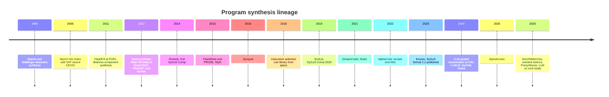
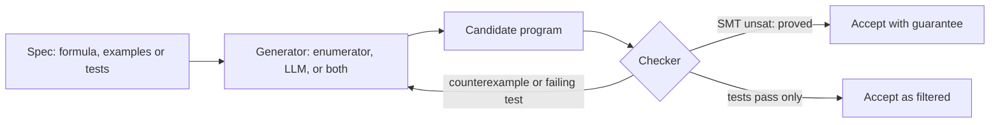

---
tags:
  - compilers
  - program-synthesis
  - sygus
  - cegis
  - smt
  - programming-by-example
  - llm-code-generation
status: complete
sources:
  - https://web.eecs.umich.edu/~weimerw/2022-481W/readings/Alur13.pdf
  - https://arxiv.org/html/2312.06001v1
  - https://sygus-org.github.io/comp/2019
  - https://www.arxiv.org/abs/1904.07146
  - https://www.cis.upenn.edu/~alur/Pldi13.pdf
  - https://www.cs.princeton.edu/~zkincaid/pub/cav13a.pdf
  - https://people.cs.umass.edu/~arjun/courses/compsci631-fall2016/external-reading/sketching.pdf
  - https://www.csl.sri.com/~tiwari/papers/pldi2011-bitvector.pdf
  - https://microsoft.com/en-us/research/wp-content/uploads/2016/12/popl11-synthesis.pdf
  - https://www.microsoft.com/en-us/research/blog/flash-fill-gives-excel-smart-charge/
  - https://www.microsoft.com/en-us/research/group/prose/
  - https://microsoft.com/en-us/research/wp-content/uploads/2016/12/oopsla15-pbe.pdf
  - https://2015.splashcon.org/details/oopsla2015/11/FlashMeta-A-Framework-for-Inductive-Program-Synthesis
  - https://people.csail.mit.edu/polikarn/publications/pldi16.pdf
  - https://bibtex.github.io/PLDI-2015-OseraZ.html
  - https://core.ac.uk/download/76395695.pdf
  - https://pl-hci-seminar.seas.harvard.edu/slides_pl_paper.pdf
  - https://arxiv.org/abs/2509.22908v1
  - https://www.sri.com/publication/artificial-intelligence-pubs/a-deductive-approach-to-program-synthesis/
  - https://arxiv.org/abs/1807.07022v2
  - https://popl19.sigplan.org/details/POPL-2019-Research-Papers/50/Structuring-the-Synthesis-of-Heap-Manipulating-Programs
  - https://www.brinckerhoff.org/clements/2214-csc530/Files/tb-rosette-2014.pdf
  - https://docs.racket-lang.org/rosette-guide/ch_essentials.html
  - https://pp.ipd.kit.edu/firm/selgen
  - https://hydride.cs.illinois.edu
  - https://par.nsf.gov/biblio/10525936
  - https://users.cs.utah.edu/~regehr/papers/popl26.pdf
  - https://arxiv.org/pdf/2108.10436
  - https://par.nsf.gov/biblio/10510243-equality-saturation-theory-exploration-la-carte
  - https://people.csail.mit.edu/asolar/papers/EllisWNSMHCST21.pdf
  - https://ar5iv.labs.arxiv.org/html/2203.07814
  - https://arxiv.org/abs/2403.03997v2
  - https://arxiv.org/html/2406.03003v1
  - https://deepmind.google/blog/alphaevolve-a-gemini-powered-coding-agent-for-designing-advanced-algorithms/
  - https://arxiv.org/html/2603.20264v1
  - https://popl26.sigplan.org/details/POPL-2026-popl-research-papers/77/Oriented-Metrics-for-Bottom-Up-Enumerative-Synthesis
  - https://popl26.sigplan.org/details/POPL-2026-popl-research-papers/39/Accelerating-Syntax-Guided-Program-Synthesis-by-Optimizing-Domain-Specific-Languages
  - https://popl26.sigplan.org/details/POPL-2026-popl-research-papers/54/Inductive-Program-Synthesis-by-Meta-Analysis-Guided-Hole-Filling
  - https://arxiv.org/abs/2604.13290v2
  - https://pldi26.sigplan.org/track/pldi-2026-papers
created: 2026-11-26
updated: 2026-11-27
---

## Table Of Contents

- [[#TL;DR|TL;DR]]
- [[#The Problem|The Problem]]
- [[#Foundations|Foundations]]
    - [[#Three Ways to Say What You Want|Three Ways to Say What You Want]]
    - [[#The Synthesis Problem as Logic|The Synthesis Problem as Logic]]
    - [[#Guaranteed Versus Test-Filtered|Guaranteed Versus Test-Filtered]]
- [[#How We Got Here|How We Got Here]]
- [[#How It Works|How It Works]]
    - [[#Enumeration with Observational Equivalence|Enumeration with Observational Equivalence]]
    - [[#Worked Example: CEGIS Against Z3|Worked Example: CEGIS Against Z3]]
    - [[#Sketching|Sketching]]
    - [[#Component-Based Synthesis|Component-Based Synthesis]]
    - [[#SyGuS and cvc5|SyGuS and cvc5]]
    - [[#Programming by Example: FlashFill and PROSE|Programming by Example: FlashFill and PROSE]]
    - [[#Type-Directed Synthesis: Myth and Synquid|Type-Directed Synthesis: Myth and Synquid]]
    - [[#Deductive Synthesis|Deductive Synthesis]]
    - [[#Rosette: A Solver-Aided Host Language|Rosette: A Solver-Aided Host Language]]
    - [[#Synthesis Inside Compilers|Synthesis Inside Compilers]]
    - [[#Neural and LLM-Guided Synthesis|Neural and LLM-Guided Synthesis]]
- [[#Where It Is Now|Where It Is Now]]
    - [[#The Research Front|The Research Front]]
    - [[#SyGuS-Comp and Solvers|SyGuS-Comp and Solvers]]
    - [[#LLMs as Synthesizers|LLMs as Synthesizers]]
- [[#Trade-offs & Open Problems|Trade-offs & Open Problems]]
- [[#Resources|Resources]]
- [[#Related Notes|Related Notes]]

## ***TL;DR***
---
*Program synthesis turns "what" into "how": you state what a program must do (examples, a logical formula, or a program with holes) and a search procedure finds code that does it. The single most important question about any synthesizer is whether its output is proven correct for all inputs or only checked against some tests.*

- **Specs and search.** A synthesizer needs a specification, a space of candidate programs (usually a grammar or DSL), and a search strategy. The SyGuS formulation makes all three explicit: find an expression in grammar $L$ that makes formula $\phi$ valid in a theory $T$ ([Alur et al., FMCAD 2013](https://web.eecs.umich.edu/~weimerw/2022-481W/readings/Alur13.pdf)).
- **The core algorithms.** Bottom-up *enumeration* with *observational equivalence* (keep one program per behaviour on the examples), *CEGIS* (synthesize against a few inputs, let an SMT solver find a counterexample, repeat), *sketching* (fill `??` holes in a partial program), and *top-down deduction* (push the spec into sub-specs, as in FlashMeta and Synquid).
- **It already ships.** Flash Fill has been in Excel since Excel 2013 and its PROSE descendants sit in Power Query, Power BI and Visual Studio; inside compilers, synthesis finds peephole rules (Souper, Hydra), rewrite rules (Ruler, Enumo), instruction selectors (Hydride) and abstract transformers (POPL 2026's NiceToMeetYou).
- **Guaranteed vs. filtered.** CEGIS with a full verifier, deductive synthesis and SMT-checked [[Verified Lifting|lifting]] give a proof; PBE, AlphaCode-style "sample a million, keep what passes the tests", and evaluator-scored search like AlphaEvolve do not. My own cvc5 run below shows the gap: given only two examples, the solver returns `f(x) = x`.
- **As of November 2026.** Classic search is still advancing (POPL 2026 oriented metrics, AMaze; PLDI 2026 Presynthesis), the last SyGuS-Comp listed on its site is 2019, and LLMs are now competitive synthesizers *when paired with a checker*: GPT-5 solved 143 of 148 SyGuS benchmarks against cvc5's 137, but cvc5 was about 16x faster ([Egolf et al., 2026](https://arxiv.org/html/2603.20264v1)).

## ***The Problem***
---
*Writing code means bridging intent and implementation by hand. Synthesis asks the machine to do the bridging, and the hard parts are saying what you want precisely and searching a space that grows exponentially with program size.*

Most compiler work transforms one program into an equivalent one. Synthesis starts with no program at all. Suppose you want a branch-free 32-bit function that rounds `x` up to the next multiple of 8. You can say what you want in at least three ways:

```c
// 1. A reference implementation (slow, obviously right)
uint32_t spec(uint32_t x) { return x % 8 == 0 ? x : x + (8 - x % 8); }

// 2. Examples
//    f(0) = 0, f(1) = 8, f(8) = 8, f(11) = 16

// 3. A sketch: "it looks like this, fill in the constants"
uint32_t f(uint32_t x) { return (x + ??) & ??; }
```

Each spec gets you to `(x + 7) & 0xfffffff8`, but with different guarantees. The reference implementation pins the meaning down for all $2^{32}$ inputs; the examples pin it down for four inputs and leave the rest to the synthesizer's taste; the sketch also fixes the *shape* of the answer, which shrinks the search enormously.

The search side is brutal. With even a handful of operators the number of expressions of size $n$ grows exponentially, and checking whether a candidate is right for *every* input is itself a SAT or SMT problem. Every technique in this note is a trick for pruning the space, decomposing the spec, or making the check cheap enough to run thousands of times. The same machinery powers [[Superoptimization]], where the "spec" is an existing piece of code and the goal is a cheaper equivalent.

## ***Foundations***
---
*Three ideas carry the field: what form the specification takes, how the synthesis question is phrased in logic so a solver can attack it, and whether the result is proved or merely tested.*

### Three Ways to Say What You Want

*Specifications range from cheap but ambiguous (examples) to precise but expensive to write (logic), with sketches and types in between.*

| Spec form | What the user writes | Correct means | Typical systems |
|---|---|---|---|
| Input-output examples | A few concrete pairs | Agrees on those pairs | FlashFill, PROSE, Escher, Myth |
| Logical formula or reference code | $\forall x.\ \phi(f(x), x)$ | Agrees on every input | SyGuS solvers, Sketch, Souper |
| Sketch (partial program) | Code with `??` holes plus a spec | Holes filled so spec holds | Sketch, Rosette |
| Types, possibly refined | `n:Nat -> x:a -> {List a \| len _v = n}` | Program inhabits the type | Synquid, Myth (types plus examples) |
| Natural language | A prompt | Usually "passes the tests" | AlphaCode, LLMs |

Real systems mix these. Myth uses types *and* examples; Sketch and Rosette use a partial program *and* a logical spec; SyGuS uses a grammar (a kind of sketch) *and* a formula.

### The Synthesis Problem as Logic

*Synthesis is a second-order existence question, and almost every algorithm is a way to avoid asking it directly.*

The SyGuS paper states the problem in three parts: a background theory $T$ (bit-vectors, linear integer arithmetic, strings), a semantic constraint $\phi$ that mentions an unknown function $f$, and a context-free grammar $L$ of allowed bodies for $f$ ([Alur et al.](https://web.eecs.umich.edu/~weimerw/2022-481W/readings/Alur13.pdf)):

$$
\exists e \in L.\ \ \forall \vec{x}.\ \ \phi[f := e](\vec{x}) \text{ is valid modulo } T
$$

**In plain English:** find a program built from the allowed pieces such that, when you plug it in for $f$, the spec is true for every possible input.

The $\exists\forall$ shape is why synthesis is harder than verification. Sketch's paper notes that for finite programs it is a 2QBF problem, which is $\Sigma_2$-complete, a level above NP ([Solar-Lezama et al., ASPLOS 2006](https://people.cs.umass.edu/~arjun/courses/compsci631-fall2016/external-reading/sketching.pdf)). Solvers are good at $\exists$ and bad at $\forall$, so the standard trick (CEGIS) swaps the $\forall$ over all inputs for a conjunction over a small, growing set of inputs, and uses a separate verifier query to find inputs that matter. The [[Superoptimization]] note writes out the two CEGIS queries; this note runs the loop on a real example below.

Equivalent programs are the other big lever. Two candidate expressions are *observationally equivalent* on example set $E$ when

$$
e_1 \sim_E e_2 \iff \forall i \in E.\ \ [\![e_1]\!](i) = [\![e_2]\!](i)
$$

**In plain English:** if two programs give the same outputs on every example you have, the synthesizer cannot tell them apart, so it only needs to keep one. The [[E-Graphs and Equality Saturation]] note covers the other way of sharing equivalent programs, by keeping all of them in one graph.

### Guaranteed Versus Test-Filtered

*This is the distinction that matters most in 2026, because LLM code generation looks like synthesis but usually only promises "passed the tests I ran".*

| Level of assurance | What has been checked | Examples |
|---|---|---|
| **Proved for all inputs** | An SMT/SAT verifier or a proof checker says the spec holds everywhere | CEGIS with a full verifier, Souper, cvc5 on a logical spec, SuSLik, Synquid, LLMLift |
| **Proved up to a bound** | Verified for inputs or loop unrollings up to some size | Sketch on finite programs, Rosette's bounded `verify` |
| **Consistent with examples** | Matches the given examples; the rest is the ranker's guess | FlashFill, PROSE, Escher, PBE tracks of SyGuS |
| **Filtered by tests** | Sampled candidates kept if they pass example tests | AlphaCode, most LLM code generation |
| **Scored by an evaluator** | Candidates ranked by a fitness function, which may or may not check correctness | AlphaEvolve, FunSearch-style search |

The bottom three are not worse engineering; they are different products. PBE is the only spec most spreadsheet users can write, and a test filter is the only check available for a competitive-programming prompt. But only the top two rows justify putting the output into a compiler without a human reading it. This is the same split the [[Superoptimization]] note draws between Massalin's test-only search and Souper's SMT proofs, and the one [[Verified Compilers]] and [[Formal Methods in Practice]] are built around.

## ***How We Got Here***
---
*Synthesis began as theorem proving (Manna and Waldinger, 1980), became practical when SAT and SMT solvers got fast in the 2000s, went mainstream with Flash Fill in 2013, standardized around SyGuS, and since 2022 has been absorbing neural and LLM search.*



| Year | Work | What changed |
|---|---|---|
| 1980 | Manna and Waldinger, TOPLAS | Synthesis as theorem proving: transformation rules, unification and induction derive recursive programs from specs |
| 2006 | Solar-Lezama et al., Sketch (ASPLOS) | Partial programs with `??` holes; counterexample-driven loop with two SAT solvers |
| 2011 | Gulwani, FlashFill paper (POPL) | String transformations from examples via a version-space DAG; called QuickCode in the paper |
| 2011 | Gulwani, Jha, Tiwari, Venkatesan, Brahma (PLDI) | Component-based synthesis of loop-free bit-vector code with SMT |
| 2013 | Alur et al., SyGuS (FMCAD) | Common problem definition: theory plus formula plus grammar |
| 2013 | Flash Fill in Excel 2013 | PBE ships in a mainstream product |
| 2013 | TRANSIT (PLDI), Escher (CAV) | Observational-equivalence pruning for enumerative search |
| 2014 | Torlak and Bodik, Rosette (PLDI) | Solver-aided host language: write an interpreter, get a synthesizer |
| 2014 | First SyGuS-Comp (July 2014) | Shared benchmarks and a yearly competition |
| 2015 | Polozov and Gulwani, FlashMeta (OOPSLA); Osera and Zdancewic, Myth (PLDI) | Reusable PBE framework (became PROSE); type-and-example synthesis |
| 2016 | Polikarpova et al., Synquid (PLDI) | Refinement types as specs; solved all 64 of its benchmarks |
| 2018 | Buchwald, Fried and Hack (CGO) | 63,012 verified x86 instruction-selection rules synthesized from ISA and IR specs |
| 2019 | Polikarpova and Sergey, SuSLik (POPL) | Deductive synthesis of pointer programs from separation logic |
| 2021 | Ellis et al., DreamCoder (PLDI); Nandi et al., Ruler (OOPSLA) | Learned libraries and neural search; synthesis of rewrite rules |
| 2022 | Li et al., AlphaCode | Up to a million samples per problem, filtered by tests |
| 2023 | Enumo (OOPSLA); SyGuS-IF 2.1 on arXiv | Programmable rule synthesis; current input format |
| 2024 | Li, Parsert and Polgreen (CAV); LLMLift (NeurIPS); Hydride (ASPLOS); Hydra (OOPSLA) | LLMs steer enumerators; LLMs write verified lifts; synthesized retargetable backends |
| 2025 | AlphaEvolve (DeepMind) | LLM proposals plus automated evaluators plus evolution |
| 2026 | NiceToMeetYou, oriented metrics, AMaze (POPL); Presynthesis (PLDI); Egolf et al. | Synthesized MLIR abstract transformers; faster enumeration; LLMs measured against cvc5 |

## ***How It Works***
---
*Each technique below is a different answer to "how do I avoid enumerating everything?" The worked examples are real runs in this note's scratch environment; the rest are short sketches of each idea.*

### Enumeration with Observational Equivalence

*Build programs bottom-up from small to large, and throw away any new program whose outputs on the examples match one you already have.*

Bottom-up enumeration starts with leaves (variables, constants), then combines everything of size 1 into size-3 programs, and so on, checking each against the spec. On its own this explodes. The key pruning, called *indistinguishability* in TRANSIT, keeps one expression per *signature* (its vector of outputs on the examples): "if two expressions e and e′ evaluate to the same values for each example ... then only one of e or e′ needs to be carried forward" ([Udupa et al., PLDI 2013](https://www.cis.upenn.edu/~alur/Pldi13.pdf)). TRANSIT reports two to three orders of magnitude fewer expressions explored for sizes above ten. Escher used the same *observational equivalence* idea for recursive programs and added a goal graph that introduces `if-then-else` only when the examples need to be split ([Albarghouthi, Gulwani and Kincaid, CAV 2013](https://www.cs.princeton.edu/~zkincaid/pub/cav13a.pdf)).

A toy run makes the effect concrete. I wrote a small Python enumerator for the grammar `E ::= x | y | 1 | E+E | E-E | E*E` (each operator adds 1 to the size) and asked it for a function matching four examples of the hidden target $x^2 - y + 1$:

```text
examples (x, y) : (1,2) (3,5) (-2,4) (0,7)
outputs         :   0     5     1    -6

size   kept, no pruning   kept, with OE pruning
1            3                  3
3           27                 16
5          486                 71

OE pruning off: found (1-(y-(x*x))) at size 7 after generating 3698 candidates
OE pruning on : found (1-(y-(x*x))) at size 7 after generating  848 candidates
```

(Real output of my script, not a published tool.) At size 3, `x+y` and `y+x` have the same signature, and so do `x*1` and `x`; keeping one of each cuts size-5 programs from 486 to 71, and the total work by 4.4x. The gap widens with every level because pruned programs are never combined again.

Two caveats are built in. First, pruning is only sound *relative to the examples*: two programs merged because they agree on four points may differ elsewhere, so when the examples later grow (for instance from a CEGIS counterexample), the bank has to be rebuilt or re-split. Second, enumeration order matters. Most modern enumerators order by size or by a learned probability, which is where LLM guidance plugs in (see [[#Neural and LLM-Guided Synthesis|below]]).

### Worked Example: CEGIS Against Z3

*The synthesizer only ever sees a handful of inputs; the verifier's job is to find the one input that breaks the current guess.*

Take the rounding sketch `(x + ??c1) & ??c2` over 32-bit unsigned integers, with the reference implementation as the spec. CEGIS alternates two solver calls:

1. **Synthesize:** find `c1, c2` such that the sketch agrees with the spec on every input in the example set $S$ (initially empty).
2. **Verify:** look for any `x` where `(x + c1) & c2 != spec(x)`. If there is none, stop. Otherwise add that `x` to $S$.

I ran this with Z3's Python bindings (z3-solver 5.4.1 from PyPI). The script is about 30 lines; the output is verbatim:

```text
iter 1:  c1=0x0        c2=0x0         counterexample x=0xff8
iter 2:  c1=0xfffff000 c2=0xff8       counterexample x=0x4cff8
iter 3:  c1=0xfffb3000 c2=0x4cff8     counterexample x=0x7ffd
iter 4:  c1=0xfffb0005 c2=0x4cff8     counterexample x=0x800000
iter 5:  c1=0xff7b0005 c2=0x84cff8    counterexample x=0x1808d00
iter 6:  c1=0xfe7b3005 c2=0x184cff8   counterexample x=0x67c1800c
iter 7:  c1=0x983a3005 c2=0x67c5cff8  counterexample x=0x64c00ffd
iter 8:  c1=0x983a2005 c2=0x67c5dff8  counterexample x=0x44ecc709
iter 9:  c1=0x98122007 c2=0x67eddff8  counterexample x=0x35710060
iter 10: c1=0x88022007 c2=0x77fddff8  counterexample x=0x5c2bfff9
iter 11: c1=0x80020007 c2=0x7ffddff8  counterexample x=0x2fffbb9f
iter 12: c1=0x80000007 c2=0x7ffffff8  counterexample x=0xbffffffd
iter 13: c1=0x7        c2=0xfffffff8  verified for all 2^32 inputs
```

The heart of the script:

```python
while True:
    synth.check(); m = synth.model()                    # holes that fit S
    a, b = m.eval(c1, True), m.eval(c2, True)
    ver = Solver(); ver.add(sketch(x, a, b) != spec(x)) # any bad input?
    if ver.check() == unsat: break                      # proof for all x
    cex = ver.model().eval(x, True)
    synth.add(sketch(cex, c1, c2) == spec(cex))         # S := S + {cex}
```

Things to notice:

- **Twelve inputs out of $2^{32}$ were enough.** Each counterexample kills every candidate that fails on it, and the solver picks counterexamples that happen to expose the wrong bits. You can watch `c2` gain one high bit after another (`0xff8`, `0x4cff8`, `0x84cff8`, ...) until it is `0xfffffff8`.
- **The solver's guesses look random,** because any model that fits $S$ is acceptable. Nothing pushes it toward "nice" constants; a cost function or an ordering (as SyGuS enumerators use) would.
- **The final answer is a proof, not a test.** The last verifier query is `unsat`, which means no 32-bit input disagrees. That is what puts this result in the top row of the assurance table.

The same loop, with the sketch replaced by a grammar and the constants replaced by a whole expression, is what SyGuS solvers and Souper run.

### Sketching

*The programmer writes the algorithm's skeleton and leaves the fiddly constants, masks and loop bounds as holes.*

Sketch made `??` its single primitive: a hole that the synthesizer replaces with a constant, from which richer holes (bit permutations, polynomials, lookup tables) are built. The paper's examples are bit tricks such as isolating the rightmost 0-bit, sketched as `return ~(x + ??) & (x + ??);` and completed with 0 and 1, and a population count whose masks and shift amounts are holes inside `x = (x & ??) + ((x >> ??) & ??);` ([Solar-Lezama et al., ASPLOS 2006](https://people.cs.umass.edu/~arjun/courses/compsci631-fall2016/external-reading/sketching.pdf)).

The solver treats each hole as a free control variable and runs a counterexample-driven loop with two SAT solvers (MiniSat, and ABC for the hardest cases). The paper does not use the name CEGIS, but it is the same loop. The headline result was AES: a sketched round function completed in about an hour over 655 synthesize-verify iterations, and the result ran within 10% of OpenSSL (21.3 ms vs. 19.7 ms for 50,000 encryptions) while the unoptimized spec took about 19.9 s.

Because Sketch works on finite programs (bounded inputs, unrolled loops), its guarantee holds within those bounds, the second row of the assurance table once real programs exceed them. Sketching's lasting idea is the division of labour: humans are good at the *shape* of an algorithm and bad at the constants; solvers are the reverse.

### Component-Based Synthesis

*Give the solver a bag of operations and let it decide how to wire them, instead of enumerating expression trees.*

Gulwani, Jha, Tiwari and Venkatesan encode each component's position in the straight-line program as an integer *location variable*, so a single SMT query chooses both the order of the components and which output feeds which input; CEGIS then supplies the inputs ([PLDI 2011](https://www.csl.sri.com/~tiwari/papers/pldi2011-bitvector.pdf)). The [[Superoptimization]] note covers this paper (Brahma, the Hacker's Delight benchmarks, `x & (x - 1)`) and its descendant, Souper's synthesizer, so it is not repeated here. The idea to keep: synthesis does not have to be search over syntax trees; it can be one constraint problem whose solution *is* the wiring diagram.

### SyGuS and cvc5

*SyGuS standardized the input format, so one benchmark file can be handed to any solver and the competition could compare them.*

A SyGuS problem is an SMT-LIB-like file built from a few extra commands: `synth-fun` (the unknown function and its grammar), `declare-var` (universally quantified inputs), `constraint` (the spec), and `check-synth` (solve). Version 2.1 added `assume`, oracle constraints, weights and an `optimize-synth` command, a constrained-Horn-clause logic, and folded the old `synth-inv` into `synth-fun` ([Padhi et al., SyGuS-IF 2.1](https://arxiv.org/html/2312.06001v1)).

Here is the rounding problem as SyGuS, with a grammar of six bit-vector operators, `x`, and any 32-bit constant, and no hint about the shape:

```lisp
(set-logic BV)
(synth-fun f ((x (_ BitVec 32))) (_ BitVec 32)
  ((Start (_ BitVec 32)))
  ((Start (_ BitVec 32) (x (Constant (_ BitVec 32))
                         (bvadd Start Start) (bvand Start Start)
                         (bvor Start Start) (bvnot Start)
                         (bvshl Start Start) (bvlshr Start Start)))))
(declare-var x (_ BitVec 32))
(constraint (= (f x)
  (ite (= (bvurem x #x00000008) #x00000000) x
       (bvadd x (bvsub #x00000008 (bvurem x #x00000008))))))
(check-synth)
```

Run through cvc5 1.4.2's Python API (`pip install cvc5`, parsed with its SyGuS 2.1 input parser), the answer came back in 2.45 s:

```lisp
(
(define-fun f ((x (_ BitVec 32))) (_ BitVec 32)
  (bvand #b11111111111111111111111111111000
         (bvadd x #b00000000000000000000000000000111)))
)
```

That is `(x + 7) & ~7`, found without a sketch and proved for all inputs because the constraint quantifies over `x`.

Now the PBE flavour. Replace the logical constraint with examples, using a smaller grammar (`x`, `1`, `7`, `0xfffffff8`, `bvadd`, `bvand`):

```text
4 examples  f(0)=0  f(1)=8  f(8)=8  f(11)=16   ->  (bvand #xfffffff8 (bvadd x #x00000007))   0.01 s
2 examples  f(0)=0  f(8)=8                     ->  x                                         0.00 s
```

Both answers are *correct with respect to their spec*. With two examples, the identity function is the smallest program that fits, so a size-ordered solver returns it. This is the guaranteed-vs-filtered distinction in one line: the solver did its job perfectly, and the result is still wrong for 7 out of 8 inputs.

The original SyGuS paper sketched three solver families, all inside a CEGIS loop: *enumerative* (size-ordered dynamic programming with observational-equivalence pruning), *symbolic* (encode the grammar as components, as in Brahma), and *stochastic* (Metropolis-Hastings over fixed-size expressions, scored by failed examples) ([Alur et al.](https://web.eecs.umich.edu/~weimerw/2022-481W/readings/Alur13.pdf)). CVC4, cvc5's predecessor, won four of five tracks at SyGuS-Comp 2019 (General, Invariant, PBE-Strings, PBE-BV), with DryadSynth taking CLIA ([SyGuS-Comp 2019](https://sygus-org.github.io/comp/2019)).

### Programming by Example: FlashFill and PROSE

*PBE trades a precise spec for one anybody can give, then leans on a DSL and a ranking function to guess what they meant.*

Gulwani's POPL 2011 paper (where the system is still called QuickCode, an Excel add-in) synthesizes string programs in a small DSL: a `Switch` over conditions, each branch a `Concatenate` of `SubStr`, `ConstStr` and `Loop` expressions, where positions are either constant offsets or "between a match of regex $r_1$ and a match of $r_2$" ([Gulwani, POPL 2011](https://microsoft.com/en-us/research/wp-content/uploads/2016/12/popl11-synthesis.pdf)). Its example of a loop:

```text
"International Business Machines"  ->  "IBM"
program: Loop(λw: Concatenate(SubStr2(v1, UpperTok, w)))
```

The trick that made it fast is never enumerating programs at all. For each example, it builds a DAG whose nodes are positions in the output string and whose edges carry *the set of all* atomic expressions that produce that substring. Every path is a consistent program, so a compact DAG represents a huge number of programs, and the paper can even count them without enumerating. Intersecting the DAGs of several examples keeps only programs consistent with all of them, and a ranking function prefers "simpler" choices (`SubStr` over constants, regex positions over fixed offsets) to pick one. Flash Fill shipped in Excel 2013, released January 2013 ([MSR blog](https://www.microsoft.com/en-us/research/blog/flash-fill-gives-excel-smart-charge/)).

FlashMeta generalized this into a framework: each DSL operator comes with a *witness function* (a partial inverse) that turns a spec on the operator's output into specs on its arguments, so the search runs top-down by *deduction*, and the results are stored in a *version space algebra* of union and join nodes ([Polozov and Gulwani, OOPSLA 2015](https://microsoft.com/en-us/research/wp-content/uploads/2016/12/oopsla15-pbe.pdf)). Twelve of the 15 earlier PBE tools they studied fit this pattern, and reimplementations took 1 to 2 months instead of 7 to 9 (FlashFill shrank from 12K to 3K lines). This became the PROSE SDK, which Microsoft lists as used in Excel, Power Query, Power BI, PowerShell, Visual Studio, Azure Data Factory and SQL Server tooling ([PROSE](https://www.microsoft.com/en-us/research/group/prose/)).

The hard part of PBE is not search but *intent*: many programs fit the examples. Rankers, active questioning of the user ("which of these outputs did you mean?") and, more recently, LLM priors are the responses. PLDI 2026's "Choose, Don't Label" is in this line ([PLDI 2026 program](https://pldi26.sigplan.org/track/pldi-2026-papers)).

### Type-Directed Synthesis: Myth and Synquid

*Types are a spec most functional programmers already write, and they prune the search space hard because ill-typed terms are never generated.*

**Myth** synthesizes recursive functions over algebraic data types in a core subset of OCaml from a type signature plus input-output examples ([Osera and Zdancewic, PLDI 2015](https://bibtex.github.io/PLDI-2015-OseraZ.html)). It treats synthesis as proof search: *introduction forms* (constructors, `fix`, `match`) are checked against the goal type so examples can be pushed inward, while *elimination forms* (variables, applications) are enumerated by type. A `match` splits the examples across branches as separate "example worlds", and a *refinement tree* records every shape the program can take given the examples ([Osera's thesis](https://core.ac.uk/download/76395695.pdf); [Harvard PL seminar slides](https://pl-hci-seminar.seas.harvard.edu/slides_pl_paper.pdf)). The standard demo:

```ocaml
(* spec: type list -> list, plus examples
   []     => []
   [0]    => [0;0]
   [1;0]  => [1;1;0;0]                                         *)
let stutter : list -> list =
  let rec f1 (l1:list) : list =
    match l1 with
    | Nil -> l1
    | Cons(n1, l2) -> Cons(n1, Cons(n1, f1 l2))
  in f1
```

Recursive calls are checked *against the examples themselves*: `f1 l2` on input `[1;0]` is trusted to return `[0;0]` only because `[0] => [0;0]` is one of the examples. Drop that example and the reasoning breaks, which is why Myth needs "trace-complete" example sets, and why its output is in the "consistent with examples" row.

**Synquid** replaces examples with *refinement types* ([[Dependent and Refinement Types]]). The spec for `replicate` is just its type:

```haskell
replicate :: n: Nat -> x: a -> {List a | len _v = n}
```

Synquid's core is *round-trip type checking*, built on liquid type inference, which checks partial programs top-down and decomposes the goal type into independent sub-goals for each sub-term, rejecting bad candidates before they are complete ([Polikarpova, Kuraj and Solar-Lezama, PLDI 2016](https://people.csail.mit.edu/polikarn/publications/pldi16.pdf)). It solved all 64 of its benchmarks, including sorting algorithms and balanced-tree operations; turning off round-trip checking made 33 of them time out. Because the spec is a type and Synquid's checker is sound, the results land in the "proved" row, with the usual caveat that the refinement type might not say everything you wanted.

### Deductive Synthesis

*Instead of guessing and checking, derive the program step by step from the spec with rules that preserve correctness, so the program is a by-product of a proof.*

Manna and Waldinger cast synthesis as theorem proving: prove that for every input an output satisfying the spec exists, using transformation rules, unification and induction, and read the program off the proof ([TOPLAS 1980](https://www.sri.com/publication/artificial-intelligence-pubs/a-deductive-approach-to-program-synthesis/)). Recursion in the program comes from induction in the proof.

The modern exemplar is **SuSLik**, which synthesizes imperative pointer programs from separation-logic pre- and postconditions. Its Synthetic Separation Logic rules transform one heap description into another, each rule emits a program fragment, and the finished derivation *is* the program, so results are correct by construction ([Polikarpova and Sergey, POPL 2019](https://arxiv.org/abs/1807.07022v2)). Deduction and search are not opposites: FlashMeta's witness functions and Synquid's type decomposition are deductive steps inside a search. The deductive end of the spectrum is close to [[Verified Compilers]] and proof assistants.

### Rosette: A Solver-Aided Host Language

*Write an interpreter for your language in Rosette and you get a verifier, an angelic executor and a synthesizer for it without writing any solver code.*

Rosette extends Racket with symbolic values and four solver-aided queries: `verify` (find a counterexample), `solve` (find inputs that make assertions pass), `debug` (find a minimal unsat core) and `synthesize` (fill holes so assertions hold for all given symbolic inputs) ([Torlak and Bodik, PLDI 2014](https://www.brinckerhoff.org/clements/2214-csc530/Files/tb-rosette-2014.pdf)). Its symbolic virtual machine merges program states at control-flow joins *by type*: booleans and integers merge into symbolic terms, equal-length lists merge element-wise, and anything else becomes a guarded union. That avoids both the path explosion of symbolic execution and the all-symbolic blowup of naive bounded model checking.

A Rosette synthesis query for the rounding sketch looks like this. It is a hand sketch, not run here, written in the style of the [Rosette guide](https://docs.racket-lang.org/rosette-guide/ch_essentials.html), whose own forms (`rosette/lib/synthax`, `??`, `synthesize #:forall ... #:guarantee ...`, `print-forms`) it uses:

```racket
#lang rosette
(require rosette/lib/synthax)             ; sketching library: ??, choose
(define int32? (bitvector 32))
(define-symbolic x int32?)
(define (round8 x)                        ; shape fixed, constants open
  (bvand (bvadd x (?? int32?)) (?? int32?)))
(define (spec x)
  (define r (bvurem x (bv 8 32)))
  (if (bveq r (bv 0 32)) x (bvadd x (bvsub (bv 8 32) r))))
(define sol
  (synthesize #:forall (list x)
              #:guarantee (assert (equal? (round8 x) (spec x)))))
(print-forms sol)
```

The guide's own worked example synthesizes a fast midpoint from a grammar of depth 2 and prints `(define (bvmid-fast lo hi) (bvlshr (bvadd hi lo) (bv #x00000001 32)))`.

The point is the workflow, not the syntax: the "synthesizer" is just the interpreter for your DSL plus one query. The paper's case studies were SynthCL (verifying and synthesizing OpenCL kernels), WebSynth (XPath synthesis for web scraping), and IFCL (information-flow stack machines).

### Synthesis Inside Compilers

*Compilers use synthesis offline, to write the rules and tables that the compiler then applies quickly, rather than calling a synthesizer on every program.*

| What is synthesized | System | How | Result |
|---|---|---|---|
| Peephole rewrites | Souper; Hydra generalizes them | CEGIS over LLVM IR; Hydra adds symbolic constants and preconditions | See [[Superoptimization]] |
| Rewrite rules for e-graphs | Ruler (OOPSLA 2021), Enumo (OOPSLA 2023) | Enumerate terms, group them by behaviour, keep a small sound rule set | See [[E-Graphs and Equality Saturation]] |
| Instruction selection rules | Buchwald, Fried and Hack (CGO 2018) | Enumerative search plus template-based CEGIS from ISA and IR semantics | 63,012 rules for x86 integer arithmetic; 29,498 missed by both Clang 6 and GCC 7.3 |
| Retargetable vector backends | Hydride (ASPLOS 2024) | Parse vendor pseudocode into semantics, merge similar instructions, SyGuS-based code synthesis | 3,557 x86, HVX and ARM instructions represented by 397 AutoLLVM IR instructions |
| Abstract transformers | NiceToMeetYou (POPL 2026) | Each transformer is the meet of simpler sound ones, synthesized to close precision gaps, checked via MLIR's SMT dialect | All sound; about 17% more precise than LLVM's hand-written ones |

**Instruction selection.** Buchwald and colleagues synthesized a library of provably correct rules from formal specs of the IR and the x86 ISA, using a hybrid of enumeration and template-based CEGIS; a prototype selector built from the library generated code "on par with a manually-tuned instruction selector", and their generated tests found 29,498 rules that both Clang 6.0.0 and GCC 7.3.0 miss ([SelGen](https://pp.ipd.kit.edu/firm/selgen)). See [[Instruction Selection]] for how such rules are applied.

**Hydride** goes further and synthesizes the *compiler*: it parses vendor pseudocode for x86 (SSE2 through AVX512), Hexagon HVX and ARM NEON into executable semantics, generalizes similar instructions into a parameterized IR, and uses a SyGuS-based synthesizer to lower Halide or [[MLIR]] programs into that IR. Against Halide's production compiler it matches on HVX and is 8% faster on x86 and 3% faster on ARM ([Hydride](https://hydride.cs.illinois.edu)). This matters for [[Vectorization]], where hand-written lowering for every new SIMD extension is a recurring cost.

**Abstract transformers** are the functions a [[Dataflow Analysis]] or [[Abstract Interpretation]] uses to push facts like "these bits are known zero" through each instruction. LLVM still lacks them for hundreds of instructions after about two decades. NiceToMeetYou synthesizes transformers for KnownBits and signed and unsigned ConstantRange as meets of simpler sound pieces, needs no sketch, and verifies each by lowering it to MLIR's SMT dialect ([Peng et al., POPL 2026](https://users.cs.utah.edu/~regehr/papers/popl26.pdf)).

The common pattern: synthesis runs once, offline, with a verifier in the loop; the compiler ships the verified output as ordinary code or tables. That keeps compile time unaffected and makes the guarantee easy to state.

### Neural and LLM-Guided Synthesis

*Learning changes the search order, not the need for a checker: a model proposes, and either a verifier or a test suite disposes.*

Three generations, roughly:

1. **Learn the library and the search policy.** DreamCoder alternates a *wake* phase (a neural recognition model guides search for programs solving tasks), an *abstraction sleep* (refactor solved programs with version spaces and an e-graph-like structure, and add the best new routines to the library) and a *dreaming sleep* (train the recognition model on replays and on "fantasies" sampled from the library) ([Ellis et al., PLDI 2021](https://people.csail.mit.edu/asolar/papers/EllisWNSMHCST21.pdf)). It ran on eight domains (list processing, text editing, LOGO graphics, symbolic regression, physics laws and more); from 1959 Lisp primitives it rediscovered fold and unfold, and on physics it solved up to 93.3% of 60 laws and identities.
2. **Sample massively, filter by tests.** AlphaCode generated up to a million samples per competitive-programming problem, filtered them on the problem's example tests (removing about 99%), clustered the survivors by behaviour on generated inputs, and submitted at most 10; it averaged a ranking around the top 54.3% in 10 Codeforces contests ([Li et al., 2022](https://ar5iv.labs.arxiv.org/html/2203.07814)). This is observational equivalence reused as a de-duplication step, but there is no verifier, so it sits in the "filtered by tests" row.
3. **LLM plus formal checker.** The model proposes, a solver checks, counterexamples go back:
   - **LLM-guided enumeration.** Li, Parsert and Polgreen prompt an LLM for SyGuS solutions, turn its (often wrong) answers into a probabilistic grammar that weights an enumerator inside CEGIS, or let the enumerator call the LLM for helper functions mid-search. On 609 SyGuS benchmarks, the LLM alone solved 303, cvc5 415, and "LLM first, then the LLM-weighted A* enumerator" 488 ([CAV 2024](https://arxiv.org/abs/2403.03997v2)).
   - **[[Verified Lifting]].** LLMLift has GPT-4 write a program summary in a Python-embedded IR plus loop invariants, proves equivalence with an SMT-based checker, then pattern-matches the summary into a DSL (Spark, TACO, a switch language, a tensor IR). It solved 44 of 45 Spark benchmarks against MetaLift's 40 and all 60 TACO benchmarks against C2TACO's 57, without the roughly 1,000 lines of hand-written search-space description the symbolic tools needed ([Bhatia et al., NeurIPS 2024](https://arxiv.org/html/2406.03003v1)).
   - **Evaluator-driven evolution.** AlphaEvolve pairs Gemini proposals with automated evaluators and an evolutionary database; it found a 48-multiplication algorithm for 4x4 complex matrices, a Borg scheduling heuristic recovering about 0.7% of Google's compute, and a 23% faster Gemini matmul kernel ([DeepMind, May 2025](https://deepmind.google/blog/alphaevolve-a-gemini-powered-coding-agent-for-designing-advanced-algorithms/)). Whether a result is *proved* depends entirely on the evaluator: a matrix-multiplication identity can be checked exactly, a scheduling heuristic only scored.



The loop is the same CEGIS diagram from 2006; what changed is the generator. The guarantee is decided entirely by which edge out of the checker you take. [[ML-Guided Optimization]] and [[Grammar-Constrained Decoding]] cover the model side: how LLMs are steered toward syntactically valid candidates in the first place.

## ***Where It Is Now***
---
*As of November 2026, classic search-based synthesis is still publishing speedups at POPL and PLDI, the SyGuS competition has gone quiet while its format and benchmarks live on, and LLMs have become serious synthesizers as long as a formal checker stays in the loop.*

### The Research Front

*The 2026 papers attack the same old problem, search-space size, with sharper abstractions and smarter orderings.*

- **Oriented metrics (POPL 2026).** Meyer and Tepe define distance measures for asymmetric operations such as string concatenation and bitwise AND, and use them to prune to a ball around the target, factor out metric-equivalent programs, and order enumeration; they report more than an order of magnitude over the prior state of the art on string and bit-vector SyGuS ([POPL 2026](https://popl26.sigplan.org/details/POPL-2026-popl-research-papers/77/Oriented-Metrics-for-Bottom-Up-Enumerative-Synthesis)).
- **AMaze (POPL 2026).** Ye, Ji, Xiong and Zhang automatically refine the DSL a SyGuS solver searches, predicting synthesis cost with dynamic programming and a learned model instead of running the solver; up to 4.35x speedups on DryadSynth, Duet, Polygen and EUsolver ([POPL 2026](https://popl26.sigplan.org/details/POPL-2026-popl-research-papers/39/Accelerating-Syntax-Guided-Program-Synthesis-by-Optimizing-Domain-Specific-Languages)).
- **Hole-filling order (POPL 2026).** Lee, Lee and Yi use abstract interpretation to choose *which* hole to fill next in top-down synthesis, evaluated on bit-vector and string benchmarks including SyGuS ([POPL 2026](https://popl26.sigplan.org/details/POPL-2026-popl-research-papers/54/Inductive-Program-Synthesis-by-Meta-Analysis-Guided-Hole-Filling)).
- **Presynthesis (PLDI 2026).** Dong et al. precompute, offline, a tree automaton capturing how every DSL program behaves under a finer abstract semantics, plus an oracle that answers "which programs satisfy this example?" quickly; instantiated for SQL, string transformation and matrix manipulation ([arXiv 2604.13290](https://arxiv.org/abs/2604.13290v2)).
- **Compiler-facing synthesis.** NiceToMeetYou (POPL 2026) for abstract transformers, plus the LLM-and-verifier peephole work (LPG, LLM-VeriOpt) summarized in [[Superoptimization]]. PLDI 2026 also ran a "Generative Testing and Program Synthesis" session and a paper on sound abstract interpreters built with LLMs (SAIL) ([PLDI 2026 program](https://pldi26.sigplan.org/track/pldi-2026-papers)).

### SyGuS-Comp and Solvers

*The format is stable and widely used; the competition itself has not run under that name since 2019, as far as its official site shows.*

| Item | Status as of November 2026 |
|---|---|
| SyGuS-Comp | Official site lists 2019 (sixth edition: CVC4 won General, Inv, PBE-Strings and PBE-BV; DryadSynth won CLIA) as its most recent; I found no later edition ([2019 page](https://sygus-org.github.io/comp/2019)) |
| Format | SyGuS-IF 2.1 (oracles, weights, CHC logic), on arXiv since December 2023 ([Padhi et al.](https://arxiv.org/html/2312.06001v1)) |
| Reference solver | cvc5; version 1.4.2 is on PyPI and solved the examples above in seconds |
| Benchmarks | The competition sets (over 1,600 problems by 2018, per [SyGuS-Comp 2018](https://www.arxiv.org/abs/1904.07146)) remain a common yardstick: the CAV 2024 LLM study uses 609 of them, and the POPL 2026 papers above evaluate on SyGuS benchmarks |

### LLMs as Synthesizers

*The 2026 evidence: frontier LLMs solve about as many SyGuS problems as cvc5, solve different ones, and are much slower; their output is only trustworthy after the same verifier runs on it.*

Egolf, Zhou and Tripakis compared symbolic tools with Qwen2.5-Coder-32B and GPT-5 across LTL reactive synthesis, SyGuS, TLA+ protocols and ACL2s recursive programs ([arXiv 2603.20264, 2026](https://arxiv.org/html/2603.20264v1)). On 148 realizable SyGuS benchmarks from the cvc5 repository, with every answer checked by a grammar checker and Z3:

| Solver | Solved | Mean time | Unique wins |
|---|---|---|---|
| cvc5 | 137 / 148 | about 1.8 s | 4 benchmarks no LLM solved |
| GPT-5 (one query) | 143 / 148 | about 28.7 s | 10 cvc5 missed |
| Qwen2.5-Coder-32B (loop, no feedback) | 96 / 148 | about 27.8 s | 6 cvc5 missed |

Together, 147 of 148 were solved by something. Across all four domains the symbolic tools beat Qwen everywhere and were at least roughly on par with GPT-5 while faster. The practical reading, consistent with the CAV 2024 portfolio result above, is that the best 2026 synthesizer is a *portfolio*: ask the LLM, verify, and fall back to (or steer) a symbolic solver when the LLM's answer fails the check.

On the verified-code side, *vericoding*, defined as "LLM-generation of formally verified code from formal specifications" in contrast to "vibe coding" from natural language, now has its own benchmark: 12,504 specifications across Dafny (3,029), Verus/Rust (2,334) and Lean (7,141), on which off-the-shelf LLMs succeeded 82%, 44% and 27% of the time respectively ([Bursuc et al., September 2025](https://arxiv.org/abs/2509.22908v1)). This is synthesis in the top row of the assurance table with an LLM as the generator and a proof checker as the verifier; see [[Formal Methods in Practice]].

## ***Trade-offs & Open Problems***
---
*Synthesis buys correct-by-construction code at the cost of writing a spec and paying for search. The open problems are about scaling the search, getting the spec right, and keeping guarantees when LLMs do the generating.*

| Choice | Buys | Costs |
|---|---|---|
| Examples as spec | Anyone can write them | Ambiguous; needs ranking or interaction; no guarantee off the examples |
| Logical spec or reference code | A proof for all inputs | Someone must write a correct spec; verification can be slow (multiply, divide, floating point) |
| Sketches and grammars | Huge pruning, readable output | Human must guess the shape; wrong grammar means no solution (SyGuS paper's linear-grammar `max` example) |
| Enumeration | Complete, finds smallest program | Exponential in program size; only small programs without strong pruning |
| CEGIS | Few examples suffice | Each round is an SMT call; hard theories make the verifier the bottleneck |
| LLM generation | Reaches long, idiomatic programs; uses natural-language intent | Slow and costly per query; no guarantee without an external checker; may repeat wrong answers |

Open problems as of late 2026:

- **Scale.** Enumerative and constraint-based synthesizers still top out at small programs. The 2026 POPL and PLDI work (oriented metrics, AMaze, Presynthesis, hole ordering) wins constant factors to an order of magnitude, not asymptotics. Loops, heaps and memory remain hard outside deductive systems like SuSLik.
- **Spec quality.** A proof is only as good as the spec. PBE specs are ambiguous by nature (the two-example `f(x) = x` above); logical specs can be subtly wrong; refinement types may omit properties. Interactive disambiguation and specifications extracted from natural language (PLDI 2026's Expecto) shift the problem rather than solve it.
- **Guarantees with LLMs.** "Passes the tests" is the default for LLM code. Keeping a verifier in the loop (CAV 2024, LLMLift, Egolf et al.) restores guarantees but only where a formal spec and a decidable check exist. For compiler rules, Alive2-style refinement checks fill that role ([[Superoptimization]], [[Translation Validation]]).
- **Verifier trust.** SMT solvers and verifiers have bugs, and bounded verification (Sketch, Rosette) is only as strong as its bound. [[Compiler Testing and Fuzzing]] applies to synthesizers too.
- **Benchmarks.** SyGuS-Comp's benchmarks date from 2014 to 2019 and no new edition has been listed since. Public benchmark files could be in LLM training data (my concern, not a finding of the papers cited), which is one more reason to judge LLM answers by the verifier rather than by benchmark scores alone.
- **Compiler integration.** Synthesized rules and transformers still need humans to judge generality and profitability before they land in [[LLVM]] or GCC. Synthesizing whole backends (Hydride) works for SIMD lowering but not yet for full [[Instruction Selection]] plus [[Register Allocation]] plus scheduling.

## ***Resources***
---
*Start with the SyGuS paper for the framework, Sketch and Rosette for the solver-aided style, Gulwani's FlashFill and FlashMeta for PBE, and the 2024 to 2026 LLM papers for where it is heading.*

**Foundational papers**
- [Syntax-Guided Synthesis](https://web.eecs.umich.edu/~weimerw/2022-481W/readings/Alur13.pdf): Alur et al., FMCAD 2013 (extended version). The problem definition and the three solver families.
- [Combinatorial Sketching for Finite Programs](https://people.cs.umass.edu/~arjun/courses/compsci631-fall2016/external-reading/sketching.pdf): Solar-Lezama, Tancau, Bodik, Saraswat and Seshia, ASPLOS 2006. `??` holes and the SAT-based counterexample loop.
- [Synthesis of Loop-free Programs](https://www.csl.sri.com/~tiwari/papers/pldi2011-bitvector.pdf): Gulwani, Jha, Tiwari and Venkatesan, PLDI 2011. Component-based synthesis.
- [A Deductive Approach to Program Synthesis](https://www.sri.com/publication/artificial-intelligence-pubs/a-deductive-approach-to-program-synthesis/): Manna and Waldinger, TOPLAS 1980.
- [TRANSIT](https://www.cis.upenn.edu/~alur/Pldi13.pdf): Udupa et al., PLDI 2013, and [Recursive Program Synthesis (Escher)](https://www.cs.princeton.edu/~zkincaid/pub/cav13a.pdf): Albarghouthi, Gulwani and Kincaid, CAV 2013. Observational-equivalence pruning.

**Programming by example and types**
- [Automating String Processing in Spreadsheets using Input-Output Examples](https://microsoft.com/en-us/research/wp-content/uploads/2016/12/popl11-synthesis.pdf): Gulwani, POPL 2011. FlashFill.
- [FlashMeta: A Framework for Inductive Program Synthesis](https://microsoft.com/en-us/research/wp-content/uploads/2016/12/oopsla15-pbe.pdf): Polozov and Gulwani, OOPSLA 2015 ([talk page](https://2015.splashcon.org/details/oopsla2015/11/FlashMeta-A-Framework-for-Inductive-Program-Synthesis)). Witness functions and version space algebras.
- [Type-and-Example-Directed Program Synthesis](https://bibtex.github.io/PLDI-2015-OseraZ.html): Osera and Zdancewic, PLDI 2015 (Myth); [Osera's thesis](https://core.ac.uk/download/76395695.pdf); [seminar slides with the stutter walkthrough](https://pl-hci-seminar.seas.harvard.edu/slides_pl_paper.pdf).
- [Program Synthesis from Polymorphic Refinement Types](https://people.csail.mit.edu/polikarn/publications/pldi16.pdf): Polikarpova, Kuraj and Solar-Lezama, PLDI 2016 (Synquid).
- [Structuring the Synthesis of Heap-Manipulating Programs](https://arxiv.org/abs/1807.07022v2): Polikarpova and Sergey, POPL 2019 (SuSLik; [talk page](https://popl19.sigplan.org/details/POPL-2019-Research-Papers/50/Structuring-the-Synthesis-of-Heap-Manipulating-Programs)).

**Tools and formats**
- [A Lightweight Symbolic Virtual Machine for Solver-Aided Host Languages](https://www.brinckerhoff.org/clements/2214-csc530/Files/tb-rosette-2014.pdf): Torlak and Bodik, PLDI 2014 (Rosette); [Rosette guide](https://docs.racket-lang.org/rosette-guide/ch_essentials.html).
- [The SyGuS Language Standard Version 2.1](https://arxiv.org/html/2312.06001v1): Padhi, Polgreen, Raghothaman, Reynolds and Udupa.
- [SyGuS-Comp 2019](https://sygus-org.github.io/comp/2019) and [SyGuS-Comp 2018 results](https://www.arxiv.org/abs/1904.07146).
- [Microsoft PROSE](https://www.microsoft.com/en-us/research/group/prose/) and the [Flash Fill launch post](https://www.microsoft.com/en-us/research/blog/flash-fill-gives-excel-smart-charge/), 2013.

**Synthesis for compilers**
- [Synthesizing an Instruction Selection Rule Library from Semantic Specifications](https://pp.ipd.kit.edu/firm/selgen): Buchwald, Fried and Hack, CGO 2018.
- [Hydride](https://hydride.cs.illinois.edu): retargetable synthesis-based compiler, ASPLOS 2024 ([record](https://par.nsf.gov/biblio/10525936)).
- [Nice to Meet You: Synthesizing Practical MLIR Abstract Transformers](https://users.cs.utah.edu/~regehr/papers/popl26.pdf): Peng, Kennedy, Fan, Greenman, Regehr and D'Antoni, POPL 2026.
- [Ruler](https://arxiv.org/pdf/2108.10436) (OOPSLA 2021) and [Enumo](https://par.nsf.gov/biblio/10510243-equality-saturation-theory-exploration-la-carte) (OOPSLA 2023): rewrite-rule synthesis; detail in [[E-Graphs and Equality Saturation]].

**Neural and LLM-guided**
- [DreamCoder](https://people.csail.mit.edu/asolar/papers/EllisWNSMHCST21.pdf): Ellis et al., PLDI 2021.
- [Competition-Level Code Generation with AlphaCode](https://ar5iv.labs.arxiv.org/html/2203.07814): Li et al., 2022.
- [Guiding Enumerative Program Synthesis with Large Language Models](https://arxiv.org/abs/2403.03997v2): Li, Parsert and Polgreen, CAV 2024.
- [Verified Code Transpilation with LLMs](https://arxiv.org/html/2406.03003v1): Bhatia et al., NeurIPS 2024 (LLMLift).
- [AlphaEvolve](https://deepmind.google/blog/alphaevolve-a-gemini-powered-coding-agent-for-designing-advanced-algorithms/): Google DeepMind, May 2025.
- [Can LLMs Perform Synthesis?](https://arxiv.org/html/2603.20264v1): Egolf, Zhou and Tripakis, 2026.
- [A Benchmark for Vericoding](https://arxiv.org/abs/2509.22908v1): Bursuc et al., 2025. LLM-written code that must pass a proof checker.

**2026 search papers**
- [Oriented Metrics for Bottom-Up Enumerative Synthesis](https://popl26.sigplan.org/details/POPL-2026-popl-research-papers/77/Oriented-Metrics-for-Bottom-Up-Enumerative-Synthesis): Meyer and Tepe, POPL 2026.
- [Accelerating Syntax-Guided Program Synthesis by Optimizing Domain-Specific Languages](https://popl26.sigplan.org/details/POPL-2026-popl-research-papers/39/Accelerating-Syntax-Guided-Program-Synthesis-by-Optimizing-Domain-Specific-Languages): Ye, Ji, Xiong and Zhang, POPL 2026 (AMaze).
- [Inductive Program Synthesis by Meta-Analysis-Guided Hole Filling](https://popl26.sigplan.org/details/POPL-2026-popl-research-papers/54/Inductive-Program-Synthesis-by-Meta-Analysis-Guided-Hole-Filling): Lee, Lee and Yi, POPL 2026.
- [Presynthesis](https://arxiv.org/abs/2604.13290v2): Dong et al., PLDI 2026.

## Related Notes

- [[Superoptimization]] — Synthesis with an existing program as the spec; covers CEGIS queries, Brahma, Souper and Hydra in depth.
- [[E-Graphs and Equality Saturation]] — Shares equivalent programs in one structure; Ruler and Enumo synthesize its rules.
- [[Formal Methods in Practice]] — The SMT solvers (Z3, cvc5) every guaranteed synthesizer leans on, and verified LLM code.
- [[Verified Compilers]] — Correct-by-construction code generation, the deductive end of synthesis.
- [[Translation Validation]] — Checking each output instead of the generator, the same move as CEGIS's verify step.
- [[Dependent and Refinement Types]] — Synquid's specification language.
- [[Type Systems and Inference]] — Type-directed search in Myth and Synquid.
- [[Instruction Selection]] — Synthesized rule libraries and Hydride's generated lowering.
- [[Vectorization]] — Hydride's SIMD targets.
- [[Abstract Interpretation]] — Synthesized abstract transformers; abstraction-guided pruning in 2026 search papers.
- [[Dataflow Analysis]] — KnownBits and ConstantRange, the domains NiceToMeetYou targets.
- [[ML-Guided Optimization]] — Learned and LLM guidance in compilers more broadly.
- [[Grammar-Constrained Decoding]] — Keeping LLM candidates inside a grammar, the LLM analogue of a SyGuS grammar.
- [[Compiler Testing and Fuzzing]] — Test-based checking, and finding bugs in verifiers and synthesizers.
- [[LLVM]] — Where synthesized peepholes and transformers end up.
- [[MLIR]] — Hydride's input and NiceToMeetYou's SMT dialect.
- [[Verified Lifting]] — Synthesis with legacy code as the spec and a DSL as the target: STNG, Dexter, MetaLift, Tenspiler, LLMLift, STAGG.
