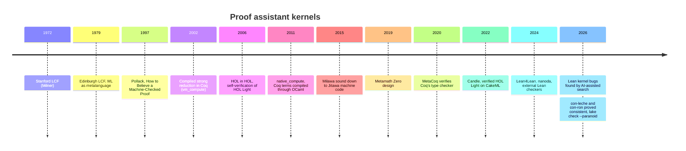
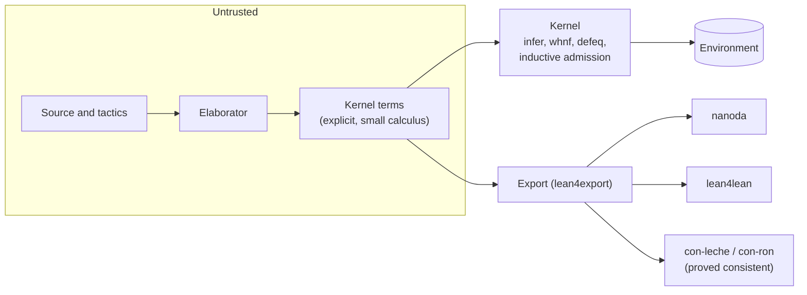

---
tags:
  - compilers
  - proof-assistants
  - trusted-computing-base
  - lean
  - rocq
  - hol
  - formal-methods
  - soundness
status: complete
sources:
  - https://www.cl.cam.ac.uk/~mjcg/papers/HolHistory.html
  - https://arxiv.org/pdf/1907.02836
  - https://www.brics.dk/RS/97/18/
  - https://www.cl.cam.ac.uk/~jrh13/papers/hollight.html
  - https://www.cl.cam.ac.uk/~jrh13/papers/holhol.pdf
  - https://xavierleroy.org/bibrefs/Gregoire-Leroy-02.html
  - https://core.ac.uk/download/49937575.pdf
  - https://www.cl.cam.ac.uk/~mom22/2015-jar-milawa.pdf
  - https://www.ps.uni-saarland.de/Publications/documents/SozeauEtAl_2020_CoqCoqCorrect.pdf
  - https://metarocq.github.io/coqcoqcorrect
  - https://arxiv.org/pdf/1910.10703
  - https://drops.dagstuhl.de/opus/volltexte/2022/16712
  - https://arxiv.org/html/2403.14064v3
  - https://ammkrn.github.io/type_checking_in_lean4/print.html
  - https://www.openwall.com/lists/oss-security/2026/08/02/1
  - https://lean-lang.org/doc/reference/latest/releases/v4.32.2/
  - https://lean-lang.org/doc/reference/4.33.0/releases/v4.33.0/
  - https://www.lesswrong.com/posts/jgmmMa7AqJNausrqx/don-t-trust-lean4-alone
  - https://leodemoura.github.io/blog/2026-10-15-lean-now-ships-with-verified-kernels/
  - https://arena.lean-lang.org/
  - https://raw.githubusercontent.com/leanprover/comparator/master/README.md
  - https://openwall.com/lists/oss-security/2026/10/26/8
  - https://www.mankier.com/1/rocqchk
created: 2026-11-26
updated: 2026-11-26
---

## Table Of Contents

- [[#TL;DR|TL;DR]]
- [[#The Problem|The Problem]]
- [[#Foundations|Foundations]]
    - [[#The LCF Approach: Theorems as an Abstract Type|The LCF Approach: Theorems as an Abstract Type]]
    - [[#The de Bruijn Criterion: Proof Objects and a Small Checker|The de Bruijn Criterion: Proof Objects and a Small Checker]]
    - [[#Where Computation Enters the Kernel|Where Computation Enters the Kernel]]
    - [[#What You Still Have to Trust|What You Still Have to Trust]]
- [[#How We Got Here|How We Got Here]]
- [[#How It Works|How It Works]]
    - [[#Worked Example: A Tiny LCF Kernel|Worked Example: A Tiny LCF Kernel]]
    - [[#Inside a Dependent Type Theory Kernel|Inside a Dependent Type Theory Kernel]]
    - [[#Compilers Inside the Kernel: vm_compute, native_compute and native_decide|Compilers Inside the Kernel: vm_compute, native_compute and native_decide]]
    - [[#Independent Checkers|Independent Checkers]]
    - [[#Verified Kernels|Verified Kernels]]
- [[#Where It Is Now|Where It Is Now]]
    - [[#The 2026 Lean Kernel Bugs|The 2026 Lean Kernel Bugs]]
    - [[#Many Kernels and the Kernel Arena|Many Kernels and the Kernel Arena]]
    - [[#Rocq, HOL and Metamath in 2026|Rocq, HOL and Metamath in 2026]]
- [[#Trade-offs & Open Problems|Trade-offs & Open Problems]]
- [[#Resources|Resources]]
- [[#Related Notes|Related Notes]]

## ***TL;DR***
---
*A proof assistant is only as trustworthy as the small program that has the final say on every proof, its kernel. This note is about how that program is kept small, checked independently, verified down to machine code, and, in 2026, attacked by AI systems hunting for soundness holes.*

- **The kernel is the trusted computing base of mathematics done by machine.** Everything else in a proof assistant (elaborator, tactics, automation, LLM provers) can be wrong without harm, because the kernel re-checks what they produce. HOL Light's kernel is "about 400 lines of mostly functional OCaml" with "ten primitive rules of inference" ([Harrison 2006](https://www.cl.cam.ac.uk/~jrh13/papers/holhol.pdf)); Lean's `src/kernel` is about 8K lines of C++ ([Moses 2026](https://www.lesswrong.com/posts/jgmmMa7AqJNausrqx/don-t-trust-lean4-alone)).
- **Two designs.** *LCF-style* kernels make `thm` an abstract type that only inference rules can build, so the host language's type checker enforces soundness and no proof is stored ([Paulson et al.](https://arxiv.org/pdf/1907.02836)). *De Bruijn-style* kernels (Rocq, Lean) type-check explicit proof terms, which can be exported and re-checked by entirely separate programs.
- **Kernels are compiled programs, and compilers leak in.** The OCaml, C++ or Lean compiler that builds the kernel, the bignum library it calls, and the bytecode or native compilers used to speed up reduction (`vm_compute`, `native_compute`, Lean's `native_decide`) are all part of what you trust ([Boespflug et al. 2011](https://core.ac.uk/download/49937575.pdf)).
- **Three defences:** keep the kernel tiny; check every proof with *several independent kernels* ([[Compiler Testing and Fuzzing|differential testing]] for logic); and *verify the kernel itself*, ideally down to machine code (Milawa on Jitawa 2015, Candle 2022, MetaCoq 2020, Lean's con-leche/con-ron 2026).
- **As of November 2026**, a July Lean kernel bug let a crafted "disproof" of the Collatz conjecture pass both the official kernel and nanoda ([oss-security](https://www.openwall.com/lists/oss-security/2026/08/02/1)); an AI-assisted audit then found six more ([Lean 4.33.0 notes](https://lean-lang.org/doc/reference/4.33.0/releases/v4.33.0/)). Lean now ships four extra kernels, two of them proved consistent, behind `lake check --paranoid` ([de Moura, Oct 2026](https://leodemoura.github.io/blog/2026-10-15-lean-now-ships-with-verified-kernels/)).

## ***The Problem***
---
*Proof assistants are huge, fast-moving programs, and their users now include AI systems that are rewarded for getting a proof accepted, not for the proof being true. The question is how much code must be right for "the checker accepted it" to mean "it is true".*

A modern proof assistant is a compiler. Lean, for example, parses, elaborates surface syntax with unification and type-class search, runs user-written tactics and metaprograms, and compiles programs to C (see [[Dependent and Refinement Types]]). That is hundreds of thousands of lines, changed daily. If any of it could make a false theorem "true", nobody could rely on the result.

The answer since the 1970s is to route every theorem through one small program with a narrow interface. Pollack framed the question in 1997 as two separate problems: is the submitted object really a derivation in the claimed formal system (a technical question, answered by an independent checker), and does the derived theorem say what we think it says (no purely technical answer) ([Pollack, BRICS RS-97-18](https://www.brics.dk/RS/97/18/)). This note is mostly about the first; the second shows up as statement-checking tools like `comparator`.

| What can go wrong | Example | Defence |
|---|---|---|
| Elaborator or tactic bug | A tactic builds an ill-typed term | Kernel re-checks every term |
| Kernel logic bug | Missing check on nested inductives (Lean, July 2026) | Small kernel, independent kernels, verified kernels |
| Bug below the kernel | Miscompiled kernel, bignum library error, memory corruption | Verified compilation, hardened allocators, kernels in other languages |
| Unsound "trust me" extensions | `native_decide`, `native_compute`, axioms | Axiom audits, separate checkers that refuse them |
| Wrong statement | Theorem proved, but not the one intended | Human review, statement comparison (`comparator`) |

The pressure changed in 2025 to 2026. AI provers produce most new Lean proofs (see [[RL for Reasoning]]), and an optimizer that is scored by the kernel will find kernel holes the way benchmark-optimizers find test-harness holes (see [[Reward Hacking in Code Benchmarks]]). Leo de Moura, after the July bug: "This is going to keep happening. AIs are really good at exploiting soundness bugs in the kernels" ([oss-security](https://www.openwall.com/lists/oss-security/2026/08/02/1)).

## ***Foundations***
---
*Two ideas organise the field: the LCF trick of making theorems unforgeable values, and the de Bruijn idea of producing proof objects that a much simpler program can re-check. Both reduce "trust the system" to "trust a small kernel plus whatever runs it".*

### The LCF Approach: Theorems as an Abstract Type
*Milner's idea was to let the host language's type system guarantee that every theorem came from inference rules, so proofs never need to be stored.*

The LCF approach means "implementing the inference rules of a logical calculus within a *proof kernel*", and Milner's insight was that abstract types make stored proofs unnecessary: "anything of type thm had definitely been created exclusively by the application of inference rules", and "ML's type checker was our guarantee" ([Paulson, Nipkow & Wenzel, *From LCF to Isabelle/HOL*](https://arxiv.org/pdf/1907.02836)). Milner built the original LCF at Stanford in 1972 and designed ML as its metalanguage ([Gordon, *From LCF to HOL*](https://www.cl.cam.ac.uk/~mjcg/papers/HolHistory.html)).

Everything a user writes (tactics, decision procedures, whole libraries) is ordinary ML code that can only produce a `thm` by calling kernel functions. A buggy tactic can fail or loop, but it cannot forge a theorem. HOL Light, HOL4, Isabelle and ProofPower are all built this way; the cost is that there is no proof object to hand to another checker afterwards.

### The de Bruijn Criterion: Proof Objects and a Small Checker
*In type-theory provers a proof is a term, and checking it is type checking; the system must emit terms simple enough for a small, separate program to verify.*

Harrison describes the de Bruijn criterion as a system outputting a proof that "a much simpler program" can check, and argues that "from a certain point of view, one can say that an LCF prover satisfies the de Bruijn criterion" too ([Harrison 2006](https://www.cl.cam.ac.uk/~jrh13/papers/holhol.pdf)). Rocq and Lean take the criterion literally: the elaborator produces explicit terms in a small core calculus, and the kernel type-checks them. Because the terms exist as data, they can be exported. For Lean, producing an export file is "a complete exit from the Lean ecosystem", and "the exporter itself is not a trusted component" ([*Type Checking in Lean 4*](https://ammkrn.github.io/type_checking_in_lean4/print.html)).

| | LCF-style | De Bruijn-style |
|---|---|---|
| What is a proof? | A run of ML code; only the resulting `thm` survives | A term in the core calculus |
| Who enforces soundness? | Host language type system plus kernel functions | Kernel type checker |
| Independent re-checking | Needs proof recording added on top | Natural: export the terms |
| Kernel size | Hundreds of lines (HOL Light) | Thousands (Lean about 8K lines of C++) |
| Examples | HOL Light, HOL4, Isabelle | Rocq, Lean, Agda, Metamath (no types, pure substitution) |

### Where Computation Enters the Kernel
*Dependent type theories let types compute, so the kernel contains an evaluator, and evaluators are where performance work, and bugs, concentrate.*

The rule that makes a type-theory kernel more than a syntax checker is conversion:

$$
\frac{\Gamma \vdash t : A \qquad \Gamma \vdash A \equiv B}{\Gamma \vdash t : B}
$$

*Plain English: if `t` has type `A`, and `A` and `B` compute to the same thing, then `t` also has type `B`.* Deciding `A ≡ B` means reducing terms (β, δ, ι, ζ and friends; see [[Dependent and Refinement Types]]). A proof such as "this 10,000-element list is sorted" can be a one-line term whose checking is a large computation. So the kernel's definitional-equality checker is a small interpreter, and performance pressure pushes it towards compilation: bytecode machines, native code, special-cased bignums. Each speed-up adds code to the trusted base.

### What You Still Have to Trust
*Even a perfect kernel runs on a compiler, a runtime and a machine, and checks the statement you typed, not the one you meant.*

For an external Lean checker, users trust "that the lean logic is sound", that the checker's authors implemented it correctly, and the compiler or interpreter of its language; for `Nat` and `String` literals "you're probably trusting a bignum library and the UTF-8 string type of the implementing language" ([*Type Checking in Lean 4*](https://ammkrn.github.io/type_checking_in_lean4/print.html)). Gödel's second incompleteness theorem caps how far self-verification can go: HOL "cannot prove its own consistency", so Harrison proved consistency of HOL in a stronger variant of HOL instead ([Harrison 2006](https://www.cl.cam.ac.uk/~jrh13/papers/holhol.pdf)). MetaCoq makes the same move explicit: the verified checker rests on the specification's metatheory ("in particular strong normalisation or canonicity"), shifting trust "from a trusted code base to a trusted theory base" ([MetaCoq](https://metarocq.github.io/coqcoqcorrect)).

## ***How We Got Here***
---
*Kernels went from an ML type-system trick (1970s), to tiny audited cores (2000s), to checkers verified down to machine code (2010s), to fleets of independent and verified kernels under AI pressure (2026).*



| Year | Milestone | Why it mattered |
|---|---|---|
| 1972 / 1979 | Stanford LCF, then Edinburgh LCF with ML as metalanguage ([Gordon](https://www.cl.cam.ac.uk/~mjcg/papers/HolHistory.html); [Paulson et al.](https://arxiv.org/pdf/1907.02836)) | Theorems as an abstract type |
| 1997 | Pollack separates "is it a derivation?" from "is it the right theorem?" ([BRICS](https://www.brics.dk/RS/97/18/)) | The vocabulary of independent checking |
| 2002 | Grégoire and Leroy compile terms to an extended OCaml ZAM bytecode for strong reduction in Coq ([ICFP 2002](https://xavierleroy.org/bibrefs/Gregoire-Leroy-02.html)) | First compiler inside a kernel's conversion check |
| 2006 | Harrison: HOL Light kernel of about 400 lines, consistency proved relative to a stronger HOL ([paper](https://www.cl.cam.ac.uk/~jrh13/papers/holhol.pdf)) | The small-kernel benchmark |
| 2011 | Boespflug, Dénès and Grégoire translate CIC terms to OCaml and compile natively; the four colour theorem check drops from 3h7min to 34min47s ([CPP 2011](https://core.ac.uk/download/49937575.pdf)) | Speed by trusting a production compiler |
| 2015 | Davis and Myreen: Milawa's 1,700-line kernel proved sound in HOL4, running on 8,200 lines of verified x86-64 (Jitawa) ([JAR 2015](https://www.cl.cam.ac.uk/~mom22/2015-jar-milawa.pdf)) | First prover sound down to machine code |
| 2020 | MetaCoq: Coq's checker verified in Coq; "one critical bug has been found every year in Coq" ([POPL 2020](https://metarocq.github.io/coqcoqcorrect)) | Verified kernel for a dependent type theory |
| 2022 | Candle: HOL Light clone, sound "down to the machine code" ([ITP 2022](https://drops.dagstuhl.de/opus/volltexte/2022/16712)) | A usable, verified LCF system |
| 2024 to 2025 | Lean4Lean checks all of Mathlib 20% to 50% slower than the C++ kernel and found a soundness bug ([Carneiro](https://arxiv.org/html/2403.14064v3)) | Practical independent Lean kernels |
| 2026 | Lean bug #14576, six more fixes in 4.33, verified kernels shipped in 4.35 | Kernels become adversarial targets |

## ***How It Works***
---
*A kernel is a type checker with a very small surface. The interesting engineering is in keeping it small while making reduction fast, and in building second and third kernels that share no code with the first.*

### Worked Example: A Tiny LCF Kernel
*The whole trick fits in a module signature: `thm` is abstract, and the only functions that return one are the inference rules.*

The following is a **hand-written OCaml sketch** of the LCF pattern (not HOL Light's real code, which has ten rules over typed lambda terms):

```ocaml
module type KERNEL = sig
  type term                       (* formulas *)
  type thm                        (* abstract: no constructor is exported *)
  val concl   : thm -> term
  val assume  : term -> thm                (* A |- A *)
  val mp      : thm -> thm -> thm          (* from |- A ==> B and |- A, get |- B *)
  val refl    : term -> thm                (* |- t = t *)
end

(* Outside the kernel, a "derived rule" can only combine primitives. *)
let undisch k th = ...   (* built from assume and mp *)
```

Because `thm` has no exported constructor, a tactic that tries `let fake : thm = ...` is a compile-time type error, not a runtime check. Derived rules and decision procedures can be arbitrarily large and buggy; they can only ever call `assume`, `mp`, `refl` and the other primitives. The soundness argument is: each primitive is sound, and the type system makes the primitives the only door. That argument trusts the host language too: an unsafe cast (`Obj.magic` in OCaml) or a type-system hole would open a second door, which is why Candle runs on a verified CakeML implementation rather than OCaml ([Abrahamsson et al.](https://drops.dagstuhl.de/opus/volltexte/2022/16712)).

### Inside a Dependent Type Theory Kernel
*Lean's and Rocq's kernels check declarations one at a time against a growing environment; most of the code is inductive-type admission and definitional equality.*

The Lean kernel consists of names, universe levels, expressions, declarations, environments, and "core operations used in type checking, including type inference, reduction, and definitional equality checking", plus "functionality for manipulating and checking inductive type declarations" ([*Type Checking in Lean 4*](https://ammkrn.github.io/type_checking_in_lean4/print.html)). Lean4Lean names the hardest features to reimplement: "bignum arithmetic, nested inductive types, and primitive projections" ([Carneiro](https://arxiv.org/html/2403.14064v3)).



Inductive-type admission is the riskiest part. When a user declares an inductive type, the kernel generates its recursor (the elimination principle) and must check positivity, universe levels, and, for *nested* inductives (a type that occurs inside another type's arguments, like `List Tree` inside `Tree`), that the nesting is translated into an equivalent mutual inductive correctly. Every one of the six August 2026 Lean fixes touched this kind of bookkeeping: free variables in `opaque` values, phantom parameters of nested inductives, universe levels that "may normalize to `Prop`", and reserved `_nested` names that "could clash with the kernel's internal nested-inductive construction" ([4.33.0 notes](https://lean-lang.org/doc/reference/4.33.0/releases/v4.33.0/)).

### Compilers Inside the Kernel: vm_compute, native_compute and native_decide
*Proof by computation needs fast evaluation, and the fastest evaluator is a compiler; each option trades trusted code for speed.*

- **Rocq `vm_compute` (2002).** Terms are compiled "to the bytecode of an abstract machine performing weak reductions on non-closed terms", a machine "derived with minimal modifications from the ZAM" of OCaml's bytecode interpreter, then read back into normal form ([Grégoire & Leroy](https://xavierleroy.org/bibrefs/Gregoire-Leroy-02.html)). The bytecode compiler and VM are now trusted kernel code.
- **Rocq `native_compute` (2011).** Terms are translated to OCaml programs and compiled by an unmodified native OCaml compiler, an instance of untyped normalization by evaluation, typically "a fivefold speedup" over bytecode. The paper is candid: "the correctness of our approach is in part contingent upon the correctness of the compiler, whose entire code enters the trusted base", and it suggests "a certified compiler for the target language" ([Boespflug, Dénès & Grégoire](https://core.ac.uk/download/49937575.pdf)).
- **Lean `native_decide`.** Lean goes further: it proves a decidable proposition by compiling and running the decision procedure. Since Lean 4.35 the result is asserted as an explicit axiom rather than through kernel support for running the compiler, so axiom audits show exactly what was trusted (details in [[Dependent and Refinement Types]]).

The same tension runs through [[Verified Compilers]]: CakeML removed the unverified compiler from its own trusted base by evaluating itself inside the logic, while `native_compute` deliberately puts a production compiler into it.

### Independent Checkers
*If two kernels written by different people in different languages both accept a proof, a bug must exist in both to fool you. This is differential testing applied to logic.*

Lean's kernel is small enough that "developers can write their own implementation", and users "can check their results with something that is completely disjoint from the Lean ecosystem" ([*Type Checking in Lean 4*](https://ammkrn.github.io/type_checking_in_lean4/print.html)). Rocq has long shipped `coqchk` (now `rocqchk`), a standalone checker for compiled `.vo` libraries that can summarize "assumptions and use of impredicativity" ([rocqchk(1)](https://www.mankier.com/1/rocqchk)). Metamath, whose logic is pure substitution, has the most extreme version: many independent verifiers in different languages for the same `set.mm` database, and Metamath Zero checks a translation of set.mm (over 34,000 ZFC proofs) in about 195 ms ([Carneiro 2019](https://arxiv.org/pdf/1910.10703)).

Independence has a limit: kernels often share a *design*. The July 2026 Lean exploit fooled both the C++ kernel and nanoda, because it combined the C++ bug with a separate nanoda bug ([4.32.2 notes](https://lean-lang.org/doc/reference/latest/releases/v4.32.2/)). Diversity of implementation is not diversity of mistakes.

Statement checking sits beside the kernel. Lean's `comparator` (now `lake comparator` in core) takes a `Challenge` file with a sorried theorem and a `Solution`, checks that every declaration used in the statement is unchanged and that the proof "only uses axioms" from an allowed list, avoids loading `.olean` files (a possible attack point), replays an export through the kernel and optional external kernels, and runs the build in a `landrun` sandbox ([comparator README](https://raw.githubusercontent.com/leanprover/comparator/master/README.md)). The sandbox matters because an untrusted proof's build runs arbitrary metaprograms, the same threat model as [[Software Fault Isolation]].

### Verified Kernels
*The strongest answer is a kernel with a machine-checked proof that it only accepts valid derivations, compiled by a verified compiler so the proof survives to machine code.*

| System | Logic | What is proved | Down to |
|---|---|---|---|
| Milawa on Jitawa (2015) | ACL2-like first-order logic | 1,700-line Lisp kernel implements a logic proved sound in HOL4; runtime is 8,200 lines of verified x86-64 plus a 200-line unverified C wrapper ([Davis & Myreen](https://www.cl.cam.ac.uk/~mom22/2015-jar-milawa.pdf)) | Machine code |
| MetaCoq (2020) | PCUIC (Coq without modules and template polymorphism) | Type checker correct w.r.t. its specification; verified erasure ([Sozeau et al.](https://metarocq.github.io/coqcoqcorrect)) | Extracted OCaml |
| Metamath Zero (2019 on) | Metamath-like | Plan: an x86-64 verifier proved to accept only valid environments; spec and x86 subset (about 25 instructions) formalized, final proof future work ([Carneiro](https://arxiv.org/pdf/1910.10703)) | Machine code (planned) |
| Candle (2022) | HOL Light's HOL | Every exported fact is valid in HOL; REPL runs the CakeML compiler internally ([Abrahamsson et al.](https://drops.dagstuhl.de/opus/volltexte/2022/16712)) | Machine code |
| Lean4Lean (2024 on) | Lean 4 | Representative typechecker functions verified; inductives "pending future work" ([Carneiro](https://arxiv.org/html/2403.14064v3)) | Lean's compiler |
| con-leche / con-ron (2026) | Lean 4 | "every environment con-leche accepts has a model in set theory"; con-ron (Rust) proved with Aeneas to refine con-leche ([de Moura](https://leodemoura.github.io/blog/2026-10-15-lean-now-ships-with-verified-kernels/)) | Lean or Rust compiler |

Note the last column. A Lean kernel proved correct in Lean still runs on Lean's compiler and runtime: de Moura's own summary is that remaining unsoundness is "most likely in Lean's compiler or runtime (including the bignum library)" ([blog](https://leodemoura.github.io/blog/2026-10-15-lean-now-ships-with-verified-kernels/)). Only the CakeML-based systems close that gap today.

## ***Where It Is Now***
---
*As of November 2026, Lean is the centre of kernel work because AI provers made its kernel a target; the response is many kernels, two of them proved consistent, plus sandboxed checking. Rocq and HOL continue on long-standing designs.*

### The 2026 Lean Kernel Bugs
*One public exploit and six fixes in two weeks turned kernel soundness from a theoretical worry into an operational one.*

- **Bug #14576 (July 2026).** On 25 July a repository claimed an AI-assisted disproof of the Collatz conjecture. On 28 July it was traced to the kernel and fixed the same day. The advisory describes a nested-inductive parameter check that did not verify that projection expressions name the right structure, combined with a crafted hash collision, to give "a checked, axiom-free proof of `False`"; affected: v4.31.0 and earlier ([oss-security, 2 Aug 2026](https://www.openwall.com/lists/oss-security/2026/08/02/1)). Lean 4.32.2 summarizes it as nested inductives with phantom type parameters whose handling "bypassed the type checker" ([notes](https://lean-lang.org/doc/reference/latest/releases/v4.32.2/)).
- **Six more fixes (Lean 4.33.0, 10 August 2026)**, each labelled by whether it affected users of `comparator` ([notes](https://lean-lang.org/doc/reference/4.33.0/releases/v4.33.0/)). One came from an AI-assisted audit of about 3.5 hours that found `add_opaque` did not reject free variables, unlike its sibling entry points; a broader AI-assisted search with the Lean FRO found six bugs, and two came from the kernel's interaction with GMP ([Moses, Sept 2026](https://www.lesswrong.com/posts/jgmmMa7AqJNausrqx/don-t-trust-lean4-alone)).

### Many Kernels and the Kernel Arena
*Lean's answer is to ship several kernels and make checking a project against all of them one command.*

- **Lean 4.35 (October 2026)** ships nanoda, lean4lean, con-leche and con-ron. `lake check` exports a project and rechecks it with `leanchecker` in a sandbox; `lake check --paranoid` adds all four extra kernels and an official-kernel build with a hardened allocator that turns memory corruption into "a checked abort instead of a silently wrong answer" ([de Moura, 15 Oct 2026](https://leodemoura.github.io/blog/2026-10-15-lean-now-ships-with-verified-kernels/)). That last point is a C++ [[Undefined Behavior and Compiler Semantics|undefined-behavior]] defence inside a logic kernel.
- **con-leche** is "the first kernel for Lean written in Lean and proven consistent"; on full Mathlib it "executes 0.69x the instructions of the official kernel", about 100 seconds on eight threads. It was implemented and proved largely by AI coding agents under heavy supervision by Joachim Breitner (Lean FRO), and con-ron is an AI-assisted Rust translation verified with Aeneas ([blog](https://leodemoura.github.io/blog/2026-10-15-lean-now-ships-with-verified-kernels/)).
- **The Lean Kernel Arena** "presents, tests and benchmarks proof checkers for the Lean Theorem Prover", scoring them first on wrongly accepted invalid proofs, then wrongly rejected valid ones, then Mathlib time. The September 2026 round lists more than 35 checkers; on Mathlib, the official v4.35.0 kernel takes 33.7 minutes of CPU time while the fastest entries (nano-lean, gruszka) take about 66 to 77 seconds ([arena](https://arena.lean-lang.org/)). The arena's test groups (`bugs/`, `corner-cases/`, `perf/`) are a regression suite of past soundness bugs, the same idea as a compiler's miscompilation test corpus ([[Compiler Testing and Fuzzing]]).

### Rocq, HOL and Metamath in 2026
*The other ecosystems are calmer but not immune.*

- **Rocq.** An oss-security post (25 October 2026) assigned CVE-2020-37268 to a 2020 issue where module functor inlining drops the record that a definition was made under `Unset Universe Checking`, so a proof of `False` can pass `Print Assumptions`; the post says it is unfixed as of Rocq 9.2.0 and that running `coqchk` on the compiled files rejects it ([oss-security](https://openwall.com/lists/oss-security/2026/10/26/8)). The claim is the poster's and was not independently checked here. It illustrates why a separate checker matters even when the main kernel is fine.
- **HOL family.** HOL Light remains the small-kernel reference, and Candle shows the design can be verified end to end; CakeML's HOL4 kernel is part of [[Verified Compilers|CakeML's]] trusted base.
- **Metamath / MM0.** Metamath's substitution-only logic still has the cheapest checking of any major system, and MM0 is the clearest plan for a checker verified to x86 ([Carneiro](https://arxiv.org/pdf/1910.10703)).

## ***Trade-offs & Open Problems***
---
*Every speed-up and every feature added to a kernel widens what must be trusted; every defence costs time, code or expressiveness.*

- **Small vs fast.** A 400-line kernel is auditable; a kernel that checks Mathlib in minutes needs bignums, caching, sharing and compiled reduction. `native_compute` gave about 5x by trusting the whole OCaml compiler ([Boespflug et al.](https://core.ac.uk/download/49937575.pdf)).
- **Expressive logic vs simple kernel.** Nested and mutual inductives, quotients, universe polymorphism and primitive projections are where 2026's bugs were. Lean4Lean still leaves the inductive-type rule as future work ([Carneiro](https://arxiv.org/html/2403.14064v3)).
- **Independent vs correlated kernels.** Kernels written from the same reference implementation or the same book can share mistakes, as nanoda showed in July. Proved-consistent kernels (con-leche) are the stronger guarantee, but only relative to the set theory used.
- **Verified vs compiled.** Verified kernels in Lean or Coq still run on unverified compilers and runtimes; only CakeML-style stacks (Candle, Jitawa) reach machine code today. Compiling a verified checker through a verified compiler is the open direction, the same "trusting trust" chain discussed in [[Reproducible Builds]].
- **The statement problem.** No kernel can tell you the theorem says what you meant. Pollack's second question stays social: human review, `comparator`-style statement freezing, and caution with AI-produced results ([Moses](https://www.lesswrong.com/posts/jgmmMa7AqJNausrqx/don-t-trust-lean4-alone)).
- **Adversarial checking.** Kernels were written to check honest users' proofs. AI provers are optimizers aimed at the kernel; checking must now assume malicious inputs, sandbox builds, and treat crashes and memory corruption as soundness issues.

## ***Resources***
---
*Start with Paulson et al. for LCF, Harrison for the small-kernel ideal, Pollack for what "trust" means, then Candle and MetaCoq for verified kernels and the 2026 Lean posts for the current state.*

**History and principles**
- [From LCF to HOL: a short history](https://www.cl.cam.ac.uk/~mjcg/papers/HolHistory.html): Gordon. Milner, LCF and ML.
- [From LCF to Isabelle/HOL](https://arxiv.org/pdf/1907.02836): Paulson, Nipkow and Wenzel, Formal Aspects of Computing 2019.
- [How to Believe a Machine-Checked Proof](https://www.brics.dk/RS/97/18/): Pollack, BRICS RS-97-18, 1997.
- [HOL Light: An Overview](https://www.cl.cam.ac.uk/~jrh13/papers/hollight.html): Harrison, TPHOLs 2009.
- [Towards Self-Verification of HOL Light](https://www.cl.cam.ac.uk/~jrh13/papers/holhol.pdf): Harrison, IJCAR 2006.

**Compiled reduction**
- [A Compiled Implementation of Strong Reduction](https://xavierleroy.org/bibrefs/Gregoire-Leroy-02.html): Grégoire and Leroy, ICFP 2002.
- [Full Reduction at Full Throttle](https://core.ac.uk/download/49937575.pdf): Boespflug, Dénès and Grégoire, CPP 2011.

**Verified and independent kernels**
- [The Reflective Milawa Theorem Prover is Sound (Down to the Machine Code that Runs it)](https://www.cl.cam.ac.uk/~mom22/2015-jar-milawa.pdf): Davis and Myreen, JAR 2015.
- [Coq Coq Correct!](https://www.ps.uni-saarland.de/Publications/documents/SozeauEtAl_2020_CoqCoqCorrect.pdf): Sozeau et al., POPL 2020 ([project page](https://metarocq.github.io/coqcoqcorrect)).
- [Metamath Zero: The Cartesian Theorem Prover](https://arxiv.org/pdf/1910.10703): Carneiro, 2019.
- [Candle: A Verified Implementation of HOL Light](https://drops.dagstuhl.de/opus/volltexte/2022/16712): Abrahamsson, Myreen, Kumar and Sewell, ITP 2022.
- [Lean4Lean: Verifying a Typechecker for Lean, in Lean](https://arxiv.org/html/2403.14064v3): Carneiro, revised 2025.
- [Type Checking in Lean 4](https://ammkrn.github.io/type_checking_in_lean4/print.html): the book behind nanoda and many arena checkers.

**2026 state**
- [Lean 4 kernel soundness bug advisory](https://www.openwall.com/lists/oss-security/2026/08/02/1): oss-security, 2 August 2026.
- [Lean 4.32.2](https://lean-lang.org/doc/reference/latest/releases/v4.32.2/) and [Lean 4.33.0](https://lean-lang.org/doc/reference/4.33.0/releases/v4.33.0/) release notes.
- [Lean Now Ships with Verified Kernels](https://leodemoura.github.io/blog/2026-10-15-lean-now-ships-with-verified-kernels/): de Moura, 15 October 2026.
- [Lean Kernel Arena](https://arena.lean-lang.org/): live checker benchmark.
- [comparator](https://raw.githubusercontent.com/leanprover/comparator/master/README.md): statement and axiom checking for untrusted proofs.
- [Don't trust Lean4 alone](https://www.lesswrong.com/posts/jgmmMa7AqJNausrqx/don-t-trust-lean4-alone): Moses, September 2026.
- [Rocq Print Assumptions advisory](https://openwall.com/lists/oss-security/2026/10/26/8): oss-security, October 2026 (claims unverified).
- [rocqchk(1)](https://www.mankier.com/1/rocqchk): Rocq's standalone checker.

## Related Notes

- [[Dependent and Refinement Types]] — The type theory these kernels check, Lean's compiler, `native_decide`, and the first account of the 2026 bug.
- [[Verified Compilers]] — CakeML, the verified compiler that lets Candle and Jitawa reach machine code.
- [[Translation Validation]] — Checking each run instead of proving the tool; independent kernels are the same idea for proofs.
- [[Compiler Testing and Fuzzing]] — Differential testing, the method behind running several kernels.
- [[Type Systems and Inference]] — Type checking and unification, the core of every kernel.
- [[Undefined Behavior and Compiler Semantics]] — Why memory corruption in a C++ kernel is a soundness bug.
- [[Software Fault Isolation]] — Sandboxing untrusted proof builds.
- [[Reward Hacking in Code Benchmarks]] — Optimizers exploiting their checker, the threat model for AI provers.
- [[Reproducible Builds]] — Trusting the compiler that builds the checker.
- [[Formal Methods in Practice]] — Proof assistants and solvers in industrial verification.
- [[Microkernels and seL4]] — The same small-trusted-core idea in operating systems.
- [[RL for Reasoning]] — The AI provers that now produce most proofs the kernels check.
