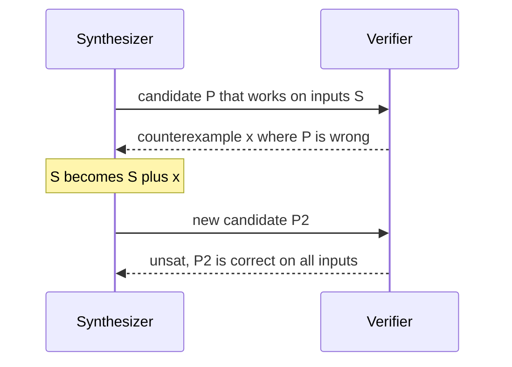
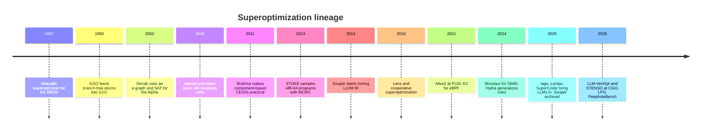
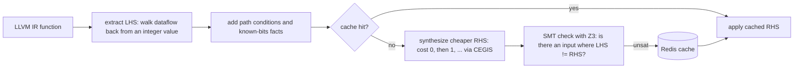
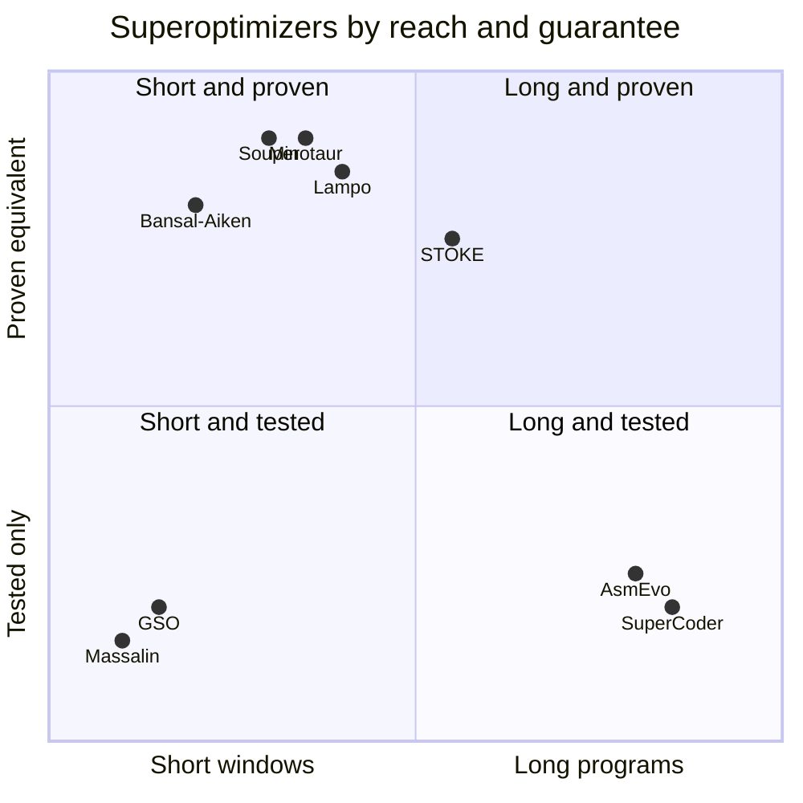

---
tags:
  - compilers
  - superoptimization
  - program-synthesis
  - peephole-optimization
  - smt
  - translation-validation
  - llvm
status: complete
sources:
  - https://www.cse.iitm.ac.in/~krishna/courses/2022/odd-cs6013/MassalinCANews87.pdf
  - https://research.swtch.com/superopt
  - https://gmplib.org/~tege/gso-pldi92.pdf
  - https://people.csail.mit.edu/randall/papers/abstracts/denali.html
  - https://www.cs.cornell.edu/courses/cs6120/2025fa/blog/denali/
  - https://www.cse.iitm.ac.in/~krishna/courses/2021/odd-cs6013/BansalAikenASPLOS06.pdf
  - https://bibtex.github.io/ASPLOS-2006-BansalA.html
  - https://www.csl.sri.com/~tiwari/papers/pldi2011-bitvector.pdf
  - https://arxiv.org/pdf/1211.0557
  - https://bibtex.github.io/ASPLOS-2013-Schkufza0A.html
  - https://github.com/StanfordPL/stoke
  - https://thakur.cs.ucdavis.edu/assets/pubs/mangpo_thakur_ASPLOS16.pdf
  - https://ar5iv.labs.arxiv.org/html/1711.04422
  - https://github.com/google/souper
  - https://blog.regehr.org/archives/1192
  - https://www-old.cs.utah.edu/~regehr/alive2-pldi21.pdf
  - https://llvm.org/docs/InstCombineContributorGuide.html
  - https://users.cs.utah.edu/~regehr/generalization-oopsla24.pdf
  - https://2024.splashcon.org/details/splash-2024-oopsla/27/Hydra-Generalizing-Peephole-Optimizations-with-Program-Synthesis
  - https://arxiv.org/html/2306.00229v3
  - https://par.nsf.gov/servlets/purl/10646970
  - https://arxiv.org/abs/2103.00022v1
  - https://k2.cs.rutgers.edu/
  - https://2026.cgo.org/details/cgo-2026-papers/45/Tensor-Program-Superoptimization-through-Cost-Guided-Symbolic-Program-Synthesis
  - https://2026.cgo.org/details/cgo-2026-papers/37/LLM-VeriOpt-Verification-Guided-Reinforcement-Learning-for-LLM-Based-Compiler-Optimi
  - https://www.llvm.org/devmtg/2025-10
  - https://arxiv.org/abs/2505.11480v2
  - https://arxiv.org/abs/2508.16125
  - https://arxiv.org/abs/2603.18477
  - https://arxiv.org/abs/2607.02684
  - https://arxiv.org/pdf/2509.16497
  - https://arxiv.org/abs/2605.19005v2
  - https://arxiv.org/html/2608.20711v1
  - https://arxiv.org/html/2609.27214
  - https://zwang4.github.io/publication/oopsla26/
created: 2026-11-26
updated: 2026-11-26
---

## Table Of Contents

- [[#TL;DR|TL;DR]]
- [[#The Problem|The Problem]]
- [[#Foundations|Foundations]]
    - [[#What Optimal Means|What Optimal Means]]
    - [[#Checking Equivalence with SMT|Checking Equivalence with SMT]]
    - [[#CEGIS|CEGIS]]
    - [[#Four Ways to Search|Four Ways to Search]]
- [[#How We Got Here|How We Got Here]]
- [[#How It Works|How It Works]]
    - [[#Worked Example: Massalin's Signum|Worked Example: Massalin's Signum]]
    - [[#GSO and Branch Elimination|GSO and Branch Elimination]]
    - [[#Denali: Goal-Directed Search|Denali: Goal-Directed Search]]
    - [[#Peephole Superoptimizers|Peephole Superoptimizers]]
    - [[#STOKE: Markov Chain Monte Carlo|STOKE: Markov Chain Monte Carlo]]
    - [[#Lens and Cooperative Search|Lens and Cooperative Search]]
    - [[#Souper: Synthesizing LLVM IR|Souper: Synthesizing LLVM IR]]
    - [[#From a Souper Result to an InstCombine Fold|From a Souper Result to an InstCombine Fold]]
    - [[#Minotaur: SIMD|Minotaur: SIMD]]
    - [[#Domain Superoptimizers|Domain Superoptimizers]]
- [[#Where It Is Now|Where It Is Now]]
    - [[#Tool Status|Tool Status]]
    - [[#LLMs as Candidate Generators|LLMs as Candidate Generators]]
    - [[#Verifier-in-the-Loop Training|Verifier-in-the-Loop Training]]
    - [[#Search Strategies Compared|Search Strategies Compared]]
- [[#Trade-offs & Open Problems|Trade-offs & Open Problems]]
- [[#Resources|Resources]]
- [[#Related Notes|Related Notes]]

## ***TL;DR***
---
*A superoptimizer searches for the cheapest instruction sequence that is provably equivalent to a given one, instead of applying hand-written rules. It only works on short, loop-free fragments, so in practice its main job is finding the rules that ordinary peephole passes are missing.*

- **The idea.** Massalin (1987) enumerated every 68020 program of length 1, 2, 3 and so on, testing each against the target, and found a branch-free **4-instruction signum** where typical hand-written code took 8 ([Massalin, ASPLOS 1987](https://www.cse.iitm.ac.in/~krishna/courses/2022/odd-cs6013/MassalinCANews87.pdf)).
- **Search plus checking.** Every superoptimizer has two halves: a *search* (enumerative, stochastic, symbolic or rewrite-based) and an *equivalence check*, which since the 2000s means a SAT or SMT query, usually to Z3. Cheap test vectors filter candidates before the expensive proof.
- **The landmarks.** GSO fed GCC branch-free idioms (early 1990s); Denali used an e-graph plus SAT (2002); Bansal and Aiken learned an x86 peephole database (2006); **STOKE** used MCMC sampling and beat gcc -O3 on Montgomery multiplication by 1.6× (2013); **Souper** mined LLVM IR and found about 7,900 distinct optimizations while building LLVM ([Sasnauskas et al.](https://ar5iv.labs.arxiv.org/html/1711.04422)).
- **The pipeline into compilers.** Superoptimizer results are concrete; a human (or Hydra, or now an LLM) generalizes them, proves the general rule with **Alive2**, and lands it in LLVM's InstCombine, which requires an Alive2 proof for every new fold ([InstCombine guide](https://llvm.org/docs/InstCombineContributorGuide.html)).
- **As of November 2026.** Souper's repository was archived in October 2025, and the field has moved to *LLMs proposing candidates while a verifier decides*: Iago (LLVM Dev Meeting 2025), Lampo, LPG, SuperCoder and CGO 2026's LLM-VeriOpt. Searches still only scale to small windows.

## ***The Problem***
---
*Compilers improve code by applying rules people wrote, so they can never do better than the rule set. Superoptimization asks a different question: what is the best code that computes this, full stop?*

An optimizing compiler is a large library of rewrite rules ([[Classic Optimizations]], [[Instruction Selection]]). Each rule was written by someone who noticed a pattern. Any pattern nobody noticed is a *missed optimization*, and nothing in the compiler will ever find it. Take sign extraction (hand sketch, not compiler output):

```c
int signum(int x) {
    if (x > 0) return 1;
    if (x < 0) return -1;
    return 0;
}
```

The obvious translation has two compares and two conditional branches. Massalin reported that typical hand-written code took 8 instructions, or 6 for clever programmers, while his search found 4 with no branches at all ([Massalin](https://www.cse.iitm.ac.in/~krishna/courses/2022/odd-cs6013/MassalinCANews87.pdf)). No rule-based compiler of the time would find that sequence, because it depends on a chain of carry-flag tricks that no single local rule expresses.

Superoptimization flips the approach: fix the *meaning* (the target code) and search the space of programs for the cheapest one with that meaning. The name is a joke on "optimization": compilers merely *improve* code, a superoptimizer looks for the actual optimum. The catch is that the space grows exponentially with program length, so the search only reaches short, loop-free fragments, and proving two programs equivalent is itself a hard problem.

## ***Foundations***
---
*Four ideas carry the field: a precise definition of "best" and "same", a solver that can decide "same" for bit-vector code, a loop that synthesizes programs from counterexamples, and a choice of how to walk the search space.*

### What Optimal Means

*Optimal is always relative to a cost model, an instruction set, a length bound and a notion of equivalence; change any of them and the answer changes.*

Given a target program $T$, a language $\mathcal{L}$ (an instruction set or IR subset) and a cost function, a superoptimizer looks for

$$
P^\star \;=\; \arg\min_{P \in \mathcal{L},\ |P| \le k} \ \text{cost}(P) \quad \text{subject to} \quad \forall x.\ P(x) = T(x)
$$

**In plain English:** among all programs up to length $k$ that give the same output as the target on *every* input, pick the cheapest. "Every input" is why this is hard: a 64-bit input has $2^{64}$ values, so you cannot test them all and must prove it.

The fine print matters in each part:

| Ingredient | Typical choice | Consequence |
|---|---|---|
| **Cost** | Instruction count (Massalin), static latency sum (STOKE), uOps from LLVM-MCA (Minotaur), IR instruction cost (Souper) | "Optimal" is only optimal for the model; real hardware may disagree |
| **Scope** | Loop-free, straight-line or with path conditions | Loops are mostly out of reach; STOKE's NaCl loop work is the exception |
| **Equivalence** | Same live outputs on all inputs; in LLVM, *refinement* | The target may be *less* defined than the source (it may remove undefined behaviour, not add it) |
| **Context** | None, live-out registers, or surrounding code (Lens) | Knowing which outputs are dead or which input bits are known makes more rewrites legal |

### Checking Equivalence with SMT

*Machine integers are fixed-width bit-vectors, and SMT solvers decide bit-vector formulas exactly, which turns "same on all inputs" into one query.*

Encode both programs as formulas over bit-vector variables, then ask the solver whether there exists an input on which they differ:

$$
\exists x.\ T(x) \neq P(x)
$$

**In plain English:** ask the solver for a counterexample. If it says *unsatisfiable*, no such input exists and the programs are equivalent. If it says *satisfiable*, it hands back the input that breaks the candidate, which is useful in its own right.

Souper emits queries in SMT-LIB and ran its evaluation on Z3 ([Sasnauskas et al.](https://ar5iv.labs.arxiv.org/html/1711.04422)); STOKE used the STP solver ([Schkufza et al.](https://arxiv.org/pdf/1211.0557)); Bansal and Aiken used the zChaff SAT solver ([Bansal & Aiken](https://www.cse.iitm.ac.in/~krishna/courses/2021/odd-cs6013/BansalAikenASPLOS06.pdf)). Multiplication and division make bit-vector queries slow, which is why STOKE modelled 64-bit multiply and divide as uninterpreted functions.

For LLVM IR "equal" is not enough, because IR has `undef`, `poison` and undefined behaviour. **Alive2** checks *refinement*: every behaviour of the optimized function must be a behaviour the original allowed, so an optimization may remove nondeterminism but not add it. It is about 23,000 lines of C++ on top of Z3, and running it over LLVM's own unit tests found 47 new bugs ([Lopes et al., PLDI 2021](https://www-old.cs.utah.edu/~regehr/alive2-pldi21.pdf)). The broader logic is in [[Formal Methods in Practice]] and [[Verified Compilers]].

### CEGIS

*Counterexample-guided inductive synthesis: guess a program that works on a few inputs, ask a verifier for an input where it fails, add that input, repeat.*

Synthesis has a $\exists\forall$ shape: there exists a program $P$ such that for all inputs $x$ the spec holds. Solvers handle $\exists$ well and $\forall$ badly, so CEGIS splits the quantifiers:

$$
\textbf{synthesize: } \exists P.\ \bigwedge_{x \in S} \phi(P, x) \qquad\qquad \textbf{verify: } \exists x.\ \neg\phi(P, x)
$$

**In plain English:** find a program that is right on the small set $S$ of inputs collected so far; then look for any input where it is wrong. If none exists, you are done. If one does, add it to $S$ and synthesize again. Each round rules out every candidate that fails on the new input.



Gulwani, Jha, Tiwari and Venkatesan made this practical for loop-free bit-vector code: give the synthesizer a *library of components* (add, and, shift, ...) and let the SMT solver choose how to wire them, encoding each component's position as an integer "location variable" ([Gulwani et al., PLDI 2011](https://www.csl.sri.com/~tiwari/papers/pldi2011-bitvector.pdf)). Their tool Brahma solved 25 Hacker's Delight puzzles, for example turning off the rightmost 1-bit:

```text
o1  := bvsub(x, 1)
res := bvand(x, o1)          ; x & (x - 1), found in 3.2 s
```

Souper's synthesizer is an improved version of this algorithm ([Sasnauskas et al.](https://ar5iv.labs.arxiv.org/html/1711.04422)).

### Four Ways to Search

*Every superoptimizer is one of these search strategies, or a mix of them.*

| Strategy | How it walks the space | Strength | Weakness | Examples |
|---|---|---|---|---|
| **Enumerative** | All programs of length 1, then 2, ...; prune equivalent prefixes | Finds the true shortest program | Exponential in length; stalls past a few instructions | Massalin, GSO, Bansal-Aiken, Lens, Souper's enumerator |
| **Stochastic** | Random mutations accepted by a cost-driven rule (MCMC) | Reaches long, very different programs | Incomplete: may never find the optimum | STOKE, K2 |
| **Symbolic** | Encode "some program of this shape" as a formula; the solver picks it | Synthesizes constants; complete within the sketch | Solver time explodes with size | Brahma, Souper CEGIS, Lens's symbolic instances |
| **Rewrite-based** | Apply equivalence axioms, then pick the best result | Equivalence is by construction | Only finds what the axioms can reach | Denali, [[E-Graphs and Equality Saturation]] |

## ***How We Got Here***
---
*Superoptimization started as an exhaustive search over a single microprocessor, gained real proofs with SAT and SMT, became stochastic to scale, moved into compiler IRs, and is now being driven by LLMs.*



| Year | Work | What changed |
|---|---|---|
| 1987 | Massalin, ASPLOS II | Exhaustive enumeration with a fast probabilistic test; about 50,000 programs per second, up to about 12 to 13 instructions |
| 1992 | Granlund and Kenner, GSO (PLDI, per the PDF's file name) | Portable C (about 3,000 lines), six ISAs; results became GCC patterns |
| 2002 | Joshi, Nelson and Randall, Denali (PLDI) | Goal-directed: axioms fill an e-graph, a SAT solver finds the shortest schedule |
| 2006 | Bansal and Aiken (ASPLOS) | Superoptimize *offline* and store results as a peephole database; SAT-checked |
| 2011 | Gulwani et al., Brahma (PLDI) | Component-based synthesis with CEGIS and SMT |
| 2013 | Schkufza, Sharma and Aiken, STOKE (ASPLOS) | Stochastic search; sacrifices completeness to reach longer programs |
| 2014-2017 | Souper (Google, Utah; arXiv 2017) | Superoptimizer that reads LLVM IR and suggests InstCombine-style folds |
| 2016 | Phothilimthana et al., Lens (ASPLOS) | Bidirectional enumerative search plus cooperation among search styles |
| 2021 | Alive2 (PLDI); K2 (SIGCOMM) | Industrial refinement checking for LLVM; superoptimizing kernel eBPF |
| 2024 | Minotaur and Hydra (both OOPSLA) | SIMD superoptimization; automatic generalization of found rules |
| 2025-2026 | Iago, Lampo, LPG, SuperCoder, LLM-VeriOpt, STENSO | LLMs generate candidates; verifiers or tests accept them |

## ***How It Works***
---
*Each system below is a different answer to the same two questions: how do you generate candidates fast enough, and how do you reject wrong ones cheaply? The worked example shows what the output looks like.*

### Worked Example: Massalin's Signum

*A real superoptimizer result from 1987: signum in four 68020 instructions and three 8086 instructions, with no branches.*

These are the sequences Massalin's superoptimizer found ([Massalin, 1987](https://www.cse.iitm.ac.in/~krishna/courses/2022/odd-cs6013/MassalinCANews87.pdf); the 8086 version is also quoted by [Russ Cox](https://research.swtch.com/superopt)):

```asm
; Motorola 68020: x in d0, signum(x) in d1
add.l   d0,d0      ; shift left; X flag := old sign bit of x
subx.l  d1,d1      ; d1 := d1 - d1 - X  = -X   (so -1 if x<0, else 0)
negx.l  d0         ; d0 := 0 - d0 - X;  X := 1 if a borrow occurred
addx.l  d1,d1      ; d1 := d1 + d1 + X

; Intel 8086: x in ax, signum(x) in dx
cwd                ; dx := sign extension of ax   (-1 or 0)
neg     ax         ; ax := -ax;  carry := 1 iff ax was nonzero
adc     dx,dx      ; dx := dx + dx + carry
```

Why it works (my own trace of the instruction semantics, not from the paper): both versions compute $2s + c$, where $s \in \{-1, 0\}$ is "is $x$ negative" spread across the register and $c \in \{0,1\}$ is "is $x$ nonzero".

| x | sign word $s$ | nonzero carry $c$ | result $2s + c$ |
|---|---|---|---|
| negative | −1 | 1 | −2 + 1 = **−1** |
| zero | 0 | 0 | **0** |
| positive | 0 | 1 | **1** |

On the 68020 the "nonzero" flag comes from `negx` on the doubled value: if $x<0$ the X flag is already 1 and the subtraction borrows; if $x>0$ then $2x$ is nonzero and it borrows; only $x=0$ gives no borrow. This is exactly the kind of answer a superoptimizer is good at and humans are bad at: it abuses flag side effects that no compiler rule mentions.

How Massalin found it:

1. **Enumerate** every combination of a chosen instruction subset, length 1 first, then 2, and so on, stopping at the first match.
2. **Test cheaply.** His first version compared Boolean formulas minterm by minterm and managed about 40 programs per second, limiting searches to about 3 instructions. The final version *ran* each candidate on test vectors instead (for signum: −1000, 0, 456, then every integer from −1024 to 1024), reaching about 50,000 programs per second on a 16 MHz 68020.
3. **Prune** sequences equivalent to a shorter one (for example `and #0,X` is just `clr X`) using bit tables.
4. **Check by hand.** Passing the tests made correctness very likely but not certain; a human confirmed the winner. The longest search, 12 instructions, took several hours.

Massalin also reported what did not work: pointers ("can point anywhere in memory"), and division by constants, where the search just rediscovered multiplying by the reciprocal.

### GSO and Branch Elimination

*The GNU Superoptimizer turned Massalin's idea into a portable tool and fed its results into GCC as instruction patterns.*

Granlund and Kenner's GSO is about 3,000 lines of host-independent C targeting the RS/6000, SPARC, 68k, 88k, AMD 29k and 80386 ([Granlund & Kenner](https://gmplib.org/~tege/gso-pldi92.pdf)). It searches by recursive iterative deepening, tests candidates on random inputs, and keeps the branching factor between 100 and 1000 by allowing only a few constants (−1, 0, 1, $2^{31}$, $2^{31}-1$). Like Massalin's tool it does not prove anything; results are checked by hand.

The point was branch elimination for comparisons. A sample of its RS/6000 output, input in `r3`:

```asm
; x == 0  (result in r5)
sfi  r4,r3,0      ; r4 := 0 - r3, sets carry
ae   r5,r4,r3     ; r5 := r4 + r3 + carry

; signed max(a, b)  (a in r3, b in r4)
doz  r5,r3,r4     ; "difference or zero"
a    r6,r5,r3
```

The authors then added RTL patterns to GCC's RS/6000 machine description so the compiler emits these sequences, and taught it to recognise `a > b ? a : b` and the `abs`/`nabs` idioms. That workflow (search offline, a human installs the result as a compiler rule) is still the main way superoptimizer output reaches users.

### Denali: Goal-Directed Search

*Instead of enumerating programs, Denali applies equivalence axioms and asks a SAT solver for the shortest schedule.*

Denali, by Joshi, Nelson and Randall, uses an automatic theorem prover to generate near-optimal code for inner loops and critical routines, the places engineers usually hand-write assembly ([Denali, PLDI 2002](https://people.csail.mit.edu/randall/papers/abstracts/denali.html)). Its pipeline, as summarised in Cornell's CS 6120 ([2025 blog](https://www.cs.cornell.edu/courses/cs6120/2025fa/blog/denali/)):

1. **Axioms.** Mathematical identities (commutativity, associativity, select/store rules) and architectural ones (what each Alpha instruction computes).
2. **E-graph.** Apply axioms until quiescence, so one compact graph holds every way to compute the goal (the ancestor of [[E-Graphs and Equality Saturation]]).
3. **SAT with a cycle budget.** Encode "no program computes the goal within $K$ cycles" as a propositional formula over when each operation launches and completes. If the solver finds a model, it is a $K$-cycle schedule; if not, raise $K$. The smallest satisfiable $K$ is optimal for the model.

Results on the Alpha EV6 included an optimal 4-byte swap in five cycles and a 31-instruction, 10-cycle checksum loop. Denali differs from enumeration in that every candidate is correct by construction, but it can only find programs its axioms can reach, and a wrong axiom makes the output wrong.

### Peephole Superoptimizers

*Bansal and Aiken moved the expensive search offline: superoptimize short sequences once, store the results in a database, and use it as a fast peephole pass.*

The key observation is that real programs repeat the same short sequences, so superoptimizing them once pays off many times ([Bansal & Aiken, ASPLOS 2006](https://www.cse.iitm.ac.in/~krishna/courses/2021/odd-cs6013/BansalAikenASPLOS06.pdf)).


- **Canonicalization** renames registers and constants in order of appearance, so `mov $8,%eax` and `mov $9,%ebx` patterns share one entry.
- **Fingerprinting** runs each candidate on two pseudo-random machine states and hashes the result, so finding which targets a candidate might match is a hash lookup, not a pairwise comparison.
- **Verification** is two-stage: 18 test vectors, then an exact SAT proof.
- **Scale.** Trained on integer programs, it learned about 3,000 code-size and 2,100 runtime optimizations, handling "nearly all of the 300+ opcodes" of x86. Over gcc 3.2.3 -O2 it gave 1-5% speedups on SPEC CINT2000 and 1.7× to 10× on small kernels.

A learned rule (their Table 4, live registers `eax`, `ecx`):

```asm
; before                      ; after
mov  $8, %eax                 mov  $7, %eax
sub  %ecx, %eax               sub  %ecx, %eax
dec  %eax
```

### STOKE: Markov Chain Monte Carlo

*STOKE gives up on finding the guaranteed optimum and instead takes a random walk through program space, guided by a cost that mixes "how wrong" and "how slow".*

Enumeration dies at a handful of instructions. Schkufza, Sharma and Aiken reframed loop-free x86-64 superoptimization as sampling ([STOKE, ASPLOS 2013](https://arxiv.org/pdf/1211.0557)). The cost of a rewrite $R$ against target $T$ is

$$
c(R; T) \;=\; \text{eq}(R; T) + \text{perf}(R; T)
$$

**In plain English:** a candidate is penalized for being incorrect and for being slow, on the same scale, so the search can pass through slightly wrong programs on the way to a fast correct one.

- **eq** is approximated on test cases: for each one, count the differing bits between target and rewrite outputs (population count of the XOR) in registers and memory, plus penalties for segfaults, floating-point exceptions and undefined reads. A rewrite is not punished for computing the right value into the wrong register (a small penalty of 3 instead). Only when every test passes does STOKE call the STP validator; a counterexample becomes a new test case.
- **perf** is a static sum of per-instruction latencies.

STOKE samples from $p(R) \propto \exp(-\beta\, c(R;T))$ with $\beta = 0.1$ using Metropolis-Hastings. A proposed rewrite $R^\*$ is accepted with probability

$$
\alpha(R \to R^\*) \;=\; \min\Big(1,\ \exp\big(-\beta\,(c(R^\*) - c(R))\big)\Big)
$$

**In plain English:** always take a move that lowers the cost; take a move that raises it with a probability that shrinks the more it raises it. That occasional uphill step is what lets the search escape local minima.

Programs have a fixed length of 50 slots (with an UNUSED token for shorter ones). Moves change an opcode, change an operand, swap two instructions, or replace an instruction. Search runs in two phases: *synthesis* starts from a random program and optimizes only correctness, to find solutions unlike the target; *optimization* starts from the target and uses both terms.

Results: on Montgomery multiplication, from 116 lines of llvm -O0 input STOKE produced 11 instructions, 16 lines shorter than gcc -O3, 1.6× faster, slightly faster than expert hand-written assembly, using a different algorithm (one wide multiply). It also found a conditional-move version of a Hacker's Delight routine that gcc and icc missed, and SSE code for SAXPY. It failed to synthesize three Hacker's Delight benchmarks where the right answer differs from a trivial wrong one by one bit per test, which gives the cost function almost no gradient. The repository's tutorial shows the kind of result it is known for: a loop-based `popcnt()` compiled at -O3 becomes `popcnt %rdi, %rax; retq`, about 8× faster on its benchmark ([STOKE README](https://github.com/StanfordPL/stoke)). Follow-ups (listed there) covered floating point with tunable precision (PLDI 2014), conditionally correct superoptimization (OOPSLA 2015), learning the x86-64 semantics automatically (PLDI 2016) and sound loop superoptimization for Native Client (ASPLOS 2017).

### Lens and Cooperative Search

*Lens made enumeration competitive again, and running enumerative, stochastic and symbolic searches together beat each alone.*

Phothilimthana et al. ([ASPLOS 2016](https://thakur.cs.ucdavis.edu/assets/pubs/mangpo_thakur_ASPLOS16.pdf)) built **Lens**, an enumerative search that prunes with a refinable equivalence abstraction and searches *bidirectionally*, from inputs forward and outputs backward. It solved 20 of 22 benchmarks (prior enumerative search: 11) about 11× faster. *Context-aware window decomposition* optimizes a window using its prefix and suffix, which relaxes what "equivalent" has to mean (an output the suffix overwrites need not match).

Their **cooperative superoptimizer** runs enumerative, stochastic and SAT-based instances in parallel and shares the best programs found. It solved 29 of 32 benchmarks where earlier superoptimizers solved 9 to 16. On ARM it beat gcc -O3 on five Hacker's Delight benchmarks (one by 17.8×) and on six of 13 WiBench/MiBench fragments (up to 82%). The framework, GreenThumb, was instantiated for ARMv7-A and the GreenArrays GA144.

### Souper: Synthesizing LLVM IR

*Souper moved superoptimization from machine code into a compiler IR, so its findings become target-independent missed optimizations in LLVM's middle end.*



How it works ([Sasnauskas et al., 2017](https://ar5iv.labs.arxiv.org/html/1711.04422)):

- **Extraction.** From each integer-valued instruction, Souper follows dataflow edges backward to build a *left-hand side* (LHS). It stops at function arguments, loads and anything it doesn't model (floating point, vectors), adds path conditions from branches, and can carry dataflow facts like known bits (see [[Dataflow Analysis]]).
- **Synthesis.** Plain enumeration of right-hand sides (RHS) was too slow for anything needing non-trivial constants, so Souper uses an improved form of Gulwani et al.'s CEGIS, trying RHS of cost 0 (a constant or an existing value), then 1, and so on.
- **Verification.** One SMT query in the quantified bit-vector theory, emitted through a patched KLEE; the paper's evaluation used Z3 4.5.1.
- **Caching.** An in-memory hash table backed by Redis, so a rebuild with a warm cache is close to normal speed.

A real Souper result (Figure 4 of the paper), in Souper's own IR syntax:

```text
; LHS                               ; RHS synthesized by Souper
%0:i64 = var                        result 0:i1
%1:i64 = and %0, 31:i64
%2:i64 = add %1, 1:i64
%3:i1  = ult 32:i64, %2
infer %3
```

The LHS asks whether `32 < (x & 31) + 1`. Since `x & 31` is at most 31, the sum is at most 32, so the comparison is always false. Developers implemented a generalized form of this one in Microsoft's Visual C++ compiler. In C terms (hand sketch):

```c
bool f(uint64_t x) { return ((x & 31) + 1) > 32; }   // always false
```

Numbers from the paper:

| Experiment | Result |
|---|---|
| Building LLVM itself | about 7,900 distinct optimizations, applied 85,000 times |
| Clang 3.9 binary | 64.3 MB vs 67.2 MB (2.9 MB, 4.4% smaller), but about 2% slower |
| Build time | 88 min cold cache, 14 min warm, 13 min without Souper |
| SPEC CINT 2006 | 898 distinct optimizations, rating 36.3 → 36.0 (no gain) |
| Visual C++ LHSs | cheaper RHS for 935 of 15,846; developers implemented 40 |

The SPEC result is the honest headline: Souper is much better at *finding* missed optimizations than at speeding programs up when run as a pass, which is why its main product became bug reports. Regehr's November 2014 post reported that LLVM did not yet perform about 1,500 of about 4,000 distinct reduced optimizations Souper found, and that Souper "loves to prove that `icmp eq %0, %0` can be simplified to 1", which is true and useless ([Regehr, 2014](https://blog.regehr.org/archives/1192)). Souper later added a filter that discards anything LLVM already does.

### From a Souper Result to an InstCombine Fold

*A superoptimizer finds one concrete rewrite; a compiler needs a general rule with a proof, tests and real-world motivation. That gap is filled by hand, and increasingly by tools.*

Souper's results were presented to LLVM developers in November 2014 and July 2015; developers then wrote folds by hand, one crediting seven commits directly or indirectly to Souper ([Sasnauskas et al.](https://ar5iv.labs.arxiv.org/html/1711.04422)). Today the path into LLVM's [[LLVM|InstCombine]] is spelled out in its contributor guide ([LLVM docs](https://llvm.org/docs/InstCombineContributorGuide.html)):

1. **Generalize.** Replace specific constants with arbitrary values plus preconditions, handle the conjugate (`eq`/`ne`) and commuted forms, and support splat vectors.
2. **Prove.** Put one or more Alive2 proofs in the PR, written with generic values and `@llvm.assume` preconditions rather than specific constants.
3. **Test.** Pre-commit the tests in a separate commit, with negative tests (one precondition broken each), multi-use, commuted and vector tests.
4. **Justify.** Folds for fuzzer-style reports "will likely be rejected if there is no evidence of real-world usefulness", and InstCombine must stay target-independent (only DataLayout and TargetLibraryInfo may vary).

Step 1 is where most of the human effort goes, and **Hydra** automates it ([Mukherjee & Regehr, OOPSLA 2024](https://users.cs.utah.edu/~regehr/generalization-oopsla24.pdf)). It prunes irrelevant parts, narrows to a small bitwidth, makes constants symbolic, synthesizes the constant expressions and preconditions that make the rule hold, and proves the result is bitwidth-independent. Their example, in Souper-style notation:

```text
y ≠ 0 |= (y:i64 − 42) × 2048  ⇒  (y − 42) ≪ 11      ; concrete Souper result
          z:i64 × 2048        ⇒  z ≪ 11             ; prune the irrelevant part
          z:i4  × 2           ⇒  z ≪ 1              ; narrow to 4 bits
IsPowerOf2(C) |= z × C         ⇒  z ≪ log2(C)        ; general, any width
```

Hydra fully generalized 30 of 40 optimizations taken from LLVM's missed-optimization issues. Applied to Souper's output it turned 26,162 concrete optimizations into 7,861 general ones; its top ten generalized rules matched 23.7× more often on SPEC CPU 2017 integer code than Souper's top ten, and a Hydra pass slowed Clang by about 4%.

### Minotaur: SIMD

*Minotaur extends Souper's approach to vector code and floating point, using Alive2 as the checker and LLVM-MCA as the cost model.*

Liu, Mada and Regehr ([OOPSLA 2024](https://arxiv.org/html/2306.00229v3); [PACMPL](https://par.nsf.gov/servlets/purl/10646970)) extract "cuts" from LLVM functions, synthesize cheaper equivalents and verify them with Alive2, for which they added formal semantics of 165 x86-64 SIMD intrinsics (SSE through AVX-512). Cost is uOps estimated by LLVM-MCA, which they found predicted speed better than cycles. On Cascade Lake it gave an average 7.3% speedup on GMP (max 13%) and 1.5% on SPEC CPU 2017 (max 4.5% on 638.imagick). Cold-cache compiles can be hundreds of times slower than clang -O3; warm-cache builds are 3% slower.

Two of its findings, both real:

```llvm
; gzip, AVX2: reverse a <32 x i8> vector, compare each byte with '.', reverse back.
; Minotaur drops both shuffles (13 uOps -> 3):
%3 = icmp eq <32 x i8> %0, <i8 46, i8 46, ..., i8 46>

; 619.lbm: fsub followed by "fcmp ogt %d, 0.0" becomes one compare (7 uOps -> 5).
; This one was implemented upstream in LLVM:
%1 = fcmp ogt float %x, %y
```

See [[Vectorization]] for why vector code leaves so much on the table.

### Domain Superoptimizers

*The same search-plus-verify recipe works anywhere programs are small and a cost model exists: kernel extensions, tensor programs, GPU assembly.*

- **eBPF (K2, SIGCOMM 2021).** Packet-processing [[eBPF]] programs are short and must pass the kernel verifier. K2 searches for variants, rejects unsafe ones with first-order-logic checks inside the loop, and post-processes output so the kernel checker accepts it. Domain-specific tricks made BPF equivalence checking about six orders of magnitude faster. Results: code 6-26% smaller than the best clang output and 1.36-55.03% lower average latency on Cilium, Facebook and kernel benchmarks ([Xu et al.](https://arxiv.org/abs/2103.00022v1); [K2 site](https://k2.cs.rutgers.edu/)).
- **Tensor programs (STENSO, CGO 2026).** Combines symbolic execution and sketch-based synthesis with a cost model and branch-and-bound pruning to find rewrites that JAX and PyTorch rules miss: geometric-mean speedups of 3.8× over NumPy and 1.6× over JAX and PyTorch-Inductor across more than 30 benchmarks ([CGO 2026](https://2026.cgo.org/details/cgo-2026-papers/45/Tensor-Program-Superoptimization-through-Cost-Guided-Symbolic-Program-Synthesis)). See [[ML Compilers]].

## ***Where It Is Now***
---
*As of November 2026, the classic SMT-driven superoptimizers are research artifacts, and the active work uses LLMs to generate candidates and generalize rules while Alive2 or tests decide what is correct. Verified results still mostly reach compilers through human-written InstCombine patches.*

### Tool Status

*What you can actually run, and how alive it is.*

| Tool | Status as of November 2026 |
|---|---|
| **Souper** | Repository archived on 30 October 2025 and read-only ([GitHub](https://github.com/google/souper)); still usable as an `opt` pass, `sclang` drop-in compiler, or standalone on bitcode |
| **STOKE** | Research prototype; "nobody is actively working on this code base"; targets Ubuntu 14.04/16.04 and gcc 4.9 ([GitHub](https://github.com/StanfordPL/stoke)) |
| **Alive2** | The de facto checker: required for InstCombine PRs, used by Minotaur, Lampo, LPG and LLM-VeriOpt. A 2025 LLVM Dev Meeting talk extended it to backends: 44 miscompiles found in AArch64 and 2 so far in RISC-V with RISCV-TV ([LLVM Dev Meeting 2025](https://www.llvm.org/devmtg/2025-10)) |
| **Minotaur, Hydra** | Research tools from Utah; several Minotaur findings landed in LLVM |

Cost remains the obstacle to running superoptimizers in a normal build. PrediPrune (2025) estimates superoptimizing SPEC CPU 2017 with Souper at about 37 hours even with parallel compilation, and uses an ML classifier to prune candidates before SMT, cutting compile time by 51% versus the baseline when combined with dataflow pruning ([Ishimwe et al.](https://arxiv.org/pdf/2509.16497)).

### LLMs as Candidate Generators

*An LLM is a good guesser and a bad prover; a superoptimizer's verifier is the reverse. Pairing them is the 2025-2026 theme.*

- **Iago** (2025 US LLVM Developers' Meeting, Manasij Mukherjee) is a drop-in replacement for Souper that uses an LLM for synthesis. On SPEC CPU 2017 problems it found fewer optimizations than Souper overall, but a large share of its finds were ones Souper missed, mostly needing two or more new instructions and several fresh constants, exactly where enumeration gives up ([LLVM Dev Meeting 2025](https://www.llvm.org/devmtg/2025-10)).
- **Lampo** (Xu et al., 2025) has an LLM propose rewrites of LLVM IR and Alive2 check them, feeding counterexamples back. On 25 known missed optimizations it detects up to 17 on average (22 across different LLMs) where Souper found 15. Over seven months it reported 26 new missed peepholes: 15 confirmed, 6 fixed. It also found a bug in Alive2 ([arXiv 2508.16125](https://arxiv.org/abs/2508.16125)).
- **LPG** (Liao et al., March 2026) does Hydra's job with an LLM in a loop with syntactic, semantic and profitability checks: 90 of 102 real LLVM peephole issues generalized, and 74 of 81 on the integer subset where Hydra managed 35 ([arXiv 2603.18477](https://arxiv.org/abs/2603.18477)).
- **PeepholeBench** (Xu et al., July 2026) asks coding agents to write the InstCombine patch itself, from 21 resolved issues and 19 merged PRs. No agent matched human developers on correctness and profitability at once; typical failures were transforms that were too narrow and misuse of LLVM-specific mechanisms ([arXiv 2607.02684](https://arxiv.org/abs/2607.02684)).
- **SuperCoder** (Wei et al., including Aiken, 2025) treats the LLM as an assembly superoptimizer on 8,072 programs averaging 130 lines, far beyond the 2-15 instruction loop-free programs of earlier benchmarks. Claude Opus 4 reached a 51.5% test-passing rate and 1.43× average speedup over gcc -O3; an RL-fine-tuned Qwen2.5-Coder-7B reached 95.0% and 1.46× ([arXiv 2505.11480](https://arxiv.org/abs/2505.11480v2)). Note "correct" here means passing tests, not a proof.
- **AsmEvo** (AMD, 2026) applies agentic search to already-compiled AMDGPU code objects: 29 of 30 KernelBench kernels improved on MI308X (1.35× geometric mean), with equivalence checked empirically on recorded inputs, which the authors call "empirical rather than formal" ([arXiv 2608.20711](https://arxiv.org/html/2608.20711v1)). See [[GPU Kernel Compilers]].

### Verifier-in-the-Loop Training

*Instead of checking an LLM's output after the fact, use the verifier's verdict as the training reward.*

**LLM-VeriOpt** (CGO 2026) trains Qwen-3B with GRPO using Alive2's equivalence result as part of the reward, making it an LLM peephole optimizer for LLVM IR. It produces verifiably correct output 90% of the time, beats larger models including Meta's LLM Compiler, and gives a 2.3× speedup over -O0 code, comparable to `-instcombine` and better in 20% of cases ([CGO 2026](https://2026.cgo.org/details/cgo-2026-papers/37/LLM-VeriOpt-Verification-Guided-Reinforcement-Learning-for-LLM-Based-Compiler-Optimi)). A Penn State preprint takes the same stance ("correctness is enforced externally as a runtime control layer rather than learned implicitly") for an LLVM lazification transform ([arXiv 2609.27214](https://arxiv.org/html/2609.27214)). OOPSLA 2026 also has CapOpt, "capability-aware superoptimization for secure and provably faster code" (title and venue only confirmed; [project page](https://zwang4.github.io/publication/oopsla26/)). Learned guidance more broadly is in [[ML-Guided Optimization]].

### Search Strategies Compared

*Equality saturation and stochastic search attack the same problem, and 2026 brought the first head-to-head.*

Hong, Soi, Zhang and Aiken's "Rewrite System Showdown: Stochastic Search vs. EqSat" (arXiv, May 2026) compares the two on five benchmarks, asking directly "are e-graphs actually good?" ([arXiv 2605.19005](https://arxiv.org/abs/2605.19005v2)). The question matters because Denali's descendant, equality saturation, is now the dominant rewrite paradigm (see [[E-Graphs and Equality Saturation]]) while STOKE's lineage never got a production home.



(Positions are a rough qualitative placement by the author of this note, not measured.)

## ***Trade-offs & Open Problems***
---
*Superoptimization buys optimality, or at least something better than the rules, at a cost of exponential search and expensive proofs. Its most durable value has been as a missed-optimization finder for humans.*

| Benefit | Cost |
|---|---|
| Finds code no rule-writer thought of (signum, Montgomery multiply) | Search is exponential in length; enumerators stop at a handful of instructions |
| SMT proofs make results trustworthy | Proofs are slow, especially with multiply and divide; Souper-scale runs take hours to days |
| Concrete results are easy to check and reproduce | Concrete results apply rarely; they need generalizing before they are worth a compiler rule |
| Can run offline with caching | A cache is tied to a compiler version; Souper's Redis cache has no versioning |
| Target-specific costs find target-specific wins | "Optimal" is only for the cost model; Denali-style optimality may not survive real caches and branch predictors |

Open problems as of late 2026:

- **Scale beyond windows.** Loops, memory and calls are mostly out of reach. Lens's context-aware windows, K2's modular verification and STOKE's loop work for Native Client are partial answers; LLMs reach longer programs but give up proofs (SuperCoder, AsmEvo).
- **Proof versus test.** Massalin, GSO and today's LLM assembly tools accept test-passing code; Souper, Minotaur and LLM-VeriOpt demand a proof. Undefined behaviour, `poison` and floating point make the proof side harder, and verifiers have bugs too (Lampo found one in Alive2).
- **Generalization and landing.** The bottleneck has moved from *finding* to *upstreaming*. Hydra and LPG automate generalization, but PeepholeBench shows agents still write patches that are too narrow, and InstCombine's guide rejects folds without real-world evidence.
- **Profitability.** Souper made Clang 4.4% smaller but 2% slower; Bansal-Aiken and Minotaur gains are single-digit percent on SPEC. Cost models (static latency, uOps from LLVM-MCA) remain proxies, and [[Instruction Scheduling]] and [[Register Allocation]] effects are invisible to IR-level search.
- **Which search?** Enumerative, stochastic, symbolic, rewrite-based and LLM-guided search each win somewhere; Lens's cooperative result and the 2026 showdown suggest combinations beat any one. Finding missed rules by search overlaps heavily with [[Compiler Testing and Fuzzing]].

## ***Resources***
---
*Read Massalin for the idea, the STOKE and Souper papers for the two modern designs, and the InstCombine contributor guide for how results actually reach a compiler.*

**Primary papers**
- [Superoptimizer: A Look at the Smallest Program](https://www.cse.iitm.ac.in/~krishna/courses/2022/odd-cs6013/MassalinCANews87.pdf): Massalin, ASPLOS II, 1987. The original, with the signum example.
- [Eliminating Branches using a Superoptimizer and the GNU C Compiler](https://gmplib.org/~tege/gso-pldi92.pdf): Granlund and Kenner, early 1990s. GSO and its GCC patterns.
- [Denali: A Goal-directed Superoptimizer](https://people.csail.mit.edu/randall/papers/abstracts/denali.html): Joshi, Nelson and Randall, PLDI 2002.
- [Automatic Generation of Peephole Superoptimizers](https://www.cse.iitm.ac.in/~krishna/courses/2021/odd-cs6013/BansalAikenASPLOS06.pdf): Bansal and Aiken, ASPLOS 2006 ([bib](https://bibtex.github.io/ASPLOS-2006-BansalA.html)).
- [Synthesis of Loop-free Programs](https://www.csl.sri.com/~tiwari/papers/pldi2011-bitvector.pdf): Gulwani, Jha, Tiwari and Venkatesan, PLDI 2011. Component-based CEGIS.
- [Stochastic Superoptimization](https://arxiv.org/pdf/1211.0557): Schkufza, Sharma and Aiken, ASPLOS 2013 ([bib](https://bibtex.github.io/ASPLOS-2013-Schkufza0A.html)).
- [Scaling up Superoptimization](https://thakur.cs.ucdavis.edu/assets/pubs/mangpo_thakur_ASPLOS16.pdf): Phothilimthana et al., ASPLOS 2016. Lens and cooperative search.
- [Souper: A Synthesizing Superoptimizer](https://ar5iv.labs.arxiv.org/html/1711.04422): Sasnauskas et al., arXiv 2017.
- [Alive2: Bounded Translation Validation for LLVM](https://www-old.cs.utah.edu/~regehr/alive2-pldi21.pdf): Lopes et al., PLDI 2021.
- [Synthesizing Safe and Efficient Kernel Extensions for Packet Processing](https://arxiv.org/abs/2103.00022v1): Xu et al., SIGCOMM 2021 (K2).
- [Hydra: Generalizing Peephole Optimizations with Program Synthesis](https://users.cs.utah.edu/~regehr/generalization-oopsla24.pdf): Mukherjee and Regehr, OOPSLA 2024 ([talk page](https://2024.splashcon.org/details/splash-2024-oopsla/27/Hydra-Generalizing-Peephole-Optimizations-with-Program-Synthesis)).
- [Minotaur: A SIMD-Oriented Synthesizing Superoptimizer](https://arxiv.org/html/2306.00229v3): Liu, Mada and Regehr, OOPSLA 2024.

**2025-2026 work**
- [Iago: AI Driven Superoptimization for LLVM](https://www.llvm.org/devmtg/2025-10): Mukherjee, 2025 US LLVM Developers' Meeting.
- [Leveraging LLMs to Detect Missed Peephole Optimizations](https://arxiv.org/abs/2508.16125) (Lampo), 2025; [Leveraging LLMs for Generalizing Peephole Optimizations](https://arxiv.org/abs/2603.18477) (LPG), 2026; [Can Coding Agents Implement Missed Compiler Optimizations?](https://arxiv.org/abs/2607.02684) (PeepholeBench), 2026. All from Chengnian Sun's group at Waterloo.
- [SuperCoder: Assembly Program Superoptimization with LLMs](https://arxiv.org/abs/2505.11480v2): Wei et al., 2025.
- [LLM-VeriOpt](https://2026.cgo.org/details/cgo-2026-papers/37/LLM-VeriOpt-Verification-Guided-Reinforcement-Learning-for-LLM-Based-Compiler-Optimi) and [STENSO](https://2026.cgo.org/details/cgo-2026-papers/45/Tensor-Program-Superoptimization-through-Cost-Guided-Symbolic-Program-Synthesis): CGO 2026.
- [Rewrite System Showdown: Stochastic Search vs. EqSat](https://arxiv.org/abs/2605.19005v2): Hong, Soi, Zhang and Aiken, 2026.
- [PrediPrune](https://arxiv.org/pdf/2509.16497): ML pruning for Souper, 2025. [AsmEvo](https://arxiv.org/html/2608.20711v1): agentic AMDGPU assembly optimization, 2026.

**Docs and tools**
- [InstCombine contributor guide](https://llvm.org/docs/InstCombineContributorGuide.html): what a new fold needs (Alive2 proof, tests, generality).
- [google/souper](https://github.com/google/souper) and [StanfordPL/stoke](https://github.com/StanfordPL/stoke): source, build notes and tutorials.
- [K2 project site](https://k2.cs.rutgers.edu/).

**Practitioners and courses**
- [Souper Results 2](https://blog.regehr.org/archives/1192): John Regehr, 2014. Early Souper output and its noise.
- [Superoptimizers](https://research.swtch.com/superopt): Russ Cox, 2008. Short introduction with the 8086 signum.
- [Denali, CS 6120 blog](https://www.cs.cornell.edu/courses/cs6120/2025fa/blog/denali/): Cornell, 2025. Readable summary of the SAT encoding.

## Related Notes

- [[Classic Optimizations]] — Peepholes, InstCombine and match.pd, where superoptimizer findings end up.
- [[LLVM]] — The IR Souper, Minotaur and Alive2 work on, and InstCombine's rules for new folds.
- [[E-Graphs and Equality Saturation]] — Denali's e-graph grew into today's rewrite-based alternative to search.
- [[Instruction Selection]] — Rule-based lowering whose gaps superoptimizers fill.
- [[Vectorization]] — Minotaur's SIMD domain.
- [[Formal Methods in Practice]] — SMT solvers and bit-vector reasoning behind every equivalence check.
- [[Verified Compilers]] — Translation validation and refinement, Alive2's core idea.
- [[Compiler Testing and Fuzzing]] — Missed-optimization hunting overlaps with fuzzing for bugs.
- [[ML-Guided Optimization]] — LLM and learned guidance, now the main driver of new superoptimizers.
- [[Dataflow Analysis]] — Known-bits and path facts that make Souper's rewrites legal.
- [[eBPF]] — K2 superoptimizes kernel extensions.
- [[ML Compilers]] — Tensor-program superoptimization (STENSO).
- [[GPU Kernel Compilers]] — Agentic assembly search on GPU kernels.
- [[Instruction Scheduling]] — Cost effects that IR-level search cannot see.
- [[Register Allocation]] — Another place where optimal solvers serve mainly as a yardstick.
- [[Program Synthesis]] — Searching for programs that meet a spec, the engine behind superoptimizers.
- [[Translation Validation]] — Checking each compiler run instead of proving the compiler.
