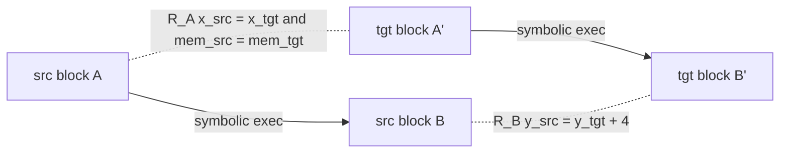
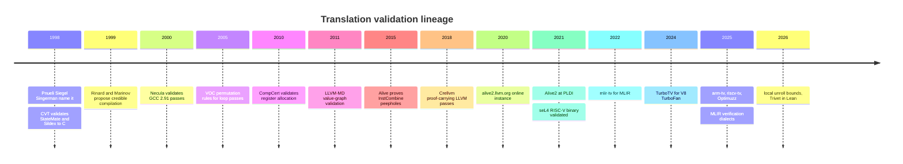
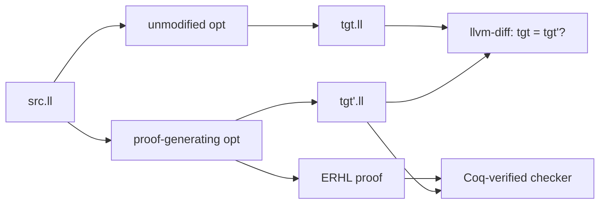
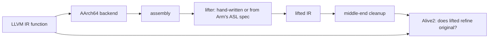
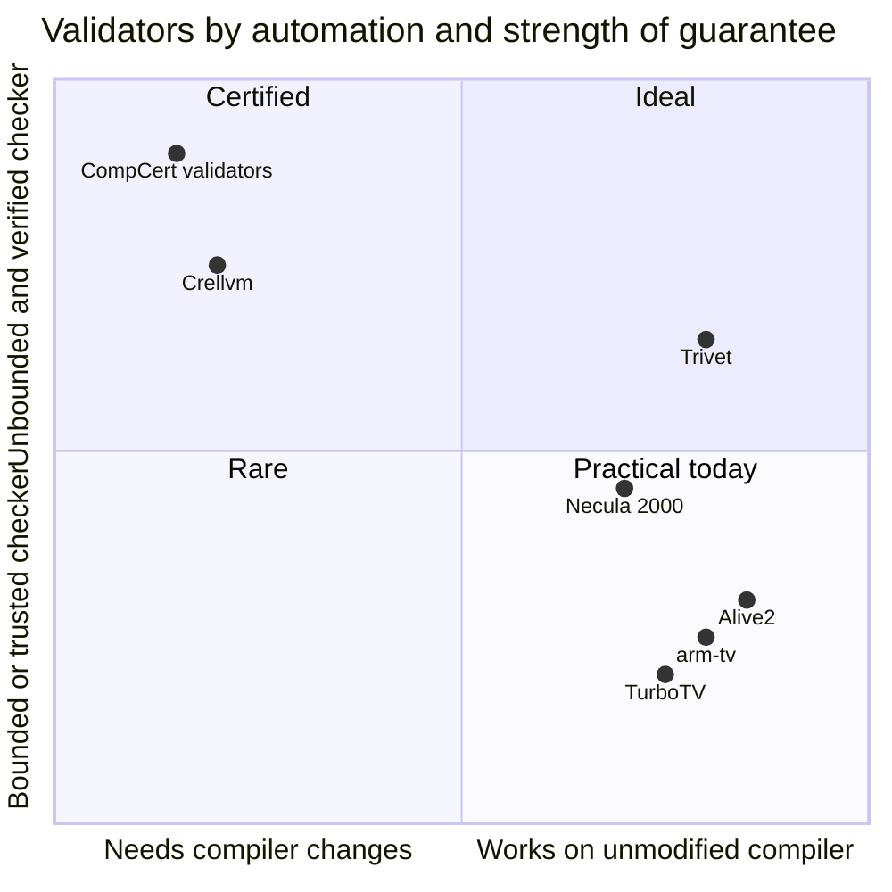

---
tags:
  - compilers
  - translation-validation
  - compiler-correctness
  - alive2
  - smt
  - refinement
  - formal-methods
status: complete
sources:
  - https://link.springer.com/chapter/10.1007/BFb0054170
  - https://www.wisdom.weizmann.ac.il/~verify/publications/1998/pss98b.html
  - https://people.csail.mit.edu/rinard/paper/credibleCompilation.html
  - https://www.cse.iitd.ac.in/~sbansal/csl862-soft/readings/translation_validation.pdf
  - https://users.cs.utah.edu/~regehr/papers/pldi15.pdf
  - https://www-old.cs.utah.edu/~regehr/alive2-pldi21.pdf
  - https://users.cs.utah.edu/~regehr/fmitf25.pdf
  - https://www-old.cs.utah.edu/~regehr/papers/arm-tv.pdf
  - https://llvm.org/devmtg/2025-10/slides/student_talks/briles.pdf
  - http://prosys.kaist.ac.kr/publications/pldi25.pdf
  - https://prosys.kaist.ac.kr/publications/icse24.pdf
  - https://sf.snu.ac.kr/publications/crellvm.pdf
  - https://arxiv.org/pdf/2609.19583
  - https://web.ist.utl.pt/nuno.lopes/pubs/alive2-mem-cav21.pdf
  - https://llvm.org/docs/InstCombineContributorGuide.html
  - https://blog.regehr.org/archives/1737
  - https://web.ist.utl.pt/nuno.lopes/alive2/
  - https://theory.stanford.edu/~barrett/pubs/ZPG+05-abstract.html
  - https://dash.harvard.edu/bitstream/1/4762396/1/pldi84-tristan.pdf
  - https://people.cs.rutgers.edu/%7Esn349/papers/local-unroll-bounds-soap26.pdf
  - https://xavierleroy.org/bibrefs/Rideau-Leroy-regalloc.html
  - https://2023.splashcon.org/details/splash-2023-oopsla/34/Formally-Verifying-Optimizations-with-Block-Simulations
  - https://cfallin.org/blog/2021/03/15/cranelift-isel-3/
  - https://microkerneldude.org/2021/05/05/sel4-on-risc-v-verified-to-binary-code/
  - https://docs.sel4.systems/projects/sel4/verified-configurations.html
  - https://arxiv.org/abs/2403.05302
  - https://easychair.org/publications/preprint/LjP7/open
  - https://www2.cs.utah.edu/~regehr/papers/pldi25.pdf
  - https://arxiv.org/pdf/2607.02684
created: 2026-11-26
updated: 2026-11-27
---

## Table Of Contents

- [[#TL;DR|TL;DR]]
- [[#The Problem|The Problem]]
- [[#Foundations|Foundations]]
    - [[#Refinement, Not Equivalence|Refinement, Not Equivalence]]
    - [[#Undef, Poison and Which Side Gets the Quantifier|Undef, Poison and Which Side Gets the Quantifier]]
    - [[#Simulation Relations and Witnesses|Simulation Relations and Witnesses]]
    - [[#Bounded Versus Unbounded Checking|Bounded Versus Unbounded Checking]]
- [[#How We Got Here|How We Got Here]]
- [[#How It Works|How It Works]]
    - [[#Alive: Proving Peephole Rules Once|Alive: Proving Peephole Rules Once]]
    - [[#Worked Example: An Incorrect Peephole|Worked Example: An Incorrect Peephole]]
    - [[#Alive2: Validating Every Run|Alive2: Validating Every Run]]
    - [[#Encoding Memory|Encoding Memory]]
    - [[#Credible Compilation and Certificate Checking|Credible Compilation and Certificate Checking]]
    - [[#Backend and Binary Validation|Backend and Binary Validation]]
    - [[#Beyond LLVM IR: JITs and MLIR|Beyond LLVM IR: JITs and MLIR]]
- [[#Where It Is Now|Where It Is Now]]
    - [[#Continuous Validation|Continuous Validation]]
    - [[#Proof Assistants and LLMs|Proof Assistants and LLMs]]
- [[#Trade-offs & Open Problems|Trade-offs & Open Problems]]
- [[#Resources|Resources]]
- [[#Related Notes|Related Notes]]

## ***TL;DR***
---
*Translation validation stops asking "is the compiler correct?" and asks "was this one compilation correct?", by handing the input and output of a run to an independent checker. It is how mainstream compilers get formal guarantees without being rewritten in a proof assistant.*

- **The idea (1998).** Pnueli, Siegel and Singerman proposed following each individual run of a compiler with an automatic check that the target code correctly implements the source, using a common semantics, a refinement relation, and a simulation-based proof method ([TACAS 1998](https://link.springer.com/chapter/10.1007/BFb0054170)). Necula applied it to GCC's real optimization passes two years later ([PLDI 2000](https://www.cse.iitd.ac.in/~sbansal/csl862-soft/readings/translation_validation.pdf)).
- **The correctness notion is refinement.** With undefined behavior, `undef` and `poison`, "same output" is the wrong test: the optimized code may *remove* nondeterminism and UB but never *add* it ([Lopes et al., PLDI 2021](https://www-old.cs.utah.edu/~regehr/alive2-pldi21.pdf)). Getting the quantifiers right (target choices universal, source choices existential) is most of the art.
- **Alive2 is the industrial instance.** It checks LLVM IR refinement with Z3, unrolls loops to a bound, and runs as `alive-tv`, an `opt` plugin, a Clang plugin and an online Compiler Explorer instance linked from "more than 800" LLVM issues ([Regehr, 2025](https://users.cs.utah.edu/~regehr/fmitf25.pdf)). Its forks validate the AArch64 and RISC-V backends by lifting assembly back to IR ([arm-tv, OOPSLA 2025](https://www-old.cs.utah.edu/~regehr/papers/arm-tv.pdf)).
- **Two flavors.** *Black-box* validators infer why the output is right (Necula, Alive2); *credible compilation* has the compiler emit a proof that a small verified checker accepts (Rinard 1999, Crellvm 2018, CompCert's validators, Axon 2026).
- **As of November 2026**, the frontier is continuous validation (fuzzers aimed at each new commit, with Alive2 as the oracle), validation beyond LLVM IR (JITs, MLIR, machine code), and replacing bounded SMT queries with Lean proofs written partly by LLMs ([Trivet, Sept 2026](https://arxiv.org/pdf/2609.19583)).

## ***The Problem***
---
*A compiler is a large program that is changed every day by many people, and a proof of it would go stale on the next commit. Translation validation trades a one-time proof of all runs for a cheap check of each run.*

[[Verified Compilers]] like CompCert prove, once and for all, that every output preserves the source's meaning. That works for a compiler designed around the proof, but not for GCC or [[LLVM]]: millions of lines, heuristics everywhere, and a stream of new [[Classic Optimizations]] each week. Pnueli's group named the second problem directly: formally verifying a code generator freezes its design, while validating its outputs does not ([Pnueli, Shtrichman & Siegel](https://www.wisdom.weizmann.ac.il/~verify/publications/1998/pss98b.html)).

Testing alone ([[Compiler Testing and Fuzzing]]) is not enough either. A differential test only sees a miscompilation if some input makes the wrong code *observably* different; translation validation asks a solver whether *any* input does. Three practical questions shape every validator:

| Question | Why it is hard | Typical answer |
|---|---|---|
| What counts as "correct"? | UB, `undef`, `poison`, nondeterministic allocation, floating-point NaN bits | Refinement, with a precise IR semantics |
| How do we relate two different programs? | Passes rename, reorder, merge and unroll | Symbolic execution plus an inferred or emitted simulation relation |
| What if the checker cannot decide? | Loops, memory, solver timeouts | Be incomplete: say "don't know" rather than a false "OK" (or a false alarm) |

The payoff is that the trusted part shrinks to the checker plus the semantics it encodes. The optimizer can stay unverified, fast and messy.

## ***Foundations***
---
*Four ideas carry the field: refinement as the definition of correct, a careful treatment of deferred undefined behavior, simulation relations to line up two programs, and the choice between bounded and unbounded checking.*

### Refinement, Not Equivalence

*A transformation is correct if every behavior the target can show is a behavior the source was allowed to show; the reverse is not required.*

Write $\text{Beh}(P, i)$ for the set of behaviors program $P$ may exhibit on input $i$ (a return value, a final memory, "undefined behavior", and so on). Then

$$
\text{tgt} \sqsubseteq \text{src} \iff \forall i.\ \text{Beh}(\text{tgt}, i) \subseteq \text{Beh}(\text{src}, i)
$$

**In plain English:** for every input, anything the optimized code might do, the original code might also have done. The Alive2 paper puts it as "Refinement allows a transformation to remove non-determinism, but not to add it" ([Lopes et al.](https://www-old.cs.utah.edu/~regehr/alive2-pldi21.pdf)).

Why not equivalence ($=$ instead of $\subseteq$)? Because most profitable optimizations are only correct in one direction:

- **Removing UB.** If the source is UB on some input, its behavior set is "anything", so the target may do whatever is cheapest there. `add nsw` overflow is poison, which is what lets `x + 1 > x` fold to `true` (see [[Classic Optimizations]]). The fold is a refinement; it is not an equivalence, and the reverse rewrite would be wrong.
- **Resolving nondeterminism.** An `undef` operand may be replaced by any concrete value (0 is popular), shrinking a set of possible results to one.
- **Allocation and addresses.** Where a heap or stack block lands is nondeterministic, so a pass that merges or removes allocations changes concrete addresses. Alive2 compares local pointers with a dedicated refinement relation rather than plain equality for this reason ([Lopes et al.](https://www-old.cs.utah.edu/~regehr/alive2-pldi21.pdf)).

Refinement composes: if each pass's output refines its input, the whole pipeline's output refines the original. That is what makes per-pass validation meaningful for a 100-pass pipeline. Pnueli's original definition was already phrased as a refinement relation ([TACAS 1998](https://link.springer.com/chapter/10.1007/BFb0054170)); LLVM's undefined-behavior semantics are what turned it from a formality into the central engineering problem.

### Undef, Poison and Which Side Gets the Quantifier

*Source nondeterminism is existentially quantified (the source may pick whatever explains the target), target nondeterminism universally (the target must be right whatever it picks). Mixing these up gives either false alarms or unsound proofs.*

LLVM has two flavors of deferred UB (the [[Classic Optimizations]] note has the full ordering, and the planned [[Undefined Behavior and Compiler Semantics]] note will go further):

- **`undef`**: "the set of all possible bit patterns for a particular type" ([Lopes et al., PLDI 2015](https://users.cs.utah.edu/~regehr/papers/pldi15.pdf)), and each *use* may see a different member.
- **`poison`**: the result of an operation whose flags were violated (`nsw`, `nuw`, `exact`, `inbounds`); it propagates and cannot be "untainted" by later operations ([PLDI 2015](https://users.cs.utah.edu/~regehr/papers/pldi15.pdf)). Alive2 represents every register as a pair `(value, ispoison)` ([PLDI 2021](https://www-old.cs.utah.edu/~regehr/alive2-pldi21.pdf)).

The original Alive splits correctness into three checks per instruction, under a precondition $\psi$ that bundles the user's precondition, source definedness and source poison-freedom: the target must be (1) defined, (2) poison-free, and (3) equal to the source, whenever $\psi$ holds ([PLDI 2015](https://users.cs.utah.edu/~regehr/papers/pldi15.pdf)). In the notation of this note (my rewrite, not the paper's symbols):

$$
\forall I.\ \forall u_{\text{tgt}}.\ \exists u_{\text{src}}.\ \psi(I, u_{\text{src}}) \Rightarrow \big(\text{def}_{\text{tgt}} \wedge \neg\text{poison}_{\text{tgt}} \wedge r_{\text{tgt}} = r_{\text{src}}\big)
$$

**In plain English:** for every input and every way the target could resolve its `undef`s, there is some way the source could have resolved *its* `undef`s that makes the source well defined and gives the same answer. The paper says target undefs are universally and source undefs existentially quantified, because "an undef in the source represents a set of values and the target can refine it to any particular value" ([PLDI 2015](https://users.cs.utah.edu/~regehr/papers/pldi15.pdf)).

The quantifier alternation ($\forall\exists$) is what makes these queries expensive. A tiny example shows the asymmetry. I checked these four claims with a 20-line z3py script that models each use of `undef` as a fresh variable (hand-written check, not Alive2 output; i8):

```
src: mul undef,2      tgt: add undef,undef   -> NOT a refinement
src: add undef,undef  tgt: mul undef,2       -> refinement holds
src: mul undef,2      tgt: 0                 -> refinement holds
src: mul undef,2      tgt: 1                 -> NOT a refinement
```

`mul undef, 2` can only produce even numbers. `add undef, undef` reads `undef` twice, independently, so it can produce odd numbers too: replacing the multiply with the add *adds* behaviors and is wrong, while the opposite direction is fine. Turning the multiply into the constant 0 picks one allowed (even) value; turning it into 1 invents a value the source could never produce. Real LLVM tests hit this: Lopes and Regehr list `shl %x, 1` versus `add %x, %x` as non-interchangeable when `%x` may be undef, and in June 2020, 25 of the 95 failures Alive2 reported in LLVM's unit tests would have been fine "if undef was removed" ([Alive2 Part 2](https://blog.regehr.org/archives/1737)). This is exactly why LLVM introduced `freeze` and is deprecating `undef` in favor of poison (see [[Classic Optimizations]]).

Alive2's engineering compromises around this: it gives each use of an `undef` value a fresh quantified variable, models function arguments with four variables (is-undef, is-poison, a defined value, and a fresh value for the undef case), and deliberately *under-approximates* partial undef, which the paper says cuts the state space from doubly exponential to exponential ([PLDI 2021](https://www-old.cs.utah.edu/~regehr/alive2-pldi21.pdf)).

### Simulation Relations and Witnesses

*For anything bigger than a peephole, the validator needs to know which point in the target corresponds to which point in the source, and what holds there. That map is a simulation relation; finding it is the hard part.*

Pnueli's recipe had three ingredients: a common semantic model for source and target, refinement as the correctness notion, and a syntactic, simulation-based proof method ([TACAS 1998](https://link.springer.com/chapter/10.1007/BFb0054170)). A simulation relation is a set of pairs (source program point, target program point) with a formula relating the two states at each pair. If the relation holds at entry, is preserved along every pair of matched paths, and implies equal observable behavior at exits, the target refines the source.



Who supplies the relation splits the field in two:

| Approach | Who finds the relation | Trusted | Examples |
|---|---|---|---|
| **Black-box validation** | The validator infers it from the two programs | Validator and its semantics | Necula 2000, Alive2, TurboTV |
| **Credible compilation** | The compiler emits it (or a full proof) as a certificate | Only the checker | Rinard and Marinov 1999, Crellvm, CompCert's validators |

Necula's validator is the classic black-box example: it calls two executions equivalent when they make the same sequence of function calls and returns, represents each basic block as a symbolic transfer function (which hides renaming, scheduling and CSE), guesses which source branch each target branch corresponds to with scored heuristics, and then solves the resulting equality constraints ([PLDI 2000](https://www.cse.iitd.ac.in/~sbansal/csl862-soft/readings/translation_validation.pdf)). He notes the compiler *could* emit the relation, but his tool infers it by passively observing the compilation. Rinard and Marinov took the other route: a credible compiler produces a proof in two parts, one that the analysis results are correct and one that source and target are related by a simulation relation, each in a logic they prove sound ([Rinard & Marinov, 1999](https://people.csail.mit.edu/rinard/paper/credibleCompilation.html)).

### Bounded Versus Unbounded Checking

*Straight-line code reduces to one SMT query. Loops do not, so a validator either unrolls them a fixed number of times (bounded, misses deep bugs) or finds loop invariants (unbounded, harder and less automatic).*

| | Bounded (Alive2) | Unbounded (simulation-relation style) |
|---|---|---|
| Loops | Unrolled $k$ times, then cut off | Related by an invariant at loop heads |
| Verdict "correct" | Only for executions within the bound | For all executions |
| Verdict "incorrect" | A real counterexample (if the model is right) | A real counterexample, or a failure to find the invariant |
| Handles loop-restructuring passes | Badly: unrolling changes iteration counts | Needs special rules (permutations, unroll correspondences) |
| Automation | Push-button | Relation inference is heuristic or must be emitted |

Alive2 unrolls each loop, inner loops first, using Tarjan-Havlak loop analysis so that the work stays linear in the unroll factor rather than exponential. Back edges in the last copy go to a *sink* block, whose reachability is negated and added to the precondition, so the check only considers executions that finish within the bound. The paper says the factor should be at least 2 for passes that do not manipulate loops and may need to reach 64 for vectorization; bugs needing more iterations are missed (its example needs about $2^{16}$), and infinite loops without `mustprogress` are not supported ([PLDI 2021](https://www-old.cs.utah.edu/~regehr/alive2-pldi21.pdf)).

Unbounded approaches pay for completeness in automation. Four ways people have tried:

- **Match loop heads with a relation.** Necula's validator relates loop headers like any other program points, which works when a pass keeps loop structure; it handled only one of GCC's four loop-unrolling variants ([PLDI 2000](https://www.cse.iitd.ac.in/~sbansal/csl862-soft/readings/translation_validation.pdf)). seL4's binary validation failed mostly on unrolled loops at `-O2` for the same reason (see [[Verified Compilers]]).
- **Proof rules per transformation family.** Zuck, Pnueli, Barrett and colleagues added *permutation rules* to their VOC tool for structure-changing loop passes (distribution, fusion, tiling, interchange): the rule shows the new iteration order respects every data dependence the transformation needs ([Zuck et al., FMSD 2005](https://theory.stanford.edu/~barrett/pubs/ZPG+05-abstract.html)). See [[Loop Optimizations]] for the passes.
- **Normalize both sides to the same graph.** LLVM-MD (Tristan, Govereau and Morrisett, PLDI 2011) converts both functions to gated SSA, where a loop becomes a μ-node (initial value plus per-iteration update) and an η-node (value at exit), builds one shared, hash-consed value graph, and rewrites it with rules that mirror the optimizer. If both functions reduce to the same node, they agree for *all* iterations. It validated about 80% of per-function optimizations across a seven-pass pipeline (ADCE, GVN, SCCP, LICM, DSE and two loop passes), but only about 50% of GVN runs without extra rules ([Tristan et al.](https://dash.harvard.edu/bitstream/1/4762396/1/pldi84-tristan.pdf)). The same idea, with e-graphs, is in [[E-Graphs and Equality Saturation]].
- **Induction in a proof assistant.** Trivet (2026) proves a restricted class of loops (a canonical three-block loop with one self-loop body) by induction in Lean instead of unrolling, and leaves general loop shapes to future work ([Liao et al.](https://arxiv.org/pdf/2609.19583)).

A middle path keeps Alive2's bounded engine but spends the bound more wisely. *Locally bounded* validation (SOAP 2026) gives each loop its own unroll factor and searches the lattice of factor vectors: a verified point prunes everything below it, a timeout prunes everything above. On 119 of TSVC's 138 loop kernels plus 86 oggenc and 56 SQLite functions, with per-loop bounds up to 15 and 10-second queries, it reported from "a few percent to over 100% more verification coverage" than one global bound ([Jelvani, Martin & Nagarakatte](https://people.cs.rutgers.edu/%7Esn349/papers/local-unroll-bounds-soap26.pdf)).

## ***How We Got Here***
---
*The idea came from synchronous-language code generators in 1998, reached a production C compiler in 2000, split into "infer it" and "certify it" camps, and became routine in LLVM after Alive (2015) and Alive2 (2021).*



| Year | Milestone | Why it mattered |
|---|---|---|
| 1998 | Pnueli, Siegel and Singerman, "Translation validation" ([TACAS 1998](https://link.springer.com/chapter/10.1007/BFb0054170)) | Named the idea; Signal (synchronous, multi-clock dataflow) to sequential C |
| 1998 | CVT in the ESPRIT SACRES project ([Pnueli et al.](https://www.wisdom.weizmann.ac.il/~verify/publications/1998/pss98b.html)) | Uninterpreted functions plus BDDs validated specifications of several thousand lines |
| 1999 | Credible compilation ([Rinard & Marinov](https://people.csail.mit.edu/rinard/paper/credibleCompilation.html)) | The compiler ships a proof; the checker is the only trusted part |
| 2000 | Necula's GCC validator ([PLDI 2000](https://www.cse.iitd.ac.in/~sbansal/csl862-soft/readings/translation_validation.pdf)) | First validator for a real optimizing C compiler, on GCC and Linux |
| 2005 | VOC permutation rules ([Zuck et al.](https://theory.stanford.edu/~barrett/pubs/ZPG+05-abstract.html)) | Structure-changing loop passes (fusion, tiling, interchange) become checkable |
| 2010 | CompCert's register-allocation validator ([Rideau & Leroy, CC 2010](https://xavierleroy.org/bibrefs/Rideau-Leroy-regalloc.html)) | Unverified heuristic plus Coq-proved checker equals a verified pass |
| 2011 | LLVM-MD ([Tristan et al., PLDI 2011](https://dash.harvard.edu/bitstream/1/4762396/1/pldi84-tristan.pdf)) | Black-box validation of a stock LLVM pipeline via value graphs |
| 2015 | Alive ([PLDI 2015](https://users.cs.utah.edu/~regehr/papers/pldi15.pdf)) | Found 8 wrong InstCombine rules among 334 translated |
| 2018 | Crellvm ([PLDI 2018](https://sf.snu.ac.kr/publications/crellvm.pdf)) | Credible compilation for real LLVM passes with a Coq-verified checker |
| 2021 | Alive2 ([PLDI 2021](https://www-old.cs.utah.edu/~regehr/alive2-pldi21.pdf)) | Validates real pass runs on real IR, no LLVM changes needed |
| 2021 | seL4 RV64 binary verification ([Heiser](https://microkerneldude.org/2021/05/05/sel4-on-risc-v-verified-to-binary-code/)) | First 64-bit architecture with seL4's C-to-binary validation |
| 2022 | mlir-tv ([Bang et al., CAV 2022](https://easychair.org/publications/preprint/LjP7/open)) | Refinement checking for tensor-level MLIR passes |
| 2024 | TurboTV ([ICSE 2024](https://prosys.kaist.ac.kr/publications/icse24.pdf)) | Translation validation for a production JavaScript JIT |
| 2025 | arm-tv ([OOPSLA 2025](https://www-old.cs.utah.edu/~regehr/papers/arm-tv.pdf)), riscv-tv ([LLVM Dev Meeting 2025](https://llvm.org/devmtg/2025-10/slides/student_talks/briles.pdf)), Optimuzz ([PLDI 2025](http://prosys.kaist.ac.kr/publications/pldi25.pdf)), verification dialects ([PLDI 2025](https://www2.cs.utah.edu/~regehr/papers/pldi25.pdf)) | Backends validated by lifting; fuzzers aimed at each commit; MLIR semantics as dialects |
| 2026 | Locally bounded TV ([SOAP 2026](https://people.cs.rutgers.edu/%7Esn349/papers/local-unroll-bounds-soap26.pdf)), Trivet ([arXiv, Sept 2026](https://arxiv.org/pdf/2609.19583)) | Smarter bounds; Lean proofs with LLM help instead of bounded SMT |

## ***How It Works***
---
*Alive and Alive2 show the SMT-based black-box style in detail, Crellvm and CompCert the certificate style; backend, JIT and MLIR validators reuse the same refinement idea on other languages.*

### Alive: Proving Peephole Rules Once

*Alive is not quite translation validation: it proves a rewrite rule correct for all inputs and all bit-widths it enumerates, once, before the rule is compiled into LLVM.*

Alive (Lopes, Menendez, Nagarakatte and Regehr, PLDI 2015) gave LLVM developers a small DSL for InstCombine-style rules (source pattern, `=>`, target pattern, optional precondition) and checked each one with Z3 ([PLDI 2015](https://users.cs.utah.edu/~regehr/papers/pldi15.pdf)). The design points that later carried into Alive2:

- **Types by enumeration.** Rules are written without fixed bit-widths. Alive uses the solver to find every valid type assignment, "iteratively strengthening the formula with the negation of each model", capping integers at 64 bits by default.
- **Three conditions per instruction.** Definedness, poison-freedom, and equal results, with source `undef`s existential and target `undef`s universal (see [[#Undef, Poison and Which Side Gets the Quantifier|Foundations]]).
- **Flag inference.** Each `nsw`, `nuw` or `exact` attribute gets a Boolean, and Alive enumerates which assignments still verify. On the 334 translated rules, it weakened one precondition and strengthened the postcondition (added flags the target may keep) for 70 of them, 21%.
- **Memory** as an array from pointers to bytes, encoded by eager Ackermannization (`store(m, q, v)` becomes `ite(p = q, v, m)`), which solved faster than the array theory in their experiments.
- **Cost.** About 5,200 lines of Python; most rules verify in "a few seconds", but some multiplication and division rules took "several hours or longer" at large widths.

The results: of InstCombine's 1,028 rules, the authors translated 334 and found **8 wrong** (2.4%). Six of those were in `MulDivRem`, out of 44 translated from that file (14%); two were in `AddSub` ([PLDI 2015](https://users.cs.utah.edu/~regehr/papers/pldi15.pdf)). In that sample, division rules were wrong far more often than the rest, and the next section shows why.

### Worked Example: An Incorrect Peephole

*A rule that looks like high-school algebra breaks at one corner of two's-complement arithmetic, and the solver finds that corner instantly.*

LLVM bug PR21245, as shown in Figure 5 of the Alive paper, in Alive's syntax ([PLDI 2015](https://users.cs.utah.edu/~regehr/papers/pldi15.pdf)):

```
Pre: C2 % (1<<C1) == 0
%s = shl nsw %X, C1
%r = sdiv %s, C2
  =>
%r = sdiv %X, C2 / (1<<C1)
```

The intuition: $(X \cdot 2^{C1}) / C2 = X / (C2 / 2^{C1})$ when $2^{C1}$ divides $C2$, and `nsw` promises the shift did not overflow. Alive reported a value mismatch at type `i4`, with the fields the paper prints:

```
ERROR: Mismatch in values of i4 %r
%X i4 = 0xF (15, -1)
C1 i4 = 0x3 (3)
C2 i4 = 0x8 (8, -8)
%s i4 = 0x8 (8, -8)
Source value: 0x1 (1)
Target value: 0xF (15, -1)
```

Read it in signed 4-bit arithmetic: $1 \ll 3 = 8$, which in `i4` is $-8$. The shift `-1 << 3 = -8` is fine under `nsw` (no signed overflow). The source computes $-8 / -8 = 1$. The target's divisor is $C2 / (1 \ll C1) = -8 / -8 = 1$, so it computes $-1 / 1 = -1$. The algebra silently assumed $2^{C1}$ is positive, which fails exactly when $C1$ is the sign bit position.

I re-encoded the rule in a few lines of z3py, with the same three conditions (hand-written checker, not Alive or Alive2; output pasted from my run with Z3 5.4.1 from the `z3-solver` Python package):

```
i4: INCORRECT  X=-1 C1=3 C2=-8  shl=-8  src=1  tgt=-1
i8: INCORRECT  X=-1 C1=7 C2=-128  shl=-128  src=1  tgt=-1
i16: INCORRECT  X=-1 C1=15 C2=-32768  shl=-32768  src=1  tgt=-1
```

Z3 finds the same corner at every width. Adding the precondition `C1 < width - 1` (keep $2^{C1}$ positive) makes `i4` and `i8` verify in 0.02 s and 0.27 s, while `i16` did not finish within 100 seconds on this machine. That reproduces, in miniature, the paper's warning that division blows up with bit-width, and why the LLVM InstCombine guide tells contributors to shrink bit-widths when Alive2 times out (see [[Verified Compilers]]).

The same idea in Alive2's form is a pair of functions, `@src` and `@tgt`, with the constants filled in. A hand-written pair for `i8` (the target's divisor $-128 / -128$ folds to 1, so `sdiv %x, 1` is just `%x`):

```llvm
define i8 @src(i8 %x) {
  %s = shl nsw i8 %x, 7
  %r = sdiv i8 %s, -128
  ret i8 %r
}
define i8 @tgt(i8 %x) {
  ret i8 %x            ; what the buggy rule would produce
}
```

Feeding the source to today's InstCombine (real output, Ubuntu LLVM 18.1.3, `opt -S -passes=instcombine`) gives a different, correct answer:

```llvm
define i8 @src(i8 %x) {
  %1 = icmp ne i8 %x, 0
  %r = zext i1 %1 to i8
  ret i8 %r
}
```

Why it is right: `shl nsw i8 %x, 7` is poison for every `%x` except 0 and -1, so only those two inputs matter, and they give 0 and 1. InstCombine exploited the poison to collapse the division into a comparison, a refinement that a naive equivalence checker would reject.

### Alive2: Validating Every Run

*Alive2 drops the DSL and checks whole functions before and after real passes, so it validates what LLVM actually did rather than what a rule says it does.*

Alive2 (Lopes, Lee, Hur, Liu and Regehr, PLDI 2021) is about 23,000 lines of C++ on Z3 ([PLDI 2021](https://www-old.cs.utah.edu/~regehr/alive2-pldi21.pdf)). The [[Verified Compilers]] note covers its headline numbers and limits; the internals worth knowing:

- **The real refinement query.** With nondeterminism variables $N$ on both sides and preconditions that may differ (LLVM can drop a `nonnull` attribute, so the target's precondition can hold where the source's fails), the final formula is: for all source inputs, target inputs and target outcomes, if the target can produce that outcome under some $N_{\text{tgt}}$, then the source can produce an outcome it refines under some $N_{\text{src}}$. The negation is split into **seven** smaller queries (preconditions, UB, return domain, poison, undef, value equality, memory), which gives sharper error messages and easier solver problems.
- **Values.** Integers are bit-vectors, floats use SMT's floating-point theory, aggregates are concatenated bit-vectors, pointers are `(block id, offset)`.
- **Calls.** An unknown call is a pure function of its arguments and memory, returning a value, a new memory and a UB flag. A target call cannot be new, so each one must match some source call; a fresh index picks which, and "no match" is UB. Unsupported intrinsics become over-approximated calls, and a bug that depends on them is not reported as definite.
- **Floating point.** NaN bit patterns are not unique ([[Floating-Point Semantics]]), so float-to-int `bitcast` was given nondeterministic NaN bits after the community found no consensus; x86's 80-bit floats are unsupported.
- **Failures found.** On LLVM's unit tests, 121 refinement violations: 43 involving `undef` inputs, 18 branches on undef or poison, 17 memory bugs, 9 vector bugs and others. 47 were reported and 28 fixed at publication. Several led to LangRef changes, such as making branching on `undef` UB. The authors also found six soundness bugs in Z3 itself.

The tools: `alive-tv` compares two IR files; an `opt` plugin adds `-tv`, so `opt -tv -sroa -instcombine -tv -gvn -tv file.ll` validates each listed pass; a Clang plugin and the `alivecc`/`alive++` drivers validate every IR-level optimization during a normal build ([PLDI 2021](https://www-old.cs.utah.edu/~regehr/alive2-pldi21.pdf)).

**The online instance.** alive2.llvm.org was created in June 2020 as a fork of Compiler Explorer. In 2025 it ran on a two-core VM with 8 GB of RAM, gave each request a 10-second timeout and 1 GB of memory, refreshed its LLVM every 2 to 3 weeks, and was "almost 5,000 commits behind" upstream Compiler Explorer. More than 800 issues in LLVM's GitHub link to it, which is how a proof gets attached to a bug report or pull request in practice ([Regehr, 2025](https://users.cs.utah.edu/~regehr/fmitf25.pdf)).

Single-file benchmarks show where it struggles. Validating whole programs pass by pass, with one-minute Z3 timeouts:

| Program | Pass/function pairs that changed | Correct | Incorrect | Timeout | Unsupported |
|---|---|---|---|---|---|
| gzip | 2.6K | 884 | 4 | 905 | 754 |
| SQLite3 | 12.2K | 2,314 | 38 | 2,102 | 7,543 |

(From Figure 7 of [Lopes et al.](https://www-old.cs.utah.edu/~regehr/alive2-pldi21.pdf); the "incorrect" column mixes real bugs and modelling gaps.) On realistic code, timeouts and unsupported features outnumber proofs. That is why Alive2 is used mainly on small, reduced test functions.

### Encoding Memory

*Memory is where translation validators spend most of their effort, because LLVM's pointer rules (provenance, out-of-bounds UB, uninitialized bytes) are subtle and SMT arrays are slow.*

Alive2's model, from the PLDI paper ([Lopes et al.](https://www-old.cs.utah.edu/~regehr/alive2-pldi21.pdf)) and the companion memory paper ([Lee, Kim, Hur & Lopes, CAV 2021](https://web.ist.utl.pt/nuno.lopes/pubs/alive2-mem-cav21.pdf)):

- **Blocks.** Every stack variable, global and `malloc` gets its own block with a bounded numeric id; a pointer is a block id plus an offset, so pointers carry provenance.
- **Bytes.** Each block is an SMT array from offset to byte. A byte is poison, part of a pointer, or a non-pointer byte with an 8-bit value and an 8-bit poison mask (so a partially initialized byte can be modelled).
- **UB rules.** Out-of-bounds or freed-block access, stores to read-only blocks, and bad `free` calls are UB; `gep inbounds` that leaves its block yields poison.
- **Local versus non-local.** Blocks allocated inside the function are private, so the source and target may allocate different numbers of them; refinement maps them with `pointerRefined` instead of requiring equal ids.

The engineering tricks are what make it tractable. The most significant bit of a block id marks *local* versus *non-local*, so the two can never alias by construction; memory is one SMT array *per block* rather than one global array, so a store touches only its block; properties of non-local blocks are uninterpreted functions while local ones are `ite` chains; and the local-or-not case split is resolved before the solver sees it, which the paper says is cheap for "over 95% of the cases". The payoff was **21 previously unknown bugs** in LLVM's memory optimizations (10 fixed at writing), from about 3,000 lines of memory-model code ([CAV 2021](https://web.ist.utl.pt/nuno.lopes/pubs/alive2-mem-cav21.pdf)). The pressure is visible in its single-file runs too: on SQLite, about 2.2K function pairs verified and about 2.2K timed out, with loops unrolled only once.

The model is deliberately logical (no integer addresses) and has one address space, which is why arm-tv needed an "assembly mode" with physical pointers and full provenance to talk about machine code ([arm-tv](https://www-old.cs.utah.edu/~regehr/papers/arm-tv.pdf)). The planned [[Memory Models and Pointer Provenance]] note covers the semantic questions; [[Pointer and Alias Analysis]] covers the optimizations whose correctness depends on them.

### Credible Compilation and Certificate Checking

*Instead of a clever validator that reverse-engineers the optimizer, make the optimizer explain itself: emit a proof object that a small, verified checker accepts.*

**Crellvm** (Kang et al., PLDI 2018) is the most complete attempt on LLVM ([PLDI 2018](https://sf.snu.ac.kr/publications/crellvm.pdf)). A proof-generating build of each pass produces the optimized IR plus a proof in **ERHL**, a relational Hoare logic for LLVM IR whose assertions have three parts: a fact about the source state, a fact about the target state, and a *maydiff* set of registers allowed to differ. A Coq-verified checker validates the proof; `llvm-diff` then confirms the proof-generating build's output matches the normal build's.



What it cost and what it found:

| Pass | Lines of pass covered | Proof-generation lines | Validations | Failures |
|---|---|---|---|---|
| mem2reg | 568 | 213 | 76.79K | 10 |
| gvn | 1,092 | 440 | 365.99K | 453 |
| licm | 706 | 286 | 168.20K | 0 |
| instcombine (139 micro-optimizations) | 702 | 1,357 | 1,593.84K | 0 |

Over about 5.3 million lines of C at `-O2`, 74.0% of 2.2 million validations succeeded, 26.0% were unsupported (mostly vector operations), and all 463 failures traced to compiler bugs, including new bugs in mem2reg and GVN. The checker is 2,987 lines of Coq with an 18,934-line correctness proof. The price: proof checking took far longer than compiling, and instrumenting InstCombine took more code than the rules themselves ([PLDI 2018](https://sf.snu.ac.kr/publications/crellvm.pdf)).

**CompCert** uses the same pattern inside a verified compiler. Rideau and Leroy's register-allocation validator infers, by a *backward* dataflow analysis, equations relating each variable to the register or stack slot holding it, which lets it accept sophisticated spilling, live-range splitting and overlapping registers; the validator is proved sound in Coq, so the allocator's heuristic needs no proof ([CC 2010](https://xavierleroy.org/bibrefs/Rideau-Leroy-regalloc.html); see [[Register Allocation]]). The Grenoble line of work went further and *co-designed* optimizations with their validators: the untrusted pass hands the validator hints (invariants or CFG morphisms), so one verified symbolic-execution validator covers superblock scheduling, dead-code elimination, constant propagation, lazy code motion and strength reduction, the last two being optimizations CompCert lacked compared to `gcc -O1` ([Gourdin et al., OOPSLA 2023](https://2023.splashcon.org/details/splash-2023-oopsla/34/Formally-Verifying-Optimizations-with-Block-Simulations)). That is the credible-compilation idea in its most practical form: the hint is a cheap certificate, not a full proof. **Axon** (Rinard, 2026) brings the 1999 term back for an LLM-built compiler (see [[Verified Compilers]]).

Production compilers use the same shape without proofs. Cranelift's register allocator ships a **symbolic checker** that replays one allocation abstractly: each register and spill slot holds a virtual-register symbol, "Unknown" or "Conflicted", moves and spills copy symbols, and every use must find the right virtual register. Its author says a flagged error "must be a bug (i.e., there are no false positives)", and that it lets them "prove that it is correct for any given compiler run". It mostly runs as a fuzzing oracle on OSS-Fuzz rather than on every compile, because of its overhead, and it found a bug in the GC reference-types support that hand-written tests missed ([Fallin, 2021](https://cfallin.org/blog/2021/03/15/cranelift-isel-3/)). Like CompCert's validator, it is fed hints by the allocator (which instructions are spills, reloads and moves).

The trade-off between the camps:

| | Black-box (Alive2) | Certificate (Crellvm, CompCert) |
|---|---|---|
| Compiler changes | None | Every pass must emit proofs |
| Checker | Large SMT encoding, trusted | Small, can be machine-verified |
| Completeness | Limited by solver and bounds | Limited by what the logic can express |
| Typical failure | Timeout or unsupported feature | Unsupported feature, or proof-generation bug |

### Backend and Binary Validation

*Below the IR, the source and target languages differ, so a validator needs a semantics for machine code too. The trick that works in LLVM is to lift the assembly back into IR and reuse Alive2.*

**arm-tv** (Berger et al., OOPSLA 2025) validates LLVM's AArch64 backend in four steps: compile a function with the backend, lift the assembly back to LLVM IR, clean the lifted IR with the middle end, and check refinement with a modified Alive2 ([arm-tv](https://www-old.cs.utah.edu/~regehr/papers/arm-tv.pdf)).



- **Machine state as IR.** The lifter allocates 29 general registers, SP, FP, LR, the zero register, four flags, 32 vector registers and a 4 KB stack, and fills unused state with `freeze poison` so the solver can choose adversarial values.
- **Two ISA semantics.** A hand-written lifter (about 8.1K lines, about 1,400 instructions) and one built by partially evaluating Arm's machine-readable ASL specification with ASLp. On the unit tests, the hand-written lifter lacked 641 instructions and the ASL-based one 11.
- **ABI checks.** 16-byte stack alignment, callee-saved registers restored, caller-saved registers nondeterministic after calls, and `signext`/`zeroext` obligations honored.
- **Results.** Inputs were 232,981 unit-test functions and 87,738 SPEC CPU 2017 functions plus fuzzers (YARPGen, alive-mutate, IRFuzzer). Between April 2022 and July 2025 it reported **45 miscompilations, 39 fixed**, most in code shared across backends. Timeouts were 3.1% on unit tests but 40% on SPEC functions.

One of its bugs (#74248): inserting into a vector at a variable index emitted a single byte store with an unbounded index, writing outside the vector for indices of 16 or more; the fix masks the index with `and x8, x2, #0xf`. Another (#57181) was an `i1 signext` parameter that conflicted with the ABI's zero-extension rule ([arm-tv](https://www-old.cs.utah.edu/~regehr/papers/arm-tv.pdf)).

**riscv-tv** applies the same pipeline to LLVM's 64-bit RISC-V backend (RV64I with the M and B extensions at publication of the arm-tv paper; floating point and vectors not started). At the October 2025 LLVM Developers' Meeting, its authors reported "Just 1 miscompile specific to RISC-V" and suggested arm-tv "may have caught most of the easier bugs in shared code"; the example was a `cttz` on an odd-width `i7` value lowered to `ori`/`ctz`/`andi`, flagged on trunk and LLVM 21.1.0 ([Briles & Regehr](https://llvm.org/devmtg/2025-10/slides/student_talks/briles.pdf)). See [[Instruction Selection]] for where these lowering bugs live.

Other binary-level validators make different choices of what to check:

- **seL4** validates the compiled binary against the verified C: both are translated into a common control-flow intermediate language and SMT solvers check them equivalent "one short code sequence at a time". After 32-bit Armv7, RISC-V 64 became in May 2021 "the first 64-bit architecture" with this binary-level proof, which needed significant scalability work; the post does not name the compiler or optimization level ([Heiser, 2021](https://microkerneldude.org/2021/05/05/sel4-on-risc-v-verified-to-binary-code/)). As of November 2026, though, seL4's [verified-configurations page](https://docs.sel4.systems/projects/sel4/verified-configurations.html) lists binary correctness only for the AArch32 (`ARM`) configuration, not for `RISCV64`, so check that page before relying on RISC-V binary-level assurance. The original PLDI 2013 method is in [[Verified Compilers]] and [[Microkernels and seL4]].
- **End-to-end C to assembly.** Rose and Bansal validate C procedures (100+ lines) against optimized assembly (200+ instructions), black-box and including loop and vectorizing transformations; their contribution is a refinement definition and SMT encoding for programs that take addresses of locals, use variable-length arrays, variadic calls and `alloca` ([OOPSLA 2024](https://arxiv.org/abs/2403.05302)).
- **VeriWasm** checks one *safety property* (sandbox isolation) of native code produced from [[WebAssembly]], rather than full refinement; see [[Software Fault Isolation]].
- **Cranelift** verifies its ISLE lowering *rules* (Crocus, Arrival) rather than validating each run; see [[Verified Compilers]] and [[Instruction Selection]].

### Beyond LLVM IR: JITs and MLIR

*The refinement recipe transfers to any IR with a precise semantics; the hard part is writing that semantics for languages that were never designed for it.*

**TurboTV** (Kwon et al., ICSE 2024) validates individual reductions in V8's TurboFan, whose IR is a [[Sea of Nodes]] graph that TurboTV schedules into a CFG first ([ICSE 2024](https://prosys.kaist.ac.kr/publications/icse24.pdf)). Values are 69-bit vectors (a 5-bit type tag plus 64 data bits). Because JavaScript itself has no UB, it runs two checks: a **UB checker** that flags any optimized graph that *can* reach UB (which only a miscompilation could introduce), and an **EQ checker** for source-target agreement on inputs that do not deoptimize. Memory is split into `AngelicMemory` (V8-preallocated, assumed not to fault) and `DemonicMemory` (bounds-checked), to cut false alarms. It encodes 306 of 914 TurboFan operators in about 12K lines of OCaml. On 196,000 fuzzer-generated programs, the EQ checker validated 13,572 of 13,870 reductions with no false positives and averaged 0.71 s; over 96% of EQ validations finished within 10 s. As a side result, running it on LLVM's WebAssembly backend tests found 90 miscompilations with one root cause (missing sign extensions), which was fixed upstream. Deoptimization is out of scope; see [[JIT Compilation]] and the planned [[Deoptimization and Speculation]] note.

**MLIR** is the newest target, because each [[MLIR]] dialect needs its own semantics, and tensor programs bring floating point and reductions that SMT handles badly.

- **mlir-tv** (Bang et al., CAV 2022) encodes a tensor as an SMT array (flattened row-major), tensor ops as lambda expressions, and floating-point operations as *uninterpreted functions* that satisfy algebraic facts like commutativity, using bit-vectors narrower than the real float width; if validation fails, it refines the abstraction ([Bang et al.](https://easychair.org/publications/preprint/LjP7/open)). The abstract encoding ran 13.6x faster on average than a concrete IEEE-754 one. It supported ops across tosa, linalg, tensor, memref, arith and bufferization; of MLIR's 2,467 unit-test function pairs it validated 433, timed out on 8 and failed on 8, and found spec-versus-implementation mismatches such as folding `x + (+0.0)` to `x` (wrong for $x = -0.0$) and a buffer-deallocation pass that introduced UB. See [[ML Compilers]].
- **First-class verification dialects** (Fehr, Fan, Pompougnac, Regehr and Grosser, PLDI 2025) make the semantics part of MLIR itself: SMT-LIB-like dialects (`smt`, `smt_bv`, and others) plus dialects for poison, UB and memory, so a dialect author defines semantics as a *lowering* into them and every dialect-independent tool (translation validation, peephole verification, transfer-function checking) comes for free ([PLDI 2025](https://www2.cs.utah.edu/~regehr/papers/pldi25.pdf)). With semantics for arith, func, builtin, memref and comb, about 1.6 million validation runs found **five miscompilations** in upstream MLIR's canonicalize pass, all fixed; 31 arith and 35 comb rewrites were verified for bit-widths up to 64.

## ***Where It Is Now***
---
*As of November 2026, translation validation in LLVM is a daily developer tool rather than a research demo, the bottleneck has moved to scaling (loops, memory, big functions), and LLMs now appear on both sides: as generators of optimizations that validators judge, and as provers that write the validation proofs.*

### Continuous Validation

*Validating each new compiler commit, instead of each pass run on a fixed corpus, catches bugs when they are introduced and are cheapest to fix.*

- **Proofs in review.** LLVM's InstCombine guide asks for Alive2 proofs in pull requests (see [[Verified Compilers]] and [[Classic Optimizations]]), and the online instance is the medium: over 800 LLVM issues link to it ([Regehr, 2025](https://users.cs.utah.edu/~regehr/fmitf25.pdf)).
- **Optimuzz** (PLDI 2025) makes "continuous translation validation" literal: given a commit, it picks the changed optimization code as a target, slices the call graph to it, runs directed fuzzing with mutations that preserve control flow, and uses Alive2 (or TurboTV for V8) as the oracle ([Kwon et al.](http://prosys.kaist.ac.kr/publications/pldi25.pdf)). It reproduced 23 of 24 known LLVM miscompilations within an hour each, where baselines like alive-mutate reproduced one. On current LLVM it found **55 new bugs**: 7 in continuous mode (79 targets over 41 commits) and 48 in batch mode (4,527 targets), 39 of them in InstCombine; 13 were patched at writing. One example: an incomplete InstCombine patch that passed Alive2 on the developer's 8 unit tests, broken by a fuzzed input within an hour. The lesson is that Alive2 only checks the tests you give it.
- **Backends in the loop.** arm-tv and riscv-tv are driven by fuzzing campaigns (YARPGen, alive-mutate, IRFuzzer and other mutators) rather than run as a CI gate, and the arm-tv authors say their campaign is "starting to mine out" bugs ([arm-tv](https://www-old.cs.utah.edu/~regehr/papers/arm-tv.pdf)). The 2025 funding proposal plans to integrate arm-tv, alivecc and llvm-reduce into the online instance and to add better counterexamples ([Regehr, 2025](https://users.cs.utah.edu/~regehr/fmitf25.pdf)).
- **The unit-test dashboard.** Since 2020, LLVM's own lit tests have been run with `opt` replaced by a wrapper that loads the Alive2 plugin and fails a test when Alive2 proves the transformation wrong, skipping unsupported (mainly interprocedural) passes; a run took "less than 2 hours on an 8-core machine", and by June 2020 it had produced 39 bug reports ([Lopes & Regehr, 2020](https://blog.regehr.org/archives/1737)). The dashboard plots failures per day with a second line for "failures if undef were removed". When I checked it on 26 November 2026, the newest run listed was dated 29 January 2026 with 137 failing tests ([dashboard](https://web.ist.utl.pt/nuno.lopes/alive2/)), so it is periodic, not per-commit.
- **Not a CI gate.** The InstCombine guide requires a proof in the pull request description but says nothing about checking it automatically, and says to submit the proof anyway if Alive2 times out ([LLVM docs](https://llvm.org/docs/InstCombineContributorGuide.html)). I found no primary source for Alive2 as a blocking check on LLVM commits; validation happens at review time, in the dashboard, and in research fuzzing campaigns.

### Proof Assistants and LLMs

*SMT validators are bounded, fixed-width and trusted; the 2026 work moves validation into Lean, where proofs are checked by a small kernel and LLMs fill in the hard steps.*

- **Trivet** (Waterloo, September 2026) generates a Lean theorem and proof scaffold for each `@src`/`@tgt` pair, fills deterministic parts automatically, and asks an LLM to fill the remaining holes, guided by Lean's error messages; for incorrect transformations, the LLM proposes a counterexample that a scaffold turns into a Lean proof of non-refinement ([Liao et al.](https://arxiv.org/pdf/2609.19583)). On 148 transformations it decided 147. On the 30 loop-free fixed-width valid cases, Alive2 proved 20 and Trivet all 30, but at a mean of about 647 seconds per proof; Trivet also proved them for *symbolic* bit-widths, which Alive2 cannot. Scaffolding cut mean proof time by 75.9% and cost by 88%.
- **Bit-width-generic proofs** are the recurring motivation: Alive2's verdict at `i8` says nothing about `i64`, while a Lean proof can quantify over the width (see Lean-MLIR and `bv_decide` in [[Verified Compilers]]).
- **LLM-written optimizations, validator-judged.** Systems where an LLM proposes peepholes and Alive2 decides are covered in [[Superoptimization]] and [[ML-Guided Optimization]]. A 2026 benchmark shows the validator's role in agent loops: **PeepholeBench** is built from 21 closed LLVM issues and 19 merged PRs (merged September 2025 to February 2026) that fixed missed InstCombine folds, and judges an agent's patch "valid" only if Alive2 accepted its rewrites and llvm-mca showed no cost regression, on about 18,673 mutated tests ([Xu et al.](https://arxiv.org/pdf/2607.02684)). Pass@3 validity ranged from 63% to 79% across agents, but no agent matched humans on validity and profitability at once; wrong transformations appeared in 0 to 7 PRs per agent, and the authors' main failure was *under-generalization* (folds too narrow to matter). Their recommendation is to put the validator inside the agent's loop.

## ***Trade-offs & Open Problems***
---
*Translation validation buys correctness of each run at the price of checker time, incompleteness, and a trusted semantics that is itself a large specification.*



*(Quadrant positions are my judgment, not measurements.)*

| Trade-off | One side | Other side |
|---|---|---|
| Bounded vs unbounded | Push-button, real counterexamples | Misses bugs past the bound; vectorizers need large bounds |
| Black-box vs certificate | No compiler changes | Proof-generation code can exceed the pass itself (Crellvm's InstCombine: 193%) |
| Fixed vs symbolic width | Fast SMT at `i8` | A Lean proof covers every width, at minutes per proof |
| Under- vs over-approximation | Alive2 under-approximates `undef` to stay tractable | Over-approximated calls make some bug reports not definite |

Open problems:

- **Scaling to real functions.** Alive2 timed out on 905 of 2.6K changed gzip functions; arm-tv on 40% of SPEC functions. Memory-heavy and division-heavy code dominates.
- **Loops and loop passes.** Bounded unrolling cannot prove vectorization or unrolling correct in general; unbounded methods need invariants that tools still find only for restricted loop shapes ([[Loop Optimizations]], [[Vectorization]]).
- **Interprocedural and link-time passes.** Inlining, IPSCCP and LTO ([[Linking and LTO]]) change many functions at once, while validators reason about one function pair.
- **The semantics is the specification.** Alive2's runs repeatedly changed LLVM's LangRef, which means the "spec" being validated against was itself unsettled. A validator is only as right as its model of `undef`, provenance and NaNs.
- **Trusted solvers.** Alive2's authors found six soundness bugs in Z3; Lean-based validation removes the solver from the trusted base but costs far more time (Trivet averaged over ten minutes per proof).
- **Validation is only as good as the inputs.** A validator checks the runs it sees. Optimuzz showed a patch passing Alive2 on its unit tests while still being wrong, so validation and targeted fuzzing ([[Compiler Testing and Fuzzing]]) work as a pair.

## ***Resources***
---
*Read Pnueli for the idea, Necula for the first real system, the two Alive papers for the modern SMT encoding, and arm-tv and Optimuzz for where industrial practice is going.*

**Primary papers: origins**
- [Translation Validation](https://link.springer.com/chapter/10.1007/BFb0054170): Pnueli, Siegel and Singerman, TACAS 1998 (LNCS 1384). The founding paper.
- [Translation Validation for Synchronous Languages (CVT)](https://www.wisdom.weizmann.ac.il/~verify/publications/1998/pss98b.html): Pnueli, Shtrichman and Siegel, 1998. The SACRES tool.
- [Credible Compilation with Pointers](https://people.csail.mit.edu/rinard/paper/credibleCompilation.html): Rinard and Marinov, FLoC Workshop on Run-Time Result Verification, 1999.
- [Translation Validation for an Optimizing Compiler](https://www.cse.iitd.ac.in/~sbansal/csl862-soft/readings/translation_validation.pdf): Necula, PLDI 2000. GCC 2.91 validator.
- [Translation and Run-Time Validation of Loop Transformations](https://theory.stanford.edu/~barrett/pubs/ZPG+05-abstract.html): Zuck, Pnueli, Goldberg, Barrett, Fang and Hu, FMSD 2005. Permutation rules.
- [Evaluating Value-Graph Translation Validation for LLVM](https://dash.harvard.edu/bitstream/1/4762396/1/pldi84-tristan.pdf): Tristan, Govereau and Morrisett, PLDI 2011. LLVM-MD.

**Primary papers: certificates and verified validators**
- [Crellvm: Verified Credible Compilation for LLVM](https://sf.snu.ac.kr/publications/crellvm.pdf): Kang et al., PLDI 2018.
- [Validating Register Allocation and Spilling](https://xavierleroy.org/bibrefs/Rideau-Leroy-regalloc.html): Rideau and Leroy, CC 2010.
- [Formally Verifying Optimizations with Block Simulations](https://2023.splashcon.org/details/splash-2023-oopsla/34/Formally-Verifying-Optimizations-with-Block-Simulations): Gourdin, Bonneau, Boulmé, Monniaux and Bérard, OOPSLA 2023. Hint-guided validators in CompCert.

**Primary papers: LLVM era**
- [Provably Correct Peephole Optimizations with Alive](https://users.cs.utah.edu/~regehr/papers/pldi15.pdf): Lopes, Menendez, Nagarakatte and Regehr, PLDI 2015.
- [Alive2: Bounded Translation Validation for LLVM](https://www-old.cs.utah.edu/~regehr/alive2-pldi21.pdf): Lopes, Lee, Hur, Liu and Regehr, PLDI 2021.
- [An SMT Encoding of LLVM's Memory Model for Bounded Translation Validation](https://web.ist.utl.pt/nuno.lopes/pubs/alive2-mem-cav21.pdf): Lee, Kim, Hur and Lopes, CAV 2021.
- [Translation Validation for LLVM's AArch64 Backend](https://www-old.cs.utah.edu/~regehr/papers/arm-tv.pdf): Berger et al., OOPSLA 2025 (arm-tv).
- [Optimization-Directed Compiler Fuzzing for Continuous Translation Validation](http://prosys.kaist.ac.kr/publications/pldi25.pdf): Kwon, Jang, Heo and Lee, PLDI 2025 (Optimuzz).
- [Translation Validation for JIT Compiler in the V8 JavaScript Engine](https://prosys.kaist.ac.kr/publications/icse24.pdf): Kwon et al., ICSE 2024 (TurboTV).
- [LLVM Translation Validation Automated with Large Language Models and Lean](https://arxiv.org/pdf/2609.19583): Liao, Xu, Zhou, Zhang and Sun, arXiv September 2026 (Trivet).
- [Exploring Locally Bounded Translation Validation](https://people.cs.rutgers.edu/%7Esn349/papers/local-unroll-bounds-soap26.pdf): Jelvani, Martin and Nagarakatte, SOAP 2026.
- [Can Coding Agents Implement Missed Compiler Optimizations?](https://arxiv.org/pdf/2607.02684): Xu, Zhou, Liao and Sun, 2026 (PeepholeBench).

**Primary papers: other languages and binaries**
- [SMT-Based Translation Validation for Machine Learning Compiler](https://easychair.org/publications/preprint/LjP7/open): Bang, Nam, Chun, Jhoo and Lee, CAV 2022 (mlir-tv).
- [First-Class Verification Dialects for MLIR](https://www2.cs.utah.edu/~regehr/papers/pldi25.pdf): Fehr, Fan, Pompougnac, Regehr and Grosser, PLDI 2025.
- [Modeling Dynamic (De)Allocations of Local Memory for Translation Validation](https://arxiv.org/abs/2403.05302): Rose and Bansal, OOPSLA 2024.

**Docs**
- [LLVM InstCombine contributor guide](https://llvm.org/docs/InstCombineContributorGuide.html): the Alive2-proof requirement and timeout advice.
- [Alive2 unit-test dashboard](https://web.ist.utl.pt/nuno.lopes/alive2/): periodic runs over LLVM's lit tests.

**Practitioners**
- [Alive2 Part 2: Tracking miscompilations in LLVM using its own unit tests](https://blog.regehr.org/archives/1737): Lopes and Regehr, 2020.
- [Cranelift, Part 3: Correctness in Register Allocation](https://cfallin.org/blog/2021/03/15/cranelift-isel-3/): Fallin, 2021. A per-run symbolic checker in production.
- [seL4 on RISC-V verified to binary code](https://microkerneldude.org/2021/05/05/sel4-on-risc-v-verified-to-binary-code/): Heiser, 2021.

**Talks and project documents**
- [Translation validation for LLVM's RISC-V Backend](https://llvm.org/devmtg/2025-10/slides/student_talks/briles.pdf): Briles and Regehr, LLVM Developers' Meeting 2025.
- [Alive2 service proposal](https://users.cs.utah.edu/~regehr/fmitf25.pdf): Regehr, 2025. Usage numbers and the online instance's infrastructure.

## Related Notes

- [[Verified Compilers]] — The proof-the-compiler alternative, plus CompCert's validators, seL4's binary validation and Cranelift rule verification.
- [[Classic Optimizations]] — Poison, undef and freeze, and the InstCombine folds Alive2 checks.
- [[Compiler Testing and Fuzzing]] — Fuzzers that feed validators inputs; Optimuzz and alive-mutate.
- [[Superoptimization]] — Same SMT machinery used to search for rewrites instead of checking them.
- [[LLVM]] — The IR and pass pipeline that Alive2 validates.
- [[MLIR]] — Dialects that need their own semantics before they can be validated.
- [[Instruction Selection]] — Where arm-tv and riscv-tv find backend miscompilations.
- [[Register Allocation]] — CompCert's verified validator for an unverified allocator.
- [[JIT Compilation]] — TurboTV validates TurboFan reductions.
- [[Sea of Nodes]] — TurboFan's IR, which TurboTV must schedule before checking.
- [[Loop Optimizations]] — The passes bounded validators handle worst.
- [[Undefined Behavior and Compiler Semantics]] — The semantic questions that decide what refinement means.
- [[Memory Models and Pointer Provenance]] — The pointer semantics Alive2's memory encoding approximates.
- [[Software Fault Isolation]] — VeriWasm-style checking of one safety property of compiled code.
- [[Formal Methods in Practice]] — SMT solvers and proof assistants behind validators.
- [[E-Graphs and Equality Saturation]] — Shared value graphs, the normalization idea behind LLVM-MD.
- [[ML Compilers]] — Tensor-level passes that mlir-tv validates.
- [[Microkernels and seL4]] — Binary-level validation of a verified kernel.
- [[Pointer and Alias Analysis]] — The optimizations Alive2's memory model has to justify.
- [[Proof Assistant Kernels]] — Independent re-checking of proofs, the same per-run idea applied to proof assistants.
- [[Floating-Point Semantics]] — What IEEE rules and fast-math flags let an FP rewrite do, and how Alive-FP checked them.
- [[Verified Lifting]] — Proving a lifted DSL program equal to the legacy loop it replaces, the same per-output check aimed up an abstraction level.
