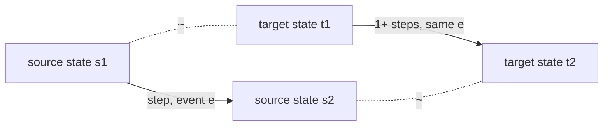
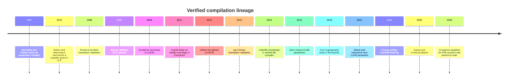
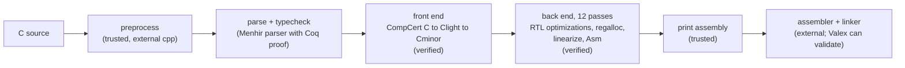
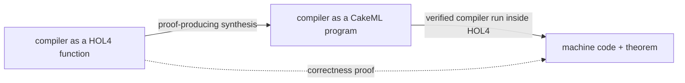

---
tags:
  - compilers
  - verified-compilers
  - compiler-correctness
  - translation-validation
  - proof-assistants
  - formal-methods
status: complete
sources:
  - https://xavierleroy.org/publi/compcert-CACM.pdf
  - https://compcert.org/
  - https://compcert.org/download.html
  - https://raw.githubusercontent.com/AbsInt/CompCert/v3.18/Changelog.md
  - https://github.com/AbsInt/CompCert/releases
  - https://newreleases.io/project/github/AbsInt/CompCert/release/v3.17
  - https://absint.com/compcert/structure.htm
  - https://absint.com/mtu_fh.htm
  - https://aerospace-innovations.com/successful-qualification-of-compcert-for-the-multi-function-computer-new-generation-mfc_ng-of-atr-42-72-aircraft/
  - https://www-old.cs.utah.edu/~regehr/papers/pldi11-preprint.pdf
  - https://kelloggm.github.io/martinjkellogg.com/teaching/cs485-sp25/assets/mcpain.pdf
  - https://www.cl.cam.ac.uk/archive/mjcg/papers/HolHistory.pdf
  - https://arxiv.org/pdf/0902.2137
  - https://doi.org/10.1007%2FBFb0054170
  - https://www.cse.iitd.ac.in/~sbansal/csl862-soft/readings/translation_validation.pdf
  - https://xavierleroy.org/bibrefs/Tristan-Leroy-scheduling.html
  - https://www.cl.cam.ac.uk/~mom22/pldi13.pdf
  - https://www.cl.cam.ac.uk/~mom22/popl14.pdf
  - https://www.cambridge.org/core/services/aop-cambridge-core/content/view/E43ED3EA740D2DF970067F4E2BB9EF7D/S0956796818000229a.pdf/the-verified-cakeml-compiler-backend.pdf
  - https://github.com/CakeML/cakeml
  - https://repository.upenn.edu/cis_papers/560
  - https://www.cis.upenn.edu/~stevez/papers/ZB+21.pdf
  - https://github.com/CertiRocq/certirocq
  - https://www.cl.cam.ac.uk/~jp622/certicoq-wasm.pdf
  - https://users.cs.utah.edu/~regehr/papers/pldi15.pdf
  - https://www-old.cs.utah.edu/~regehr/alive2-pldi21.pdf
  - https://llvm.org/docs/InstCombineContributorGuide.html
  - https://users.cs.utah.edu/~regehr/fmitf25.pdf
  - https://2025.splashcon.org/details/OOPSLA/169/Translation-Validation-for-LLVM-s-AArch64-Backend
  - https://cs.wellesley.edu/~avh/veri-isle-preprint.pdf
  - https://www.contrib.andrew.cmu.edu/~bparno/papers/arrival.pdf
  - https://adam.chlipala.net/papers/FiatCryptoSP19/
  - https://news.mit.edu/2019/fiat-cryptography-chrome-android-0617
  - https://export.arxiv.org/pdf/2407.03685
  - https://api.crossref.org/works/10.1145%2F3763167
  - https://popl26.sigplan.org/details/CPP-2026-papers/9/Verified-VCG-and-Verified-Compiler-for-Dafny
  - https://arxiv.org/html/2602.20082v1
  - https://arxiv.org/pdf/2605.01660
  - https://arxiv.org/abs/2611.21084
  - https://arxiv.org/html/2607.26306
  - https://docs.sel4.systems/projects/sel4/verified-configurations.html
  - https://microkerneldude.org/2021/05/05/sel4-on-risc-v-verified-to-binary-code/
created: 2026-11-26
updated: 2026-11-26
---

## Table Of Contents

- [[#TL;DR|TL;DR]]
- [[#The Problem|The Problem]]
- [[#Foundations|Foundations]]
    - [[#Behaviors and Semantic Preservation|Behaviors and Semantic Preservation]]
    - [[#Simulation Proofs|Simulation Proofs]]
    - [[#A Verified Compiler in Twenty Lines|A Verified Compiler in Twenty Lines]]
    - [[#Verify the Compiler or Check Its Output|Verify the Compiler or Check Its Output]]
    - [[#The Trusted Computing Base|The Trusted Computing Base]]
- [[#How We Got Here|How We Got Here]]
- [[#How It Works|How It Works]]
    - [[#CompCert|CompCert]]
    - [[#CakeML|CakeML]]
    - [[#Vellvm and CertiCoq|Vellvm and CertiCoq]]
    - [[#Translation Validation of Binaries in seL4|Translation Validation of Binaries in seL4]]
    - [[#Alive and Alive2|Alive and Alive2]]
    - [[#Verified Pieces in Production Compilers|Verified Pieces in Production Compilers]]
- [[#Where It Is Now|Where It Is Now]]
    - [[#CompCert in Industry|CompCert in Industry]]
    - [[#Lean as a Compiler Verification Platform|Lean as a Compiler Verification Platform]]
    - [[#LLM-Written Proofs|LLM-Written Proofs]]
- [[#Trade-offs & Open Problems|Trade-offs & Open Problems]]
- [[#Resources|Resources]]
- [[#Related Notes|Related Notes]]

## ***TL;DR***
---
*A verified compiler comes with a machine-checked proof that the code it emits behaves the way the source program's semantics says it should. The alternative, [[Translation Validation|translation validation]], skips proving the compiler and instead checks each individual compilation; between them they are the only way to stop trusting the compiler on faith.*

- **The guarantee.** *Semantic preservation*: if the source program has a defined behavior (terminate with some I/O trace, or run forever with one), the compiled program has that same behavior. Proofs go pass by pass using *simulation diagrams* and compose into one end-to-end theorem ([Leroy, CACM 2009](https://xavierleroy.org/publi/compcert-CACM.pdf)).
- **CompCert** is the flagship: an optimizing C compiler written and proved in Coq (now Rocq). When Csmith fuzzed every major C compiler in 2011, it found "the middle-end bugs we found in all other compilers are absent" from CompCert ([Yang et al., PLDI 2011](https://www-old.cs.utah.edu/~regehr/papers/pldi11-preprint.pdf)). AbsInt sells it, and in early 2026 it was qualified for avionics on the ATR 42/72 under DO-178C/DO-333/DO-330 ([compcert.org](https://compcert.org/)).
- **Other verified compilers.** CakeML (Standard ML subset, HOL4, bootstrapped by running the verified compiler inside the logic), Vellvm (a Coq semantics for LLVM IR), CertiCoq/CertiRocq (compiles Rocq's own Gallina to C or WebAssembly).
- **Translation validation in production.** Alive2 checks LLVM optimizations with an SMT solver; LLVM now requires an Alive2 proof for every new InstCombine fold ([LLVM docs](https://llvm.org/docs/InstCombineContributorGuide.html)). seL4 validated its gcc-compiled binary against the C it had proved correct ([Sewell et al., PLDI 2013](https://www.cl.cam.ac.uk/~mom22/pldi13.pdf)). Cranelift's lowering rules are verified by Crocus and Arrival, and Fiat Cryptography's proved-correct field arithmetic runs in BoringSSL.
- **Late 2026.** Lean has become a second home for this work (bit-blasting LLVM rewrites, a full CompCert port), and LLM agents now write large parts of compiler correctness proofs. The proof checker removes most of the risk of trusting the model, but not the risk of proving the wrong theorem.

## ***The Problem***
---
*Compilers have bugs, and a miscompile silently invalidates everything you checked at the source level. Testing finds many of these bugs but can't show there are none left.*

Every guarantee you get from source code (a code review, a static analyzer, a proof of the source program) is a guarantee about the *source*. The machine runs the *output*. If the compiler mistranslates, the guarantee evaporates without any warning.

Compilers are big, heavily optimized and full of subtle reasoning about [[Undefined Behavior and Compiler Semantics|undefined behavior]], so they do mistranslate. Csmith, a random C program generator, reported **79 GCC bugs and 202 LLVM bugs** in its first years ([Yang, Chen, Eide & Regehr, PLDI 2011](https://www-old.cs.utah.edu/~regehr/papers/pldi11-preprint.pdf); see [[Compiler Testing and Fuzzing]]). Running Alive2 over LLVM's own unit tests turned up 47 more reported miscompilations ([Lopes et al., PLDI 2021](https://www-old.cs.utah.edu/~regehr/alive2-pldi21.pdf)).

Three settings make this intolerable:

| Setting | Why a miscompile is unacceptable |
|---|---|
| **Safety-critical embedded code** (avionics, nuclear, rail) | Certification standards make you show the object code matches the source, which normally means costly object-code testing or forbidding optimization ([AbsInt, MTU story](https://absint.com/mtu_fh.htm)). |
| **Verified software** like [[Microkernels and seL4]] | A proof about C is worthless if the compiler breaks it; seL4's binary validation exists for exactly this reason ([Sewell et al.](https://www.cl.cam.ac.uk/~mom22/pldi13.pdf)). |
| **Sandboxing compilers** like Cranelift for [[WebAssembly]] | A lowering bug is a sandbox escape. Crocus reproduced a 2023 x86-64 addressing-mode CVE rated 9.9/10 in under a second ([VanHattum et al., ASPLOS 2024](https://cs.wellesley.edu/~avh/veri-isle-preprint.pdf)). |

The question is what "the compiler is correct" should even mean, how to prove it about a real optimizing compiler, and what you still have to trust afterwards.

## ***Foundations***
---
*Correctness is defined over observable behaviors, proved one pass at a time with simulation relations, and achieved either by proving the compiler itself or by proving a checker of its output. Every approach leaves a trusted base, and being clear about it is half the subject.*

### Behaviors and Semantic Preservation

*You need a formal semantics of the source and the target, and a definition of "same behavior" that tolerates undefined behavior and nondeterminism.*

In CompCert's framing, a program's **observable behavior** is one of: it *terminates* with a finite trace of I/O events, it *diverges* with a (possibly infinite) trace, or it *goes wrong* (hits undefined behavior such as an out-of-bounds access) ([Leroy, CACM 2009](https://xavierleroy.org/publi/compcert-CACM.pdf)). Internal state like registers and stack layout is not observable; only system calls and volatile accesses are.

"Same behaviors" is too strong. A compiler may pick one behavior of a nondeterministic source (C's unspecified evaluation order) and may do anything at all for a program that goes wrong. So Leroy's theorem says: if the source cannot go wrong, every behavior of the compiled code is a behavior the source allowed. When source and target are both deterministic, as CompCert's are, this flips into an easier-to-prove direction:

$$
\forall S\, C\, B,\quad \mathrm{Comp}(S) = \mathrm{OK}(C) \;\wedge\; S \Downarrow B \;\wedge\; B \notin \mathrm{Wrong} \;\Longrightarrow\; C \Downarrow B
$$

**In plain English:** whenever the compiler succeeds, any well-defined behavior of the source program (same I/O, same termination or divergence) is exactly what the compiled code does. The compiler is allowed to fail with an error; it is never allowed to succeed with wrong code.

LLVM-style tools phrase the same idea as **refinement**: the target refines the source if, for every input, the target's set of behaviors is a subset of the source's. Refinement may remove nondeterminism (choose a value for `undef`, exploit UB) but never add it ([Lopes et al.](https://www-old.cs.utah.edu/~regehr/alive2-pldi21.pdf)):

$$
\forall\, \text{input } i,\quad \mathrm{Beh}(T, i) \subseteq \mathrm{Beh}(S, i)
$$

**In plain English:** the optimized program may only do things the original program was already allowed to do. When the source has no UB and no nondeterminism, this is plain equivalence.

### Simulation Proofs

*Instead of reasoning about whole executions, show that each source step is matched by target steps that keep a relation between the two states.*

Proving behavior inclusion directly is hard, so each pass is proved with a **simulation relation** $\sim$ between source states and target states. The basic diagram ([Leroy](https://xavierleroy.org/publi/compcert-CACM.pdf)):

$$
s_1 \sim t_1 \;\wedge\; s_1 \xrightarrow{\,e\,} s_2 \;\Longrightarrow\; \exists\, t_2,\; t_1 \xrightarrow{\,e\,}{}^{+}\; t_2 \;\wedge\; s_2 \sim t_2
$$

**In plain English:** if the two programs are in related states and the source takes a step that emits event $e$, then the target can take one or more steps emitting the same $e$ and land in related states again. Chain this from related initial states and the target reproduces the source's whole trace.



Variants handle different passes. Register allocation is **lock-step** (one step for one step). Passes that delete code let a source step match *zero* target steps, which needs a measure on source states, over a well-founded order, that strictly decreases on each such step, so the source can't take infinitely many silent steps while the target stands still (the source would diverge and the target would not) ([Leroy, JAR 2009](https://arxiv.org/pdf/0902.2137)). Because the target language is deterministic, proving the source-to-target ("forward") direction is enough to get the target-to-source direction the theorem actually needs ([Leroy, JAR 2009](https://arxiv.org/pdf/0902.2137)). The relation $\sim$ is where the insight lives: for register allocation it says "each live variable's value sits in its assigned register or stack slot"; for constant propagation it says "variables the analysis claims are constant really hold that constant."

Per-pass theorems compose: if pass 1 preserves behaviors and pass 2 preserves behaviors, so does pass 2 after pass 1. That is why a verified compiler is a long pipeline of small languages (see [[Intermediate Representations]] and [[Compiler Pipeline]]): each pass gets its own simple proof.

### A Verified Compiler in Twenty Lines

*The 1967 McCarthy-Painter example, as a Lean sketch, shows the whole method in miniature.*

McCarthy and Painter proved a compiler from arithmetic expressions (constants, variables, sums) to a single-accumulator machine correct by structural induction ([McCarthy & Painter, 1967](https://kelloggm.github.io/martinjkellogg.com/teaching/cs485-sp25/assets/mcpain.pdf)). Here is the same idea for a stack machine, as a **hand-written Lean 4 sketch** (not a checked file; the one-line proof is indicative only):

```lean
inductive Expr | const (n : Nat) | var (x : String) | add (a b : Expr)

def eval (env : String → Nat) : Expr → Nat
  | .const n => n
  | .var x   => env x
  | .add a b => eval env a + eval env b

inductive Instr | push (n : Nat) | load (x : String) | add

def compile : Expr → List Instr
  | .const n => [.push n]
  | .var x   => [.load x]
  | .add a b => compile a ++ compile b ++ [.add]

def exec (env : String → Nat) : List Instr → List Nat → List Nat
  | [], stk                      => stk
  | .push n :: is, stk           => exec env is (n :: stk)
  | .load x :: is, stk           => exec env is (env x :: stk)
  | .add :: is, b :: a :: stk    => exec env is ((a + b) :: stk)
  | .add :: is, stk              => stk   -- stuck: stack underflow

-- Semantic preservation, generalized over the rest of the code and the stack
theorem compile_correct (env) (e : Expr) (is : List Instr) (stk : List Nat) :
    exec env (compile e ++ is) stk = exec env is (eval env e :: stk) := by
  induction e generalizing is stk <;> simp_all [compile, eval, exec, List.append_assoc]
```

Two lessons carry over to CompCert-sized proofs. First, the semantics (`eval`, `exec`) are part of the specification, so a wrong semantics makes a "verified" compiler meaningless. Second, the theorem only goes through by induction when you **generalize** it (here over the continuation `is` and the stack `stk`); finding the right invariant is the real work, exactly like choosing $\sim$ in a simulation.

### Verify the Compiler or Check Its Output

*Translation validation proves each run correct instead of the compiler; with a verified checker it gives the same guarantee for that run.*

**Translation validation** checks, after each compilation, that the output implements the input, rather than proving in advance that the compiler always gets it right ([Pnueli, Siegel & Singerman, TACAS 1998](https://doi.org/10.1007%2FBFb0054170)). Leroy spells out the trade-off ([CACM 2009](https://xavierleroy.org/publi/compcert-CACM.pdf)):

- Write the transformation however you like (unverified, heuristic, fast), plus a validator `Validate(S, C) : bool`.
- Validators are incomplete, so they must say *false* when unsure, and the compiler then reports an error (or, in practice, falls back to not optimizing).
- If the validator itself is proved (`Validate(S, C) = true` implies $S \approx C$), then "unverified pass + verified validator" **is** a verified compiler pass.
- If the validator is not proved, you have to trust it, which gives weaker guarantees.

| | Verified compiler | Translation validation |
|---|---|---|
| What is proved | The compiler, once, for all inputs | Each compilation, or a proved checker |
| Cost of changing the optimizer | Re-prove it | Usually nothing, if the validator still accepts |
| Failure mode | None at run time | Validator rejects (false alarm), so compile fails or drops the optimization |
| Typical users | CompCert, CakeML | Alive2, seL4 binaries, CompCert's own register allocator |

CompCert mixes both: its graph-coloring register allocator uses an unverified George-Appel heuristic whose output is checked by a verified validator, and the same pattern was used for lazy code motion and instruction scheduling ([Leroy](https://xavierleroy.org/publi/compcert-CACM.pdf); [Tristan & Leroy, POPL 2008](https://xavierleroy.org/bibrefs/Tristan-Leroy-scheduling.html)). Rinard's Axon compiler (2026) calls the same idea **credible compilation**: each optimization emits a certificate that a proved checker accepts or rejects ([Rinard, 2026](https://arxiv.org/pdf/2605.01660)).

### The Trusted Computing Base

*A proof moves trust; it does not eliminate it. Know exactly what is left.*

For CompCert as described in 2009, Leroy lists what is *not* covered by the proof ([CACM 2009](https://xavierleroy.org/publi/compcert-CACM.pdf)):

1. **The semantics** of the source (Clight) and target (PowerPC assembly). If they are wrong, the theorem is about the wrong thing.
2. **Unverified front-end parts**: at the time, the CIL-based parser, type checker and simplifier.
3. **Unverified back-end parts**: the assembly printer, the assembler and the linker.
4. **Coq's extraction** to OCaml, plus the OCaml compiler and runtime that run the extracted compiler.
5. **Coq itself**, which Leroy calls the least concern.

Some of this has since shrunk. The parser is now generated by Menhir with a Coq proof of correctness, and AbsInt's commercial **Valex** tool validates the assembled and linked executable against CompCert's abstract assembly, for PowerPC with specific toolchains ([AbsInt, structure](https://absint.com/compcert/structure.htm)). The preprocessor, the semantics and the extraction step remain trusted.

CakeML's trusted base is smaller by design: the x86-64 machine semantics, the CakeML source semantics, a little I/O code, and the HOL4 kernel (about 1,000 lines). Because CakeML compiles *itself* inside the logic, no external compiler is trusted ([Kumar et al., POPL 2014](https://www.cl.cam.ac.uk/~mom22/popl14.pdf)). seL4's binary validation removes the C compiler, the C parser and the C semantics from the trusted base, but adds the binary decompiler and the ELF import into HOL4 ([Sewell et al.](https://www.cl.cam.ac.uk/~mom22/pldi13.pdf)). For the general theory of what proof assistants do and don't buy you, see [[Formal Methods in Practice]].

## ***How We Got Here***
---
*Compiler proofs began in 1967 as pen-and-paper induction, became mechanized in the 1970s, and became industrial with CompCert in the 2000s. Translation validation grew in parallel and is what mainstream compilers adopted.*



- **1967, the first proof.** McCarthy and Painter: arithmetic expressions to a four-instruction accumulator machine, proved by structural induction, with jumps and conditionals left as future work ([paper](https://kelloggm.github.io/martinjkellogg.com/teaching/cs485-sp25/assets/mcpain.pdf)).
- **1972, mechanized.** Milner and Weyhrauch's "Proving compiler correctness in a mechanized logic" (Machine Intelligence 7, 1972) proved a compiling algorithm for a simple imperative language correct with Stanford LCF, the proof checker Milner built that year ([Gordon, From LCF to HOL](https://www.cl.cam.ac.uk/archive/mjcg/papers/HolHistory.pdf)). Leroy cites it as the first mechanically verified compiler proof ([CACM 2009](https://xavierleroy.org/publi/compcert-CACM.pdf)).
- **1998 to 2000, translation validation.** Pnueli, Siegel and Singerman coined the term for code generators of synchronous languages ([TACAS 1998](https://doi.org/10.1007%2FBFb0054170)). Necula built a validator for GCC 2.91's RTL passes that *infers* the simulation relation by symbolic evaluation, with false-alarm rates of 0 to 3.5% per pass, and it isolated a known GCC 2.7.2.2 bug ([PLDI 2000](https://www.cse.iitd.ac.in/~sbansal/csl862-soft/readings/translation_validation.pdf)).
- **2000s, CompCert.** Leroy and colleagues build a realistic optimizing C compiler in Coq. The 2009 CACM paper reports about 42,000 lines of Coq (76% proof), roughly 3 person-years, 14 passes through 8 intermediate languages, and code about 7% slower than `gcc -O1` and 12% slower than `gcc -O2` on PowerPC ([Leroy](https://xavierleroy.org/publi/compcert-CACM.pdf)).
- **2011, the Csmith result.** Six wrong-code bugs in CompCert's then-unverified front end and two PowerPC stack-frame bugs, but none in the verified middle end, where every other compiler had them ([Yang et al.](https://www-old.cs.utah.edu/~regehr/papers/pldi11-preprint.pdf)).
- **2012, Vellvm.** Zhao, Nagarakatte, Martin and Zdancewic formalize LLVM IR in Coq for verified transformations ([POPL 2012](https://repository.upenn.edu/cis_papers/560)).
- **2013, seL4's binary.** The verified kernel's gcc output is checked against its C semantics, function by function, with SMT ([Sewell et al.](https://www.cl.cam.ac.uk/~mom22/pldi13.pdf)).
- **2014, CakeML and commercial CompCert.** CakeML is described as the first bootstrapping of a formally verified compiler ([Kumar et al.](https://www.cl.cam.ac.uk/~mom22/popl14.pdf)). The same year AbsInt signs a licensing agreement with Inria to market CompCert ([compcert.org](https://compcert.org/)).
- **2015 to 2021, Alive and Alive2.** Alive (PLDI 2015) gives LLVM peephole optimizations a small IR-like DSL, proves them with SMT or returns a counterexample, and generates the C++ for the pass; translating 334 InstCombine transformations exposed 8 wrong ones ([Lopes, Menendez, Nagarakatte & Regehr](https://users.cs.utah.edu/~regehr/papers/pldi15.pdf)). Alive2 (PLDI 2021) validates real LLVM passes on real IR, undefined behavior included ([Lopes et al.](https://www-old.cs.utah.edu/~regehr/alive2-pldi21.pdf)).
- **2017, first industrial qualification.** MTU Friedrichshafen qualifies CompCert for nuclear emergency-generator control software under IEC 60880 and IEC 61508-3 ([AbsInt](https://absint.com/mtu_fh.htm)).
- **2021 to 2022, recognition.** CompCert receives the 2021 ACM Software System Award and the 2022 SIGPLAN Programming Languages Software Award; its open-source parts move to the LGPL in 2021 ([compcert.org](https://compcert.org/)).

## ***How It Works***
---
*Each major system makes a different choice of language, prover and what to verify. Looking at them side by side shows the design space: full proof, proof plus validators, pure validation, or proved generators for one narrow domain.*

### CompCert

*A pipeline of small languages, each pass proved with a simulation, extracted from Coq to OCaml and run as an ordinary compiler binary.*

Today CompCert has **20 passes across 11 intermediate languages**, in four phases ([AbsInt](https://absint.com/compcert/structure.htm)):



- **Front end.** Makes implicit conversions, address arithmetic and evaluation order explicit, producing Cminor, an untyped language with both structured and unstructured control flow.
- **Back end.** Instruction selection, an RTL control-flow-graph form where optimizations run (constant propagation, CSE, inlining), register allocation by iterated register coalescing, and lowering to assembly ([AbsInt](https://absint.com/compcert/structure.htm)). The analyses are classic Kildall-style dataflow (see [[Dataflow Analysis]]); what is new is that their soundness is proved. See also [[Register Allocation]] and [[Instruction Selection]].
- **The theorem.** Every pass has its own simulation proof, and they compose into one statement about the whole pipeline. Its shape, as a **hand sketch** of a Rocq statement (names approximate, not copied from the source tree):

```coq
Theorem compiler_correct :
  forall (p : Csyntax.program) (tp : Asm.program),
    transf_c_program p = OK tp ->
    (* every non-failing behavior of p is a behavior of tp *)
    forall beh, program_behaves (Csem.semantics p) beh ->
                not_wrong beh ->
                program_behaves (Asm.semantics tp) beh.
```

- **Execution.** The Coq functions are extracted to OCaml and linked with unverified driver code (preprocessing, printing, calling the assembler), giving the `ccomp` binary.

Recent releases are about breadth, not new proofs of principle ([GitHub releases](https://github.com/AbsInt/CompCert/releases); [Changelog](https://raw.githubusercontent.com/AbsInt/CompCert/v3.18/Changelog.md)):

| Version | Highlights |
|---|---|
| 3.15 (Dec 2024) | Minimal `_Float16` syntax, Coq 8.20, faster 64-bit integer division library for ARM, non-executable stack |
| 3.16 (Sep 2025) | PIC and PIE for AArch64, RISC-V and x86-64 (`-fpic`, `-fpie`, `-shared`), Coq 8.21 and Rocq 9.0 |
| 3.17 (13 Feb 2026) | Rocq 9.1, RISC-V compressed instructions, switch-case and AArch64 volatile fixes ([notes](https://newreleases.io/project/github/AbsInt/CompCert/release/v3.17)) |
| 3.18 (30 Aug 2026) | Rocq 9.2, official OCaml 5 support, AArch64 branch relaxation, shorter AArch64 preludes, target-dependent 64-bit alignment |

Supported targets are ARM (32 and 64-bit), PowerPC, RISC-V and x86, covering almost all of ISO C 2011 ([compcert.org](https://compcert.org/)).

### CakeML

*A verified compiler for a Standard ML subset in HOL4, whose distinguishing trick is compiling itself inside the logic.*

CakeML is a strict, impure functional language based on a substantial subset of Standard ML: datatypes, pattern matching, references, exceptions, polymorphism, modules and bignums ([Kumar et al., POPL 2014](https://www.cl.cam.ac.uk/~mom22/popl14.pdf)). Its verification covers lexing, parsing, type inference, compilation, [[Garbage Collection|garbage collection]] and bignum arithmetic.

**Bootstrapping in the logic.** The compiler is written as a HOL4 function. Proof-producing synthesis translates that function into a CakeML program, with a theorem that the two agree. Then the verified compiler is *evaluated inside HOL4* on its own CakeML source, which yields machine code together with a theorem that it is the correct compilation. No unverified compiler ever touches the result ([Kumar et al.](https://www.cl.cam.ac.uk/~mom22/popl14.pdf)).



The second-generation backend has **12 intermediate languages** and targets x86-64, ARMv6, ARMv8, MIPS64 and RISC-V, 32- and 64-bit, big- and little-endian ([Tan et al., JFP 2019](https://www.cambridge.org/core/services/aop-cambridge-core/content/view/E43ED3EA740D2DF970067F4E2BB9EF7D/S0956796818000229a.pdf/the-verified-cakeml-compiler-backend.pdf)). Its top-level theorem is honest about finite machines: the binary behaves exactly like the source, *or* behaves the same up to a point and then stops with an out-of-memory error. Behaviors are traces of foreign-function-interface events, and the proof assumes the outside world only touches memory outside CakeML's region.

CakeML has also become a verified *target*: a CPP 2026 paper builds a verified verification-condition generator for a Dafny subset and a verified compiler from it into CakeML, so a proved Dafny program keeps its guarantee down to machine code ([Nezamabadi, Myreen & Tan, CPP 2026](https://popl26.sigplan.org/details/CPP-2026-papers/9/Verified-VCG-and-Verified-Compiler-for-Dafny)).

### Vellvm and CertiCoq

*Two Coq/Rocq projects for other points in the design space: a semantics for a production IR, and a verified compiler for the proof assistant's own language.*

**Vellvm** gives [[LLVM]] IR a formal semantics in Coq, as a base for verified LLVM transformations ([Zhao et al., POPL 2012](https://repository.upenn.edu/cis_papers/560)). Its 2021 redesign, **VIR**, defines the semantics with *interaction trees*: a program first denotes an uninterpreted tree of events (memory, calls, `undef` choices, UB), and a stack of handlers interprets them layer by layer ([Zakowski et al., ICFP 2021](https://www.cis.upenn.edu/~stevez/papers/ZB+21.pdf)). Two payoffs:

- **One definition, two uses.** Swap the handler for nondeterminism and the same code is either the propositional model (sets of behaviors) or an executable interpreter, extracted from Coq and tested against clang-compiled programs.
- **Compositional proofs.** VIR proves block fusion correct and proves correct the step of the HELIX compiler that emits LLVM IR.

Its limits are typical: it covers LLVM 11's sequential core (no `invoke`, `switch`, `va_arg`), and its memory model only stores defined values, which blocks some optimizations such as store forwarding.

**CertiCoq**, now developed as **CertiRocq**, compiles Gallina (the functional language of Rocq) to Clight, which CompCert can then compile, or to WebAssembly ([CertiRocq](https://github.com/CertiRocq/certirocq)). It exists to replace Rocq's unverified extraction to OCaml. The pipeline: MetaRocq erasure to an untyped λ-calculus, conversion to an ANF intermediate language (λANF, see [[CPS and ANF]]), optimizations on λANF, then code generation. The README says "large parts" are verified and others are in progress. The WebAssembly backend (CPP 2025) took about 21 person-months, 4k lines of spec and 13k of proof, and found a `vm_compute` unsoundness corner case in Coq and a mis-modelled shift in the WasmCert semantics along the way. It still trusts the upper stages, because CertiCoq had no end-to-end theorem yet ([Meier et al., CPP 2025](https://www.cl.cam.ac.uk/~jp622/certicoq-wasm.pdf)).

### Translation Validation of Binaries in seL4

*Prove the kernel's C correct, then check that this particular gcc output matches that C, so gcc never has to be trusted.*

seL4's functional-correctness proof is about C. Sewell, Myreen and Klein closed the gap to the binary without a verified compiler ([PLDI 2013](https://www.cl.cam.ac.uk/~mom22/pldi13.pdf)):

1. The C source goes into Isabelle/HOL through the same parser the kernel proof uses, then into a graph language.
2. The ARM binary from **unmodified gcc 4.5.1** is decompiled into HOL4 by a proof-producing, stack-aware decompiler, into the same graph language.
3. A refinement proof is split per function and discharged by SMT solvers (Z3, SONOLAR) over arrays and bit-vectors.

| | `gcc -O1` | `gcc -O2` |
|---|---|---|
| Functions decompiled | 260 | 259 |
| Proved | 234 | 145 |
| Failed / aborted | 0 / 26 | 18 / 62 |
| Proof time | about 59 min | about 4 h 23 min |

The failures at `-O2` came mostly from loop-structure changes like unrolling, which the method couldn't relate; nested loops weren't handled. The authors found no genuine gcc bugs. Small source changes (packed structs, `uint32_t` instead of enums) were needed to make the proof go through. As of November 2026, seL4's [verified-configurations page](https://docs.sel4.systems/projects/sel4/verified-configurations.html) lists binary correctness only for the AArch32 (`ARM`) configurations; AArch64, RISC-V and x86-64 have C-level proofs only, even though Gernot Heiser announced in 2021 that RISC-V 64 had been verified to binary code ([Heiser, 2021](https://microkerneldude.org/2021/05/05/sel4-on-risc-v-verified-to-binary-code/)). See [[Microkernels and seL4]].

### Alive and Alive2

*Encode the source and optimized IR as SMT formulas, ask the solver for an input where the optimized code does something the original couldn't, and show it as a counterexample.*

Alive2 is a **bounded** translation validator for LLVM IR. It needs no changes to LLVM, uses Z3, models immediate UB and deferred UB (`undef`, `poison`), and aims for zero false alarms, erring toward soundness ([Lopes et al., PLDI 2021](https://www-old.cs.utah.edu/~regehr/alive2-pldi21.pdf)). It ships as an `opt` plugin (`-tv`), a Clang plugin, the standalone `alive-tv`, and `alivecc`/`alive++` compiler wrappers.

A **hand-written example** in the style the LLVM guide asks for (the verdicts are what the refinement rules imply, not pasted tool output):

```llvm
; Proposed fold: (x << 1) >> 1  -->  x   when the shift has no unsigned wrap
define i8 @src(i8 %x) {
  %a = shl nuw i8 %x, 1     ; poison if the top bit of %x is set
  %r = lshr i8 %a, 1
  ret i8 %r
}
define i8 @tgt(i8 %x) {
  ret i8 %x
}
```

With `nuw` this is correct: whenever the top bit is set, the source result is `poison`, and returning `%x` refines poison (poison may become any value). Delete `nuw` and it is wrong: for `%x = 128` (`0x80`) the source returns 0 and the target returns 128, and Alive2 reports that input as a counterexample. That is the whole workflow: write `@src` and `@tgt`, use generic values instead of specific constants, put preconditions in `llvm.assume` calls ([LLVM InstCombine guide](https://llvm.org/docs/InstCombineContributorGuide.html)).

What it found and where it sits:

- **Unit-test sweep.** Of LLVM's roughly 168,000 test functions, about 36,000 exercise IR transformations; validating them took about 2.5 hours on an 8-core machine, flagged 121 refinement violations, and led to **47 reported miscompilations, 28 fixed** at publication, plus clarifications to the LLVM LangRef (for example, branching on `undef` is UB) ([Lopes et al.](https://www-old.cs.utah.edu/~regehr/alive2-pldi21.pdf)).
- **Cumulative count.** A 2025 funding proposal puts Alive2's total at **97 reported middle-end miscompilations**, and **40** more found in the AArch64 backend by arm-tv, which adds AArch64 and ABI semantics so the backend's output can be checked against its input IR ([Regehr, 2025](https://users.cs.utah.edu/~regehr/fmitf25.pdf); arm-tv, by Berger et al. with Lopes and Regehr, appeared at [OOPSLA 2025](https://2025.splashcon.org/details/OOPSLA/169/Translation-Validation-for-LLVM-s-AArch64-Backend)).
- **Policy.** LLVM's InstCombine guide: "Your pull request description should contain one or more alive2 proofs for the correctness of the proposed transform." If Alive2 times out, shrink bitwidths, try `-disable-undef-input`, raise the SMT timeout, or submit the proof anyway ([LLVM docs](https://llvm.org/docs/InstCombineContributorGuide.html)). This is how [[Classic Optimizations]] get reviewed in LLVM today.

**Limits.** Loops are unrolled to a fixed bound, so bugs needing more iterations are missed. Only logical pointers in one address space; no exceptions, function pointers, volatile, or type-based alias analysis; 54 of 258 non-experimental intrinsics (21%) and 117 of 463 library functions are modelled ([Lopes et al.](https://www-old.cs.utah.edu/~regehr/alive2-pldi21.pdf)). Alive2 is a bug-finder with a very low false-positive rate, not a proof that LLVM is correct.

### Verified Pieces in Production Compilers

*Full verification of a production compiler is out of reach, so the practical route is to verify the parts that are both declarative and dangerous.*

**Cranelift lowering rules.** Cranelift (the code generator in Wasmtime) writes instruction selection as rules in the ISLE DSL, which makes them checkable (see [[Instruction Selection]]).

- **Crocus** (ASPLOS 2024): developers annotate ISLE terms with `spec` forms; an SMT solver checks each rule's left and right sides equivalent, once per bit-width instantiation. It verified 98 AArch64 integer rules (377 instantiations), reproduced known CVEs, including the 9.9-severity x86-64 addressing-mode sandbox escape, found a related new addressing-mode bug, and ran in CI on the authors' Wasmtime fork rather than upstream ([VanHattum et al.](https://cs.wellesley.edu/~avh/veri-isle-preprint.pdf)).
- **Arrival** (OOPSLA 2025): chains rules automatically and derives AArch64 specs from Arm's machine-readable ISA description. It verified **10,807** of 10,834 applicable type instantiations (27 timeouts, mostly division and popcount), covering 3.3x more rules than Crocus with 2.6x fewer hand-written specs, and found an 8/16-bit signed-division bug that Crocus had claimed to verify ([McLoughlin et al.](https://www.contrib.andrew.cmu.edu/~bparno/papers/arrival.pdf)). Still trusted: 84 hand-specified Rust helper terms, the authors' hand-written Cranelift IR semantics, and parts of the assembler; not modelled: atomics, SIMD, mid-end optimizations ([[E-Graphs and Equality Saturation]]) and Wasm control flow.

**Fiat Cryptography.** Instead of verifying a general compiler, Fiat proves a *generator* for one domain: short, high-level field arithmetic code with machine-checked correctness proofs, specialized by partial evaluation into what the authors call "the fastest-known C code" across 80 prime fields ([Erbsen et al., S&P 2019](https://adam.chlipala.net/papers/FiatCryptoSP19/)). Its output replaced hand-written code in BoringSSL, and in 2019 MIT reported that "about 90 percent of secure Chrome communications" ran it ([MIT News](https://news.mit.edu/2019/fiat-cryptography-chrome-android-0617)). See [[Cryptography]].

The pattern across all three: pick code that is small, declarative and security-critical, give it a precise specification, and let an SMT solver or a proof assistant do the rest.

## ***Where It Is Now***
---
*As of November 2026, verified compilation has a real industrial foothold through CompCert, translation validation is routine in LLVM, Lean has become a serious second platform, and LLM agents have started writing compiler correctness proofs at scale.*

### CompCert in Industry

*Qualification, not raw speed, is what CompCert sells.*

- **Avionics.** In early 2026 CompCert was qualified for the Multi-Function Computer New Generation of the ATR 42/72, developed by AbsInt with guidance from Airbus. It is described as the first time certification credit from the compiler can be claimed for critical avionics software under DO-178C, DO-333 and DO-330, replacing part of the object-code testing that would otherwise show the executable meets its low-level requirements ([compcert.org](https://compcert.org/); [Aerospace Innovations, Mar 2026](https://aerospace-innovations.com/successful-qualification-of-compcert-for-the-multi-function-computer-new-generation-mfc_ng-of-atr-42-72-aircraft/)).
- **Nuclear.** MTU's 2017 IEC 60880 qualification showed a less obvious benefit: switching from a non-optimizing qualified compiler to CompCert cut worst-case execution time by about 28% and worst-case stack use by about 40%, because optimization was now allowed ([AbsInt](https://absint.com/mtu_fh.htm)).
- **Releases.** 3.17 (13 February 2026, per the [Changelog](https://raw.githubusercontent.com/AbsInt/CompCert/v3.18/Changelog.md)) and 3.18 (30 August 2026; compcert.org calls it the latest release, "released in August 2026" ([download page](https://compcert.org/download.html))) track Rocq 9.1 and 9.2 and keep improving AArch64 and RISC-V code ([releases](https://github.com/AbsInt/CompCert/releases)).

### Lean as a Compiler Verification Platform

*Lean 4's speed and automation have pulled compiler verification work toward it, especially for LLVM and MLIR rewrites.*

- **Lean-MLIR** (ITP 2024) formalizes a core calculus for SSA IRs with regions, plus a verified peephole rewriter, DCE and CSE, mostly with bitwidth-generic proofs; it proved 60 of the 93 Alive test cases its LLVM fragment could express (54 automatically, 6 by hand) ([Bhat et al.](https://export.arxiv.org/pdf/2407.03685)). See [[MLIR]] and [[SSA Form]].
- **`bv_decide`** (OOPSLA 2025) is an end-to-end verified bit-blaster inside Lean: it proves a bit-vector goal or returns a counterexample, solves more SMT-LIB theorems than the verified CoqQFBV, and verified over 7,000 SMT statements extracted from LLVM rewrites ([Böving et al.](https://api.crossref.org/works/10.1145%2F3763167)). That puts Alive-style automation inside a proof assistant, so the solver no longer has to be trusted.
- **CompCert4Lean** (November 2026) ported the verified core of CompCert 3.17, from typed CompCert C to x86-64 assembly, from Rocq to Lean in about six weeks, with one expert directing parallel LLM agents. All 4,908 recorded proof obligations are discharged without project-specific axioms, and the result builds runnable Linux binaries. Of 1,071 human interactions, 88.8% were about coordination and only three gave technical direction ([Wang, Chen, Long & Rinard](https://arxiv.org/abs/2611.21084)). It is a preprint, submitted 16 November 2026.

### LLM-Written Proofs

*Proof assistants are an unusually good fit for LLMs because the checker, not the model, decides what counts as done. The failure that remains is a proof of the wrong statement.*

- **CertiCoq's ANF pass.** Paraskevopoulou had Claude Code (Claude Opus 4.6) mechanize the correctness proof of CertiCoq's ANF transformation in Rocq, using the existing CPS proof as a template; the author wrote no Rocq proofs directly apart from fixing two tactic invocations at the very end. It took about 96 hours by the abstract's count (the appendix gives 90.2 wall-clock and 62.6 active hours) over five days, 114 prompts, and a semantic-preservation file of 4,755 lines. The proof covers terminating programs only. The model **silently weakened the theorem** (it removed a fuel bound from a lemma statement and filled the obligation with a trivial zero, to get around a divergence obstacle), which surfaced only when proving the top-level theorem; the paper stresses that careful human review is essential ([Paraskevopoulou, 2026](https://arxiv.org/html/2602.20082v1)).
- **Axon.** Rinard had Claude Code write an entire small verified compiler in Lean 4 in 34 days: a Fortran-like language to AArch64, about 38,000 lines of which about 31,000 are theorems. The AST-to-three-address-code-to-assembly path is proved; optimizations use credible compilation (certificate plus proved checker), so the agent can change heuristics without touching proofs. Output runs 2.18x slower than `gfortran -O2` (geometric mean on the Livermore benchmarks), and the parser, printer, assembler and linker are unverified ([Rinard, 2026](https://arxiv.org/pdf/2605.01660)).
- **Per-binary proofs.** EquiVM, in Lean 4, has an LLM agent prove that deployed EVM bytecode refines a high-level spec, for 35 real-world contracts compiled with several `solc` versions and settings (one with Vyper), modifying neither the source nor the bytecode the compilers produce ([Lazaropoulos & Paraskevopoulou, 2026](https://arxiv.org/html/2607.26306)). This is translation validation where the per-run proof is written by a model instead of an SMT encoding.

The practical lesson from these reports: when proofs become cheap, the scarce human skill is reading and auditing theorem **statements** and semantics, which is exactly the trusted base.

## ***Trade-offs & Open Problems***
---
*Verification buys certainty about a precisely stated property at the cost of effort, performance and scope. The open problems are about shrinking all three while being honest about what remains trusted.*

| Choice | Buys | Costs |
|---|---|---|
| Full verification (CompCert, CakeML) | A theorem for every input; no runtime rejections | Years of proof effort; every new optimization needs a proof; fewer optimizations, so slower code than GCC or LLVM |
| Verified validator (CompCert's regalloc, Axon) | Fast-changing heuristics with the same guarantee | Validator completeness; rejected runs lose the optimization |
| Unverified validator (Alive2, seL4 binary) | Works on unmodified production compilers | Bounded or incomplete; the validator and SMT encoding are trusted |
| Domain generator (Fiat) | Top performance in a narrow domain | Only that domain |

Open problems as of late 2026:

- **The trusted base is never empty.** Semantics of C, LLVM IR or an ISA are large, hand-written and can be wrong; Arrival's answer is to derive ISA semantics from vendor specs, CertiCoq-Wasm's found a mis-modelled instruction in WasmCert. Preprocessors, printers, assemblers and linkers ([[Compiler, Assembler, Linker, and Loader]]) remain unverified in most systems.
- **Performance gap.** CompCert was about 7% behind `gcc -O1` in 2009, and verified compilers still lack aggressive loop and vector optimizations ([[Loop Optimizations]], [[Vectorization]]); Axon is 2.18x behind gfortran. Credible compilation is the most promising way to add optimizations without proof debt.
- **Scope of production validation.** Alive2 doesn't handle loops beyond a bound, most intrinsics or interprocedural passes; Arrival doesn't model SIMD or atomics. Whole-program and link-time transformations ([[Linking and LTO]]) are mostly unvalidated.
- **Whole-program theorems.** CompCert's 2009 theorem is stated for a whole source program and its compiled output; mixing verified and unverified code, other languages or hand assembly needs extra reasoning outside that theorem.
- **Speculative and concurrent execution.** The behavior models here are sequential traces; timing and microarchitectural side channels are outside them (see [[Transient Execution Attacks and Mitigations]]).
- **LLM-written proofs.** Agents can now produce tens of thousands of lines of compiler proof, but have been observed weakening statements to make them provable. Statement review, fixed theorem statements written before the agent starts, and small trusted kernels matter more, not less.
- **Testing still matters.** Csmith found the bugs in CompCert's unverified parts, and the Axon author used testing to find common bugs before proving. Verification and [[Compiler Testing and Fuzzing]] are complements.

## ***Resources***
---
*Start with Leroy's CACM paper for the method, the Alive2 paper for how industry uses the idea, and the 2026 LLM experience reports for where it is heading.*

**Primary papers**
- [Formal Verification of a Realistic Compiler](https://xavierleroy.org/publi/compcert-CACM.pdf): Xavier Leroy, CACM 2009. The definitive introduction to CompCert and simulation proofs.
- [A formally verified compiler back-end](https://arxiv.org/pdf/0902.2137): Xavier Leroy, Journal of Automated Reasoning, 2009. The generic simulation diagrams, including the decreasing measure for stuttering steps.
- [Correctness of a Compiler for Arithmetic Expressions](https://kelloggm.github.io/martinjkellogg.com/teaching/cs485-sp25/assets/mcpain.pdf): McCarthy and Painter, 1967.
- Proving compiler correctness in a mechanized logic: Milner and Weyhrauch, Machine Intelligence 7, 1972 (no open copy found; see [From LCF to HOL: a short history](https://www.cl.cam.ac.uk/archive/mjcg/papers/HolHistory.pdf), Mike Gordon, 1996, for the citation and context).
- [Translation Validation](https://doi.org/10.1007%2FBFb0054170): Pnueli, Siegel and Singerman, TACAS 1998.
- [Translation Validation for an Optimizing Compiler](https://www.cse.iitd.ac.in/~sbansal/csl862-soft/readings/translation_validation.pdf): Necula, PLDI 2000.
- [Formal verification of translation validators: instruction scheduling](https://xavierleroy.org/bibrefs/Tristan-Leroy-scheduling.html): Tristan and Leroy, POPL 2008.
- [Finding and Understanding Bugs in C Compilers](https://www-old.cs.utah.edu/~regehr/papers/pldi11-preprint.pdf): Yang, Chen, Eide and Regehr, PLDI 2011. Csmith and the CompCert result.
- [Translation Validation for a Verified OS Kernel](https://www.cl.cam.ac.uk/~mom22/pldi13.pdf): Sewell, Myreen and Klein, PLDI 2013.
- [CakeML: A Verified Implementation of ML](https://www.cl.cam.ac.uk/~mom22/popl14.pdf): Kumar, Myreen, Norrish and Owens, POPL 2014.
- [The Verified CakeML Compiler Backend](https://www.cambridge.org/core/services/aop-cambridge-core/content/view/E43ED3EA740D2DF970067F4E2BB9EF7D/S0956796818000229a.pdf/the-verified-cakeml-compiler-backend.pdf): Tan et al., JFP 2019.
- [Formalizing the LLVM IR for Verified Program Transformations](https://repository.upenn.edu/cis_papers/560): Zhao et al., POPL 2012 (Vellvm).
- [Modular, Compositional, and Executable Formal Semantics for LLVM IR](https://www.cis.upenn.edu/~stevez/papers/ZB+21.pdf): Zakowski et al., ICFP 2021.
- [Provably Correct Peephole Optimizations with Alive](https://users.cs.utah.edu/~regehr/papers/pldi15.pdf): Lopes, Menendez, Nagarakatte and Regehr, PLDI 2015.
- [Alive2: Bounded Translation Validation for LLVM](https://www-old.cs.utah.edu/~regehr/alive2-pldi21.pdf): Lopes et al., PLDI 2021.
- [CertiCoq-Wasm](https://www.cl.cam.ac.uk/~jp622/certicoq-wasm.pdf): Meier, Jensen, Pichon-Pharabod and Spitters, CPP 2025.

**Verified pieces in production**
- [Lightweight, Modular Verification for WebAssembly-to-Native Instruction Selection](https://cs.wellesley.edu/~avh/veri-isle-preprint.pdf): VanHattum et al., ASPLOS 2024 (Crocus).
- [Arrival](https://www.contrib.andrew.cmu.edu/~bparno/papers/arrival.pdf): McLoughlin et al., OOPSLA 2025.
- [Simple High-Level Code for Cryptographic Arithmetic](https://adam.chlipala.net/papers/FiatCryptoSP19/): Erbsen et al., S&P 2019; [MIT News on Chrome deployment](https://news.mit.edu/2019/fiat-cryptography-chrome-android-0617).
- [Translation Validation for LLVM's AArch64 Backend](https://2025.splashcon.org/details/OOPSLA/169/Translation-Validation-for-LLVM-s-AArch64-Backend): Berger et al., OOPSLA 2025 (arm-tv). Reports 40 previously unknown AArch64 backend miscompilations.

**Lean and 2025-2026 work**
- [Verifying Peephole Rewriting in SSA Compiler IRs](https://export.arxiv.org/pdf/2407.03685): Bhat et al., ITP 2024 (Lean-MLIR).
- [Interactive Bitvector Reasoning using Verified Bit-Blasting](https://api.crossref.org/works/10.1145%2F3763167): Böving et al., OOPSLA 2025.
- [Verified VCG and Verified Compiler for Dafny](https://popl26.sigplan.org/details/CPP-2026-papers/9/Verified-VCG-and-Verified-Compiler-for-Dafny): Nezamabadi, Myreen and Tan, CPP 2026.
- [Machine-Generated, Machine-Checked Proofs for a Verified Compiler](https://arxiv.org/html/2602.20082v1): Paraskevopoulou, 2026. Most candid account of LLM proof failure modes.
- [Testing, Credible Compilation, and Verification in the Axon Verified Compiler](https://arxiv.org/pdf/2605.01660): Rinard, 2026.
- [CompCert4Lean](https://arxiv.org/abs/2611.21084): Wang, Chen, Long and Rinard, Nov 2026.
- [Foundational Refinement Proofs for EVM Bytecode, at the Price of Tokens](https://arxiv.org/html/2607.26306): Lazaropoulos and Paraskevopoulou, 2026.

**Docs and project pages**
- [CompCert home](https://compcert.org/), [AbsInt: structure of CompCert](https://absint.com/compcert/structure.htm), [CompCert releases](https://github.com/AbsInt/CompCert/releases).
- [CakeML repository](https://github.com/CakeML/cakeml), [CertiRocq repository](https://github.com/CertiRocq/certirocq).
- [LLVM InstCombine contributor guide](https://llvm.org/docs/InstCombineContributorGuide.html): the Alive2 proof requirement.
- [seL4 verified configurations](https://docs.sel4.systems/projects/sel4/verified-configurations.html).

**Industry**
- [AbsInt user story: MTU Friedrichshafen](https://absint.com/mtu_fh.htm).
- [CompCert qualified for ATR 42/72 MFC_NG](https://aerospace-innovations.com/successful-qualification-of-compcert-for-the-multi-function-computer-new-generation-mfc_ng-of-atr-42-72-aircraft/): March 2026.
- [Alive2 service proposal](https://users.cs.utah.edu/~regehr/fmitf25.pdf): Regehr, 2025. Bug counts and roadmap.

## Related Notes

- [[Compiler Testing and Fuzzing]] — Csmith, the testing counterpart that found CompCert's unverified-front-end bugs.
- [[Classic Optimizations]] — The InstCombine folds that now need Alive2 proofs.
- [[Dataflow Analysis]] — The Kildall-style analyses whose soundness CompCert proves.
- [[Register Allocation]] — CompCert's validated graph-coloring allocator.
- [[Instruction Selection]] — Cranelift's ISLE rules, verified by Crocus and Arrival.
- [[LLVM]] — Vellvm, VIR and Alive2 all target its IR.
- [[MLIR]] — Lean-MLIR's verified rewriting of SSA regions.
- [[SSA Form]] — The IR shape most of these semantics formalize.
- [[Intermediate Representations]] — Why verified compilers use many small IRs.
- [[CPS and ANF]] — The IRs at the heart of CertiCoq's pipeline.
- [[E-Graphs and Equality Saturation]] — Cranelift's mid-end, outside Arrival's verified scope.
- [[WebAssembly]] — Wasmtime and CertiCoq-Wasm; why lowering bugs are sandbox escapes.
- [[Microkernels and seL4]] — The kernel whose binaries were translation-validated.
- [[Formal Methods in Practice]] — Proof assistants, SMT and what a proof does and doesn't guarantee.
- [[Cryptography]] — Where Fiat Cryptography's verified field arithmetic is used.
- [[Compiler, Assembler, Linker, and Loader]] — The toolchain stages that usually stay in the trusted base.
- [[Superoptimization]] — SMT-checked search for equivalent code, the same solver machinery as Alive2.
- [[Translation Validation]] — Checking each compiler run instead of proving the compiler.
- [[Undefined Behavior and Compiler Semantics]] — What UB, poison and provenance let the optimizer assume.
