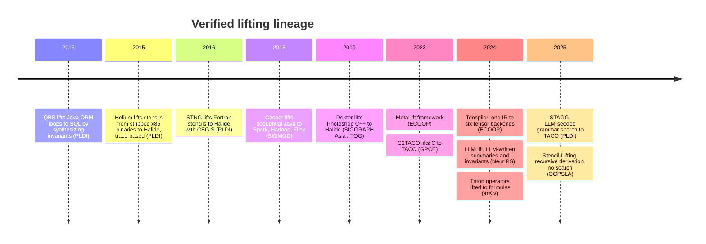
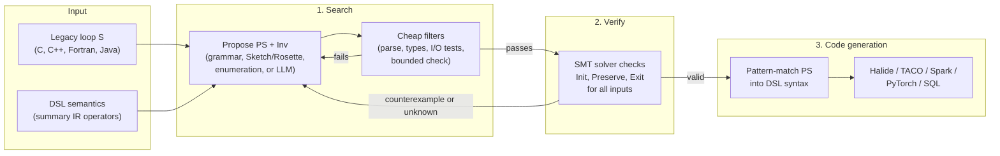

---
tags:
  - compilers
  - verified-lifting
  - program-synthesis
  - transpilation
  - dsl
  - smt
  - llm-code-generation
status: complete
sources:
  - https://homes.cs.washington.edu/~akcheung/papers/pldi13.html
  - https://projects.csail.mit.edu/helium
  - https://homes.cs.washington.edu/~akcheung/papers/pldi16.html
  - https://ar5iv.labs.arxiv.org/html/1801.09802
  - https://par.nsf.gov/servlets/purl/10184393
  - https://dexter.uwplse.org
  - https://www.osti.gov/servlets/purl/1765083
  - https://people.eecs.berkeley.edu/~sseshia/pubs/b2hd-bhatia-ecoop23.html
  - https://metalift.github.io
  - https://github.com/metalift/metalift
  - https://www.cl.cam.ac.uk/~ey204/teaching/ACS/R244_2024_2025/papers/c2taco_GPCE_2023.pdf
  - https://arxiv.org/abs/2404.18249
  - https://arxiv.org/html/2404.18249
  - https://arxiv.org/html/2406.03003v1
  - https://www2.eecs.berkeley.edu/Pubs/TechRpts/2024/EECS-2024-11.html
  - https://pith.science/paper/2412.20992
  - https://arxiv.org/pdf/2504.19705
  - https://arxiv.org/abs/2509.10236
  - https://2025.splashcon.org/details/OOPSLA/182/Stencil-Lifting-Hierarchical-Recursive-Lifting-System-for-Extracting-Summary-of-Sten
  - https://arxiv.org/html/2604.13523v2
  - https://arxiv.org/pdf/2511.12638
created: 2026-11-27
updated: 2026-11-27
---

## Table Of Contents

- [[#TL;DR|TL;DR]]
- [[#The Problem|The Problem]]
- [[#Foundations|Foundations]]
    - [[#Why Lift Into a DSL|Why Lift Into a DSL]]
    - [[#Program Summaries|Program Summaries]]
    - [[#Loop Invariants and Verification Conditions|Loop Invariants and Verification Conditions]]
    - [[#Proved, Bounded or Tested|Proved, Bounded or Tested]]
- [[#How We Got Here|How We Got Here]]
- [[#How It Works|How It Works]]
    - [[#The Three Phases|The Three Phases]]
    - [[#Worked Example: Lifting a Blend Kernel|Worked Example: Lifting a Blend Kernel]]
    - [[#Search: Grammars, Sketches and Cost Models|Search: Grammars, Sketches and Cost Models]]
    - [[#Search: LLMs as Proposers|Search: LLMs as Proposers]]
    - [[#Search Without Search: Stencil-Lifting|Search Without Search: Stencil-Lifting]]
    - [[#Code Generation and Backends|Code Generation and Backends]]
    - [[#Building a Lifter: MetaLift|Building a Lifter: MetaLift]]
- [[#Where It Is Now|Where It Is Now]]
    - [[#The Systems Side by Side|The Systems Side by Side]]
    - [[#The Research Front|The Research Front]]
    - [[#Tooling and Adoption|Tooling and Adoption]]
- [[#Trade-offs & Open Problems|Trade-offs & Open Problems]]
- [[#Resources|Resources]]
- [[#Related Notes|Related Notes]]

## ***TL;DR***
---
*Verified lifting rewrites old, hand-written loops into a domain-specific language (Halide, TACO, Spark, SQL, a tensor IR) and proves the rewrite means the same thing. It is [[Program Synthesis]] with the old code as the spec, and its payoff is that one lift lets a modern DSL compiler retarget the code to new hardware.*

- **The move.** Instead of pattern-matching syntax, a lifter *searches* for a high-level **program summary** in a small IR that models the target DSL, plus the **loop invariants** that prove the summary equals the original code for every input. A verified summary is then printed as DSL code by simple rules ([Cheung, DOE report](https://www.osti.gov/servlets/purl/1765083); [Bhatia et al., NeurIPS 2024](https://arxiv.org/html/2406.03003v1)).
- **Three phases.** Search (find summary and invariants), verify (an SMT solver checks them for all inputs), generate code (pattern-match the summary into the DSL). The search is where systems differ: Sketch or Rosette over hand-written grammars (STNG, Casper, Dexter, MetaLift, Tenspiler), enumeration guided by static analysis (C2TACO), LLM proposals checked by a verifier (LLMLift, STAGG), or a recursive derivation with no search at all (Stencil-Lifting).
- **It pays.** Reported results include median 4.1x (up to 24x) for Fortran stencils lifted to Halide ([STNG, PLDI 2016](https://homes.cs.washington.edu/~akcheung/papers/pldi16.html)), 264 of 353 Adobe Photoshop functions lifted to Halide with median 7.03x on x86 ([Dexter, TOG 2019](https://par.nsf.gov/servlets/purl/10184393)), and 105x kernel and 9.65x end-to-end averages for sequential C++ or Python lifted to six tensor backends ([Tenspiler, ECOOP 2024](https://arxiv.org/abs/2404.18249)).
- **"Verified" varies.** Tenspiler and LLMLift prove equivalence over unbounded inputs with an SMT solver; C2TACO checks 10 random input/output examples; STAGG uses bounded model checking with CBMC. Read the checking column before trusting a result.
- **As of November 2026.** LLMs replaced most of the hand-written search: LLMLift matched or beat four specialized lifters with roughly 100 lines of prompt instead of about 1,000 lines of grammar per domain, and PLDI 2025's STAGG solved 76 of 77 TACO benchmarks. The open problems are floating point (provers reason over reals), the size of what can be lifted (single kernels, not programs), and trusting the operator semantics the proof rests on.

## ***The Problem***
---
*A lot of performance-critical code is written as plain nested loops in C, C++, Fortran or Java. Its algorithm is buried under hand optimizations for hardware that no longer exists, and a modern compiler cannot recover it.*

Consider an image filter written in 2008, tuned for SSE and a single core. Today you would rather express it in Halide, which separates *what* is computed from *how* it is scheduled, and let Halide target AVX-512, ARM NEON or a GPU. Or take a C++ loop nest from an inference engine that would run 100x faster as a PyTorch or MLX tensor operation. The algorithm hasn't changed; only its expression has.

Three obstacles stand in the way:

1. **Rewriting by hand is slow and risky.** Photoshop alone had hundreds of such functions ([Dexter](https://par.nsf.gov/servlets/purl/10184393)). Each rewrite can introduce subtle bugs at boundaries, in integer rounding, or in iteration order.
2. **General-purpose compilers can't see the intent.** [[Loop Optimizations]] and [[Vectorization]] work on the loop as written. They cannot turn a triple loop into "this is a matrix multiply, call the tuned library" because proving that needs reasoning about whole arrays, which their [[Dataflow Analysis]] and [[Pointer and Alias Analysis]] don't do.
3. **Rule-based transpilers are brittle.** A syntax-directed translator needs a rule for every way a programmer might write the same loop. MetaLift's authors describe such rule sets as slow and error-prone to write ([Bhatia et al., ECOOP 2023](https://people.eecs.berkeley.edu/~sseshia/pubs/b2hd-bhatia-ecoop23.html)).

Verified lifting replaces the rules with a search: *find any DSL program, and a proof, such that the DSL program equals the original.* The original code becomes the specification, which is the same trick [[Superoptimization]] and [[Translation Validation]] use, but aimed upward in abstraction instead of sideways.

## ***Foundations***
---
*Four ideas carry the field: why a DSL is the right target, what a program summary is, how loop invariants turn "equal for all inputs" into finite solver queries, and what level of checking a given tool actually provides.*

### Why Lift Into a DSL

*A DSL compiler already knows how to make its programs fast on many machines. Lifting is a way to borrow that knowledge for code that was never written in the DSL.*

| Target DSL | What it captures | What its compiler does with it | Lifters |
|---|---|---|---|
| SQL | Relational queries | Join ordering, pushdown, indexes in the database | QBS |
| Halide | Image and stencil pipelines | Separate schedules for tiling, vectorizing, parallelizing, GPU | Helium, STNG, Dexter, Stencil-Lifting |
| Spark, Hadoop, Flink | Map, reduce, join over distributed data | Distributed execution | Casper, MetaLift, LLMLift |
| TACO | Tensor algebra in index notation | Generated dense and sparse kernels for CPU and GPU | C2TACO, STAGG, LLMLift |
| TensIR (Tenspiler) | Element-wise, reduction and matrix-vector ops | Printed to NumPy, TensorFlow, PyTorch, MLX, Intel Gaudi TPC-C, Gemmini | Tenspiler, LLMLift |
| P4 / switch atoms | Packet-processing transactions | Line-rate switch pipelines | MetaLift's Domino-style lifter, LLMLift |

The key property is that a DSL program is *smaller* and *more declarative* than the loop it replaces. That makes the search tractable: the space of short TACO expressions is far smaller than the space of C programs. It also connects lifting to [[ML Compilers]] and [[GPU Kernel Compilers]], which are exactly the DSL compilers that tensor lifters feed.

### Program Summaries

*A program summary is a short functional description of what a code fragment computes, written using only the target DSL's operators. It is the object the lifter searches for.*

The summary lives in an intermediate language that models the DSL's semantics, not its concrete syntax. Casper's IR models map, reduce and join, close to Haskell's `map` and `fold` ([Casper](https://ar5iv.labs.arxiv.org/html/1801.09802)); Tenspiler's TensIR has a dozen operators such as `tensor_tensor(t, t, op)`, `tensor_scalar(t, c, op)`, `reduce_sum`, `reduce_max`, `transpose`, `tensor_vec_prod`, `take`, `slice` and `ite` ([Tenspiler](https://arxiv.org/html/2404.18249)). QBS used a "theory of ordered relations" close to SQL ([QBS](https://homes.cs.washington.edu/~akcheung/papers/pldi13.html)). LLMLift writes the IR as a small set of Python functions so an LLM can read and write it ([LLMLift](https://arxiv.org/html/2406.03003v1)).

Separating the summary IR from the DSL's syntax has two benefits. The solver only needs a semantics for a dozen pure operators, and one IR can be printed to several DSLs, which is how Tenspiler reaches six backends from a single lift. It is the same design argument behind [[Intermediate Representations]] generally.

### Loop Invariants and Verification Conditions

*Loops are why lifting is hard to verify. A loop invariant summarizes what the loop has computed so far, and with it the solver only has to check a few finite formulas instead of every possible iteration count.*

The lifting problem, as LLMLift states it, is a second-order existence question ([LLMLift, Eq. 2](https://arxiv.org/html/2406.03003v1)):

$$
\exists\, PS \in G.\ \exists\, Inv \in G_I.\ \forall \sigma.\ \varphi(\sigma, PS, Inv, S)
$$

*In words: find a summary $PS$ from the grammar $G$ and invariants $Inv$ from the invariant grammar $G_I$ such that, for every program state $\sigma$, the verification conditions $\varphi$ linking the source program $S$, the summary and the invariants all hold.*

For a single loop `while (c) body` with output variable `out`, $\varphi$ is the classic Hoare-logic triple of conditions:

$$
\begin{aligned}
&\text{Init:} && Pre \Rightarrow Inv(\sigma_0) \\
&\text{Preserve:} && Inv(\sigma) \land c(\sigma) \Rightarrow Inv(\text{body}(\sigma)) \\
&\text{Exit:} && Inv(\sigma) \land \lnot c(\sigma) \Rightarrow out = PS(\text{inputs})
\end{aligned}
$$

*In words: the invariant holds before the loop; one more iteration keeps it true; and when the loop stops, the invariant forces the output to equal the summary. If all three are valid, the summary is correct for every input size, with no unrolling.*

Lifting invariants have a recognizable shape: "the output so far equals the summary applied to the prefix of the input processed so far." LLMLift writes this as $Inv \triangleq f(i) \land e(T_{lang})$, a bound on the loop index plus an expression in the DSL's operators ([LLMLift, Eq. 3](https://arxiv.org/html/2406.03003v1)). Because invariants are built from the same operators as summaries, the same search machinery finds both. When a loop nests, each level gets its own invariant, and the inner one mentions the outer index.

### Proved, Bounded or Tested

*Tools that call themselves lifters give three very different guarantees. Which one you have decides whether the lifted code can replace the original without review.*

| Level | What is checked | Misses | Examples |
|---|---|---|---|
| **Proved (unbounded)** | VCs valid for all inputs and all sizes, by an SMT solver or prover | Bugs in the operator semantics or the code generator; anything modeled as reals but run as floats | Tenspiler (cvc5), LLMLift, Dexter (Z3), Casper, MetaLift |
| **Bounded** | Equivalence for all inputs up to a size or loop bound, by bounded model checking | Behavior beyond the bound | STAGG (CBMC with rational arithmetic) |
| **Tested** | Agreement on a set of input/output examples | Any input not sampled | C2TACO (10 random I/O examples; CBMC on three benchmarks only) |

Sources: [Tenspiler](https://arxiv.org/html/2404.18249), [STAGG](https://arxiv.org/pdf/2504.19705), [C2TACO](https://www.cl.cam.ac.uk/~ey204/teaching/ACS/R244_2024_2025/papers/c2taco_GPCE_2023.pdf), [Dexter](https://par.nsf.gov/servlets/purl/10184393).

This is the same split as in [[Program Synthesis]] between proved and test-filtered synthesizers, and it matters for the same reason: a candidate that passes ten random tests can still be wrong on the edges (empty arrays, odd sizes, overflow). The "verified" in verified lifting originally meant the first row.

## ***How We Got Here***
---
*The idea came out of the database world in 2013, moved to stencils and image processing by 2016 to 2019, was turned into a reusable framework in 2023, and was largely handed to LLMs plus verifiers from 2024.*



| Year | Work | What it added |
|---|---|---|
| 2013 | [QBS](https://homes.cs.washington.edu/~akcheung/papers/pldi13.html), Cheung, Solar-Lezama, Madden (PLDI) | Synthesize invariants and postconditions in a theory of ordered relations, then read SQL off the postcondition. 75 fragments from over 120k lines of open-source Java. |
| 2015 | [Helium](https://projects.csail.mit.edu/helium), Mendis et al. (PLDI) | Lifting from *binaries* via dynamic traces to Halide. IrfanView kernels gained 4.97x. Its project page claims no equivalence proof, which is the gap STNG closed. |
| 2016 | [STNG](https://homes.cs.washington.edu/~akcheung/papers/pldi16.html), Kamil, Cheung, Itzhaky, Solar-Lezama (PLDI) | Coined the pattern: CEGIS finds a summary in a predicate language plus a proof; summaries compile to Halide. Median 4.1x, up to 24x. |
| 2018 | [Casper](https://ar5iv.labs.arxiv.org/html/1801.09802), Ahmad and Cheung (SIGMOD) | A MapReduce summary IR, a data-transfer cost model to pick among equivalent summaries, and runtime switching between versions. 82 of 101 fragments across 55 benchmarks; up to 48.2x. |
| 2019 | [Dexter](https://par.nsf.gov/servlets/purl/10184393), Ahmad, Ragan-Kelley, Cheung, Kamil (TOG) | Staged search (output region, then traversal, then computation) with Sketch, Hoare-style VCs checked by Z3. 264 of 353 Photoshop functions. |
| 2023 | [MetaLift](https://people.eecs.berkeley.edu/~sseshia/pubs/b2hd-bhatia-ecoop23.html), Bhatia, Kohli, Seshia, Cheung (ECOOP) | A lifter *generator*: describe the DSL's semantics and search space, get a verified transpiler. Three transpilers in orders of magnitude fewer lines than the bespoke ones. |
| 2023 | [C2TACO](https://www.cl.cam.ac.uk/~ey204/teaching/ACS/R244_2024_2025/papers/c2taco_GPCE_2023.pdf), Magalhães, Woodruff, Polgreen, O'Boyle (GPCE) | Static-analysis-guided enumeration for TACO: predict length, dimensions (delinearization) and operators. 95% of 71 benchmarks; 24.1x geomean on a GTX 1080 Ti. Tested, not proved. |
| 2024 | [Tenspiler](https://arxiv.org/abs/2404.18249), Qiu, Cai, Bhatia, Hasabnis, Seshia, Cheung (ECOOP) | TensIR, one lift to six backends, and search-space pruning (type filtering, bounded states, expression templates). All 69 benchmarks lifted. |
| 2024 | [LLMLift](https://arxiv.org/html/2406.03003v1), Bhatia, Qiu, Hasabnis, Seshia, Cheung (NeurIPS) | GPT-4 writes summary and invariants in a Python IR; an SMT verifier decides. Matches or beats MetaLift, C2TACO and Tenspiler with no hand-written grammar. |
| 2025 | [STAGG](https://arxiv.org/pdf/2504.19705), Li, Magalhães, Brauckmann, O'Boyle, Polgreen (PLDI) | LLM candidates turned into a probabilistic grammar, then weighted A* search; CBMC bounded check. 76 of 77. |
| 2025 | [Stencil-Lifting](https://arxiv.org/abs/2509.10236), Li et al. (OOPSLA) | Derives summaries recursively over "invariant subgraphs" with guaranteed termination, so no search and no external verifier. |

The DOE final report on Cheung's stencil project describes the founding idea in one line: use synthesis to find both the target code and a proof that it preserves the input's meaning, rather than syntax-driven rewrite rules ([Cheung, DOE report](https://www.osti.gov/servlets/purl/1765083)).

## ***How It Works***
---
*Every lifter runs the same loop: propose a summary and invariants, check them, and print the winner. The craft is in making the proposal step find the right answer before the search space explodes.*

### The Three Phases

*Search, verify, generate. Only the middle phase carries the guarantee; the other two can be as heuristic as you like.*



1. **Search.** Find a candidate $PS$ and $Inv$. Classic lifters ran CEGIS: synthesize against a few concrete states, ask the verifier for a counterexample, add it, repeat. LLM-based lifters sample candidates and discard failures. All of them put cheap filters in front of the solver.
2. **Verify.** Translate the source loop, the summary and the invariants into SMT formulas (usually via the source's IR; MetaLift reads LLVM IR) and check the three VCs. A "valid" answer is the guarantee.
3. **Generate.** Map each IR operator to its DSL spelling. Tenspiler adds a backend with pattern-matching rules ([Tenspiler](https://arxiv.org/abs/2404.18249)), and LLMLift reuses the same idea ([LLMLift](https://arxiv.org/html/2406.03003v1)).

### Worked Example: Lifting a Blend Kernel

*Tenspiler's running example is Photoshop-style "screen" blending. It shows the whole pipeline in one screen of code: a nested loop goes in, a one-line tensor expression comes out, and two invariants carry the proof.*

**Source.** The original is a C++ nested loop that applies `screen(a, b) = a + b - (a * b) / 255` to each pixel. Paraphrased from Tenspiler's Fig. 1 ([Tenspiler](https://arxiv.org/html/2404.18249)):

```cpp
vector<vector<int>> screen_blend(vector<vector<int>> b, vector<vector<int>> a) {
    vector<vector<int>> out;
    for (int row = 0; row < b.size(); row++) {
        vector<int> row_vec;
        for (int col = 0; col < b[0].size(); col++)
            row_vec.push_back(b[row][col] + a[row][col]
                              - b[row][col] * a[row][col] / 255);
        out.push_back(row_vec);
    }
    return out;
}
```

**Summary found by search** (Tenspiler's TensIR, as printed in the paper; `t_t` is `tensor_tensor`, `t_s` is `tensor_scalar`):

```text
out = t_t( t_t(b, a, +),  t_s( t_t(b, a, *), 255, / ),  - )
    ≡ b + a - (b * a) // 255        (element-wise)
```

**Invariants.** The paper says each invariant expresses `out` in TensIR operators over the part already processed; its figure is not legible in the text I read, so the two below are my reconstruction of the standard shape, not a quote. Write $\text{blend}(x, y) = x + y - (x \cdot y) / 255$ applied element-wise and $\text{take}(t, k)$ for the first $k$ rows (or elements):

$$
\begin{aligned}
Inv_{outer} &:\ 0 \le row \le m \ \land\ out = \text{blend}(\text{take}(b, row),\ \text{take}(a, row)) \\
Inv_{inner} &:\ Inv_{outer} \land\ 0 \le col \le n \ \land\ row\_vec = \text{blend}(\text{take}(b[row], col),\ \text{take}(a[row], col))
\end{aligned}
$$

*In words: after `row` outer iterations, `out` holds exactly the blended first `row` rows; inside a row, `row_vec` holds the blended first `col` pixels of that row.*

The solver then checks that $Inv_{outer}$ holds at `row = 0` (`out` is empty, and so is the blend of zero rows), that one inner iteration extends `row_vec` by exactly one blended pixel, that leaving the inner loop and pushing `row_vec` re-establishes $Inv_{outer}$ for `row + 1`, and that at `row = m` the output equals the full summary. Tenspiler finds the summary with Rosette over bounded states (1-D tensors of length 2, 6-bit integers in early rounds) and then re-checks it over unbounded domains with cvc5 ([Tenspiler](https://arxiv.org/html/2404.18249)).

**Generated code.** Each operator maps to its backend spelling. For NumPy the result would look like:

```python
def screen_blend(b, a):          # b, a: int32 arrays of the same shape
    return b + a - (b * a) // 255
```

The comment matters. The proof is about the IR's integer semantics; the generated code is only right if the backend's operators mean the same thing. With `uint8` NumPy arrays `b + a` wraps at 256, so a code generator has to pick dtypes that match the source's C++ promotion to `int`. This is the "trust the operator semantics" caveat that LLMLift states explicitly ([LLMLift](https://arxiv.org/html/2406.03003v1)).

Pruning is what makes this tractable. Tenspiler reports that a depth-4 TensIR grammar has about 200,000 expressions, and that filtering by return type, restricting to live variables and constants in the program, and abstracting the source's expression tree into a template cut the space for this example to 64 ([Tenspiler](https://arxiv.org/html/2404.18249)).

### Search: Grammars, Sketches and Cost Models

*The first decade of lifters searched hand-written grammars with a solver-aided synthesizer. Most of the engineering went into shrinking the grammar for each domain.*

- **CEGIS over Sketch or Rosette.** STNG and Dexter used Sketch-style counterexample-guided synthesis ([STNG](https://homes.cs.washington.edu/~akcheung/papers/pldi16.html), [Dexter](https://par.nsf.gov/servlets/purl/10184393)); MetaLift and Tenspiler use Rosette for bounded synthesis ([MetaLift repo](https://github.com/metalift/metalift), [Tenspiler](https://arxiv.org/html/2404.18249)). The mechanics are those in [[Program Synthesis]].
- **Staging.** Dexter splits the search into three stages: which output region is written, in what traversal order, and what is computed per point, so each stage's grammar stays small ([Cheung, DOE report](https://www.osti.gov/servlets/purl/1765083)).
- **Static analysis as a prior.** C2TACO estimates the expression's length, recovers tensor dimensions by delinearizing array accesses, and predicts likely operators, then enumerates bottom-up. Without those heuristics its own enumerator (ETS) lifted 85% of real-world benchmarks rather than 95% ([C2TACO](https://www.cl.cam.ac.uk/~ey204/teaching/ACS/R244_2024_2025/papers/c2taco_GPCE_2023.pdf)).
- **Cost models.** Several summaries can be correct; they are not equally fast. Casper's cost model estimates data moved between nodes, prunes the search with it, and emits several versions with a runtime monitor that switches between them ([Casper](https://ar5iv.labs.arxiv.org/html/1801.09802)).

The price is human effort per domain. LLMLift's authors estimate about 1,000 lines of search-space description for MetaLift's Spark lifter, about 1,100 for packet processing, over 1,000 lines of heuristics for C2TACO and about 1,200 lines from a domain expert for Tenspiler ([LLMLift](https://arxiv.org/html/2406.03003v1)).

### Search: LLMs as Proposers

*An LLM is good at guessing "this loop is a matrix-vector product" and bad at guaranteeing it. Verified lifting is a natural fit because the verifier already exists to catch bad guesses.*

**LLMLift** ([Bhatia et al., NeurIPS 2024](https://arxiv.org/html/2406.03003v1)):

1. Define the DSL's operators as Python functions in the prompt.
2. Ask GPT-4 (zero-shot) for a summary using only those operators; reject anything that doesn't parse. Budget: 50 summary queries.
3. For each surviving summary, ask (one-shot) for loop invariants, also in Python, because the authors found LLMs handle SMT-LIB poorly. Budget: 10 invariant queries per summary.
4. Rewrite summary and invariants into the verifier's language and check with an SMT solver. Summaries whose invariants never verify are marked wrong and excluded from later prompts.
5. Print the verified summary into the DSL with pattern rules.

| Domain | Prior specialized tool | Prior solved | LLMLift solved | Avg. time (LLMLift vs prior) |
|---|---|---|---|---|
| Java to Spark | MetaLift | 40/45 | 44/45 | about 1 min vs about 3 min |
| C to packet-switch atoms | MetaLift | 10/10 | 10/10 | about 2 s vs about 6 s |
| C++ to TACO | C2TACO | 57/60 | 60/60 | about 2 s vs about 41 s |
| C++ to Tenspiler's IR | Tenspiler | 23/23 | 23/23 | about 96 s vs about 115 s |

Two details are worth keeping. Splitting summary and invariant generation into two prompts mattered: a single combined prompt solved 20 of 23 tensor benchmarks, two phases solved 23. And without its hand-written optimizations, Tenspiler solved only 5 of those 23 within an hour, which is the gap the LLM closes ([LLMLift](https://arxiv.org/html/2406.03003v1)).

**STAGG** ([Li et al., PLDI 2025](https://arxiv.org/pdf/2504.19705)) uses the LLM differently. GPT-4 proposes about ten TACO expressions; STAGG abstracts them into templates, builds a probabilistic grammar weighted by how often each rule appears, and runs top-down or bottom-up weighted A* search over it. Static analysis predicts the output tensor's dimensions. Candidates pass I/O tests, then CBMC bounded verification (extended to rational arithmetic to dodge floating point).

| Method (77 TACO benchmarks) | Solved | Avg. time |
|---|---|---|
| STAGG top-down | 76 (98.7%) | 106 s |
| STAGG bottom-up | 73 (94.8%) | 99 s |
| C2TACO | 67 (87.0%) | 21 s |
| LLM alone | 34 (44.2%) | 2.6 s |

The "LLM alone" row is the argument for the whole design: the model is right less than half the time on its own and nearly always right when its guesses steer a checked search.

### Search Without Search: Stencil-Lifting

*For a narrow but important domain, the summary can be computed directly instead of searched for.*

Stencil-Lifting ([Li et al., OOPSLA 2025](https://arxiv.org/abs/2509.10236)) represents nested loops as "invariant subgraphs" (customized data-dependence graphs) and gives each vertex a predicate-based summary of its computation. A recursive algorithm with guaranteed termination derives these summaries, and self-consistency between them yields the loop invariants and postconditions, so no external verifier is needed. The authors claim completeness is formally proven, and report translation 31.62x faster than STNG and 5.8x faster than Dexter on stencil suites and four real applications. The trade is generality: it is a stencil lifter, not a framework.

### Code Generation and Backends

*Once the summary is verified, code generation is deliberately boring: one rule per operator. That simplicity is what lets one lift serve many targets.*

Tenspiler's six backends (NumPy, TensorFlow, PyTorch, MLX, TPC-C for Intel Gaudi, and the Gemmini accelerator) all print from the same TensIR summary ([Tenspiler](https://arxiv.org/html/2404.18249)). Hardware limits show up here rather than in the proof: 41 of 69 benchmarks could be translated to Gemmini's ISA, and only 10 could be expressed entirely in Gemmini instructions. Halide-targeting lifters (STNG, Dexter) additionally rely on Halide's autoscheduler to pick a schedule; Dexter's median 7.03x (x86) and 4.52x (ARM) speedups use it ([Dexter](https://par.nsf.gov/servlets/purl/10184393)). Performance after lifting is the DSL compiler's job, which is the point: see [[ML Compilers]], [[GPU Kernel Compilers]] and [[AI Accelerators]].

### Building a Lifter: MetaLift

*MetaLift turns "write a verified lifter" into "describe your DSL". It is the reference framework for the Berkeley line of work.*

A MetaLift user supplies three things ([MetaLift site](https://metalift.github.io), [ECOOP 2023](https://people.eecs.berkeley.edu/~sseshia/pubs/b2hd-bhatia-ecoop23.html)):

| Input | Example |
|---|---|
| **Target fragments** | "loops over arrays" for a GPU DSL |
| **Semantics** | The DSL's operators in a functional specification language (the current repo uses a Python API) |
| **Code generation** | How each operator prints in the DSL's concrete syntax |

MetaLift compiles the source with Clang to LLVM IR (the repo supports LLVM 11), generates verification conditions, and searches with Rosette or an LLM backend, verifying with Z3 ([MetaLift repo](https://github.com/metalift/metalift)). The same repo carries LLMLift's scripts (`llmlift_scripts`), and LLMLift and Tenspiler share authors with it. QBS, STNG, Casper, Dexter and the Domino-style packet lifter are listed as compilers built in the same style ([MetaLift site](https://metalift.github.io)).

## ***Where It Is Now***
---
*As of November 2026, verified lifting is an active research area with no mainstream product, one notable production use (Photoshop), and a clear shift from hand-tuned grammars to LLM proposals checked by solvers.*

### The Systems Side by Side

*The checking column is the one to read first.*

| System | Source to target | Search | Checking | Headline result |
|---|---|---|---|---|
| QBS (2013) | Java ORM to SQL | Synthesized invariants and postconditions | Proved | 75 fragments analyzed |
| Helium (2015) | x86 binary to Halide | Dynamic traces | No proof claimed | 4.97x on IrfanView kernels |
| STNG (2016) | Fortran to Halide | CEGIS | Proved | median 4.1x, up to 24x |
| Casper (2018) | Java to Spark/Hadoop/Flink | Synthesis plus cost model | Proved | 82/101 fragments; up to 48.2x |
| Dexter (2019) | C++ to Halide | Staged Sketch search | Proved (Z3) | 264/353 Photoshop functions; median 7.03x x86 |
| C2TACO (2023) | C to TACO | Analysis-guided enumeration | Tested (10 I/O) | 95% of 71; 24.1x GPU geomean |
| Tenspiler (2024) | C++ or Python to 6 tensor backends | Rosette, pruned grammar | Proved (cvc5) | 69/69; 105x kernel, 9.65x end-to-end avg |
| LLMLift (2024) | Four domains | GPT-4 proposals | Proved (SMT) | 44/45, 10/10, 60/60, 23/23 |
| DL operator lifting (2024) | Triton to math formulas | Symbolic execution, SyGuS, e-graphs | Proved, but see caveat | 32/33 synthesized, 28/33 verified |
| STAGG (2025) | C to TACO | LLM-seeded weighted A* | Bounded (CBMC) | 76/77 |
| Stencil-Lifting (2025) | Stencils to DSL | Recursive derivation | Self-consistency proof | 31.62x faster than STNG |

Sources: as cited in [[#How We Got Here|How We Got Here]]; DL operators from [Zhan et al., arXiv Dec 2024](https://pith.science/paper/2412.20992).

### The Research Front

*Recent work pushes on three fronts: LLMs in the search loop, new kinds of source code (GPU kernels, hardware), and faster or search-free derivation.*

- **LLM plus verifier is the default.** LLMLift (NeurIPS 2024) and STAGG (PLDI 2025) set the pattern, and Berkeley's tech report "Can LLMs Perform Verified Lifting of Code?" ([EECS-2024-11](https://www2.eecs.berkeley.edu/Pubs/TechRpts/2024/EECS-2024-11.html)) is the longer version of the argument. This is the same "generator proposes, checker disposes" structure that [[LLM-Written Kernels]] and RL training with verifiers rely on.
- **Lifting GPU kernels.** Zhan, Hu, Xia and Li lift 33 real Triton operators to mathematical formulas using symbolic execution, SyGuS-style search, SMT invariants and e-graph simplification ([[E-Graphs and Equality Saturation]]); Tenspiler synthesized only 13 of them. An automated review notes the proofs fix `BLOCK_SIZE=4` and treat values as reals, which the paper's own setup supports ([Pith](https://pith.science/paper/2412.20992)). Next door, Volta (Dubey, Aiken et al., 2025) checks *equivalence* of an optimized GPU kernel against a reference at the PTX level over the reals, verifying FlashAttention variants and LLM-written kernels in minutes ([arXiv 2511.12638](https://arxiv.org/pdf/2511.12638)). It is [[Translation Validation]] rather than lifting, but the two meet at "prove this kernel equals that formula".
- **Lifting hardware semantics.** TensorLift (Michigan, 2026) lifts bit-level accelerator behavior extracted from RTL through an eight-pass [[MLIR]] pipeline into tensor-level ISA specifications for Gemmini and VTA, checking steps with Z3 bitvector proofs ([arXiv 2604.13523](https://arxiv.org/html/2604.13523v2)). Same word, different direction: it lifts *what the hardware does* so compilers can target it.
- **Search-free lifting.** Stencil-Lifting (OOPSLA 2025) shows a domain where the summary can be derived rather than searched.

### Tooling and Adoption

*Mostly research code, with one well-known industrial success.*

- **Photoshop.** The DOE final report on Cheung's verified-lifting project states that Dexter-compiled code has shipped in Adobe Photoshop since 2020 ([Cheung, DOE report](https://www.osti.gov/servlets/purl/1765083)). I found no public Adobe statement confirming the current status.
- **MetaLift.** The GitHub repo is the most reusable artifact (Python, Rosette, Z3, LLVM 11 front end, LLM backend). Its most recent commits I saw are dependency bumps from February 2025, so treat it as a research platform, not a maintained product ([MetaLift repo](https://github.com/metalift/metalift)).
- **No mainstream compiler lifts.** I found no production general-purpose compiler that raises loops to a DSL with proofs. The nearest cousins are the rule-based, local idiom recognizers (such as turning a byte loop into `memset`) inside [[Loop Optimizations]] and [[Vectorization]].

## ***Trade-offs & Open Problems***
---
*Lifting trades generality for proof. The hard limits are floating point, program size, and how much of the trusted base sits outside the proof.*

- **Floating point.** Most lifters prove equivalence over integers or reals. STAGG extends CBMC to rationals specifically to avoid floating-point issues; the Triton work treats values as reals ([STAGG](https://arxiv.org/pdf/2504.19705), [Pith](https://pith.science/paper/2412.20992)). But `sum(a * b)` in PyTorch does not add in the order the C loop did, so a "proved" lift can still change the last bits, or more for ill-conditioned sums. See [[Floating-Point Semantics]] for why reassociation is not free.
- **What the proof trusts.** The guarantee covers the summary against the source *as modeled*. It does not cover the operator semantics written for the IR, the rewrite into SMT, or the code generator; LLMLift says so directly ([LLMLift](https://arxiv.org/html/2406.03003v1)). The `uint8` overflow trap in the worked example is a small instance. Closing that gap would mean verified code generators in the style of [[Verified Compilers]].
- **Source semantics.** Lifting C and C++ inherits their [[Undefined Behavior and Compiler Semantics|undefined behavior]] and aliasing rules. A lifter that assumes `out` doesn't alias `a` must establish that, which is a job for [[Pointer and Alias Analysis]].
- **Scale.** Every system lifts kernels: single loops or loop nests. Whole-program lifting, or lifting code whose control flow is data-dependent, remains out of reach. Dexter lifted only 50% of Photoshop's Filter Suite against 88 to 100% of the blend suites ([Dexter](https://par.nsf.gov/servlets/purl/10184393)).
- **Bounded and tested checks.** C2TACO's I/O tests and STAGG's bounded model checking are faster and cover more programs, but they are not proofs. Benchmarks that compare a proved lifter with a tested one are comparing different products. The risk of optimizing against a weak checker is the subject of [[Reward Hacking in Code Benchmarks]].
- **Effort moves, it doesn't vanish.** LLMs remove the per-domain grammar, but someone still writes the IR semantics, the invariant templates and the code generator. LLMLift used about 100 lines of prompt for TACO, against about 1,000 lines of grammar before ([LLMLift](https://arxiv.org/html/2406.03003v1)).
- **Choosing among correct lifts.** Several summaries can be proven equal to the source; which is fastest depends on the target. Casper's cost model is an early answer; most LLM-based lifters return the first one that verifies.
- **Lifting vs. optimizing in place.** An alternative to lifting is to optimize the low-level code directly with [[Superoptimization]] or an LLM and check with [[Translation Validation]]. Lifting wins when the DSL compiler knows more than any local rewrite can (scheduling, distribution, accelerators); it loses when the code doesn't fit any DSL.

## ***Resources***
---
*Start with Tenspiler for a complete modern pipeline, LLMLift for the LLM version, and Dexter for the best industrial case.*

**Origins**
- [Optimizing Database-Backed Applications with Query Synthesis](https://homes.cs.washington.edu/~akcheung/papers/pldi13.html): Cheung, Solar-Lezama and Madden, PLDI 2013 (QBS).
- [Helium](https://projects.csail.mit.edu/helium): Mendis et al., PLDI 2015. Lifting stencils from stripped x86 binaries to Halide.
- [Verified Lifting of Stencil Computations](https://homes.cs.washington.edu/~akcheung/papers/pldi16.html): Kamil, Cheung, Itzhaky and Solar-Lezama, PLDI 2016 (STNG).
- [Automatically Leveraging MapReduce Frameworks for Data-Intensive Applications](https://ar5iv.labs.arxiv.org/html/1801.09802): Ahmad and Cheung, SIGMOD 2018 (Casper).
- [Automatically Translating Image Processing Libraries to Halide](https://par.nsf.gov/servlets/purl/10184393): Ahmad, Ragan-Kelley, Cheung and Kamil, ACM TOG 2019 (Dexter); [project site](https://dexter.uwplse.org).
- [Using Verified Lifting to Optimize Legacy Stencil Codes](https://www.osti.gov/servlets/purl/1765083): Cheung, DOE final report. Definition, history and the Photoshop deployment claim.

**Frameworks and tensor lifting**
- [Building Code Transpilers for Domain-Specific Languages Using Program Synthesis](https://people.eecs.berkeley.edu/~sseshia/pubs/b2hd-bhatia-ecoop23.html): Bhatia, Kohli, Seshia and Cheung, ECOOP 2023 (MetaLift); [site](https://metalift.github.io), [repo](https://github.com/metalift/metalift).
- [C2TACO: Lifting Tensor Code to TACO](https://www.cl.cam.ac.uk/~ey204/teaching/ACS/R244_2024_2025/papers/c2taco_GPCE_2023.pdf): Magalhães, Woodruff, Polgreen and O'Boyle, GPCE 2023.
- [Tenspiler: A Verified-Lifting-Based Compiler for Tensor Operations](https://arxiv.org/abs/2404.18249): Qiu et al., ECOOP 2024 ([HTML](https://arxiv.org/html/2404.18249)).

**LLMs and recent work**
- [Verified Code Transpilation with LLMs](https://arxiv.org/html/2406.03003v1): Bhatia et al., NeurIPS 2024 (LLMLift).
- [Can LLMs Perform Verified Lifting of Code?](https://www2.eecs.berkeley.edu/Pubs/TechRpts/2024/EECS-2024-11.html): Berkeley EECS tech report 2024-11.
- [Verified Lifting of Deep Learning Operators](https://pith.science/paper/2412.20992): Zhan, Hu, Xia and Li, arXiv 2412.20992, Dec 2024.
- [Guided Tensor Lifting](https://arxiv.org/pdf/2504.19705): Li, Magalhães, Brauckmann, O'Boyle and Polgreen, PLDI 2025 (STAGG).
- [Stencil-Lifting](https://arxiv.org/abs/2509.10236): Li et al., OOPSLA 2025 ([SPLASH page](https://2025.splashcon.org/details/OOPSLA/182/Stencil-Lifting-Hierarchical-Recursive-Lifting-System-for-Extracting-Summary-of-Sten)).
- [Equivalence Checking of ML GPU Kernels](https://arxiv.org/pdf/2511.12638): Dubey, Driscoll, Wei, Kayal, Sharma and Aiken, 2025 (Volta).
- [TensorLift](https://arxiv.org/html/2604.13523v2): Gao, Yang, Jin and Bleier, 2026. Semantic lifting of accelerator RTL to tensor ISA specs in MLIR.

## Related Notes

- [[Program Synthesis]] — The search machinery (CEGIS, Sketch, Rosette, SyGuS, LLM-guided search) every lifter uses.
- [[Translation Validation]] — Checking a transformation's output instead of trusting it; lifting's verify phase is the same idea.
- [[Superoptimization]] — Synthesis with existing code as the spec, aimed at cheaper code at the same level rather than a higher one.
- [[ML Compilers]] — The tensor DSL compilers that tensor lifters hand their output to.
- [[GPU Kernel Compilers]] — Triton and friends, both a lifting target and, in 2024 work, a lifting source.
- [[LLM-Written Kernels]] — The other way to get fast tensor code from LLMs, usually checked by tests rather than proofs.
- [[Reward Hacking in Code Benchmarks]] — What goes wrong when the checker is weaker than it looks.
- [[Loop Optimizations]] — What general-purpose compilers do to loops without lifting them.
- [[Vectorization]] — Local idiom recognition, the rule-based cousin of lifting.
- [[Intermediate Representations]] — Why a small semantic IR between source and target pays off.
- [[Dataflow Analysis]] — The analyses lifters use to recover dimensions and live variables.
- [[Pointer and Alias Analysis]] — The aliasing facts a sound C/C++ lifter must establish.
- [[Undefined Behavior and Compiler Semantics]] — The source-language semantics a lift must respect.
- [[Floating-Point Semantics]] — Why proofs over reals don't settle floating-point equivalence.
- [[E-Graphs and Equality Saturation]] — Used to simplify lifted formulas back into readable form.
- [[Verified Compilers]] — What it would take to trust the code generator too.
- [[MLIR]] — Host of TensorLift's semantic-lifting pipeline and of many lifting targets.
- [[LLVM]] — MetaLift's front end reads LLVM IR.
- [[AI Accelerators]] — Gemmini and Gaudi, two of Tenspiler's targets.
- [[Formal Methods in Practice]] — The SMT solvers (Z3, cvc5) the proofs run on.
