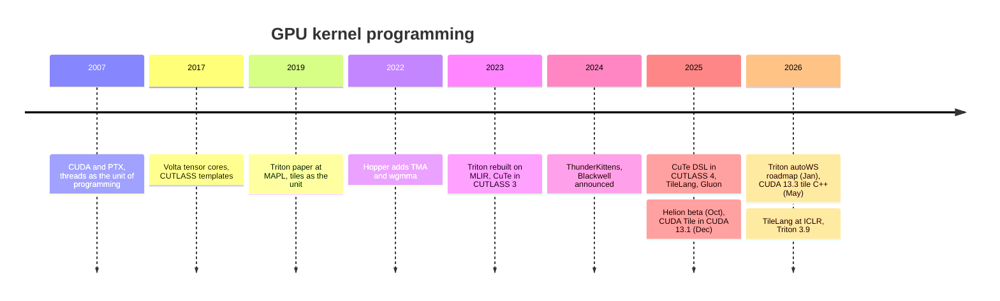
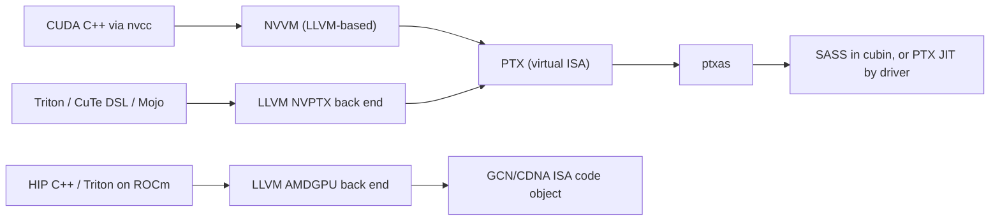
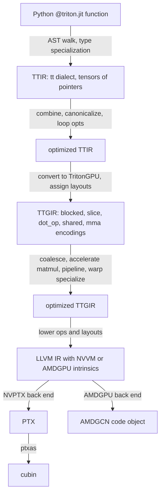

---
tags:
  - compilers
  - gpu
  - cuda
  - triton
  - kernels
  - ml-compilers
  - tensor-cores
status: complete
sources:
  - https://www.eecs.harvard.edu/~htk/publication/2019-mapl-tillet-kung-cox.pdf
  - https://pytorch.org/blog/triton-kernel-compilation-stages/
  - https://arxiv.org/abs/2505.23819
  - https://triton-lang.org/main/gluon/
  - https://pytorch.org/blog/warp-specialization-in-triton-design-and-roadmap/
  - https://newreleases.io/project/pypi/triton/release/3.9.0
  - https://developer.nvidia.com/blog/openai-triton-on-nvidia-blackwell-boosts-ai-performance-and-programmability/
  - https://developer.nvidia.com/blog/simplify-gpu-programming-with-nvidia-cuda-tile-in-python
  - https://github.com/NVIDIA/cuda-tile
  - https://developer.nvidia.com/blog/cuda-13-2-introduces-enhanced-cuda-tile-support-and-new-python-features
  - https://developer.nvidia.com/blog/nvidia-cuda-13-3-enhances-gpu-development-with-tile-programming-in-c-compiler-autotuning-and-python-updates/
  - https://docs.nvidia.com/cutlass/media/docs/pythonDSL/overview.html
  - https://docs.nvidia.com/cutlass/latest/media/docs/pythonDSL/guides/mma/tcgen05_programming.html
  - https://pytorch.org/blog/helion/
  - https://www.linuxfoundation.org/press/pytorch-foundation-welcomes-helion-as-a-foundation-hosted-project-to-standardize-open-portable-and-accessible-ai-kernel-authoring
  - https://proceedings.iclr.cc/paper_files/paper/2026/hash/76fb92288bf90360c527efb0d1c2aba6-Abstract-Conference.html
  - https://github.com/tile-ai/tilelang
  - https://arxiv.org/abs/2410.20399v1
  - https://docs.jax.dev/en/latest/pallas/
  - https://docs.jax.dev/en/latest/pallas/gpu/reference.html
  - https://www.modular.com/blog/matrix-multiplication-on-blackwell-part-4---breaking-sota
  - https://www.modular.com/blog/structured-mojo-kernels-part-1-peak-performance-half-the-code
  - https://rocm.blogs.amd.com/software-tools-optimization/gluon-gemm-tutorial/README.html
  - https://www.amd.com/en/developer/resources/technical-articles/2026/optimizing-gemm-with-tlx.html
  - https://arxiv.org/abs/2502.10517
  - https://scalingintelligence.stanford.edu/blogs/kernelbench
  - https://docs.nvidia.com/cuda/cuda-programming-guide/01-introduction/cuda-platform.html
  - https://developer.nvidia.com/blog/understanding-ptx-the-assembly-language-of-cuda-gpu-computing
  - https://docs.nvidia.com/cuda/archive/13.1.1/cuda-programming-guide/02-basics/writing-cuda-kernels.html
  - https://docs.nvidia.com/cuda/blackwell-tuning-guide/index.html
  - https://docs.nvidia.com/cuda/developer-preview/13.4/parallel-thread-execution/index.html
  - https://rocm.docs.amd.com/projects/llvm-project/en/latest/LLVM/llvm/html/NVPTXUsage.html
  - https://llvm.org/docs/AMDGPU/../AMDGPUUsage.html
  - https://pypi.org/project/triton/3.9.0/
  - https://triton-lang.org/main/getting-started/tutorials/gluon/tcgen05.html
  - https://docs.jax.dev/en/latest/pallas/design/design.html
  - https://www.modular.com/blog/matrix-multiplication-on-nvidias-blackwell-part-1-introduction
  - https://arxiv.org/abs/2504.17577
  - https://engineering.fb.com/2026/11/10/open-source/tlx-a-hardware-native-gpu-compiler-for-production-ml/
created: 2026-11-26
updated: 2026-11-26
---

## Table Of Contents

- [[#TL;DR|TL;DR]]
- [[#The Problem|The Problem]]
- [[#Foundations|Foundations]]
    - [[#The GPU From a Compiler's View|The GPU From a Compiler's View]]
    - [[#Occupancy and Register Pressure|Occupancy and Register Pressure]]
    - [[#Coalescing and Shared Memory|Coalescing and Shared Memory]]
    - [[#Tensor Cores and Asynchrony|Tensor Cores and Asynchrony]]
- [[#How We Got Here|How We Got Here]]
- [[#How It Works|How It Works]]
    - [[#The CUDA and ROCm Toolchains|The CUDA and ROCm Toolchains]]
    - [[#The Tile Abstraction|The Tile Abstraction]]
    - [[#Worked Example - Vector Add|Worked Example - Vector Add]]
    - [[#Worked Example - A Triton Matmul|Worked Example - A Triton Matmul]]
    - [[#Inside the Triton Compiler|Inside the Triton Compiler]]
    - [[#CUTLASS and CuTe Layout Algebra|CUTLASS and CuTe Layout Algebra]]
    - [[#The Wider Family of Tile Languages|The Wider Family of Tile Languages]]
    - [[#Autotuning|Autotuning]]
    - [[#Software Pipelining and Warp Specialization|Software Pipelining and Warp Specialization]]
- [[#Where It Is Now|Where It Is Now]]
    - [[#Triton in 2026|Triton in 2026]]
    - [[#NVIDIA CUDA Tile|NVIDIA CUDA Tile]]
    - [[#Helion, TileLang and the Python DSL Boom|Helion, TileLang and the Python DSL Boom]]
    - [[#AMD|AMD]]
    - [[#LLM-Written Kernels|LLM-Written Kernels]]
- [[#Trade-offs & Open Problems|Trade-offs & Open Problems]]
- [[#Resources|Resources]]
- [[#Related Notes|Related Notes]]

## ***TL;DR***
---
*A GPU kernel compiler turns a program for one small piece of work (a tile of a matrix, a block of a vector) into code that keeps tens of thousands of GPU threads, the tensor cores and the memory system busy at once. Graph-level [[ML Compilers]] decide which operations to fuse; kernel compilers decide how each fused operation actually runs.*

- **The level of abstraction moved up from threads to tiles.** CUDA makes you write what *one thread* does. Triton, introduced by Tillet, Kung and Cox at MAPL 2019, makes you write what *one program instance* does to a whole tile, and the compiler handles the threads, coalescing, shared memory and barriers ([Tillet et al., 2019](https://www.eecs.harvard.edu/~htk/publication/2019-mapl-tillet-kung-cox.pdf)). NVIDIA adopted the same idea in CUDA 13.1 as *CUDA Tile*, with a "virtual ISA for tile-based programming" that plays the role PTX plays for threads ([NVIDIA, Dec 2025](https://developer.nvidia.com/blog/simplify-gpu-programming-with-nvidia-cuda-tile-in-python)).
- **The pipeline is mostly [[MLIR]] then [[LLVM]].** Triton goes Python AST → Triton IR (`ttir`) → TritonGPU IR (`ttgir`, which adds *layouts*: which thread holds which element) → LLVM IR → PTX → cubin ([PyTorch blog, 2024](https://pytorch.org/blog/triton-kernel-compilation-stages/)). CuTe DSL, CUDA Tile IR, Mojo and Pallas are MLIR-based too.
- **The hard part is the hardware's asynchrony.** Since Hopper, the fast path uses asynchronous copy engines (TMA) and asynchronous matrix instructions (`wgmma`, then Blackwell's `tcgen05` with its own *tensor memory*). Getting peak speed needs software pipelining and *warp specialization* (different warps do loads, math and epilogue), which compilers in 2026 can only partly automate ([Meta/PyTorch, Jan 2026](https://pytorch.org/blog/warp-specialization-in-triton-design-and-roadmap/)).
- **So the field is a ladder of control.** From most automatic to most manual: Helion → Triton → TileLang / cuTile → Gluon / TLX / ThunderKittens → CuTe DSL / CUTLASS → raw CUDA and PTX. Each rung trades portability and ease for control over layouts, memory and scheduling.
- **As of November 2026:** Triton is at 3.9 with Blackwell and AMD gfx1250 work; CUDA 13.3 extended tile programming to C++ and to Hopper; Helion is a PyTorch Foundation project; and LLM agents writing kernels are an active research area measured by KernelBench.

## ***The Problem***
---
*Modern ML speed is decided inside a handful of kernels (matmul, attention, normalization), and the gap between a naive and an expert version of the same kernel is large. Classic compilers can't close that gap automatically, and writing every kernel by hand doesn't scale.*

A matmul on an H100 or B200 runs far below peak when written the obvious way: each thread computes one output element and reads its row and column straight from DRAM. The fast version tiles the problem three levels deep (thread block, warp, instruction), stages tiles through shared memory, double- or triple-buffers loads so they overlap the math, feeds tensor-core instructions whose operand layouts are dictated by hardware, and ends with a fused epilogue. AMD's 2026 Gluon tutorial shows the same arc on MI355: the naive Gluon GEMM ran at 520 TFLOPS (25% MFMA efficiency), the tuned one at 1489 TFLOPS (98.75%) ([AMD ROCm blog, May 2026](https://rocm.blogs.amd.com/software-tools-optimization/gluon-gemm-tutorial/README.html)).

Three things make this hard for a general compiler:

- **The search space is huge and discrete.** Tile sizes, number of warps, pipeline depth, loop order and layouts interact; the best choice changes per GPU and per shape.
- **The hardware contract keeps changing.** Volta's warp-level `mma`, Hopper's warpgroup `wgmma` plus TMA, Blackwell's single-thread `tcgen05.mma` writing into tensor memory: each generation needed a new kernel structure, not just a new instruction.
- **Fusion is where the wins are.** Libraries (cuBLAS, cuDNN) cover fixed operations; new model ideas ([[FlashAttention]], new [[Attention]] variants, [[Quantization]] formats, [[Mixture of Experts]] routing) need *custom fused kernels* faster than libraries ship them.

Polyhedral and auto-scheduling compilers (TVM, Tensor Comprehensions, Halide-style schedules; see [[Loop Optimizations]]) tried to derive kernels from loop nests. They work well for many shapes, but the peak kernels for matmul and attention kept coming from humans, because the winning structure is not a loop transformation away from the naive code: it involves asynchronous producer/consumer pipelines, register-level data layouts dictated by the tensor-core instruction, and numerics tricks (FlashAttention's online softmax rescaling). The answer the field converged on: a *tile-level* language where the programmer keeps control of the algorithm and the data blocking, and the compiler takes over the per-thread mapping, memory placement and instruction choice.

## ***Foundations***
---
*To read a GPU kernel compiler you need four hardware ideas: the thread hierarchy, the register-versus-occupancy budget, how memory accesses are combined, and the asynchronous tensor-core instructions that recent GPUs are built around.*

### The GPU From a Compiler's View

*A kernel is one program run by a grid of thread blocks; each block runs on one streaming multiprocessor (SM) as groups of 32 threads called warps.*

| Level | NVIDIA name | Size (typical) | Shares | Compiler's concern |
|---|---|---|---|---|
| Thread | thread | 1 | its own registers | Register allocation, instruction selection |
| Warp | warp | 32 threads in lockstep (SIMT) | one instruction stream | Divergence, shuffles, tensor-core fragments |
| Warpgroup | warpgroup (Hopper+) | 4 warps = 128 threads | `wgmma` operands | Which warps cooperate on one MMA |
| Block / CTA | thread block | up to 1024 threads | shared memory, barriers | Tiling, shared-memory allocation, `__syncthreads` |
| Cluster | thread block cluster (Hopper+) | a few CTAs | distributed shared memory | Multicast loads, multi-CTA MMA |

*SIMT* (single instruction, multiple threads) means you write scalar code per thread and the hardware runs 32 threads of a warp on one instruction; a branch that splits the warp runs both sides with some lanes masked off. AMD's equivalent of a warp is a *wavefront* of 64 lanes on its CDNA data-center GPUs. The CUDA programming guide describes the model from the SIMT side ([NVIDIA, CUDA Programming Guide](https://docs.nvidia.com/cuda/archive/13.1.1/cuda-programming-guide/02-basics/writing-cuda-kernels.html)).

### Occupancy and Register Pressure

*Every SM has a fixed register file and shared memory; whatever one block uses limits how many blocks fit, and fewer resident warps means less latency hiding.*

On recent NVIDIA data-center GPUs an SM has 65,536 32-bit registers, at most 255 registers per thread, at most 64 resident warps (2048 threads), and up to 228 KB of configurable shared memory (227 KB per block) on compute capability 10.0 ([Blackwell tuning guide](https://docs.nvidia.com/cuda/blackwell-tuning-guide/index.html)). The resident-warp count is the tightest of three budgets:

$$
W_{\text{resident}} = \min\left( W_{\max},\;
\left\lfloor \frac{R_{SM}}{32\, r} \right\rfloor,\;
\left\lfloor \frac{S_{SM}}{s_{\text{block}}} \right\rfloor \cdot w_{\text{block}} \right)
\qquad
\text{occupancy} = \frac{W_{\text{resident}}}{W_{\max}}
$$

**In plain English:** $r$ is registers per thread, $s_{\text{block}}$ shared memory per block and $w_{\text{block}}$ warps per block. With $r = 128$, the register file holds $65536 / (32 \cdot 128) = 16$ warps, so occupancy is at most 25%, however little shared memory you use. With $r = 255$, only 8 warps fit.

This is the central tension for a kernel compiler. Big tiles mean more data reuse per load but more registers for accumulators; past 255 registers the compiler *spills* to slow local memory. Matmul kernels deliberately run at low occupancy and hide latency with asynchronous copies instead of with many warps, which is why the [[Register Allocation]] done by `ptxas` matters so much, and why Blackwell moved the MMA accumulator out of registers altogether.

### Coalescing and Shared Memory

*Global memory is fast only when the 32 threads of a warp touch adjacent addresses; shared memory is fast only when they avoid bank conflicts.*

- **Coalescing.** When a warp's 32 loads fall in a few contiguous 32-byte sectors, the hardware merges them into few transactions. `a[threadIdx.x]` coalesces; `a[threadIdx.x * N]` (walking down a column of a row-major matrix) does not, and wastes most of each transaction. Triton's original paper lists memory coalescing as one of the machine-dependent passes the compiler does for you ([Tillet et al., 2019](https://www.eecs.harvard.edu/~htk/publication/2019-mapl-tillet-kung-cox.pdf)).
- **Shared memory** is a software-managed scratchpad per SM, split into 32 banks. A kernel loads a tile coalesced from global memory, then reads it in whatever order the math needs. Two threads hitting the same bank at different addresses serialize, so compilers *swizzle* (XOR-permute) addresses. Triton's 2019 paper also allocated shared memory from live ranges and inserted barriers automatically for read-after-write and write-after-read hazards.

### Tensor Cores and Asynchrony

*Tensor cores do small matrix multiplies in one instruction; each GPU generation changed who issues them, where the operands live and how loads overlap with them.*

| Generation | Matrix instruction | Operands / accumulator | Data movement | Consequence for compilers |
|---|---|---|---|---|
| Volta, Turing, Ampere | `mma.sync` (per warp, synchronous) | registers / registers | `cp.async` (Ampere): async global → shared copy | Per-warp fragments with fixed register layouts |
| Hopper (sm_90) | `wgmma.mma_async` (per warpgroup, async) | shared memory (A may be registers) / registers | **TMA**: one thread copies a whole tile via a tensor descriptor, completion tracked by an `mbarrier` | Producer warps issue TMA, consumer warpgroups issue `wgmma`: warp specialization |
| Blackwell (sm_100) | `tcgen05.mma` (issued by one thread, async) | shared memory or tensor memory / **tensor memory (TMEM)**: 128 rows × 512 columns of 32-bit cells per SM, as many cells as the register file ([Gluon tcgen05 tutorial](https://triton-lang.org/main/getting-started/tutorials/gluon/tcgen05.html)) | TMA, multicast across a CTA pair | Accumulators leave the register file; explicit TMEM alloc (power-of-two column counts from 32 to 512) and copy |

The [PTX ISA](https://docs.nvidia.com/cuda/developer-preview/13.4/parallel-thread-execution/index.html) defines these instructions, and NVIDIA's [tcgen05 programming guide](https://docs.nvidia.com/cutlass/latest/media/docs/pythonDSL/guides/mma/tcgen05_programming.html) in the CUTLASS docs walks through TMEM allocation and the MMA flow. The trend matters more than the details: matrix math became an *asynchronous unit* the kernel feeds through queues and barriers, so a kernel looks less like a loop and more like a small dataflow pipeline, which is exactly what is hard to generate automatically.

## ***How We Got Here***
---
*GPU kernels went from hand-written CUDA, to C++ template libraries, to tile languages with MLIR compilers, and in 2025-2026 to a crowded field of Python tile DSLs plus NVIDIA's own tile IR.*



- **CUDA and PTX.** NVIDIA's model exposed threads directly and compiled through PTX, a virtual ISA stable across GPU generations ([NVIDIA, CUDA platform](https://docs.nvidia.com/cuda/cuda-programming-guide/01-introduction/cuda-platform.html)). Fast kernels came from vendor libraries written by experts.
- **Templates.** CUTLASS turned expert GEMM structure into reusable C++ templates; CUTLASS 3 rebuilt it on *CuTe*, a layout algebra (see [[#CUTLASS and CuTe Layout Algebra|below]]).
- **Triton (2019).** Tillet, Kung and Cox proposed tile-typed values, a C-like front end (Triton-C), an LLVM-based Triton-IR with predicated SSA for bounds checks, and a JIT that did hierarchical tiling, coalescing, shared-memory allocation and barrier insertion. On a GTX 1070 its matmul was "on par" with cuBLAS 10.0, reaching over 90% of peak on some shapes, and 2-3× faster than PlaidML and Tensor Comprehensions ([Tillet et al., 2019](https://www.eecs.harvard.edu/~htk/publication/2019-mapl-tillet-kung-cox.pdf)). OpenAI later shipped it as a Python DSL, and it became the default code generator for TorchInductor in PyTorch 2.
- **MLIR rewrite.** Triton IR and TritonGPU IR became [[MLIR]] dialects, the form described in the [PyTorch compilation-stages post](https://pytorch.org/blog/triton-kernel-compilation-stages/).
- **Hopper and Blackwell broke the abstraction.** TMA, `wgmma` and `tcgen05` rewarded warp-specialized, deeply pipelined kernels. [[FlashAttention]]-3 on Hopper was hand-written in CUTLASS; Triton spent 2024-2026 adding warp specialization and lower-level escape hatches (Gluon), while new DSLs (ThunderKittens, TileLang, CuTe DSL) targeted the gap.

## ***How It Works***
---
*Below: the toolchain every kernel ends in, why tiles became the unit, two worked examples, Triton's compiler internals, CuTe's layouts, the other tile languages, and the two optimizations that decide modern performance.*

### The CUDA and ROCm Toolchains

*Everything ends in PTX plus `ptxas` on NVIDIA, or in the LLVM AMDGPU back end on AMD.*



- **PTX** is NVIDIA's virtual ISA: an assembly with unlimited virtual registers, typed instructions and a version number. A *fatbinary* can carry both SASS for known GPUs and PTX that the driver JIT-compiles for future ones ([NVIDIA, CUDA platform](https://docs.nvidia.com/cuda/cuda-programming-guide/01-introduction/cuda-platform.html); [NVIDIA blog, Understanding PTX](https://developer.nvidia.com/blog/understanding-ptx-the-assembly-language-of-cuda-gpu-computing)).
- **`ptxas`** is the real back end: closed-source register allocation, instruction scheduling and SASS emission. Every open compiler (Triton, CuTe DSL, Mojo, Clang CUDA) still depends on it, which is one reason NVIDIA's CUDA 13.3 *CompileIQ* autotunes compiler settings per kernel, reporting up to 15% on already-optimized Triton attention and CUTLASS GEMM kernels ([NVIDIA, May 2026](https://developer.nvidia.com/blog/nvidia-cuda-13-3-enhances-gpu-development-with-tile-programming-in-c-compiler-autotuning-and-python-updates/)).
- **LLVM's NVPTX back end** turns LLVM IR into PTX; NVIDIA's NVVM is itself LLVM-based ([NVPTX user guide](https://rocm.docs.amd.com/projects/llvm-project/en/latest/LLVM/llvm/html/NVPTXUsage.html)).
- **AMD ROCm** has no virtual ISA layer: HIP (a CUDA-like C++ dialect) and Triton compile through the open [LLVM AMDGPU back end](https://llvm.org/docs/AMDGPU/../AMDGPUUsage.html) straight to the target's ISA (`gfx942` for MI300, `gfx950` for MI350/MI355), so the whole stack down to machine code is open.

### The Tile Abstraction

*A tile is a fixed-shape block of a tensor. Tile programs are written as if one sequential program handles one tile; the compiler spreads the tile across threads.*

The Triton paper defines the tile as a statically shaped multi-dimensional sub-array, with each kernel written "as a single thread" that the compiler parallelizes, removing explicit synchronization from the source ([Tillet et al., 2019](https://www.eecs.harvard.edu/~htk/publication/2019-mapl-tillet-kung-cox.pdf)). In today's Python Triton, a *program* (one instance of the kernel, launched once per grid point) operates on tensors like `tl.arange(0, BLOCK)`; it maps to one CTA of `num_warps` warps.

The split of work is the point. The **programmer** still picks the grid (which tile each program owns), the tile sizes (often autotuned), the loop over K and the accumulator type, the masks for ragged edges, and what to fuse before the final store. The **compiler** picks the thread-to-element mapping (layouts), coalesced vectorized loads, shared-memory staging and swizzles, the tensor-core instruction (`mma`, `wgmma`, `tcgen05` or AMD MFMA), barriers and software pipelining (`num_stages`), and, through LLVM and `ptxas`, register allocation.

The arithmetic payoff of tiling is reuse. For a $B_M \times B_N$ output tile, each step over $K$ loads a $B_M \times B_K$ and a $B_K \times B_N$ tile and does $2 B_M B_N B_K$ flops:

$$
I = \frac{2 B_M B_N B_K}{(B_M + B_N)\, B_K \cdot b} = \frac{2 B_M B_N}{(B_M + B_N)\, b}
$$

**In plain English:** arithmetic intensity $I$ (flops per byte read from global memory) grows with the tile size and does not depend on $B_K$. With $B_M = B_N = 128$ and fp16 ($b = 2$ bytes), $I = 64$ flops/byte; a one-element "tile" gets $I = 0.5$. The tile is what turns a memory-bound computation into a compute-bound one, until the tile no longer fits in registers or shared memory (see [[#Occupancy and Register Pressure|occupancy]]).

### Worked Example - Vector Add

*The same computation as per-thread CUDA and as a Triton tile program.*

Naive CUDA: each thread computes its own global index and handles one element.

```c
__global__ void add(const float* x, const float* y, float* out, int n) {
    int i = blockIdx.x * blockDim.x + threadIdx.x;  // one element per thread
    if (i < n) out[i] = x[i] + y[i];
}
// launch: add<<<(n + 255) / 256, 256>>>(x, y, out, n);
```

Triton: each *program* handles a `BLOCK_SIZE` tile; no thread index appears.

```python
import triton, triton.language as tl

@triton.jit
def add_kernel(x_ptr, y_ptr, out_ptr, n, BLOCK_SIZE: tl.constexpr):
    pid = tl.program_id(axis=0)                     # which tile am I?
    offs = pid * BLOCK_SIZE + tl.arange(0, BLOCK_SIZE)
    mask = offs < n                                 # ragged last tile
    x = tl.load(x_ptr + offs, mask=mask)
    y = tl.load(y_ptr + offs, mask=mask)
    tl.store(out_ptr + offs, x + y, mask=mask)

# grid = (triton.cdiv(n, 1024),); add_kernel[grid](x, y, out, n, BLOCK_SIZE=1024)
```

NVIDIA's cuTile Python (CUDA 13.1+) reads almost the same: `pid = ct.bid(0)`, then `ct.load(a, index=(pid,), shape=(tile_size,))` for each input and `ct.store(c, index=(pid,), tile=a_tile + b_tile)` ([NVIDIA, Dec 2025](https://developer.nvidia.com/blog/simplify-gpu-programming-with-nvidia-cuda-tile-in-python)).

**What the tile compiler does with the Triton version.** With `BLOCK_SIZE=1024` and 4 warps, the blocked layout gives each of the 128 threads chunks of 4 *contiguous* elements (`sizePerThread = [4]`); that covers 512 elements, so the layout repeats twice over the 1024-element tile and each thread holds two such chunks. That layout is what lets the back end emit 128-bit vector loads (two per thread per input), perfectly coalesced. The PyTorch blog shows exactly this layout appearing in TritonGPU IR ([PyTorch blog, 2024](https://pytorch.org/blog/triton-kernel-compilation-stages/)), and in the CUDA version the programmer would have to restructure the code by hand (`float4` loads, four elements per thread) to get the same.

### Worked Example - A Triton Matmul

*A blocked matmul in about 20 lines: the programmer writes the tile loop, the compiler emits tensor-core code and pipelining.*

```python
@triton.jit
def matmul(A, B, C, M, N, K, sam, sak, sbk, sbn, scm, scn,
           BM: tl.constexpr, BN: tl.constexpr, BK: tl.constexpr):
    pid_m, pid_n = tl.program_id(0), tl.program_id(1)
    rm, rn = pid_m * BM + tl.arange(0, BM), pid_n * BN + tl.arange(0, BN)  # C tile
    rk = tl.arange(0, BK)
    a_ptrs = A + rm[:, None] * sam + rk[None, :] * sak  # BM x BK pointer tile
    b_ptrs = B + rk[:, None] * sbk + rn[None, :] * sbn  # BK x BN pointer tile
    acc = tl.zeros((BM, BN), dtype=tl.float32)
    for k in range(0, K, BK):                          # walk the K dimension
        a = tl.load(a_ptrs, mask=(rk[None, :] + k) < K, other=0.0)
        b = tl.load(b_ptrs, mask=(rk[:, None] + k) < K, other=0.0)
        acc += tl.dot(a, b)                            # -> mma / wgmma / tcgen05
        a_ptrs += BK * sak; b_ptrs += BK * sbk
    c = acc.to(tl.float16)                             # fused epilogue goes here
    tl.store(C + rm[:, None] * scm + rn[None, :] * scn, c,
             mask=(rm[:, None] < M) & (rn[None, :] < N))
```

The naive CUDA counterpart is a three-line loop per thread:

```c
__global__ void matmul_naive(const half* A, const half* B, half* C, int M, int N, int K) {
    int r = blockIdx.y * blockDim.y + threadIdx.y, c = blockIdx.x * blockDim.x + threadIdx.x;
    if (r < M && c < N) { float s = 0; for (int k = 0; k < K; ++k) s += (float)A[r*K+k] * (float)B[k*N+c]; C[r*N+c] = s; }
}
```

The naive kernel re-reads every input element from global memory $N$ or $M$ times and never touches a tensor core. In the Triton version the compiler: picks an MMA layout for `acc` and a matching *dot operand* layout for `a` and `b`; stages `a` and `b` through swizzled shared memory; turns `num_stages=3` into a three-deep software pipeline of async copies (`cp.async` or TMA); and lowers `tl.dot` to the right tensor-core instruction for the target. On Hopper and Blackwell, getting from "correct and decent" to peak also needs warp specialization ([[#Software Pipelining and Warp Specialization|below]]).

### Inside the Triton Compiler

*Two MLIR dialects carry the program from hardware-neutral tiles to tiles with explicit thread layouts, before LLVM takes over.*



The PyTorch blog follows the vector-add kernel through these stages and dumps each one with `kernel.asm["ttir" | "ttgir" | "llir" | "ptx" | "cubin"]` ([Kokkila-Schumacher et al., PyTorch blog, 2024](https://pytorch.org/blog/triton-kernel-compilation-stages/)). Triton IR is already type-specialized but has no notion of threads:

```mlir
// TTIR
%9  = tt.load %8, %6 : tensor<1024x!tt.ptr<f32>>
%13 = arith.addf %9, %12 : tensor<1024xf32>
// TTGIR: same op, now with a layout (4 elems/thread, 32 threads/warp, 4 warps)
#blocked = #triton_gpu.blocked<{sizePerThread = [4], threadsPerWarp = [32],
                                warpsPerCTA = [4], order = [0]}>
%13 = arith.addf %9, %12 : tensor<1024xf32, #blocked>
```

TritonGPU IR (second half above) attaches a *layout encoding* to every tensor type, and the PTX ends up as plain per-thread arithmetic such as `add.f32 %f17, %f1, %f9;`.

**Layouts are the core idea.** The encodings listed in the blog are `blocked` (each warp owns a contiguous chunk, good for coalesced loads), `slice` (a tensor reduced along one dimension), `dot_op` (operand layout for a matrix product), `shared` (in shared memory, with a swizzle), `nvidia_mma` (tensor-core accumulator), and `amd_mfma` / `amd_wmma` (AMD matrix cores). Much of the TTGIR optimizer is about choosing layouts and inserting `convert_layout` ops, which may round-trip through shared memory, only where needed. To unify layouts within and across backends, Triton moved to *linear layouts* (announced at the Triton conference, per the same blog): every layout is a linear map over $\mathbb{F}_2$ (bit-vectors) from hardware indices (register, lane, warp) to tensor coordinates, so conversions and swizzles become matrix algebra ([Linear Layouts, arXiv 2505.23819](https://arxiv.org/abs/2505.23819)).

### CUTLASS and CuTe Layout Algebra

*CuTe describes every data and thread arrangement as a composable function from coordinates to offsets, so tiling and partitioning become algebra instead of index arithmetic.*

A CuTe *layout* is a pair of nested tuples, a **shape** and a **stride**; it maps a logical coordinate to a linear index by an inner product. `(4,8):(1,4)` is a 4×8 column-major matrix, `(4,8):(8,1)` row-major. Operations like composition, complement, logical divide (tiling) and product (repeating) work on layouts directly, and *atoms* describe what one hardware instruction (an MMA or a copy) expects. A kernel is written by dividing the global tensor into CTA tiles, then partitioning each tile across threads with the atom's layout; the same code works for different instructions because the atom carries the layout. CuTe C++ underpins CUTLASS 3 and 4.

**CuTe DSL** (CUTLASS 4) brings the same abstractions to Python: "CUTLASS DSLs translate Python code into a custom intermediate representation (IR), which is then Just-In-Time (JIT) compiled into optimized CUDA kernels using MLIR and ptxas" ([NVIDIA CUTLASS docs](https://docs.nvidia.com/cutlass/media/docs/pythonDSL/overview.html)). It is a low-level model ("full control over the hardware thread and data hierarchy"), aims to match CUTLASS C++ performance, and is marketed on much faster compile times than heavy C++ templates. The docs say it is in public beta and not a replacement for CUTLASS C++.

### The Wider Family of Tile Languages

*Many languages share the tile idea and differ on how much they hide; the table runs roughly from most control to most automation.*

| System | From | Level of control | Compiles via | Notes |
|---|---|---|---|---|
| **CuTe DSL** | NVIDIA (CUTLASS 4) | Threads, layouts, atoms, TMEM, barriers | MLIR → PTX → `ptxas` | Python face of CuTe C++ |
| **ThunderKittens** | Stanford (ICLR 2025) | Warp-level, small register tiles | C++ templates in CUDA | Embedded DSL; reports matching cuBLAS and FlashAttention-3 on GEMM and attention inference, and 10-40% over the strongest baselines on attention backwards ([Spector et al.](https://arxiv.org/abs/2410.20399v1)) |
| **Gluon** | Triton project | Explicit layouts, shared memory, warp specialization | Triton's TTGIR onward | "Triton's lower-level GPU programming model" ([triton-lang.org](https://triton-lang.org/main/gluon/)) |
| **TLX** | Meta (Triton Low-Level Extensions) | Low-level execution, memory-movement and synchronization constructs inside Triton | Triton | Used for hand-tuning ([Meta Engineering, Nov 2026](https://engineering.fb.com/2026/11/10/open-source/tlx-a-hardware-native-gpu-compiler-for-production-ml/)); AMD has a 2026 CDNA4 TLX GEMM write-up ([AMD](https://www.amd.com/en/developer/resources/technical-articles/2026/optimizing-gemm-with-tlx.html)) |
| **TileLang** | tile-ai project, Wang et al. (ICLR 2026) | Explicit memory placement, data movement, scheduling | own compiler | Up to 5× over Triton on H100 per the paper ([ICLR 2026](https://proceedings.iclr.cc/paper_files/paper/2026/hash/76fb92288bf90360c527efb0d1c2aba6-Abstract-Conference.html)) |
| **cuTile / CUDA Tile IR** | NVIDIA (CUDA 13.1+) | Tiles only, no threads | Tile IR (MLIR dialect) → `tileiras` → cubin | NVIDIA's official tile model, now also in C++ |
| **Triton** | OpenAI, then community | Tiles, block pointers, autotuned configs | TTIR → TTGIR → LLVM | De facto standard; TorchInductor target |
| **Mojo kernels** | Modular | Systems language with layouts and GPU intrinsics | MLIR → LLVM | Blackwell matmul series reports 100.6% of cuBLAS on a 4096³ GEMM ([Modular](https://www.modular.com/blog/matrix-multiplication-on-blackwell-part-4---breaking-sota)) |
| **Pallas** | Google / JAX | Block specs over a grid | Mosaic (TPU), Mosaic GPU (GPU); the older Pallas-to-Triton path has been removed ([Pallas design](https://docs.jax.dev/en/latest/pallas/design/design.html)) | JAX's kernel language ([JAX docs](https://docs.jax.dev/en/latest/pallas/)) |
| **Helion** | Meta / PyTorch | "PyTorch with tiles"; tile sizes and strategy left to the tuner | generates Triton | Beta Oct 2025 ([PyTorch blog](https://pytorch.org/blog/helion/)) |

Two patterns stand out. First, nearly every new system is a Python-embedded DSL that traces Python into [[MLIR]] (or into Triton), because Python is where ML engineers are and JIT compilation hides build steps. Second, the low end of the ladder exists because the high end can't yet express everything Blackwell needs: TMEM management, CTA pairs, cluster launch control.

### Autotuning

*Kernel compilers expose tile sizes and schedule knobs as parameters and pick them by measurement, not by cost model.*

The Triton paper's auto-tuner searched tile sizes exhaustively over powers of two ([Tillet et al., 2019](https://www.eecs.harvard.edu/~htk/publication/2019-mapl-tillet-kung-cox.pdf)). Today `@triton.autotune` takes a list of `triton.Config(BLOCK_M=..., num_warps=..., num_stages=...)` and benchmarks them on the first call for each key (usually the problem shape). Helion pushes this much further: one `hl.tile` loop implicitly spans block sizes, loop orders, flattening, indexing mode (pointers, block pointers or TMA tensor descriptors), L2 grouping and Triton's own knobs; the autotuner searches many configurations with differential evolution or pattern search, typically about 10 minutes the first time (the blog's log: "Autotuning complete in 586.6s after searching 1520 configs"), and the winning config can then be frozen into the source ([PyTorch blog, Oct 2025](https://pytorch.org/blog/helion/)). NVIDIA's CompileIQ applies the same idea one level down, to `ptxas`-level compiler settings ([NVIDIA, May 2026](https://developer.nvidia.com/blog/nvidia-cuda-13-3-enhances-gpu-development-with-tile-programming-in-c-compiler-autotuning-and-python-updates/)). See [[ML-Guided Optimization]] for learned alternatives to brute-force search.

### Software Pipelining and Warp Specialization

*The two schedule transformations that matter most on Hopper and Blackwell, and the place where compilers still trail experts.*

**Software pipelining** overlaps the loads for iteration $k+s$ with the math for iteration $k$, using $s$ buffers in shared memory (Triton's `num_stages`). It is classic modulo scheduling ([[Loop Optimizations]]) applied to async copies and barriers; Triton has done it automatically for years.

**Warp specialization** splits the CTA's warps into roles: a *producer* partition issuing TMA loads, a *consumer* partition issuing `wgmma` or `tcgen05.mma`, and often an *epilogue* or *correction* partition, communicating through shared-memory (or TMEM) buffers guarded by `mbarrier`s. Producers use few registers and consumers many, which also eases register pressure. Meta's January 2026 post describes Triton's automatic version, *autoWS*, enabled per loop with `tl.range(..., warp_specialize=True)` and implemented as a chain of passes: data partitioning → loop scheduling (software pipelining) → partition scheduling → buffer creation in SMEM or TMEM → memory planning → code partitioning into per-warp regions with two barriers per channel ([Ren et al., PyTorch blog, Jan 2026](https://pytorch.org/blog/warp-specialization-in-triton-design-and-roadmap/)).

Results are close but not equal to experts: on B200, autoWS attention reached throughput close to Gluon and cuDNN and 1.5-2× stock Triton, with cuDNN still 10-20% ahead; the authors call compiler support "limited and experimental" (same post). That gap is why Gluon, TLX and CuTe DSL exist.

## ***Where It Is Now***
---
*As of November 2026: Triton is still the hub but now has explicit low-level layers; NVIDIA ships its own tile stack; the Python DSL field is crowded; AMD treats Triton and Gluon as first-class; and LLM agents writing kernels are a measured research area.*

### Triton in 2026

*Releases kept arriving through 2026, focused on Blackwell, persistent kernels and AMD.*

- **Releases.** GitHub and PyPI list Triton 3.5, 3.6, 3.7, 3.8 and 3.9 ([GitHub releases](https://github.com/triton-lang/triton/releases/tag/v3.7.0); [newreleases.io](https://newreleases.io/project/pypi/triton/release/3.9.0)). The 3.9.0 notes include: `clc=True`, which "turns a one-tile-per-program kernel into a persistent Cluster Launch Control loop", also with `warp_specialize=True`; TCGen5 MMA reusing A operands across N tiles and FP4×FP4 kernels 6-15% faster on SM103; the bundled CUDA 13 `ptxas` for Hopper and newer; Gluon `gl.inline_asm` and `cache_policy` on loads, stores and TMA; new `tl.atomic_load`, `tl.atomic_store` and `tl.atomic_poll`; and initial AMD `gfx1250-strict` support with AMD codegen on its own LLVM pin. PyPI lists 3.9.0 as released on 27 October 2026 ([PyPI](https://pypi.org/project/triton/3.9.0/)).
- **Blackwell.** NVIDIA and OpenAI worked together on Blackwell support in Triton ([NVIDIA blog](https://developer.nvidia.com/blog/openai-triton-on-nvidia-blackwell-boosts-ai-performance-and-programmability/)); by 3.9 the release notes are tuning `tcgen05` paths for SM100/SM103.
- **Two-level language.** Gluon "exposes layouts, shared memory, warp specialization, and target-specific features directly" so advanced kernels can "trade convenience for control" ([triton-lang.org](https://triton-lang.org/main/gluon/)). In practice this gives a two-level workflow: write the kernel in Triton, and move the hot loop to Gluon when the compiler's layout or schedule choices fall short.
- **autoWS roadmap.** Meta's plan includes profile-guided partition scheduling, ping-pong scheduling, TTGIR-to-TLX conversion for debugging, Blackwell cluster launch control and AMD "wave specialization" ([Ren et al., Jan 2026](https://pytorch.org/blog/warp-specialization-in-triton-design-and-roadmap/)).

### NVIDIA CUDA Tile

*NVIDIA's own tile model: a tile-level virtual ISA beside PTX, with Python and now C++ front ends.*

- **CUDA 13.1 (Dec 2025)** introduced CUDA Tile and cuTile Python. "Tile IR provides the virtual ISA for tile-based programming," positioned as the tile analog of PTX and aimed at targeting tensor cores portably across future GPUs; the post lists compute capability 8.x, 10.x, 11.x and 12.x, driver R580+ and `pip install cuda-tile` ([NVIDIA, Dec 2025](https://developer.nvidia.com/blog/simplify-gpu-programming-with-nvidia-cuda-tile-in-python)).
- **Tile IR is an open MLIR dialect.** The [NVIDIA/cuda-tile](https://github.com/NVIDIA/cuda-tile) repo (Apache 2.0 with LLVM exceptions) holds the CUDA Tile dialect, Python bindings, a bytecode format and a conformance suite; `tileiras`, which compiles the bytecode to a cubin, ships with the CUDA Toolkit rather than in the open repo. External contributions are not accepted.
- **CUDA 13.2 (Mar 2026)** brought "enhanced CUDA Tile support", including new cuTile Python features such as recursive functions, closures and custom reductions and scans ([NVIDIA](https://developer.nvidia.com/blog/cuda-13-2-introduces-enhanced-cuda-tile-support-and-new-python-features)); **CUDA 13.3 (May 2026)** added tile programming in C++ and Hopper (compute capability 9.0) support, plus CompileIQ ([NVIDIA, May 2026](https://developer.nvidia.com/blog/nvidia-cuda-13-3-enhances-gpu-development-with-tile-programming-in-c-compiler-autotuning-and-python-updates/)).

This makes NVIDIA's stack look like Triton's: a tile-level IR the vendor compiler lowers, with threads, layouts and asynchrony decided below the user. The difference is that NVIDIA owns the lowering and can track each new tensor-core generation directly.

### Helion, TileLang and the Python DSL Boom

*Higher-level DSLs compete on how much the compiler and tuner decide.*

- **Helion** (Meta, beta 22 Oct 2025) compiles "PyTorch with tiles" to autotuned Triton. The blog reports, as geomean speedups over eager PyTorch on B200, 3.27× for Helion vs 2.7× for `torch.compile` max-autotune and 1.76× for hand-written Triton, and on MI350X 2.37× vs 2.26× vs 1.65× ([PyTorch blog](https://pytorch.org/blog/helion/)); these are the authors' benchmarks. It became a PyTorch Foundation-hosted project in April 2026 ([Linux Foundation](https://www.linuxfoundation.org/press/pytorch-foundation-welcomes-helion-as-a-foundation-hosted-project-to-standardize-open-portable-and-accessible-ai-kernel-authoring)).
- **TileLang** (ICLR 2026) gives tile-level control of memory placement, data movement and parallel scheduling, separates scheduling choices (thread binding, layout, tensorization, pipelining) from dataflow as annotations and leaves most other optimizations to the compiler ([arXiv 2504.17577](https://arxiv.org/abs/2504.17577)), writes fused attention in under 80 lines of Python, and reports up to 5× over Triton on H100 ([Wang et al., ICLR 2026](https://proceedings.iclr.cc/paper_files/paper/2026/hash/76fb92288bf90360c527efb0d1c2aba6-Abstract-Conference.html); [GitHub](https://github.com/tile-ai/tilelang)).
- **Mojo** kernels from Modular target Blackwell with a four-part matmul series (Aug-Sept 2025; [Part 1](https://www.modular.com/blog/matrix-multiplication-on-nvidias-blackwell-part-1-introduction)) whose Part 4 reports 100.6% of cuBLAS at 1772.9 TFLOPS on a 4096³ GEMM and about 90% at 8192³ ([Modular](https://www.modular.com/blog/matrix-multiplication-on-blackwell-part-4---breaking-sota)), and "structured kernels" (Mar 2026) that report cutting the code nearly in half (14,683 → 7,634 lines) at the same ~1770 TFLOPS on SM100 ([Modular](https://www.modular.com/blog/structured-mojo-kernels-part-1-peak-performance-half-the-code)).
- **Pallas** remains JAX's route to custom kernels, with Mosaic for TPUs and Mosaic GPU for NVIDIA GPUs, whose docs target Hopper (H100) and Blackwell (B200) ([JAX docs](https://docs.jax.dev/en/latest/pallas/gpu/reference.html)); the earlier Pallas-to-Triton lowering has been removed ([Pallas design](https://docs.jax.dev/en/latest/pallas/design/design.html)); see [[AI Accelerators]] for the TPU side.

### AMD

*AMD's strategy is to make Triton and Gluon fast on Instinct GPUs rather than build a separate DSL.*

Triton's AMD back end lowers TTGIR through `amd_mfma` and `amd_wmma` layouts to LLVM AMDGPU ([PyTorch blog](https://pytorch.org/blog/triton-kernel-compilation-stages/)). AMD's May 2026 Gluon GEMM tutorial on MI355 (gfx950, CDNA4) shows the low-level levers: buffer loads that move bounds checks into hardware (cutting 140 branches to 4), async copies straight into LDS, swizzled or padded LDS layouts against bank conflicts, and `gl.amd.cdna4.mfma_scaled` for MXFP4; the final FP16 kernel reaches 1489 TFLOPS at 98.75% MFMA efficiency, BF8 3257 TFLOPS and MXFP4 5255 TFLOPS ([AMD ROCm blog](https://rocm.blogs.amd.com/software-tools-optimization/gluon-gemm-tutorial/README.html)). Helion's MI350X numbers above and Triton 3.9's gfx1250 work show the portability story is real but still vendor-tuned.

### LLM-Written Kernels

*Using LLMs and agents to write kernels became a benchmarked research area, with honest results so far.*

KernelBench (Ouyang et al., Stanford, Feb 2025) has 250 PyTorch workloads in three levels (single operators, fusions, full architectures) and a metric $\text{fast}_p$: the share of generated kernels that are correct *and* faster than the PyTorch baseline by more than a threshold $p$. In the original paper, frontier reasoning models matched the PyTorch baseline "in less than 20% of the cases" ([arXiv 2502.10517](https://arxiv.org/abs/2502.10517)); most correct kernels were slower than PyTorch, with a few large outliers ([Stanford blog](https://scalingintelligence.stanford.edu/blogs/kernelbench)). Tile DSLs matter here: a shorter, safer target language (Triton, Helion, TileLang) is easier for a model to write correctly than CUDA with manual synchronization, and autotuning covers the model's weak guesses about tile sizes. Measurement pitfalls (reward hacking by skipping work, loose tolerances) are a recurring theme; see [[Compiler Testing and Fuzzing]] for the verification side.

## ***Trade-offs & Open Problems***
---
*Every rung of the abstraction ladder buys something and costs something; the open problems are about automating what experts still do by hand on the newest hardware.*

| Choice | Buys | Costs |
|---|---|---|
| Raw CUDA / PTX | Total control, day-one hardware features | Hard to write, harder to port, easy to get subtly wrong |
| CuTe DSL / CUTLASS | Expert-level kernels, NVIDIA's own idioms | NVIDIA only; steep layout-algebra learning curve |
| Gluon / TLX / ThunderKittens | Explicit layouts and warp roles in a friendlier language | You now own the schedule and synchronization |
| Triton | Portable NVIDIA/AMD, short code, huge ecosystem | Peak on Hopper/Blackwell often needs Gluon or autoWS |
| cuTile / Tile IR | Vendor-maintained lowering, forward-compatible ISA | NVIDIA only; the lowering compiler (`tileiras`) ships only in the CUDA Toolkit |
| Helion / high-level DSLs | Least code, autotuner explores strategies | Long first-run tuning; harder to reason about what was generated |

**Open problems.**

- **Automatic warp specialization and pipelining.** autoWS gets close to hand-tuned attention but trails cuDNN by 10-20% on B200, and the authors list profile-guided and model-based global search as future work ([Ren et al.](https://pytorch.org/blog/warp-specialization-in-triton-design-and-roadmap/)). The joint space of partitions, buffers, layouts and schedules is combinatorial, a natural target for [[E-Graphs and Equality Saturation]]-style or learned search.
- **Layouts as a formal object.** Linear layouts over $\mathbb{F}_2$ and CuTe's algebra are converging descriptions of the same thing; a shared formalism could let tools verify conversions and swizzles instead of testing them.
- **Register pressure and spills.** Tile size choices are made above the level where registers are allocated, and `ptxas` is a black box; a bad guess shows up only as spills in SASS. Blackwell's TMEM eases this for accumulators but adds a new memory to allocate.
- **Portability vs peak.** Each vendor has its own MMA instructions, memory spaces and async engines; Triton papers over them with per-backend layouts, but the best kernels still diverge per target. CUDA Tile IR addresses forward compatibility on NVIDIA only.
- **Fusion across kernels.** Graph-level [[ML Compilers]] fuse by template; Meta's roadmap mentions IR-level fusion between handwritten and generated kernels and "megakernels" as future directions.
- **Compile time and autotuning cost.** Minutes of autotuning per kernel and shape is fine for training jobs, painful for [[JIT Compilation]] in serving with dynamic shapes ([[LLM Serving]]).
- **Correctness.** Races between warp partitions, wrong barrier phases and numerics drift are hard to test; [[Verified Compilers]] techniques have barely touched GPU kernel compilers, and LLM-written kernels raise the stakes.

## ***Resources***
---
*Start with the Triton paper and the PyTorch compilation-stages post for the core model, then the Gluon and warp-specialization material for where Hopper and Blackwell pushed it. Vendor docs cover the toolchain and hardware.*

**Primary papers**
- [Triton: An Intermediate Language and Compiler for Tiled Neural Network Computations](https://www.eecs.harvard.edu/~htk/publication/2019-mapl-tillet-kung-cox.pdf): Tillet, Kung and Cox, MAPL 2019.
- [Linear Layouts: Robust Code Generation of Efficient Tensor Computation Using F2](https://arxiv.org/abs/2505.23819): arXiv 2025. [ThunderKittens: Simple, Fast, and Adorable AI Kernels](https://arxiv.org/abs/2410.20399v1): Spector et al., ICLR 2025. [TileLang: Bridge Programmability and Performance in Modern Neural Kernels](https://proceedings.iclr.cc/paper_files/paper/2026/hash/76fb92288bf90360c527efb0d1c2aba6-Abstract-Conference.html): Wang et al., ICLR 2026 (preprint [arXiv 2504.17577](https://arxiv.org/abs/2504.17577)).
- [KernelBench: Can LLMs Write Efficient GPU Kernels?](https://arxiv.org/abs/2502.10517): Ouyang et al., 2025.

**Practitioners and teams**
- PyTorch blog: [Triton Kernel Compilation Stages](https://pytorch.org/blog/triton-kernel-compilation-stages/) (Oct 2024), [Helion](https://pytorch.org/blog/helion/) (Oct 2025), [Warp Specialization in Triton: Design and Roadmap](https://pytorch.org/blog/warp-specialization-in-triton-design-and-roadmap/) (Jan 2026).
- NVIDIA: [CUDA Tile in Python](https://developer.nvidia.com/blog/simplify-gpu-programming-with-nvidia-cuda-tile-in-python) (Dec 2025), [CUDA 13.3 tile C++ and CompileIQ](https://developer.nvidia.com/blog/nvidia-cuda-13-3-enhances-gpu-development-with-tile-programming-in-c-compiler-autotuning-and-python-updates/) (May 2026), [Triton on Blackwell](https://developer.nvidia.com/blog/openai-triton-on-nvidia-blackwell-boosts-ai-performance-and-programmability/).
- AMD: [GEMM Kernels with Gluon](https://rocm.blogs.amd.com/software-tools-optimization/gluon-gemm-tutorial/README.html) (May 2026), [Optimizing GEMM + Activation on CDNA4 with TLX](https://www.amd.com/en/developer/resources/technical-articles/2026/optimizing-gemm-with-tlx.html) (2026).
- Meta: [TLX: a hardware-native GPU compiler for production ML](https://engineering.fb.com/2026/11/10/open-source/tlx-a-hardware-native-gpu-compiler-for-production-ml/) (Nov 2026).
- Modular: [Matmul on Blackwell, Part 1](https://www.modular.com/blog/matrix-multiplication-on-nvidias-blackwell-part-1-introduction), [Part 4](https://www.modular.com/blog/matrix-multiplication-on-blackwell-part-4---breaking-sota), [Structured Mojo Kernels](https://www.modular.com/blog/structured-mojo-kernels-part-1-peak-performance-half-the-code).
- [KernelBench blog](https://scalingintelligence.stanford.edu/blogs/kernelbench): Stanford Scaling Intelligence Lab, Dec 2024.

**Docs and code**
- [Gluon overview](https://triton-lang.org/main/gluon/), the [Gluon tcgen05 tutorial](https://triton-lang.org/main/getting-started/tutorials/gluon/tcgen05.html), the [Triton 3.9.0 release notes](https://newreleases.io/project/pypi/triton/release/3.9.0) and [PyPI page](https://pypi.org/project/triton/3.9.0/).
- [NVIDIA/cuda-tile](https://github.com/NVIDIA/cuda-tile) (CUDA Tile IR dialect), [CUDA 13.2 Tile update](https://developer.nvidia.com/blog/cuda-13-2-introduces-enhanced-cuda-tile-support-and-new-python-features), [CUTLASS Python DSL overview](https://docs.nvidia.com/cutlass/media/docs/pythonDSL/overview.html) and [tcgen05 MMA programming guide](https://docs.nvidia.com/cutlass/latest/media/docs/pythonDSL/guides/mma/tcgen05_programming.html).
- [PTX ISA](https://docs.nvidia.com/cuda/developer-preview/13.4/parallel-thread-execution/index.html), [CUDA platform overview](https://docs.nvidia.com/cuda/cuda-programming-guide/01-introduction/cuda-platform.html), [Writing CUDA SIMT kernels](https://docs.nvidia.com/cuda/archive/13.1.1/cuda-programming-guide/02-basics/writing-cuda-kernels.html), [Blackwell tuning guide](https://docs.nvidia.com/cuda/blackwell-tuning-guide/index.html), [Understanding PTX](https://developer.nvidia.com/blog/understanding-ptx-the-assembly-language-of-cuda-gpu-computing), [LLVM NVPTX user guide](https://rocm.docs.amd.com/projects/llvm-project/en/latest/LLVM/llvm/html/NVPTXUsage.html) and [AMDGPU back-end user guide](https://llvm.org/docs/AMDGPU/../AMDGPUUsage.html).
- [Pallas docs](https://docs.jax.dev/en/latest/pallas/), [Pallas design](https://docs.jax.dev/en/latest/pallas/design/design.html) and [Mosaic GPU with Pallas](https://docs.jax.dev/en/latest/pallas/gpu/reference.html); [TileLang repo](https://github.com/tile-ai/tilelang); [Helion as a PyTorch Foundation project](https://www.linuxfoundation.org/press/pytorch-foundation-welcomes-helion-as-a-foundation-hosted-project-to-standardize-open-portable-and-accessible-ai-kernel-authoring).

## Related Notes

- [[ML Compilers]] — The graph level above: fusion decisions that produce the kernels described here.
- [[MLIR]] — The framework under Triton, CuTe DSL, CUDA Tile IR, Mojo and Pallas.
- [[LLVM]] — The NVPTX and AMDGPU back ends every stack ends in.
- [[AI Accelerators]] — The hardware: tensor cores, TMA, TMEM, TPUs and Instinct GPUs.
- [[FlashAttention]] — The kernel that drove warp specialization and Gluon.
- [[Loop Optimizations]] — Tiling and software pipelining in their classic CPU form.
- [[Register Allocation]] — Why spills and occupancy hinge on `ptxas`.
- [[ML-Guided Optimization]] — Learned cost models and autotuning.
- [[E-Graphs and Equality Saturation]] — A candidate for searching schedule spaces.
- [[Compiler Testing and Fuzzing]] — Checking generated and LLM-written kernels.
- [[Attention]] — The operation most custom kernels serve.
- [[Quantization]] — FP8, FP4 and MXFP4 formats that need new kernels.
- [[LLM Serving]] — Where kernel latency and compile time meet production.
