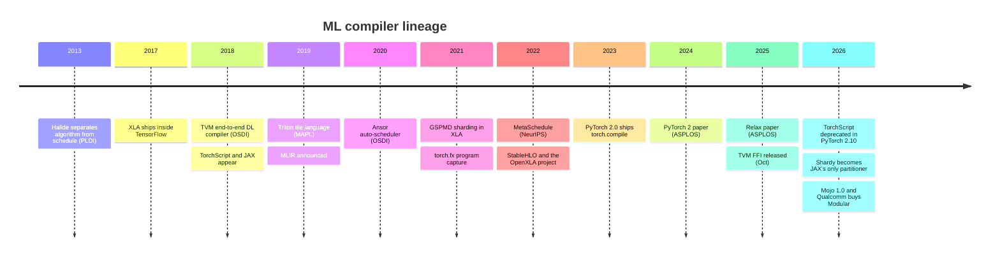

---
tags:
  - compilers
  - ml-compilers
  - deep-learning
  - kernel-fusion
  - pytorch
  - xla
  - tvm
  - gpu
status: complete
sources:
  - https://horace.io/brrr_intro.html
  - https://docs.pytorch.org/assets/pytorch2-2.pdf
  - https://dev-discuss.pytorch.org/t/torchinductor-a-pytorch-native-compiler-with-define-by-run-ir-and-symbolic-shapes/747
  - https://arxiv.org/abs/2112.08429
  - https://pytorch.org/blog/pytorch-2-9/
  - https://pytorch.org/blog/pytorch-2-10-release-blog/
  - https://pytorch.org/blog/pytorch-2-11-release-blog/
  - https://pytorch.org/blog/pytorch-2-12-release-blog/
  - https://pytorch.org/blog/pytorch-2-13-release-blog/
  - https://pytorch.org/blog/pytorch-2-14-release-blog/
  - https://courses.cs.washington.edu/courses/cse501/15sp/papers/raganKelley.pdf
  - https://www.arxiv.org/pdf/1802.04799
  - https://www.usenix.org/conference/osdi20/presentation/zheng
  - https://arxiv.org/abs/2205.13603
  - https://arxiv.org/abs/2311.02103
  - https://tvm.apache.org/2025/10/21/tvm-ffi
  - https://www.eecs.harvard.edu/~htk/publication/2019-mapl-tillet-kung-cox.pdf
  - https://arxiv.org/pdf/2002.11054
  - https://openxla.org/xla/gpu_architecture
  - https://openxla.org/stablehlo
  - https://arxiv.org/abs/2105.04663
  - https://docs.jax.dev/en/latest/shardy_jax_migration.html
  - https://jax.readthedocs.io/en/latest/jaxpr.html
  - https://arxiv.org/abs/1910.02653
  - https://developers.google.com/coral/guides/software/mlir-iree-compilers
  - https://docs.nvidia.com/deeplearning/tensorrt/11.4.0/performance/fusion-catalog.html
  - https://vllm.ai/blog/2025-08-20-torch-compile
  - https://www.lmsys.org/blog/2026-08-17-advanced-cuda-graph
  - https://modular.com/blog/modular-26-5-mojo-1-0-is-here
  - https://www.qualcomm.com/news/releases/2026/07/qualcomm-completes-acquisition-of-modular
  - https://hwbusters.com/news/qualcomm-open-sourced-the-mojo-compiler-three-weeks-after-paying-3-9-billion-for-it/
  - https://www.phoronix.com/news/Mojo-1.1-Released
  - https://aws.amazon.com/about-aws/whats-new/2026/07/aws-announce-neuron-2-31-0/
  - https://groq.com/wp-content/uploads/2024/02/2020-Isca.pdf
  - https://hc32.hotchips.org/assets/program/conference/day2/HotChips2020_ML_Training_Cerebras_v03.pdf
  - https://arxiv.org/abs/2601.17754
created: 2026-11-26
updated: 2026-11-26
---

## Table Of Contents

- [[#TL;DR|TL;DR]]
- [[#The Problem|The Problem]]
- [[#Foundations|Foundations]]
    - [[#Graphs, Ops and Kernels|Graphs, Ops and Kernels]]
    - [[#Compute, Memory and Overhead|Compute, Memory and Overhead]]
    - [[#Fusion Is the Main Win|Fusion Is the Main Win]]
    - [[#Algorithm vs Schedule|Algorithm vs Schedule]]
- [[#How We Got Here|How We Got Here]]
- [[#How It Works|How It Works]]
    - [[#The Two-Level Pipeline|The Two-Level Pipeline]]
    - [[#Graph Capture|Graph Capture]]
    - [[#Static and Dynamic Shapes|Static and Dynamic Shapes]]
    - [[#Graph-Level Optimizations|Graph-Level Optimizations]]
    - [[#Sharding as a Compiler Pass|Sharding as a Compiler Pass]]
    - [[#Operator-Level Codegen|Operator-Level Codegen]]
    - [[#Worked Example, gelu of a Linear Layer|Worked Example, gelu of a Linear Layer]]
    - [[#Compiling for Accelerators|Compiling for Accelerators]]
- [[#Where It Is Now|Where It Is Now]]
    - [[#PyTorch 2.x|PyTorch 2.x]]
    - [[#XLA, JAX and OpenXLA|XLA, JAX and OpenXLA]]
    - [[#TVM, MLIR Stacks and Mojo|TVM, MLIR Stacks and Mojo]]
    - [[#Compilers Inside LLM Inference|Compilers Inside LLM Inference]]
- [[#Trade-offs & Open Problems|Trade-offs & Open Problems]]
- [[#Resources|Resources]]
- [[#Related Notes|Related Notes]]

## ***TL;DR***
---
*An ML compiler takes a model written as a graph of tensor operators and turns it into a few fast kernels for a specific chip. Most of the win comes from fusing operators so intermediate tensors never round-trip through slow device memory.*

- **Why it exists.** Frameworks have thousands of operators and there are many chips; hand-writing a kernel for every pair doesn't scale. Worse, most non-matmul ops are *memory-bound*: in BERT they are about 0.2% of the FLOPs but take far more than 0.2% of the time, because the GPU spends that time moving data, not computing ([Horace He, 2022](https://horace.io/brrr_intro.html)).
- **Two levels.** A *graph level* captures the model (TorchDynamo, `jax.jit`, TorchScript, ONNX importers) and rewrites it (fusion, layout, constant folding, rematerialization, sharding). An *operator level* generates loop code for each fused group (TorchInductor → Triton or C++, XLA → Triton or LLVM IR, TVM → TensorIR), often by searching over schedules.
- **The main systems.** `torch.compile` (TorchDynamo + AOTAutograd + TorchInductor) for PyTorch; XLA via StableHLO for JAX, TensorFlow and TPUs; Apache TVM (now Relax + TVM FFI); TensorRT for NVIDIA inference; IREE and other [[MLIR]]-based stacks; vendor compilers for Trainium, Cerebras and Groq.
- **Headline result.** The PyTorch 2 paper reports TorchInductor at a **2.27× inference and 1.41× training** geometric-mean speedup over eager mode across 180+ models on an A100 ([Ansel et al., ASPLOS 2024](https://docs.pytorch.org/assets/pytorch2-2.pdf)).
- **As of November 2026:** PyTorch is at 2.14 (September 2026), TorchScript is deprecated in favour of `torch.export`, Inductor can emit CuTeDSL/CUTLASS kernels alongside Triton, JAX's only partitioner is Shardy, TVM has spun out its ABI as TVM FFI, Mojo reached 1.0, and LLM servers (vLLM, SGLang) use `torch.compile` and CUDA graphs by default.

## ***The Problem***
---
*Deep learning creates an "operators × hardware" matrix that no team can fill by hand, and the cheap-looking operators are the slow ones because they are limited by memory bandwidth and launch overhead, not arithmetic.*

**Operator explosion × hardware explosion.** PyTorch alone has thousands of operator overloads; the PyTorch 2 paper counts 3,028 ops including overloads when measuring shape-function coverage ([Ansel et al.](https://docs.pytorch.org/assets/pytorch2-2.pdf)). Each needs a fast implementation on NVIDIA, AMD and Intel GPUs, x86 and Arm CPUs, TPUs and a growing list of [[AI Accelerators]]. And research invents new *combinations* (a new norm, a new [[Attention]] variant for the [[Transformer]], a new activation) that no library has a kernel for. The TVM paper framed this as the motivation for an automated, end-to-end compiler rather than vendor libraries per operator ([Chen et al., OSDI 2018](https://www.arxiv.org/pdf/1802.04799)).

**Most of the graph is memory-bound.** Horace He's "brrr" essay splits time into three buckets: *compute* (FLOPs), *memory* (moving tensors between DRAM and the chip), and *overhead* (Python, framework dispatch, kernel launches). On an A100, matmuls on tensor cores reach 312 TFLOPS while other math tops out at 19.5 TFLOPS and DRAM bandwidth is 1.5 TB/s. Normalization and pointwise ops achieve 250× and 700× fewer FLOPS than matmuls, and that gap is mostly memory transfer, not computation ([He](https://horace.io/brrr_intro.html)).

**Eager mode can't fix it.** An eager framework runs one operator at a time and doesn't know what comes next, so it can't fuse; every op writes its full output to DRAM and the next op reads it back. As He puts it, fusion isn't possible in eager mode because the GPU must know the next operation in advance. A compiler sees the whole graph (or a large piece) first, and that is the whole point.

**Overhead is real at small sizes.** PyTorch manages about 280 thousand operations per second on tiny tensors ([He](https://horace.io/brrr_intro.html)). In LLM decode, where each step processes one token per sequence, launch and dispatch overhead can dominate; that is why [[LLM Serving]] systems pair compilers with CUDA graphs (see [[#Compilers Inside LLM Inference|below]]).

## ***Foundations***
---
*Four ideas carry the field: models are dataflow graphs of tensor ops; each op is compute-, memory- or overhead-bound; fusion removes memory traffic; and "what to compute" can be separated from "how to run it".*

### Graphs, Ops and Kernels

*A model is a graph of tensor operators; a kernel is the code that runs one or more of them on the device.*

A **graph** is a dataflow DAG whose nodes are tensor **operators** (`aten.mm`, `stablehlo.dot_general`) and whose edges are tensors: an FX graph, a jaxpr, an HLO module, a Relax function. A **kernel** is one program launched on the device (a Triton kernel, a cuBLAS GEMM); a **fusion group** is a set of ops compiled into one kernel; a **schedule** is the loop order, tiling, parallelization and memory placement chosen for a kernel.

These graphs are a domain-specific [[Intermediate Representations|IR]]: pure dataflow in [[SSA Form]] with no in-place mutation once functionalized, which makes classic graph rewrites (see [[Classic Optimizations]]) easy and aliasing analysis mostly unnecessary.

### Compute, Memory and Overhead

*Whether an op is limited by arithmetic or by bandwidth depends on how many FLOPs it does per byte it moves.*

$$
I = \frac{\text{FLOPs}}{\text{bytes moved}}, \qquad
t \approx \max\!\left(\frac{\text{FLOPs}}{P_{\text{peak}}},\ \frac{\text{bytes}}{B_{\text{mem}}}\right) + t_{\text{overhead}}, \qquad
I^{*} = \frac{P_{\text{peak}}}{B_{\text{mem}}}
$$

**In plain English:** an op's arithmetic intensity $I$ is how much math it does for each byte it reads or writes. Its time is roughly whichever is slower, doing the math or moving the bytes, plus fixed launch and dispatch costs. If $I$ is below the chip's *ridge point* $I^*$, the op is memory-bound and faster math units won't help.

On an A100 using He's figures, $I^* = 312 \times 10^{12} / 1.5 \times 10^{12} \approx 208$ FLOPs per byte for tensor-core work. A bf16 GELU does on the order of ten FLOPs per element while reading 2 bytes and writing 2, so $I \approx 2$ to 3: about 100× below the ridge. A large square matmul has $I$ that grows with the matrix size and easily clears it. This is the roofline model, and it is why ML compilers focus on the cheap ops.

### Fusion Is the Main Win

*Fusing consumers into producers keeps intermediates in registers or on-chip memory, cutting DRAM traffic roughly in proportion to the number of ops fused.*

He's example: `x.cos().cos()` run as two ops makes four global-memory transfers (read x, write tmp, read tmp, write out); fused, it makes two, for about a 2× speedup, and a fused `x.cos().cos()` costs about the same as a single `x.cos()` ([He](https://horace.io/brrr_intro.html)). The XLA team calls fusion "XLA's single most important optimization": fused intermediates stay in registers or shared memory, and each fusion compiles to one GPU kernel ([OpenXLA, XLA:GPU architecture](https://openxla.org/xla/gpu_architecture)).

| Fusion kind | What merges | Example |
|---|---|---|
| **Vertical (producer-consumer)** | A chain of ops where each consumes the last | bias add → GELU → dropout |
| **Reduction fusion** | Pointwise ops feeding or following a reduction | LayerNorm: mean, var, normalize, scale |
| **Epilogue / prologue** | Pointwise ops into a matmul's output or input | GEMM + bias + GELU in one kernel |
| **Horizontal (combo)** | Independent ops with no data dependency | Several small parameter updates in one launch |

Attention is the extreme case: [[FlashAttention]] is a hand-fused kernel that never materializes the full attention matrix, and FlexAttention in PyTorch compiles user-written score modifiers into fused attention kernels ([PyTorch 2.13 release](https://pytorch.org/blog/pytorch-2-13-release-blog/)).

### Algorithm vs Schedule

*Halide's key idea: write what each output pixel or element is, separately from how loops are ordered, tiled, parallelized and stored. The compiler, or a search, picks the schedule.*

Halide (PLDI 2013) split image-processing pipelines into an *algorithm* (pure functions over coordinates) and a *schedule* (tiling, vectorization, parallelism, and where each stage is computed and stored) ([Ragan-Kelley et al., PLDI 2013](https://courses.cs.washington.edu/courses/cse501/15sp/papers/raganKelley.pdf)):

```cpp
// Algorithm: a 3x3 box blur, defined as two pure stages
blur_x(x, y) = (in(x-1, y) + in(x, y) + in(x+1, y)) / 3;
out(x, y)    = (blur_x(x, y-1) + blur_x(x, y) + blur_x(x, y+1)) / 3;

// Schedule: tile the output, vectorize, parallelize rows,
// and compute blur_x per tile (a fusion decision) instead of all at once
out.tile(x, y, xi, yi, 256, 32).vectorize(xi, 8).parallel(y);
blur_x.compute_at(out, x).vectorize(x, 8);
```

`compute_at` is fusion expressed as a schedule choice, with recomputation of overlapping rows as the price. TVM carried the idea to tensors ("tensor expressions"), and nearly every ML compiler since splits *what* from *how*. The scheduling decisions themselves are the [[Loop Optimizations]] and [[Vectorization]] of classic compilers, chosen per shape and per chip.

## ***How We Got Here***
---
*ML compilers grew from image-processing DSLs and TensorFlow's XLA, went through a "make the user write a static graph" era, and since 2023 have mostly converged on capturing ordinary Python and compiling it just in time.*



- **Static graphs (2015 to 2018).** TensorFlow 1 made users build a graph up front; XLA compiled it. Fast, but hard to debug and write. PyTorch's eager mode won researchers over, leaving compilers without a graph.
- **Recovering a graph from eager code (2018 to 2022).** TorchScript tried to compile a Python subset; `torch.fx` traced with proxy objects ([Reed et al., MLSys 2022](https://arxiv.org/abs/2112.08429)); lazy tensors deferred ops at runtime. Each was either restrictive, unsound, or slow (see [[#Graph Capture|Graph Capture]]). JAX took the other path: require pure functions, then trace them.
- **Tensor compilers (2018 to 2022).** TVM brought Halide-style schedules plus a learned cost model to deep learning ([Chen et al.](https://www.arxiv.org/pdf/1802.04799)); Ansor generated schedules automatically from a search space instead of hand templates ([Zheng et al., OSDI 2020](https://www.usenix.org/conference/osdi20/presentation/zheng)); MetaSchedule expressed the search space as probabilistic programs ([Shao et al., NeurIPS 2022](https://arxiv.org/abs/2205.13603)). Triton showed that tile-level programming in Python could match vendor kernels ([Tillet, Kung and Cox, MAPL 2019](https://www.eecs.harvard.edu/~htk/publication/2019-mapl-tillet-kung-cox.pdf)). From 2019, [[MLIR]] gave compiler builders reusable dialects and passes ([Lattner et al., 2020](https://arxiv.org/pdf/2002.11054)); StableHLO became the portable op set between frameworks and XLA-family compilers ([OpenXLA](https://openxla.org/stablehlo)).
- **PyTorch 2 (2023).** TorchDynamo captures graphs from CPython bytecode, and TorchInductor generates Triton, reaching 93% of TorchBench models versus 45% for TorchScript ([Ansel et al.](https://docs.pytorch.org/assets/pytorch2-2.pdf)). This settled the capture problem for PyTorch, and by 2026 TorchScript was deprecated.

## ***How It Works***
---
*Every ML compiler has the same skeleton: capture a graph, optimize it as a graph, partition it into kernels, then generate and tune each kernel for the target, falling back to vendor libraries where they are better.*

### The Two-Level Pipeline

*Graph-level passes decide what goes into each kernel; operator-level codegen decides how each kernel runs.*

| Stage | TorchInductor | XLA (GPU) | Apache TVM |
|---|---|---|---|
| Graph IR | FX graph (ATen / Prims ops) | HLO, imported from StableHLO | Relax |
| Kernel IR | Define-by-run loop IR (Python) | Fusion emitters; TritonIR for GEMM/softmax fusions | TensorIR |
| Codegen | Triton (GPU), C++/OpenMP (CPU), CuTeDSL (2.13+) | Triton → PTX; LLVM IR directly for reductions and transposes | LLVM, CUDA, Metal, Vulkan, etc. |
| Matmuls | ATen/cuBLAS by default; Triton or CUTLASS templates under `max_autotune` | cuBLAS/cuDNN or Triton GEMM fusions | Scheduled TensorIR or library dispatch |

Sources: [Ansel et al.](https://docs.pytorch.org/assets/pytorch2-2.pdf), [OpenXLA](https://openxla.org/xla/gpu_architecture), [Lai et al., Relax](https://arxiv.org/abs/2311.02103), [PyTorch 2.14 release](https://pytorch.org/blog/pytorch-2-14-release-blog/).

### Graph Capture

*Getting a faithful graph out of Python is the hardest front-end problem; the answer that stuck for PyTorch is to intercept bytecode and guard on assumptions.*

| Approach | How it captures | Weakness | Evidence |
|---|---|---|---|
| `torch.jit.trace` | Run once, record executed ops | Silently drops control flow | Unsound by design |
| `torch.jit.script` (TorchScript) | Parse a static subset of Python | Rejects much real code | 36 of 80 TorchBench models (45%), 0 of 46 HuggingFace |
| `torch.fx.symbolic_trace` | Python-level proxy objects | "still unsound"; can bake random values into constants, drops global side effects | |
| Lazy tensors | Defer ops at runtime, build graph per iteration | High overhead: 38% inference, 90% training (V100) | |
| **TorchDynamo** | CPython frame-eval hook (PEP 523), symbolic bytecode execution, guards | Graph breaks on unsupported code | 74 of 80 TorchBench (93%), 46/46 HF, 62/62 TIMM; 5% / 1% overhead |
| `jax.jit` | Trace a *pure* function with abstract values into a jaxpr | Requires functional code; retraces per shape/dtype | |

Sources: [Ansel et al.](https://docs.pytorch.org/assets/pytorch2-2.pdf), [Reed et al.](https://arxiv.org/abs/2112.08429), [JAX docs](https://jax.readthedocs.io/en/latest/jaxpr.html).

**How Dynamo works.** CPython's PEP 523 lets a library replace frame evaluation. Dynamo symbolically runs each frame's bytecode, records tensor ops into an FX graph, and emits *guards* (checks on types, shapes, globals; 30 guard types at the time of the paper) that must hold for the compiled code to be reused. On an unsupported op or a branch on a tensor's *value*, it inserts a **graph break**: compile what it has, run the offending code eagerly, and resume tracing in a generated continuation. Branches on tensor *metadata* (shapes, dtypes) are specialized away ([Ansel et al.](https://docs.pytorch.org/assets/pytorch2-2.pdf)). In the paper, 70% of TorchBench models had zero graph breaks.

**AOTAutograd** then runs PyTorch's autograd on *fake tensors* to record a joint forward-and-backward graph, decomposes ops into a smaller set, makes the graph purely functional, and splits it with a **min-cut** that chooses what to save versus recompute for backward ([Ansel et al.](https://docs.pytorch.org/assets/pytorch2-2.pdf)).

**JAX** goes the other way: `jax.jit` calls the Python function once with abstract "tracer" values carrying only shape and dtype, records primitives into a jaxpr, and lowers that to StableHLO for XLA. Python control flow runs at trace time; data-dependent control flow must use `lax.cond`/`lax.while_loop` ([JAX docs](https://jax.readthedocs.io/en/latest/jaxpr.html)). Because there's no bytecode interception, there are no graph breaks; non-traceable code is simply an error.

### Static and Dynamic Shapes

*Kernels are fastest when every size is a constant; real workloads (variable sequence lengths, batch sizes) need either recompilation or symbolic shapes.*

There are three strategies. XLA and JAX by default **specialize** on exact shapes and recompile when one changes, so users pad or bucket sizes to limit compiles (vLLM's `compile_sizes` and CUDA-graph batch buckets are the same idea). TorchDynamo and Inductor use **symbolic shapes with guards**, trading some specialization for one compile across many sizes. TVM Relax makes **symbolic shapes first-class in the IR**.

PyTorch's symbolic shapes run *meta functions* (shape-only versions of ops; 2,657 of 3,028 ops covered at publication) on symbolic sizes. Each symbol carries a *hint* from the first real input; when a branch depends on a size, the compiler follows the hinted branch and adds a guard rather than representing the conditional. Sizes 0 and 1 are specialized, since they change broadcasting semantics ([Ansel et al.](https://docs.pytorch.org/assets/pytorch2-2.pdf)). PyTorch 2.14 adds an experimental declarative API, `@dynamic_spec`/`ShapesSpec`, shared by `torch.compile`, `torch.export` and `make_fx`, e.g. `ShapeVar("batch", min=2, max=128)` ([PyTorch 2.14](https://pytorch.org/blog/pytorch-2-14-release-blog/)). Relax makes symbolic shape variables part of the IR's type system so they flow across function and kernel boundaries ([Lai et al.](https://arxiv.org/abs/2311.02103)).

### Graph-Level Optimizations

*Graph passes are classic compiler optimizations applied to whole tensors, plus a few that only make sense for ML: layout choice, recomputation for memory, and sharding.*

| Pass | What it does | ML twist |
|---|---|---|
| **Fusion** | Groups ops into one kernel | The main win; Inductor uses greedy fusion over pointwise, reduction and scatter nodes ([Ansel et al.](https://docs.pytorch.org/assets/pytorch2-2.pdf)) |
| **Layout assignment** | Chooses physical memory order per tensor (NCHW vs NHWC, tiled layouts) | XLA resolves conflicts by inserting `copy` ops that physically transpose ([OpenXLA](https://openxla.org/xla/gpu_architecture)) |
| **Constant folding** | Precomputes subgraphs on constants | Weights are often treated as constants at inference, so e.g. a transposed weight can be folded |
| **Decomposition** | Rewrites big ops into primitives | Inductor lowers 433 ATen ops onto 54 primitive loop-IR ops |
| **Rematerialization** | Recomputes cheap values in backward instead of storing them | Optimal version is an ILP ([Checkmate, MLSys 2020](https://arxiv.org/abs/1910.02653)); AOTAutograd uses min-cut |
| **Comm/compute overlap** | Reorders collectives against compute | Inductor's `simple_overlap` on by default in 2.14 |
| **SPMD partitioning** | Splits the graph across devices from sharding annotations | GSPMD, Shardy (next section) |

Rematerialization matters because training memory is dominated by saved activations. Pointwise ops are cheap to recompute (they are memory-bound anyway), so recomputing them inside a fused backward kernel can be *faster* than reading them back from DRAM, which is why the min-cut tends to save matmul outputs and recompute activations.

### Sharding as a Compiler Pass

*Users annotate how a few tensors are split across a device mesh; the compiler propagates the rest and inserts the collectives.*

GSPMD (Google, 2021) made sharding an XLA pass: annotate a few tensors with how they are split over a logical device mesh, and the compiler propagates shardings through the graph, rewrites each op for its local shard, and inserts all-gather, reduce-scatter and all-reduce where layouts disagree ([Xu et al., 2021](https://arxiv.org/abs/2105.04663)). That one mechanism expresses data, tensor and pipeline-style parallelism, the strategies described in [[Distributed Training]]. Its successor, **Shardy**, is an [[MLIR]]-based partitioner co-developed by the team behind PartIR and the XLA team behind GSPMD; JAX completed its migration in March 2026, after which Shardy is JAX's only partitioner ([JAX docs](https://docs.jax.dev/en/latest/shardy_jax_migration.html)). On the PyTorch side, DTensor and compile-time passes play the same role, and 2.14's `compile_on_one_rank` lets one compiled artifact load on every rank ([PyTorch 2.14](https://pytorch.org/blog/pytorch-2-14-release-blog/)).

### Operator-Level Codegen

*Once the graph is partitioned, each group becomes loop code; systems differ in how much they search for a schedule and how much they delegate to a tile language.*

**Search-based schedulers (TVM line).** TVM writes an operator as a *tensor expression*, pure index math such as `C = te.compute((M, N), lambda i, j: te.sum(A[i, k] * B[k, j], axis=k))`, and then searches for a schedule (tiling, binding tiles to GPU blocks and threads, caching in shared memory) guided by a learned cost model ([Chen et al.](https://www.arxiv.org/pdf/1802.04799)). Ansor removed hand-written schedule templates by sampling programs from a hierarchical search space and fine-tuning them with evolutionary search and a learned cost model ([Zheng et al.](https://www.usenix.org/conference/osdi20/presentation/zheng)); MetaSchedule unified templates and auto-scheduling as probabilistic programs over TensorIR ([Shao et al.](https://arxiv.org/abs/2205.13603)). The cost-model side of this is covered in [[ML-Guided Optimization]].

**Tile languages (Triton line).** Instead of scheduling scalar loops, the compiler emits *block-level* programs (load a tile, compute, store) and lets a tile compiler handle threads, shared memory and tensor cores. TorchInductor and XLA both generate Triton. Details of Triton, CUTLASS/CuTe, Pallas and Helion belong in [[GPU Kernel Compilers]].

**TorchInductor.** Inductor lowers FX nodes into a *define-by-run* loop IR written as executable Python, schedules and fuses it, and prints Triton for GPUs and C++ with OpenMP for CPUs ([Ansel et al.](https://docs.pytorch.org/assets/pytorch2-2.pdf); [Inductor design post](https://dev-discuss.pytorch.org/t/torchinductor-a-pytorch-native-compiler-with-define-by-run-ir-and-symbolic-shapes/747)). Matmuls and convolutions usually go to vendor libraries; with `max_autotune`, Inductor benchmarks Triton templates (and, since 2.13/2.14, CuTeDSL and CUTLASS "NVGEMM" kernels) against ATen and keeps the fastest ([PyTorch 2.13](https://pytorch.org/blog/pytorch-2-13-release-blog/), [2.14](https://pytorch.org/blog/pytorch-2-14-release-blog/)).

**XLA.** Frameworks lower to StableHLO, XLA runs HLO-to-HLO passes (SPMD partitioning, layout assignment, fusion), then emits each fusion: fusions containing a matmul or softmax are converted to TritonIR with chosen tile sizes, and reductions and transposes go straight to LLVM IR. Runtime calls to cuBLAS, cuDNN and NCCL sit alongside, though the docs note these libraries "often preclude complex fusion opportunities" ([OpenXLA](https://openxla.org/xla/gpu_architecture)).

**Other stacks.**

| System | Input | Approach |
|---|---|---|
| **TensorRT** | ONNX, Torch-TensorRT, TensorRT-LLM | Builds a per-GPU engine; fuses layers per a documented fusion catalog and times candidate kernels on the target GPU ([NVIDIA](https://docs.nvidia.com/deeplearning/tensorrt/11.4.0/performance/fusion-catalog.html)) |
| **IREE** | StableHLO, Torch, TOSA, ONNX via MLIR | MLIR-based compiler plus a small runtime, aimed at portability down to mobile and embedded ([Google Coral docs](https://developers.google.com/coral/guides/software/mlir-iree-compilers)) |
| **Apache TVM (Relax)** | PyTorch FX/export, ONNX | Graph IR and TensorIR in one module, so passes can cross levels ([Lai et al.](https://arxiv.org/abs/2311.02103)) |

### Worked Example, gelu of a Linear Layer

*A three-op function shows what `torch.compile` does: one graph, one library matmul, and one fused Triton kernel instead of three memory round trips.*

```python
import torch

@torch.compile
def f(x, w, b):
    return torch.nn.functional.gelu(x @ w + b)

# x: [8192, 4096], w: [4096, 4096], b: [4096], all bf16 on CUDA
```

**Step 1, Dynamo's FX graph** (sketch of the shape of the output, not a verbatim dump; `TORCH_LOGS=graph_code` prints the real one):

```python
def forward(self, L_x_, L_w_, L_b_):
    matmul = L_x_ @ L_w_
    add    = matmul + L_b_
    gelu   = torch._C._nn.gelu(add)
    return (gelu,)
```

**Step 2, Inductor's output** (sketch in Inductor's style; `TORCH_LOGS=output_code` prints the real kernel). The `mm` becomes an external call to cuBLAS; the add and GELU fuse into one pointwise kernel that reads the matmul output once and writes the result once:

```python
# Sketch: one fused pointwise kernel for (mm_out + b) -> gelu (exact erf form)
@triton.jit
def triton_poi_fused_add_gelu_0(in_out_ptr0, in_ptr0, xnumel, XBLOCK: tl.constexpr):
    xoffset = tl.program_id(0) * XBLOCK
    xindex = xoffset + tl.arange(0, XBLOCK)
    xmask = xindex < xnumel
    col = xindex % 4096                                   # bias index (broadcast over rows)
    v = tl.load(in_out_ptr0 + xindex, xmask).to(tl.float32)
    bias = tl.load(in_ptr0 + col, xmask).to(tl.float32)
    z = v + bias
    out = 0.5 * z * (1.0 + libdevice.erf(z * 0.7071067811865476))
    tl.store(in_out_ptr0 + xindex, out.to(tl.bfloat16), xmask)   # in place over mm_out

# Host side: buf0 = extern_kernels.mm(x, w)  (cuBLAS), then launch the kernel on buf0 and b
```

Note the in-place store: Inductor reuses the matmul buffer, so there's no extra allocation. With `mode="max-autotune"`, Inductor may instead pick a Triton or CUTLASS GEMM template with the bias and GELU as an *epilogue*, so the matmul's output tile goes through GELU in registers before its only write.

**Memory traffic, before and after.** Shapes as above, bf16 (2 bytes): $x$ is 64 MiB, $w$ is 32 MiB, and each $8192 \times 4096$ intermediate is 64 MiB. Count only DRAM reads and writes, ignoring the tiny bias.

| Plan | Kernels | Matmul traffic | Elementwise traffic | Total |
|---|---|---|---|---|
| Eager, unfused | mm, add, gelu | 96 MiB read + 64 write | add: 64 + 64; gelu: 64 + 64 | **416 MiB** |
| Inductor default (pointwise fused) | mm, fused add+gelu | 96 + 64 | 64 + 64 | **288 MiB** |
| Epilogue fused (max-autotune) | one GEMM | 96 + 64 | 0 | **160 MiB** |

$$
t_{\text{mm}} \approx \frac{2MNK}{P_{\text{peak}}} = \frac{2 \cdot 8192 \cdot 4096 \cdot 4096}{312 \times 10^{12}} \approx 0.88\ \text{ms},
\qquad
t_{\text{tail}} \approx \frac{\text{elementwise bytes}}{1.5 \times 10^{12}}
$$

**In plain English:** the matmul is compute-bound and costs about 0.88 ms at A100 peak. The elementwise tail is pure memory traffic: 256 MiB unfused is about 0.18 ms, fused is about 0.09 ms, and as an epilogue it is essentially free. So the end-to-end ideal goes from about 1.06 ms to 0.97 ms to 0.88 ms, a 17% saving on a matmul-heavy layer. On graphs dominated by norms, activations and residual adds, the memory-bound share is far larger, which is where whole-model speedups like the PyTorch 2 paper's 2× to 3× on some suites come from.

At LLM-decode shapes ($M$ = a few tokens), the picture flips: the matmul is memory-bound on reading $w$, the elementwise bytes are tiny, and the three kernel *launches* dominate. There fusion helps by cutting launches, and CUDA graphs remove the rest of the CPU overhead.

### Compiling for Accelerators

*Accelerators without a mature CUDA-style kernel ecosystem lean even harder on the compiler: on TPUs, Trainium, Cerebras and Groq, the compiler is the programming model.*

| Target | Compiler path | What the compiler must decide |
|---|---|---|
| **Google TPU** | JAX/PyTorch-XLA → StableHLO → XLA's TPU backend (closed source); Pallas for hand-written kernels | Fusion, tiling for the matrix units, layout, sharding across the TPU mesh (GSPMD/Shardy) |
| **AWS Trainium/Inferentia** | PyTorch/JAX via XLA → Neuron compiler; NKI for custom kernels. Neuron 2.31 (July 2026) ships NKI 0.5.0 ([AWS](https://aws.amazon.com/about-aws/whats-new/2026/07/aws-announce-neuron-2-31-0/)) | Mapping ops onto tensor, vector and scalar engines; on-chip memory management |
| **Cerebras WSE** | Graph compiler places each layer's kernels on regions of the wafer's cores and routes data between them; CSL for low-level kernels ([Hot Chips 2020](https://hc32.hotchips.org/assets/program/conference/day2/HotChips2020_ML_Training_Cerebras_v03.pdf)); MLIR lowering research continues ([2026 stencil pipeline](https://arxiv.org/abs/2601.17754)) | Spatial placement and routing, closer to FPGA place-and-route than to GPU codegen |
| **Groq TSP/LPU** | Compiler schedules every instruction and data movement statically; the hardware is deterministic, with no caches or dynamic arbitration ([Abts et al., ISCA 2020](https://groq.com/wp-content/uploads/2024/02/2020-Isca.pdf)) | Cycle-exact scheduling across functional units and chips |

The trend is clear in Groq's design: removing hardware that handles uncertainty (caches, out-of-order issue) makes performance predictable but moves all scheduling into the compiler. The [[AI Accelerators]] note covers the hardware side.

## ***Where It Is Now***
---
*As of November 2026: `torch.compile` is the default way to speed up PyTorch and sits inside the main LLM servers; XLA/JAX has finished its move to Shardy; TVM is repositioning as modular infrastructure; and the frontier is kernel DSLs and compile-time cost, not graph capture.*

### PyTorch 2.x

*Roughly quarterly releases in 2025 and 2026 have shifted Inductor from "Triton only" to a multi-backend kernel autotuner, and retired TorchScript.*

| Release | Date | Compiler-relevant highlights |
|---|---|---|
| 2.9 | Oct 2025 | ROCm and Intel XPU install improvements, Arm work ([PyTorch](https://pytorch.org/blog/pytorch-2-9/)) |
| 2.10 | Jan 21, 2026 | `torch.compile` on Python 3.14 (3.14t experimental); **combo kernels** (horizontal fusion of independent ops); `torch.compile` respects deterministic mode; `varlen_attn()`; DebugMode; **TorchScript deprecated, use `torch.export`** ([PyTorch](https://pytorch.org/blog/pytorch-2-10-release-blog/)) |
| 2.12 | May 2026 | Device-agnostic `torch.accelerator.Graph` API; microscaling quantization export ([via 2.13 post](https://pytorch.org/blog/pytorch-2-13-release-blog/)) |
| 2.13 | Jul 8, 2026 | **CuTeDSL backend for Inductor** (GEMM, RMSNorm) beside Triton; `torch.compiler.set_default_backend`; Armv9-A/SVE targets; Triton pin 3.7.1 ([PyTorch](https://pytorch.org/blog/pytorch-2-13-release-blog/)) |
| 2.14 | Sep 2, 2026 | **NVGEMM** (CuTeDSL CUTLASS kernels with epilogue fusion, NVFP4 on Blackwell) in max-autotune; comm/compute overlap on by default; `torch.switch`; `torch.while_loop` CUDA-graph capture; `ShapesSpec`; compile-on-one-rank; Helion registered as a native DSL backend; Dynamo TVM backend's Relay path removed; `torch.compile` raises on Python 3.15 ([PyTorch](https://pytorch.org/blog/pytorch-2-14-release-blog/)) |

Almost all of these are marked API-unstable. Two directions stand out: Inductor is becoming a *dispatcher across kernel languages* (Triton, CuTeDSL, CUTLASS, Helion) chosen by autotuning, and `torch.export` plus AOTInductor is the ahead-of-time path for deployment (2.14 adds zero-copy external weights in AOTInductor). Quantized formats like NVFP4 now arrive through compiler epilogues rather than standalone kernels; see [[Quantization]].

### XLA, JAX and OpenXLA

*XLA remains the compiler for TPUs and JAX; its GPU backend now leans on Triton for its most important fusions.*

- **Partitioning.** Shardy replaced GSPMD's propagation in JAX, with migration complete in March 2026 and a six-month window in which older exported models still run with GSPMD ([JAX docs](https://docs.jax.dev/en/latest/shardy_jax_migration.html)).
- **GPU codegen.** XLA:GPU's documentation describes GEMM and softmax fusions lowered through TritonIR, other fusions through LLVM IR, and a runtime IR (an MLIR dialect) where CUDA-graph extraction happens, with CUDA graph support "still a work in progress" ([OpenXLA](https://openxla.org/xla/gpu_architecture)).
- **StableHLO** is the interchange layer that lets JAX, PyTorch/XLA and other frontends target XLA, IREE and vendor compilers such as Neuron ([OpenXLA](https://openxla.org/stablehlo)).

### TVM, MLIR Stacks and Mojo

*The standalone "one compiler for everything" pitch has faded; pieces of TVM and MLIR now show up as infrastructure inside other systems.*

- **Apache TVM.** Relax (ASPLOS 2025) replaced Relay as the graph IR, with symbolic shapes and cross-level optimization ([Lai et al.](https://arxiv.org/abs/2311.02103)). In October 2025 the project released **TVM FFI**, "an open ABI and FFI for machine learning systems": a stable C ABI and DLPack-based tensor exchange so kernel libraries can ship one wheel across Python and PyTorch versions; FlashInfer ships with it, and it supports PyTorch, JAX and CuPy ([Apache TVM, Oct 2025](https://tvm.apache.org/2025/10/21/tvm-ffi)). The post describes this as providing "neutral and modular infrastructure pieces", a signal of where TVM is heading.
- **MLIR-based stacks.** IREE, Shardy, XLA's emitters, Triton, CuTeDSL and Mojo all build on [[MLIR]]; it is the shared substrate even where the user-facing tool differs.
- **Mojo and MAX.** Mojo reached 1.0 on August 11, 2026, with Modular promising to open source the compiler in 2026 ([Modular](https://modular.com/blog/modular-26-5-mojo-1-0-is-here)). Qualcomm completed its acquisition of Modular in July 2026 ([Qualcomm](https://www.qualcomm.com/news/releases/2026/07/qualcomm-completes-acquisition-of-modular)). News headlines (not read in full) report the Mojo compiler released under Apache 2.0 with LLVM exceptions about three weeks after the deal ([Hardware Busters](https://hwbusters.com/news/qualcomm-open-sourced-the-mojo-compiler-three-weeks-after-paying-3-9-billion-for-it/)) and Mojo 1.1 accepting community compiler contributions ([Phoronix](https://www.phoronix.com/news/Mojo-1.1-Released)).

### Compilers Inside LLM Inference

*In LLM serving, the compiler's job is fusion around custom kernels plus removing CPU overhead with CUDA graphs; compile time has become the main complaint.*

**vLLM.** `torch.compile` is on by default in vLLM V1. Dynamo captures one graph with a dynamic batch dimension (or static graphs for listed `compile_sizes`); the graph is split into CUDA-graph-safe pieces, captured piecewise, and compiled artifacts are cached on disk and reusable across identical machines. vLLM's own FX passes fuse across custom ops: AllReduce + RMSNorm (up to 15%), AllReduce + RMSNorm + FP8 quant (up to 8%), attention + FP8 quant (up to 7%), sequence parallelism and async TP (up to 10%). Startup time is called a "huge pain point" ([vLLM, Aug 2025](https://vllm.ai/blog/2025-08-20-torch-compile)).

**SGLang.** Decode uses full CUDA graphs per batch-size bucket. For prefill, SGLang's `torch.compile`-based piecewise backend spent 78 to 86% of graph-preparation time compiling (90 s on a 235B MoE, 158 s on GLM-5.2), so SGLang built **Breakable CUDA Graph**, which captures graph-safe regions and runs marked functions eagerly *without a compiler*; it became the default prefill strategy in 2026, builds graphs 3.8 to 5.2× faster, and on gpt-oss-120b prefill reached 1.70× over eager versus 1.45× for the compiled piecewise path ([SGLang, Aug 2026](https://www.lmsys.org/blog/2026-08-17-advanced-cuda-graph)).

The lesson: for [[LLM Serving]], the heavy kernels ([[FlashAttention]], MoE GEMMs for [[Mixture of Experts]], paged [[KV Cache]] attention) are hand-written or DSL-written, and the compiler's value is the glue between them, which has to pay back its compile time.

## ***Trade-offs & Open Problems***
---
*ML compilers trade generality, compile time and debuggability against speed; the hardest remaining problems are dynamic shapes, compile latency, and knowing when to trust a library over generated code.*

| Choice | You get | You pay |
|---|---|---|
| Bytecode capture (Dynamo) | Runs almost any Python | Guards, recompiles, graph breaks to debug |
| Static shapes | Best kernels, full constant folding | Recompile or pad for every new size |
| Symbolic shapes | One compile covers many sizes | Less specialized kernels, guard complexity |
| Aggressive fusion | Fewer DRAM round trips and launches | Recomputation, register pressure, harder profiling |
| Generated kernels | Fusion across arbitrary ops | May lose to cuBLAS/cuDNN on big GEMMs |
| Autotuning | Fastest kernel per shape and chip | Minutes of compile time, nondeterminism without care |

**Open problems.**

- **Compile time.** vLLM and SGLang both name startup cost as the top pain; SGLang went compiler-free for prefill graphs partly for this reason. Caching, compile-on-one-rank and precompiled artifacts are partial answers.
- **Dynamic shapes and control flow.** Ragged batches, MoE routing and variable-length attention still push systems toward bucketing; `torch.cond`/`torch.switch`/`while_loop` and Relax's symbolic shapes are steps toward real dynamism.
- **Fusion decisions.** Greedy fusion is the norm; searching over fusion choices with rewrite systems is an active research area (see [[E-Graphs and Equality Saturation]]), as are learned cost models ([[ML-Guided Optimization]]).
- **Correctness and numerics.** Fusion reorders floating-point math, so compiled and eager outputs differ slightly; PyTorch 2.10's deterministic mode and DebugMode tensor hashing exist to find such divergence. Compiler bugs are tested with fuzzing and differential testing ([[Compiler Testing and Fuzzing]]).
- **Portability vs peak.** The best kernels on new NVIDIA parts appear first in CUTLASS/CuTeDSL, which is why Inductor added them as backends; staying portable across AMD, Intel, TPU and Trainium while matching that remains open (see [[GPU Kernel Compilers]]).
- **Who owns the graph.** Interchange formats (StableHLO, `torch.export`, ONNX) and ABIs (TVM FFI, DLPack) are converging, but there's still no single IR that every framework emits and every vendor consumes.

## ***Resources***
---
*Start with Horace He's essay for the "why", the PyTorch 2 paper for how a modern compiler captures and generates code, and the XLA:GPU architecture page for the other main design. Halide and TVM explain where schedules came from.*

**Explainer and primary papers**
- Start here: [Making Deep Learning Go Brrrr From First Principles](https://horace.io/brrr_intro.html) (Horace He, 2022), on compute, memory and overhead regimes and fusion.
- PyTorch: [PyTorch 2](https://docs.pytorch.org/assets/pytorch2-2.pdf) (Ansel et al., ASPLOS 2024); [torch.fx](https://arxiv.org/abs/2112.08429) (Reed et al., MLSys 2022).
- Schedules and search: [Halide](https://courses.cs.washington.edu/courses/cse501/15sp/papers/raganKelley.pdf) (Ragan-Kelley et al., PLDI 2013); [TVM](https://www.arxiv.org/pdf/1802.04799) (Chen et al., OSDI 2018); [Ansor](https://www.usenix.org/conference/osdi20/presentation/zheng) (Zheng et al., OSDI 2020); [MetaSchedule](https://arxiv.org/abs/2205.13603) (Shao et al., NeurIPS 2022); [Relax](https://arxiv.org/abs/2311.02103) (Lai et al., ASPLOS 2025).
- Infrastructure: [Triton](https://www.eecs.harvard.edu/~htk/publication/2019-mapl-tillet-kung-cox.pdf) (Tillet, Kung and Cox, MAPL 2019); [MLIR](https://arxiv.org/pdf/2002.11054) (Lattner et al., CGO 2021).
- Memory and parallelism: [GSPMD](https://arxiv.org/abs/2105.04663) (Xu et al., 2021); [Checkmate](https://arxiv.org/abs/1910.02653) (Jain et al., MLSys 2020).
- Accelerators: [Groq TSP, "Think Fast"](https://groq.com/wp-content/uploads/2024/02/2020-Isca.pdf) (Abts et al., ISCA 2020); [Cerebras WSE programming](https://hc32.hotchips.org/assets/program/conference/day2/HotChips2020_ML_Training_Cerebras_v03.pdf) (Hot Chips 2020); [MLIR stencils at wafer scale](https://arxiv.org/abs/2601.17754) (arXiv, 2026).

**Docs and design posts**
- [TorchInductor design post](https://dev-discuss.pytorch.org/t/torchinductor-a-pytorch-native-compiler-with-define-by-run-ir-and-symbolic-shapes/747); [XLA:GPU architecture](https://openxla.org/xla/gpu_architecture); [StableHLO](https://openxla.org/stablehlo); [Understanding Jaxprs](https://jax.readthedocs.io/en/latest/jaxpr.html); [Shardy JAX migration](https://docs.jax.dev/en/latest/shardy_jax_migration.html).
- [TensorRT layer fusion catalog](https://docs.nvidia.com/deeplearning/tensorrt/11.4.0/performance/fusion-catalog.html) (NVIDIA); [MLIR and IREE compilers](https://developers.google.com/coral/guides/software/mlir-iree-compilers) (Google Coral docs).

**Releases and practitioner posts (2025 to 2026)**
- PyTorch release blogs: [2.9](https://pytorch.org/blog/pytorch-2-9/), [2.10](https://pytorch.org/blog/pytorch-2-10-release-blog/), [2.11](https://pytorch.org/blog/pytorch-2-11-release-blog/), [2.12](https://pytorch.org/blog/pytorch-2-12-release-blog/), [2.13](https://pytorch.org/blog/pytorch-2-13-release-blog/), [2.14](https://pytorch.org/blog/pytorch-2-14-release-blog/).
- LLM serving: [torch.compile in vLLM](https://vllm.ai/blog/2025-08-20-torch-compile) (vLLM, Aug 2025); [Advanced CUDA Graph Techniques in SGLang](https://www.lmsys.org/blog/2026-08-17-advanced-cuda-graph) (Aug 2026).
- Ecosystem: [TVM FFI](https://tvm.apache.org/2025/10/21/tvm-ffi) (Apache TVM, Oct 2025); [Mojo 1.0](https://modular.com/blog/modular-26-5-mojo-1-0-is-here) (Modular, Aug 2026); [Qualcomm completes Modular acquisition](https://www.qualcomm.com/news/releases/2026/07/qualcomm-completes-acquisition-of-modular) (Jul 2026); [Mojo compiler open-sourced](https://hwbusters.com/news/qualcomm-open-sourced-the-mojo-compiler-three-weeks-after-paying-3-9-billion-for-it/) (Hardware Busters); [Mojo 1.1](https://www.phoronix.com/news/Mojo-1.1-Released) (Phoronix); [AWS Neuron 2.31.0](https://aws.amazon.com/about-aws/whats-new/2026/07/aws-announce-neuron-2-31-0/) (Jul 2026).

## Related Notes

- [[GPU Kernel Compilers]] — Triton, CUTLASS/CuTeDSL, Pallas and Helion: the tile languages ML compilers emit.
- [[MLIR]] — The shared infrastructure under XLA's emitters, Shardy, IREE, Triton and Mojo.
- [[LLVM]] — The final code generator for most GPU and CPU backends.
- [[Intermediate Representations]] — Graph IRs (FX, HLO, Relax) as domain-specific IRs.
- [[JIT Compilation]] — `torch.compile` and `jax.jit` are JITs with guards and recompilation.
- [[Loop Optimizations]] — Tiling, fusion and interchange, the content of a schedule.
- [[ML-Guided Optimization]] — Learned cost models in TVM, Ansor and MetaSchedule.
- [[E-Graphs and Equality Saturation]] — Search-based alternatives to greedy fusion and rewriting.
- [[Compiler Testing and Fuzzing]] — Finding miscompilations and numeric divergence.
- [[AI Accelerators]] — The hardware these compilers target.
- [[FlashAttention]] — The canonical hand-fused kernel.
- [[Quantization]] — Low-precision formats now fused into GEMM epilogues.
- [[Distributed Training]] — Parallelism strategies that GSPMD and Shardy express as sharding.
- [[LLM Serving]] — Where `torch.compile` and CUDA graphs meet vLLM and SGLang.
- [[Transformer]] — The workload most of these optimizations target.
- [[Mixture of Experts]] — Dynamic routing that strains static-shape compilers.
