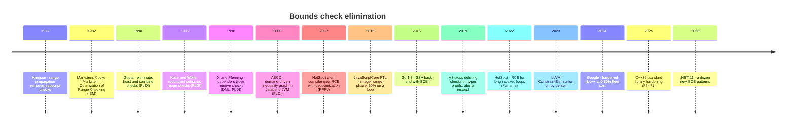
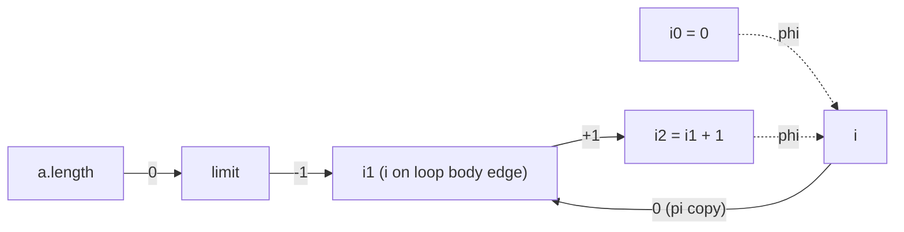
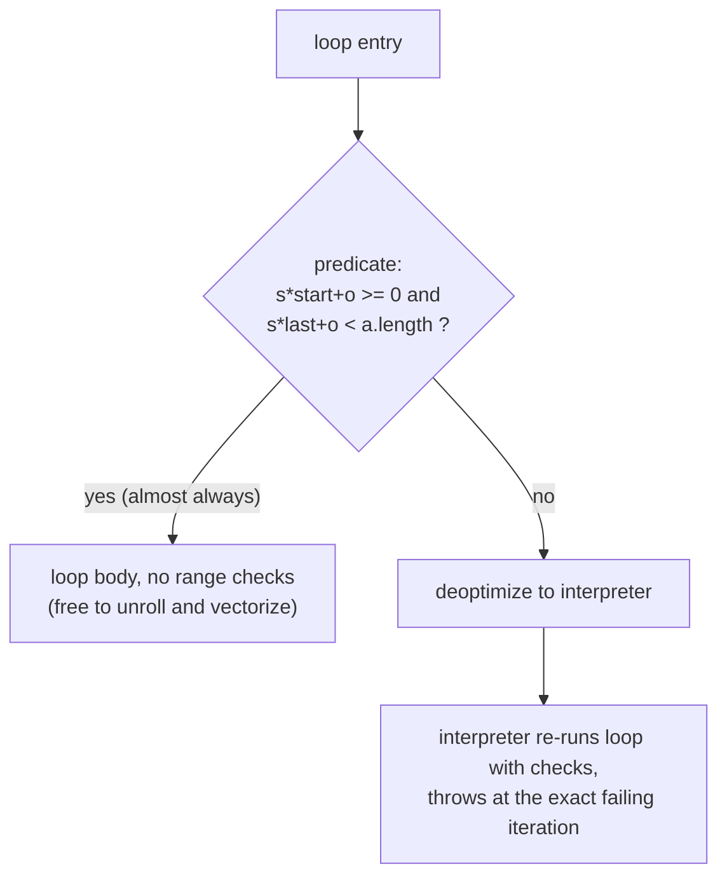
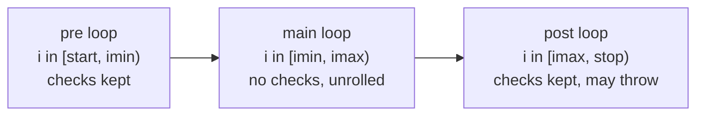
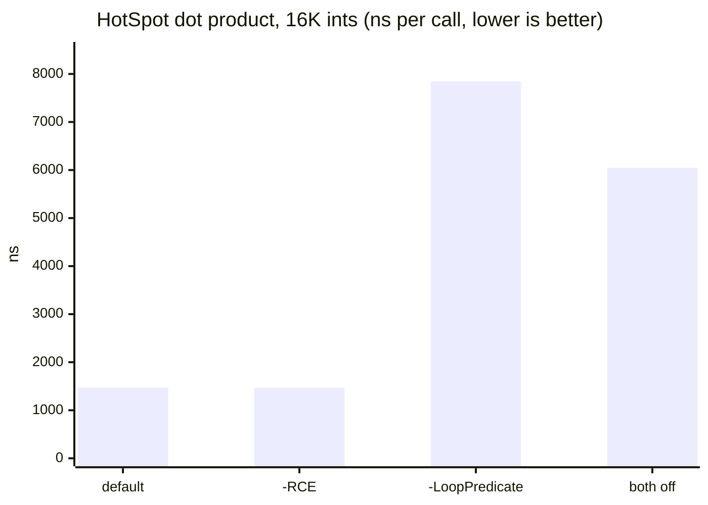

---
tags:
  - compilers
  - optimization
  - bounds-check-elimination
  - range-check-elimination
  - range-analysis
  - loop-predication
  - jit
  - hotspot
  - llvm
  - go
  - rust
  - webassembly
  - memory-safety
status: complete
sources:
  - https://homes.cs.washington.edu/~bodik/ucb/research/pldi00.html
  - https://www.classes.cs.uchicago.edu/archive/2004/fall/32630-1/papers/p321-bodik.pdf
  - https://www.cs.ucr.edu/~gupta/research/Publications/Comp/pldi90.pdf
  - https://bibtex.github.io/SCC-1982-MarksteinCM.html
  - https://bibtex.github.io/PLDI-1995-KolteW.html
  - https://bibtex.github.io/PLDI-1998-XiP.html
  - https://ssw.jku.at/Research/Papers/Wuerthinger07
  - https://developers.redhat.com/articles/2022/03/16/range-check-elimination-loops-openjdks-hotspot-jvm
  - https://developers.redhat.com/index%2Ephp/articles/2022/08/25/optimize-loops-long-variables-java
  - https://mail.openjdk.org/pipermail/hotspot-compiler-dev/2025-July/094420.html
  - https://mail.openjdk.org/pipermail/hotspot-compiler-dev/2025-August/095456.html
  - https://mail.openjdk.org/pipermail/hotspot-compiler-dev/2026-January/102231.html
  - https://bugs.openjdk.org/browse/JDK-8379409
  - https://llvm.org/docs/doxygen/InductiveRangeCheckElimination_8cpp_source.html
  - https://lists.llvm.org/pipermail/llvm-commits/Week-of-Mon-20230206/1124355.html
  - https://lists.llvm.org/pipermail/llvm-commits/Week-of-Mon-20250825/1713166.html
  - https://lists.llvm.org/pipermail/llvm-commits/Week-of-Mon-20260112/1823903.html
  - https://lists.llvm.org/pipermail/llvm-commits/Week-of-Mon-20260209/1847090.html
  - https://go101.org/optimizations/5-bce.html
  - https://go.dev/test/checkbce.go
  - https://go.dev/doc/go1.26
  - https://learn.microsoft.com/archive/blogs/clrcodegeneration/array-bounds-check-elimination-in-the-clr
  - https://devblogs.microsoft.com/dotnet/performance-improvements-in-net-11/
  - https://webkit.googlesource.com/WebKit/+/ee3920c2a543c80685a05bf7b811e5a0e6c2e781%5E%21/Source/JavaScriptCore/dfg
  - https://chromium.googlesource.com/v8/v8/+/7bb6dc0e06fa158df508bc8997f0fce4e33512a5
  - https://doar-e.github.io/blog/2019/05/09/circumventing-chromes-hardening-of-typer-bugs
  - https://github.com/v8/v8.dev/blob/5286c5a9b9b762f503f53362815c0648bceb1e23/src/blog/spectre.md
  - https://llvm.org/docs/SpeculativeLoadHardening.html
  - https://spidermonkey.dev/blog/2025/01/15/is-memory64-actually-worth-using.html
  - https://home.cit.tum.de/~engelke/pubs/2410-vmil.pdf
  - https://docs.wasmtime.dev/api/wasmtime/struct.Config.html
  - https://security.googleblog.com/2024/11/retrofitting-spatial-safety-to-hundreds.html
  - https://wg21.link/P3471
  - https://sandordargo.com/blog/2026/05/13/cpp26-library-hardening
  - https://discourse.llvm.org/t/rfc-enforcing-bounds-safety-in-c-fbounds-safety/70854
  - https://internals.rust-lang.org/t/bounds-checking-optimizations/24021
  - https://lists.llvm.org/pipermail/cfe-commits/Week-of-Mon-20260309/819220.html
  - https://llvm.org/docs/doxygen/GuardWidening_8cpp_source.html
  - https://llvm.org/docs/doxygen/LoopPredication_8cpp_source.html
created: 2026-11-26
updated: 2026-11-27
---

## Table Of Contents

- [[#TL;DR|TL;DR]]
- [[#The Problem|The Problem]]
- [[#Foundations|Foundations]]
    - [[#What a Bounds Check Is|What a Bounds Check Is]]
    - [[#Five Ways to Get Rid of One|Five Ways to Get Rid of One]]
    - [[#Range Facts as Difference Constraints|Range Facts as Difference Constraints]]
    - [[#Why Exceptions Make It Hard|Why Exceptions Make It Hard]]
- [[#How We Got Here|How We Got Here]]
- [[#How It Works|How It Works]]
    - [[#Dominating Checks and Range Facts|Dominating Checks and Range Facts]]
    - [[#ABCD - The Inequality Graph|ABCD - The Inequality Graph]]
    - [[#Loop Predication - Hoist and Deoptimize|Loop Predication - Hoist and Deoptimize]]
    - [[#Iteration-Space Splitting - Pre, Main and Post Loops|Iteration-Space Splitting - Pre, Main and Post Loops]]
    - [[#Measured - Which Checks Go Keeps|Measured - Which Checks Go Keeps]]
    - [[#Measured - LLVM Splits the Loop Itself|Measured - LLVM Splits the Loop Itself]]
    - [[#Measured - Turning Off HotSpot's Loop Predication|Measured - Turning Off HotSpot's Loop Predication]]
    - [[#Letting the Hardware Check - Wasm Guard Regions|Letting the Hardware Check - Wasm Guard Regions]]
    - [[#Letting the Language Check - Iterators and Types|Letting the Language Check - Iterators and Types]]
- [[#Where It Is Now|Where It Is Now]]
- [[#Trade-offs & Open Problems|Trade-offs & Open Problems]]
- [[#Resources|Resources]]
- [[#Related Notes|Related Notes]]

## ***TL;DR***
---
*Safe languages check every array index against the array's length. Bounds check elimination (BCE, called range check elimination or RCE in the JVM world) is the set of compiler techniques that prove most of those checks can never fail, or move them somewhere cheaper, so safety costs close to nothing.*

- **The check is one compare and a branch.** `0 <= i < len` folds into a single unsigned compare (`(unsigned)i < (unsigned)len`). On its own it is cheap; what hurts is that the branch can throw, which blocks loop optimizations and, most of all, [[Vectorization]].
- **Five tools.** Delete a check a dominating branch already implies (range analysis); hoist a loop's checks into one test before the loop and deoptimize if it fails (*loop predication*); split the loop into pre, main and post copies so only the middle one runs unchecked (*iteration-space splitting*); let the MMU do it with guard pages ([[WebAssembly]]); or design the language so no index exists (iterators, slices, dependent types).
- **The classic algorithm** is ABCD (Bodik, Gupta and Sarkar, PLDI 2000): build a graph of facts `v <= u + c` over SSA names and ask whether a short enough path proves the check. It removed 45% of dynamic checks in IBM's Jalapeño JVM with "fewer than 10 analysis steps per bound check".
- **Measured here:** Go 1.24 kept 9 checks in 8 small functions, and source-level hints (reslicing, touching the largest index first) removed exactly the ones they target. LLVM 22, via rustc, vectorized an indexed loop by splitting off a checked scalar tail, so the checked and unchecked versions ran within 1% of each other. In HotSpot (JDK 21), turning off loop predication made a vectorized dot product **5.3x** slower; turning off classic RCE alone changed nothing.
- **It now underpins hardened C++.** Google turned on hardened libc++ bounds checks across its services at an average **0.30%** cost, crediting the compiler's removal of redundant checks, and C++26 standardizes hardened preconditions ([Google, Nov 2024](https://security.googleblog.com/2024/11/retrofitting-spatial-safety-to-hundreds.html); [P3471](https://wg21.link/P3471)).
- **As of November 2026:** .NET 11 (shipped November 10, 2026) added about a dozen new BCE patterns; HotSpot is still extending RCE to `long` loops and `MemorySegment` code; LLVM's ConstraintElimination pass, on by default since 2023, keeps gaining facts (known bits, constant ranges, bounded memory accesses).

## ***The Problem***
---
*Java, C#, Go, Rust, Swift, JavaScript and WebAssembly all promise that an out-of-range index is caught, not silently turned into a read of someone else's memory. Keeping that promise naively puts a compare and a branch in front of every array access, and inside hot loops those branches cost far more than their instruction count suggests.*

A loop like this one is the textbook case:

```java
int s = 0;
for (int i = 0; i < n; i++)
    s += a[i] * b[i];
```

Semantically, each iteration does two checks: `0 <= i < a.length` and `0 <= i < b.length`, throwing `ArrayIndexOutOfBoundsException` at the exact iteration where one fails. Three costs follow:

| Cost | Why it hurts |
|---|---|
| **Instructions** | A compare and a predicted branch per access. Cheap per check, but it is in the hottest code in the program. |
| **Lost optimizations** | Every check is a possible exit with a precise exception state, so the loop can no longer be unrolled, reordered or vectorized freely. Bodik et al. noted that checks "block code motion" and optimizations like partial redundancy elimination and scheduling ([ABCD abstract](https://homes.cs.washington.edu/~bodik/ucb/research/pldi00.html)). |
| **Code size** | Each check needs a slow path that builds the exception or panic, often with the failing index and a source location. |

The lost optimizations dominate. In the HotSpot measurement below, the checks themselves are a handful of instructions, but leaving them inside the loop costs a 5.3x slowdown because the loop stops being vectorized.

The other half of the problem is that unsafe languages are being asked to add checks. Google's hardened libc++ and C++26's standard library hardening both put bounds checks on `operator[]` and friends in C++, and they are only acceptable because the compiler can remove most of them ([Google](https://security.googleblog.com/2024/11/retrofitting-spatial-safety-to-hundreds.html)). BCE is now as much about making C++ safe as about making Java fast.

## ***Foundations***
---
*BCE is range analysis applied to one question: is this index always in `[0, length)` here? The answer comes from facts the program already establishes (loop bounds, earlier checks, branches), propagated over SSA form, plus a few transformations that create new places where the answer is yes.*

### What a Bounds Check Is

*A check has a lower half and an upper half; with zero-based arrays both collapse into one unsigned comparison, which is how every production compiler emits it.*

For an index $i$ and length $n$ (with $n \ge 0$):

$$
0 \le i < n \iff (\text{unsigned})\,i < (\text{unsigned})\,n
$$

**In plain English:** a negative `i`, reinterpreted as unsigned, becomes a huge number, so it fails the upper-bound test too. One compare covers both bounds. ABCD's paper describes this trick for zero-based arrays ([Bodik et al.](https://www.classes.cs.uchicago.edu/archive/2004/fall/32630-1/papers/p321-bodik.pdf)), and it is what rustc and LLVM produced in the gather loop measured below:

```asm
.LBB6_3:
    movl  (%rdx,%r9), %r8d        ; j = idx[k]
    cmpq  %r8, %rsi               ; t.len  vs  j   (unsigned)
    jbe   .LBB6_6                 ; len <= j  ->  panic_bounds_check
    addl  (%rdi,%r8,4), %eax      ; s += t[j]
```

### Five Ways to Get Rid of One

*Every technique in this note is one of five moves. The first three are compiler analyses; the last two move the job somewhere else.*

| Move | Idea | Where it is used |
|---|---|---|
| **Prove redundant** | A dominating branch or earlier check already implies this one | Go's `prove` pass, .NET assertion propagation, LLVM ConstraintElimination, JavaScriptCore integer range optimization, ABCD |
| **Hoist with a guard** | Replace per-iteration checks with one test of the first and last index before the loop; if it fails, fall back to code that checks properly | HotSpot loop predication, LLVM LoopPredication and GuardWidening, Graal |
| **Split the iteration space** | Clone the loop into pre, main and post copies; prove the main copy safe and keep checks in the small ones | HotSpot C2 RCE, LLVM IRCE, the LLVM loop vectorizer's checked tail |
| **Let the hardware check** | Reserve enough virtual memory that any 32-bit index lands in memory or a guard page; the page fault is the check | Wasm engines (Wasmtime, V8, SpiderMonkey) |
| **Let the language check** | Iterate without indices, or prove indices in the type system | Rust and Go iterators and `range`, C# `foreach`, dependent types (DML, ATS) |

### Range Facts as Difference Constraints

*Most of what a compiler needs to know about indices is "this value is at most that value plus a constant". Facts of that shape compose along paths, so proving a check becomes a shortest-path question.*

The facts look like:

$$
v \le u + c \qquad (u, v \text{ program values},\ c \text{ a constant})
$$

**In plain English:** "`v` is at most `c` more than `u`." A loop test `i < n` gives $i \le n - 1$; a check `i < a.length` that passed gives $i \le \text{len}(a) - 1$; `j = i + 1` gives $j \le i + 1$. Chaining facts adds their constants, so a check `x < len(a)` is redundant when some chain of facts gives

$$
x \le \text{len}(a) + c \quad\text{with}\quad c \le -1
$$

**In plain English:** if you can walk from `len(a)` to `x` through known facts and the total slack is at most −1, then `x < len(a)` always holds. This is exactly the zone (difference-bound) abstract domain from [[Abstract Interpretation]], solved sparsely on [[SSA Form]] rather than as a dense matrix.

Loops add a twist. An induction variable `i = i + 1` gives the fact $i_{next} \le i + 1$, a cycle of weight $+1$ in the graph. Going round it makes the bound *weaker* each time, so a proof cannot rely on it; ABCD calls these *amplifying* cycles and treats cycles of weight zero or less as harmless ([Bodik et al.](https://www.classes.cs.uchicago.edu/archive/2004/fall/32630-1/papers/p321-bodik.pdf)). Loop bounds have to come from the loop's exit test instead.

### Why Exceptions Make It Hard

*A check is not just a compare; it is a promise to throw at one exact point with all earlier side effects done and no later ones. Moving or merging checks breaks that promise unless the compiler has a way to recover.*

If iteration 7 of a loop writes to an array and iteration 9 is out of bounds, Java requires the writes of iterations 0 to 8 to be visible when the exception is thrown. Hoisting "check index 9" to before the loop would throw too early. Two escapes exist:

- **Prove it never fails**, so timing does not matter (removal, iteration-space splitting).
- **Make failure recoverable**: if the hoisted check fails, [[Deoptimization and Speculation|deoptimize]] to an interpreter or less-optimized code that re-runs from a safe point and throws at the right iteration. HotSpot's range checks "deoptimize rather than throw" for exactly this reason ([Westrelin, Red Hat 2022](https://developers.redhat.com/articles/2022/03/16/range-check-elimination-loops-openjdks-hotspot-jvm)).

Ahead-of-time compilers for Rust, Go or C# have no interpreter to fall back to, so they rely more on proofs, on loop versioning (run a checked copy if the fast-path test fails), and on the programmer writing code the prover understands.

## ***How We Got Here***
---
*BCE started with Fortran and Pascal range checks in the late 1970s, became central when Java made checks mandatory, and is now being pulled into C++ by the memory-safety push.*



- **Range propagation (1970s).** Harrison's 1977 work used compile-time range analysis to remove redundant subscript checks. Gupta later noted it needed whole-program use-def and def-use information and was "less effective when applied to dynamic arrays" ([Gupta, PLDI 1990](https://www.cs.ucr.edu/~gupta/research/Publications/Comp/pldi90.pdf)).
- **IBM, 1982.** Markstein, Cocke and Markstein's *Optimization of Range Checking* (SIGPLAN Symposium on Compiler Construction) eliminated redundant checks and moved them out of loops; Gupta later called its elimination algorithm less general than his own and noted it did no combining of checks ([bibtex](https://bibtex.github.io/SCC-1982-MarksteinCM.html); [Gupta](https://www.cs.ucr.edu/~gupta/research/Publications/Comp/pldi90.pdf)).
- **Gupta, 1990.** *A Fresh Look at Optimizing Array Bound Checking* framed the three operations still used today: eliminate redundant checks with dataflow analysis, propagate checks out of loops using monotonic subscripts, and combine several checks into one ([Gupta](https://www.cs.ucr.edu/~gupta/research/Publications/Comp/pldi90.pdf)). Kolte and Wolfe's PLDI 1995 paper extended redundancy elimination for Fortran ([bibtex](https://bibtex.github.io/PLDI-1995-KolteW.html)).
- **Types, 1998.** Xi and Pfenning showed that dependent types, where an array's type carries its length and an index's type carries its range, let the type checker prove accesses safe so no check is emitted ([bibtex](https://bibtex.github.io/PLDI-1998-XiP.html)). See [[Dependent and Refinement Types]].
- **Java and JITs, 2000s.** Java made checks mandatory and compiled at run time, so analyses had to be fast. ABCD was designed for that: sparse, demand-driven, and able to spend effort only on hot checks ([Bodik et al.](https://homes.cs.washington.edu/~bodik/ucb/research/pldi00.html)). Würthinger, Wimmer and Mössenböck added RCE to HotSpot's client compiler (C1), hoisting checks out of loops and deoptimizing on failure; SciMark sped up about 40% on average, SPECjvm98 2% on average and 12% at most ([PPPJ 2007](https://ssw.jku.at/Research/Papers/Wuerthinger07)). A 2009 CLR post shows .NET's JIT removing checks for `for (i = 0; i < a.Length; i++)` and `foreach`, but not for descending loops, parallel arrays bounded by another length, static arrays or multi-dimensional arrays ([CLR blog](https://learn.microsoft.com/archive/blogs/clrcodegeneration/array-bounds-check-elimination-in-the-clr)).
- **JavaScript and Go, 2015 to 2016.** JavaScriptCore's FTL tier gained a phase doing "forward propagation of integer inequalities", which made a simple array loop 60% faster and Kraken about 3% faster ([WebKit commit](https://webkit.googlesource.com/WebKit/+/ee3920c2a543c80685a05bf7b811e5a0e6c2e781%5E%21/Source/JavaScriptCore/dfg)). Go's SSA back end, new in Go 1.7, brought BCE to Go ([go101](https://go101.org/optimizations/5-bce.html)).
- **Security turns, 2018 to 2019.** Spectre variant 1 ("bounds check bypass") showed that a check that is architecturally correct can still be speculated past. And V8 learned that BCE turns typer bugs into memory corruption: if the type system wrongly proves an index in range, the deleted check was the last line of defence. In February 2019 V8 began lowering such checks to an "aborting bounds check that crashes rather than deopts" instead of deleting them ([V8 commit](https://chromium.googlesource.com/v8/v8/+/7bb6dc0e06fa158df508bc8997f0fce4e33512a5); [doar-e](https://doar-e.github.io/blog/2019/05/09/circumventing-chromes-hardening-of-typer-bugs)).
- **Checks come to C++, 2024 to 2025.** Google enabled hardened libc++ in production (details in [[#Where It Is Now|Where It Is Now]]), and C++26 standardized hardened preconditions.

## ***How It Works***
---
*Real compilers stack several of these: a cheap redundancy pass that runs everywhere, a loop pass that hoists or splits, and, in JITs, speculation backed by deoptimization. Three measurements below show how much each part matters.*

### Dominating Checks and Range Facts

*The simplest and most common case: an earlier check or branch on the same path already proves this one. Every compiler does this; they differ in how much arithmetic they can reason through.*

Go's `prove` pass describes the canonical case in its own source. For `a[i] = 4; foo(a[i])` the compiler emits two `if i >= len(a) { panic }` tests, and "the second comparison i >= len(a) is clearly redundant because if the else branch of the first comparison is executed, we already know that i < len(a)" (`cmd/compile/internal/ssa/prove.go`, Go 1.24). The pass walks the dominator tree, asserting each branch condition that dominates a block into a *fact table*, then tests a block's own condition and its negation: "If either leads to a contradiction, it can trim that successor."

The fact table stores, for each pair of values, which of `<`, `=`, `>` are still possible (a 3-bit mask), plus signed and unsigned min/max limits per value. Its comment is candid about the design: "The fact table logic is sound, but incomplete. Outside of a few special cases, it performs no deduction or arithmetic... the ad hoc approach taken by the facts table is effective for real code while remaining very efficient." A separate `loopbce.go` recognizes induction variables of the form `Phi(min, ind + inc)` and records invariants like `min <= ind < max` for blocks the loop header dominates, which is what lets `for i := 0; i < len(s); i++ { s[i] }` drop its check.

Other compilers do the same with different machinery:

- **.NET's JIT** tracks facts ("assertions") from earlier checks and branches and removes range checks they imply. .NET 11's list of additions shows how granular this gets: learning `i >= 0` from `(uint)i < span.Length`, combining the bounds of both operands of `|`, bounding the results of `LZCNT`/`POPCNT`, and strengthening the first of several constant-index checks in a block to the largest index so the rest disappear ([Toub, Sep 2026](https://devblogs.microsoft.com/dotnet/performance-improvements-in-net-11/)).
- **LLVM's ConstraintElimination**, on by default since February 2023, collects linear constraints from dominating conditions and solves them with a small constraint system; enabling it cost 0.20% to 0.32% compile time and gave about 2,000 simplifications across MultiSource, SPEC2006 and SPEC2017 on AArch64 ([commit 8028263](https://lists.llvm.org/pipermail/llvm-commits/Week-of-Mon-20230206/1124355.html)). Rust's bounds checks are ordinary LLVM branches, so this is where many of them die.
- **JavaScriptCore's** integer range phase propagates inequalities forward and also removes overflow checks on `x + constant` ([WebKit](https://webkit.googlesource.com/WebKit/+/ee3920c2a543c80685a05bf7b811e5a0e6c2e781%5E%21/Source/JavaScriptCore/dfg)).

### ABCD - The Inequality Graph

*ABCD turns "prove this check" into a search over a graph of `v <= u + c` facts, built only once per method and explored only for checks worth removing.*

ABCD works in **e-SSA** form: extra copy nodes (π-assignments) are placed on each branch exit and after each check, so that every fact attaches to a variable name valid wherever that name is live. Then:

- **Vertices** are variables, constants and array lengths.
- **Edges** are facts: an edge $u \xrightarrow{c} v$ means $v \le u + c$.
- **Merge points** (φ nodes) take the weakest fact over their inputs (*max* nodes); ordinary nodes take the strongest along any path (*min* nodes).
- **A check `A[x]`** is redundant if the shortest distance from `A.length` to `x` is at most −1. Upper and lower bounds are solved as "two independent problems" on separate graphs, the lower one rooted at the constant 0 ([Bodik et al.](https://www.classes.cs.uchicago.edu/archive/2004/fall/32630-1/papers/p321-bodik.pdf)).

A worked example:

```java
int limit = a.length;          // limit = len
for (int i = 0; i < limit; i++) {
    // pi node on the true edge:  i1 <= limit - 1
    a[i1] = 0;                 // check: i1 < len ?
}
```



The path `a.length → limit → i1` has weight $0 + (-1) = -1$, so $i_1 \le \text{len} - 1$ and the upper check goes. The φ cycle through `i2` has weight $+1$ (amplifying) and contributes nothing. The solver `demandProve` is a depth-first search that answers yes or no for one bound rather than computing exact distances, which is why it can stop early.

ABCD also handles *partially* redundant checks (redundant on some paths), inserting compensating checks on the other paths when profiles say it pays, and it allows these insertions to be "control-speculative". In Jalapeño it removed on average 45% of dynamic checks, with per-check analysis averaging about 4 ms and the Symantec benchmarks speeding up about 10% ([Bodik et al.](https://www.classes.cs.uchicago.edu/archive/2004/fall/32630-1/papers/p321-bodik.pdf)).

### Loop Predication - Hoist and Deoptimize

*A JIT can replace a loop's per-iteration checks with one test of the first and last index before the loop, because if that test fails it can deoptimize and let slower code throw at the right iteration.*

HotSpot handles counted loops of the form `for (i = start; i < stop; i += stride)` with indices that are linear in `i`: the index must be "scale * i + offset, with scale and offset required to be loop-invariant integer values" ([Westrelin](https://developers.redhat.com/articles/2022/03/16/range-check-elimination-loops-openjdks-hotspot-jvm)). For positive `scale` and `stride`, the index is smallest at the first iteration and largest at the last, so:

$$
\forall i \in [\text{start}, \text{last}]:\ 0 \le s\,i + o < n
\iff
0 \le s\cdot\text{start} + o \ \wedge\ s\cdot\text{last} + o < n
$$

**In plain English:** for a straight-line index, checking the two ends checks everything in between. HotSpot computes both ends before the loop and emits two guards (a *predicate*); the loop body runs with no checks.



A false failure is harmless: the interpreter just runs the loop correctly. That also means the predicate can be *wider* than needed. LLVM's GuardWidening exploits this deliberately, merging `check(i+7)` and `check(i+9)` into one stronger guard, since "It is always _legal_ to deoptimize" ([GuardWidening.cpp](https://llvm.org/docs/doxygen/GuardWidening_8cpp_source.html)); its LoopPredication pass hoists range checks the same way ([LoopPredication.cpp](https://llvm.org/docs/doxygen/LoopPredication_8cpp_source.html)). These passes only pay off for JITs built on LLVM that supply a deoptimization target; ahead-of-time Rust or C++ has none. See [[Deoptimization and Speculation]].

HotSpot also has a profile-guided variant, switched by `UseProfiledLoopPredicate` (on by default in the JDK 21 build measured below).

### Iteration-Space Splitting - Pre, Main and Post Loops

*Without deoptimization, the compiler can still split the loop so that a middle range of iterations is provably safe, and keep real checks only in the short pieces before and after.*

HotSpot's C2 does this after predication, for checks predication could not hoist. It computes the range $[i_{min}, i_{max})$ of `i` where the check cannot fail, then makes three copies of the loop:

- a **pre loop** for iterations below $i_{min}$, with checks;
- a **main loop** over $[i_{min}, i_{max})$, with no checks (and later unrolled and vectorized);
- a **post loop** from $i_{max}$ to `stop`, with checks.

For positive scale and integer division, $i_{min} = \min(\text{stop}, (-o + 1)/s)$ and $i_{max} = \min(\text{stop}, (n - o)/s)$, where the $+1$ corrects for rounding; the article notes the upper bound can be slightly conservative but stays correct, and the same scheme handles several checks with different scales, offsets and arrays at once ([Westrelin](https://developers.redhat.com/articles/2022/03/16/range-check-elimination-loops-openjdks-hotspot-jvm)).



LLVM's **InductiveRangeCheckElimination** (IRCE) is the same idea: it "splits a loop's iteration space into three disjoint ranges... in a way such that the loop running in the middle loop provably does not need range checks" ([IRCE.cpp](https://llvm.org/docs/doxygen/InductiveRangeCheckElimination_8cpp_source.html)). Its header example rewrites

```c
for (i = 0; i < n; i++) {
  if (0 <= i && i < len) { ... } else { throw; }
}
```

into a main loop `for (i = 0; i < smin(n, len); i++)` whose check is "fully redundant", followed by a loop from `smin(n, len)` to `n` that keeps it.

Because the exception still happens in the post loop at the right iteration, this works without deoptimization, which is why ahead-of-time compilers can use it.

### Measured - Which Checks Go Keeps

*Go's compiler can print every check it failed to remove. Eight small functions show which patterns its prover handles and which hints fix the rest.*

Compiled with Go 1.24.7 on x86-64 using `go build -gcflags="-d=ssa/check_bce/debug=1"`, which prints `Found IsInBounds` (index) or `Found IsSliceInBounds` (slicing) for each surviving check:

| Function | Code | Checks left |
|---|---|---|
| `SumLen` | `for i := 0; i < len(s); i++ { t += s[i] }` | 0 |
| `SumN` | same, but `i < n` for an unrelated `n` | 1, inside the loop |
| `SumNResliced` | `s = s[:n]` first, then the `i < n` loop | 1 slice check before the loop, 0 inside |
| `LoadLE` | `b[0] \| b[1]<<8 \| b[2]<<16 \| b[3]<<24` | 4 |
| `LoadLEHint` | `_ = b[3]` first, then the same expression | 1 |
| `Lookup` | `t[x & 0xFF]` on a `*[256]byte` | 0 |
| `Dot` | `for i := range a { s += a[i] * b[i] }` | 1 (`b[i]`, inside the loop) |
| `DotHint` | `b = b[:len(a)]` first, then the same loop | 1 slice check before the loop, 0 inside |

Three lessons. First, the prover only connects an index to a length through facts it can see: `i < n` says nothing about `len(s)` until a reslice `s = s[:n]` makes `len(s) == n` a fact (the slice expression itself is checked once, outside the loop). Second, checks are processed in program order, so `b[0]` cannot benefit from a later `b[3]`; touching the largest index first turns four checks into one. Go's own `encoding/binary` does exactly this, with `_ = b[3] // bounds check hint to compiler; see golang.org/issue/14808` (Go 1.24 source). Third, masks into fixed-size arrays are free: `x & 0xFF` is provably below 256.

### Measured - LLVM Splits the Loop Itself

*Rust's indexed loops look like they need a check per access, but LLVM split the loop on its own: a vector main loop with no checks and a scalar tail that keeps them. The cost of checks that cannot be removed, in a data-dependent gather, was about 5%.*

Rust 1.97.0 (LLVM 22.1.6), `-C opt-level=3`, default x86-64 target (SSE2), on a 2.1 GHz Intel Xeon. Each function processes 16,384 `i32` elements (64 KiB per array, so it fits in L2); timings are the median of 9 runs of median-of-7 batches, pinned to one core.

```rust
pub fn isum_index(a: &[i32], b: &[i32], n: usize) -> i32 {
    let mut s = 0i32;
    for i in 0..n { s = s.wrapping_add(a[i].wrapping_mul(b[i])); }
    s
}
```

The generated code (abridged) shows LLVM computing a safe trip count as $\min(n-1, \text{len}(a), \text{len}(b))$, running the vector loop up to it with no checks, then finishing in a scalar loop that checks each access and calls `panic_bounds_check` on the first failure:

```asm
    cmpq    %rsi, %rcx          ; r9 = min(a.len, b.len)
    movq    %rsi, %r9
    cmovbq  %rcx, %r9
    leaq    -1(%r8), %rax       ; r9 = min(r9, n - 1)
    cmpq    %rax, %r9
    cmovaeq %rax, %r9
    ...
.LBB0_5:                        ; vector main loop: 8 elements, no checks
    movdqu  (%rdi,%rax,4), %xmm2
    ...
    pmuludq %xmm2, %xmm4
    paddd   %xmm4, %xmm1
    addq    $8, %rax
    cmpq    %rax, %r9
    jne     .LBB0_5
.LBB0_7:                        ; scalar tail: checks kept
    cmpq    %r9, %rsi           ; i == a.len ?
    je      .LBB0_12            ;   -> panic_bounds_check
    cmpq    %r9, %rcx           ; i == b.len ?
    je      .LBB0_11            ;   -> panic_bounds_check
    ...
```

This is iteration-space splitting with an empty pre loop. Which LLVM pass produced the split was not traced; the shape is the same as IRCE's.

| Variant | Code | Checks in the hot loop | Median time |
|---|---|---|---|
| Indexed | `a[i] * b[i]` for `i in 0..n` | 0 (vector body), 2 per element in the tail | 3,966 ns |
| Resliced | `let (a, b) = (&a[..n], &b[..n])` first | 0 | 3,960 ns |
| Unchecked | `get_unchecked(i)` in `unsafe` | 0 | 3,984 ns |
| Gather, checked | `t[idx[k] as usize]` | 1 per element | 6,158 ns |
| Gather, unchecked | `get_unchecked` | 0 | 5,857 ns |

The three dot-product variants are within 1% of each other: once the compiler can split the loop, the checks cost nothing measurable. The gather's index comes from memory, so no analysis can prove it in range; there the check survives as one compare and branch per element and cost **5.1%** (6,158 vs 5,857 ns, with run-to-run spread of about ±5%, so treat this as "small but real"). A naive `unsafe` rewrite of the dot product bought nothing.

### Measured - Turning Off HotSpot's Loop Predication

*HotSpot exposes both of its loop BCE mechanisms as flags. Disabling loop predication on a simple dot product cost 5.3x; disabling classic range check elimination alone cost nothing, because predication had already done the job.*

OpenJDK 21.0.13 (C2, running with the CPU's AVX-512), same machine, method `dot(int[] a, int[] b, int n)` with `for (i = 0; i < n; i++) s += a[i] * b[i]` over 16,384 elements, after 20,000 warm-up calls. Median of 3 JVM runs, each the median of 9 batches:

| JVM flags | Time per call | vs. default |
|---|---|---|
| default | 1,470 ns | 1.0x |
| `-XX:-RangeCheckElimination` | 1,467 ns | 1.0x |
| `-XX:-UseLoopPredicate` | 7,844 ns | 5.3x |
| both off | 6,045 ns | 4.1x |



At 1,470 ns the loop runs at about 0.09 ns, or 0.19 cycles, per element, which only a vectorized loop can do; at 7,844 ns it is about one cycle per element, a scalar rate. So the inference (no disassembler plugin was installed to confirm it) is that predication's hoisted checks are what let C2 vectorize this loop, and without them the loop stays scalar. That RCE-off made no difference means predication had already removed every check RCE would have handled. Why "both off" beat "predication off" is not clear from timing alone.

### Letting the Hardware Check - Wasm Guard Regions

*WebAssembly engines skip most compiler BCE on 64-bit hosts: they reserve so much address space that any 32-bit index plus a small offset lands either in the memory or on an unmapped guard page, so the page fault is the bounds check.*

Wasmtime's default 4 GiB reservation plus a 32 MiB guard "allows eliminating almost all bounds checks on loads/stores with an immediate offset of less than 32MiB" ([Wasmtime `Config`](https://docs.wasmtime.dev/api/wasmtime/struct.Config.html)). The trick fails for 64-bit memories, where SpiderMonkey reports slowdowns that "can range from just 10% to over 100%" ([SpiderMonkey](https://spidermonkey.dev/blog/2025/01/15/is-memory64-actually-worth-using.html)); Döllerer and Engelke measured plain software checks at 109.8% average overhead against 12.7% for a branch-free two-level guard scheme ([VMIL 2024](https://home.cit.tum.de/~engelke/pubs/2410-vmil.pdf)). With memory64, compiler BCE matters again. The details are in [[WebAssembly]] and [[Software Fault Isolation]].

### Letting the Language Check - Iterators and Types

*The cheapest check is one never generated. Languages steer code toward forms where no index exists or the type system already knows the bound.*

- **Iterators and ranges.** Rust's `iter().zip()`, Go's `for i, x := range s`, and C#'s `foreach` produce no index to check (or one the compiler trivially bounds). Rust's community advice is to reslice or assert equal lengths up front so LLVM's job is easy ([Rust internals, Feb 2026](https://internals.rust-lang.org/t/bounds-checking-optimizations/24021)), which is what the Go and Rust measurements above show.
- **Dependent and refinement types.** In DML and its successor ATS, an array of length `n` has a type indexed by `n` and an index has a type like `{i:nat | i < n}`, so a well-typed access needs no run-time check ([Xi and Pfenning](https://bibtex.github.io/PLDI-1998-XiP.html)). See [[Dependent and Refinement Types]].
- **Annotations for C.** Clang's `-fbounds-safety`, from Apple, adds bounds annotations such as `__counted_by(n)` to C pointers and inserts checks the optimizer can then remove ([RFC](https://discourse.llvm.org/t/rfc-enforcing-bounds-safety-in-c-fbounds-safety/70854)).

## ***Where It Is Now***
---
*As of November 2026, BCE is a mature, incremental field: no new algorithm, but steady pattern-by-pattern gains in every major compiler, driven by Panama-style memory APIs in Java, span-heavy code in .NET, and bounds-checked C++.*

- **.NET.** Stephen Toub's .NET 11 performance post (September 15, 2026) lists about a dozen new JIT BCE patterns, including range narrowing from `!= constant`, same-block assertions, bounds of bitwise OR, `(uint)i < span.Length` implying `i >= 0`, bounded results of leading-zero and popcount, coalescing several constant-index checks in a block (a 16-element sum went from 2.958 to 1.828 ns), and tracking progressively smaller `Span.Slice` results inside vectorized loops ([Toub](https://devblogs.microsoft.com/dotnet/performance-improvements-in-net-11/)). .NET 11 shipped November 10, 2026 (see [[JIT Compilation]]).
- **HotSpot.** The active front is `long` indices and the Foreign Function & Memory API's `MemorySegment`. Long counted loops are compiled as an outer `long` loop around an inner `int` loop so existing RCE applies ([Westrelin, 2022](https://developers.redhat.com/index%2Ephp/articles/2022/08/25/optimize-loops-long-variables-java)). JDK-8342692, integrated July 22, 2025 (after the JDK 25 fork, so in JDK 26), skips that loop nest for loops known or profiled to run at most 1,000 iterations, guarded by a new predicate that deoptimizes if the profile is wrong ([hotspot-compiler-dev](https://mail.openjdk.org/pipermail/hotspot-compiler-dev/2025-July/094420.html)). JDK-8356176 (integrated August 2025) fixed missing RCE when `byteSize()` appears in the loop's exit test ([hotspot-compiler-dev](https://mail.openjdk.org/pipermail/hotspot-compiler-dev/2025-August/095456.html)); JDK-8356184, under review in January 2026, targets checks on `ConvI2L(iv + invar)` that still block RCE ([hotspot-compiler-dev](https://mail.openjdk.org/pipermail/hotspot-compiler-dev/2026-January/102231.html)); and JDK-8379409, an open enhancement, proposes generalizing loop predication from unsigned checks to any signed or unsigned comparison of `iv * scale + offset` against a range ([JBS](https://bugs.openjdk.org/browse/JDK-8379409)).
- **LLVM.** ConstraintElimination keeps gaining sources of facts. Pull requests posted to llvm-commits add constraints from memory accesses that are in bounds by construction (#155253, from August 2025), min and max bounds from known bits (#176607, January 2026) and constant-range information (#180862, February 2026) ([#155253](https://lists.llvm.org/pipermail/llvm-commits/Week-of-Mon-20250825/1713166.html), [#176607](https://lists.llvm.org/pipermail/llvm-commits/Week-of-Mon-20260112/1823903.html), [#180862](https://lists.llvm.org/pipermail/llvm-commits/Week-of-Mon-20260209/1847090.html)). Their merge status was not checked for this note.
- **Rust.** In February 2026 a contributor reported that LLVM could not hoist checks out of some loops because `panic_bounds_check` takes the failing index and is not marked as only reading its arguments; emitting a trap instead shrank a toy binary about 3% and moved a benchmark by −1.18% on average, at the price of losing the index in the error. Replies pointed to the immediate-abort panic work and a possible trap-on-overflow flag; nothing was decided ([Rust internals](https://internals.rust-lang.org/t/bounds-checking-optimizations/24021)).
- **Go.** BCE improved notably in Go 1.24 (range over `min`, `copy` patterns, some `i--` and `i += 2` loops), making hints like `is = is[:256]` unnecessary there ([go101](https://go101.org/optimizations/5-bce.html)); Go 1.26's release notes (February 2026) list no BCE changes ([Go 1.26](https://go.dev/doc/go1.26)). The measurement above used Go 1.24.7.
- **C++.** Google reported in November 2024 that hardened libc++ across its services cost **0.30%** on average, found over 1,000 bugs, and cut the production segfault rate by 30%; removing one unnecessary check alone took the overhead from 0.35% to 0.30%, and the post credits "the compiler's ability to eliminate redundant checks during optimization" plus [[Profile-Guided Optimization|PGO]] ([Google](https://security.googleblog.com/2024/11/retrofitting-spatial-safety-to-hundreds.html)). C++26's standard library hardening (P3471R4) makes `operator[]`, `front()`, `back()`, `span` slicing, `optional` access and `mdspan` indexing into checked contract preconditions; as of May 2026 GCC 15 and MSVC 19.44 partly implemented it ([Dargo](https://sandordargo.com/blog/2026/05/13/cpp26-library-hardening)). Clang's `-fbounds-safety` for C is still being upstreamed from Apple's fork, with pieces such as API-notes support posted in March 2026 ([PR #185257](https://lists.llvm.org/pipermail/cfe-commits/Week-of-Mon-20260309/819220.html)).
- **JavaScript.** V8 has kept its 2019 policy: a check the typer proves redundant is lowered to an aborting check rather than deleted, trading a little speed for robustness against typer bugs ([doar-e](https://doar-e.github.io/blog/2019/05/09/circumventing-chromes-hardening-of-typer-bugs)). Whether Turboshaft, V8's newer optimizing back end, changed this was not checked here.

## ***Trade-offs & Open Problems***
---
*BCE trades compile time and code size for speed, and its proofs are only as trustworthy as the analyses behind them. Its hardest open problems are about security, not speed.*

| Choice | Gains | Costs |
|---|---|---|
| Redundancy elimination (fact tables, ABCD, ConstraintElimination) | Cheap; runs everywhere; no code growth | Only removes checks a dominating fact implies; misses loops whose bound relates to a different length |
| Loop predication with deoptimization | Removes all checks from the loop body; enables vectorization | Needs a deopt target (JITs only); a wrong profile causes deopt storms |
| Iteration-space splitting (pre/main/post, IRCE) | Works ahead of time; exceptions stay precise | Three copies of the loop; only linear indices |
| Guard pages | Zero instructions per access | 4 GiB+ of address space per memory; fails for 64-bit indices |
| Source hints (reslicing, `_ = b[3]`, `assert!`) | Predictable; portable across compiler versions | Burden on the programmer; hints go stale as provers improve |

- **A wrong proof is a memory-safety bug.** In a safe language the bounds check is the safety guarantee, so a miscompiled BCE is a sandbox escape. V8's response to typer bugs (keep an aborting check) is one answer; [[Translation Validation]] and [[Verified Compilers]] are the formal ones, and [[Compiler Testing and Fuzzing]] is the practical one.
- **Speculation ignores checks.** A check that is never removed can still be bypassed speculatively (Spectre variant 1). V8's poisoning mitigation cost under 20% on Octane while lfence-style barriers cost 2–3x, and V8 eventually concluded that "the only effective mitigation is to move sensitive data out of the process's address space" ([V8, April 2019](https://github.com/v8/v8.dev/blob/5286c5a9b9b762f503f53362815c0648bceb1e23/src/blog/spectre.md)). LLVM's Speculative Load Hardening estimates 10% to 50% overhead ([SLH](https://llvm.org/docs/SpeculativeLoadHardening.html)). Removing a check also removes nothing to speculate past, which is one more reason to prove checks rather than keep them.
- **Non-linear and data-dependent indices.** Gathers through an index array, hashes and `s[i/2]`-style indices are out of reach of every technique here; Go 1.24 still keeps checks on `s[i/2]` and `s[len(s)%3]` ([go101](https://go101.org/optimizations/5-bce.html)). The measured cost was small (5%) on a gather, but it is not zero.
- **Precise exceptions vs. freedom.** Language semantics that require the exception or panic at the exact iteration, with the failing index in the message, are what make hoisting hard without deoptimization. Proposals like Rust's trap-instead-of-panic trade debuggability for optimization.
- **Hardened C++ at scale.** Google's 0.30% depended on PGO, careful library design and a few reviewed unchecked paths. Whether the same holds for codebases without PGO, or for the parts of C++ hardening that check iterators rather than indices, is open.
- **Who maintains the hints.** As provers improve, hint idioms become dead code (Go 1.24 made several unnecessary). Compilers that report remaining checks (`-d=ssa/check_bce`, .NET's JIT dumps) help, but there is no portable way to ask "did this check go away?" in Rust or C++.

## ***Resources***
---
*Start with Westrelin's Red Hat post for how a production JIT does it, the ABCD paper for the classic algorithm, go101 for a hands-on view of what a prover can and cannot see, and Toub's .NET posts for the current pattern list.*

**Papers**
- [ABCD: Eliminating Array Bounds Checks on Demand](https://homes.cs.washington.edu/~bodik/ucb/research/pldi00.html): Bodik, Gupta, Sarkar; PLDI 2000 ([PDF](https://www.classes.cs.uchicago.edu/archive/2004/fall/32630-1/papers/p321-bodik.pdf)).
- [A Fresh Look at Optimizing Array Bound Checking](https://www.cs.ucr.edu/~gupta/research/Publications/Comp/pldi90.pdf): Gupta; PLDI 1990.
- [Optimization of Range Checking](https://bibtex.github.io/SCC-1982-MarksteinCM.html): Markstein, Cocke, Markstein; SIGPLAN Symposium on Compiler Construction 1982.
- [Elimination of Redundant Array Subscript Range Checks](https://bibtex.github.io/PLDI-1995-KolteW.html): Kolte and Wolfe; PLDI 1995.
- [Eliminating Array Bound Checking Through Dependent Types](https://bibtex.github.io/PLDI-1998-XiP.html): Xi and Pfenning; PLDI 1998.
- [Array Bounds Check Elimination for the Java HotSpot Client Compiler](https://ssw.jku.at/Research/Papers/Wuerthinger07): Würthinger, Wimmer, Mössenböck; PPPJ 2007.
- [Performant Bounds Checking for 64-Bit WebAssembly](https://home.cit.tum.de/~engelke/pubs/2410-vmil.pdf): Döllerer and Engelke; VMIL 2024.

**Compiler docs and source**
- [Range check elimination in loops in OpenJDK's HotSpot JVM](https://developers.redhat.com/articles/2022/03/16/range-check-elimination-loops-openjdks-hotspot-jvm) and [Optimize loops with long variables in Java](https://developers.redhat.com/index%2Ephp/articles/2022/08/25/optimize-loops-long-variables-java): Roland Westrelin, Red Hat, 2022.
- [InductiveRangeCheckElimination.cpp](https://llvm.org/docs/doxygen/InductiveRangeCheckElimination_8cpp_source.html), [LoopPredication.cpp](https://llvm.org/docs/doxygen/LoopPredication_8cpp_source.html), [GuardWidening.cpp](https://llvm.org/docs/doxygen/GuardWidening_8cpp_source.html): LLVM.
- [[ConstraintElim] Enable pass by default](https://lists.llvm.org/pipermail/llvm-commits/Week-of-Mon-20230206/1124355.html): Florian Hahn's pass, February 2023.
- Go: `cmd/compile/internal/ssa/prove.go` and `loopbce.go` in the Go source tree; [test/checkbce.go](https://go.dev/test/checkbce.go).
- [JavaScriptCore integer range optimization commit](https://webkit.googlesource.com/WebKit/+/ee3920c2a543c80685a05bf7b811e5a0e6c2e781%5E%21/Source/JavaScriptCore/dfg): Filip Pizlo, June 2015.
- [V8: Introduce aborting bounds checks](https://chromium.googlesource.com/v8/v8/+/7bb6dc0e06fa158df508bc8997f0fce4e33512a5): Jaroslav Sevcik, February 2019.

**Practitioner posts**
- [Bounds Check Elimination in Go](https://go101.org/optimizations/5-bce.html): go101; patterns, hints and per-version changes.
- [Array Bounds Check Elimination in the CLR](https://learn.microsoft.com/archive/blogs/clrcodegeneration/array-bounds-check-elimination-in-the-clr): 2009.
- [Performance Improvements in .NET 11](https://devblogs.microsoft.com/dotnet/performance-improvements-in-net-11/): Stephen Toub, September 2026, "Bounds Checks" section.
- [Circumventing Chrome's hardening of typer bugs](https://doar-e.github.io/blog/2019/05/09/circumventing-chromes-hardening-of-typer-bugs): doar-e, May 2019.
- [A year with Spectre: a V8 perspective](https://github.com/v8/v8.dev/blob/5286c5a9b9b762f503f53362815c0648bceb1e23/src/blog/spectre.md): Titzer and Sevcik, April 2019.
- [Retrofitting spatial safety to hundreds of millions of lines of C++](https://security.googleblog.com/2024/11/retrofitting-spatial-safety-to-hundreds.html): Google Security Blog, November 2024.
- [C++26: Standard library hardening](https://sandordargo.com/blog/2026/05/13/cpp26-library-hardening): Sandor Dargo, May 2026; [P3471](https://wg21.link/P3471).
- [Bounds checking optimizations](https://internals.rust-lang.org/t/bounds-checking-optimizations/24021): Rust internals forum, February 2026.

## ***Related Notes***
---
*The analyses BCE is built from, the loop and JIT machinery it plugs into, and the sandboxing and safety work that depends on it.*

- [[Dataflow Analysis]] — Range facts are a dataflow problem; MLIR's integer range analysis serves the same goal.
- [[Abstract Interpretation]] — Intervals and zones, the abstract domains behind range analysis.
- [[SSA Form]] — ABCD's e-SSA and Go's prove pass both work on SSA names.
- [[Classic Optimizations]] — Redundancy elimination and code motion, of which BCE is a specialized case.
- [[Loop Optimizations]] — Unrolling, versioning and induction variables that pre/main/post splitting relies on.
- [[Vectorization]] — The optimization that in-loop checks most often block.
- [[Deoptimization and Speculation]] — Loop predication and guard widening rely on deoptimizing when a hoisted check fails.
- [[JIT Compilation]] — HotSpot, V8, JavaScriptCore and .NET, where most BCE work happens.
- [[Sea of Nodes]] — The IR of C2 and V8's TurboFan, where range checks float as nodes.
- [[LLVM]] — IRCE, LoopPredication, GuardWidening and ConstraintElimination.
- [[Profile-Guided Optimization]] — Profiled loop predication and Google's hardened libc++ both lean on profiles.
- [[WebAssembly]] — Guard regions as hardware bounds checks, and why memory64 brings checks back.
- [[Software Fault Isolation]] — Bounds enforcement for untrusted code.
- [[Sanitizers]] — ASan-- removes redundant sanitizer checks with the same ideas.
- [[Undefined Behavior and Compiler Semantics]] — What happens in C and C++ when no check exists.
- [[Dependent and Refinement Types]] — Types that prove indices in range so no check is emitted.
- [[Translation Validation]] — Checking that an optimizer's removal of a check was sound.
- [[Monomorphization]] — Planned: specialization that exposes constant lengths to the prover.
- [[On-Stack Replacement]] — Entering an optimized, check-free loop mid-execution.
