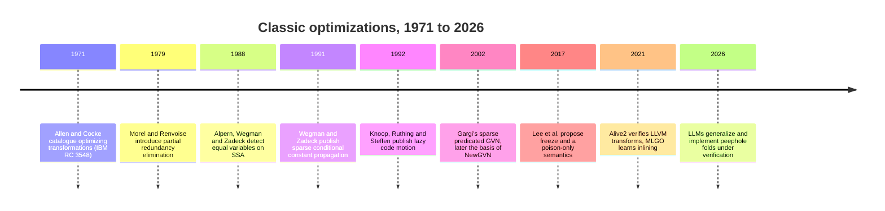
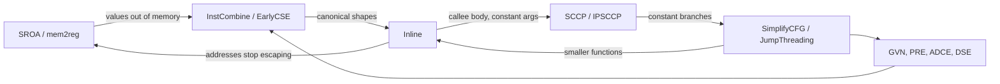

---
tags:
  - compilers
  - optimization
  - scalar-optimizations
  - value-numbering
  - inlining
  - undefined-behavior
  - llvm
  - gcc
status: complete
sources:
  - https://www.computerhistory.org/collections/catalog/102655328
  - https://fermatslibrary.com/p/77219a71
  - https://amturing.acm.org/bib/allen_1012327.cfm
  - https://shop.elsevier.com/books/advanced-compiler-design-and-implementation/muchnick/978-0-08-049871-3
  - https://bibtex.github.io/POPL-1988-AlpernWZ.html
  - https://cs.brown.edu/research/pubs/techreports/reports/CS-91-22.html
  - https://www.cs.utexas.edu/~pingali/CS380C/2016/lectures/LazyCodeMotion.pdf
  - https://bibtex.github.io/PLDI-2002-Gargi.html
  - https://www.llvm.org/doxygen/NewGVN_8cpp_source.html
  - https://discourse.llvm.org/t/newgvn-gvn-pre-plans/84746
  - https://gnu.googlesource.com/gcc/+/refs/heads/master/gcc/tree-ssa-pre.cc
  - https://llvm.org/docs/Passes.html
  - https://llvm.org/docs/InstCombineContributorGuide.html
  - https://softwarefreedom.sourceforge.io/gccint/The-Language.html
  - https://llvm.org/doxygen/InlineCost_8h_source.html
  - https://arxiv.org/abs/2101.04808v1
  - https://bbv.xania.org/202512/17-inlining-the-ultimate-optimisation
  - https://xania.org/AoCO2025-archive
  - https://blog.llvm.org/2011/05/what-every-c-programmer-should-know.html
  - https://blog.regehr.org/archives/213/embed
  - https://blog.regehr.org/?p=1496
  - https://www-old.cs.utah.edu/~regehr/papers/undef-pldi17.pdf
  - https://www.llvm.org/docs/_sources/UndefinedBehavior.rst.txt
  - https://discourse.llvm.org/t/please-dont-use-undef-in-tests-part-2/83388
  - https://discourse.llvm.org/t/rfc-signedness-independent-icmps/81423
  - https://www-old.cs.utah.edu/~regehr/alive2-pldi21.pdf
  - https://lists.llvm.org/pipermail/llvm-commits/Week-of-Mon-20251027/1768597.html
  - https://lists.llvm.org/pipermail/llvm-commits/Week-of-Mon-20251110/1775945.html
  - https://lists.llvm.org/pipermail/llvm-commits/Week-of-Mon-20251117/1783194.html
  - https://lists.llvm.org/pipermail/llvm-commits/Week-of-Mon-20251124/1784202.html
  - https://releases.llvm.org/22.1.0/docs/ReleaseNotes.html
  - https://releases.llvm.org/23.1.0/docs/ReleaseNotes.html
  - https://www.phoronix.com/news/LLVM-23.1-Released
  - https://gcc.gnu.org/gcc-16/changes.html
  - https://arxiv.org/abs/2508.16125v2
  - https://arxiv.org/abs/2603.18477
  - https://arxiv.org/abs/2607.02684
  - https://users.cs.utah.edu/~regehr/generalization-oopsla24.pdf
created: 2026-11-26
updated: 2026-11-26
---

## Table Of Contents

- [[#TL;DR|TL;DR]]
- [[#The Problem|The Problem]]
- [[#Foundations|Foundations]]
    - [[#Four Families of Waste and Canonical Forms|Four Families of Waste and Canonical Forms]]
    - [[#Poison, Undef and UB as Facts|Poison, Undef and UB as Facts]]
- [[#How We Got Here|How We Got Here]]
- [[#How It Works|How It Works]]
    - [[#Promoting Memory with SROA and mem2reg|Promoting Memory with SROA and mem2reg]]
    - [[#Constants and Dead Code|Constants and Dead Code]]
    - [[#Peepholes, InstCombine and match.pd|Peepholes, InstCombine and match.pd]]
    - [[#Value Numbering, CSE and GVN|Value Numbering, CSE and GVN]]
    - [[#Partial Redundancy and Lazy Code Motion|Partial Redundancy and Lazy Code Motion]]
    - [[#CFG Simplification and Jump Threading|CFG Simplification and Jump Threading]]
    - [[#Inlining and Its Cost Model|Inlining and Its Cost Model]]
    - [[#Undefined Behavior as an Enabler|Undefined Behavior as an Enabler]]
    - [[#How the Passes Feed Each Other|How the Passes Feed Each Other]]
- [[#Where It Is Now|Where It Is Now]]
- [[#Trade-offs & Open Problems|Trade-offs & Open Problems]]
- [[#Resources|Resources]]
- [[#Related Notes|Related Notes]]

## ***TL;DR***
---
*Classic optimizations are the dozen or so scalar rewrites every optimizing compiler runs: fold constants, delete dead code, reuse values already computed, simplify instruction patterns, straighten control flow, and inline calls. None is impressive alone; together, run in the right order and repeated, they turn naive front-end output into tight code.*

- **The catalogue is old.** Allen and Cocke listed procedure integration, CSE, code motion, constant folding, dead code elimination, strength reduction and peephole optimization in an IBM report dated September 1971 ([CHM](https://www.computerhistory.org/collections/catalog/102655328); [Fermat's Library](https://fermatslibrary.com/p/77219a71)). Modern LLVM and GCC still run every one of those.
- **SSA made them cheap.** On [[SSA Form]], constant propagation (SCCP), value numbering (GVN) and dead code elimination (ADCE) become sparse passes over def-use chains instead of dense [[Dataflow Analysis|dataflow]] over every program point.
- **Enabling beats doing.** Inlining saves a call, but its real payoff is giving every other pass a private copy of the callee to specialise ([Godbolt, Dec 2025](https://bbv.xania.org/202512/17-inlining-the-ultimate-optimisation)). Much of compiler engineering is *phase ordering*: arranging passes so each exposes work for the next.
- **Undefined behavior is fuel.** LLVM's `nsw`, `nuw`, `inbounds` and `samesign` flags turn "this can't happen" into *poison*, which licenses rewrites like `x + 1 > x` → `true` for signed `x` ([Lee et al., PLDI 2017](https://www-old.cs.utah.edu/~regehr/papers/undef-pldi17.pdf)).
- **As of November 2026**, every new LLVM InstCombine fold must come with an Alive2 proof ([LLVM docs](https://llvm.org/docs/InstCombineContributorGuide.html)), `undef` is formally deprecated in favour of poison ([LLVM UB manual](https://www.llvm.org/docs/_sources/UndefinedBehavior.rst.txt)), and LLM-plus-verifier tools are finding missed peepholes that humans then upstream ([Xu et al., 2025](https://arxiv.org/abs/2508.16125v2)).

## ***The Problem***
---
*Front ends emit simple, correct, slow code on purpose. Somebody has to clean it up, and the cleanup has to be provably safe for every input.*

Clang at `-O0` puts every local in a stack slot and reloads it at each use; a two-line function becomes a dozen `alloca`, `store` and `load` instructions (see the example under [[#Promoting Memory with SROA and mem2reg|SROA and mem2reg]]). Abstraction layers make it worse: a C++ `std::vector` index or a Rust iterator is a chain of tiny calls, each with checks that are redundant once you can see the whole chain. Macros and templates paste the same expression into many places.

The optimizer has to remove that waste without:
- **Changing meaning.** Any program the source language defines must behave identically. Bugs here are miscompilations, the worst kind of compiler bug.
- **Taking forever.** LLVM's `-O2` pipeline runs InstCombine eight times (from `opt -passes='default<O2>' -print-pipeline-passes` on LLVM 18, run locally). Each pass must be near-linear.
- **Making things worse.** Inlining or duplicating code for jump threading can blow up code size and instruction-cache misses. Every enabling transform needs a cost model.

## ***Foundations***
---
*Every optimization answers three questions: is it safe, is it profitable, and can the compiler see the opportunity. The classics fall into four families of waste, and most of them rely on a canonical form and a precise model of undefined behavior.*

| Question | What answers it | Example |
|---|---|---|
| **Safe?** | Program semantics, analyses ([[Dataflow Analysis]], alias analysis), UB rules | Hoisting `a/b` above `if (b != 0)` is unsafe: it can trap |
| **Profitable?** | Cost models, target hooks, profiles | Inlining a 2,000-instruction callee into 50 call sites |
| **Possible?** | Whether earlier passes put the code in a shape this pass recognises | GVN can't see `x*y == y*x` until operands are in a canonical order |

Formally, a transform is correct if the target *refines* the source: every behavior of the optimized program is one the original allowed. Alive2 checks exactly this relation ([Lopes et al., PLDI 2021](https://www-old.cs.utah.edu/~regehr/alive2-pldi21.pdf)).

### Four Families of Waste and Canonical Forms

*Nearly every classic pass removes one of four kinds of waste, and most of them work on a canonical form so they only have to recognise one spelling of each idea.*

| Waste | Passes | One-line idea |
|---|---|---|
| **Work whose answer is known** | constant folding, SCCP, IPSCCP, InstSimplify | Compute it at compile time |
| **Work whose answer is unused** | DCE, ADCE, DSE, dead argument elimination | Delete it |
| **Work done twice** | CSE, value numbering (GVN, FRE), PRE, LICM | Reuse the first result |
| **Work done the slow way** | peephole, InstCombine, strength reduction, reassociation | Replace with a cheaper equivalent |

Enablers sit across all four: SROA/mem2reg expose values hidden in memory, inlining exposes the callee's body, CFG simplification and jump threading expose control-flow facts. [[Loop Optimizations]] apply the same ideas across iterations.

`x*8` and `x<<3` mean the same thing, so LLVM's InstCombine calls itself "a target-independent canonicalization pass": it picks one form (for example, multiply by a power of two becomes a shift, and non-strict compares become strict ones), and a backend that prefers another form reverses it later ([LLVM docs](https://llvm.org/docs/InstCombineContributorGuide.html)). Canonicalization multiplies the power of every later pass (GVN only has to hash one shape), which is why InstCombine sometimes does *non-optimizing* rewrites that only make sense as setup.

### Poison, Undef and UB as Facts

*LLVM models three kinds of "can't happen"; each licenses different rewrites.*

- **Immediate UB** (division by zero, null dereference): the program has no meaning from here on, so "optimizers may drop observable effects, such as I/O, that occur before the UB" ([LLVM UB manual](https://www.llvm.org/docs/_sources/UndefinedBehavior.rst.txt)).
- **Poison**: deferred UB. An `add nsw` that overflows yields poison, which propagates through arithmetic and becomes real UB only at a side effect or a branch.
- **Undef**: "any value of the type", possibly a different value at each use. Now deprecated (see [[#Where It Is Now|Where It Is Now]]).
- **`freeze`**: turns poison or undef into one arbitrary but fixed value, so a transform can stop poison spreading.

$$
\text{immediate UB} \;\sqsupset\; \text{poison} \;\sqsupset\; \text{undef} \;\sqsupset\; \text{freeze(poison)} \;\sqsupset\; \text{concrete value}
$$

**In plain English:** reading left to right, each item allows fewer behaviors. A transform may move rightward (replace poison with any concrete value) but never leftward (introduce UB where none existed). This ordering is from LLVM's UB manual.

## ***How We Got Here***
---
*The catalogue was fixed by 1971; the following fifty years went into making each item sparse, provable and well-ordered.*



- **The catalogue (1971–72).** Allen and Cocke's report, reprinted in *Design and Optimization of Compilers* (1972), is "perhaps the first paper to systematically catalog code transformations" ([ACM Turing bib](https://amturing.acm.org/bib/allen_1012327.cfm)). Its categories (procedure integration; unrolling, fusion, unswitching; redundant subexpressions and code motion; constant folding and dead code; strength reduction and linear function test replacement; peephole) map almost one to one onto today's pass lists ([Fermat's Library](https://fermatslibrary.com/p/77219a71)).
- **Global and partial redundancy (1979–1992).** Morel and Renvoise unified CSE and loop-invariant code motion as *partial* redundancy elimination; Knoop, Rüthing and Steffen's lazy code motion placed each computation as late as safely possible to keep live ranges short, and Drechsler and Stadel simplified the equations further ([UT Austin CS380C](https://www.cs.utexas.edu/~pingali/CS380C/2016/lectures/LazyCodeMotion.pdf)).
- **SSA-based sparse passes (1988–2002).** Value numbering over SSA ([Alpern, Wegman, Zadeck, POPL 1988](https://bibtex.github.io/POPL-1988-AlpernWZ.html)), SCCP ([Wegman and Zadeck, 1991](https://cs.brown.edu/research/pubs/techreports/reports/CS-91-22.html)) and predicated GVN ([Gargi, PLDI 2002](https://bibtex.github.io/PLDI-2002-Gargi.html)) made the classics fast enough to run repeatedly. [Muchnick (1997)](https://shop.elsevier.com/books/advanced-compiler-design-and-implementation/muchnick/978-0-08-049871-3) is the standard textbook summary of this era.
- **UB gets a semantics (2011–2021).** Lattner's 2011 posts popularised the idea that UB is an optimization contract ([LLVM blog](https://blog.llvm.org/2011/05/what-every-c-programmer-should-know.html)); Regehr's 2010 guide explained the programmer's side ([Regehr](https://blog.regehr.org/archives/213/embed)). Lee et al. then showed LLVM's undef/poison rules were internally inconsistent and proposed `freeze` ([PLDI 2017](https://www-old.cs.utah.edu/~regehr/papers/undef-pldi17.pdf)); Alive2 turned the fixed semantics into a checker.

## ***How It Works***
---
*Each subsection shows one pass family, with real IR produced locally by Clang/opt 18.1.3 (and GCC 13.3 where noted), then shows how the families feed each other.*

### Promoting Memory with SROA and mem2reg

*Nothing else works until locals leave memory; SROA splits aggregates into scalars and mem2reg turns scalar stack slots into SSA values.*

```c
struct pair { int a, b; };
int s(int x) { struct pair p = { x, x + 1 }; return p.a * p.b; }
```

Before (`clang -O2 -Xclang -disable-llvm-passes`; metadata, alignment and lifetime markers trimmed), then after `opt -passes=sroa`:

```llvm
  %x.addr = alloca i32
  %p = alloca %struct.pair
  store i32 %x, ptr %x.addr
  %a = getelementptr inbounds %struct.pair, ptr %p, i32 0, i32 0
  %0 = load i32, ptr %x.addr
  store i32 %0, ptr %a            ; ... same again for %b = x + 1 ...
  %2 = load i32, ptr %a
  %3 = load i32, ptr %b
  %mul = mul nsw i32 %2, %3
  ret i32 %mul
; ---------------- after sroa ----------------
  %add = add nsw i32 %x, 1
  %mul = mul nsw i32 %x, %add
  ret i32 %mul
```

SROA "splits aggregate allocas into per-member allocas and converts them to scalar SSA form when possible"; mem2reg does the scalar half alone ([LLVM Passes](https://llvm.org/docs/Passes.html)). Both refuse when the address escapes (passed to an unknown call, stored to memory), which is why inlining first matters: once the callee is visible, the address often no longer escapes. The SSA construction itself is in [[SSA Form]].

### Constants and Dead Code

*Folding evaluates an operation on constants, propagation pushes the result to its uses, and SCCP does both while discovering which branches are dead; DCE then deletes what nobody uses.*

**Folding** is local (`add i32 2, 3` → `5`; LLVM's ConstantFolding and InstSimplify). **Propagation** replaces uses of a name known to hold a constant, trivial on SSA where each name has one definition.

- **SCCP** "assumes values are constant and blocks are dead unless proven otherwise" ([LLVM Passes](https://llvm.org/docs/Passes.html)). Being optimistic lets it find constants that flow around loops and through branches that a pessimistic pass would give up on. The lattice and worklist are worked through in [[Dataflow Analysis]].
- **IPSCCP** runs the same algorithm across function boundaries, so a function always called with `n = 4` gets `n` folded to 4 inside.

SCCP is the clearest case of two optimizations combining to beat their sum: running constant propagation and unreachable-code elimination to a joint fixed point finds more than iterating them separately, because each feeds the other within one pass.

LLVM's `dce` deletes dead instructions and "rechecks instructions that were used by removed instructions"; `adce` "assumes values are dead until proven otherwise, similar to SCCP but applied to value liveness" ([LLVM Passes](https://llvm.org/docs/Passes.html)). The difference matters for cycles: two φ-nodes that only feed each other around a loop each have a user, so DCE keeps them, but neither reaches a store, return or call, so ADCE deletes both. Dead *stores* need memory reasoning and live in DSE. Most dead code is not written by humans; it is what constant propagation and inlining leave behind.

### Peepholes, InstCombine and match.pd

*A peephole optimizer looks at a few connected instructions and replaces them with a cheaper equivalent. LLVM's InstCombine and GCC's match.pd are industrial-strength versions with large, ever-growing pattern libraries.*

```c
int f(int x) {
  int a = x * 8;
  int b = a + 0;
  int c = (b ^ -1) + 1;   /* two's-complement negate */
  return c / 1 + (x << 3);
}
```

After `mem2reg` only, then after `mem2reg,instcombine`:

```llvm
  %mul = mul nsw i32 %x, 8
  %add = add nsw i32 %mul, 0
  %xor = xor i32 %add, -1
  %add1 = add nsw i32 %xor, 1
  %div = sdiv i32 %add1, 1
  %shl = shl i32 %x, 3
  %add2 = add nsw i32 %div, %shl
  ret i32 %add2
; ---------------- after instcombine ----------------
  ret i32 0
```

The folds involved are all textbook: multiply by 8 is canonicalized to a shift (strength reduction as canonicalization), `+0` and `/1` are identities, `~b + 1` is negation, and `-(x<<3) + (x<<3)` is zero. InstCombine runs on a worklist, re-queuing the users of each changed instruction, so each fold sees the results of the last. The rules InstCombine lives by ([LLVM docs](https://llvm.org/docs/InstCombineContributorGuide.html)):

- **Split of labour.** InstSimplify handles folds that only return an existing value or constant; InstCombine handles folds that create instructions; VectorCombine and AggressiveInstCombine take cost-modelled or target-dependent work.
- **Don't grow code.** A fold should not increase instruction count; replacing two instructions with two is only profitable if both originals die, so patterns guard inner values with `m_OneUse()`.
- **Keep the flags.** Propagate `nsw`/`nuw` when easy ("they are hard to recover later"), and drop them when a rewrite invalidates them.
- **Target independence.** Only DataLayout and TargetLibraryInfo may influence it.

GCC writes its peepholes declaratively in `match.pd`, a Lisp-like DSL that the `genmatch` generator turns into C++. The internals manual's example `(simplify (bit_and @0 integer_all_onesp) @0)` says that x AND all-ones is x ([GCC internals](https://softwarefreedom.sourceforge.io/gccint/The-Language.html)): `@0` captures an operand, `:c` on an operator also matches with operands swapped, and `(for op (plus minus) ...)` stamps a pattern out for several operators.

**Scalar strength reduction** swaps expensive operations for cheap ones: unsigned `x/8` → `x>>3`, `x%8` → `x&7`, division by a constant → multiply-high by a "magic" reciprocal plus shifts, and on x86 `x*9` → `lea`. Godbolt's Advent of Compiler Optimisations walks through the multiply and divide cases in assembly ([AoCO 2025 archive](https://xania.org/AoCO2025-archive)); the loop form (`i*stride` → running sum) is in [[Loop Optimizations]].

### Value Numbering, CSE and GVN

*Give every computed value a number such that equal numbers mean equal values at run time; then any second computation of a known number is redundant.*

**Local value numbering** walks a basic block with a hash table from expression keys to value numbers:

$$
\mathrm{key}(v = a \;\mathit{op}\; b) = \big(\mathit{op},\; \mathrm{VN}(a),\; \mathrm{VN}(b)\big), \quad \text{operands sorted if } \mathit{op} \text{ is commutative}
$$

**In plain English:** two instructions get the same number if they apply the same operator to operands that already have the same numbers. Sorting operands for commutative operators makes `a*b` and `b*a` collide.

```llvm
; int h(int a, int b) { int x = a * b; int y = b * a; return x - y; }
; after mem2reg                         ; after early-cse (or gvn)
%mul  = mul nsw i32 %a, %b              %mul = mul nsw i32 %a, %b
%mul1 = mul nsw i32 %b, %a              ret i32 0
%sub  = sub nsw i32 %mul, %mul1
ret i32 %sub
```

CSE proved `%mul1 ≡ %mul`, rewrote `%sub` to `%mul - %mul`, and InstSimplify folded that to 0; the now-dead `%mul` is left for DCE. On SSA, *global* value numbering extends this across blocks, using dominance: a value is reusable wherever its definition dominates the use.

The production variants differ in how hard they look:

| Pass | Approach | Notes |
|---|---|---|
| LLVM **EarlyCSE** | Dominator-tree walk with scoped hash tables | Cheap; runs early and often |
| LLVM **GVN** | Pessimistic hash-based GVN plus load elimination and scalar PRE | Default at `-O2`; "eliminate fully and partially redundant instructions" ([LLVM Passes](https://llvm.org/docs/Passes.html)) |
| LLVM **NewGVN** | Optimistic, sparse, congruence classes; based on Gargi and Simpson | Handles phi-of-ops vs op-of-phis ([NewGVN.cpp](https://www.llvm.org/doxygen/NewGVN_8cpp_source.html)); not default |
| GCC **FRE** | SCC-based value numbering (`tree-ssa-sccvn`) plus elimination | "the elimination phase of GVN" ([tree-ssa-pre.cc](https://gnu.googlesource.com/gcc/+/refs/heads/master/gcc/tree-ssa-pre.cc)) |
| GCC **PRE** | GVN-PRE on top of SCCVN, plus code hoisting | Hoisting moves values "further up than PRE would do" |

*Optimistic* numbering assumes everything is equal until proven otherwise (like SCCP), so it can prove two loop-carried φs equal when each depends on the other; *pessimistic* numbering assumes nothing and cannot. That is the main reason NewGVN exists.

### Partial Redundancy and Lazy Code Motion

*An expression is partially redundant if it is already computed on some paths into a point but not all. PRE inserts it on the missing paths, making the original fully redundant.*

```c
int g(int *p, int a, int b, int c) {
  if (c) p[0] = a + b; else p[1] = 7;
  return a + b;          /* computed on the then-path only */
}
```

LLVM `opt -passes=gvn` (after mem2reg) inserts `a + b` on the else path and merges with a φ:

```llvm
if.then:
  %add = add nsw i32 %a, %b
  store i32 %add, ptr %p, align 4
  br label %if.end
if.else:
  ; ... store 7 to p[1] ...
  %.pre = add nsw i32 %a, %b                 ; inserted by PRE
  br label %if.end
if.end:
  %add2.pre-phi = phi i32 [ %.pre, %if.else ], [ %add, %if.then ]
  ret i32 %add2.pre-phi
```

GCC 13 `-O2` (the `pre` dump) instead *hoists* one copy above the branch, because the value is anticipated on both successors:

```c
  <bb 2>:  _13 = a_6(D) + b_7(D);  if (c_2(D) != 0) goto <bb 3>; else goto <bb 4>;
  <bb 3>:  *p_3(D) = _13;
  <bb 4>:  MEM[(int *)p_3(D) + 4B] = 7;
  <bb 5>:  return _13;
```

Same dynamic count (one add per path), different shape: GCC's code hoisting trades register lifetime for code size. Lazy code motion makes this choice systematic. It solves availability (forward) and anticipability (backward), places each expression at the *earliest* safe edge, then pushes it *later* as far as possible to shorten live ranges ([UT Austin CS380C](https://www.cs.utexas.edu/~pingali/CS380C/2016/lectures/LazyCodeMotion.pdf)):

$$
\begin{aligned}
\mathrm{EARLIEST}(i,j) &= \mathrm{ANTIN}(j) - \mathrm{AVAILOUT}(i) - \big(\mathrm{EXPRKILL}(i) \cup \mathrm{ANTOUT}(i)\big)\\
\mathrm{LATER}(i,j) &= \mathrm{EARLIEST}(i,j) \cup \big(\mathrm{LATERIN}(i) - \mathrm{UEEXPR}(i)\big)\\
\mathrm{INSERT}(i,j) &= \mathrm{LATER}(i,j) - \mathrm{LATERIN}(j), \qquad \mathrm{DELETE}(k) = \mathrm{UEEXPR}(k) - \mathrm{LATERIN}(k)
\end{aligned}
$$

**In plain English:** insert an expression on edge $i \to j$ if every path from $j$ will need it, it isn't already available out of $i$, and pushing it any further down would stop helping; delete the original computation in any block where the inserted copy now reaches it. Insertions on *critical edges* (multi-successor to multi-predecessor) need a new block. Loop-invariant code motion falls out as a special case: an expression in a loop body is partially redundant with itself around the back edge.

### CFG Simplification and Jump Threading

*Many optimizations leave behind empty blocks, constant branches and diamonds that compute a select. CFG cleanup removes them; jump threading duplicates code so a branch outcome known on one incoming edge skips the test entirely.*

- **SimplifyCFG** "performs dead code elimination and basic block merging", removes unreachable blocks and folds trivial φs and branch-only blocks ([LLVM Passes](https://llvm.org/docs/Passes.html)). It also turns small if/else diamonds into `select`, which is what made `clamp` branch-free in the inlining example below.
- **Jump threading** looks for "distinct threads of control flow running through a basic block": if a predecessor always reaches a known successor, it redirects that edge, duplicating the intermediate block ([LLVM Passes](https://llvm.org/docs/Passes.html)). Example: after `if (x > 0) flag = 1; else flag = 0; ... if (flag) ...`, each predecessor already knows `flag`, so the second test disappears.
- **DFA jump threading** does the same for state-machine loops (`switch (state)` in a loop), threading each case straight to the next state's case; see [[#Where It Is Now|Where It Is Now]] for its 2025 default-on attempts.

The cost is code duplication, so both passes have size thresholds.

### Inlining and Its Cost Model

*Inlining replaces a call with a copy of the callee's body. It is the most powerful enabler in the pipeline and the one most in need of a good heuristic.*

```c
static int square(int v) { return v * v; }
static int clamp(int v, int lo, int hi) { if (v < lo) return lo; if (v > hi) return hi; return v; }
int caller(int x) { return clamp(square(x), 0, 20); }
```

After `opt -passes=inline` (on SROA'd input):

```llvm
entry:
  %mul.i = mul nsw i32 %x, %x
  %cmp1.i = icmp sgt i32 %mul.i, 20
  br i1 %cmp1.i, label %if.then2.i, label %if.end3.i
if.then2.i:
  br label %clamp.exit
if.end3.i:
  br label %clamp.exit
clamp.exit:
  %retval.0.i = phi i32 [ 20, %if.then2.i ], [ %mul.i, %if.end3.i ]
  ret i32 %retval.0.i
```

Note what is *missing*: the `v < lo` test. While cloning the body with `lo = 0`, the inliner simplified `icmp slt (mul nsw %x, %x), 0` to false, because a square with `nsw` can't be negative (overflow would be poison). After `instcombine,simplifycfg` the diamond becomes `call i32 @llvm.smin.i32(i32 %mul.i, i32 20)`, and the x86-64 code at `-O2` is four instructions plus `ret`:

```asm
caller:
    imull   %edi, %edi
    cmpl    $20, %edi
    movl    $20, %eax
    cmovbl  %edi, %eax      # unsigned compare: value known non-negative
    retq
```

Godbolt calls inlining "the ultimate enabling optimisation": the gain is not the saved call but that the compiler gets "a fresh copy of code at the call site" to specialise ([Godbolt, Dec 2025](https://bbv.xania.org/202512/17-inlining-the-ultimate-optimisation)). Hence its folklore title, "mother of all optimizations".

**The cost model.** LLVM's inliner runs bottom-up over the call graph SCCs ([LLVM Passes](https://llvm.org/docs/Passes.html)). For each call site it *simulates* the inlined body, estimating instructions after simplification with the actual arguments, and compares against a threshold:

$$
\text{inline} \iff \mathrm{cost}(\text{callee} \mid \text{args}) - \text{bonuses} < \text{threshold}
$$

**In plain English:** a callee is "cheap enough" if what's left after constant arguments prune it, minus credits (for example, the last call to a static function lets the original be deleted), fits the budget. LLVM's constants include `OptAggressiveThreshold = 250` for `-O3`, `OptSizeThreshold = 50` for `-Os`, `OptMinSizeThreshold = 5` for `-Oz`, `LoopPenalty = 25` and `ColdccPenalty = 2000` ([InlineCost.h](https://llvm.org/doxygen/InlineCost_8h_source.html)). The hand-tuned heuristic is a natural target for learning: Google's MLGO replaced inlining-for-size decisions with a trained policy and reported up to 7% smaller code than `-Oz` ([Trofin et al., 2021](https://arxiv.org/abs/2101.04808v1)); see [[ML-Guided Optimization]].

**Interprocedural cousins.** Three passes get some of inlining's benefit, or make it possible:

- **Tail call elimination.** LLVM's `tailcallelim` "transforms calls of the current function (self recursion) followed by a return instruction" into a branch back to the entry ([LLVM Passes](https://llvm.org/docs/Passes.html)). Recursion depth then costs no stack. Day 19 of Godbolt's 2025 series covers it ([AoCO archive](https://xania.org/AoCO2025-archive)).
- **Interprocedural constant propagation.** LLVM's `ipsccp` and GCC's IPA-CP propagate constant arguments and return values into callees, so the callee body folds as if it had been inlined, without the code growth.
- **Devirtualization.** A C++ virtual call or function-pointer call can't be inlined. If analysis proves the dynamic type (or, with [[Linking and LTO|LTO]], that the class hierarchy is closed), the call becomes direct. *Speculative* devirtualization guesses the likely target and guards it: `if (fp == likely) likely(x); else fp(x);`. As of GCC 16 (April 2026), speculative devirtualization "now handles general indirect function calls" and can speculate more than one target ([GCC 16 changes](https://gcc.gnu.org/gcc-16/changes.html)).

### Undefined Behavior as an Enabler

*UB is a contract: the programmer promises certain things never happen, and the compiler optimizes as if that were true.*

```c
int sgt(int x)      { return x + 1 > x; }
int ugt(unsigned x) { return x + 1 > x; }
```

```llvm
; @sgt at -O2: signed overflow is UB, so x + 1 > x always
  ret i32 1
; @ugt at -O2: unsigned wraps, so it is false only at UINT_MAX
  %cmp = icmp ne i32 %x, -1
  %conv = zext i1 %cmp to i32
  ret i32 %conv
```

Clang lowers C signed `+` to `add nsw`. Lee et al. show why the flag must produce *poison* rather than undef: with poison, `a + b > a` can become `b > 0`; with undef the rewrite is illegal ([PLDI 2017](https://www-old.cs.utah.edu/~regehr/papers/undef-pldi17.pdf)). The same reasoning lets the compiler widen a 32-bit `nsw` induction variable to 64 bits and drop a sign extension per iteration, worth up to 39% on one microbenchmark in their measurements. Lattner's examples are the classic list: signed overflow lets `for (i = 0; i <= N; ++i)` be assumed to run N+1 times; type-based [[Pointer and Alias Analysis|alias analysis]] lets a float loop become `memset`; null dereference being UB lets side effects move freely ([LLVM blog, 2011](https://blog.llvm.org/2011/05/what-every-c-programmer-should-know.html)).

The paper's other finding is that the semantics must be *consistent across passes*. GVN wants "branch on poison is UB"; loop unswitching wanted "branch on poison is a nondeterministic choice". Both can't hold. The fix made branching on poison UB and had unswitching `freeze` the hoisted condition, at a measured cost within ±1.6% on SPEC CPU 2006 run time ([Lee et al.](https://www-old.cs.utah.edu/~regehr/papers/undef-pldi17.pdf); [Regehr's summary](https://blog.regehr.org/?p=1496)).

The flip side is that programs with UB get "optimized" into surprises, which is why `-fwrapv` and `-fno-strict-aliasing` exist ([Lattner](https://blog.llvm.org/2011/05/what-every-c-programmer-should-know.html)).

### How the Passes Feed Each Other

*No pass is run once. Pipelines interleave cheap cleanups with expensive passes because each one exposes work for the others, and the order changes the result.*



LLVM 18's `-O2` function-simplification pipeline, nested inside the inliner's call-graph walk, runs in this order (abridged from `-print-pipeline-passes`): `sroa, early-cse, jump-threading, correlated-propagation, simplifycfg, instcombine, tailcallelim, reassociate, licm, simple-loop-unswitch, simplifycfg, instcombine, indvars, sroa, gvn, sccp, bdce, instcombine, jump-threading, adce, dse, licm, simplifycfg, instcombine`. Because it is nested in the CGSCC walk, each callee is simplified *before* its callers decide whether to inline it, so cost estimates see the cleaned-up body.

The *phase-ordering problem* is that no fixed order is best for every program: GVN before inlining misses cross-call redundancy, InstCombine's canonical form can hide a relationship from a later pass (one motivation for `samesign`, [Popov](https://discourse.llvm.org/t/rfc-signedness-independent-icmps/81423)), and jump threading's duplication can help or hurt the [[Register Allocation|register allocator]]. Production compilers answer with repetition and hand-tuning; research answers with search, learned orders ([[ML-Guided Optimization]]) and equality saturation, which applies rewrites non-destructively ([[E-Graphs and Equality Saturation]]). The [[Compiler Pipeline]] note covers the pass manager itself.

## ***Where It Is Now***
---
*As of November 2026 the classic passes are mature; the action is in proving them correct, finishing the move from undef to poison, retiring or reviving NewGVN, and using LLMs to find and write missed peepholes.*

- **Releases.** LLVM 22.1 added `ptrtoaddr`, which reads a pointer's address "without capturing provenance", giving optimizers a provenance-safe alternative to `ptrtoint` ([LLVM 22.1 notes](https://releases.llvm.org/22.1.0/docs/ReleaseNotes.html)). LLVM 23.1 shipped in summer 2026 ([Phoronix](https://www.phoronix.com/news/LLVM-23.1-Released)); its IR changes relevant here are a new `noipa` attribute that blocks interprocedural analysis of a definition, and `alwaysinline` no longer bypassing target-feature compatibility checks ([LLVM 23.1 notes](https://releases.llvm.org/23.1.0/docs/ReleaseNotes.html)). Neither release lists InstCombine, GVN or SCCP changes in its notes: those passes now change through a steady stream of small folds rather than headline features. GCC 16.1 (April 2026) extended speculative devirtualization ([GCC 16](https://gcc.gnu.org/gcc-16/changes.html)).
- **Alive2 is the gate.** The InstCombine guide requires that a pull request "contain one or more alive2 proofs for the correctness of the proposed transform", written as `@src`/`@tgt` pairs with generic constants, and rejects fuzzer-found missed optimizations without evidence of real-world value ([LLVM docs](https://llvm.org/docs/InstCombineContributorGuide.html)). Alive2's original run over LLVM's unit tests led to 47 bug reports, 28 fixed by publication ([Lopes et al.](https://www-old.cs.utah.edu/~regehr/alive2-pldi21.pdf)).
- **Undef on the way out.** The UB manual says "Undef values are deprecated and should be used only when strictly necessary", essentially for loads of uninitialized memory ([LLVM UB manual](https://www.llvm.org/docs/_sources/UndefinedBehavior.rst.txt)). In late 2024 about a third of LLVM's tests triggered UB, which blocks Alive2 from checking them, and roughly 302 `UndefValue::get` uses remained in LLVM and Clang ([Lopes, LLVM Discourse](https://discourse.llvm.org/t/please-dont-use-undef-in-tests-part-2/83388)). Test cleanups continue, for example removing the remaining `undef` uses from the [[Vectorization|loop vectorizer]]'s tests in November 2025 ([llvm-commits](https://lists.llvm.org/pipermail/llvm-commits/Week-of-Mon-20251124/1784202.html)).
- **More poison flags.** `icmp samesign` (RFC September 2024) says the operands share a sign or the result is poison, so signed and unsigned predicates become interchangeable without losing information ([Popov, RFC](https://discourse.llvm.org/t/rfc-signedness-independent-icmps/81423)). It joins `nsw`, `nuw`, `exact` and others as facts InstCombine must preserve.
- **GVN vs NewGVN.** NewGVN is still not the default. In March 2025 Nikita Popov argued "we should bite the bullet and delete NewGVN", while others pointed to a promising NewGVN-PRE prototype and to loop-φ equivalences only NewGVN finds; no decision was recorded ([LLVM Discourse](https://discourse.llvm.org/t/newgvn-gvn-pre-plans/84746)). I found no later public resolution.
- **DFA jump threading.** A PR to enable it by default was approved on 1 November 2025, with the compile-time tracker showing it "essentially free" but some files regressing up to 20% ([llvm-commits](https://lists.llvm.org/pipermail/llvm-commits/Week-of-Mon-20251027/1768597.html)); it was reverted on 10 November and a reapply PR opened on 22 November 2025 ([revert](https://lists.llvm.org/pipermail/llvm-commits/Week-of-Mon-20251110/1775945.html), [reapply](https://lists.llvm.org/pipermail/llvm-commits/Week-of-Mon-20251117/1783194.html)). I could not confirm from release notes whether it is on by default in LLVM 22 or 23.
- **LLMs plus verifiers for peepholes.** LPO pairs an LLM with formal verification to search for missed folds: 62 found, 28 confirmed, 13 fixed in LLVM ([Xu et al., 2025/2026](https://arxiv.org/abs/2508.16125v2)). LPG generalizes concrete folds into rules, 90 of 102 real LLVM optimizations versus 35 of 81 for the synthesis-based Hydra on a comparable subset ([Liao et al., Mar 2026](https://arxiv.org/abs/2603.18477); [Hydra, OOPSLA 2024](https://users.cs.utah.edu/~regehr/generalization-oopsla24.pdf)). PeepholeBench (July 2026) finds that coding agents asked to implement such folds trade correctness against profitability, and "no agent matches human developers on both dimensions at once" ([Xu et al., 2026](https://arxiv.org/abs/2607.02684)). See [[Superoptimization]].

## ***Trade-offs & Open Problems***
---
*The classics are solved one at a time and unsolved together: ordering, cost models and the UB contract are still judgment calls.*

| Choice | Buys | Costs |
|---|---|---|
| Aggressive inlining | Specialisation, every later pass sees more | Code size, i-cache misses, compile time, worse register pressure |
| Many repeated cleanup passes | Robust to ordering | Compile time (InstCombine alone runs eight times at `-O2`) |
| PRE / code hoisting | Fewer dynamic computations | Longer live ranges, more spills |
| Exploiting UB | Real speedups (IV widening, alias analysis) | Surprising behavior for buggy programs; needs a sound semantics |
| Big peephole libraries, optimistic analyses | More idioms and loop-carried facts | Review burden, harder debugging, compile time |

Open problems:

- **Phase ordering** has no general solution; production pipelines are tuned by hand against benchmark suites ([[ML-Guided Optimization]], [[E-Graphs and Equality Saturation]]).
- **Inliner cost models** are mostly hand-tuned constants; learned policies such as MLGO so far target size ([Trofin et al.](https://arxiv.org/abs/2101.04808v1)).
- **Verification coverage.** Alive2 is bounded: it unrolls loops only to a fixed factor and approximates function pointers, exceptions and most intrinsics ([Lopes et al.](https://www-old.cs.utah.edu/~regehr/alive2-pldi21.pdf)). Interprocedural passes like inlining and IPSCCP are much harder to check than single-function peepholes. See [[Verified Compilers]] and [[Compiler Testing and Fuzzing]].
- **Memory and value.** Migrating GVN to MemorySSA is an open alternative to NewGVN ([LLVM Discourse](https://discourse.llvm.org/t/newgvn-gvn-pre-plans/84746)), and since every fold costs compile time for everyone, real-world value is now an explicit review criterion ([LLVM docs](https://llvm.org/docs/InstCombineContributorGuide.html)).

## ***Resources***
---
*Start with Godbolt's 2025 advent series and Lattner's UB posts for intuition, then Muchnick and the original papers, then the LLVM InstCombine guide and Alive2 for how it's done today.*

- **History.** [Allen and Cocke's catalogue](https://fermatslibrary.com/p/77219a71) (IBM RC 3548, 1971; [CHM record](https://www.computerhistory.org/collections/catalog/102655328), [ACM bibliography](https://amturing.acm.org/bib/allen_1012327.cfm)); [Muchnick, *Advanced Compiler Design and Implementation*](https://shop.elsevier.com/books/advanced-compiler-design-and-implementation/muchnick/978-0-08-049871-3) (1997).
- **Classic papers.** [Alpern, Wegman, Zadeck, POPL 1988](https://bibtex.github.io/POPL-1988-AlpernWZ.html); [Wegman and Zadeck, SCCP, 1991](https://cs.brown.edu/research/pubs/techreports/reports/CS-91-22.html); [Gargi, PLDI 2002](https://bibtex.github.io/PLDI-2002-Gargi.html); [lazy code motion lecture, UT Austin CS380C](https://www.cs.utexas.edu/~pingali/CS380C/2016/lectures/LazyCodeMotion.pdf).
- **UB and verification.** [Taming Undefined Behavior in LLVM](https://www-old.cs.utah.edu/~regehr/papers/undef-pldi17.pdf) (PLDI 2017, with [Regehr's post](https://blog.regehr.org/?p=1496)); [Alive2](https://www-old.cs.utah.edu/~regehr/alive2-pldi21.pdf) (PLDI 2021); [LLVM UB manual](https://www.llvm.org/docs/_sources/UndefinedBehavior.rst.txt); [samesign RFC](https://discourse.llvm.org/t/rfc-signedness-independent-icmps/81423); [undef in tests](https://discourse.llvm.org/t/please-dont-use-undef-in-tests-part-2/83388).
- **Learning and LLMs.** [MLGO](https://arxiv.org/abs/2101.04808v1) (2021); [Hydra](https://users.cs.utah.edu/~regehr/generalization-oopsla24.pdf) (OOPSLA 2024); [LPO](https://arxiv.org/abs/2508.16125v2) (2025); [LPG](https://arxiv.org/abs/2603.18477) and [PeepholeBench](https://arxiv.org/abs/2607.02684) (2026).
- **LLVM docs and source.** [Pass reference](https://llvm.org/docs/Passes.html); [InstCombine contributor guide](https://llvm.org/docs/InstCombineContributorGuide.html); [NewGVN.cpp](https://www.llvm.org/doxygen/NewGVN_8cpp_source.html); [NewGVN/GVN PRE plans](https://discourse.llvm.org/t/newgvn-gvn-pre-plans/84746); [InlineCost.h](https://llvm.org/doxygen/InlineCost_8h_source.html); release notes for [22.1](https://releases.llvm.org/22.1.0/docs/ReleaseNotes.html) and [23.1](https://releases.llvm.org/23.1.0/docs/ReleaseNotes.html); DFA jump threading [PR](https://lists.llvm.org/pipermail/llvm-commits/Week-of-Mon-20251027/1768597.html), [revert](https://lists.llvm.org/pipermail/llvm-commits/Week-of-Mon-20251110/1775945.html), [reapply](https://lists.llvm.org/pipermail/llvm-commits/Week-of-Mon-20251117/1783194.html).
- **GCC.** [match.pd language](https://softwarefreedom.sourceforge.io/gccint/The-Language.html); [tree-ssa-pre.cc](https://gnu.googlesource.com/gcc/+/refs/heads/master/gcc/tree-ssa-pre.cc); [GCC 16 changes](https://gcc.gnu.org/gcc-16/changes.html).
- **Explainers.** Matt Godbolt's [Advent of Compiler Optimisations 2025](https://xania.org/AoCO2025-archive), especially [Inlining - the ultimate optimisation](https://bbv.xania.org/202512/17-inlining-the-ultimate-optimisation); Chris Lattner's [What Every C Programmer Should Know About Undefined Behavior](https://blog.llvm.org/2011/05/what-every-c-programmer-should-know.html) (2011); John Regehr's [A Guide to Undefined Behavior in C and C++](https://blog.regehr.org/archives/213/embed) (2010).

## Related Notes

- [[Dataflow Analysis]] — Lattices, worklists and the full SCCP walk-through these passes rely on.
- [[SSA Form]] — The representation that makes SCCP, GVN and ADCE sparse; mem2reg builds it.
- [[Compiler Pipeline]] — The pass manager and where the middle end sits.
- [[Loop Optimizations]] — LICM, induction variables and loop strength reduction build on the same ideas.
- [[LLVM]] — InstCombine, GVN, SROA and the inliner in their home project.
- [[Linking and LTO]] — Whole-program inlining, IPSCCP and devirtualization.
- [[Superoptimization]] — Searching for optimal peepholes rather than writing them.
- [[E-Graphs and Equality Saturation]] — A way around phase ordering for rewrite rules.
- [[ML-Guided Optimization]] — Learned inlining and pass ordering.
- [[Verified Compilers]] — Proving transformations correct, from CompCert to Alive2.
- [[Compiler Testing and Fuzzing]] — Finding miscompilations and missed optimizations.
- [[Compiler, Assembler, Linker, and Loader]] — The owner's note on the C build stages around the optimizer.
- [[Pointer and Alias Analysis]] — Which pointers may refer to the same memory, and how optimizers use it.
