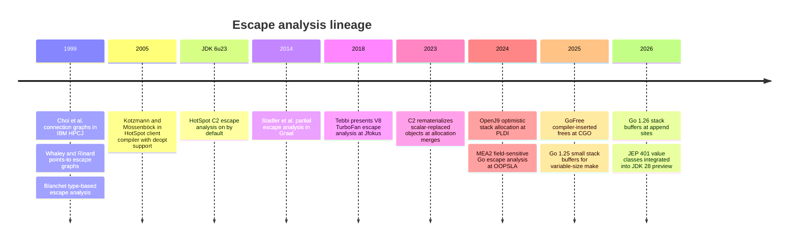
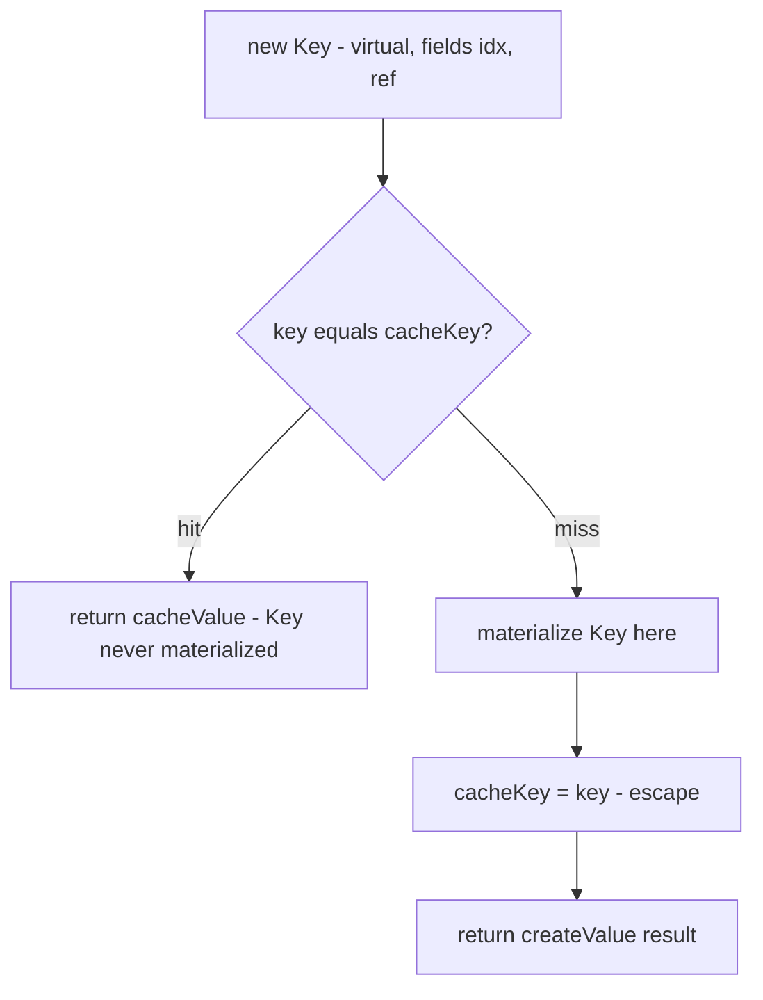
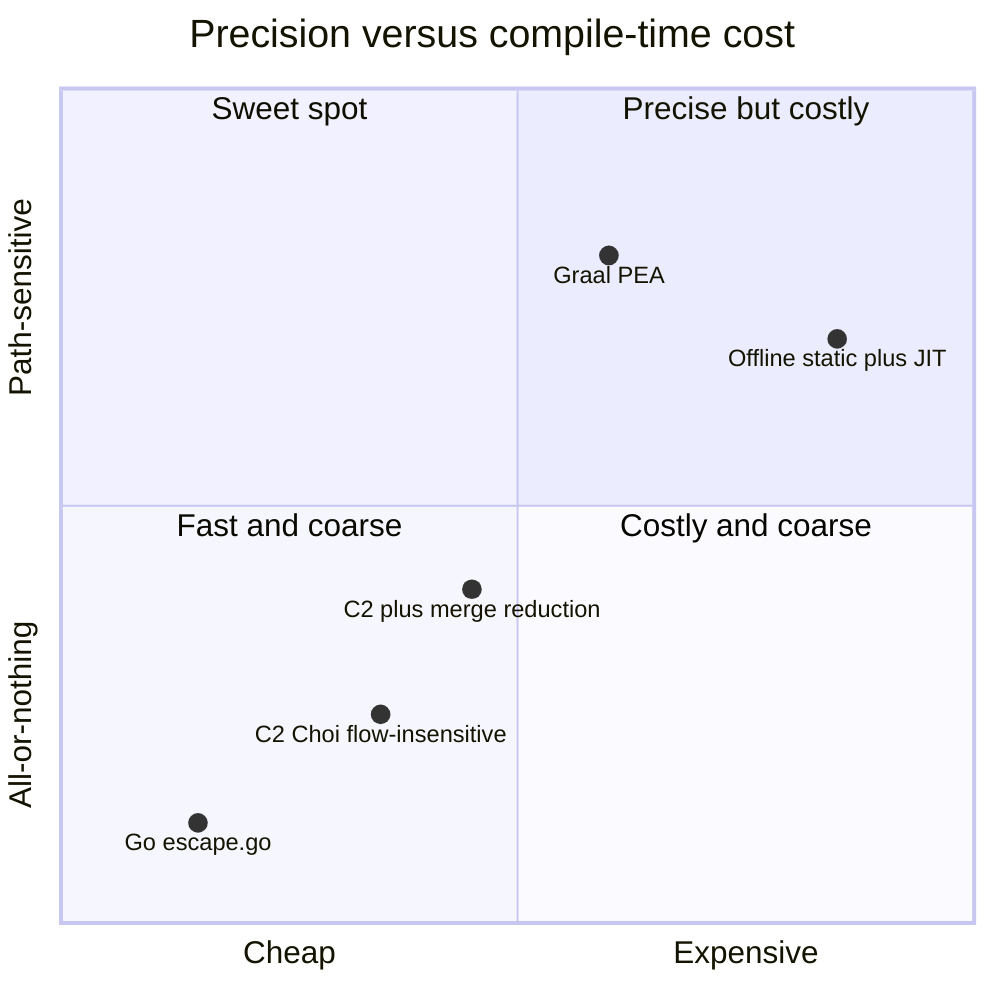

---
tags:
  - compilers
  - escape-analysis
  - scalar-replacement
  - stack-allocation
  - lock-elision
  - jit
  - hotspot
  - graal
  - go
  - llvm
status: complete
sources:
  - https://faculty.cc.gatech.edu/~harrold/6340/cs6340_fall2009/Readings/choi99escape.pdf
  - https://people.csail.mit.edu/rinard/paper/oopsla99.pdf
  - https://static.aminer.org/pdf/20170130/pdfs/oopsla/kmujuerhcqthgvqymw2nypk0e6g4jx5s.pdf
  - https://bibtex.github.io/OOPSLA-1999-Blanchet.html
  - https://ssw.jku.at/Research/Papers/Ko05/
  - https://ssw.jku.at/Research/Papers/Stadler14/Stadler2014-CGO-PEA.pdf
  - https://docs.oracle.com/en/java/javase/25/vm/java-hotspot-virtual-machine-performance-enhancements.html
  - https://cr.openjdk.org/~cslucas/escape-analysis/EscapeAnalysis.html
  - https://mail.openjdk.org/pipermail/hotspot-dev/2023-July/076937.html
  - https://mail.openjdk.org/pipermail/hotspot-compiler-dev/2024-January/072210.html
  - https://bugs.openjdk.org/browse/JDK-8325408
  - https://bugs.openjdk.org/browse/JDK-8350168
  - https://devblogs.microsoft.com/java/?p=231151
  - https://devblogs.microsoft.com/java/improving-openjdk-scalar-replacement-part-3-3
  - https://mail.openjdk.org/pipermail/hotspot-compiler-dev/2021-May/047486.html
  - https://bugs.openjdk.org/browse/JDK-8366137
  - https://bugs.openjdk.org/browse/JDK-8370610
  - https://mail.openjdk.org/pipermail/hotspot-compiler-dev/2025-December/100644.html
  - https://mail.openjdk.org/pipermail/hotspot-compiler-dev/2025-December/100818.html
  - https://mail.openjdk.org/pipermail/hotspot-compiler-dev/2026-January/102213.html
  - https://mail.openjdk.org/pipermail/hotspot-dev/2025-November/114533.html
  - https://openjdk.org/jeps/401
  - https://infoq.com/news/2026/08/jep401-value-objects-preview
  - https://www.graalvm.org/dev/reference-manual/java/compiler
  - https://chrisseaton.com/truffleruby/seeing-escape-analysis/
  - https://www.cse.iitm.ac.in/~krishna/preprints/pldi24/pldi24.pdf
  - https://adityaanand7.github.io/pdf/Aditya-RHPL-25.pdf
  - https://go.googlesource.com/go/+/HEAD/src/cmd/compile/internal/escape/escape.go
  - https://go.dev/blog/allocation-optimizations
  - https://tip.golang.org/doc/go1.25
  - https://go.dev/doc/go1.26
  - https://go.dev/doc/go1.27
  - https://go.googlesource.com/proposal/+/HEAD/design/74299-runtime-freegc.md
  - https://2024.splashcon.org/details/splash-2024-oopsla/102/
  - https://homes.cs.washington.edu/~mernst/pubs/explicit-free-cgo2025-abstract.html
  - https://lists.llvm.org/pipermail/llvm-commits/Week-of-Mon-20210621/929502.html
  - https://www.npopov.com/2026/01/31/This-year-in-LLVM-2025.html
  - https://releases.llvm.org/21.1.0/docs/ReleaseNotes.html
  - https://www.jfokus.se/jfokus18/preso/Escape-Analysis-in-V8.pdf
  - https://chromium.googlesource.com/v8/v8.git/+/7.0.107/src/compiler/escape-analysis.cc
  - https://docs.google.com/document/d/1vL1_1g4sY4WbTgbirKBq-40_zsrhI-zM0ZiioC_ahl8/export?format=pdf
  - https://webkit.googlesource.com/WebKit/+/master/Source/JavaScriptCore/dfg/DFGObjectAllocationSinkingPhase.cpp
  - https://fuchsia.googlesource.com/third_party/swift/+/1862c95a58d6461091e849224696b3e35cd13dcf/lib/SILOptimizer/Transforms/StackPromotion.cpp
  - https://mjtsai.com/blog/?p=23981
  - https://forums.swift.org/t/accepted-with-modifications-se-0446-nonescapable-types/75504
created: 2026-11-26
updated: 2026-11-26
---

## Table Of Contents

- [[#TL;DR|TL;DR]]
- [[#The Problem|The Problem]]
- [[#Foundations|Foundations]]
    - [[#What Escaping Means|What Escaping Means]]
    - [[#The Escape Lattice|The Escape Lattice]]
    - [[#Connection Graphs|Connection Graphs]]
    - [[#What You Gain|What You Gain]]
    - [[#Escape Analysis Meets Deoptimization|Escape Analysis Meets Deoptimization]]
- [[#How We Got Here|How We Got Here]]
- [[#How It Works|How It Works]]
    - [[#A Connection Graph by Hand|A Connection Graph by Hand]]
    - [[#HotSpot C2|HotSpot C2]]
    - [[#The All-or-Nothing Problem, Measured|The All-or-Nothing Problem, Measured]]
    - [[#Graal's Partial Escape Analysis|Graal's Partial Escape Analysis]]
    - [[#Worked Example - PEA Before and After|Worked Example - PEA Before and After]]
    - [[#Go - Escape Analysis Decides Stack or Heap|Go - Escape Analysis Decides Stack or Heap]]
    - [[#LLVM - SROA, Allocation Removal and Captures|LLVM - SROA, Allocation Removal and Captures]]
    - [[#JavaScript Engines|JavaScript Engines]]
    - [[#Swift and Rust|Swift and Rust]]
- [[#Where It Is Now|Where It Is Now]]
    - [[#HotSpot - Merges, Load Folding and Valhalla|HotSpot - Merges, Load Folding and Valhalla]]
    - [[#Go 1.25 to 1.27|Go 1.25 to 1.27]]
    - [[#Research|Research]]
- [[#Trade-offs & Open Problems|Trade-offs & Open Problems]]
- [[#Resources|Resources]]
- [[#Related Notes|Related Notes]]

## ***TL;DR***
---
*Escape analysis asks one question about every allocation: can a reference to this object be seen after the code that created it is done with it, or by another thread? If the answer is no, the compiler may delete the allocation, keep the fields in registers, put the object on the stack, or drop its locks, which is one of the biggest single wins in managed-language compilers.*

- **"Escapes" means reachable from somewhere that outlives the scope:** stored into the heap or a global, returned, passed to code the compiler cannot see, or handed to another thread. Choi et al. (OOPSLA 1999) turned this into a three-level lattice, NoEscape, ArgEscape, GlobalEscape, computed on a *connection graph* ([Choi et al.](https://faculty.cc.gatech.edu/~harrold/6340/cs6340_fall2009/Readings/choi99escape.pdf)).
- **The payoffs differ by runtime.** HotSpot C2 does *scalar replacement* (fields become SSA values, the object disappears) and lock elision but explicitly not stack allocation ([Oracle docs](https://docs.oracle.com/en/java/javase/25/vm/java-hotspot-virtual-machine-performance-enhancements.html)); Go uses escape analysis to decide stack versus heap for every variable ([escape.go](https://go.googlesource.com/go/+/HEAD/src/cmd/compile/internal/escape/escape.go)); LLVM gets the same effect from SROA, malloc/free removal and `captures(none)` facts.
- **Classic analyses are all-or-nothing.** If an object escapes on *any* path, C2 treats it as escaping on *every* path. Graal's *partial escape analysis* (Stadler et al., CGO 2014) keeps objects virtual along the control flow and materializes them only on the branch that escapes, cutting allocated memory by up to 58.5% and adding up to 33% throughput on a Scala benchmark ([Stadler et al.](https://ssw.jku.at/Research/Papers/Stadler14/Stadler2014-CGO-PEA.pdf)).
- **Real tool output below.** On JDK 21, a never-escaping `Point` drops from 24 bytes per call to 0; one that escapes on a 1-in-a-million branch still costs about 24 bytes on every call. Go 1.24's `-gcflags=-m` shows exactly why things move to the heap, and rustc 1.97 deletes a `Box` and a `Vec` entirely.
- **As of November 2026:** HotSpot merges allocations at control-flow joins (`ReduceAllocationMerges`) and is reviewing control-flow-sensitive load folding, while Valhalla's value classes (JEP 401, integrated into JDK 28 as a preview) attack the problem from the language side; Go 1.25 and 1.26 stack-allocate more slice backing stores; research is combining offline static analysis with JIT speculation and compiler-inserted frees.

## ***The Problem***
---
*Languages with garbage collection make every object a heap object by default, and many of those objects are tiny, short-lived temporaries. Escape analysis is how a compiler proves that a temporary does not need the heap, so the abstraction (an iterator, a boxed integer, a `Point`) costs nothing at run time.*

Look at what a heap allocation costs in a managed runtime: bump-pointer allocation in a thread-local buffer, header initialization, field zeroing, later a share of garbage collection work proportional to allocation rate, plus [[Pointer and Alias Analysis|aliasing]] uncertainty that blocks other optimizations because the fields now live in memory. A `new Point(x, y)` that is created, read twice and dropped pays all of that for nothing.

Programmers in these languages are encouraged to write such code: small immutable value-like objects, lambdas, iterators, `Optional`, boxed numbers in generic collections, defensive copies. The Oracle HotSpot documentation's own example is a getter that returns a defensive copy of a `Person`, which the compiler can eliminate when the caller never lets it escape ([Oracle docs](https://docs.oracle.com/en/java/javase/25/vm/java-hotspot-virtual-machine-performance-enhancements.html)). Without escape analysis, that idiomatic style is measurably slower than hand-flattened code.

Two more problems ride along:

- **Synchronization.** Java's `StringBuffer` and `Vector` methods are `synchronized` "because they can be accessed by different threads. However, in most scenarios, they are used in a thread local manner" ([Oracle docs](https://docs.oracle.com/en/java/javase/25/vm/java-hotspot-virtual-machine-performance-enhancements.html)). A lock on an object no other thread can reach is pure overhead.
- **Stack lifetime safety.** Languages that do allow stack allocation (Go, Swift, C with `alloca`) need the compiler to prove that no pointer to the stack slot outlives the frame. Go phrases it as two invariants: "pointers to stack objects cannot be stored in the heap" and "pointers to a stack object cannot outlive that object" ([escape.go](https://go.googlesource.com/go/+/HEAD/src/cmd/compile/internal/escape/escape.go)).

The question is static and conservative: the compiler must prove *no* execution lets the reference leak, so anything it cannot see (an unknown callee, a virtual call it cannot resolve, a store into an object that itself escapes) counts as an escape.

## ***Foundations***
---
*Five ideas carry the topic: what "escape" means, a small lattice that grades how far an object escapes, a graph that propagates those grades, the optimizations each grade unlocks, and the deoptimization trick that lets a JIT be optimistic.*

### What Escaping Means

*An object escapes a scope if any reference to it can be observed outside that scope, either later in time (after the method returns) or elsewhere (another thread).*

The two scopes that matter are the **method** (does the object outlive the call that created it?) and the **thread** (can another thread reach it?). OpenJDK's status page states them as `Escapes(O, M)` and `Escapes(O, T)` ([OpenJDK EA status](https://cr.openjdk.org/~cslucas/escape-analysis/EscapeAnalysis.html)). Concretely, a reference escapes when it is:

| Route out | Java / Go example | Why the compiler loses track |
|---|---|---|
| Stored to a global / static | `sink = p;` / `global = p` | Anyone can read it later |
| Stored into an escaped object's field | `escaped.f = p;` | Reachability is transitive |
| Returned | `return new Point(..)` | The caller keeps it past this frame |
| Passed to code not analyzed | non-inlined call, virtual call, interface method, native | The callee might store it anywhere |
| Captured by a closure that outlives the frame | Go `func() { c++ }` returned | The closure's environment holds it |
| Handed to another thread | `go func(){...}()`, `Thread.start` | Thread escape: locks are no longer redundant |

The last row is why Choi et al. separated *method* escape from *thread* escape: an object passed down to callees that do not leak it further is still thread-local, so its locks can go even if it cannot be stack-allocated ([Choi et al.](https://faculty.cc.gatech.edu/~harrold/6340/cs6340_fall2009/Readings/choi99escape.pdf)).

### The Escape Lattice

*Choi et al. grade every object with one of three states ordered NoEscape below ArgEscape below GlobalEscape; analysis only ever moves an object up.*

- **NoEscape:** the object does not outlive the method that created it, so it can be stack-allocated or scalar-replaced.
- **ArgEscape:** the object escapes through arguments but not its creating thread, so locks on it can be removed.
- **GlobalEscape:** any thread or method may reach it.

([Choi et al.](https://faculty.cc.gatech.edu/~harrold/6340/cs6340_fall2009/Readings/choi99escape.pdf); HotSpot's documentation uses the same three names, defining ArgEscape as "passed as an argument or referenced by an argument but does not globally escape during a call", [Oracle docs](https://docs.oracle.com/en/java/javase/25/vm/java-hotspot-virtual-machine-performance-enhancements.html).)

The propagation rule is a join over reachability. If $\mathit{es}(n)$ is the escape state of graph node $n$ and $r \leadsto o$ means "object $o$ is reachable from node $r$ by following references":

$$\mathit{es}(o) \;=\; \mathit{es}_0(o) \;\sqcup \bigsqcup_{r \,\leadsto\, o} \mathit{es}(r), \qquad \text{NoEscape} \sqsubset \text{ArgEscape} \sqsubset \text{GlobalEscape}$$

**In plain English:** an object is at least as escaped as anything that can reach it. Store it into a static field (GlobalEscape) and it, and everything it points to, becomes GlobalEscape. This is a monotone [[Dataflow Analysis|dataflow]] problem on a finite lattice, so a worklist reaches a fixed point quickly; see [[Abstract Interpretation]] for the general frame.

### Connection Graphs

*A connection graph is a points-to graph specialized for escape questions: one node per allocation site, one per reference variable or field, with edges showing who may point to whom.*

Choi et al.'s graph has object nodes (one per `new` site), reference nodes (locals, parameters, fields, statics, with statics always GlobalEscape), and three kinds of edges: **points-to** (reference to object), **deferred** (a plain copy `p = q`, resolved lazily so copies do not need eager updates) and **field** (object to its field nodes). *Phantom* nodes stand in for objects created by callers, so a method can be summarized without knowing its call sites ([Choi et al.](https://faculty.cc.gatech.edu/~harrold/6340/cs6340_fall2009/Readings/choi99escape.pdf)).

**Interprocedural summaries.** Each method's graph is reduced to the part reachable from its parameters and globals (the *NonLocalGraph*); at each call site the callee's summary is mapped into the caller's graph, and methods are processed bottom-up over the call graph until the solution stops changing. Methods that cannot be analyzed, such as native code, get a conservative "bottom graph" ([Choi et al.](https://faculty.cc.gatech.edu/~harrold/6340/cs6340_fall2009/Readings/choi99escape.pdf)). This is the same machinery as field-sensitive points-to analysis in [[Pointer and Alias Analysis]], cut down to answer one yes/no question per allocation.

Go's analysis uses a different, lighter graph: "a directed weighted graph where vertices (termed "locations") represent variables" and "edges represent assignments between variables (with weights representing addressing/dereference counts)" ([escape.go](https://go.googlesource.com/go/+/HEAD/src/cmd/compile/internal/escape/escape.go)). An `&x` edge has weight -1, a `*p` edge +1, so the analysis can tell "the address of `x` flows to the heap" from "the value of `x` flows to the heap".

### What You Gain

*Four optimizations, in rough order of how often they fire: scalar replacement, allocation removal, lock elision and stack allocation.*

| Optimization | Needs | What happens | Who does it |
|---|---|---|---|
| **Scalar replacement** (SRA, "object explosion") | NoEscape in the compiled region | Each field becomes a local SSA value; loads and stores vanish; the allocation is deleted | HotSpot C2, Graal, V8 TurboFan, LLVM SROA (for stack aggregates) |
| **Allocation removal** | Object is never observed at all | The `new`/`malloc` and matching free are deleted | All of the above; LLVM InstCombine for malloc/free pairs |
| **Lock elision** | Thread-local (ArgEscape or lower) | `monitorenter`/`monitorexit` dropped | HotSpot C2 ("eliminates locks for objects that do not globally escape"), Graal |
| **Stack allocation** | NoEscape, object needed as a real block of memory | Object lives in the frame, freed on return | Go, Swift (`alloc_ref [stack]`), OpenJ9, LLVM heap-to-stack; *not* HotSpot |

Scalar replacement is usually better than stack allocation when it applies: no memory at all, fields in registers, and later passes ([[Classic Optimizations]] like constant folding and DCE) see plain values. Chris Seaton makes this point about Graal: what it does is not really stack allocation, because no object is stored anywhere and the field values become dataflow edges ([Seaton, 2020](https://chrisseaton.com/truffleruby/seeing-escape-analysis/), paraphrased). Stack allocation matters when the object must exist as memory, for example because its address is passed to a callee that is known not to keep it, or because it is an array indexed by a non-constant.

### Escape Analysis Meets Deoptimization

*A JIT can scalar-replace an object even if a rare deoptimization path would need it, by recording how to rebuild the object.*

A speculative [[JIT Compilation|JIT]] keeps *deoptimization points* where compiled code can fall back to the interpreter. The interpreter knows nothing about scalar-replaced objects, so the compiler records each virtual object's field values in the deopt metadata and the runtime rebuilds ("rematerializes") the object, and re-acquires any elided locks, on the way out. Kotzmann and Mössenböck added exactly this to HotSpot's client compiler in 2005, extending the framework to reallocate and relock objects on demand ([Kotzmann and Mössenböck, VEE 2005](https://ssw.jku.at/Research/Papers/Ko05/), paraphrased). Graal's PEA attaches a copy of the object's virtual state to the FrameState ([Stadler et al.](https://ssw.jku.at/Research/Papers/Stadler14/Stadler2014-CGO-PEA.pdf), paraphrased), and V8 records state at each deopt point so dematerialized objects can be re-created ([Tebbi, Jfokus 2018](https://www.jfokus.se/jfokus18/preso/Escape-Analysis-in-V8.pdf), paraphrased). This is what makes escape analysis in a JIT more aggressive than in a static compiler: an escape that only happens after a deopt does not count.

## ***How We Got Here***
---
*Escape analysis came from functional-language closure and region work, became a Java topic in a burst of four papers in 1999, shipped in HotSpot C2 by default from JDK 6u23, got its control-flow-sensitive form in Graal in 2014, and in the 2020s spread toward cheaper stack allocation and language-level value types.*



| Year | Milestone | Why it mattered |
|---|---|---|
| 1999 | **Choi, Gupta, Serrano, Sreedhar, Midkiff** (OOPSLA): connection graph, NoEscape/ArgEscape/GlobalEscape, prototyped in IBM's HPCJ static Java compiler | Median 19% of objects stack-allocatable, median 51% of lock operations removed, 2% to 23% faster ([paper](https://faculty.cc.gatech.edu/~harrold/6340/cs6340_fall2009/Readings/choi99escape.pdf)) |
| 1999 | **Whaley and Rinard** (OOPSLA): compositional points-to escape graphs with inside and outside edges | Analyzes incomplete programs; 22% to 95% of objects stack-allocatable, 24% to 67% of syncs removed in Jalapeño ([paper](https://people.csail.mit.edu/rinard/paper/oopsla99.pdf)) |
| 1999 | **Blanchet** (OOPSLA): escape as an integer "height" derived from types, forward and backward passes | 13% to 95% of data on the stack, average speedup 21%, up to 44%, mostly from less GC ([paper](https://static.aminer.org/pdf/20170130/pdfs/oopsla/kmujuerhcqthgvqymw2nypk0e6g4jx5s.pdf)) |
| 2005 | **Kotzmann and Mössenböck** (VEE): escape analysis in a JIT with dynamic class loading and deoptimization | "Equi-escape sets"; reallocate and relock on deopt ([page](https://ssw.jku.at/Research/Papers/Ko05/)) |
| JDK 6u23 | **HotSpot C2** enables escape analysis by default "in Java SE 6u23 and later", using Choi's flow-insensitive variant | Scalar replacement and lock elision for everyone; no stack allocation ([Oracle docs](https://docs.oracle.com/en/java/javase/25/vm/java-hotspot-virtual-machine-performance-enhancements.html)) |
| 2014 | **Stadler, Würthinger, Mössenböck** (CGO): partial escape analysis in Graal | Per-branch decisions; materialize only where the object escapes ([paper](https://ssw.jku.at/Research/Papers/Stadler14/Stadler2014-CGO-PEA.pdf)) |
| 2023 | **JDK-8287061**: C2 scalar-replaces objects that meet at a merge and are only used as debug info or through field loads | First crack in C2's merge limitation ([commit](https://mail.openjdk.org/pipermail/hotspot-dev/2023-July/076937.html)) |
| 2024 | **Optimistic stack allocation** (PLDI): static analysis plus dynamic "heapification" in OpenJ9 | Stack allocation in a JVM despite class loading ([paper](https://www.cse.iitm.ac.in/~krishna/preprints/pldi24/pldi24.pdf)) |
| 2025-26 | **Go 1.25 and 1.26** stack-allocate variable-size and appended slices speculatively | Escape analysis plus a fixed 32-byte buffer ([Go blog](https://go.dev/blog/allocation-optimizations)) |

The arc: the 1999 papers established the analysis and showed big wins on paper, but stack allocation in Java needed VM support that JVMs did not offer (Whaley and Rinard note Jalapeño "does not support stack allocation" yet). Production JITs went the other way, toward scalar replacement, which needs no VM changes beyond deopt metadata. The remaining work has been about precision at control-flow merges, interprocedural reach, and making the guarantee part of the language.

## ***How It Works***
---
*First a connection graph by hand, then each production system: C2's flow-insensitive analysis and its limits (with measurements), Graal's partial escape analysis with a worked example, Go's stack-or-heap decision with real compiler output, LLVM's equivalents, JavaScript engines, and why Swift and Rust need less of it.*

### A Connection Graph by Hand

*Build the graph, seed the escape states, propagate, and read off the answers.*

Hand sketch (not tool output), in Java:

```java
static Node head;                       // static field: GlobalEscape

int f(Node arg) {
    Node a = new Node();                // allocation site A1
    Node b = new Node();                // allocation site A2
    Node c = new Node();                // allocation site A3
    a.next = b;                         // A1.next -> A2
    arg.next = c;                       // phantom(arg).next -> A3
    if (cond()) head = b;               // static -> A2
    return a.val;
}
```

| Node | Seed | Reached from | Final state | Consequence |
|---|---|---|---|---|
| `head` (static) | GlobalEscape | | GlobalEscape | |
| A2 | NoEscape | `head`, A1.next | **GlobalEscape** | Must be a real heap object |
| `arg` phantom | ArgEscape | | ArgEscape | |
| A3 | NoEscape | `arg`'s phantom object | **ArgEscape** | Heap object, but locks on it could go if `f`'s callers are analyzed and it stays thread-local |
| A1 | NoEscape | only local `a` | **NoEscape** | Scalar-replace: `a.val` becomes a value, `a.next` store is dead |

Two points the table makes concrete. First, A2 escapes because of one branch; a flow-insensitive analysis does not care that `cond()` may be rare (this is the problem PEA fixes). Second, A1 points *to* an escaping object but is not itself reachable from one, so it stays NoEscape: escape flows along edges *into* an object, not out of it.

### HotSpot C2

*C2 runs Choi et al.'s flow-insensitive analysis on its sea-of-nodes graph, then scalar-replaces NoEscape allocations and removes locks on non-global objects.*

C2 "implements the flow-insensitive escape analysis algorithm" from Choi et al., eliminates "scalar replaceable object allocations and the associated locks", eliminates "locks for objects that do not globally escape", and "does not replace a heap allocation with a stack allocation" ([Oracle docs](https://docs.oracle.com/en/java/javase/25/vm/java-hotspot-virtual-machine-performance-enhancements.html)). The graph is built over C2's [[Sea of Nodes]] IR, where each field becomes a slice of memory, which is what makes replacing loads with the stored values straightforward once the allocation is known not to escape.

Interprocedural information comes from a cheap bytecode-level analysis of static callees, following Kotzmann and Mössenböck; virtual methods are not analyzed and methods larger than 150 bytes are not analyzed either, so arguments to them count as globally escaping ([OpenJDK EA status](https://cr.openjdk.org/~cslucas/escape-analysis/EscapeAnalysis.html)). JDK 21 exposes a flag with that same value, `MaxBCEAEstimateSize` (my reading is that it is this limit; the status page does not name the flag):

```text
$ java -XX:+UnlockDiagnosticVMOptions -XX:+PrintFlagsFinal -version | grep -E 'EscapeAnalysis|Eliminate|BCEA'
     bool DoEscapeAnalysis                  = true    {C2 product} {default}
     intx EliminateAllocationArraySizeLimit = 64      {C2 product} {default}
     bool EliminateAllocations              = true    {C2 product} {default}
     bool EliminateAutoBox                  = true    {C2 product} {default}
     bool EliminateLocks                    = true    {C2 product} {default}
     bool EliminateNestedLocks              = true    {C2 product} {default}
   double EscapeAnalysisTimeout             = 20.000000 {C2 product} {default}
     intx MaxBCEAEstimateSize               = 150     {product} {default}
```

(Real output, OpenJDK 21.0.13, trimmed to the relevant rows.) `EliminateAllocationArraySizeLimit = 64` means only small constant-length arrays are candidates.

The OpenJDK status page lists five reasons C2 gives up, each with an example ([OpenJDK EA status](https://cr.openjdk.org/~cslucas/escape-analysis/EscapeAnalysis.html)):

1. **Flow insensitivity:** an object stored to a static inside `if (cond1)` is escaping everywhere.
2. **Inlining interplay:** EA depends on inlining but does not steer it; a callee that is not inlined makes its arguments escape.
3. **Control-flow merges:** if a Phi could hold either of two allocations, neither is scalar-replaced.
4. **Loop-carried objects:** an object reassigned across iterations is not replaced.
5. **Interprocedural limits:** virtual calls and big methods, as above.

Its preliminary measurements on Renaissance and DaCapo: about 35% of C2-compiled methods are candidates; of those, about 80% are discarded because EA decides every object escapes, about 7% hit C2 restrictions, and about 13% get at least one object scalar-replaced ([OpenJDK EA status](https://cr.openjdk.org/~cslucas/escape-analysis/EscapeAnalysis.html)).

### The All-or-Nothing Problem, Measured

*Three tiny methods on JDK 21 show the clean case, the rare-escape case and the merge case.*

The harness warms each method up for 50 million calls, then reads the thread's allocated-bytes counter around 10 million more:

```java
record Point(int x, int y) {}
static Point sink;

static int noEscape(int i) {             // never escapes
    Point p = new Point(i, i + 1);
    return p.x() + p.y();
}
static int rareEscape(int i) {           // escapes once per ~1M calls
    Point p = new Point(i, i + 1);
    if ((i & 0xFFFFF) == 0) sink = p;
    return p.x() + p.y();
}
static int merge(int i) {                // which Point reaches q depends on a branch
    Point q = ((i & 1) == 0) ? new Point(i, 0) : new Point(0, i);
    return q.x() + q.y();
}
```

Real output (OpenJDK 21.0.13, x86-64, `getThreadAllocatedBytes` per call):

```text
== EA on (default)
noEscape      0.00 bytes/call
rareEscape   23.82 bytes/call
merge        24.00 bytes/call
== -XX:-DoEscapeAnalysis
noEscape     24.00 bytes/call
rareEscape   24.00 bytes/call
merge        24.00 bytes/call
```

A `Point` is 24 bytes (header plus two `int`s, padded). With escape analysis on, `noEscape` allocates nothing: the object was scalar-replaced. `rareEscape` still pays for an object on essentially every call, because one store on a path taken once in a million marks the allocation GlobalEscape for the whole method. `merge` pays too, because a Phi of two allocations defeats C2's analysis on this JDK. JDK 21 has no `ReduceAllocationMerges` flag at all (it is absent from `PrintFlagsFinal`); later JDKs added one, described below, but only JDK 21 was available to run here.

### Graal's Partial Escape Analysis

*PEA walks the IR in control-flow order, keeps every new object "virtual" with known field values, and creates the real object only at the exact point and branch where it escapes.*

Stadler, Würthinger and Mössenböck describe most escape analyses as all-or-nothing and make the decision per branch instead ([CGO 2014](https://ssw.jku.at/Research/Papers/Stadler14/Stadler2014-CGO-PEA.pdf)). The mechanics, from the paper:

- **Virtual state.** Every allocation starts *virtual*. The analysis state maps it to its current field values and a lock count. A field store updates the state; a field load is replaced by the tracked value. `monitorenter` on a virtual object just increments the lock count, and the monitor operations are removed.
- **Materialization.** When a virtual object reaches an operation that lets it escape (a store into the heap, a non-inlined call, anything the analysis does not model), PEA inserts the real allocation *right there*, initialized with the current field values, and from then on the object is escaped. The effect is that the allocation moves into the escaping branch.
- **Merges.** At a control-flow join, an object escaped in every predecessor becomes escaped with a Phi of the materialized values; escaped in some and virtual in others means materialize in the virtual predecessors; virtual in all means it stays virtual, with each field merged (equal values stay, different values get a Phi). This repeats until no more materializations happen.
- **Loops** start from a speculative state taken from the loop entry, process the body, merge back-edge states, and reprocess if the assumption was wrong.
- **Deopt.** Virtual objects referenced by a FrameState have their virtual state attached, so the deoptimizer can rebuild them.

This is an [[Abstract Interpretation|abstract interpretation]] over the control-flow graph whose abstract values are "virtual object with these fields" or "escaped". Graal's IR keeps side effects on a fixed control backbone (see [[Sea of Nodes]]), which gives PEA the ordered walk it needs. GraalVM's documentation still summarizes it the same way: it "only allocates it on paths that "escape" the compilation unit" ([GraalVM docs](https://www.graalvm.org/dev/reference-manual/java/compiler)).

**Results** (Table 1 of the paper): allocated memory down 4.9% on average for DaCapo, 15.2% for ScalaDaCapo and 16.1% for SPECjbb2005; speedups of 2.2%, 10.4% and 8.7%; the extreme case is ScalaDaCapo factorie with 58.5% less memory (43,393 to 17,996 MB per iteration) and 33.0% more throughput; jython regressed 2.1% from larger compiled methods. Against C2's own escape analysis, the gain attributable to EA was 0.9% versus 2.2% (DaCapo), 7.4% versus 10.4% (ScalaDaCapo) and 5.4% versus 8.7% (SPECjbb2005), with the caveat that compilers differ in more than EA ([CGO 2014](https://ssw.jku.at/Research/Papers/Stadler14/Stadler2014-CGO-PEA.pdf)).

### Worked Example - PEA Before and After

*The paper's motivating shape: a cache lookup that allocates a key, returns early on a hit, and only stores the key on a miss.*

Hand sketch modelled on the paper's `getValue` example (the paper's listing is not reproduced; names are mine):

```java
// Source
static Key cacheKey;
static Object cacheValue;

static Object getValue(int idx, Object ref) {
    Key key = new Key(idx, ref);
    if (key.equals(cacheKey)) {          // hot path: hit
        return cacheValue;
    } else {                             // cold path: miss
        cacheKey = key;                  // <- the only escape
        cacheValue = createValue();
        return cacheValue;
    }
}
```

C2 (flow-insensitive): `key` is stored to a static on one path, so it is GlobalEscape and is allocated on every call, hit or miss. If `Key.equals` is `synchronized` or takes a lock, that lock stays too.

Graal PEA, written back as Java (hand sketch of the transformed IR, after `equals` is inlined):

```java
static Object getValue(int idx, Object ref) {
    // Key is virtual: {idx = idx, ref = ref}; no allocation yet
    Key ck = cacheKey;
    if (ck != null && idx == ck.idx && ref == ck.ref) {   // equals() on field values
        return cacheValue;                                  // hit: zero allocations
    } else {
        Key key = new Key(idx, ref);     // materialized here, with current field values
        cacheKey = key;
        cacheValue = createValue();
        return cacheValue;
    }
}
```

Same static count of `new` sites, but the dynamic count on the hit path drops to zero, which is the paper's point: PEA moves the allocation into the escaping branch ([CGO 2014](https://ssw.jku.at/Research/Papers/Stadler14/Stadler2014-CGO-PEA.pdf), paraphrased). Applied to the earlier `rareEscape`, PEA would allocate once per million calls instead of every call. Seaton's walkthrough shows the same thing in real Graal graphs: in his `sumPartial`, the allocation appears only on the branch that passes the vector to a non-inlined `blackhole` ([Seaton, 2020](https://chrisseaton.com/truffleruby/seeing-escape-analysis/)).



### Go - Escape Analysis Decides Stack or Heap

*In Go every variable is semantically allowed to outlive its scope; the compiler's escape analysis decides where it actually lives, and `-gcflags=-m` prints the decision.*

Go's analysis is static, whole-package and deliberately simple: "Every Go language construct is lowered into this representation, generally without sensitivity to flow, path, or context", and "without distinguishing elements within a compound variable" ([escape.go](https://go.googlesource.com/go/+/HEAD/src/cmd/compile/internal/escape/escape.go)). It records how each function's parameters flow "to the heap and to its result parameters" as *parameter tags* used at static call sites, which is where the familiar `leaking param` messages come from.

Real output, Go 1.24.7, `go build -gcflags='-m'` on a small file (the `can inline` lines are trimmed):

```go
func sumLocal() int     { p := &Point{1, 2}; return p.X + p.Y }      // line 11
func newPoint() *Point  { return &Point{3, 4} }                       // line 17
func storeGlobal()      { p := &Point{5, 6}; global = p }             // line 22
func printIt(x int)     { fmt.Println(x) }                            // line 28
func makeBuf(n int) []byte { b := make([]byte, n); return b[:0] }     // line 33
func localBuf() int     { b := make([]byte, 64); b[0] = 1; return len(b) } // line 39
func counter() func() int { c := 0; return func() int { c++; return c } } // lines 46-47
func spawn(ch chan int) { v := 42; go func() { ch <- v }() }          // lines 51-53
```

```text
./ea.go:11:7: &Point{...} does not escape
./ea.go:17:9: &Point{...} escapes to heap
./ea.go:22:7: &Point{...} escapes to heap
./ea.go:28:13: ... argument does not escape
./ea.go:28:14: x escapes to heap
./ea.go:33:11: make([]byte, n) escapes to heap
./ea.go:39:11: make([]byte, 64) does not escape
./ea.go:46:2: moved to heap: c
./ea.go:47:9: func literal escapes to heap
./ea.go:51:12: leaking param: ch
./ea.go:53:5: func literal escapes to heap
```

Reading it row by row: returned and global-stored pointers escape; `x` escapes because `fmt.Println` takes `...any`, so the `int` is boxed into an interface whose contents flow into `Fprintln`'s parameters, which leak; a `make` with a non-constant size escapes on 1.24 even though it is never returned; a closure that captures `c` by reference and is returned forces `c` itself to the heap ("moved to heap"); the `go` statement's closure escapes because a goroutine outlives the frame.

`-m=2` explains each decision as a flow chain, which is the fastest way to find the line responsible:

```text
./ea.go:22:7: &Point{...} escapes to heap:
./ea.go:22:7:   flow: p = &{storage for &Point{...}}:
./ea.go:22:7:     from p := &Point{...} (assign) at ./ea.go:22:4
./ea.go:22:7:   flow: {heap} = p:
./ea.go:22:7:     from global = p (assign) at ./ea.go:23:9
./ea.go:33:11: make([]byte, n) escapes to heap:
./ea.go:33:11:   flow: {heap} = &{storage for make([]byte, n)}:
./ea.go:33:11:     from make([]byte, n) (non-constant size) at ./ea.go:33:11
./ea.go:46:2: c escapes to heap:
./ea.go:46:2:   flow: {storage for func literal} = &c:
./ea.go:46:2:     from c (captured by a closure) at ./ea.go:47:22
```

Interfaces are the common surprise. A constant-size buffer handed to an interface method escapes, because the compiler cannot see which `Write` runs; the same buffer used through a concrete method does not (real output, Go 1.24.7):

```go
func writeTo(w io.Writer) { buf := make([]byte, 16); w.Write(buf) }   // line 6
func concrete() byte      { var b buf16; b.fill(); return b.b[0] } // fill has receiver *buf16
```

```text
./iface.go:5:14: leaking param: w
./iface.go:6:13: make([]byte, 16) escapes to heap
./iface.go:12:7: b does not escape
```

Go's analysis is deliberately cheap and conservative; the OOPSLA 2024 MEA2 paper notes that it ignores struct fields and computes no points-to sets, and adding both on GoLLVM cut heap allocation sites by 7.9% on average (up to 25.7%) across 12 projects for under 1% extra compile time ([MEA2, OOPSLA 2024](https://2024.splashcon.org/details/splash-2024-oopsla/102/)).

### LLVM - SROA, Allocation Removal and Captures

*LLVM has no single "escape analysis" pass; the same reasoning is spread across SROA, allocation-site removal, capture tracking and the Attributor's heap-to-stack.*

**SROA** (scalar replacement of aggregates) is scalar replacement for stack objects: an `alloca` whose address does not escape is split into per-field values and promoted to SSA. Real output, clang 18, `opt -passes=sroa` on a struct temporary (the `-O0` input has five loads, five stores and three allocas):

```llvm
; before (clang -O0 -Xclang -disable-O0-optnone, trimmed)
  %5 = alloca %struct.P, align 4
  %6 = getelementptr inbounds %struct.P, ptr %5, i32 0, i32 0
  store i32 %7, ptr %6, align 4
  ...
  %14 = add nsw i32 %11, %13
; after sroa
define dso_local i32 @sum_local(i32 noundef %0, i32 noundef %1) #0 {
  %3 = add nsw i32 %0, %1
  ret i32 %3
}
```

**Heap allocation removal.** A `malloc` whose result is only stored to, loaded from and `free`d is deleted outright. In this real `-mllvm -print-changed` trace for `p = malloc(8); p->x = a; p->y = b; r = p->x + p->y; free(p);` the `malloc` survives SROA and EarlyCSE (store-to-load forwarding already happened) and disappears in **InstCombine**:

```text
*** IR Dump After EarlyCSEPass on sum_heap ***
  %3 = call noalias ptr @malloc(i64 noundef 8) #5
  store i32 %0, ptr %3, align 4, !tbaa !5
  ...
*** IR Dump After InstCombinePass on sum_heap ***
define dso_local i32 @sum_heap(i32 noundef %0, i32 noundef %1) local_unnamed_addr #0 {
  %3 = add nsw i32 %0, %1
  ret i32 %3
}
```

**Capture facts.** LLVM's version of "does it escape into the callee" is the capture attribute: `nocapture`, replaced in LLVM 21 by `captures(none)` ([LLVM 21 notes](https://releases.llvm.org/21.1.0/docs/ReleaseNotes.html)). The difference it makes, real clang 18 `-O2` output for two functions that differ only in a `__attribute__((noescape))` on the callee's parameter:

```c
int may_capture(int a) { int v = 0; use_may_keep(&v); v = a; opaque(); return v; }
int no_capture(int a)  { int v = 0; use_noescape(&v); v = a; opaque(); return v; }
```

```llvm
define dso_local i32 @may_capture(i32 noundef %0) ... {
  call void @use_may_keep(ptr noundef nonnull %2)
  store i32 %0, ptr %2, align 4, !tbaa !5
  call void @opaque()
  %3 = load i32, ptr %2, align 4, !tbaa !5      ; must reload: opaque() may have written v
  ret i32 %3
}
define dso_local noundef i32 @no_capture(i32 noundef returned %0) ... {
  call void @use_noescape(ptr nocapture noundef nonnull %2)
  tail call void @opaque()
  ret i32 %0                                     ; v cannot have changed: return a directly
}
```

Without the fact, `&v` might have been stashed by `use_may_keep`, so `opaque()` could write `v` and the load stays. With it, `v` is provably unreachable from `opaque()`, the store is dead and the function returns its argument. Capture tracking now also distinguishes capturing a pointer's address from capturing its provenance, and alias analysis checks only provenance captures ([Popov, This year in LLVM 2025](https://www.npopov.com/2026/01/31/This-year-in-LLVM-2025.html), paraphrased); [[Pointer and Alias Analysis]] covers that side in depth.

**Heap-to-stack.** The Attributor has an `AAHeapToStack` transformation that turns non-escaping heap allocations into `alloca`s. Its main production use is GPU OpenMP: OpenMPOpt applies it so that runtime "globalization" allocations (`__kmpc_alloc_shared`) can be "replaced with thread-private stack memory" ([Huber, llvm-commits 2021](https://lists.llvm.org/pipermail/llvm-commits/Week-of-Mon-20210621/929502.html)). In ordinary C/C++ the default pipeline relies on removal instead, since a C++ `new` usually escapes into a destructor or container.

### JavaScript Engines

*JavaScript JITs need escape analysis even more than Java ones, because object literals, closures and iterator results are everywhere, and they lean heavily on deoptimization to stay correct.*

V8's TurboFan escape analysis (Tobias Tebbi's design) replaces object fields with local variables, keeps a virtual object per allocation, merges field values with Phis at branches, and records state at deopt points so dematerialized objects can be recreated; its example is `abs({x:a, y:a})`, which after inlining needs no allocation. When an inner object escapes, analysis restarts from that allocation, so graph mutation is deferred until a fixed point, and per-node state is held in a persistent hash-tree map with O(1) copies. Listed limits: escaping uses such as non-inlinable calls, indexed access that needs real memory, and object identity ([Tebbi, Jfokus 2018](https://www.jfokus.se/jfokus18/preso/Escape-Analysis-in-V8.pdf)). The source describes a `VariableTracker` that "keeps track of the values of variables at all points of the effect chain" ([escape-analysis.cc](https://chromium.googlesource.com/v8/v8.git/+/7.0.107/src/compiler/escape-analysis.cc)). Escape analysis is one of the whole-graph TurboFan frontend phases that V8's 2023 Turboshaft frontend design said cannot reuse Maglev's one-pass approach because "loops would need to be revisited" ([Turboshaft Frontend, 2023](https://docs.google.com/document/d/1vL1_1g4sY4WbTgbirKBq-40_zsrhI-zM0ZiioC_ahl8/export?format=pdf)).

JavaScriptCore's DFG/FTL tiers call it *object allocation sinking*: "we use a points-to analysis coupled with an escape analysis", which the source describes as "similar to an abstract interpreter focused on local allocations" ([DFGObjectAllocationSinkingPhase.cpp](https://webkit.googlesource.com/WebKit/+/master/Source/JavaScriptCore/dfg/DFGObjectAllocationSinkingPhase.cpp)). "Sinking" is the same idea as PEA: push the allocation down to the point where it is first needed as a real object, and rebuild it on OSR exit.

### Swift and Rust

*When the language tracks ownership or lifetimes, much of what escape analysis infers is stated in the types, and what remains is ordinary LLVM cleanup.*

**Swift** has reference-counted classes, so escape analysis still matters: the SIL `StackPromotion` pass "Promotes heap allocated objects to the stack", setting `[stack]` on an `alloc_ref` and inserting a matching `dealloc_ref [stack]`, using SIL's EscapeAnalysis and requiring that the object's uses post-dominate the allocation ([StackPromotion.cpp](https://fuchsia.googlesource.com/third_party/swift/+/1862c95a58d6461091e849224696b3e35cd13dcf/lib/SILOptimizer/Transforms/StackPromotion.cpp)). For closures the language did the work: closure parameters are non-escaping by default (SE-0103), Swift 4.2 made a non-escaping context a trivial non-refcounted pointer, and from early 2019 those contexts are stack-allocated ([Tsai, 2019](https://mjtsai.com/blog/?p=23981)). SE-0446 (accepted October 2024) generalizes the idea to values: a `~Escapable` type may carry lifetime dependencies, so "does not escape" becomes a checked property of the type rather than an analysis result ([Swift forums](https://forums.swift.org/t/accepted-with-modifications-se-0446-nonescapable-types/75504)).

**Rust** makes escape analysis mostly moot: values live on the stack unless you ask for `Box`, `Vec` or `Rc`, and the borrow checker already guarantees a reference cannot outlive its referent, which is exactly the invariant Go's analysis has to infer. What is left is LLVM removing allocations the programmer did ask for. Real output, rustc 1.97.0 `-O --emit=llvm-ir`:

```rust
#[no_mangle] pub fn boxed_sum(a: i32, b: i32) -> i32 { let p = Box::new(P { x: a, y: b }); p.x + p.y }
#[no_mangle] pub fn vec_sum(a: i32, b: i32) -> i32 { let v = vec![a, b]; v.iter().sum() }
```

```llvm
@vec_sum = unnamed_addr alias i32 (i32, i32), ptr @boxed_sum

define noundef i32 @boxed_sum(i32 noundef %a, i32 noundef %b) unnamed_addr #0 ... {
start:
; call __rustc::__rust_no_alloc_shim_is_unstable_v2
  tail call void @_RNvCs9hJ03s5DiqP_7___rustc35___rust_no_alloc_shim_is_unstable_v2() #1
  %_0 = add i32 %b, %a
  ret i32 %_0
}
```

Both the `Box` and the `Vec` allocation were removed, the two functions became identical, and `vec_sum` was merged into an alias of `boxed_sum`. The leftover call is to a symbol whose name marks it as a rustc allocator shim; it is not an allocation.

## ***Where It Is Now***
---
*As of November 2026, the frontier in production is making escape analysis less all-or-nothing (HotSpot), stack-allocating more without changing the language (Go), and making non-escape a language guarantee (Valhalla, Swift `~Escapable`); research is mixing static and dynamic analysis.*

### HotSpot - Merges, Load Folding and Valhalla

*C2 has chipped away at the merge problem, is reviewing flow-sensitive load folding, and still has no partial escape analysis in mainline.*

- **Allocation merges.** JDK-8287061 (integrated July 2023) added `SafePointScalarMergeNode` so allocations meeting at a Phi used as debug info can be scalar-replaced, and splits field loads through the merge so the Phi of objects becomes unnecessary ([commit](https://mail.openjdk.org/pipermail/hotspot-dev/2023-July/076937.html)). After several bug reports, `ReduceAllocationMerges` was disabled by default for JDK 22 "to minimize the risk" ([hotspot-compiler-dev, Jan 2024](https://mail.openjdk.org/pipermail/hotspot-compiler-dev/2024-January/072210.html); backport [JDK-8325408](https://bugs.openjdk.org/browse/JDK-8325408) for 22.0.1). Microsoft's June 2024 write-up says the optimization is enabled by default on OpenJDK tip and in Microsoft's builds of 11, 17 and 21, disabled with `-XX:+UnlockDiagnosticVMOptions -XX:-ReduceAllocationMerges` ([Soares, Part 2](https://devblogs.microsoft.com/java/?p=231151)); a later bug, "Unexpected NullPointerException in C2 compiled code due to ReduceAllocationMerges", lists JDK 23, 24 and 25 as affected ([JDK-8350168](https://bugs.openjdk.org/browse/JDK-8350168)), so the code is live there. Microsoft reports roughly 10% and 20% execution-time gains on Renaissance NaiveBayes and ScalaDoku and little change elsewhere ([Soares, Part 3](https://devblogs.microsoft.com/java/improving-openjdk-scalar-replacement-part-3-3)). I could not run JDK 23 or later here to confirm the `merge` example above is now allocation-free.
- **Partial escape analysis for C2** has been proposed but not merged. AWS's 2021 RFC described a post-EA phase with deferred object allocation and new flags such as `DoPartialEscapeAnalysis` ([RFC, May 2021](https://mail.openjdk.org/pipermail/hotspot-compiler-dev/2021-May/047486.html)); open enhancement issues against JDK 26 still aim to write Java tests exposing allocation-elimination opportunities that Graal finds but C2 misses, and to review an earlier PEA pull request ([JDK-8370610](https://bugs.openjdk.org/browse/JDK-8370610), [JDK-8366137](https://bugs.openjdk.org/browse/JDK-8366137), paraphrased).
- **Flow-sensitive load folding.** JDK-8373495 (Quan Anh Mai, December 2025) attacks the all-or-nothing problem differently: at each load, ask whether the object has escaped *yet*, and if not, walk past calls and memory barriers to the store the load observes. The new phase costs "around 5 - 7% the runtime of EA, and about 0.5% the total runtime of C2" ([RFR, Dec 2025](https://mail.openjdk.org/pipermail/hotspot-compiler-dev/2025-December/100644.html)). A first PR was withdrawn on December 14, 2025 ([notice](https://mail.openjdk.org/pipermail/hotspot-compiler-dev/2025-December/100818.html)); revision v19 was still in review in late January 2026 with merging memory and pointer Phis listed as future work ([review, Jan 2026](https://mail.openjdk.org/pipermail/hotspot-compiler-dev/2026-January/102213.html)). I found no integration notice.
- **Correctness.** Allocation elimination interacts with every other memory optimization. JDK-8370405 (November 2025) fixed a case where `MergeStores` combined two `StoreI`s into a mismatched `StoreL` and scalar replacement then captured the wrong value in deopt state; the fix bails out on mismatched stores, and the bug was found by a whitebox fuzzer ([commit](https://mail.openjdk.org/pipermail/hotspot-dev/2025-November/114533.html)). See [[Compiler Testing and Fuzzing]].
- **Valhalla.** JEP 401 says escape analysis optimizations are "somewhat unpredictable" and "do not help with objects that escape the scope of the optimization"; value objects have no identity, so the JVM may *scalarize* them ("encode the object's field values into additional local variables") or *flatten* them into a containing field or array, which helps exactly where escape analysis cannot, though it is "not a goal to guarantee any particular optimization strategy" ([JEP 401](https://openjdk.org/jeps/401)). InfoQ reported in August 2026 that JEP 401 "has been integrated into JDK 28" as a preview ([InfoQ, Aug 2026](https://infoq.com/news/2026/08/jep401-value-objects-preview)). JDK 28 had not shipped as of this note.

### Go 1.25 to 1.27

*Go has been widening what escape analysis can put on the stack, mostly for slices.*

From Keith Randall's February 2026 post and the release notes ([Go blog](https://go.dev/blog/allocation-optimizations); [Go 1.25](https://tip.golang.org/doc/go1.25); [Go 1.26](https://go.dev/doc/go1.26)):

| Release | Change | Effect on the `makeBuf`-style code above |
|---|---|---|
| Go 1.24 | Non-escaping `make` with a *constant* size uses a stack backing store | `make([]byte, 64)` stays on the stack; `make([]byte, n)` goes to the heap (the output above) |
| Go 1.25 (Aug 2025) | Non-escaping variable-size `make` gets a small (currently 32-byte) stack buffer; falls back to the heap if the size does not fit | `make(T, n)` with small `n` allocates nothing |
| Go 1.26 (Feb 2026) | The same speculative stack buffer at `append` sites, so growth starts on the stack | An append loop of a few elements allocates nothing |
| Go 1.26 | Escaping slices: the compiler inserts `runtime.move2heap` at the return, "the identity function for slices that are already allocated in the heap", copying a stack-backed slice out only if needed | A returned slice built by `append` can still start on the stack |

The Go 1.25 notes warn that this "has the potential to amplify the effects of incorrect unsafe.Pointer usage", and both releases offer `-gcflags=all=-d=variablemakehash=n` to turn the new stack allocations off and the bisect tool with `-compile=variablemake` to find the culprit ([Go 1.25](https://tip.golang.org/doc/go1.25)). Go 1.27 (August 2026) lists no escape-analysis change; its allocation news is size-specialized `malloc` routines that make some small (<80 byte) allocations up to 30% cheaper ([Go 1.27](https://go.dev/doc/go1.27)). The Go toolchain used for the outputs above is 1.24.7, so they show the pre-1.25 behaviour.

The complementary idea is freeing what *does* reach the heap. The `runtime.freegc` design (January 2025, in progress) has the compiler insert frees where escape and alias analysis prove memory dead, for example the old backing array after `append` grows an unaliased slice, even when the final slice escapes; a prototype cut allocations in json/v2 benchmarks by 1% to 43.7% ([freegc design](https://go.googlesource.com/proposal/+/HEAD/design/74299-runtime-freegc.md)). The design doc names no target release.

### Research

*Three directions: richer static analysis for Go, static-plus-speculative stack allocation for JVMs, and compiler-inserted freeing.*

- **Optimistic stack allocation** (PLDI 2024): a precise offline analysis (Soot) feeds OpenJ9's JIT, which stack-allocates optimistically and *heapifies* objects at run time if class loading or hot-code replacement makes them escape. Dynamic stack-allocated objects rose about 43%, GC cycles fell about 5.3% on average, and in minimum-heap runs performance improved 8.8% on average, 37% on h2 ([Anand et al.](https://www.cse.iitm.ac.in/~krishna/preprints/pldi24/pldi24.pdf)).
- **CoSSJIT** (same group, presented December 2025): ties the static results to run-time conditions (call-site polymorphism, branch outcomes, inlining) checked by the JIT; slides report about 1.4x more stack allocation, about 35% less GC at one heap setting and about 6.7% better performance on DaCapo and SPECjvm 2008 ([RHPL 2025 slides](https://adityaanand7.github.io/pdf/Aditya-RHPL-25.pdf)).
- **MEA2** (OOPSLA 2024) for Go, above: field sensitivity and points-to sets on GoLLVM, 7.9% fewer heap allocation sites on average ([MEA2](https://2024.splashcon.org/details/splash-2024-oopsla/102/)).
- **GoFree** (CGO 2025): an O(N²) escape analysis that finds short-lived heap objects safe to free explicitly; across 6 Go programs it freed 14% of heap memory on average and cut GC time 13% and wall-clock time 2% ([GoFree](https://homes.cs.washington.edu/~mernst/pubs/explicit-free-cgo2025-abstract.html)).

## ***Trade-offs & Open Problems***
---
*Escape analysis is always a bet between precision and compile time, and between what a static proof can see and what the program does at run time; the hard cases are merges, loops, interprocedural reach and dynamic code.*



(Positions are my qualitative reading of the sources, not measurements.)

- **Inlining is the real analysis.** Every production EA is mostly intraprocedural over the inlined region; a callee that is not inlined is an escape. Inlining and EA do not coordinate in C2 ([OpenJDK EA status](https://cr.openjdk.org/~cslucas/escape-analysis/EscapeAnalysis.html)), so a heuristic change in the inliner can make allocations reappear. Go's parameter tags and Choi's summaries help across calls, but virtual and interface calls defeat them.
- **Merges and loops.** Phis over objects, and objects carried around loops, are where flow-insensitive analyses give up and where PEA spends its iterations. C2's merge reduction covers loads and debug uses; V8's design doc names loops as the reason escape analysis needs revisiting passes ([Turboshaft Frontend, 2023](https://docs.google.com/document/d/1vL1_1g4sY4WbTgbirKBq-40_zsrhI-zM0ZiioC_ahl8/export?format=pdf)).
- **Code size and compile time.** PEA duplicates materialization code into escaping branches and grew some methods enough to regress jython by 2.1% ([CGO 2014](https://ssw.jku.at/Research/Papers/Stadler14/Stadler2014-CGO-PEA.pdf)); the AWS RFC listed compile time and code size as risks for C2 ([RFC](https://mail.openjdk.org/pipermail/hotspot-compiler-dev/2021-May/047486.html)).
- **Identity.** Scalar replacement is only legal if nothing observes the object's identity (`==`, identity hash, locking that cannot be elided). Valhalla's answer is to give up identity in the type; V8 lists object identity among its limits ([Tebbi](https://www.jfokus.se/jfokus18/preso/Escape-Analysis-in-V8.pdf)).
- **Predictability.** Users cannot tell whether an allocation was removed without tooling (`-gcflags=-m`, allocation counters, graph dumps). JEP 401 calls the existing optimizations "somewhat unpredictable" ([JEP 401](https://openjdk.org/jeps/401)). Small refactors flip results, which is why Go exposes the decisions and why benchmarks need allocation counters, as in the Java harness above.
- **Dynamic code.** Class loading, monkey-patching and hot-code replacement can make a "non-escaping" object escape later. JITs cover this with deopt and rematerialization; the PLDI 2024 work covers it with run-time heapification. A static compiler has to be conservative instead.
- **Interaction bugs.** Removing an allocation removes memory that other passes assumed existed; the 2025 C2 `MergeStores` bug and the `ReduceAllocationMerges` NPE are recent examples of wrong deopt state or wrong code ([commit](https://mail.openjdk.org/pipermail/hotspot-dev/2025-November/114533.html); [JDK-8350168](https://bugs.openjdk.org/browse/JDK-8350168)). Formal treatment of these transformations is thin; see [[Verified Compilers]].
- **Stack versus scalar replacement.** Stack allocation needs GC cooperation (stack objects may point to heap objects and must be scanned) and is wasted if the object could be fully scalar-replaced; HotSpot has chosen not to do it, while OpenJ9 and Go do.

## ***Resources***
---
*Start with Choi et al. for the model, Stadler et al. for the modern JIT form, the OpenJDK status page for real limits, and Go's escape.go header plus `-gcflags=-m=2` to see one working analysis end to end.*

**Primary papers**
- [Escape Analysis for Java](https://faculty.cc.gatech.edu/~harrold/6340/cs6340_fall2009/Readings/choi99escape.pdf): Choi, Gupta, Serrano, Sreedhar, Midkiff, OOPSLA 1999. Connection graphs and the three-state lattice.
- [Compositional Pointer and Escape Analysis for Java Programs](https://people.csail.mit.edu/rinard/paper/oopsla99.pdf): Whaley and Rinard, OOPSLA 1999. Inside/outside edges, incomplete programs.
- [Escape Analysis for Object-Oriented Languages: Application to Java](https://static.aminer.org/pdf/20170130/pdfs/oopsla/kmujuerhcqthgvqymw2nypk0e6g4jx5s.pdf): Bruno Blanchet, OOPSLA 1999 ([citation](https://bibtex.github.io/OOPSLA-1999-Blanchet.html)). Type-based heights.
- [Escape Analysis in the Context of Dynamic Compilation and Deoptimization](https://ssw.jku.at/Research/Papers/Ko05/): Kotzmann and Mössenböck, VEE 2005. Rematerialization on deopt.
- [Partial Escape Analysis and Scalar Replacement for Java](https://ssw.jku.at/Research/Papers/Stadler14/Stadler2014-CGO-PEA.pdf): Stadler, Würthinger, Mössenböck, CGO 2014. The control-flow-sensitive algorithm.
- [Optimistic Stack Allocation and Dynamic Heapification for Managed Runtimes](https://www.cse.iitm.ac.in/~krishna/preprints/pldi24/pldi24.pdf): Anand et al., PLDI 2024. Static plus dynamic stack allocation in OpenJ9.
- [MEA2](https://2024.splashcon.org/details/splash-2024-oopsla/102/): Ding et al., OOPSLA 2024. Field-sensitive Go escape analysis.
- [GoFree](https://homes.cs.washington.edu/~mernst/pubs/explicit-free-cgo2025-abstract.html): Peng, Zhang, Ernst, Chen, Ding, CGO 2025. Compiler-inserted frees.

**Docs and source**
- [Java HotSpot VM Performance Enhancements](https://docs.oracle.com/en/java/javase/25/vm/java-hotspot-virtual-machine-performance-enhancements.html): Oracle, JDK 25 docs. What C2 does and does not do.
- [HotSpot Escape Analysis and Scalar Replacement Status](https://cr.openjdk.org/~cslucas/escape-analysis/EscapeAnalysis.html): OpenJDK. The five limits with examples and measurements.
- [cmd/compile/internal/escape/escape.go](https://go.googlesource.com/go/+/HEAD/src/cmd/compile/internal/escape/escape.go): Go team. The best short description of a production escape analysis.
- [JEP 401: Value Classes and Objects](https://openjdk.org/jeps/401): Dan Smith et al. Scalarization and flattening without escape analysis.
- [Graal Compiler reference](https://www.graalvm.org/dev/reference-manual/java/compiler): GraalVM docs.
- [StackPromotion.cpp](https://fuchsia.googlesource.com/third_party/swift/+/1862c95a58d6461091e849224696b3e35cd13dcf/lib/SILOptimizer/Transforms/StackPromotion.cpp) and [DFGObjectAllocationSinkingPhase.cpp](https://webkit.googlesource.com/WebKit/+/master/Source/JavaScriptCore/dfg/DFGObjectAllocationSinkingPhase.cpp): Swift and JavaScriptCore sources.
- Go release notes [1.25](https://tip.golang.org/doc/go1.25), [1.26](https://go.dev/doc/go1.26), [1.27](https://go.dev/doc/go1.27); [LLVM 21 release notes](https://releases.llvm.org/21.1.0/docs/ReleaseNotes.html).

**Engineering posts and mailing lists**
- [Allocating on the Stack](https://go.dev/blog/allocation-optimizations): Keith Randall, Go blog, February 2026. Go 1.24 to 1.26 slice stack allocation.
- [Directly freeing user memory to reduce GC work](https://go.googlesource.com/proposal/+/HEAD/design/74299-runtime-freegc.md): thepudds, Go design doc, 2025.
- [Improving OpenJDK Scalar Replacement, Part 2](https://devblogs.microsoft.com/java/?p=231151) and [Part 3](https://devblogs.microsoft.com/java/improving-openjdk-scalar-replacement-part-3-3): Cesar Soares, Microsoft, 2024. Allocation merges in C2.
- [JDK-8287061 integration](https://mail.openjdk.org/pipermail/hotspot-dev/2023-July/076937.html), [ReduceAllocationMerges disabled for JDK 22](https://mail.openjdk.org/pipermail/hotspot-compiler-dev/2024-January/072210.html), [C2 PEA RFC](https://mail.openjdk.org/pipermail/hotspot-compiler-dev/2021-May/047486.html), [JDK-8373495 load folding](https://mail.openjdk.org/pipermail/hotspot-compiler-dev/2025-December/100644.html): hotspot mailing lists.
- [Escape Analysis in V8](https://www.jfokus.se/jfokus18/preso/Escape-Analysis-in-V8.pdf): Tobias Tebbi, Jfokus 2018.
- [Seeing Escape Analysis Working](https://chrisseaton.com/truffleruby/seeing-escape-analysis/): Chris Seaton, 2020. Graal graphs before and after, including partial escape.
- [This year in LLVM (2025)](https://www.npopov.com/2026/01/31/This-year-in-LLVM-2025.html): Nikita Popov, 2026. Capture and provenance tracking.

## Related Notes

- [[Pointer and Alias Analysis]] — Escape analysis is points-to analysis asking one question; LLVM capture facts live there.
- [[JIT Compilation]] — C2, Graal and V8 run escape analysis after inlining and rely on deopt to be optimistic.
- [[Sea of Nodes]] — The IR C2 and Graal run escape analysis on; memory slices make field replacement easy.
- [[Garbage Collection]] — What escape analysis saves: allocation rate, GC frequency, write barriers.
- [[Deoptimization and Speculation]] — Rematerializing scalar-replaced objects and relocking on deopt.
- [[Dataflow Analysis]] — The escape lattice is a monotone dataflow problem.
- [[Abstract Interpretation]] — PEA and JSC's allocation sinking are abstract interpreters over virtual objects.
- [[Classic Optimizations]] — Scalar replacement exposes constant folding, DCE and store-to-load forwarding.
- [[SSA Form]] — SROA and scalar replacement turn memory into SSA values.
- [[LLVM]] — SROA, InstCombine allocation removal, the Attributor and `captures(none)`.
- [[Memory Allocators]] — Go 1.27's size-specialized malloc and freegc work on the allocations that do escape.
- [[Closure Conversion and Defunctionalization]] — Whether a closure's environment escapes decides heap versus stack closures.
- [[Memory Models and Pointer Provenance]] — Address versus provenance capture in LLVM.
- [[Compiler Testing and Fuzzing]] — Fuzzers keep finding allocation-elimination bugs in C2.
- [[Verified Compilers]] — Proving these transformations correct is still largely open.
