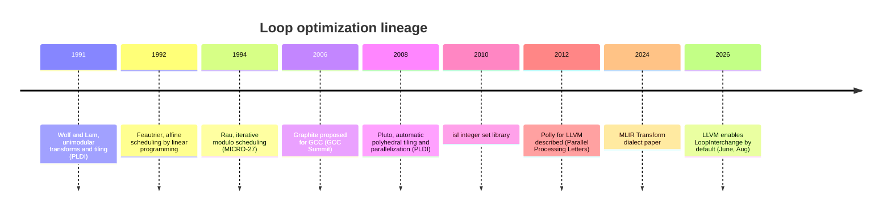
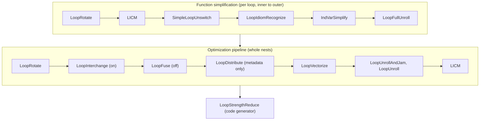

---
tags:
  - compilers
  - loop-optimization
  - dependence-analysis
  - polyhedral-model
  - scalar-evolution
  - llvm
  - mlir
status: complete
sources:
  - https://www.cs.cornell.edu/courses/cs6120/2025fa/lesson/8/
  - https://llvm.org/docs/LoopTerminology.html
  - https://llvm.org/docs/Passes.html
  - https://LLVM.org/devmtg/2009-10/ScalarEvolutionAndLoopOptimization.pdf
  - https://www.cs.cmu.edu/~15411/slides/20-dep.pdf
  - https://cs.utexas.edu/~pingali/CS380C/2025/papers/wolf91a.pdf
  - https://american.cs.ucdavis.edu/Micro27/html/abst7.html
  - https://www.doi.org/10.1007/BF01407835
  - https://ftp.icm.edu.pl/packages/gcc/summit/2006-GCC-Summit-Proceedings.pdf
  - https://www.ece.lsu.edu/jxr/pluto/
  - https://en.wikipedia.org/wiki/Integer_set_library
  - https://api.crossref.org/works/10.1142%2FS0129626412500107
  - https://polly.llvm.org/
  - https://polly.llvm.org/docs/ReleaseNotes.html
  - https://github.com/llvm/llvm-project/commit/7a0f7dbf2dcc
  - https://gcc.gnu.org/onlinedocs/gcc/Optimize-Options.html
  - https://gcc.gnu.org/pipermail/gcc/2025-December/247204.html
  - https://mlir.llvm.org/docs/Dialects/Affine/
  - https://arxiv.org/html/2409.03864v2
  - https://lists.llvm.org/pipermail/mlir-commits/2026-March/162119.html
  - https://discourse.llvm.org/t/enabling-loop-interchange/82589
  - https://lists.llvm.org/pipermail/llvm-commits/Week-of-Mon-20250922/1740360.html
  - https://lists.llvm.org/pipermail/all-commits/Week-of-Mon-20260601/303617.html
  - http://www.mail-archive.com/cfe-commits@lists.llvm.org/msg734704.html
  - https://discourse.llvm.org/t/llvm-23-1-0-rc3-released/91551
  - https://discourse.llvm.org/t/loop-transformations-round-table-notes-llvm-us-dev-meet-2026/92735
  - https://github.com/llvm/llvm-project/blob/main/llvm/lib/Passes/PassBuilderPipelines.cpp
  - https://github.com/llvm/llvm-project/blob/main/llvm/include/llvm/Passes/PassBuilder.h
  - https://github.com/llvm/llvm-project/blob/main/llvm/lib/CodeGen/TargetPassConfig.cpp
  - https://releases.llvm.org/22.1.0/docs/ReleaseNotes.html
  - https://arxiv.org/pdf/2502.03402
  - https://arxiv.org/abs/2403.11522v4
  - https://arxiv.org/html/2511.00592v1
  - https://arxiv.org/abs/2512.15766
created: 2026-11-26
updated: 2026-11-26
---

## Table Of Contents

- [[#TL;DR|TL;DR]]
- [[#The Problem|The Problem]]
- [[#Foundations|Foundations]]
    - [[#Finding Loops|Finding Loops]]
    - [[#Canonical Loop Form|Canonical Loop Form]]
    - [[#Induction Variables and Scalar Evolution|Induction Variables and Scalar Evolution]]
    - [[#Data Dependence|Data Dependence]]
- [[#How We Got Here|How We Got Here]]
- [[#How It Works|How It Works]]
    - [[#Loop-Invariant Code Motion|Loop-Invariant Code Motion]]
    - [[#Strength Reduction and LSR|Strength Reduction and LSR]]
    - [[#Unrolling, Unswitching and Peeling|Unrolling, Unswitching and Peeling]]
    - [[#Fusion and Distribution|Fusion and Distribution]]
    - [[#Interchange, Skewing and Legality|Interchange, Skewing and Legality]]
    - [[#Tiling for Cache Locality|Tiling for Cache Locality]]
    - [[#Software Pipelining|Software Pipelining]]
    - [[#The Polyhedral Model|The Polyhedral Model]]
    - [[#The LLVM Loop Pipeline|The LLVM Loop Pipeline]]
- [[#Where It Is Now|Where It Is Now]]
    - [[#LLVM|LLVM]]
    - [[#GCC|GCC]]
    - [[#MLIR|MLIR]]
    - [[#Research|Research]]
- [[#Trade-offs & Open Problems|Trade-offs & Open Problems]]
- [[#Resources|Resources]]
- [[#Related Notes|Related Notes]]

## ***TL;DR***
---
*Loop optimizations rewrite the loops where programs spend most of their time. They work in two layers: cheap scalar clean-ups inside one loop that every optimizing compiler runs, and restructurings of whole loop nests that need dependence analysis to prove legal and a cost model to prove profitable.*

- **Scalar layer (runs everywhere at -O2).** Find loops in the CFG, put them in a canonical shape (preheader, single latch, LCSSA, rotated), describe every induction variable as a recurrence (LLVM's *Scalar Evolution*), then hoist invariant work (**LICM**), turn multiplies into adds (**strength reduction**), **unroll**, **unswitch** and **peel**.
- **Nest layer (the hard part).** **Interchange**, **fusion**, **distribution**, **skewing** and **tiling** reorder iterations to improve cache reuse and expose parallelism. Each is legal only if every data dependence still points forward in time, which is checked with *distance and direction vectors* ([CMU 15-411](https://www.cs.cmu.edu/~15411/slides/20-dep.pdf)).
- **The polyhedral model** treats a loop nest's iterations as integer points in a polyhedron and a transformation as an affine schedule, so a whole sequence of interchanges, skews and tiles is chosen at once by integer linear programming (Feautrier, Pluto, isl, Polly, Graphite, MLIR's affine dialect).
- **The payoff can be large.** Wolf and Lam's tiled 500×500 matrix multiply ran 2.75× faster on one processor and scaled past 7× on eight, where the untiled one stalled at about 4.5× on bus contention ([Wolf & Lam, PLDI 1991](https://cs.utexas.edu/~pingali/CS380C/2025/papers/wolf91a.pdf)).
- **As of November 2026:** LLVM turned on **LoopInterchange** by default in its pass pipeline on 1 June 2026 and in clang and flang at -O1 and above on 31 August 2026, its first default nest transformation using DependenceAnalysis. LoopFusion is still off by default. Polly and GCC's Graphite remain opt-in, with Graphite described by a GCC maintainer as "not under active development". The momentum for aggressive tiling has moved to MLIR and to [[ML Compilers]].

## ***The Problem***
---
*A program's hot code is almost always a loop, and modern CPUs and GPUs are limited by memory bandwidth and latency more than by arithmetic. The order in which a loop nest touches memory therefore decides its speed, and that order is exactly what the source code fixes and the compiler must prove it may change.*

Cornell's CS 6120 puts the motivation in one line: loop optimization matters because "programs, by definition, spend most of their time executing loops!" ([Sampson, CS 6120](https://www.cs.cornell.edu/courses/cs6120/2025fa/lesson/8/)). Three kinds of waste show up inside loops: repeated work, like `x * y` recomputed every iteration (fixed by LICM and strength reduction); loop overhead and lost instruction-level parallelism, like one compare and branch per useful add (unrolling, software pipelining, [[Vectorization]]); and bad memory order (interchange, tiling, fusion).

The last is the expensive one. In C's row-major layout, `for (i…) for (j…) s += A[i][j];` walks memory with stride 1; swap the two loops and every access jumps `N*8` bytes, missing cache on almost every load once a column no longer fits. A programmer can fix this by hand, but loop orders that are good for one machine, tile size or data size are wrong for another, and code generated by frontends such as Fortran, ML frameworks or template libraries is rarely written with the target's cache in mind. The compiler is in the best place to choose, but only if it can prove the reordering keeps the program's meaning.

## ***Foundations***
---
*Four ideas carry everything later: how a compiler recognizes a loop in a CFG, the canonical shape it forces loops into, how it describes values that change every iteration, and how it knows which iterations depend on which.*

### Finding Loops

*A loop is a strongly connected set of blocks with a single entry, the header, which dominates every block in it. A back edge is an edge into a block that dominates its source.*

Block $d$ **dominates** block $n$ if every path from the entry to $n$ passes through $d$ (see [[Dataflow Analysis]] and [[SSA Form]], which use the same dominator tree). An edge $n \to h$ is a **back edge** when $h$ dominates $n$. The **natural loop** of that back edge is

$$
\text{loop}(n \to h) = \{h\} \cup \{\, m \mid m \text{ can reach } n \text{ without passing through } h \,\}
$$

**In plain English:** start from the block that jumps back to the header and walk the CFG backwards, stopping at the header. Everything you collect is the loop body.

LLVM's terminology matches this: a loop has one **header**; a **latch** is a block with an edge to the header; that edge is a **backedge**; edges leaving the loop go from **exiting blocks** to **exit blocks** ([LLVM Loop Terminology](https://llvm.org/docs/LoopTerminology.html)). Loops whose bodies are disjoint or nested form a **loop nest** tree, and nest transformations operate on paths through that tree.

**Reducible vs irreducible.** If every cycle in the CFG has a header that dominates it, the CFG is *reducible* and every cycle is a natural loop. Code built from `goto`, some state machines, and some optimizations can create a cycle with two entries, which has no such header. LLVM notes that "a cycle in the CFG does not imply there is a loop"; its `FixIrreducible` pass can insert new headers to turn such cycles into loops, but it is not in the default pipelines, so loop passes simply skip irreducible regions ([LLVM Loop Terminology](https://llvm.org/docs/LoopTerminology.html)).

### Canonical Loop Form

*Passes are simpler to write if every loop looks the same: one place to put hoisted code, one latch, exits owned by the loop, and loop values that leave only through phi nodes.*

| Form | What it guarantees | Why passes want it |
|---|---|---|
| **Preheader** | A single block outside the loop whose only successor is the header; it dominates the loop | A safe place to put hoisted code (LICM) and setup code (strength reduction) |
| **Loop Simplify form** | Preheader, a single backedge (so one latch), and *dedicated exits* (no exit block has a predecessor outside the loop) | Required by LoopRotate and most loop passes |
| **LCSSA** (loop-closed SSA) | Every value defined in the loop and used outside it goes through a single-entry phi in an exit block | Unswitching, unrolling and SCEV only need to fix the loop-closing phis, not every outside use |
| **Rotated** | The loop is a `do/while`: the exit test sits in the latch, with a guard before the loop | Invariant loads can be hoisted into the preheader, because the body now runs at least once whenever the preheader runs |

Sources: [LLVM Loop Terminology](https://llvm.org/docs/LoopTerminology.html), [LLVM Passes](https://llvm.org/docs/Passes.html). Rotation turns `while (i < n) { body; i++; }` into `if (i < n) { do { body; i++; } while (i < n); }`.

### Induction Variables and Scalar Evolution

*An induction variable changes by a fixed amount per iteration. LLVM's Scalar Evolution (SCEV) describes every such value as a chain of recurrences, from which it derives trip counts, closed forms and address patterns.*

A **basic induction variable** is updated as `i += e` with `e` loop-invariant; a **derived** one has the form `j = c*i + d` with `c`, `d` invariant ([CS 6120](https://www.cs.cornell.edu/courses/cs6120/2025fa/lesson/8/)). LLVM's ScalarEvolution generalizes this. It maps each SSA value to an expression built from constants, arithmetic, extensions, unknowns and **add recurrences** `{A,+,B}<L>`: a value that starts at `A` and grows by `B` each iteration of loop `L`. Nested loops give nested recurrences, and the representation comes from Bachmann, Wang and Zima's *Chains of Recurrences* ([LLVM Dev Meeting 2009](https://LLVM.org/devmtg/2009-10/ScalarEvolutionAndLoopOptimization.pdf)).

```c
int *a; for (long i = 0; i < n; i++) a[2*i + 3] = 0;
```

| Value | SCEV |
|---|---|
| `i` | `{0,+,1}<loop>` |
| `2*i + 3` | `{3,+,2}<loop>` |
| `&a[2*i+3]` | `{(12 + %a),+,8}<loop>` (4-byte ints) |
| Backedge-taken count | `n - 1` (when `n > 0`) |

A chain with more terms describes polynomials. For a three-term chain,

$$
\{a, +, b, +, c\}(k) = a + b\,k + c\,\binom{k}{2}
$$

**In plain English:** the value at iteration $k$ starts at $a$, gains $b$ each step, and the step itself grows by $c$ each step, so the closed form is a quadratic. This is how a compiler can replace `sum += i` in a loop with `n*(n-1)/2` after it. The same machinery feeds IndVarSimplify (canonical counters, exit-value rewriting) and LoopStrengthReduce, and nsw/nuw flags decide whether SCEV may assume the arithmetic doesn't wrap ([LLVM Dev Meeting 2009](https://LLVM.org/devmtg/2009-10/ScalarEvolutionAndLoopOptimization.pdf)). Qualcomm's 2025 *Tensor Evolution* extends the same chains-of-recurrences idea from scalars to whole tensors in loops ([Absar et al., 2025](https://arxiv.org/pdf/2502.03402)).

### Data Dependence

*Two statement instances depend on each other if they touch the same memory and at least one writes. A reordering is legal only if every dependence still runs from earlier to later.*

There are three kinds: **flow** (write then read, the true dependence), **anti** (read then write) and **output** (write then write).

For a dependence from source iteration $\vec{I}_s$ to target iteration $\vec{I}_t$ in a nest, the **distance vector** is $\vec{d} = \vec{I}_t - \vec{I}_s$, and the **direction vector** keeps only each component's sign (`<`, `=`, `>`, or `*` for unknown). In the original program every dependence vector is lexicographically non-negative, since a source always runs before its target ([CMU 15-411](https://www.cs.cmu.edu/~15411/slides/20-dep.pdf)).

**Worked example.**

```c
for (i = 1; i < N; i++)
  for (j = 0; j < M - 1; j++)
    A[i][j] = A[i-1][j+1] + 1;    // S
```

Iteration $(i, j)$ reads `A[i-1][j+1]`, which iteration $(i-1, j+1)$ wrote. So the flow dependence has distance $\vec{d} = (i, j) - (i-1, j+1) = (1, -1)$ and direction $(<, >)$: carried by the outer loop, pointing "backwards" in $j$. We use this vector again under [[#Interchange, Skewing and Legality|Interchange, Skewing and Legality]].

**Dependence tests** decide whether two accesses $A[a\,i + c_1]$ (write) and $A[b\,j + c_2]$ (read) can hit the same element:

$$
\textbf{GCD test:}\quad \exists\, i, j \in \mathbb{Z}:\ a\,i - b\,j = c_2 - c_1 \;\Longrightarrow\; \gcd(a, b) \mid (c_2 - c_1)
$$

**In plain English:** an integer solution exists only if the gcd of the coefficients divides the difference of the constants. If it doesn't, the accesses never overlap. For `A[2k+10]` written and `A[2k+1]` read, $\gcd(2,2) = 2$ doesn't divide $-9$, so there is no dependence ([CMU 15-411](https://www.cs.cmu.edu/~15411/slides/20-dep.pdf)). The test ignores loop bounds, so it is conservative.

$$
\textbf{Banerjee:}\quad \min_{\text{bounds}} (a\,i - b\,j) \;\le\; c_2 - c_1 \;\le\; \max_{\text{bounds}} (a\,i - b\,j)
$$

**In plain English:** the Banerjee test adds the loop bounds. It computes the smallest and largest value the left side can take over the iteration space (real-valued, so it is still conservative), and if $c_2 - c_1$ falls outside that range there is no dependence. Production analyzers chain several such tests per subscript; exact answers need integer programming, which is what the polyhedral tools do.

## ***How We Got Here***
---
*Loop optimization grew out of vectorizing and parallelizing Fortran compilers, gained a matrix theory of transformations around 1990, and then moved to polyhedral scheduling, which mainstream compilers adopted only partially and as opt-in passes.*



- **Unimodular transformations (1991).** Wolf and Lam showed that interchange, reversal and skewing are all integer matrices with determinant ±1, so any sequence of them is one matrix, and legality is one test: every transformed distance vector must stay lexicographically positive. They added tiling on top and implemented it in Stanford's SUIF compiler ([Wolf & Lam, PLDI 1991](https://cs.utexas.edu/~pingali/CS380C/2025/papers/wolf91a.pdf)).
- **Affine scheduling (1992).** Feautrier framed scheduling as finding an affine function from each statement's iteration to a time step that respects all dependences, solved with linear programming, first in one dimension and then for multidimensional time ([Feautrier, IJPP 1992](https://www.doi.org/10.1007/BF01407835)).
- **Polyhedral tools (2006 to 2012).** GCC's Graphite was presented at the 2006 GCC Summit ([GCC Summit 2006](https://ftp.icm.edu.pl/packages/gcc/summit/2006-GCC-Summit-Proceedings.pdf)). Pluto (Bondhugula, Hartono, Ramanujam, Sadayappan, PLDI 2008) found tiling hyperplanes automatically with an ILP cost function ([Pluto](https://www.ece.lsu.edu/jxr/pluto/)). isl gave everyone an exact integer set library, and both Graphite and Polly use it ([isl](https://en.wikipedia.org/wiki/Integer_set_library)). Polly brought the model to LLVM IR ([Grosser et al., PPL 2012](https://api.crossref.org/works/10.1142%2FS0129626412500107)).
- **Schedules as programs (2010s to now).** ML compilers separated *what* a kernel computes from *how* its loops are tiled and ordered; MLIR's affine dialect and Transform dialect bring that split into a general compiler (see [[#MLIR|MLIR]]).

## ***How It Works***
---
*Each transformation is a rewrite with a legality condition and a profitability question. The scalar ones need SSA and alias information; the nest ones need dependence vectors; the polyhedral model folds many of them into one schedule.*

### Loop-Invariant Code Motion

*Move a computation to the preheader if its operands don't change in the loop and moving it can't change behavior.*

An instruction can be hoisted if all its operands are defined outside the loop (or are themselves hoisted), and it is either safe to execute speculatively (no traps, no side effects) or guaranteed to execute whenever the loop is entered. A load also needs [[Pointer and Alias Analysis|alias analysis]] to show no store in the loop can write the same address. LLVM's LICM "attempt[s] to remove as much code from the body of a loop as possible" ([LLVM Passes](https://llvm.org/docs/Passes.html)); it also promotes loop-invariant memory locations to registers and sinks code into exit blocks, and runs with MemorySSA for its memory queries ([PassBuilderPipelines.cpp](https://github.com/llvm/llvm-project/blob/main/llvm/lib/Passes/PassBuilderPipelines.cpp)).

**Before** (rotated loop, `mul` recomputed every iteration):

```llvm
entry:                                  ; @fill(ptr %a, i64 %n, i64 %x, i64 %y)
  %guard = icmp sgt i64 %n, 0
  br i1 %guard, label %ph, label %exit
ph:                                     ; preheader
  br label %loop
loop:
  %i = phi i64 [ 0, %ph ], [ %i.next, %loop ]
  %k = mul i64 %x, %y                   ; invariant
  %p = getelementptr inbounds i64, ptr %a, i64 %i
  store i64 %k, ptr %p
  %i.next = add nuw nsw i64 %i, 1
  %done = icmp eq i64 %i.next, %n
  br i1 %done, label %exit, label %loop
```

**After** `opt -passes=licm`, `%k = mul i64 %x, %y` sits in `%ph`, runs once, and the loop body keeps only the GEP, the store and the counter. A `mul` can't trap, so it could be hoisted even without the guard. A load or a division could not, which is why loop rotation (which creates the guarded preheader) runs before LICM.

### Strength Reduction and LSR

*Replace a multiply by the induction variable with an add carried around the loop.*

Classic strength reduction turns a derived induction variable `j = c*i + d` into one initialized to `d` in the preheader and bumped by `c*e` each iteration, followed by copy propagation and dead-code elimination ([CS 6120](https://www.cs.cornell.edu/courses/cs6120/2025fa/lesson/8/)).

```c
for (i = 0; i < n; i++)        // before: one multiply per access
  a[i*stride] = 0;

for (p = a, i = 0; i < n; i++, p += stride)   // after: one add
  *p = 0;
```

LLVM splits this in two. IndVarSimplify canonicalizes counters early; **LoopStrengthReduce** (LSR) runs late, as the first IR pass of the code generator, because the best choice depends on the target's addressing modes and register count ([TargetPassConfig.cpp](https://github.com/llvm/llvm-project/blob/main/llvm/lib/CodeGen/TargetPassConfig.cpp)). LSR looks at the uses of address recurrences such as `{%a,+,8}` and chooses which induction variables to keep, removing multiplies from the body and stepping pointers directly ([LLVM Dev Meeting 2009](https://LLVM.org/devmtg/2009-10/ScalarEvolutionAndLoopOptimization.pdf)); the right choice depends on which addressing modes the target has and how many registers are free. It also interacts with [[Register Allocation]]: every extra pointer it keeps live is a register.

### Unrolling, Unswitching and Peeling

*Unrolling copies the body several times per trip to cut branch overhead and give the scheduler and vectorizer more to work with; unswitching and peeling clone a loop to remove a branch. All three trade code size for speed.*

| Kind | When the trip count is | Result |
|---|---|---|
| **Full** | A small compile-time constant | Loop disappears; values may constant-fold |
| **Partial** | Known, divisible by the factor | Body copied *k* times, one exit test per *k* iterations |
| **Runtime** | Unknown | Unrolled main loop plus a remainder (epilogue) loop, or a prologue |
| **Unroll-and-jam** | Outer loop of a nest | Unroll the outer loop and fuse the copies of the inner loop, improving register reuse |

```c
for (i = 0; i + 3 < n; i += 4) { s += a[i]; s += a[i+1]; s += a[i+2]; s += a[i+3]; }
for (; i < n; i++) s += a[i];     // remainder loop: runtime unroll by 4
```

LLVM runs full unrolling early (LoopFullUnroll, inside the simplification pipeline) so the results can be simplified, and partial and runtime unrolling late, after the vectorizer ([PassBuilderPipelines.cpp](https://github.com/llvm/llvm-project/blob/main/llvm/lib/Passes/PassBuilderPipelines.cpp)). The cost: bigger code, more instruction-cache pressure, longer compile time, more register pressure, and a remainder loop that hurts short trip counts. Masking the remainder away instead, called tail folding, is a [[Vectorization]] topic; LLVM 22 made it the default for the vectorizer on RISC-V ([LLVM 22 release notes](https://releases.llvm.org/22.1.0/docs/ReleaseNotes.html)).

**Unswitching and peeling.** Unswitching moves a branch that never changes out of the loop by cloning the loop; peeling splits off the first or last iterations when they behave differently.

```c
for (i = 0; i < n; i++) {          // before: tests `flag` n times
  if (flag) a[i] = 0; else a[i] = b[i];
}
if (flag) for (i = 0; i < n; i++) a[i] = 0;      // after unswitching
else      for (i = 0; i < n; i++) a[i] = b[i];
```

Unswitching doubles code per invariant condition, so LLVM's `SimpleLoopUnswitch` does the cheap *trivial* cases (a branch that just exits the loop) everywhere and full *non-trivial* unswitching only at -O3 ([PassBuilderPipelines.cpp](https://github.com/llvm/llvm-project/blob/main/llvm/lib/Passes/PassBuilderPipelines.cpp)). **Peeling** copies out the first (or last) iteration, typically when a phi takes a different value on the first trip or a condition is only true at the boundary; GCC lists `-fpeel-loops` and `-fsplit-loops` (split a loop at the point where a condition flips) among its -O3 flags ([GCC options](https://gcc.gnu.org/onlinedocs/gcc/Optimize-Options.html)).

### Fusion and Distribution

*Fusion merges adjacent loops over the same range so data is reused while hot; distribution (fission) splits one loop so each part can be vectorized, parallelized or interchanged on its own.*

```c
// separate loops: t[] written to memory, then read back
for (i = 0; i < n; i++) t[i] = a[i] * 2;
for (i = 0; i < n; i++) b[i] = t[i] + 1;
// fused: t[i] is still in a register; if t is dead afterwards it disappears
for (i = 0; i < n; i++) { t[i] = a[i] * 2; b[i] = t[i] + 1; }
```

Fusion is legal if no value written by iteration $i$ of the first loop is used by an earlier iteration $j < i$ of the second, since fusion would run the use first. Distribution is legal if statements in a dependence cycle stay in the same loop and the loops are emitted in dependence order. The two pull against each other: fusion improves locality and removes temporaries, which is why it dominates in ML compilers ([CS 6120](https://www.cs.cornell.edu/courses/cs6120/2025fa/lesson/8/)), while distribution isolates the one statement with a loop-carried dependence so the rest can vectorize. In LLVM, `LoopDistribute` runs only for loops with `llvm.loop.distribute` metadata or when a flag enables it ([PassBuilderPipelines.cpp](https://github.com/llvm/llvm-project/blob/main/llvm/lib/Passes/PassBuilderPipelines.cpp)); GCC enables `-ftree-loop-distribution` at -O3 ([GCC options](https://gcc.gnu.org/onlinedocs/gcc/Optimize-Options.html)).

### Interchange, Skewing and Legality

*Swap two loops in a nest to change which index varies fastest. Legal if every transformed dependence vector stays lexicographically positive; skewing can make an illegal interchange legal.*

A transformation $T$ (a unimodular matrix for interchange, reversal and skewing) maps each distance vector $\vec{d}$ to $T\vec{d}$. It is legal if

$$
T\vec{d} \succ \vec{0} \quad \text{for every dependence } \vec{d}
$$

**In plain English:** after reordering, the first non-zero entry of every dependence vector must still be positive, so each source still runs before its target ([Wolf & Lam](https://cs.utexas.edu/~pingali/CS380C/2025/papers/wolf91a.pdf); [CMU 15-411](https://www.cs.cmu.edu/~15411/slides/20-dep.pdf)).

**Worked example (continuing the dependence above, $\vec{d} = (1, -1)$):**

| Transformation | Matrix $T$ | $T\vec{d}$ | Legal? |
|---|---|---|---|
| Interchange $(i, j) \to (j, i)$ | $\begin{pmatrix}0&1\\1&0\end{pmatrix}$ | $(-1, 1)$ | No: first entry negative |
| Skew $j' = j + i$ | $\begin{pmatrix}1&0\\1&1\end{pmatrix}$ | $(1, 0)$ | Yes |
| Skew, then interchange | $\begin{pmatrix}1&1\\1&0\end{pmatrix}$ | $(0, 1)$ | Yes: now carried by the inner loop, so the outer loop is parallel |

Skewing first turns a "diagonal" dependence into one that is legal under interchange, and the result has a parallel outer loop. Wolf and Lam's search heuristic (skew, reverse, permute) chooses such combinations by modeling self- and group-reuse of each array reference ([Wolf & Lam](https://cs.utexas.edu/~pingali/CS380C/2025/papers/wolf91a.pdf)).

### Tiling for Cache Locality

*Tiling (blocking) splits an n-deep nest into 2n loops so that a small block of the iteration space, whose data fits in cache, finishes before the next one starts.*

Naive matrix multiply reuses each element of `B` once per row of `A`, but for large `N` the row of `B` has been evicted by the time it's needed again. Tiling with block size `T` keeps a `T×T` block of each matrix resident:

```c
// C += A * B, N x N, tile size T (chosen so 3*T*T*8 bytes fit in cache)
for (ii = 0; ii < N; ii += T)
  for (kk = 0; kk < N; kk += T)
    for (jj = 0; jj < N; jj += T)
      // point loops: work on one block of each matrix
      for (i = ii; i < min(ii + T, N); i++)
        for (k = kk; k < min(kk + T, N); k++) {
          double a = A[i][k];                 // register reuse
          for (j = jj; j < min(jj + T, N); j++)
            C[i][j] += a * B[k][j];           // stride-1 in j: vectorizable
        }
```

Tiling is legal when the tiled loops are **fully permutable**, which holds when every dependence has non-negative components in those loops; skewing can establish that ([Wolf & Lam](https://cs.utexas.edu/~pingali/CS380C/2025/papers/wolf91a.pdf)). Real BLAS kernels tile several levels at once (registers, L1, L2, L3) and copy blocks into contiguous *packed* buffers; Polly pattern-matches matrix multiplication and emits this GotoBLAS-style structure ([Polly](https://polly.llvm.org/)). The minimums and partial tiles are a cost: Polly's in-progress 24.0.0git release adds an option to separate complete tiles from partial ones so the vectorizer can skip the scalar epilogue on full tiles ([Polly release notes](https://polly.llvm.org/docs/ReleaseNotes.html)). The same blocking, mapped to thread blocks, shared memory and registers instead of cache levels, is the core of [[GPU Kernel Compilers]] and of kernels like [[FlashAttention]].

### Software Pipelining

*Overlap iterations so a new one starts every II cycles, before the previous one finishes, like a hardware pipeline built in software.*

**[[Instruction Scheduling|Modulo scheduling]]** picks an *initiation interval* II and schedules one iteration so that the same schedule, repeated every II cycles, never oversubscribes a functional unit ([Rau, MICRO-27](https://american.cs.ucdavis.edu/Micro27/html/abst7.html)). The lower bound is

$$
\text{II} \ge \text{MII} = \max\!\Big(\underbrace{\max_{r}\Big\lceil \tfrac{\text{uses}_r}{\text{units}_r} \Big\rceil}_{\text{ResMII}},\ \underbrace{\max_{\text{cycles } c}\Big\lceil \tfrac{\text{latency}(c)}{\text{distance}(c)} \Big\rceil}_{\text{RecMII}}\Big)
$$

**In plain English:** you can't start iterations faster than the busiest resource allows (ResMII), or faster than a loop-carried dependence chain can complete (RecMII: total latency around the cycle divided by how many iterations it spans). The scheduler tries II = MII and increases it until a schedule fits, then emits a prologue, a steady-state kernel and an epilogue. It matters most on in-order and VLIW targets (DSPs, some accelerators); out-of-order CPUs overlap iterations in hardware, so mainstream compilers use it selectively.

### The Polyhedral Model

*Represent each statement's iterations as the integer points of a polyhedron, its memory accesses and dependences as affine relations, and a whole sequence of loop transformations as one affine schedule chosen by integer linear programming.*

For a static control part (SCoP: loops with affine bounds, affine array subscripts, no data-dependent control), the model has three pieces, written here in isl notation:

```text
Domain:     { S[i,j] : 1 <= i < N and 0 <= j < M - 1 }
Access:     { S[i,j] -> A[i, j] }  (write)   { S[i,j] -> A[i-1, j+1] }  (read)
Dependence: { S[i,j] -> S[i+1, j-1] : ... }        distance (1, -1)
Schedule:   { S[i,j] -> [i, j] }                  original order
Tiled:      { S[i,j] -> [floor(i/32), floor((i+j)/32), i, i+j] }   skew + tile
```

A schedule $\theta_S(\vec{x}) = H\vec{x} + \vec{c}$ is legal if for every dependence from $\vec{s}$ to $\vec{t}$, $\theta(\vec{t}) - \theta(\vec{s}) \succ \vec{0}$. Feautrier turned this into a linear program using the affine form of Farkas' lemma ([Feautrier, IJPP 1992](https://www.doi.org/10.1007/BF01407835)). Pluto then picks hyperplanes one at a time, minimizing an upper bound on the dependence distances along each (and so the reuse distance and inter-tile communication), which yields bands of permutable, tileable loops ([Pluto](https://www.ece.lsu.edu/jxr/pluto/)):

$$
\theta(\vec{t}) - \theta(\vec{s}) \;\le\; \vec{u}\cdot\vec{n} + w \quad \text{for all dependences, minimize } (\vec{u}, w)
$$

**In plain English:** among all legal hyperplanes, choose the one along which dependent iterations are closest together, bounded by a function of the problem size $\vec{n}$. Short dependence distances mean data is reused soon after it is produced, and tiles along such hyperplanes talk to few neighbors.

Every tool follows the same pipeline (detect SCoPs, build domains and accesses, compute exact dependences, solve for a schedule, generate loops from the schedule's AST). The tools: **isl** (Verdoolaege, MIT license) does the exact integer set arithmetic, including an ILP solver and dependence analysis ([isl](https://en.wikipedia.org/wiki/Integer_set_library)); **Polly** detects SCoPs in LLVM IR and does tiling, fusion, OpenMP parallelization and SIMD preparation ([Polly](https://polly.llvm.org/)); **Graphite** does the same on GCC's GIMPLE with an isl-based optimizer built on Pluto's algorithms ([GCC options](https://gcc.gnu.org/onlinedocs/gcc/Optimize-Options.html)); MLIR's **affine dialect** borrows polyhedral techniques but keeps loops structured in the IR (see [[#MLIR|MLIR]]).

### The LLVM Loop Pipeline

*In LLVM, cheap per-loop passes run early in a loop pass manager to simplify code; nest-level and vectorization passes run once, late, as function passes.*



Simplified from [PassBuilderPipelines.cpp](https://github.com/llvm/llvm-project/blob/main/llvm/lib/Passes/PassBuilderPipelines.cpp) and [TargetPassConfig.cpp](https://github.com/llvm/llvm-project/blob/main/llvm/lib/CodeGen/TargetPassConfig.cpp) on main, November 2026; exact passes vary by optimization level. A source comment above LoopFuse reads "This may not be the right place in the pipeline". See [[LLVM]] and [[Compiler Pipeline]] for the surrounding passes.

## ***Where It Is Now***
---
*As of November 2026: the scalar loop passes are mature everywhere. LLVM has just turned on its first dependence-driven nest transformation by default, GCC's polyhedral pass is unmaintained, and aggressive tiling lives mainly in MLIR and ML compilers. Research has shifted to learned and LLM-guided schedule search.*

### LLVM

- **LoopInterchange is on by default.** The 2024 RFC by Sjoerd Meijer, with Sebastian Pop and Madhur Amilkanthwar, argued interchange enables vectorization and triggers often in SPEC, and measured compile-time increases up to 1.8% on lencod ([Discourse, Oct 2024](https://discourse.llvm.org/t/enabling-loop-interchange/82589)). It stalled in September 2025 because "Enablement of LoopInterchange is currently blocked on correctness issues in DependenceAnalysis", chiefly integer overflow handling ([llvm-commits, Sep 2025](https://lists.llvm.org/pipermail/llvm-commits/Week-of-Mon-20250922/1740360.html)). It landed in the pass pipeline on 1 June 2026, stating all known bugs, including those in DependenceAnalysis, were fixed and every component had a maintainer ([commit 13e62f0](https://lists.llvm.org/pipermail/all-commits/Week-of-Mon-20260601/303617.html)). Clang and flang still overrode it until 31 August 2026, when `-floop-interchange` became the default at -O1 and above ([commit e448a89](http://www.mail-archive.com/cfe-commits@lists.llvm.org/msg734704.html)). LLVM 23.1.0 shipped on 25 August 2026 ([LLVM Discourse](https://discourse.llvm.org/t/llvm-23-1-0-rc3-released/91551)), so plain `clang -O2` running interchange should first appear in LLVM 24 (no backport was found as of November 2026). In `PassBuilder.h` on main, `LoopInterchange = true` and `LoopFusion = false` ([PassBuilder.h](https://github.com/llvm/llvm-project/blob/main/llvm/include/llvm/Passes/PassBuilder.h)).
- **Fusion and distribution are next.** At the November 2026 US Dev Meeting round table, fusion crashes had been fixed and a basic cost model had replaced a stub; default enablement awaits compile-time data ("Even 1% impact on the compile-time-tracker can be huge") and an RFC. A loop-distribution RFC on statement-seeded partitioning is open, and attendees asked whether fusion and distribution need a shared cost model, and whether such transforms belong in MLIR or as VPlan transforms ([round table notes](https://discourse.llvm.org/t/loop-transformations-round-table-notes-llvm-us-dev-meet-2026/92735)).
- **Polly** is still in tree and opt-in. Its legacy pass manager support was removed in favor of a "PhaseManager" ([commit 7a0f7db](https://github.com/llvm/llvm-project/commit/7a0f7dbf2dcc)). The in-progress 24.0.0git notes add complete-tile isolation, heap allocation of large packed arrays in the matrix-multiply path, and `-plugin-arg=Polly,...` option passing ([Polly release notes](https://polly.llvm.org/docs/ReleaseNotes.html)). The 2026 round table mentioned Polly only as a source of "lessons" for the default transforms.

### GCC

At -O3 GCC enables its non-polyhedral nest transforms: `-floop-interchange`, `-floop-unroll-and-jam` and `-ftree-loop-distribution`. Graphite's `-floop-nest-optimize` ("Enable the isl based loop nest optimizer") is experimental and off at every level ([GCC options](https://gcc.gnu.org/onlinedocs/gcc/Optimize-Options.html)). In December 2025 Richard Biener (SUSE) answered a question about Graphite's state: it is "not under active development", it remains partly because its dependence analysis may still be useful, and he suggested exposing high-level loop transforms through OpenMP-style annotations ([gcc mailing list, Dec 2025](https://gcc.gnu.org/pipermail/gcc/2025-December/247204.html)).

### MLIR

The **affine dialect** keeps loops (`affine.for`, `affine.if`, `affine.parallel`) and accesses (`affine.load`, `affine.store`) in a form whose bounds and subscripts are (quasi-)affine functions of loop indices and symbols, so dependence analysis and transformations are exact by construction rather than recovered from pointer arithmetic ([MLIR affine dialect](https://mlir.llvm.org/docs/Dialects/Affine/)). A tiled matmul nest looks like this:

```mlir
#lb = affine_map<(d0) -> (d0)>
#ub = affine_map<(d0) -> (d0 + 32)>
affine.for %i = 0 to 1024 step 32 {              // tile loops
  affine.for %j = 0 to 1024 step 32 {
    affine.for %ii = #lb(%i) to #ub(%i) {        // point loops
      affine.for %jj = #lb(%j) to #ub(%j) {
        affine.for %k = 0 to 1024 {
          %a = affine.load %A[%ii, %k] : memref<1024x1024xf32>
          %b = affine.load %B[%k, %jj] : memref<1024x1024xf32>
          %c = affine.load %C[%ii, %jj] : memref<1024x1024xf32>
          %p = arith.mulf %a, %b : f32
          %s = arith.addf %c, %p : f32
          affine.store %s, %C[%ii, %jj] : memref<1024x1024xf32>
}}}}}
```

Most ML pipelines tile earlier, at the **linalg** level, where an op like `linalg.matmul` is tiled and fused into `scf.for` or `scf.forall` loops before any loop exists in memory form. The **Transform dialect** makes the schedule a separate script that names payload ops through handles and applies tiling, splitting, unrolling and so on; its paper reports at most about 2.6% compile-time overhead, a Transform-based tiling matching OpenMP, and a 1.68× autotuned batch-matmul speedup ([Lücke et al., 2024](https://arxiv.org/html/2409.03864v2)). Upstream work in 2026 is mostly robustness, such as fixing tiling of rank-0 ops ([mlir-commits, Mar 2026](https://lists.llvm.org/pipermail/mlir-commits/2026-March/162119.html)), rather than new theory. See [[MLIR]] and [[ML Compilers]].

### Research

| Work | Year | Idea | Reported result |
|---|---|---|---|
| LOOPer | PACT 2025 | Deep-learning cost model driving a polyhedral autoscheduler over many affine transforms | 1.84× geomean over Tiramisu's autoscheduler, 1.42× over Pluto on PolyBench ([arXiv](https://arxiv.org/abs/2403.11522v4)) |
| ComPilot | Nov 2025 | Off-the-shelf LLM proposes transform sequences; Tiramisu checks legality and times them | 2.66× single run, 3.54× best-of-5 over original; 2.94× over Pluto, 1.78× over a Pluto capped to never regress ([arXiv](https://arxiv.org/html/2511.00592v1)) |
| LOOPRAG | Dec 2025 | Retrieval-augmented LLM with legal generated demonstrations and differential testing | Large average speedups vs GCC-Graphite, Clang-Polly and ICX on PolyBench, TSVC, LORE ([arXiv](https://arxiv.org/abs/2512.15766)) |

The pattern: keep the compiler's exact legality check (polyhedral dependence analysis) and replace the hand-built profitability heuristic with search. The ComPilot numbers also show how much of a "speedup over Pluto" is really avoiding Pluto's regressions. See [[ML-Guided Optimization]].

## ***Trade-offs & Open Problems***
---
*Legality is mostly solved for affine code; profitability is not. Every nest transformation trades locality or parallelism against code size, compile time and the risk of slowing down code the model misjudged.*

| Choice | You get | You pay |
|---|---|---|
| Unroll more | Fewer branches, more ILP, vectorizer room | Code size, i-cache, registers, remainder loops |
| Fuse or distribute | Fusion: reuse while hot, fewer temporaries. Distribution: vectorizable pieces | Fusion: register pressure. Distribution: temporaries, extra passes over memory |
| Interchange or tile | Stride-1 access, cache reuse, parallel loops | Needs exact dependences; tile sizes are machine-specific |
| Polyhedral scheduling | Many transforms chosen jointly, exact legality | Only for SCoPs; ILP compile time; generated code can be complex and slower |
| Learned or LLM search | Better schedules than fixed heuristics | Search time, measurement noise, reproducibility |

**Open problems.**

- **Low-level IR hides the structure.** LLVM IR has pointers and flat GEPs, so multi-dimensional subscripts must be *delinearized* back out, and reviewers on the interchange RFC worried about relying on GEP element types for this ([Discourse](https://discourse.llvm.org/t/enabling-loop-interchange/82589)). MLIR avoids the problem by keeping affine structure, which is one reason the round table asked whether these passes belong there.
- **Cost models.** On the interchange RFC a reviewer found the cost model interchanging the same loops twice; fusion and distribution need to agree with each other and with the vectorizer, and a fused loop the vectorizer then rejects is a net loss ([round table notes](https://discourse.llvm.org/t/loop-transformations-round-table-notes-llvm-us-dev-meet-2026/92735)).
- **Compile time.** Dependence analysis and alias queries cost time on every loop, even when nothing fires: the 1.8% on lencod came from loops interchange never transformed ([Discourse](https://discourse.llvm.org/t/enabling-loop-interchange/82589)).
- **Correctness.** Overflow handling in subscript arithmetic blocked the interchange default for about nine months. Dependence analyzers are a good target for [[Compiler Testing and Fuzzing]] and for [[Verified Compilers]] work.
- **Polyhedral in production.** Both mainstream polyhedral passes have stayed opt-in for over a decade, and Graphite is "not under active development". The lasting impact has been on DSLs and MLIR, where the program arrives already affine.

## ***Resources***
---
*For foundations, read the CS 6120 lesson and the CMU dependence slides, then Wolf and Lam. For LLVM specifics, the Loop Terminology page and the SCEV talk. For the polyhedral model, Feautrier, then Pluto and the isl and Polly material.*

- **Courses:** [CS 6120 Lesson 8](https://www.cs.cornell.edu/courses/cs6120/2025fa/lesson/8/) (Cornell, Adrian Sampson); [data dependence slides](https://www.cs.cmu.edu/~15411/slides/20-dep.pdf) (CMU 15-411, 2026).
- **Classic papers:** [Wolf and Lam, PLDI 1991](https://cs.utexas.edu/~pingali/CS380C/2025/papers/wolf91a.pdf); [Feautrier, IJPP 1992](https://www.doi.org/10.1007/BF01407835); [Rau, MICRO-27 1994](https://american.cs.ucdavis.edu/Micro27/html/abst7.html); [Pluto, PLDI 2008](https://www.ece.lsu.edu/jxr/pluto/); [Polly, PPL 2012](https://api.crossref.org/works/10.1142%2FS0129626412500107).
- **Recent papers:** [MLIR Transform dialect](https://arxiv.org/html/2409.03864v2) (2024); [LOOPer](https://arxiv.org/abs/2403.11522v4); [ComPilot](https://arxiv.org/html/2511.00592v1); [LOOPRAG](https://arxiv.org/abs/2512.15766); [Tensor Evolution](https://arxiv.org/pdf/2502.03402).
- **LLVM docs and code:** [Loop Terminology](https://llvm.org/docs/LoopTerminology.html); [Passes](https://llvm.org/docs/Passes.html); [ScalarEvolution talk, 2009](https://LLVM.org/devmtg/2009-10/ScalarEvolutionAndLoopOptimization.pdf); [PassBuilderPipelines.cpp](https://github.com/llvm/llvm-project/blob/main/llvm/lib/Passes/PassBuilderPipelines.cpp), where every loop pass sits.
- **Polyhedral and MLIR docs:** [Polly](https://polly.llvm.org/) and its [release notes](https://polly.llvm.org/docs/ReleaseNotes.html); [isl](https://en.wikipedia.org/wiki/Integer_set_library); [GCC optimization options](https://gcc.gnu.org/onlinedocs/gcc/Optimize-Options.html); [MLIR affine dialect](https://mlir.llvm.org/docs/Dialects/Affine/).
- **Status threads:** [interchange RFC](https://discourse.llvm.org/t/enabling-loop-interchange/82589) and [enabling commit](https://lists.llvm.org/pipermail/all-commits/Week-of-Mon-20260601/303617.html); [2026 loop round table](https://discourse.llvm.org/t/loop-transformations-round-table-notes-llvm-us-dev-meet-2026/92735); [state of Graphite, Dec 2025](https://gcc.gnu.org/pipermail/gcc/2025-December/247204.html).

## Related Notes

- [[Classic Optimizations]] — The scalar passes (GVN, PRE, DCE) that clean up after LICM and strength reduction.
- [[Dataflow Analysis]] — Dominators and the analyses loop detection is built on.
- [[SSA Form]] — Phi nodes, LCSSA and how induction variables appear in SSA.
- [[Intermediate Representations]] — Why low-level IR makes dependence analysis hard and affine IR makes it easy.
- [[Vectorization]] — The main consumer of interchange, distribution and unrolling.
- [[LLVM]] — Where these passes sit in the pass manager.
- [[MLIR]] — Affine, linalg and Transform dialects for tiling and fusion.
- [[ML Compilers]] — Tiling and fusion as the core of tensor compilers.
- [[GPU Kernel Compilers]] — Tiling mapped to thread blocks, shared memory and registers.
- [[Register Allocation]] — Pressure created by unrolling, LSR and fusion; [[Instruction Selection]] picks the addressing modes LSR aims for.
- [[ML-Guided Optimization]] — Learned and LLM-guided schedule search.
- [[Compiler Testing and Fuzzing]] — Finding miscompiles in dependence analysis.
- [[Verified Compilers]] — Proving loop transformations correct.
- [[FlashAttention]] — A hand-tiled, fused loop nest for attention.
- [[AI Accelerators]] — Hardware whose memory hierarchy tiling targets.
- [[Pointer and Alias Analysis]] — Which pointers may refer to the same memory, and how optimizers use it.
- [[Instruction Scheduling]] — Ordering instructions for pipelines, including modulo scheduling.
- [[Bounds Check Elimination]] — Pre/main/post loop splitting and loop predication that free loops from range checks.
