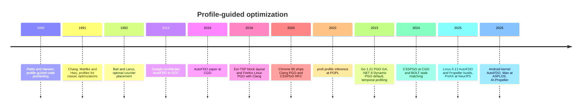

---
tags:
  - compilers
  - profile-guided-optimization
  - pgo
  - fdo
  - autofdo
  - code-layout
  - inlining
  - llvm
  - gcc
status: complete
sources:
  - https://lists.llvm.org/pipermail/cfe-commits/Week-of-Mon-20231127/523141.html
  - https://rocm.docs.amd.com/projects/llvm-project/en/docs-7.2.4/LLVM/clang/html/SourceBasedCodeCoverage.html
  - https://llvm.org/docs/CommandGuide/llvm-profdata.html
  - https://llvm.org/docs/InstrProfileFormat.html
  - https://llvm.org/docs/BranchWeightMetadata.html
  - https://llvm.org/doxygen/SpillPlacement_8cpp_source.html
  - https://llvm.org/doxygen/MachineFunctionSplitter_8cpp_source.html
  - https://llvm.org/docs/doxygen/IndirectCallPromotion_8cpp_source.html
  - https://llvm.googlesource.com/llvm-project/+/refs/heads/main/llvm/lib/Analysis/InlineCost.cpp
  - https://rocm.docs.amd.com/projects/llvm-project/en/docs-7.2.2/LLVM/llvm/html/HowToBuildWithPGO.html
  - https://www.kernel.org/doc/html/latest/dev-tools/autofdo.html
  - https://android.googlesource.com/platform/system/extras/+/b87b1e619739159edcf4363927204f5bff6a2775/simpleperf/doc/collect_lbr_data_for_autofdo.md
  - https://discourse.llvm.org/t/optimizing-the-linux-kernel-with-autofdo-including-thinlto-and-propeller/79108
  - https://research.google/pubs/pub45290/
  - https://research.google/pubs/propeller-a-profile-guided-relinking-optimizer-for-warehouse-scale-applications/
  - https://lists.llvm.org/pipermail/llvm-dev/2020-August/144101.html
  - https://htyu.github.io/paper/Revamping_Sampling_based_PGO_with_Context_sensitivity_and_Pseudo_instrumentation_preprint.pdf
  - https://research.facebook.com/file/613161556496734/Profile-Inference-Revisited.pdf
  - https://arxiv.org/pdf/1809.04676
  - https://www.doi.org/10.1145/989393.989433
  - https://api.crossref.org/works/10.1002%2FSPE.4380211204
  - https://infoscience.epfl.ch/record/192916?ln=en
  - https://www.cs.cornell.edu/courses/cs6120/2019fa/blog/profile-guided-code-layout
  - https://discourse.llvm.org/t/rfc-temporal-profiling-extension-for-irpgo/68068
  - https://llvm.org/devmtg/2024-04/slides/TechnicalTalks/Hoag-TemporalProfiling-and-OrderfileOptimization-forMobileApps.pdf
  - https://lists.llvm.org/pipermail/llvm-commits/Week-of-Mon-20250203/1560571.html
  - https://arxiv.org/abs/2401.17168v1
  - https://api.crossref.org/works/10.1145%2F3779212.3790248
  - https://blog.chameleoncloud.org/posts/wax-optimizing-data-center-applications-with-stale-profile
  - https://go.dev/doc/pgo
  - https://go.dev/doc/go1.21
  - https://go.dev/blog/go1.21
  - https://go.dev/doc/go1.22
  - https://www.uber.com/en-KW/blog/automating-efficiency-of-go-programs-with-pgo
  - https://blog.cloudflare.com/reclaiming-cpu-for-free-with-pgo/
  - https://doc.rust-lang.org/rustc/profile-guided-optimization.html
  - https://learn.microsoft.com/cpp/build/profile-guided-optimizations
  - https://gcc.gnu.org/onlinedocs/gcc/Optimize-Options.html
  - https://gcc.gnu.org/gcc-16/changes.html
  - https://gcc.gnu.org/pipermail/gcc/2026-April/247990.html
  - https://conf.gnu-tools-cauldron.org/opo25/talk/YV7F3H/
  - https://learn.microsoft.com/en-ca/dotnet/Core/whats-new/dotnet-8/runtime
  - https://devclass.com/2023/09/18/most-valuable-change-in-net-8-dynamic-optimization-on-by-default-says-microsoft
  - https://devblogs.microsoft.com/dotnet/bing-on-dotnet-8-the-impact-of-dynamic-pgo/
  - https://blog.chromium.org/2020/08/chrome-just-got-faster-with-profile.html
  - https://glandium.org/blog/?p=3888
  - https://mail.python.org/pipermail/python-dev/2015-August/141310.html
  - https://docs.python.org/3/using/configure.html
  - https://android-developers.googleblog.com/2026/03/BoostingAndroid%20PerformanceIntroducingAutoFDO.html?hl=mk
  - https://releases.llvm.org/22.1.0/docs/ReleaseNotes.html
  - https://releases.llvm.org/23.1.0/docs/ReleaseNotes.html
  - https://releases.llvm.org/23.1.0/tools/clang/docs/ReleaseNotes.html
  - https://www.llvm.org/devmtg/2025-10
  - https://lists.llvm.org/pipermail/llvm-commits/Week-of-Mon-20240715/1407227.html
  - https://www.llvm.org/devmtg/2026-01/slides/apgo_cgo_workshop.pdf
  - https://pldi26.sigplan.org/details/LCTES-2026-main/15/Empirical-Observations-about-Profile-Guided-Optimizations-for-Mainstream-C-C-Compil
  - https://arxiv.org/abs/2507.16649v1
  - https://arxiv.org/abs/2112.14679v2
  - https://arxiv.org/pdf/2202.06728
  - https://neurips.cc/media/neurips-2025/Slides/119293.pdf
  - https://research.google/pubs/ai-propeller-warehouse-scale-inter-procedural-code-layout-optimization-with-alphaevolve/
  - https://fosdem.org/schedule/event/fosdem-2025-4109-profile-guided-optimization-pgo-in-llvm-current-challenges-from-the-adopter-perspective
created: 2026-11-26
updated: 2026-11-28
---

## Table Of Contents

- [[#TL;DR|TL;DR]]
- [[#The Problem|The Problem]]
- [[#Foundations|Foundations]]
    - [[#What a Profile Contains|What a Profile Contains]]
    - [[#Frequencies, Probabilities and Flow|Frequencies, Probabilities and Flow]]
    - [[#Which Optimizations Consume Profiles|Which Optimizations Consume Profiles]]
- [[#How We Got Here|How We Got Here]]
- [[#How It Works|How It Works]]
    - [[#Instrumented PGO in Clang|Instrumented PGO in Clang]]
    - [[#Sampled PGO with AutoFDO|Sampled PGO with AutoFDO]]
    - [[#CSSPGO and Pseudo-Probes|CSSPGO and Pseudo-Probes]]
    - [[#Profile Inference|Profile Inference]]
    - [[#Worked Example|Worked Example]]
    - [[#Indirect Call Promotion|Indirect Call Promotion]]
    - [[#Temporal Profiling and Startup Ordering|Temporal Profiling and Startup Ordering]]
    - [[#Stale Profiles and Matching|Stale Profiles and Matching]]
    - [[#PGO in Other Toolchains|PGO in Other Toolchains]]
- [[#Where It Is Now|Where It Is Now]]
    - [[#Measured Gains|Measured Gains]]
    - [[#Toolchain Releases|Toolchain Releases]]
    - [[#Hyperscalers and Platforms|Hyperscalers and Platforms]]
    - [[#Research|Research]]
- [[#Trade-offs & Open Problems|Trade-offs & Open Problems]]
- [[#Resources|Resources]]
- [[#Related Notes|Related Notes]]

## ***TL;DR***
---
*A compiler guesses which code is hot; profile-guided optimization (PGO, also called FDO) replaces those guesses with measured counts from real runs. The same passes then make different, better decisions about inlining, layout, splitting, spills and devirtualization, typically worth a few percent to over 10% on large, branchy programs.*

- **What a profile says.** Block and edge counts (so branch probabilities), call counts, function entry counts, and *value profiles* such as the targets of indirect calls and the sizes passed to `memcpy`. In LLVM these become `!prof` metadata (`branch_weights`, `function_entry_count`) on the IR ([LLVM BranchWeightMetadata](https://llvm.org/docs/BranchWeightMetadata.html)).
- **Two ways to get one.** *Instrumented* PGO builds a special binary with counters (`clang -fprofile-generate`, run, `llvm-profdata merge`, `clang -fprofile-use`): exact, but the training build is slow (73% overhead on HHVM in Meta's measurement). *Sampled* PGO (AutoFDO) maps hardware branch samples from `perf` on ordinary production binaries back to source; it reached 85% of instrumented gains at Google ([Chen et al., CGO 2016](https://research.google/pubs/pub45290/)), and Meta's CSSPGO closes most of the remaining gap with pseudo-probes ([He et al., CGO 2024](https://htyu.github.io/paper/Revamping_Sampling_based_PGO_with_Context_sensitivity_and_Pseudo_instrumentation_preprint.pdf)).
- **Who uses it.** Chrome (up to 10% faster page loads), CPython's `--enable-optimizations`, the Linux kernel (AutoFDO and Propeller since 6.13), Go (on by default with a `default.pgo` file since 1.21, 2 to 14% gains), .NET (Dynamic PGO on by default since .NET 8, about 15% on average), and over 75% of Meta's data-center cycles.
- **The hard parts are operational.** Profiles go stale as code changes, training runs may not match production, and builds become non-reproducible. Stale-profile matching (BOLT, LLVM's sample loader, Wax at ASPLOS 2026) recovers most of the benefit from old profiles.
- **As of November 2026:** the action is in sampled and post-link PGO on Arm (SPE, ETE, BRBE support in LLVM 23, GCC 16 and the Android kernel), stale-profile matching, and learned profile inference and layout (ProfiX at NeurIPS 2025, AI-Propeller in 2026). Post-link layout itself (BOLT, Propeller) is covered in [[Linking and LTO]], and the layout algorithms in [[Code Layout]].

## ***The Problem***
---
*Every optimizer constantly trades one path against another, and without data it must assume all paths are equally likely. Most of those trades are only profitable if you know which side is hot.*

Inlining a call makes that call site faster and the function bigger; worth it only if the call runs often. Putting block B right after A makes the A→B branch a free fall-through and every other successor of A a taken jump; worth it only if A→B is the common edge. Spilling a register in a loop body is cheap if the loop is cold and ruinous if it is hot. A static compiler sees none of this. It falls back on heuristics: loops iterate several times, `if (p == NULL)` is unlikely, error paths are cold. Raman and Li measured how far that gets you on Google's code: across more than 7 million branches, LLVM's heuristics labelled many branches unbiased, but "of branches the LLVM heuristics label unbiased, only 7% are actually unbiased" ([Raman & Li, 2022](https://arxiv.org/pdf/2202.06728)).

Programmers can annotate (`__builtin_expect`, `[[likely]]`), and these lower to the same branch weights a profile would produce ([LLVM BranchWeightMetadata](https://llvm.org/docs/BranchWeightMetadata.html)), but nobody annotates a million-line codebase, and annotations rot. PGO's promise is that the program tells the compiler where its time goes. The cost is a second build input (the profile) that has to be collected, stored, kept fresh and matched to code that keeps changing.

## ***Foundations***
---
*A profile is a set of counts attached to the program's structure; the compiler turns them into probabilities and frequencies, and nearly every heuristic pass reads those numbers.*

### What a Profile Contains

*Four kinds of information, each feeding different passes.*

| Kind | What is recorded | Main consumers |
|---|---|---|
| **Block and edge counts** | How often each basic block ran and which way each branch went | Block layout, hot/cold splitting, spill placement, loop unrolling and peeling, size vs speed choices |
| **Call and entry counts** | How often each call site and each function ran (`function_entry_count`) | Inlining, function ordering, function-level hot/cold sections, ThinLTO import |
| **Value profiles** | The most common values at chosen sites: indirect-call targets, vtables, `memcpy`/`memset` sizes | Indirect call promotion and devirtualization, memory-intrinsic specialization |
| **Context and time** | Counts split by calling context (CSSPGO, CS-IRPGO); first-execution timestamps (temporal profiling) | Context-aware inlining; startup function ordering |

In LLVM's instrumented format, each function's record holds its counters, a `FuncHash` ("a checksum of the function's IR, taking control flow graph and instrumented value sites into account") and value-profile records; for indirect calls the raw profile stores callee addresses that `llvm-profdata` maps back to function names, and vtable addresses are stored with name hashes for type profiling ([LLVM InstrProfileFormat](https://llvm.org/docs/InstrProfileFormat.html)). The FuncHash is why you cannot reuse an instrumented profile after editing a function: the hash no longer matches.

### Frequencies, Probabilities and Flow

*Counts become probabilities on edges and relative frequencies on blocks, and flow conservation lets the compiler infer counts it never measured.*

For a conditional branch with profile weights $w_T$ and $w_F$:

$$
P(\text{taken}) = \frac{w_T}{w_T + w_F}, \qquad \text{freq}(B) = \sum_{(A \to B)} \text{freq}(A)\, P(A \to B)
$$

**In plain English:** a branch's probability is its share of the counts, and a block is as hot as the sum of its incoming edges, each weighted by how hot its source is and how often that edge is chosen.

Counts must also obey *flow conservation*: everything that enters a block leaves it.

$$
\text{count}(B) = \sum_{e \in \text{in}(B)} \text{count}(e) = \sum_{e \in \text{out}(B)} \text{count}(e)
$$

**In plain English:** if a block ran 100 times, its incoming edges together ran 100 times and so did its outgoing edges. So if you know some edge counts you can compute the rest.

Two consequences matter. First, instrumentation does not need a counter on every edge. Treat the CFG as a graph with an extra exit-to-entry edge; the counts on the edges of any spanning tree are determined by the counts on the remaining $|E| - |V| + 1$ edges, so only those need counters, and the choice of which edges get them can favour cold ones. Ball and Larus built this into an algorithm that, per their abstract, "halves the number of counters" and cuts counter increments by up to four times ([Ball & Larus, 1992](https://infoscience.epfl.ch/record/192916?ln=en)). Second, sampled profiles violate conservation (samples are noisy and some blocks get none), so the compiler must *infer* a consistent set of counts; see [[#Profile Inference|Profile Inference]] below.

### Which Optimizations Consume Profiles

*Most of the gain comes from a handful of decisions that are all "spend code size or registers where the time is".*

| Optimization | What the profile changes | Example source |
|---|---|---|
| **Inlining** | Hot call sites get a higher size threshold, cold ones a lower one | LLVM `InlineCost` reads `HotCallSiteThreshold`, `ColdCallSiteThreshold` and profile summary hotness ([InlineCost.cpp](https://llvm.googlesource.com/llvm-project/+/refs/heads/main/llvm/lib/Analysis/InlineCost.cpp)); MSVC inlines a small B into A "if function A frequently calls function B" ([MSVC docs](https://learn.microsoft.com/cpp/build/profile-guided-optimizations)) |
| **Block layout** | Hot successor becomes the fall-through; cold blocks sink | Pettis and Hansen (PLDI 1990); Ext-TSP ([Newell & Pupyrev](https://arxiv.org/pdf/1809.04676)) |
| **Hot/cold splitting** | Never-run blocks move to a separate section | LLVM's MachineFunctionSplitter "splits out cold machine basic blocks from the parent function" ([source](https://llvm.org/doxygen/MachineFunctionSplitter_8cpp_source.html)); GCC `-freorder-blocks-and-partition` ([GCC](https://gcc.gnu.org/onlinedocs/gcc/Optimize-Options.html)) |
| **Register allocation** | Spills and splits go where block frequency is lowest | LLVM's spill placement weights constraints "by the block frequency" in a Hopfield-network model ([SpillPlacement.cpp](https://llvm.org/doxygen/SpillPlacement_8cpp_source.html)); see [[Register Allocation]] |
| **Indirect call promotion** | Hot indirect call becomes a guarded direct call that can be inlined | LLVM's pass "promotes indirect calls to conditional direct calls when the indirect-call value profile metadata is available" ([source](https://llvm.org/docs/doxygen/IndirectCallPromotion_8cpp_source.html)) |
| **Loop transforms** | Unroll, peel, unswitch and vectorize hot loops; leave cold ones small | GCC's `-fprofile-use` turns on `-funroll-loops`, `-fpeel-loops`, `-funswitch-loops`, `-ftree-loop-vectorize` and more ([GCC](https://gcc.gnu.org/onlinedocs/gcc/Optimize-Options.html)); see [[Loop Optimizations]] |
| **Size vs speed** | Cold functions are optimized for size, hot ones for speed | MSVC: "Functions where the program spends the most execution time can be optimized for speed" ([MSVC docs](https://learn.microsoft.com/cpp/build/profile-guided-optimizations)) |
| **Function ordering** | Hot or co-executed functions are placed together | GCC `-fprofile-reorder-functions`; LLVM temporal profiling; post-link in [[Linking and LTO]] |

## ***How We Got Here***
---
*PGO is older than most of the optimizations it guides. The ideas (counted edges, chained layouts, profile-assisted classic passes) date from 1990 to 1992; the last decade made profiles cheap to collect from production and robust to code changes.*



| Year | Event | Why it mattered |
|---|---|---|
| 1990 | Pettis and Hansen, "Profile guided code positioning" ([PLDI '90](https://www.doi.org/10.1145/989393.989433)) | Greedy chain merging of blocks and procedures by edge weight; still the template for layout ([CS 6120 explainer](https://www.cs.cornell.edu/courses/cs6120/2019fa/blog/profile-guided-code-layout)) |
| 1991 | Chang, Mahlke, Hwu, "Using profile information to assist classic code optimizations" ([SP&E 21(12)](https://api.crossref.org/works/10.1002%2FSPE.4380211204)) | IMPACT showed profiles help ordinary passes, not just layout |
| 1992 | Ball and Larus, "Optimally profiling and tracing programs" ([EPFL record](https://infoscience.epfl.ch/record/192916?ln=en)) | Cheap edge profiling via counter placement |
| 2014 | Google contributes AutoFDO to GCC ([Cauldron 2025 abstract](https://conf.gnu-tools-cauldron.org/opo25/talk/YV7F3H/)) | Sampled profiles from `perf` instead of training builds |
| 2016 | AutoFDO paper: 10.5% geomean, 85% of FDO's gain, FDO users up 8x at Google ([CGO 2016](https://research.google/pubs/pub45290/)) | Made PGO a fleet-wide default rather than a specialist tool |
| 2018 | Ext-TSP ([Newell & Pupyrev](https://arxiv.org/pdf/1809.04676)); Firefox Linux builds get Clang LTO and PGO ([Hommey](https://glandium.org/blog/?p=3888)) | Better layout objective; PGO in a major open-source browser on Linux |
| 2020 | Chrome M85 ships PGO with Clang on Windows and Mac (first shipped in M53 on Windows with MSVC) ([Chromium blog](https://blog.chromium.org/2020/08/chrome-just-got-faster-with-profile.html)); CSSPGO RFC ([llvm-dev](https://lists.llvm.org/pipermail/llvm-dev/2020-August/144101.html)) | PGO at browser scale; start of pseudo-probe sampling |
| 2022 | Profile inference revisited, *profi* ([POPL 2022](https://research.facebook.com/file/613161556496734/Profile-Inference-Revisited.pdf)) | Consistent counts from noisy samples, in LLVM |
| 2023 | Go 1.21 makes PGO generally available with `default.pgo` ([Go 1.21](https://go.dev/doc/go1.21)); .NET 8 turns Dynamic PGO on ([.NET 8](https://learn.microsoft.com/en-ca/dotnet/Core/whats-new/dotnet-8/runtime)); temporal profiling RFC ([Discourse](https://discourse.llvm.org/t/rfc-temporal-profiling-extension-for-irpgo/68068)) | PGO becomes a default in mainstream managed and garbage-collected languages |
| 2024 | CSSPGO paper; BOLT stale matching ([arXiv 2401.17168](https://arxiv.org/abs/2401.17168v1)) | Sampling closes on instrumentation; old profiles stay useful |
| 2025 | Linux 6.13 adds AutoFDO and Propeller builds (see [[Linking and LTO]]) | PGO for the kernel itself |
| 2026 | Android kernel AutoFDO ([Android blog](https://android-developers.googleblog.com/2026/03/BoostingAndroid%20PerformanceIntroducingAutoFDO.html?hl=mk)); Wax ([ASPLOS 2026](https://api.crossref.org/works/10.1145%2F3779212.3790248)) | Lab-synthesized profiles; source-aware stale matching |

## ***How It Works***
---
*Collect counts (by counters or by sampling), turn them into a consistent annotated IR, then let the ordinary passes read the annotations. Each collection method trades accuracy, overhead and operational effort differently.*

### Instrumented PGO in Clang

*Build with counters, run representative inputs, merge the raw files into an indexed profile, rebuild with it.*

Clang offers two instrumentation flavours. "Frontend-based instrumentation can be enabled with the option `-fprofile-instr-generate`, and IR-based instrumentation can be enabled with the option `-fprofile-generate`. For best performance with PGO, IR-based instrumentation should be used." IR instrumentation has "lower instrumentation overhead, smaller raw profile size, and better runtime performance"; frontend instrumentation keeps "better source correlation" and is what source-based coverage uses. The two profile kinds are not interchangeable and there is no converter ([Clang docs patch, 2023](https://lists.llvm.org/pipermail/cfe-commits/Week-of-Mon-20231127/523141.html)).

A typical sequence (assembled from the Clang, `llvm-profdata` and coverage docs; not run for this note):

```bash
# 1. Instrumented build: IR-level counters, raw output default_%m.profraw
clang -O2 -fprofile-generate app.c -o app.instr

# 2. Training runs; name files per process so parallel runs don't clobber
LLVM_PROFILE_FILE="prof/app-%p-%m.profraw" ./app.instr < train1.txt
LLVM_PROFILE_FILE="prof/app-%p-%m.profraw" ./app.instr < train2.txt

# 3. Merge raw profiles into one indexed profile (optionally weight inputs)
llvm-profdata merge -o app.profdata prof/*.profraw
llvm-profdata show --topn=10 app.profdata      # sanity check: hottest functions

# 4. Optimized build with the same flags as step 1, plus the profile
clang -O2 -fprofile-use=app.profdata app.c -o app
```

Details that bite in practice:

- **File patterns.** `%p` expands to the process ID, `%h` to the host name, `%Nm` to the binary's signature, `%b` to its build ID, and `%c` turns on continuous syncing of counters to the file ([Clang coverage docs](https://rocm.docs.amd.com/projects/llvm-project/en/docs-7.2.4/LLVM/clang/html/SourceBasedCodeCoverage.html)).
- **Merging.** Raw profiles are a version-specific memory dump; only the *indexed* format (an on-disk hash table keyed by function) is stable, so `llvm-profdata merge` is required even for one run ([InstrProfileFormat](https://llvm.org/docs/InstrProfileFormat.html)). `--weighted-input=<weight,file>` scales one training scenario relative to others, `--sparse` drops zero-count functions, and `llvm-profdata overlap` reports how similar two profiles are as a percentage ([llvm-profdata](https://llvm.org/docs/CommandGuide/llvm-profdata.html)).
- **Threads.** Counters are plain increments by default; `-fprofile-update=atomic` makes them atomic, and in Clang 23 it "will now promote counter updates out of loops, similar to the non-atomic case" ([Clang 23 notes](https://releases.llvm.org/23.1.0/tools/clang/docs/ReleaseNotes.html)).
- **Context-sensitive IRPGO.** `-fcs-profile-generate` uses the same counters but "performs a post-inline late instrumentation and can produce context-sensitive profiles" ([Clang docs patch](https://lists.llvm.org/pipermail/cfe-commits/Week-of-Mon-20231127/523141.html)): a second instrumented build, already optimized with the first profile, records counts per inlined copy.
- **Self-hosting.** LLVM documents a PGO build of Clang itself (`-DLLVM_BUILD_INSTRUMENTED=IR`, train on `check-clang`, `check-llvm` and a full build), noting users report it "can decrease overall compile time by 20%" ([HowToBuildWithPGO](https://rocm.docs.amd.com/projects/llvm-project/en/docs-7.2.2/LLVM/llvm/html/HowToBuildWithPGO.html)).

The weakness is cost. Meta measured instrumentation-based PGO's profiling overhead on HHVM at 73.06%, against 0.04% for pseudo-probe sampling ([He et al., CGO 2024, Table I](https://htyu.github.io/paper/Revamping_Sampling_based_PGO_with_Context_sensitivity_and_Pseudo_instrumentation_preprint.pdf)). You cannot ship that to production, so the profile comes from a training workload, which may not look like production.

### Sampled PGO with AutoFDO

*Profile the real optimized binary with hardware branch records, map samples back to source lines through debug info, and feed that to the next build.*

AutoFDO uses the CPU's last-branch record (LBR on Intel, BRS or `amd_lbr_v2` on AMD Zen 3 and 4, SPE or ETM on Arm) to capture the last few taken branches at each sample. From branch pairs it reconstructs which address ranges executed (fall-through runs between branches), and the debug line table maps addresses to source lines and discriminators. The Linux kernel's guide gives the full flow ([kernel AutoFDO docs](https://www.kernel.org/doc/html/latest/dev-tools/autofdo.html)); adapted to a user-space binary with the event and period from Android's guide ([simpleperf doc](https://android.googlesource.com/platform/system/extras/+/b87b1e619739159edcf4363927204f5bff6a2775/simpleperf/doc/collect_lbr_data_for_autofdo.md)):

```bash
# Sample taken branches with branch stacks (-b) on the production binary
perf record -e BR_INST_RETIRED.NEAR_TAKEN:u -b -c 100003 -o perf.data -- ./app ...

# Convert samples + debug info into an LLVM sample profile
create_llvm_prof --binary=./app --profile=perf.data --format=extbinary --out=app.prof

# Next build of the (possibly newer) source consumes it
clang -O2 -g -fprofile-sample-use=app.prof app.c -o app
```

Several profiles can be combined with `llvm-profdata merge` (`--sample`), and the kernel's equivalent flags are `CONFIG_AUTOFDO_CLANG=y` and `make LLVM=1 CLANG_AUTOFDO_PROFILE=<profile>` ([kernel docs](https://www.kernel.org/doc/html/latest/dev-tools/autofdo.html)).

The payoff is operational: no special build and no training workload, so profiles come from production continuously. Google's CGO 2016 paper reported a 10.5% geomean improvement, 85% of the gain of instrumented FDO, an 8x increase in FDO users, and "over half of CPU cycles" spent in some flavour of FDO-optimized binary ([Chen, Li, Moseley](https://research.google/pubs/pub45290/)). The weaknesses are imprecision and attribution: line tables are imperfectly maintained through optimization, and the profile for a function merges all of its callers.

### CSSPGO and Pseudo-Probes

*Replace debug-line correlation with stable probe IDs inserted early, and record calling context from stack samples.*

Meta's CSSPGO RFC named AutoFDO's bottleneck as "profile quality" and blamed two things: debug-info correlation and context insensitivity ([He, llvm-dev 2020](https://lists.llvm.org/pipermail/llvm-dev/2020-August/144101.html)). Its fixes:

- **Pseudo-probes.** Each basic block gets a probe, an intrinsic marked as touching only inaccessible memory, so it barely constrains optimization. Probes generate no machine instructions; their IDs go into a separate `.pseudo_probe` section that is not loaded at run time. They are inserted early in the pre-LTO pipeline, so they describe a stable CFG. Enable with `-fpseudo-probe-for-profiling` (named in [LLVM 22 notes](https://releases.llvm.org/22.1.0/docs/ReleaseNotes.html)).
- **Context.** A virtual unwinder in the new `llvm-profgen` tool turns stack samples into profiles keyed by call path, so a function inlined into two callers gets two different profiles (kernel form: `llvm-profgen --kernel --binary=<vmlinux> --perfdata=<perf_file> -o <profile_file>` ([kernel docs](https://www.kernel.org/doc/html/latest/dev-tools/autofdo.html))).

On SPEC2006 the RFC reported profile-quality error of 24.58% for AutoFDO, 15.70% for instrumented PGO and 16.21% for pseudo-instrumentation, and a 2.04% geomean speedup over AutoFDO. The CGO 2024 paper reports 1 to 5% over AutoFDO on five production server workloads, says CSSPGO "bridged over 60% of the performance gap" to instrumented PGO on HHVM, and that it now optimizes "over 75% of Meta's data center CPU cycles" ([He, Yu, Wang, Oh, CGO 2024](https://htyu.github.io/paper/Revamping_Sampling_based_PGO_with_Context_sensitivity_and_Pseudo_instrumentation_preprint.pdf)). The cost is metadata: the probe section averages about 25% of binary size, on disk only.

### Profile Inference

*Sampled counts are noisy and incomplete; the compiler solves a flow problem (or, recently, asks a model) to get counts that are consistent and close to the truth.*

Classical inference casts the CFG as a flow network and finds the minimum-cost flow that stays closest to the observed sample counts while obeying conservation. He, Mestre, Pupyrev, Wang and Yu showed that this misses a *connectivity* requirement (flow must reach every executed block from the entry), proved the connected version APX-hard, and built a heuristic solver, **profi**, now in LLVM's sample loader. On SPEC CPU 2017 it raised block-count overlap with ground truth from 90.78% to 93.85% and edge overlap from 83.8% to 90.1%, and improved PGO speedup on data-center workloads by up to 3.5% ([Profile Inference Revisited, POPL 2022](https://research.facebook.com/file/613161556496734/Profile-Inference-Revisited.pdf)).

Machine learning attacks two versions of the problem:

- **No profile at all.** Rotem and Cummins train a model to stand in for missing profile data, reporting "some gains over compiling without profile information" at negligible compile-time cost ([arXiv 2112.14679](https://arxiv.org/abs/2112.14679v2)). Raman and Li (Google) trained a neural network on more than 40 million static branches from datacenter code; it cut probability error by 20 to 50% versus LLVM's heuristics, gave about 1% geomean over `-O3` on 40 benchmarks, and recovered about 60% of a limited SamplePGO's improvement on Search ([arXiv 2202.06728](https://arxiv.org/pdf/2202.06728)).
- **A noisy profile.** ProfiX (NeurIPS 2025) uses a graph neural network over the CFG to reconstruct block frequencies from sampled counts; its slides report a MySQL PGO speedup of 12.1% versus 9.7% with profi-inferred profiles and 8.3% with raw samples ([ProfiX slides](https://neurips.cc/media/neurips-2025/Slides/119293.pdf)). See [[ML-Guided Optimization]].

### Worked Example

*A hand sketch (not real tool output) of one function whose inlining and layout change once a profile arrives.*

```c
int parse_line(const char *s) {
  if (s[0] == '#')                 // comment lines
    return handle_comment(s);
  return handle_record(s);         // data lines
}
```

Without a profile, LLVM's static heuristics see a byte comparison and have no strong opinion; both successors get similar weight, and both calls are judged by the default inline threshold. After training on a log with 98,765 data lines and 12 comment lines, `-fprofile-use` annotates the IR (metadata syntax from [BranchWeightMetadata](https://llvm.org/docs/BranchWeightMetadata.html)):

```llvm
define i32 @parse_line(ptr %s) !prof !0 {
entry:
  %c = load i8, ptr %s
  %is_comment = icmp eq i8 %c, 35          ; '#'
  br i1 %is_comment, label %comment, label %record, !prof !1
comment:                                   ; ran 12 times
  %r1 = call i32 @handle_comment(ptr %s)
  ret i32 %r1
record:                                    ; ran 98765 times
  %r2 = call i32 @handle_record(ptr %s)
  ret i32 %r2
}
!0 = !{!"function_entry_count", i64 98777}
!1 = !{!"branch_weights", i32 12, i32 98765}
```

Three decisions change:

1. **Inlining.** The `handle_record` call site is hot relative to the profile summary, so the inliner applies the higher hot-call-site threshold and inlines it; the `handle_comment` site is cold and gets the lower cold threshold, so it stays a call (the thresholds are `HotCallSiteThreshold` and `ColdCallSiteThreshold` in [InlineCost.cpp](https://llvm.googlesource.com/llvm-project/+/refs/heads/main/llvm/lib/Analysis/InlineCost.cpp)).
2. **Layout.** Block placement makes `%record` (now containing the inlined body) the fall-through of `entry` and moves `%comment` to the end.
3. **Splitting.** With instrumented profiles, a block counts as cold if it is below the profile summary's 99.995th percentile cutoff by default (`mfs-psi-cutoff=999950`); MachineFunctionSplitter can move such blocks into a separate cold section ([source](https://llvm.org/doxygen/MachineFunctionSplitter_8cpp_source.html)). Whether 12 executions qualifies depends on the whole program's count distribution.

Ext-TSP scores a layout by giving each edge of weight $w$ a value of $w$ if it falls through, $0.1\,w\,(1 - d/1024)$ for a forward jump of $d \le 1024$ bytes, $0.1\,w\,(1 - d/640)$ for a backward jump of $d \le 640$ bytes, and 0 otherwise ([Newell & Pupyrev](https://arxiv.org/pdf/1809.04676)). With illustrative distances:

| Layout | entry→record | entry→comment | Ext-TSP score |
|---|---|---|---|
| Source order: entry, comment, record (record 40 B away) | forward jump: $98765 \times 0.1 \times (1 - 40/1024) \approx 9{,}490$ | fall-through: $12$ | $\approx 9{,}502$ |
| Profile order: entry, record, ..., comment (comment split far away) | fall-through: $98{,}765$ | jump beyond 1024 B: $0$ | $98{,}765$ |

**In plain English:** Ext-TSP rewards making hot edges fall-throughs and keeping hot jumps short; the profile layout scores about ten times higher because the 98,765 common-case executions no longer take a branch and the hot path occupies fewer cache lines.

### Indirect Call Promotion

*Turn a hot indirect call into a compare against the likeliest target plus a direct call, which the inliner can then inline.*

Value profiling records the callee at each indirect call site (for C++ also the vtable). The promotion pass rewrites

```cpp
// before                     // after (sketch)
r = obj->area();              if (vptr_target == &Circle::area)
                                r = Circle::area(obj);   // direct, inlinable
                              else
                                r = obj->area();         // fallback
```

LLVM can compare either the function pointer or, when vtable profiling is enabled, the loaded vtable address ("comparing vtables with functions") ([IndirectCallPromotion.cpp](https://llvm.org/docs/doxygen/IndirectCallPromotion_8cpp_source.html)). MSVC calls the same thing *virtual call speculation* ([MSVC docs](https://learn.microsoft.com/cpp/build/profile-guided-optimizations)); Go's PGO devirtualizes interface calls "adding a concrete call to the most common callee" ([Go 1.21](https://go.dev/doc/go1.21)); JITs do it with inline caches and guarded devirtualization (see [[JIT Compilation]]).

### Temporal Profiling and Startup Ordering

*For startup, what matters is not how often a function runs but when it first runs; order functions by first use so startup touches fewer pages.*

Meta's temporal profiling extension to IR PGO stores "the timestamp for when the function was executed for the first time", and a trace is the functions of one run ordered by those timestamps ([RFC, 2023](https://discourse.llvm.org/t/rfc-temporal-profiling-extension-for-irpgo/68068)). It is enabled with `-pgo-temporal-instrumentation` and has been available since LLVM 17 ([Hoag, EuroLLVM 2024](https://llvm.org/devmtg/2024-04/slides/TechnicalTalks/Hoag-TemporalProfiling-and-OrderfileOptimization-forMobileApps.pdf)). `llvm-profdata order` then runs **balanced partitioning** (recursive bisection that keeps functions from the same traces together) to emit an order file "that reduces the number of page faults" ([llvm-profdata](https://llvm.org/docs/CommandGuide/llvm-profdata.html)); it can order a million functions in about 20 seconds. On large iOS apps the authors report 40% fewer startup page faults and a 0.8 to 3% smaller compressed size when the linker also groups similar functions for compression ([Hoag](https://llvm.org/devmtg/2024-04/slides/TechnicalTalks/Hoag-TemporalProfiling-and-OrderfileOptimization-forMobileApps.pdf)).

```bash
llvm-profdata order default.profdata -o app.order                 # Mach-O: -Wl,-order_file,app.order
ld.lld --bp-startup-sort=function --irpgo-profile=default.profdata  # ELF, in the linker
```

The ELF options landed in lld in February 2025: `--bp-startup-sort=function --irpgo-profile=<file>` orders by temporal profile and `--bp-compression-sort=[data|function|both]` groups similar sections for better LZ compression ([lld commit](https://lists.llvm.org/pipermail/llvm-commits/Week-of-Mon-20250203/1560571.html)). This is the startup cousin of the hot/cold function ordering covered in [[Linking and LTO]], and it targets page faults, so see [[Virtual Memory and Paging]].

### Stale Profiles and Matching

*Code changes between when a profile was collected and when it is used. The question is how much of the old profile can still be attached to the new code.*

- **Instrumented profiles** are keyed by function name and CFG hash; a changed function's hash mismatches and its profile is dropped (Rust's docs suggest `-Cllvm-args=-pgo-warn-missing-function` to notice) ([rustc book](https://doc.rust-lang.org/rustc/profile-guided-optimization.html)).
- **Sample profiles** are keyed by line offset within the function, so edits elsewhere are harmless. Go uses the same idea: matching uses "line offsets within functions", so edits outside a hot function and moving a function within a package usually survive, while edits inside a hot function or renames may not; failures are "graceful degradation" ([Go PGO guide](https://go.dev/doc/pgo)).
- **Fuzzy matching.** LLVM's sample loader can salvage stale profiles by aligning call-site *anchors* between the old profile and the new IR with a longest-common-subsequence match. A July 2024 patch extends this to renamed functions (a signature change alters the mangled name): functions present only in the new IR are compared with unused profiles by anchor similarity (twice the matched anchors over all anchors, threshold 80% by default), behind `--salvage-unused-profile`; on one large Meta service "90%+ of the found renaming pair is good" ([LLVM commit, Lei Wang](https://lists.llvm.org/pipermail/llvm-commits/Week-of-Mon-20240715/1407227.html)).
- **Binary-level matching.** Ayupov, Panchenko and Pupyrev's BOLT method hashes blocks and uses profile inference to fill gaps; it "recovers up to 0.8 of BOLT's maximum benefit" even when most of the profile is stale ([arXiv 2401.17168](https://arxiv.org/abs/2401.17168v1)).
- **Source-aware matching.** Wax (ASPLOS 2026) maps files, then lines (exact, then Levenshtein-fuzzy), then functions by name components, then blocks by instruction similarity. Applied with BOLT, it beats binary-level matching on every app reported, for example mysql 26.46% vs 18.60% speedup (fresh profile: 32.63%) and gcc 8.72% vs 3.90% (fresh: 11.72%) ([Chameleon blog](https://blog.chameleoncloud.org/posts/wax-optimizing-data-center-applications-with-stale-profile); [ASPLOS record](https://api.crossref.org/works/10.1145%2F3779212.3790248)).

The opposite failure, an *unrepresentative* profile, has a GCC knob: `-fprofile-partial-training` ignores profile feedback for functions the training never ran, "at the cost of significantly bigger code" ([GCC](https://gcc.gnu.org/onlinedocs/gcc/Optimize-Options.html)).

### PGO in Other Toolchains

*Same idea everywhere; the differences are who collects the profile and how it reaches the build.*

| Toolchain | Collect | Use | Notes |
|---|---|---|---|
| **GCC** | `-fprofile-generate` (instrumented) or `perf` + `create_gcov` (AutoFDO) | `-fprofile-use` / `-fauto-profile` | `-fprofile-use` also enables unrolling, peeling, `-ftracer`, value-profile transforms (`-fvpt`), IPA-CP cloning, loop vectorization and function reordering ([GCC](https://gcc.gnu.org/onlinedocs/gcc/Optimize-Options.html)) |
| **MSVC** | Compile `/GL`, link `/LTCG /GENPROFILE`; runs write `app!N.pgc`; `pgomgr` merges into `.pgd` | Link `/LTCG /USEPROFILE` | Optimizations listed include inlining, virtual call speculation, register allocation, block layout, dead and EH code separation ([MSVC docs](https://learn.microsoft.com/cpp/build/profile-guided-optimizations)) |
| **Go** | pprof CPU profile from production, e.g. `/debug/pprof/profile?seconds=30`; merge with `go tool pprof -proto a.pprof b.pprof > merged.pprof` | Commit as `default.pgo` in the main package; `go build` defaults to `-pgo=auto` | Inlining and devirtualization; Go 1.22 interleaves them ([Go 1.22](https://go.dev/doc/go1.22)); conservative by design to avoid fast/slow/fast "iterative instability" ([guide](https://go.dev/doc/pgo)) |
| **Rust** | `RUSTFLAGS="-Cprofile-generate=/tmp/pgo-data" cargo build --release --target=...` | `llvm-profdata merge`, then `-Cprofile-use=...merged.profdata` | `--target` keeps flags off build scripts; `cargo pgo build` / `cargo pgo optimize` automate it ([rustc book](https://doc.rust-lang.org/rustc/profile-guided-optimization.html)) |
| **CPython** | `./configure --enable-optimizations` runs `PROFILE_TASK` (default `-m test --pgo`) | Same build | Recommended with `--with-lto`; `--enable-bolt` is experimental ([Python docs](https://docs.python.org/3/using/configure.html)) |
| **.NET** | Tier-0 code carries extra instrumentation | Tier-1 recompilation | Dynamic PGO on by default in .NET 8 ([.NET 8](https://learn.microsoft.com/en-ca/dotnet/Core/whats-new/dotnet-8/runtime)) |

A Go example, straight from the guide's workflow:

```bash
curl -o cpu.pprof "http://localhost:6060/debug/pprof/profile?seconds=30"
cp cpu.pprof cmd/server/default.pgo     # commit it
go build ./cmd/server                   # -pgo=auto finds default.pgo
```

**JIT tiering is built-in PGO.** A tiered JIT runs cheap, instrumented code first, then recompiles hot methods using what it saw. .NET's Dynamic PGO instruments tier-0 code and uses the data at tier 1; Microsoft reports about 15% average improvement, with 23% of ~4600 benchmarks gaining 20% or more ([.NET 8](https://learn.microsoft.com/en-ca/dotnet/Core/whats-new/dotnet-8/runtime)). Stephen Toub called the one-character PR that enabled it possibly "the most valuable PR in all of .NET 8" ([DevClass](https://devclass.com/2023/09/18/most-valuable-change-in-net-8-dynamic-optimization-on-by-default-says-microsoft)). The JIT's advantage is that the profile always matches the running code and input; its cost is warm-up and the compile work itself: Bing's re-JIT queue exceeded 300,000 methods before the first query and two million after a few hours ([Bing on .NET 8](https://devblogs.microsoft.com/dotnet/bing-on-dotnet-8-the-impact-of-dynamic-pgo/)). See [[JIT Compilation]] and [[Deoptimization and Speculation]].

## ***Where It Is Now***
---
*As of November 2026, PGO is routine for browsers, language runtimes, compilers, kernels and hyperscale fleets. The frontier is making sampled profiles as good as instrumented ones on every architecture, keeping old profiles useful, and letting models fill in what profiles miss.*

### Measured Gains

*Primary numbers, each from the team that measured it. Baselines differ, so compare within rows, not across them.*

| Project | Gain | Baseline and source |
|---|---|---|
| Chrome M85 | Page loads up to 10% faster at the median; Speedometer 2.0 +11.4% (Windows), +7.7% (Mac) | Non-PGO Chrome ([Chromium blog, 2020](https://blog.chromium.org/2020/08/chrome-just-got-faster-with-profile.html)) |
| Firefox (Linux, 2018) | "more than 5%" on most Talos tests, up to 18% | Switching from GCC 6.4 with PGO to Clang 6 with LTO (Linux builds also kept PGO), so a compiler change, not PGO alone ([Hommey](https://glandium.org/blog/?p=3888)) |
| CPython (2015) | Up to 20% on some benchmarks (2.7), up to 22.94% (3.x), one regression of -2.79% | PGO vs non-PGO, measured by Alecsandru Patrascu (Intel) and quoted in Guido van Rossum's reply ([python-dev](https://mail.python.org/pipermail/python-dev/2015-August/141310.html)) |
| Go | 2 to 7% (Go 1.21); 2 to 14% (Go 1.22+); compiler built with PGO builds 2 to 4% faster | Same program without PGO ([Go 1.21 blog](https://go.dev/blog/go1.21); [Go 1.22](https://go.dev/doc/go1.22)) |
| Uber Go fleet | ~4% from inlining; 24,000 CPU cores saved across top services; several thousand services enrolled | Before and after enabling, March 2025 ([Uber](https://www.uber.com/en-KW/blog/automating-efficiency-of-go-programs-with-pgo)) |
| Cloudflare Go service | ~3.5% CPU (~97 cores) | Before and after, May 2024 ([Cloudflare](https://blog.cloudflare.com/reclaiming-cpu-for-free-with-pgo/)) |
| .NET 8 Dynamic PGO | ~15% average; Bing: 13% fewer CPU cycles per query, ~8% faster serving | .NET without Dynamic PGO ([.NET 8](https://learn.microsoft.com/en-ca/dotnet/Core/whats-new/dotnet-8/runtime); [Bing](https://devblogs.microsoft.com/dotnet/bing-on-dotnet-8-the-impact-of-dynamic-pgo/)) |
| Linux kernel | Google database 2.6% (AutoFDO) / 2.9% (instrumented); Meta service ~5% / ~6%; Neper tcp_rr latency 10.6% / 11.8%; on tcp_rr, ThinLTO plus Propeller add a further 4.5% on top of the AutoFDO build | Non-FDO kernel ([Xu & Shen, 2024](https://discourse.llvm.org/t/optimizing-the-linux-kernel-with-autofdo-including-thinlto-and-propeller/79108)) |
| Google AutoFDO | 10.5% geomean, 85% of instrumented FDO's gain | No FDO ([CGO 2016](https://research.google/pubs/pub45290/)) |
| Meta CSSPGO | 1 to 5% over AutoFDO | AutoFDO ([CGO 2024](https://htyu.github.io/paper/Revamping_Sampling_based_PGO_with_Context_sensitivity_and_Pseudo_instrumentation_preprint.pdf)) |
| Propeller | 1.1 to 8% beyond PGO and ThinLTO | PGO+ThinLTO ([ASPLOS 2023](https://research.google/pubs/propeller-a-profile-guided-relinking-optimizer-for-warehouse-scale-applications/)) |
| Android user space | ~4% cold app launch, ~1% boot time | Non-AutoFDO native code ([Android blog, 2026](https://android-developers.googleblog.com/2026/03/BoostingAndroid%20PerformanceIntroducingAutoFDO.html?hl=mk)) |

### Toolchain Releases

*Recent releases are mostly about sampling on Arm and on Windows, not new optimizations.*

- **LLVM 22.1** (24 February 2026): a profile-guided mode for the machine outliner (`-enable-machine-outliner` with optimistic and conservative PGO modes); `-fpseudo-probe-for-profiling` now supported for COFF and `llvm-profgen` decodes COFF pseudo-probes, bringing CSSPGO to Windows binaries; BOLT lite mode on AArch64 ([LLVM 22 notes](https://releases.llvm.org/22.1.0/docs/ReleaseNotes.html)).
- **LLVM 23.1** (25 August 2026): BOLT accepts AArch64 profiles from Arm SPE and branch-stack hardware such as BRBE; `llvm-profgen` decodes ETM traces through OpenCSD for Cortex-M; atomic profile counters are promoted out of loops ([LLVM 23 notes](https://releases.llvm.org/23.1.0/docs/ReleaseNotes.html); [Clang 23 notes](https://releases.llvm.org/23.1.0/tools/clang/docs/ReleaseNotes.html)).
- **GCC.** Jan Hubička's Cauldron 2025 talk covered making AutoFDO work with LTO and modernizing its infrastructure ([Cauldron 2025](https://conf.gnu-tools-cauldron.org/opo25/talk/YV7F3H/)). GCC 16 adds ARM SPE to `gcc-auto-profile` and "AutoFDO is now regularly tested on AArch64" ([GCC 16 changes](https://gcc.gnu.org/gcc-16/changes.html)). In April 2026 an NVIDIA engineer proposed an in-tree AutoFDO profile generator to "replace our current reliance on external Google tools which is not actively maintained" ([RFC](https://gcc.gnu.org/pipermail/gcc/2026-April/247990.html)).
- **LLVM Dev Meeting 2025** had PGO-adjacent talks on bare-metal PGO runtimes, tracking lost source locations (which hurt sample PGO), and a BOLT-on-AArch64 tutorial comparing it with AutoFDO and Propeller ([program](https://www.llvm.org/devmtg/2025-10)).

### Hyperscalers and Platforms

*The big users all moved to continuous, sampled, production profiles.*

- **Meta** optimizes over 75% of data-center CPU cycles with CSSPGO ([CGO 2024](https://htyu.github.io/paper/Revamping_Sampling_based_PGO_with_Context_sensitivity_and_Pseudo_instrumentation_preprint.pdf)).
- **Google** runs Propeller-optimized code on "over tens of millions of cores" at any time ([Propeller](https://research.google/pubs/propeller-a-profile-guided-relinking-optimizer-for-warehouse-scale-applications/)). AI-Propeller (2026) evolved Propeller's layout heuristic into an interprocedural one with AlphaEvolve, rewarded by hardware counters, for 0.23 to 1.6% over state-of-the-art FDO and post-link optimization ([Google Research](https://research.google/pubs/ai-propeller-warehouse-scale-inter-procedural-code-layout-optimization-with-alphaevolve/)).
- **Android** (March 2026) rolled out AutoFDO for the android16-6.12 and android15-6.6 kernels on aarch64. Profiles are synthesized in a lab on Pixel devices with Arm ETE and TRBE trace, running the top 100 apps; the lab workload is "85% similar" to fleet behaviour, and "this lab-based data delivers performance gains comparable to those from real-world fleets" ([Android blog](https://android-developers.googleblog.com/2026/03/BoostingAndroid%20PerformanceIntroducingAutoFDO.html?hl=mk)).
- **Uber** collects Go profiles daily and merges them fleet-wide; its first rollout made some builds up to 8x slower because pprof parsing took up to 95% of compile time, fixed with a preprocessing step ([Uber](https://www.uber.com/en-KW/blog/automating-efficiency-of-go-programs-with-pgo)).

### Research

*2025 and 2026 work concentrates on portability, staleness and learned inference.*

- **Wax** (ASPLOS 2026): source-aware stale-profile matching, above.
- **APGO** (LLVM-CGO workshop, January 2026): profile on x86, optimize for RISC-V and Arm. Over 90% of profile data points match across x86 and RISC-V; mismatched regions are reconstructed with LLM-generated formulas. It cut profiling time up to 32.78x and matched or beat native PGO on 48 of 54 SPEC CPU2006 workload-target pairs (vectorization disabled) ([slides](https://www.llvm.org/devmtg/2026-01/slides/apgo_cgo_workshop.pdf)).
- **ProfiX** (NeurIPS 2025): GNN profile inference, above.
- **Empirical study** (LCTES 2026, Pal and Kulkarni): first comprehensive comparison of GCC and Clang PGO on MiBench, reporting "some counter-intuitive" observations ([program](https://pldi26.sigplan.org/details/LCTES-2026-main/15/Empirical-Observations-about-Profile-Guided-Optimizations-for-Mainstream-C-C-Compil)).
- **Survey** (arXiv, July 2025): organizes PGO by collection method, optimization time, compiler and architecture ([Liu et al.](https://arxiv.org/abs/2507.16649v1)).
- **Adoption** remains the bottleneck: Alexander Zaitsev's FOSDEM 2025 talk lists documentation gaps, uneven integration across LLVM-based toolchains and low industry awareness ([FOSDEM 2025](https://fosdem.org/schedule/event/fosdem-2025-4109-profile-guided-optimization-pgo-in-llvm-current-challenges-from-the-adopter-perspective)).

## ***Trade-offs & Open Problems***
---
*PGO buys run-time speed with build complexity, a data pipeline and a reproducibility problem. Which flavour to use depends on whether you control production and how fast the code changes.*

| Choice | You get | You pay |
|---|---|---|
| Instrumented (IR) PGO | Exact counts, value profiles, temporal traces | Slow training build (73% overhead on HHVM); training may not match production; profile invalid after edits |
| Front-end instrumentation | Precise source mapping (coverage) | More overhead; worse for optimization |
| AutoFDO (sampled) | Production profiles, no special build | Debug-info dependence, context loss, needs LBR/SPE/ETM hardware |
| CSSPGO | Near-instrumented quality from sampling | Probe metadata (~25% of binary size on disk); stack sampling |
| Static or learned profiles | No collection at all | Roughly 1% over `-O3` in Google's study, well below real profiles |
| JIT online profiles | Always fresh, input-specific | Warm-up, compile cost at run time, re-JIT queues |
| Post-link layout (BOLT, Propeller) | Exact final layout | Another stage and profile; see [[Linking and LTO]] |

**Open problems.**

- **Representativeness.** A profile is a bet that the future looks like the past. Go's guide warns about "iterative stability" (build 1 fast, build 2 slow) ([Go PGO](https://go.dev/doc/pgo)); GCC's partial-training mode trades code size for safety against unrepresentative runs. Android's lab-synthesized profiles are a bet that a good lab beats noisy fleet data.
- **Staleness.** Every matching scheme leaves a gap: Wax recovers roughly 65 to 93% of a fresh profile's gain on its benchmarks, BOLT's matcher up to 0.8 of the maximum. Continuous profiling narrows the gap but makes the build depend on yesterday's traffic.
- **Reproducibility and debugging.** The binary now depends on a data file that changes daily. Bisecting a regression means pinning the profile too; a miscompile that appears only with a particular profile is hard to reduce (see [[Compiler Testing and Fuzzing]]).
- **Portability.** Sampling hardware differs by vendor (LBR, BRS, SPE, ETE, BRBE) and tool support lags; profiles do not transfer across architectures without work like APGO.
- **Profile-hungry heuristics.** Inlining and layout use hand-set thresholds over profile counts; learned policies ([[ML-Guided Optimization]]) and hardware-in-the-loop search (AI-Propeller) are replacing them gradually, with the usual questions of generalization.
- **Adoption.** Most software is still built without PGO, mainly because collecting and refreshing profiles is a pipeline, not a flag.

## ***Resources***
---
*Start with the Go PGO guide and the rustc book for the shortest end-to-end workflows, then read AutoFDO, CSSPGO and profi for how sampled PGO actually works, and the Ext-TSP paper for layout.*

**Primary papers**
- [Profile guided code positioning](https://www.doi.org/10.1145/989393.989433): Pettis and Hansen, PLDI 1990. Chain-based block and procedure layout.
- [Using profile information to assist classic code optimizations](https://api.crossref.org/works/10.1002%2FSPE.4380211204): Chang, Mahlke, Hwu, SP&E 1991.
- [Optimally profiling and tracing programs](https://infoscience.epfl.ch/record/192916?ln=en): Ball and Larus, 1992. Counter placement.
- [AutoFDO](https://research.google/pubs/pub45290/): Chen, Li, Moseley, CGO 2016. Sampled PGO at Google.
- [Improved Basic Block Reordering](https://arxiv.org/pdf/1809.04676): Newell and Pupyrev (Meta). Ext-TSP.
- [Profile Inference Revisited](https://research.facebook.com/file/613161556496734/Profile-Inference-Revisited.pdf): He, Mestre, Pupyrev, Wang, Yu, POPL 2022. profi.
- [Revamping Sampling-Based PGO with Context-Sensitivity and Pseudo-Instrumentation](https://htyu.github.io/paper/Revamping_Sampling_based_PGO_with_Context_sensitivity_and_Pseudo_instrumentation_preprint.pdf): He, Yu, Wang, Oh, CGO 2024. CSSPGO.
- [Propeller](https://research.google/pubs/propeller-a-profile-guided-relinking-optimizer-for-warehouse-scale-applications/): Shen et al., ASPLOS 2023.
- [Stale Profile Matching](https://arxiv.org/abs/2401.17168v1): Ayupov, Panchenko, Pupyrev, 2024. And [Wax](https://blog.chameleoncloud.org/posts/wax-optimizing-data-center-applications-with-stale-profile): Bhuiyan, Hoque, Moreira, Khan, ASPLOS 2026.
- [Learning Branch Probabilities in Compiler from Datacenter Workloads](https://arxiv.org/pdf/2202.06728): Raman and Li, 2022; [PGO without Profiles](https://arxiv.org/abs/2112.14679v2): Rotem and Cummins, 2021; [ProfiX](https://neurips.cc/media/neurips-2025/Slides/119293.pdf): Tan, Jiang, Shen, NeurIPS 2025.

**Docs**
- [Clang PGO flag documentation patch](https://lists.llvm.org/pipermail/cfe-commits/Week-of-Mon-20231127/523141.html), [llvm-profdata](https://llvm.org/docs/CommandGuide/llvm-profdata.html), [InstrProfileFormat](https://llvm.org/docs/InstrProfileFormat.html), [BranchWeightMetadata](https://llvm.org/docs/BranchWeightMetadata.html), [HowToBuildWithPGO](https://rocm.docs.amd.com/projects/llvm-project/en/docs-7.2.2/LLVM/llvm/html/HowToBuildWithPGO.html).
- [Kernel AutoFDO guide](https://www.kernel.org/doc/html/latest/dev-tools/autofdo.html); [GCC optimize options](https://gcc.gnu.org/onlinedocs/gcc/Optimize-Options.html); [MSVC PGO](https://learn.microsoft.com/cpp/build/profile-guided-optimizations).
- [Go PGO guide](https://go.dev/doc/pgo); [rustc PGO chapter](https://doc.rust-lang.org/rustc/profile-guided-optimization.html); [CPython configure options](https://docs.python.org/3/using/configure.html).

**Practitioners and talks**
- [CSSPGO RFC](https://lists.llvm.org/pipermail/llvm-dev/2020-August/144101.html) (He, 2020) and [temporal profiling RFC](https://discourse.llvm.org/t/rfc-temporal-profiling-extension-for-irpgo/68068) (Meta, 2023); [Hoag, EuroLLVM 2024](https://llvm.org/devmtg/2024-04/slides/TechnicalTalks/Hoag-TemporalProfiling-and-OrderfileOptimization-forMobileApps.pdf).
- [Optimizing the Linux kernel with AutoFDO, ThinLTO and Propeller](https://discourse.llvm.org/t/optimizing-the-linux-kernel-with-autofdo-including-thinlto-and-propeller/79108) (Xu and Shen, 2024).
- Production write-ups: [Uber Go PGO](https://www.uber.com/en-KW/blog/automating-efficiency-of-go-programs-with-pgo), [Cloudflare](https://blog.cloudflare.com/reclaiming-cpu-for-free-with-pgo/), [Bing on .NET 8](https://devblogs.microsoft.com/dotnet/bing-on-dotnet-8-the-impact-of-dynamic-pgo/), [Android kernel AutoFDO](https://android-developers.googleblog.com/2026/03/BoostingAndroid%20PerformanceIntroducingAutoFDO.html?hl=mk).
- [Zaitsev, PGO adoption challenges, FOSDEM 2025](https://fosdem.org/schedule/event/fosdem-2025-4109-profile-guided-optimization-pgo-in-llvm-current-challenges-from-the-adopter-perspective).

**Courses and surveys**
- [Profile-Guided Code Layout](https://www.cs.cornell.edu/courses/cs6120/2019fa/blog/profile-guided-code-layout): Cornell CS 6120 blog, 2019. Pettis-Hansen implemented on Bril.
- [From Profiling to Optimization](https://arxiv.org/abs/2507.16649v1): Liu et al., 2025 survey.

## Related Notes

- [[Code Layout]] — The block placement, splitting and function ordering algorithms that consume block and call counts.
- [[Linking and LTO]] — Post-link layout with BOLT and Propeller, and how PGO stacks with LTO; this note avoids repeating it.
- [[JIT Compilation]] — Tiered JITs as online PGO: inline caches, type feedback, Dynamic PGO.
- [[Deoptimization and Speculation]] — What a JIT does when a profile-based guess turns out wrong.
- [[ML-Guided Optimization]] — Learned inlining and layout policies, learned branch probabilities, AI-Propeller.
- [[Classic Optimizations]] — Inlining and the scalar passes whose decisions profiles steer.
- [[Loop Optimizations]] — Unrolling, peeling and unswitching that profiles turn on or off.
- [[Register Allocation]] — Spill placement weighted by block frequency.
- [[Instruction Scheduling]] — Planned: another backend pass whose choices block frequencies can steer.
- [[Compiler Pipeline]] — Where profile annotation and use sit in the pipeline.
- [[LLVM]] — `llvm-profdata`, `llvm-profgen`, the sample loader and branch-weight metadata.
- [[Virtual Memory and Paging]] — Page faults that startup function ordering reduces.
- [[Compiler Testing and Fuzzing]] — Profile-dependent miscompiles and reproducibility.
- [[Sampling Profilers and Safepoint Bias]] — How sampled profiles go wrong in JIT runtimes, and how `perf` names JIT code.
- [[Tiering Policies and Warm-up]] — When JITs collect profiles, and AOT caches that ship them from a training run.
