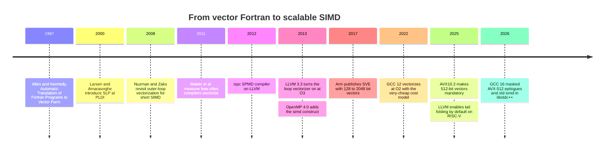

---
tags:
  - compilers
  - vectorization
  - simd
  - auto-vectorization
  - loop-optimization
  - llvm
  - gcc
status: complete
sources:
  - https://www.llvm.org/docs/Vectorizers.html
  - https://rocm.docs.amd.com/projects/llvm-project/en/docs-7.14.1/LLVM/llvm/html/VectorizationPlan.html
  - https://llvm.org/devmtg/2025-10/slides/technical_talks/hahn.pdf
  - https://llvm.org/docs/RISCV/RISCVVectorExtension.html
  - https://releases.llvm.org/22.1.0/docs/_sources/ReleaseNotes.md.txt
  - https://llvm.googlesource.com/llvm-project/+/707447159341f7b5678dee4f47731af50524b9ae
  - https://blog.llvm.org/2013/05/llvm-33-vectorization-improvements.html
  - https://gcc.gnu.org/gcc-16/changes.html
  - https://developer.arm.com/community/arm-community-blogs/b/tools-software-ides-blog/posts/gcc-15-continuously-improving
  - https://gcc.gnu.org/onlinedocs/gcc/Optimize-Options.html
  - https://gcc.gnu.org/onlinedocs/gcc-14.1.0/gcc/Optimize-Options.html
  - https://www.gnu.org/s/gcc/gcc-12/changes.html
  - https://commit.csail.mit.edu/papers/2000/SLP-PLDI-2000.pdf
  - https://researchr.org/publication/AllenK87
  - https://unpaywall.org/10.1145%2F1454115.1454119
  - https://www.microsoft.com/en-us/research/publication/an-evaluation-of-vectorizing-compilers
  - https://arxiv.org/html/2502.11906v1
  - https://arxiv.org/abs/1803.06185
  - https://developer.nvidia.com/blog/accelerating-nvidia-hpc-software-with-sve-on-aws-graviton3/
  - https://nvidia.github.io/grace-cpu-benchmarking-guide/developer/vectorization.html
  - https://cdrdv2-public.intel.com/849709/356368-003-intel-avx10-technical-paper.pdf
  - https://www.phoronix.com/news/LLVM-Clang-AVX10.2-Always-512
  - https://docs.riscv.org/reference/isa/unpriv/v-st-ext.html
  - https://www.open-std.org/JTC1/SC22/wg21/docs/papers/2025/p3691r1.pdf
  - https://isocpp.org/files/papers/P1928R15.pdf
  - https://gcc.gnu.org/pipermail/libstdc++-cvs/2026q1/044515.html
  - https://doc.rust-lang.org/std/simd/index.html
  - https://github.com/rust-lang/rust/issues/86656
  - https://blog.rust-lang.org/2025/08/07/Rust-1.89.0/
  - https://github.com/google/highway
  - https://llvm.org/pubs/2012-05-13-InPar-ispc.html
  - https://www-inf.telecom-sudparis.eu/COURS/CSC5001/Supports/Cours/OpenMP/OpenMP-4.0-C.pdf
created: 2026-11-26
updated: 2026-11-26
---

## Table Of Contents

- [[#TL;DR|TL;DR]]
- [[#The Problem|The Problem]]
- [[#Foundations|Foundations]]
    - [[#SIMD Hardware in One Table|SIMD Hardware in One Table]]
    - [[#Fixed vs Scalable Length, and Masks|Fixed vs Scalable Length, and Masks]]
    - [[#Dependences Set the Safe Width|Dependences Set the Safe Width]]
- [[#How We Got Here|How We Got Here]]
- [[#How It Works|How It Works]]
    - [[#Loop Vectorization Legality|Loop Vectorization Legality]]
    - [[#Reductions and Induction Variables|Reductions and Induction Variables]]
    - [[#Cost Model, VF and Interleaving|Cost Model, VF and Interleaving]]
    - [[#Tails, Epilogues and Masked Loops|Tails, Epilogues and Masked Loops]]
    - [[#VPlan|VPlan]]
    - [[#SLP Vectorization|SLP Vectorization]]
    - [[#Scalable Vectors in LLVM IR|Scalable Vectors in LLVM IR]]
    - [[#Worked Example, saxpy on Three Targets|Worked Example, saxpy on Three Targets]]
    - [[#Worked Example, Reductions|Worked Example, Reductions]]
    - [[#Worked Example, a Loop That Will Not Vectorize|Worked Example, a Loop That Will Not Vectorize]]
    - [[#Why Auto-Vectorization Fails and How to Help|Why Auto-Vectorization Fails and How to Help]]
    - [[#Explicit SIMD Programming Models|Explicit SIMD Programming Models]]
- [[#Where It Is Now|Where It Is Now]]
    - [[#LLVM|LLVM]]
    - [[#GCC 15 and 16|GCC 15 and 16]]
    - [[#Hardware, AVX10 and SVE in Practice|Hardware, AVX10 and SVE in Practice]]
    - [[#SIMD in the Languages|SIMD in the Languages]]
- [[#Trade-offs & Open Problems|Trade-offs & Open Problems]]
- [[#Resources|Resources]]
- [[#Related Notes|Related Notes]]

## ***TL;DR***
---
*Vectorization rewrites scalar code so one instruction works on several data elements at once (SIMD). Compilers do it automatically for loops (loop vectorization) and for groups of similar straight-line operations (SLP), but only when they can prove it is safe and estimate it is profitable.*

- **What it buys.** A 512-bit register holds 16 `float`s, so one `vfmadd` can do the work of 16 scalar multiply-adds. Memory-bound loops gain less than this, compute-bound loops more.
- **Two auto-vectorizers.** The *loop vectorizer* widens each instruction of an innermost loop by a *vectorization factor* (VF) and runs VF iterations at a time. The *SLP vectorizer* packs independent, isomorphic scalar operations, usually adjacent stores, into one vector operation ([Larsen & Amarasinghe, PLDI 2000](https://commit.csail.mit.edu/papers/2000/SLP-PLDI-2000.pdf); [LLVM docs](https://www.llvm.org/docs/Vectorizers.html)).
- **The legality wall.** Loop-carried dependences, possible pointer aliasing, floating-point reassociation, and control flow all block vectorization. Compilers answer with runtime alias checks, if-conversion to masks, and ordered or fast-math reductions.
- **Scalable vectors.** Arm SVE and RISC-V V leave the register width to the chip (SVE allows 128 to 2,048 bits) ([Stephens et al., 2017](https://arxiv.org/abs/1803.06185)). LLVM models this with types like `<vscale x 4 x i32>`, and predicates let one loop handle its own tail with no scalar epilogue.
- **It still often fails.** On the TSVC2 benchmark with unknown trip counts, GCC 14, Clang 18 and Intel ICX vectorized only 46 to 56% of 151 loops ([Sakib et al., 2025](https://arxiv.org/html/2502.11906v1)).
- **As of November 2026.** LLVM's loop vectorizer keeps moving into VPlan and folds tails by default on RISC-V (LLVM 22); GCC 16 adds masked AVX-512 epilogues and vectorizes uncounted loops; AVX10.2 makes 512-bit vectors mandatory; C++26 has `std::simd`; Rust's `std::simd` is still nightly-only.

## ***The Problem***
---
*CPUs gained wide vector units long ago, but ordinary code is written one element at a time. Something has to turn `for (i...) y[i] = a*x[i] + y[i]` into vector instructions, and that something must not change the program's meaning.*

A modern core can issue one or two 256-bit or 512-bit vector operations per cycle. Scalar code leaves most of that idle. Hand-writing vector code with intrinsics works but ties the code to one instruction set: SSE, AVX2, AVX-512, NEON, SVE and RVV each have their own registers, widths and quirks. The compiler is the natural place to do it, but it faces three questions on every loop. **Is it legal?** Running iterations 0 to 7 together is only correct if none reads what an earlier one in the group writes, and with C pointers the compiler often cannot tell (see [[Dataflow Analysis]], [[Loop Optimizations]]). **Is it profitable?** Gathers, shuffles, runtime checks and tails cost cycles; for short loops the vector version can be slower. **What about leftovers?** With `n = 1003` and VF = 8, three iterations remain for a scalar loop, a smaller vector loop, or masked lanes.

Decades of work have not made this reliable. Maleki et al. found that compilers vectorized 45 to 71% of loops in a synthetic benchmark and "only a few loops from the real applications" ([Maleki et al., PACT 2011](https://www.microsoft.com/en-us/research/publication/an-evaluation-of-vectorizing-compilers)), and the 2025 TSVC2 study above still shows roughly half.

## ***Foundations***
---
*Three ideas carry the rest of the note: what the vector hardware looks like, fixed vs scalable widths with masks for partial vectors, and dependence distance as the limit on how many iterations can run together.*

### SIMD Hardware in One Table

*Each family adds wider registers and, later, per-lane masks; the masks are what make compiler vectorization of real code practical.*

| ISA | Register width | Masking | Notes |
|---|---|---|---|
| **SSE to SSE4.2** (x86) | 128-bit `xmm` | None (blend instructions only) | Baseline for x86-64; `-O2` without `-march` targets SSE2 |
| **AVX, AVX2** (x86) | 256-bit `ymm` | None in general; `vmaskmov` loads and stores | AVX2 adds integer ops and gathers; FMA is a separate feature |
| **AVX-512** (x86) | 512-bit `zmm`, 32 registers | 8 mask registers `k0`–`k7` on almost every instruction | Many subsets (F, BW, VL, ...). AVX10 regroups them by version ([Intel AVX10 paper, 2025](https://cdrdv2-public.intel.com/849709/356368-003-intel-avx10-technical-paper.pdf)) |
| **NEON / Advanced SIMD** (Arm) | 128-bit | None | Every AArch64 core has it |
| **SVE, SVE2** (Arm) | 128 to 2,048 bits, chip's choice, in 128-bit steps | Predicate registers `p0`–`p15` | Vector-length agnostic code ([Stephens et al.](https://arxiv.org/abs/1803.06185)) |
| **RISC-V V 1.0** | `VLEN` bits, chip's choice | `v0` as mask; `vl` register limits the active length | `vsetvli` sets element width, grouping (LMUL) and length per strip ([RISC-V V spec](https://docs.riscv.org/reference/isa/unpriv/v-st-ext.html)) |

### Fixed vs Scalable Length, and Masks

*Fixed-width ISAs bake the width into each instruction; scalable ones let the same binary run at any width. Masks turn "some lanes should not run" from a branch into data.*

With SSE or AVX2, a loop compiled for 8 floats per iteration uses 8 floats forever; using AVX-512 means recompiling. SVE code instead asks the hardware how many lanes it has (`cntw` counts 32-bit lanes) and advances by that amount. The same instructions run on 256-bit SVE in AWS Graviton3 ([NVIDIA](https://developer.nvidia.com/blog/accelerating-nvidia-hpc-software-with-sve-on-aws-graviton3/)) and on 128-bit SVE2 in NVIDIA Grace ([NVIDIA Grace guide](https://nvidia.github.io/grace-cpu-benchmarking-guide/developer/vectorization.html)). RVV goes further: `vsetvli` returns how many elements this strip will process, so a loop never needs to know the width at all. The price is that the compiler cannot treat the width as a constant, which needs new IR types ([[#Scalable Vectors in LLVM IR|below]]).

**Masks** (per-lane on/off bits) serve three jobs. **If-conversion**: `if (b[i] > 0) a[i] = 2*b[i]` becomes a compare that writes a mask plus a masked store. **Tails**: the last partial vector runs with only the first `n mod VF` lanes on. **Speculation**: SVE's first-faulting loads let a loop with an early exit load past the end safely. AVX-512 and SVE mask almost every instruction; SSE, AVX2 and NEON don't, so the compiler must emulate with blends or fall back to scalar code.

### Dependences Set the Safe Width

*If iteration i writes what iteration i+d reads, at most d iterations can run in lockstep.*

For `a[i+4] = a[i] + 1`, iteration `i` writes `a[i+4]`, which iteration `i+4` reads. The dependence distance is 4. Doing iterations 0..3 together is fine (they read `a[0..3]`, write `a[4..7]`), but 0..7 together would read `a[4..7]` before they're written.

$$
\text{VF}_{\max} = \min_{\text{true deps } d} \text{distance}(d)
$$

**In plain English:** the largest legal vector width is the smallest distance of any forward-carried read-after-write dependence. Clang 18 confirms this: with `-mavx512f`, which could fit 16 `int`s, it vectorizes the distance-4 loop at width 4 and a distance-2 variant at width 2. A distance of 1 (`a[i] = a[i-1] + ...`) forbids vectorization entirely ([[#Worked Example, a Loop That Will Not Vectorize|example below]]).

## ***How We Got Here***
---
*Vectorizing compilers began with Fortran on vector supercomputers, shrank to short SIMD units in commodity CPUs, and are now returning to supercomputer-style variable length with SVE and RVV.*



- **Vector supercomputers.** Allen and Kennedy's dependence-based translation of Fortran loops to vector form ([TOPLAS 1987](https://researchr.org/publication/AllenK87)) set the template: build a dependence graph, find strongly connected components, vectorize the statements not in a cycle.
- **Short SIMD.** Multimedia extensions had 64- to 128-bit registers and no masks, so long-vector techniques fit poorly. Larsen and Amarasinghe's SLP paper argued for packing isomorphic statements within a basic block instead ([PLDI 2000](https://commit.csail.mit.edu/papers/2000/SLP-PLDI-2000.pdf)). Nuzman and Zaks showed outer loops are worth vectorizing too ([PACT 2008](https://unpaywall.org/10.1145%2F1454115.1454119)).
- **Production compilers.** LLVM 3.3 turned its loop vectorizer on at `-O3` and added an SLP pass (off by default then) ([Rotem, LLVM blog 2013](https://blog.llvm.org/2013/05/llvm-33-vectorization-improvements.html)); both are now on by default ([LLVM docs](https://www.llvm.org/docs/Vectorizers.html)). GCC 12 made `-O2` equivalent to the old `-O2 -ftree-vectorize -fvect-cost-model=very-cheap` ([GCC 12 changes](https://www.gnu.org/s/gcc/gcc-12/changes.html)).
- **Scalable again.** SVE and RVV bring back variable-length vectors with masks, which pushed LLVM toward scalable types and VPlan.

## ***How It Works***
---
*Loop vectorization is legality analysis, then a cost-driven choice of width and unroll, then code generation with a vector body, runtime checks and a tail. SLP is a separate, bottom-up packing pass. Examples below are real Clang 18 and GCC 13 output.*

### Loop Vectorization Legality

*The compiler must prove that executing VF consecutive iterations as one is equivalent to running them one by one.*

Both vectorizers run late in the middle end, after loops are canonicalized; in LLVM the loop vectorizer runs first and SLP picks up straight-line code it left behind (see [[LLVM]], [[Compiler Pipeline]]). LLVM's `LoopAccessAnalysis` collects every memory access as a start pointer plus a stride, using scalar evolution, and classifies each pair:

- **Provably independent** (different `restrict` or `noalias` objects, or non-overlapping ranges): fine.
- **Dependent with a known distance**: fine up to that distance (above).
- **Unknown, possibly overlapping pointers**: emit a **runtime check**. "If they overlap, the scalar loop runs" ([LLVM docs](https://www.llvm.org/docs/Vectorizers.html)). For saxpy without `restrict`, Clang 18 emits two compares before the vector loop:

```asm
    lea  rcx, [rsi + 4*rax]   ; end of x
    cmp  rcx, rdx             ; x_end <= y ?  no overlap -> vector loop
    jbe  .LBB0_6
    lea  rcx, [rdx + 4*rax]   ; end of y
    cmp  rcx, rsi             ; y_end <= x ?  otherwise run the scalar loop
    jbe  .LBB0_6
```

Control flow inside the body is removed by **if-conversion**: both sides are computed and a mask selects which lanes store. Loops with one early exit (`break`) are now also accepted ([LLVM docs](https://www.llvm.org/docs/Vectorizers.html)). Calls block vectorization unless they have a vector version, such as math intrinsics or a vector library selected with `-fveclib`.

### Reductions and Induction Variables

*A reduction folds every iteration into one scalar; vectorizing it means keeping VF partial results and combining them at the end, which reorders the arithmetic.*

The loop vectorizer recognizes reductions with `+`, `*`, `&`, `|`, `^`, min and max, and integer and pointer induction variables ([LLVM docs](https://www.llvm.org/docs/Vectorizers.html)). For an integer sum it keeps a vector of partial sums, then does a horizontal reduction after the loop. Integer addition is associative, so this is exact.

Floating-point addition is not associative, so `((s+x0)+x1)+x2...` and `(s+x0+x4...) + (x1+x5...)` can round differently. Compilers therefore need permission (`-ffast-math`, `-fassociative-math`, or `#pragma clang loop vectorize(enable)`), or an *ordered* (in-order) reduction. AArch64 and RISC-V have in-order reduction instructions, "though these are usually less efficient" ([LLVM docs](https://www.llvm.org/docs/Vectorizers.html)).

$$
s = \sum_{i=0}^{n-1} x_i \;\longrightarrow\; s = \sum_{l=0}^{VF-1} \Big( \sum_{k} x_{k \cdot VF + l} \Big)
$$

**In plain English:** lane `l` sums every VF-th element starting at `l`, and the lanes are added at the end. Same mathematical answer, different rounding.

### Cost Model, VF and Interleaving

*The compiler tries each legal width, estimates cycles per scalar iteration from per-instruction target costs, and also picks an interleave count to hide latency.*

$$
\text{VF}^{*} = \arg\max_{VF} \frac{VF \cdot C_{\text{scalar}}}{C_{\text{vector}}(VF)}
\qquad
T(n) \approx C_{\text{checks}} + \Big\lfloor \tfrac{n}{VF\cdot IC} \Big\rfloor C_{\text{vector}} \cdot IC + \big(n \bmod (VF \cdot IC)\big)\, C_{\text{scalar}}
$$

**In plain English:** pick the width with the best estimated speedup per scalar iteration, then remember the fixed costs: runtime checks happen once, the vector body runs `n / (VF·IC)` times, and the leftovers run scalar. For small `n` the fixed terms dominate, which is why vectorizers emit a minimum-trip-count guard (`cmp edi, 32` in the AVX2 code below).

The **interleave count** (IC) unrolls the vector body so several independent vector operations are in flight; LLVM bases it on register pressure and code size ([LLVM docs](https://www.llvm.org/docs/Vectorizers.html)). Clang's remark reports both: `vectorization width: 4, interleaved count: 2`. Users can force them with `#pragma clang loop vectorize_width(8) interleave_count(2)`.

GCC has four cost models: `unlimited`, `dynamic` (runtime profitability check), `cheap`, and `very-cheap`, which is what `-O2` uses. The current manual says very-cheap "disables vectorization of loops when any runtime check for data dependence or alignment is required" ([GCC manual](https://gcc.gnu.org/onlinedocs/gcc/Optimize-Options.html)). The GCC 14 manual was stricter: it allowed vectorization only "if the vector code would entirely replace the scalar code" ([GCC 14 manual](https://gcc.gnu.org/onlinedocs/gcc-14.1.0/gcc/Optimize-Options.html)), so loops of unknown length needing an epilogue stayed scalar. GCC 13 on this machine refused the `restrict` saxpy at `-O2` and vectorized it at `-O3`.

### Tails, Epilogues and Masked Loops

*Three ways to finish the last `n mod VF` iterations, trading code size, branch cost and mask cost.*

| Strategy | How | Good for | Cost |
|---|---|---|---|
| **Scalar epilogue** | Original loop runs the remainder | Fixed-width ISAs without masks | Up to VF−1 slow iterations; extra code |
| **Vectorized epilogue** | A second, narrower vector loop | Wide vectors (AVX-512) where VF−1 is large | More code; LLVM supports this ([LLVM docs](https://www.llvm.org/docs/Vectorizers.html)) |
| **Tail folding (predication)** | One loop; last iteration runs with a partial mask | SVE, RVV, AVX-512 | Every iteration pays for the mask; no epilogue at all |

With `-mavx512f -mavx512vl`, Clang 18 emits a main loop on 512-bit `zmm` registers (VF 16) and a vectorized epilogue on 256-bit `ymm` (VF 8), using a mask register for the conditional store of the `if` example from the Foundations section:

```asm
.LBB2_10:                                  ; epilogue, VF 8
    vmovups   ymm1, ymmword ptr [rsi + 4*rdx]
    vcmpltps  k1, ymm0, ymm1               ; k1 = (0 < b[i])
    vaddps    ymm1, ymm1, ymm1             ; 2*b[i]
    vmovups   ymmword ptr [rdi + 4*rdx] {k1}, ymm1   ; store only where k1 set
```

RVV adds a fourth style: **EVL tail folding**, where the loop asks `vsetvli` for the explicit vector length of each strip and passes it to `llvm.vp.*` intrinsics, so the last strip is simply shorter rather than masked ([LLVM RISC-V docs](https://llvm.org/docs/RISCV/RISCVVectorExtension.html)).

### VPlan

*VPlan is LLVM's explicit model of a vectorized loop: a small CFG of "recipes" that can be costed and transformed before any IR is changed.*

The original loop vectorizer made decisions on scalar IR and generated vector IR in one go, so cost estimates and generated code drifted apart. VPlan describes each candidate as "an explicit model for describing vectorization candidates" ([VPlan docs](https://rocm.docs.amd.com/projects/llvm-project/en/docs-7.14.1/LLVM/llvm/html/VectorizationPlan.html)):

- **VPRecipe**: models one or more output instructions, computes its own cost, and generates its own code; it may widen, replicate (scalarize per lane) or clone its input.
- **VPBasicBlock / VPRegionBlock**: a hierarchical CFG; a region is a single-entry, single-exit subgraph that can be replicated, used for predicated scalar code.
- **VPValue / VPUser / VPDef**: VPlan's own def-use chains, so plan-to-plan transforms work like ordinary [[SSA Form|SSA]] rewrites.

The process is legal step, plan step (build, cost, optimize, prune), select best VF and UF, and execute, which "is the only step that modifies the IR". The documented roadmap is to move from recording decisions in VPlan, to making decisions as VPlan-to-VPlan transforms, to doing the whole planning process in VPlan, including outer loops and SLP-style packing.

**Outer-loop vectorization.** In `for i: for j: c[i] += a[i][j] * b[j]`, the inner loop is a reduction but rows `i` are independent, so each lane can take its own row and walk `j`. Nuzman and Zaks showed this pays off on short-SIMD machines ([PACT 2008](https://unpaywall.org/10.1145%2F1454115.1454119)). VPlan lists outer-loop vectorization as a goal; LLVM's default path handles innermost loops, so [[Loop Optimizations|loop interchange]], which makes the independent loop innermost, is one workaround.

### SLP Vectorization

*SLP looks for groups of identical operations on adjacent data in straight-line code and fuses each group into one vector instruction.*

Larsen and Amarasinghe's algorithm ([PLDI 2000](https://commit.csail.mit.edu/papers/2000/SLP-PLDI-2000.pdf)): seed packs with adjacent memory references, extend them along def-use and use-def chains when the operations are isomorphic and independent, combine packs, then schedule, reverting to scalar on a dependence cycle. LLVM's SLPVectorizer works "bottom-up, across basic blocks", typically seeded from consecutive stores ([LLVM docs](https://www.llvm.org/docs/Vectorizers.html)).

```c
void add4(double *restrict a, const double *restrict b, const double *restrict c) {
    a[0] = b[0] + c[0];  a[1] = b[1] + c[1];
    a[2] = b[2] * c[2];  a[3] = b[3] * c[3];
}
```

Clang 18 reports `Stores SLP vectorized with cost -5 and with tree size 4` twice (the negative cost is the estimated saving) and emits two 128-bit packs:

```asm
    movupd  xmm0, xmmword ptr [rsi]       ; b[0..1]
    movupd  xmm1, xmmword ptr [rdx]       ; c[0..1]
    addpd   xmm1, xmm0
    movupd  xmmword ptr [rdi], xmm1       ; a[0..1]; then the same with mulpd for a[2..3]
```

SLP cannot merge the add pair and the multiply pair because they are not isomorphic. LLVM 22 extends this with "copyable elements", which fill a missing lane with an identity operation such as `add x, 0`, and initial FMA pattern recognition ([LLVM 22 notes](https://releases.llvm.org/22.1.0/docs/_sources/ReleaseNotes.md.txt)).

### Scalable Vectors in LLVM IR

*`<vscale x 4 x i32>` means "4 × vscale lanes of i32", where vscale is a runtime constant fixed by the hardware.*

The type system gains one unknown: `vscale`. On SVE, `<vscale x 4 x float>` fills one register (vscale = width/128). On RVV, LLVM defines vscale as VLEN/64, and LMUL register grouping maps to the element count, so `i32` at LMUL=1 is `<vscale x 2 x i32>` ([LLVM RISC-V docs](https://llvm.org/docs/RISCV/RISCVVectorExtension.html)). Here is Clang 18's IR for saxpy on `-march=armv9-a` with tail folding forced (`-mllvm -prefer-predicate-over-epilogue=predicate-dont-vectorize`):

```llvm
vector.body:
  %index = phi i64 [ 0, %ph ], [ %index.next, %vector.body ]
  %mask  = phi <vscale x 4 x i1> [ %mask.entry, %ph ], [ %mask.next, %vector.body ]
  %px = getelementptr inbounds float, ptr %x, i64 %index       ; %py likewise for y
  %vx = call <vscale x 4 x float> @llvm.masked.load.nxv4f32.p0(ptr %px, i32 4, <vscale x 4 x i1> %mask, <vscale x 4 x float> poison)
  %vy = call <vscale x 4 x float> @llvm.masked.load.nxv4f32.p0(ptr %py, i32 4, <vscale x 4 x i1> %mask, <vscale x 4 x float> poison)
  %r  = call <vscale x 4 x float> @llvm.fmuladd.nxv4f32(<vscale x 4 x float> %splat.a, <vscale x 4 x float> %vx, <vscale x 4 x float> %vy)
  call void @llvm.masked.store.nxv4f32.p0(<vscale x 4 x float> %r, ptr %py, i32 4, <vscale x 4 x i1> %mask)
  %index.next = add i64 %index, %step            ; %step = vscale * 4
  %mask.next = call <vscale x 4 x i1> @llvm.get.active.lane.mask.nxv4i1.i64(i64 %index.next, i64 %n)
  %more = extractelement <vscale x 4 x i1> %mask.next, i64 0
  br i1 %more, label %vector.body, label %exit
```

`get.active.lane.mask(i, n)` turns on lanes where `i + lane < n`, so the last iteration is partial. Nothing about the hardware width appears except `vscale`. (Value names shortened from the real output.)

### Worked Example, saxpy on Three Targets

*One C loop, three code shapes: interleaved AVX2, a predicated SVE loop, and an RVV loop with a scalar tail.*

```c
void saxpy(int n, float a, const float *restrict x, float *restrict y) {
    for (int i = 0; i < n; i++) y[i] = a * x[i] + y[i]; }
```

**x86-64, `clang -O2 -mavx2 -mfma`.** VF 8, interleave 4: four independent 256-bit FMAs per trip (32 floats), with a scalar loop for the tail. `a*x[i] + y[i]` became a fused multiply-add even without `-ffast-math`: Clang fuses a multiply and add written in one expression by default.

```asm
    cmp     edi, 32                 ; fewer than 32 elements -> scalar loop
    vbroadcastss ymm1, xmm0         ; splat a
.LBB0_4:
    vmovups ymm2, ymmword ptr [rsi + r8]               ; x[i..i+7], likewise ymm3-ymm5
    vfmadd213ps ymm2, ymm1, ymmword ptr [rdx + r8]     ; a*x + y, 4 of these per trip
    vmovups ymmword ptr [rdx + r8], ymm2               ; store, 4 per trip
    sub     r8, -128                                   ; advance 32 floats
    cmp     rdi, r8
    jne     .LBB0_4
.LBB0_6:                                               ; scalar tail
    vfmadd213ss xmm1, xmm0, dword ptr [rdx + 4*rcx]
```

**AArch64 SVE, `clang -O2 -march=armv9-a` with tail folding.** No scalar loop at all; `whilelo` builds the lane mask and doubles as the loop test. Clang's default for this target instead reports `vectorization width: vscale x 4, interleaved count: 2` with a scalar epilogue.

```asm
    ptrue   p0.s                    ; all-true for the arithmetic
    mov     z0.s, s0                ; splat a
    whilelo p1.s, xzr, x8           ; p1 = lanes with i < n
.LBB0_2:
    ld1w    { z1.s }, p1/z, [x1, x9, lsl #2]   ; masked load x
    ld1w    { z2.s }, p1/z, [x2, x9, lsl #2]   ; masked load y
    fmad    z1.s, p0/m, z0.s, z2.s             ; a*x + y
    st1w    { z1.s }, p1, [x2, x9, lsl #2]     ; masked store
    incw    x9                                 ; i += lanes per vector
    whilelo p1.s, x9, x8
    b.mi    .LBB0_2                            ; loop while first lane active
```

**RISC-V, `clang-18 -O2 -march=rv64gcv`.** Clang 18 picks LMUL=2 (`vsetvli ..., e32, m2`), loads with `vl2re32.v`, uses `vfmacc.vv`, and keeps a scalar tail. LLVM 22 folds tails by default on RISC-V ([LLVM 22 notes](https://releases.llvm.org/22.1.0/docs/_sources/ReleaseNotes.md.txt)), removing that tail.

### Worked Example, Reductions

*Integer sums vectorize at -O2; float sums don't, unless you allow reassociation.*

```c
float sumf(const float *x, int n) { float s = 0; for (int i = 0; i < n; i++) s += x[i]; return s; }
int   sumi(const int   *x, int n) { int   s = 0; for (int i = 0; i < n; i++) s += x[i]; return s; }
```

Clang 18 `-O2 -Rpass=loop-vectorize -Rpass-analysis=loop-vectorize` (file positions replaced by function names):

```text
sumf: remark: loop not vectorized: cannot prove it is safe to reorder floating-point
operations; allow reordering by specifying '#pragma clang loop vectorize(enable)' before
the loop or by providing the compiler option '-ffast-math'.
sumi: remark: vectorized loop (vectorization width: 4, interleaved count: 2)
```

The `sumi` loop keeps two vectors of partial sums (IC 2), then folds them horizontally:

```asm
.LBB1_5:
    movdqu  xmm2, xmmword ptr [rdi + rsi]
    paddd   xmm0, xmm2              ; partial sums, elements 0-3 of each 8
    movdqu  xmm2, xmmword ptr [rdi + rsi + 16]
    paddd   xmm1, xmm2              ; partial sums, elements 4-7
    ...                             ; after the loop: paddd xmm1, xmm0, then two
                                    ; pshufd + paddd steps fold 4 lanes to 1
```

With `-ffast-math`, `sumf` gets the same shape with `addps`. GCC 13 at `-O3` takes a third path and reports `sumf` as "vectorized", but the body is four in-order `addss` per trip: an ordered reduction emulated with scalar adds, which preserves rounding and gains little.

### Worked Example, a Loop That Will Not Vectorize

*A distance-1 dependence (a prefix sum) is the textbook blocker; the remark names it precisely.*

```c
void prefix(float *a, int n) {
    for (int i = 1; i < n; i++)
        a[i] = a[i-1] + a[i];
}
```

With `clang -O2 -Rpass-missed=loop-vectorize -Rpass-analysis=loop-vectorize`:

```text
fail.c:3:14: remark: loop not vectorized: unsafe dependent memory operations in loop.
Use #pragma clang loop distribute(enable) to allow loop distribution to attempt to
isolate the offending operations into a separate loop
Backward loop carried data dependence. Memory location is the same as accessed at fail.c:3:16
fail.c:2:5: remark: loop not vectorized [-Rpass-missed=loop-vectorize]
```

GCC's equivalent is `-fopt-info-vec-missed`. Here no pragma helps, since the result really depends on the order. A prefix sum can be vectorized only by rewriting the algorithm (log-step shifts within a vector plus a carried scalar), which is a job for intrinsics or a library.

### Why Auto-Vectorization Fails and How to Help

*Most failures are the compiler being unable to prove something the programmer knows; the fixes give it that fact.*

| Blocker | Why it stops the compiler | Programmer's fix |
|---|---|---|
| Possible aliasing | Writes through `y` might change `x` | `restrict` / `__restrict__`; or accept the runtime check |
| Loop-carried dependence | Real order dependence | Change the algorithm; `#pragma clang loop distribute(enable)` to split off the bad part |
| FP reassociation | Vector reductions change rounding | `-ffast-math` / `-fassociative-math`, or `#pragma omp simd reduction(+:s)` |
| Non-unit stride, indirect `a[idx[i]]` | Needs gathers and scatters, often costed as unprofitable | Restructure data (struct of arrays); the cost model often rejects gathers unless forced ([LLVM docs](https://www.llvm.org/docs/Vectorizers.html)) |
| Calls in the body | No vector variant known | `-fveclib=libmvec`, `-fno-math-errno`, `#pragma omp declare simd` |
| Complex control flow, unknown exits | If-conversion or early-exit support has limits | Simplify; move rare paths out of the loop |
| Unknown trip count at `-O2` (GCC) | very-cheap model limits | `-O3`, or `-fvect-cost-model=dynamic` |

The TSVC2 study found indirect accesses defeated GCC and Clang on all 8 such loops on x86, gather-based vectorizations sometimes gave no speedup, and nearly identical loops were vectorized by one compiler but not another ([Sakib et al.](https://arxiv.org/html/2502.11906v1)). Always check remarks (`-Rpass-missed=loop-vectorize`, `-fopt-info-vec-missed`) instead of assuming.

### Explicit SIMD Programming Models

*When the compiler won't, you write the vectors yourself, at one of several levels of abstraction.*

| Model | Level | Portability | Notes |
|---|---|---|---|
| **Intrinsics** (`_mm256_fmadd_ps`, `svmla_f32_x`) | One instruction each | None | Full control; Rust 1.89 added many AVX-512 intrinsics and target features ([Rust 1.89](https://blog.rust-lang.org/2025/08/07/Rust-1.89.0/)) |
| **OpenMP `simd`** | Pragma on a loop | Any OpenMP compiler | `#pragma omp simd` asserts the loop is safe; `declare simd` makes vector function variants ([OpenMP 4.0 card](https://www-inf.telecom-sudparis.eu/COURS/CSC5001/Supports/Cours/OpenMP/OpenMP-4.0-C.pdf)) |
| **Vector types** (`std::simd`, Rust `std::simd`) | Typed vector values with operators | Across ISAs, width chosen at compile time | C++26 adopted; Rust nightly |
| **Highway** (Google) | C++ library, length-agnostic | 27 targets incl. AVX10.2, SVE2, RVV; runtime dispatch | Used by Chromium, Firefox, libjxl, NumPy ([Highway](https://github.com/google/highway)) |
| **ISPC** | SPMD language, "one program instance per lane" | CPU SIMD units | The [[GPU Kernel Compilers|GPU]] model on CPUs; up to 35× on 4 cores vs serial C++ ([Pharr & Mark, 2012](https://llvm.org/pubs/2012-05-13-InPar-ispc.html)) |

## ***Where It Is Now***
---
*As of November 2026: LLVM's vectorizer is mid-way through its VPlan rewrite and treats predicated, scalable loops as normal; GCC has unified its vectorizer around SLP and keeps widening what -O2 vectorizes; hardware is converging on 512-bit x86 and 128-bit SVE2 servers; and portable vector types have reached the C++ standard.*

### LLVM

*VPlan keeps absorbing the loop vectorizer, and RISC-V now folds tails by default.*

- **VPlan progress.** Florian Hahn's October 2025 status talk shows costs now computed per recipe after plan construction, legacy runtime-check code removed, early exits modeled as a separate vector exit block, interleaving done as a VPlan transform, and a pipeline with partial reductions, FMax/FMin without fast-math, and an EVL step for RISC-V. Next: modular VPlan construction ("VPlan0"), dissolving loop regions, and lowering recipes gradually ([Hahn, LLVM Dev Mtg 2025](https://llvm.org/devmtg/2025-10/slides/technical_talks/hahn.pdf)).
- **RISC-V tail folding.** Enabled by default in August 2025 for LLVM 22, after a 21% gain on SPEC 525.x264_r on a BPI-F3 board and a 30% geomean code-size reduction across SPEC and TSVC ([commit 7074471](https://llvm.googlesource.com/llvm-project/+/707447159341f7b5678dee4f47731af50524b9ae)). LLVM 22 notes: "The loop vectorizer now performs tail folding by default on RISC-V, which removes the need for a scalar epilogue loop" ([LLVM 22](https://releases.llvm.org/22.1.0/docs/_sources/ReleaseNotes.md.txt)).
- **SLP.** Copyable elements and initial FMA recognition (LLVM 22). An experimental Sandbox Vectorizer framework builds modular vectorization pipelines on Sandbox IR ([LLVM docs](https://www.llvm.org/docs/Vectorizers.html)).

### GCC 15 and 16

*GCC merged its vectorizers into one SLP-based design and keeps extending early-break, masked and uncounted loops.*

- **GCC 15** (2025): only the loop-aware SLP vectorizer remains, unifying the old loop and SLP paths; leaner early-break loops; alignment peeling with early breaks for NEON and fixed-size SVE; masked peeling for fixed-size SVE, which helped HPC loops such as GROMACS; `std::find` and `std::find_if` vectorize through early-break support ([Arm, GCC 15](https://developer.arm.com/community/arm-community-blogs/b/tools-software-ides-blog/posts/gcc-15-continuously-improving)).
- **GCC 16** (16.1, April 2026): "The vectorizer now supports vectorizing uncounted loops", peeling for alignment in vector-length-agnostic loops using masking, mutual peeling for alignment, more flexible reduction detection, better early-break code, and on x86 "Auto-vectorization will now try to use a masked vector epilog when AVX512 support is enabled". AArch64 gains `-mautovec-preference` to choose the ISA used for auto-vectorization ([GCC 16 changes](https://gcc.gnu.org/gcc-16/changes.html)).

### Hardware, AVX10 and SVE in Practice

*x86 is reconverging on 512-bit vectors with masks; deployed SVE is narrow, valued for what it can vectorize rather than raw width.*

- **AVX10.** Intel's March 2025 revision removed the 256-bit maximum vector size option; AVX10.2 now requires 128-, 256- and 512-bit support ([Intel AVX10 paper rev 3.0](https://cdrdv2-public.intel.com/849709/356368-003-intel-avx10-technical-paper.pdf); [Phoronix, Mar 2025](https://www.phoronix.com/news/LLVM-Clang-AVX10.2-Always-512)). GCC 16 removed `-mavx10.1-256`, `-mavx10.1-512` and `-mevex512`, and its `-march=novalake` enables AVX10.1 and AVX10.2 ([GCC 16](https://gcc.gnu.org/gcc-16/changes.html)). For compilers this means one 512-bit-capable target with masks again, instead of the AVX-512 subset maze.
- **SVE in practice.** The SVE servers cited here are 128 or 256 bits wide. On NVIDIA Grace (Neoverse V2, 4×128-bit), SVE and NEON have the same peak throughput; SVE's benefit is that "kernels that cannot be vectorized in NEON can be vectorized with SVE", and NVIDIA's advice is to let the compiler choose and avoid intrinsics ([NVIDIA Grace guide](https://nvidia.github.io/grace-cpu-benchmarking-guide/developer/vectorization.html)). Vector-length-agnostic code runs on any width, but knowing the exact width (vector-length-specific code for one `-mcpu`) enables further optimizations ([NVIDIA](https://developer.nvidia.com/blog/accelerating-nvidia-hpc-software-with-sve-on-aws-graviton3/)).

### SIMD in the Languages

*Portable vector types are standard in C++26 but still unstable in Rust.*

- **C++26 `std::simd`.** Based on Matthias Kretz's P1928 ([P1928R15](https://isocpp.org/files/papers/P1928R15.pdf)). In June 2025 P3691R1 renamed it into namespace `std::simd` with `basic_vec`/`vec` and `basic_mask`/`mask` ([P3691R1](https://www.open-std.org/JTC1/SC22/wg21/docs/papers/2025/p3691r1.pdf)). libstdc++ landed an implementation in February 2026 for GCC 16, x86-only for now, without `[simd.math]` or permutes, and without the `__cpp_lib_simd` macro ([libstdc++ commit](https://gcc.gnu.org/pipermail/libstdc++-cvs/2026q1/044515.html)); GCC 16 lists `std::simd` as experimental.
- **Rust.** `std::simd` is still "a nightly-only experimental API" behind `portable_simd` ([Rust docs](https://doc.rust-lang.org/std/simd/index.html)). The tracking issue lists open design questions, including whether the lane-count trait works with scalable vectors, and the need for an RFC on a stable subset ([rust-lang/rust#86656](https://github.com/rust-lang/rust/issues/86656)). Stable Rust relies on `core::arch` intrinsics and auto-vectorization.

## ***Trade-offs & Open Problems***
---
*Vectorization trades certainty for speed in several directions: proof vs runtime checks, exact FP vs fast FP, portable vs tuned code, and code size vs tail handling.*

| Choice | You get | You pay |
|---|---|---|
| Runtime alias checks | Vectorize without `restrict` | Code size; a scalar fallback path; check cost on short loops |
| Tail folding (masks, EVL) | No epilogue; smaller code | Mask overhead every iteration; needs good mask hardware |
| Fast-math reductions | Full-speed FP reductions | Results change with VF, ISA and compiler version |
| Vector-length agnostic code | One binary for all SVE/RVV widths | Lost constant folding; more complex IR |
| Explicit SIMD (intrinsics, `std::simd`) | Guaranteed vectorization | Maintenance; portability (intrinsics) or abstraction gaps (`std::simd`) |

**Open problems.**

- **Predictability and cost.** Compilers disagree on near-identical loops, and vectorized code is not always faster ([Sakib et al.](https://arxiv.org/html/2502.11906v1)); static per-instruction costs miss cache and gather effects. Learned cost models are one direction ([[ML-Guided Optimization]]).
- **Beyond innermost loops.** Outer-loop and whole-function vectorization in LLVM still sit on the VPlan roadmap rather than in the default pipeline ([VPlan docs](https://rocm.docs.amd.com/projects/llvm-project/en/docs-7.14.1/LLVM/llvm/html/VectorizationPlan.html)).
- **Portable types meet scalable hardware.** `std::simd` sizes are compile-time constants, and Rust's design question about scalable vectors is still open, so neither maps directly onto vector-length-agnostic SVE or RVV.
- **Correctness.** Vectorizers are a rich source of miscompiles (wrong alias checks, poison in masked lanes); see [[Compiler Testing and Fuzzing]] and translation validation in [[Verified Compilers]].

## ***Resources***
---
*Start with the LLVM vectorizer docs and try the examples with `-Rpass` remarks. Read Allen and Kennedy for dependence theory, Larsen and Amarasinghe for SLP, the VPlan doc and Hahn's 2025 talk for LLVM's design, and the GCC 15/16 notes for the current frontier.*

**Primary papers**
- [Automatic Translation of Fortran Programs to Vector Form](https://researchr.org/publication/AllenK87): Allen and Kennedy, TOPLAS 1987. [Exploiting Superword Level Parallelism](https://commit.csail.mit.edu/papers/2000/SLP-PLDI-2000.pdf): Larsen and Amarasinghe, PLDI 2000.
- [Outer-loop vectorization revisited](https://unpaywall.org/10.1145%2F1454115.1454119): Nuzman and Zaks, PACT 2008. [An Evaluation of Vectorizing Compilers](https://www.microsoft.com/en-us/research/publication/an-evaluation-of-vectorizing-compilers): Maleki et al., PACT 2011.
- [ispc](https://llvm.org/pubs/2012-05-13-InPar-ispc.html): Pharr and Mark, InPar 2012. [The ARM Scalable Vector Extension](https://arxiv.org/abs/1803.06185): Stephens et al., IEEE Micro 2017.
- [Comparison of Vectorization Capabilities of Different Compilers for X86 and ARM CPUs](https://arxiv.org/html/2502.11906v1): Sakib et al., arXiv 2025.

**Compiler docs and release notes**
- [Auto-Vectorization in LLVM](https://www.llvm.org/docs/Vectorizers.html), [Vectorization Plan](https://rocm.docs.amd.com/projects/llvm-project/en/docs-7.14.1/LLVM/llvm/html/VectorizationPlan.html), [RISC-V Vector Extension in LLVM](https://llvm.org/docs/RISCV/RISCVVectorExtension.html).
- [What's new in VPlan](https://llvm.org/devmtg/2025-10/slides/technical_talks/hahn.pdf): Florian Hahn, LLVM Developers' Meeting 2025.
- [LLVM 22 release notes](https://releases.llvm.org/22.1.0/docs/_sources/ReleaseNotes.md.txt); [RISC-V tail folding commit](https://llvm.googlesource.com/llvm-project/+/707447159341f7b5678dee4f47731af50524b9ae); [LLVM 3.3 vectorization](https://blog.llvm.org/2013/05/llvm-33-vectorization-improvements.html) (Rotem, 2013).
- GCC: [optimize options](https://gcc.gnu.org/onlinedocs/gcc/Optimize-Options.html) (cost models); [GCC 12](https://www.gnu.org/s/gcc/gcc-12/changes.html), [GCC 16](https://gcc.gnu.org/gcc-16/changes.html) changes; [GCC 15 on Arm](https://developer.arm.com/community/arm-community-blogs/b/tools-software-ides-blog/posts/gcc-15-continuously-improving).

**Hardware and programming models**
- [Intel AVX10 paper rev 3.0](https://cdrdv2-public.intel.com/849709/356368-003-intel-avx10-technical-paper.pdf); [RVV 1.0 spec](https://docs.riscv.org/reference/isa/unpriv/v-st-ext.html); [Arm vectors on Grace](https://nvidia.github.io/grace-cpu-benchmarking-guide/developer/vectorization.html).
- [P1928R15](https://isocpp.org/files/papers/P1928R15.pdf), [P3691R1](https://www.open-std.org/JTC1/SC22/wg21/docs/papers/2025/p3691r1.pdf), [libstdc++ std::simd](https://gcc.gnu.org/pipermail/libstdc++-cvs/2026q1/044515.html); [Rust std::simd](https://doc.rust-lang.org/std/simd/index.html); [Google Highway](https://github.com/google/highway).

## Related Notes

- [[Loop Optimizations]] — Interchange, distribution, unrolling and the dependence tests vectorization relies on.
- [[Dataflow Analysis]] — The analyses behind alias and dependence reasoning.
- [[SSA Form]] — Vectorizers work on SSA IR; VPlan has its own def-use chains.
- [[Classic Optimizations]] — LICM and induction-variable simplification that canonicalize loops first.
- [[LLVM]] — LoopVectorize, SLPVectorizer, VPlan and scalable vector types.
- [[Instruction Selection]] — Lowering vector IR and masks to SSE, AVX-512, SVE and RVV.
- [[GPU Kernel Compilers]] — SPMD and masks, the model ISPC brings to CPUs.
- [[MLIR]] — The vector dialect for explicit vector code generation.
- [[ML-Guided Optimization]] — Learned cost models for vectorization decisions.
- [[Compiler Testing and Fuzzing]] — Finding vectorizer miscompiles.
- [[AI Accelerators]] — Hardware that goes beyond SIMD to matrix units.
- [[Compiler, Assembler, Linker, and Loader]] — The C build stages that produce the assembly shown here.
