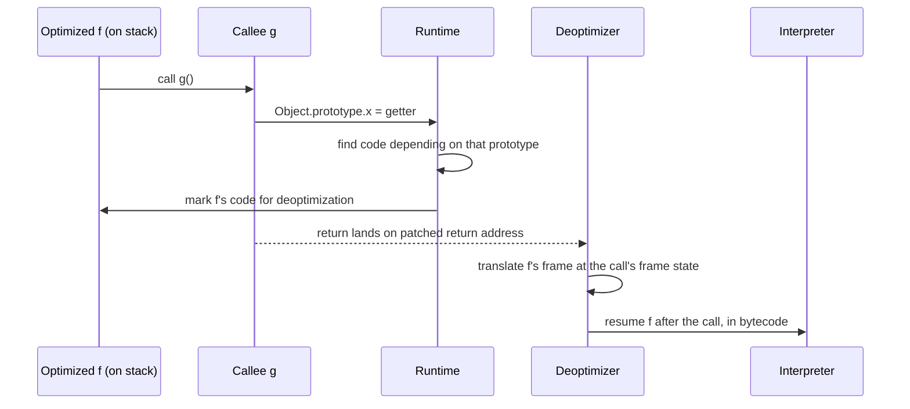
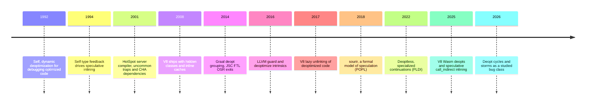
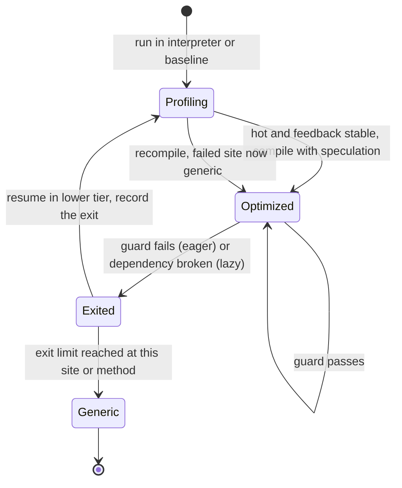

---
tags:
  - compilers
  - jit
  - runtimes
  - deoptimization
  - speculation
  - osr
  - v8
  - javascriptcore
  - hotspot
  - graal
  - llvm
status: complete
sources:
  - https://bibliography.selflanguage.org/dynamic-deoptimization.html
  - https://usenix.org/event/jvm01/full_papers/paleczny/paleczny.pdf
  - https://webkit.org/blog/10308/speculation-in-javascriptcore/
  - https://chromium.googlesource.com/v8/v8.git/+/main/docs/runtime/deoptimization.md
  - https://v8.dev/blog/lazy-unlinking
  - https://v8.dev/blog/wasm-speculative-optimizations
  - https://arxiv.org/pdf/1711.03050
  - https://arxiv.org/abs/2203.02340
  - https://ar5iv.labs.arxiv.org/html/2203.02340
  - https://ssw.jku.at/General/Staff/GD/PPPJ-2014-duboscq-29.pdf
  - https://www.graalvm.org/dev/graalvm-as-a-platform/language-implementation-framework/DeoptCyclePatterns/
  - https://www.graalvm.org/truffle/javadoc/com/oracle/truffle/api/CompilerDirectives.html
  - https://mail.openjdk.org/pipermail/hotspot-compiler-dev/2025-December/101194.html
  - https://bugs.openjdk.org/browse/JDK-8374307
  - https://lists.llvm.org/pipermail/llvm-dev/2016-February/095709.html
  - https://lists.llvm.org/pipermail/llvm-commits/Week-of-Mon-20160229/337349.html
  - https://chromium.googlesource.com/external/github.com/emscripten-core/emscripten-fastcomp/+/2a333e6b14e94de7fa32dd0a772886d028515708/test/Verifier/deoptimize-intrinsic.ll
  - https://llvm.org/docs/doxygen/GuardWidening_8cpp_source.html
  - https://llvm.org/docs/doxygen/LoopPredication_8cpp_source.html
  - https://chromium.googlesource.com/external/github.com/python/cpython/+/01a683a3d4dcc8fa2b28873dbe6f57183899ad31/InternalDocs/jit.md
  - https://gist.github.com/EgorBo/dc181796683da3d905a5295bfd3dd95b
  - https://arxiv.org/pdf/2603.06551
  - https://groups.google.com/g/v8-reviews/c/jiwjIHrbPDQ
  - https://groups.google.com/g/v8-dev/c/r3cCGRs7wpU
  - https://lists.llvm.org/pipermail/llvm-dev/2016-February/095567.html
  - https://bernsteinbear.com/blog/launch-zjit/
created: 2026-11-26
updated: 2026-11-28
---

## Table Of Contents

- [[#TL;DR|TL;DR]]
- [[#The Problem|The Problem]]
- [[#Foundations|Foundations]]
    - [[#Speculate, Guard, Exit|Speculate, Guard, Exit]]
    - [[#The Correctness Rule|The Correctness Rule]]
    - [[#Eager and Lazy Deoptimization|Eager and Lazy Deoptimization]]
    - [[#When Speculation Pays - The Cost Model|When Speculation Pays - The Cost Model]]
- [[#How We Got Here|How We Got Here]]
- [[#How It Works|How It Works]]
    - [[#Worked Example - One Guard, One Frame State|Worked Example - One Guard, One Frame State]]
    - [[#Rebuilding Frames - Inlining and Materialization|Rebuilding Frames - Inlining and Materialization]]
    - [[#Dependencies, Watchpoints and Invalidation|Dependencies, Watchpoints and Invalidation]]
    - [[#Learning From Failure - Exit Counts and Deopt Loops|Learning From Failure - Exit Counts and Deopt Loops]]
    - [[#Engine by Engine|Engine by Engine]]
    - [[#Speculation in an AOT Toolkit - LLVM Guards|Speculation in an AOT Toolkit - LLVM Guards]]
    - [[#Paying Less for Metadata|Paying Less for Metadata]]
    - [[#Alternatives to Deoptimizing|Alternatives to Deoptimizing]]
- [[#Where It Is Now|Where It Is Now]]
- [[#Trade-offs & Open Problems|Trade-offs & Open Problems]]
- [[#Resources|Resources]]
- [[#Related Notes|Related Notes]]

## ***TL;DR***
---
*A speculative compiler bets that the future looks like the profile, compiles only the common case, and guards the bet with cheap checks. Deoptimization is the insurance policy: when a check fails, the runtime rebuilds the slow, general frame the program would have had and carries on there, so a wrong bet costs time but never changes behavior.*

- **Three parts, always.** A *speculation* (this value is a small int; this call goes to `F`; no subclass of `C` exists), a *guard* or *dependency* that detects when it is false, and an *exit* that transfers the live state back to unoptimized code. Self introduced the exit half in 1992 to debug optimized code ([Hölzle, Chambers and Ungar, PLDI 1992](https://bibliography.selflanguage.org/dynamic-deoptimization.html)); HotSpot made it standard for Java with *uncommon traps* and class-hierarchy dependencies ([Paleczny, Vick and Click, JVM 2001](https://usenix.org/event/jvm01/full_papers/paleczny/paleczny.pdf)).
- **Eager vs lazy.** A failing guard deopts *eagerly*, right there. An outside event (a prototype change, a class load) invalidates code that is still on the stack; that frame deopts *lazily*, when control returns to it ([V8 docs](https://chromium.googlesource.com/v8/v8.git/+/main/docs/runtime/deoptimization.md)).
- **The bet must be nearly certain.** JavaScriptCore measured a deopt at about 2,500 ns (DFG) and 10,000 ns (FTL) against at most 1.48 ns saved per bytecode, so speculation only pays above roughly 99.94% success; its rule is "speculate only when p ≈ 1" ([Pizlo, WebKit 2020](https://webkit.org/blog/10308/speculation-in-javascriptcore/)).
- **The hard part is not deopting once, it is not deopting forever.** Engines count exits, back off exponentially and stop speculating at sites that keep failing. Getting this wrong causes *deopt loops* or *storms*: HotSpot was still reviewing a fix for one in early 2026 ([JDK-8374307](https://bugs.openjdk.org/browse/JDK-8374307)), and speculation is the second-largest root cause (28.8%) of 191 JIT performance bugs studied in HotSpot, Graal, V8 and SpiderMonkey ([Yi et al., OOPSLA 2026](https://arxiv.org/pdf/2603.06551)).
- **As of November 2026:** speculation has spread from dynamic languages to WebAssembly (V8 speculatively inlines `call_indirect` with deopts since Chrome 137, 1.59× on Dart microbenchmarks, [V8 2025](https://v8.dev/blog/wasm-speculative-optimizations)); Graal detects deopt cycles automatically ([GraalVM docs](https://www.graalvm.org/dev/graalvm-as-a-platform/language-implementation-framework/DeoptCyclePatterns/)); research asks whether a failed guard should deopt at all, or jump to a continuation compiled for the new case ([Deoptless, PLDI 2022](https://arxiv.org/abs/2203.02340)).

## ***The Problem***
---
*Dynamic languages give the compiler almost no static facts, and even static languages hide the facts that matter most (which class a virtual call hits, whether a branch is ever taken). Speculation gets those facts from the running program, but a fact observed so far can stop being true at any moment.*

Consider what a compiler sees in a few lines of JavaScript:

```javascript
function sum(points) {
  let s = 0;
  for (let i = 0; i < points.length; i++) s += points[i].x;
  return s;
}
```

Statically, `points` might be anything with a `length`, `points[i]` might be a getter with side effects, `.x` might live at a different offset in every object, and `s += ...` might be integer addition, floating-point addition, string concatenation or a call to `valueOf`. Compiling all of that correctly means a generic call per operation, which is why a plain interpreter is slow ([[JIT Compilation]]).

The running program, however, almost always calls `sum` with arrays of objects built by one constructor whose `x` is a small integer. A compiler that *knows* that can emit a tight loop: one shape check, an integer add with an overflow check, a load at a fixed offset. The catch is that "knows" really means "has observed so far". Tomorrow someone may pass an object whose `x` is `0.5`, or add a getter for `x` to `Object.prototype`.

So a speculative compiler needs three things:

1. A way to decide what is *probably* true ([[Profile-Guided Optimization|profiling]] and type feedback from lower tiers).
2. A cheap way to notice when the bet is wrong, either a check in the code (a *guard*) or a notification from the runtime (a *dependency*).
3. A way to keep running *correctly* after a wrong bet, without having compiled the slow cases. That last part is **deoptimization**: transfer the live state of the optimized frame into the frame shape the unoptimized code expects, and resume there.

Static, ahead-of-time compilers face the same tension in milder form. Devirtualizing a call through [[Profile-Guided Optimization|PGO]] needs a fallback for the unexpected receiver. An AOT compiler keeps both paths in the code. A JIT can keep only the fast one, because it can always recompile.

## ***Foundations***
---
*Four ideas carry the topic: speculation is an assumption plus a check plus an exit; an exit is only correct if it lands in an equivalent state; exits come in two timings, eager and lazy; and a cost model says how sure you must be before betting.*

### Speculate, Guard, Exit

*Every speculative optimization replaces "handle every case" with "handle the observed case, and leave if it does not hold".*

| Piece | What it is | Examples |
|---|---|---|
| **Speculation** | A fact assumed true in the compiled code | operand is a 31-bit int; object has hidden class `M2`; callee is `F`; index is in bounds; this branch is never taken |
| **Guard** | An instruction that tests the fact | `CheckSmi`, `CheckMaps`, an overflow flag test, a compare against the expected function |
| **Dependency** (watchpoint) | A promise registered with the runtime instead of an inline test | "class `C` has no subclasses", "this prototype is unchanged", "this global is constant" |
| **Exit** | Where control goes when a guard fails | a deopt stub (V8), an OSR exit (JSC), an uncommon trap (HotSpot) |
| **Frame state** | The recipe for rebuilding the unoptimized frame at that exit | bytecode offset, and where each live local, operand and object now lives |

The guard is cheap, typically a compare and a not-taken branch. Everything *after* the guard can rely on the fact, which is where the speed comes from: an `int` that is known to be an `int` can stay unboxed in a register, a call known to target `F` can be inlined, and an index known to be in bounds feeds [[Loop Optimizations|loop]] and [[Classic Optimizations|scalar]] optimizations.

### The Correctness Rule

*Deoptimizing at any guard must be indistinguishable from never having optimized. If that holds, speculation can only change speed, never results.*

Flückiger et al. made this precise in **sourir**, a small IR whose functions have several *versions* and whose speculation instruction is `assume e* else ξ ξ̃*`: if all predicates `e*` hold, fall through; otherwise deoptimize to the target named in `ξ`, building the target's environment from a *varmap* evaluated in the current environment, with extra entries `ξ̃*` to synthesize caller frames for inlined code ([Flückiger et al., POPL 2018](https://arxiv.org/pdf/1711.03050)). Two invariants carry the proof:

- **Version equivalence:** all versions of a function are observationally equivalent.
- **Assumption transparency:** deoptimizing at any `assume` is equivalent to continuing execution.

In plain English: the exit must land in a state the slow code could have reached by itself, and no visible side effect may happen twice or not at all. With that rule they prove speculative constant propagation, unreachable-code elimination, inlining, moving an `assume` past side-effect-free code, hoisting a predicate to a dominating `assume`, and merging chained `assume`s correct by weak bisimulation ([Flückiger et al.](https://arxiv.org/pdf/1711.03050)).

Production engines enforce the same rule by construction. JavaScriptCore exits "back to the equivalent point in the unoptimized code" at a bytecode boundary, and uses bytecode liveness to decide what state to recover ([Pizlo, 2020](https://webkit.org/blog/10308/speculation-in-javascriptcore/)). The practical consequence: **a guard must sit before the side effects it protects**, or the exit must resume after them. Resuming in the middle of a half-done operation is the classic deopt bug.

### Eager and Lazy Deoptimization

*Eager deopt happens at a failing guard in the running code. Lazy deopt happens to code that is still on the stack when something else in the program breaks its assumption.*

V8's runtime documentation names three kinds, `Eager`, `Lazy` and `LazyAfterFastCall` (a lazy variant for direct calls into C++) ([V8 docs](https://chromium.googlesource.com/v8/v8.git/+/main/docs/runtime/deoptimization.md)):

| | Eager | Lazy |
|---|---|---|
| Trigger | A guard in this code fails | Another piece of code invalidates an assumption (map transition, prototype change, function redefinition, class load) |
| Where | At the failing instruction | When control returns into a frame running the invalidated code |
| Mechanism in V8 | Jump to a deopt exit stub at the end of the function | Code is marked for deoptimization; on return into a marked frame the return address is patched to a lazy-deopt builtin |
| HotSpot equivalent | Uncommon trap | Dependent methods deoptimized at class load; running threads converted at a safepoint ([Paleczny et al.](https://usenix.org/event/jvm01/full_papers/paleczny/paleczny.pdf)) |



The lazy case has an extra subtlety: the frame state must describe the point *after* the call returns, because the call has already happened. Engines therefore record two frame states at calls, one for eager exits before the call and one for lazy exits after it (in May 2026 V8 split Turboshaft's single `FrameState` type into `EagerFrameState` and `LazyFrameState`, because passing one where the other belonged was an easy mistake, [v8-reviews](https://groups.google.com/g/v8-reviews/c/jiwjIHrbPDQ)).

Lazy invalidation also has to stop *future* calls from entering stale code. V8 once kept a linked list of every closure sharing an optimized code object and walked it on deopt and during GC; in a micro-benchmark with about 2 million closures it spent "around 98% of its execution time on garbage collection". Since 2017 optimized code instead checks a `marked_for_deoptimization` bit on entry and relinks itself lazily, which gained 33% on `bluebird-parallel` and 22% on `wikipedia` ([Franco, V8 2017](https://v8.dev/blog/lazy-unlinking)).

### When Speculation Pays - The Cost Model

*A guard is nearly free when it passes and very expensive when it fails, so the probability threshold for betting is extreme.*

Let $p$ be the probability a speculation holds, $B$ the time it saves when it holds, and $C$ the cost of an exit when it fails. Speculating wins when

$$p \cdot B \;>\; (1-p)\cdot C \quad\Longleftrightarrow\quad p \;>\; \frac{C}{B + C}.$$

**In plain English:** the more an exit costs relative to what the fast path saves, the closer to certain you must be. JavaScriptCore measured $B \le 1.48$ ns (Baseline's 1.71 ns per bytecode minus FTL's 0.225 ns) and synthetic exit costs of $C = 2{,}499$ ns in the DFG and $9{,}998$ ns in the FTL, three to four orders of magnitude more. That puts break-even at $p > 0.9994$ for the DFG and higher still for the FTL, hence the stated policy of speculating only when $p \approx 1$ and only when "all profiling sources concur" ([Pizlo, 2020](https://webkit.org/blog/10308/speculation-in-javascriptcore/)).

Two refinements keep this from being too pessimistic. A failed exit is not the end: after a deopt the code runs slower until it is recompiled *without* that speculation, so the real cost is one exit plus a warm-up, not an exit per execution. And dependencies (watchpoints) cost nothing on the fast path at all, so facts that rarely change, such as "this class has one implementation", are cheap to assume.

## ***How We Got Here***
---
*Deoptimization began as a debugging trick in Self, became the enabler of aggressive optimization in HotSpot, was refined in the JavaScript engines' race of the 2010s, gained a formal model in 2018, and has spread to WebAssembly and to research on not deoptimizing at all.*



- **Self (1992).** Hölzle, Chambers and Ungar wanted source-level debugging of heavily inlined code. Their answer was to *deoptimize* on demand: when the debugger needs a frame, rebuild unoptimized frames from the optimized one using recorded scope descriptors ([PLDI 1992](https://bibliography.selflanguage.org/dynamic-deoptimization.html)). Once you can do that at any time, you can also do it when an assumption fails, which is what made later speculative optimizations safe.
- **HotSpot (1999 to 2001).** The server compiler emits "an uncommon trap, a trampoline back to interpreted mode" for cases it chooses not to compile; when class loading "invalidates inlining or other optimization decisions, the dependent methods are deoptimized", with threads in those methods "rolled forward to a safepoint, at which point the native frame is converted into an interpreter frame". Debug info recorded at safepoints and calls holds the locals, monitors and stack entries needed to rebuild the frame ([Paleczny, Vick and Click, JVM 2001](https://usenix.org/event/jvm01/full_papers/paleczny/paleczny.pdf)). Class hierarchy analysis plus deoptimization is what lets Java inline virtual calls freely.
- **The JavaScript engines (2008 onward).** With no static types at all, everything is speculative: shapes, number representations, call targets. V8, JavaScriptCore and SpiderMonkey all built multi-tier pipelines whose top tiers deopt to lower ones ([[JIT Compilation]]). JSC's DFG and FTL exit preferably to Baseline code, and to the LLInt interpreter if Baseline code was thrown away during GC ([Pizlo, 2020](https://webkit.org/blog/10308/speculation-in-javascriptcore/)).
- **Graal and Truffle (2013 onward).** Graal carries deopt state as `FrameState` nodes in its [[Sea of Nodes|graph IR]] and reduced the size of that metadata with *deopt grouping* ([Duboscq et al., PPPJ 2014](https://ssw.jku.at/General/Staff/GD/PPPJ-2014-duboscq-29.pdf)). Truffle exposed speculation to language implementers as API calls like `transferToInterpreterAndInvalidate()` and `Assumption` objects ([Truffle API](https://www.graalvm.org/truffle/javadoc/com/oracle/truffle/api/CompilerDirectives.html)).
- **LLVM (2016).** Sanjoy Das, Philip Reames and others added `deopt` operand bundles, `@llvm.experimental.deoptimize` and `@llvm.experimental.guard`, so LLVM-based JITs for managed languages could express speculation in IR and let ordinary passes reason about it ([RFC](https://lists.llvm.org/pipermail/llvm-dev/2016-February/095709.html); [D17732 review](https://lists.llvm.org/pipermail/llvm-commits/Week-of-Mon-20160229/337349.html)).
- **Theory and alternatives (2018 to 2022).** sourir gave the first formal account ([POPL 2018](https://arxiv.org/pdf/1711.03050)); Deoptless asked whether a failed speculation should deopt at all ([PLDI 2022](https://arxiv.org/abs/2203.02340)).

## ***How It Works***
---
*At compile time the optimizer places guards and records a frame state at each exit; at run time a failed guard jumps to a stub, the deoptimizer translates the machine state into interpreter frames, and a counter decides whether to recompile with or without the failed bet.*



### Worked Example - One Guard, One Frame State

*Follow `s += points[i].x` from source to speculative IR and back out through a failed guard.*

Suppose the lower tiers recorded that `points[i]` always had hidden class `M2` (with `x` in slot 0) and that `s` and `x` were always small integers. The optimizing tier can emit, in pseudo-IR in the style of V8's TurboFan or Maglev:

```text
loop:
  o   = LoadElement points, i
  CheckMaps o, [M2]          ; deopt reason: wrong map      frame state FS1
  x   = LoadField o, slot0   ; no lookup: offset is known
  CheckSmi x                 ; deopt reason: not a Smi      frame state FS1
  s'  = Int32AddCheckOverflow s, x  ; deopt on overflow     frame state FS1
  i'  = Int32Add i, 1
  ...
FS1 = { bytecode: "load points[i]" offset 17,
        locals: { points: r8, s: r9 (int32, needs boxing), i: r10 (int32) },
        accumulator: <none> }
```

Each guard points to a *frame state*: the bytecode offset to resume at and where every interpreter-visible value now lives (a register, a stack slot, a constant) and in what representation. V8 serializes this as a `DeoptimizationFrameTranslation`, a compact bytecode stream per deopt point, whose opcodes include `LITERAL`, `TAGGED_STACK_SLOT`, `INT32_STACK_SLOT`, `DOUBLE_STACK_SLOT`, register variants, `CAPTURED_OBJECT` and `DUPLICATED_OBJECT` ([V8 docs](https://chromium.googlesource.com/v8/v8.git/+/main/docs/runtime/deoptimization.md)).

Now someone passes an object whose `x` is `0.5`. `CheckSmi x` fails, and:

1. Control jumps to the deopt exit stub for that guard, which saves registers and calls the deoptimizer.
2. The deoptimizer looks up the translation for this exit and builds a `TranslatedState` with one `TranslatedFrame` per interpreter frame.
3. Values are converted back to the interpreter's representation: `s` in `r9` is an untagged int32, so it is re-tagged as a Smi (or boxed as a heap number if it no longer fits).
4. A new interpreter frame is written, the accumulator set, and Ignition resumes at bytecode offset 17, which reloads `points[i]` and does the generic, slow `+=`.

Because `FS1` points *before* the load and the add, and neither has a visible side effect, redoing them in the interpreter is safe; this is the correctness rule in action. All three guards in the loop can share `FS1`.

### Rebuilding Frames - Inlining and Materialization

*Inlining collapses several source frames into one machine frame, and escape analysis deletes objects the interpreter expects to exist, so the deoptimizer has to recreate both.*

**Inlined frames.** If `sum` inlined a helper `getX(p)`, a guard inside the inlined body must rebuild *two* interpreter frames: `getX`'s, mid-function, and `sum`'s, waiting at the call. Frame states therefore form a chain, outermost caller first, and V8's `TranslatedState` holds a list of frames "including inlined functions" ([V8 docs](https://chromium.googlesource.com/v8/v8.git/+/main/docs/runtime/deoptimization.md)). sourir's `ξ̃*` entries model exactly this: extra continuations that synthesize the missing caller frames ([Flückiger et al.](https://arxiv.org/pdf/1711.03050)).

**Builtins.** Engines also inline library functions. When V8 deopts inside an inlined `Array.prototype.forEach`, it cannot return to bytecode that does not exist, so it builds a special continuation frame that resumes the builtin's loop at the current index (`ArrayForEachLoopLazyDeoptContinuation`) and returns to the interpreter afterwards ([V8 docs](https://chromium.googlesource.com/v8/v8.git/+/main/docs/runtime/deoptimization.md)).

**Materialization.** [[Escape Analysis]] may have replaced an object with its fields in registers. The interpreter needs a real object, so the frame state records the object's fields (V8's `CAPTURED_OBJECT`; Graal's virtual object states attached to `FrameState`s) and the deoptimizer allocates it on the way out, also re-acquiring any locks the compiler elided. `DUPLICATED_OBJECT` lets two frame slots refer to the same rebuilt object so identity is preserved ([V8 docs](https://chromium.googlesource.com/v8/v8.git/+/main/docs/runtime/deoptimization.md)). Allocation during a deopt has its own hazard: V8's Wasm deoptimizer is not allowed to allocate on the heap at all, because a GC could run while the stack is inconsistent ([V8, 2025](https://v8.dev/blog/wasm-speculative-optimizations)).

### Dependencies, Watchpoints and Invalidation

*Some facts are checked inline on every use; others are too global or too stable to check, so the compiler registers interest and the runtime throws the code away if they change.*

| Engine | Name | Typical facts |
|---|---|---|
| HotSpot | Dependencies (recorded during compilation) | Class hierarchy: "method `m` has one implementation below `C`" ([Paleczny et al.](https://usenix.org/event/jvm01/full_papers/paleczny/paleczny.pdf)) |
| JavaScriptCore | Watchpoints | Structure transitions, constant globals; a fired watchpoint causes "immediate jettison" ([Pizlo](https://webkit.org/blog/10308/speculation-in-javascriptcore/)) |
| V8 | Code dependencies | Prototype chains, function redefinition, map transitions ([V8 docs](https://chromium.googlesource.com/v8/v8.git/+/main/docs/runtime/deoptimization.md)) |
| Truffle | `Assumption` objects | Language-level invariants the interpreter writer chooses ([Truffle API](https://www.graalvm.org/truffle/javadoc/com/oracle/truffle/api/CompilerDirectives.html)) |
| CPython tier 2 | Executor invalidation | Executors are registered in `executor_blooms`/`executor_ptrs` so they can be invalidated "because values they used in their construction may have changed" ([CPython InternalDocs](https://chromium.googlesource.com/external/github.com/python/cpython/+/01a683a3d4dcc8fa2b28873dbe6f57183899ad31/InternalDocs/jit.md)) |

The trade is simple: an inline guard costs a little on every execution and nothing when the fact changes elsewhere; a dependency costs nothing per execution but forces lazy deopt of every frame using the code when the fact changes. Rare, global facts go to dependencies; per-value facts go to guards.

### Learning From Failure - Exit Counts and Deopt Loops

*Every engine has to answer the same question after an exit: was that a fluke, or is the profile wrong? Answer "fluke" too often and the code deopts forever; answer "wrong" too fast and you never get fast code.*

The failure mode is the **deopt loop** (Graal: *deopt cycle*; HotSpot: *deoptimization storm*): optimize, speculate, fail, deopt, collect the same feedback, re-optimize with the same speculation, fail again. Each lap pays a compile and an exit.

**JavaScriptCore** counts exits per compiled code block. After a DFG or FTL compile, normal exits must reach $100 \cdot 2^R$ before recompiling (exits landing in a hot Baseline loop count against $5 \cdot 2^R$), where $R$ is the recompile count. Reaching the limit *jettisons* the code; each recompile doubles the thresholds, and Baseline then runs twice as long as last time before tiering up again. The exit-causing value is fed back into the value profile, and sites that have seen a counterexample are not speculated on again. Pizlo's worked case shows a function settling after 8 compilations ([Pizlo, 2020](https://webkit.org/blog/10308/speculation-in-javascriptcore/)).

**HotSpot C2** calls the exit an *uncommon trap*, each with a reason (for example `Reason_unstable_if` for a branch that was assumed never taken, `Reason_speculate_class_check` for a type profile) and an action (`Action_reinterpret` recompiles, `Action_none` does not). Per-method limits stop speculation per reason: `PerMethodTrapLimit` is 100, `PerMethodSpecTrapLimit` is 5,000, and the recompilation cutoff works out to 201 recompiles from `PerMethodRecompilationCutoff` = 400. JDK-8374307 (December 2025) describes how a method trapping for several reasons can hit the recompile cutoff before the `unstable_if` limit; C2 then switches to `Action_none` while still speculating, and a hot path "can produce thousands of deoptimizations per second". The reported case was a serialization method with many bitmask-driven branches, and the workaround being patched had been in the code for 17 years ([hotspot-compiler-dev](https://mail.openjdk.org/pipermail/hotspot-compiler-dev/2025-December/101194.html)).

**Truffle/Graal** documents the patterns that cause unbounded cycles: calling `transferToInterpreterAndInvalidate()` on every execution, argument profiles whose cached value keeps changing, caches that only go generic after many changes, compilation-final fields on objects that are not partial-evaluation constants, and exceptions like `ClassCastException` that always deopt even when caught. GraalVM 25 enables automatic deopt cycle detection "after 15 compilations" ([GraalVM docs](https://www.graalvm.org/dev/graalvm-as-a-platform/language-implementation-framework/DeoptCyclePatterns/)).

The common recipe across engines:

| Technique | Effect |
|---|---|
| Count exits per site and per method | Distinguish a fluke from a pattern |
| Exponential back-off on recompilation | Bound the total cost of being wrong |
| Feed the failing value back into the profile | The next compile sees the counterexample |
| Mark the site "do not speculate" after N failures | Next version compiles the generic path there |
| Give up on the method after M recompiles | Leave it in a lower tier rather than loop |

### Engine by Engine

*Same idea, different vocabulary and different landing tiers.*

| Engine | Exit is called | Lands in | Frame-state record | Loop control |
|---|---|---|---|---|
| **V8** (JS) | Deopt (eager, lazy) | Ignition interpreter | `DeoptimizationFrameTranslation` | Feedback updated; function re-tiers later |
| **V8** (Wasm) | Deopt (since Chrome 137) | Liftoff baseline, recompiled for the affected inlined functions | `FrameDescription` translated to Liftoff layout | Re-collects feedback and can tier up again ([V8, 2025](https://v8.dev/blog/wasm-speculative-optimizations)) |
| **JavaScriptCore** | OSR exit | Baseline, or LLInt if Baseline was discarded | OSR exit records, guided by bytecode liveness | $100 \cdot 2^R$ exits, jettison, watchpoints |
| **HotSpot C2** | Uncommon trap | Interpreter | Debug info / scope descriptors at safepoints | Per-reason trap limits, recompile cutoff |
| **Graal** | Deoptimize node | Interpreter (HotSpot) or Truffle interpreter | `FrameState` nodes in the graph | Truffle cycle detection after 15 compilations |
| **CPython 3.13+ tier 2** | `DEOPT_IF` / `EXIT_IF` | Tier 1 adaptive interpreter | Exit data per uop trace | An `EXIT_IF` side exit may record a new trace; a deopt does not ([CPython InternalDocs](https://chromium.googlesource.com/external/github.com/python/cpython/+/01a683a3d4dcc8fa2b28873dbe6f57183899ad31/InternalDocs/jit.md)) |

JSC's choice to exit only to tiers that do not speculate means "there are no chains of exits for the same operation" ([Pizlo](https://webkit.org/blog/10308/speculation-in-javascriptcore/)). CPython's design is the tracing-JIT version of the same idea: a guard in a trace either *side-exits* (and may grow a side trace, like LuaJIT or PyPy) or *deopts* back to the specializing interpreter, which resets its adaptive counters so the bytecode re-specializes.

### Speculation in an AOT Toolkit - LLVM Guards

*LLVM lets a JIT built on it express speculation in IR, so ordinary optimization passes can move, merge and widen guards.*

LLVM's support, added in 2016 after an llvm-dev RFC on guard intrinsics:

- A **`deopt` operand bundle** on a call carries the abstract state (the frame state) the runtime needs if it deoptimizes at that call.
- **`@llvm.experimental.deoptimize`** is a one-way transfer out of compiled code ("It does not allow entries", per the review). The verifier requires that calls to it "must be followed by a return of the value computed by experimental_deoptimize", that it have "exactly one "deopt" operand bundle", and that it "cannot be invoked" ([D17732 review](https://lists.llvm.org/pipermail/llvm-commits/Week-of-Mon-20160229/337349.html); [verifier test](https://chromium.googlesource.com/external/github.com/emscripten-core/emscripten-fastcomp/+/2a333e6b14e94de7fa32dd0a772886d028515708/test/Verifier/deoptimize-intrinsic.ll)).
- **`@llvm.experimental.guard(i1 %cond) [ "deopt"(...) ]`** deoptimizes if `%cond` is false ([RFC](https://lists.llvm.org/pipermail/llvm-dev/2016-February/095709.html)).

The interesting consequence is **guard widening**. Because "It is always _legal_ to deoptimize", a guard may be transformed so that it "fails more often than it did before" ([GuardWidening.cpp](https://llvm.org/docs/doxygen/GuardWidening_8cpp_source.html)). Two bounds checks become one:

```llvm
; before
%c0 = icmp ult i32 7, %len
call void @llvm.experimental.guard(i1 %c0) [ "deopt"() ]
call void @unknown_side_effects()
%c1 = icmp ult i32 9, %len
call void @llvm.experimental.guard(i1 %c1) [ "deopt"() ]

; after widening: the first guard checks the stronger fact, the second is gone
%c0w = icmp ult i32 9, %len
call void @llvm.experimental.guard(i1 %c0w) [ "deopt"() ]
call void @unknown_side_effects()
```

**In plain English:** if index 9 is in bounds, so is index 7, and it is fine to bail out a little early in the rare case where 7 fits but 9 does not, since the bail-out lands in correct generic code. Loop predication applies the same idea to hoist range checks out of loops ([LoopPredication.cpp](https://llvm.org/docs/doxygen/LoopPredication_8cpp_source.html)), a direct connection to [[Bounds Check Elimination]].

### Paying Less for Metadata

*Frame states are needed at every possible exit but used almost never, so their size is pure overhead in the code cache.*

Duboscq et al. measured Graal's deopt metadata at **1.7× to 1.9× the size of the machine code** it described. *Deopt grouping* merges `Deoptimize` nodes that share a logical `FrameState` into one deopt behind a merge, so only one low-level translation is stored. It applies where control flow to a deopt is explicit (about 38% of the final deopt information) and cut emitted deopt information by about a quarter (DaCapo −26.49%, SPECjvm2008 −25.97%). Combined with HotSpot's sharing of debug info, Graal's metadata overhead fell to 0.9× to 1.1× of code size ([PPPJ 2014](https://ssw.jku.at/General/Staff/GD/PPPJ-2014-duboscq-29.pdf)). Sharing `FS1` across the three guards in the worked example above is the same idea.

### Alternatives to Deoptimizing

*Deopt is not the only answer to a failed speculation. The alternatives trade code size for avoiding the cliff.*

- **Keep the slow path in the code.** .NET's guarded devirtualization tests the profiled type, calls (and can inline) the direct target, and keeps the original interface call "as a cold fallback, just in case"; a small benchmark went from 5.74 ns to 3.27 ns with Dynamic PGO ([Egor Bogatov](https://gist.github.com/EgorBo/dc181796683da3d905a5295bfd3dd95b)). Static [[Profile-Guided Optimization|PGO]] compilers do the same. No exit is ever needed, but the fallback limits what can be assumed after the merge.
- **Exit to another compiled version.** Tracing JITs and CPython's tier 2 jump from a hot side exit into a separately compiled side trace instead of the interpreter.
- **Deoptless.** In Ř, a JIT for R, a failing guard dispatches to a *specialized continuation*: optimized code compiled for the exact situation at the exit, keyed by the exit point, the deopt reason (for example "typecheck failed, actual type was an integer vector"), and the types of the operand stack and environment. At most 5 continuations per exit, with stack and environment size caps, no recursion, no inlined frames. With 1 in 10,000 assumptions failed at random, benchmarks ran 1× to 9.1× faster than with plain deopt, most by more than 1.9×, and none slower; one benchmark that took over an hour in that mode finished in under five minutes ([Flückiger et al., PLDI 2022](https://ar5iv.labs.arxiv.org/html/2203.02340)). The authors note the main evaluation is synthetic and worst-case.

## ***Where It Is Now***
---
*As of November 2026, speculation has moved into WebAssembly, the engines are treating deopt loops as a bug class with tooling of its own, and the research question has shifted from "is deopt correct?" to "can we avoid the performance cliff?".*

- **WebAssembly speculates too (June 2025).** WebAssembly is statically typed, but indirect and reference calls still hide targets. V8 shipped deopts for Wasm and speculative `call_indirect` inlining in Chrome M137: TurboFan inlines up to four observed targets behind checks on the table bounds, instance and target. On Dart microbenchmarks inlining alone gave 1.19× and inlining with deopts 1.59× on average; applications gained 1% to 8% (Dart Flute 8%), and Google Sheets' calc engine up to 7% ([V8, Jun 2025](https://v8.dev/blog/wasm-speculative-optimizations)). See [[WebAssembly]].
- **HotSpot deopt storm under review (Dec 2025 to Jan 2026).** The JDK-8374307 fix (stop speculating on untaken branches on the final recompilation) was still marked unresolved on the bug tracker when checked in November 2026, with a pull request linked ([JDK-8374307](https://bugs.openjdk.org/browse/JDK-8374307)).
- **Graal detects cycles (GraalVM 25).** Truffle reports deopt cycles automatically after 15 compilations and documents fixes for each pattern ([GraalVM docs](https://www.graalvm.org/dev/graalvm-as-a-platform/language-implementation-framework/DeoptCyclePatterns/)).
- **Performance bugs as a research topic (April 2026).** Yi, Ding, Shi and Gligoric collected 191 JIT performance bugs across HotSpot (87), Graal (18), V8 (51) and SpiderMonkey (35); speculation, including the deopt process, is the second-largest root cause at 28.80% (55 bugs). Their differential tester JITTERY found 12 new performance bugs in HotSpot and Graal, 11 confirmed and 6 fixed, 4 of them speculation bugs ([OOPSLA 2026](https://arxiv.org/pdf/2603.06551)). See [[Compiler Testing and Fuzzing]].
- **V8 housekeeping.** Deopt reasons are an enum in V8's source; a July 2026 v8-dev thread removed nine unused ones, and notes that Maglev's lazy deopt path always reports `kUnknown` ([v8-dev, Jul 2026](https://groups.google.com/g/v8-dev/c/r3cCGRs7wpU)).
- **Python and Ruby.** CPython's tier-2 traces use `EXIT_IF`/`DEOPT_IF` exits back to the specializing interpreter ([InternalDocs](https://chromium.googlesource.com/external/github.com/python/cpython/+/01a683a3d4dcc8fa2b28873dbe6f57183899ad31/InternalDocs/jit.md)); Ruby's ZJIT is a method JIT with an SSA IR, shipped off by default in Ruby 4.0 ([Bernstein, Dec 2025](https://bernsteinbear.com/blog/launch-zjit/)). Their project status is tracked in [[JIT Compilation]].

## ***Trade-offs & Open Problems***
---
*Speculation trades predictability for speed. The engineering is in making the bet cheap when right, bounded when wrong, and correct in both cases.*

| Choice | You get | You pay |
|---|---|---|
| Speculate aggressively | Unboxed values, inlined calls, eliminated checks | Exits cost 1,000× to 10,000× a fast-path operation; deopt loops if the profile is unstable |
| Inline guards | Per-value precision; nothing to undo elsewhere | A compare and branch on every execution; a frame state per exit |
| Dependencies / watchpoints | Zero cost on the fast path | Global invalidation and lazy deopt of every frame using the code |
| Exit to interpreter | Simplest landing; no exit chains | Slowest code after the exit, until re-tiering |
| Exit to baseline or a side trace | Less of a cliff | More compiled code, more translation layouts to keep correct |
| Keep a slow path in the code (GDV) | No exits, no metadata | Bigger code; weaker facts after the merge |
| Specialized continuations (Deoptless) | No cliff for repeated failures | Extra compiles and dispatch; research-grade only |

**Open problems.**

- **Performance cliffs nobody can see.** A deopt loop shows up as "this function got slower", not as an error. JSC's thresholds, HotSpot's trap limits and Truffle's cycle detector are all heuristics, and JDK-8374307 shows that interactions between them can still produce storms after decades of tuning ([hotspot-compiler-dev](https://mail.openjdk.org/pipermail/hotspot-compiler-dev/2025-December/101194.html)). Developer-facing tools to explain deopts remain thin.
- **Correctness and security.** A missing guard, a guard placed after a side effect, or a wrong frame state means optimized code runs on a false assumption or resumes in an impossible state. sourir proves the optimizations correct in a model ([POPL 2018](https://arxiv.org/pdf/1711.03050)), but production engines are tested, not verified; see [[Verified Compilers]] and [[Translation Validation]].
- **Metadata cost.** Frame states can exceed the code they describe ([PPPJ 2014](https://ssw.jku.at/General/Staff/GD/PPPJ-2014-duboscq-29.pdf)), which matters for memory-constrained devices and for AOT caches that want to store speculative code.
- **Speculation across runs.** AOT caches (Project Leyden, .NET ReadyToRun) want to reuse profiles from training runs, but a speculation that was safe in training may not be in production; that tension sits between [[JIT Compilation]] and [[Profile-Guided Optimization]].
- **When to stop deopting.** Deoptless shows a different point in the design space ([PLDI 2022](https://arxiv.org/abs/2203.02340)); whether specialized continuations pay off in a production engine, with inlining and global invalidation, is untested.

## ***Resources***
---
*Read Pizlo's essay first: it is the most complete public account of a production speculation system, with numbers. Then the V8 deopt doc for the mechanics, sourir for the theory, and the Graal cycle-pattern page for what goes wrong in practice.*

**Foundational papers**
- [Debugging Optimized Code with Dynamic Deoptimization](https://bibliography.selflanguage.org/dynamic-deoptimization.html): Hölzle, Chambers and Ungar, PLDI 1992.
- [The Java HotSpot Server Compiler](https://usenix.org/event/jvm01/full_papers/paleczny/paleczny.pdf): Paleczny, Vick and Click, JVM 2001. Uncommon traps, CHA dependencies, deopt at safepoints.
- [Correctness of Speculative Optimizations with Dynamic Deoptimization](https://arxiv.org/pdf/1711.03050): Flückiger et al., POPL 2018. The sourir model.
- [Speculation without Regret: Reducing Deoptimization Meta-Data in the Graal Compiler](https://ssw.jku.at/General/Staff/GD/PPPJ-2014-duboscq-29.pdf): Duboscq et al., PPPJ 2014.
- [Deoptless: Speculation with Dispatched On-Stack Replacement and Specialized Continuations](https://arxiv.org/abs/2203.02340): Flückiger et al., PLDI 2022.
- [Understanding and Finding JIT Compiler Performance Bugs](https://arxiv.org/pdf/2603.06551): Yi et al., OOPSLA 2026.

**Engine teams**
- [Speculation in JavaScriptCore](https://webkit.org/blog/10308/speculation-in-javascriptcore/): Filip Pizlo, WebKit, 2020.
- [Deoptimization in V8](https://chromium.googlesource.com/v8/v8.git/+/main/docs/runtime/deoptimization.md): V8 runtime docs.
- [An internship on laziness: lazy unlinking of deoptimized functions](https://v8.dev/blog/lazy-unlinking): Juliana Franco, V8, 2017.
- [Speculative Optimizations for WebAssembly using Deopts and Inlining](https://v8.dev/blog/wasm-speculative-optimizations): Lehmann and Liedtke, V8, 2025.
- [Deoptimization Cycle Patterns](https://www.graalvm.org/dev/graalvm-as-a-platform/language-implementation-framework/DeoptCyclePatterns/) and [CompilerDirectives](https://www.graalvm.org/truffle/javadoc/com/oracle/truffle/api/CompilerDirectives.html): GraalVM / Truffle docs.
- [JDK-8374307 review thread](https://mail.openjdk.org/pipermail/hotspot-compiler-dev/2025-December/101194.html): HotSpot deopt storm, 2025.
- [CPython JIT internals](https://chromium.googlesource.com/external/github.com/python/cpython/+/01a683a3d4dcc8fa2b28873dbe6f57183899ad31/InternalDocs/jit.md): exits and executors in tier 2.

**LLVM**
- [RFC: Add guard intrinsics to LLVM](https://lists.llvm.org/pipermail/llvm-dev/2016-February/095709.html) (2016, with [Sanjoy Das's reply](https://lists.llvm.org/pipermail/llvm-dev/2016-February/095567.html) on how guards and deopt bundles should be modeled); [D17732 review](https://lists.llvm.org/pipermail/llvm-commits/Week-of-Mon-20160229/337349.html); [GuardWidening.cpp](https://llvm.org/docs/doxygen/GuardWidening_8cpp_source.html); [LoopPredication.cpp](https://llvm.org/docs/doxygen/LoopPredication_8cpp_source.html).

## Related Notes

- [[JIT Compilation]] — Tiers, inline caches and type feedback: where speculations come from.
- [[Escape Analysis]] — Scalar-replaced objects that the deoptimizer must rematerialize.
- [[Sea of Nodes]] — Graal's `FrameState` nodes carry deopt state through the graph.
- [[Profile-Guided Optimization]] — The offline version of betting on a profile, with fallbacks instead of exits.
- [[WebAssembly]] — Liftoff as V8's deopt target for Wasm since Chrome 137.
- [[Garbage Collection]] — [[Safepoints and Stack Maps|Safepoints and stack maps]] share machinery with deopt metadata.
- [[LLVM]] — `deopt` bundles, guards, guard widening and loop predication.
- [[Loop Optimizations]] — Guard hoisting and OSR entry at loop headers.
- [[Bounds Check Elimination]] — Speculative range checks and loop predication.
- [[Classic Optimizations]] — Speculative constant propagation and dead-code elimination after guards.
- [[Compiler Testing and Fuzzing]] — Finding deopt correctness and performance bugs.
- [[Verified Compilers]] — Formal models of speculation and deoptimization.
- [[Translation Validation]] — Checking JIT optimizations case by case.
- [[CPS and ANF]] — Deopt targets and specialized continuations are continuations in the formal sense.
- [[Safepoints and Stack Maps]] — The same per-safepoint records hold GC maps and deopt frame states.
- [[On-Stack Replacement]] — The upward direction: entering optimized code mid-loop, deopt run in reverse.
- [[Sampling Profilers and Safepoint Bias]] — Profilers reuse the same per-pc scope records to name sampled frames.
