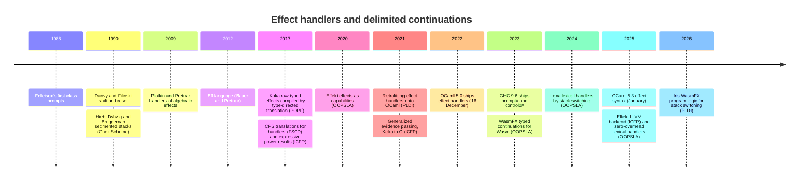
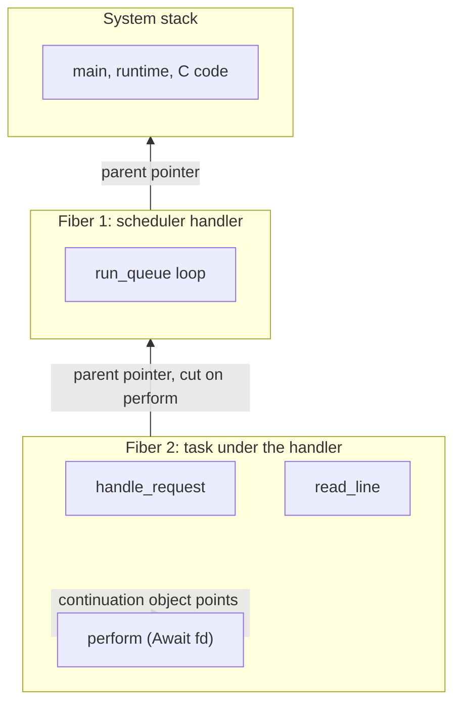

---
tags:
  - compilers
  - runtimes
  - effect-handlers
  - delimited-continuations
  - continuations
  - fibers
  - ocaml
  - koka
  - effekt
  - webassembly
  - stack-switching
  - concurrency
status: complete
sources:
  - https://arxiv.org/pdf/2104.00250
  - https://ocaml.org/manual/effects.html
  - https://ocaml.org/changelog/2022-12-16-ocaml-50
  - https://ocaml.org/changelog/2025-01-08-ocaml-530
  - https://discuss.ocaml.org/t/whats-the-status-of-typed-effects/18439
  - https://www.microsoft.com/en-us/research/uploads/prod/2021/08/genev-icfp21.pdf
  - https://www.microsoft.com/en-us/research/?p=337556
  - https://github.com/koka-lang/koka
  - https://www.github.com/koka-lang/libmprompt
  - https://legacy.cs.indiana.edu/~dyb/pubs/stack.pdf
  - https://arxiv.org/pdf/1610.09161
  - https://arxiv.org/pdf/1203.1539
  - https://www.cs.uoregon.edu/research/summerschool/summer25/_lectures/Xie-slides-1.pdf
  - https://github.com/lexi-lambda/ghc-proposals/blob/delimited-continuation-primops/proposals/0000-delimited-continuation-primops.md
  - https://downloads.haskell.org/ghc/9.6.1/docs/users_guide/9.6.1-notes.html
  - https://arxiv.org/pdf/2308.08347
  - https://github.com/WebAssembly/stack-switching/blob/main/proposals/stack-switching/Explainer.md
  - https://github.com/webassembly/proposals
  - https://docs.wasmtime.dev/stability-wasm-proposals.html
  - https://bugzilla.mozilla.org/show_bug.cgi?id=2032477
  - https://cs.au.dk/~birke/papers/2026-pldi-iris-wasmfx.pdf
  - https://effekt-lang.org/evolution
  - https://se.cs.uni-tuebingen.de/publications/muhcu2025multiple.pdf
  - https://cs.uwaterloo.ca/~yizhou/papers/lexa-oopsla2024.pdf
  - https://cs.uwaterloo.ca/~yizhou/papers/zero-oopsla2025.pdf
  - https://arxiv.org/pdf/2512.03083
  - https://cr.openjdk.org/~rpressler/loom/Loom-Proposal.html
  - https://openjdk.org/jeps/491
  - https://homepages.inf.ed.ac.uk/slindley/papers/handlers-cps.pdf
created: 2026-11-26
updated: 2026-11-28
---

## Table Of Contents

- [[#TL;DR|TL;DR]]
- [[#The Problem|The Problem]]
- [[#Foundations|Foundations]]
    - [[#Continuations, Undelimited and Delimited|Continuations, Undelimited and Delimited]]
    - [[#Effect Handlers Are Resumable Exceptions|Effect Handlers Are Resumable Exceptions]]
    - [[#The Reduction Rule|The Reduction Rule]]
    - [[#The Design Axes|The Design Axes]]
- [[#How We Got Here|How We Got Here]]
- [[#How It Works|How It Works]]
    - [[#Worked Example - A Generator in OCaml 5|Worked Example - A Generator in OCaml 5]]
    - [[#Four Ways to Capture the Rest of the Computation|Four Ways to Capture the Rest of the Computation]]
    - [[#Separate Stacks - OCaml 5 Fibers|Separate Stacks - OCaml 5 Fibers]]
    - [[#Segmented and Growable Stacks|Segmented and Growable Stacks]]
    - [[#Evidence Passing - Koka Compiles Handlers to C|Evidence Passing - Koka Compiles Handlers to C]]
    - [[#Finding the Handler - Dynamic Search vs Lexical Scope|Finding the Handler - Dynamic Search vs Lexical Scope]]
    - [[#Multi-Shot Resumptions and Copying|Multi-Shot Resumptions and Copying]]
    - [[#Stack Switching in WebAssembly|Stack Switching in WebAssembly]]
    - [[#Living With C, Debuggers and the GC|Living With C, Debuggers and the GC]]
- [[#Where It Is Now|Where It Is Now]]
- [[#Trade-offs & Open Problems|Trade-offs & Open Problems]]
- [[#Resources|Resources]]
- [[#Related Notes|Related Notes]]

## ***TL;DR***
---
*An effect handler is an exception handler that can resume: code `perform`s an operation, the nearest handler for it receives both the operation's argument and a continuation holding "the rest of the computation up to the handler", and may continue it later. One construct gives you generators, async/await, green threads, backtracking and dependency injection, and the compiler's whole job is making that captured continuation cheap.*

- **Delimited continuations are the mechanism; handlers are the interface.** A delimited continuation is a slice of the stack between the current point and a marker (a *prompt*). Untyped, handlers, delimited control and monadic reflection can each express the others; typed, the picture is more subtle ([Forster, Kammar, Lindley and Pretnar](https://arxiv.org/pdf/1610.09161)). Handlers for algebraic effects come from [Plotkin and Pretnar (ESOP 2009)](https://www.cs.uoregon.edu/research/summerschool/summer25/_lectures/Xie-slides-1.pdf).
- **Four implementation families.** (1) Selective [[CPS and ANF|CPS]] (Links on JavaScript, js_of_ocaml, Kotlin coroutines); (2) monadic multi-prompt translation with *evidence passing* (Koka, compiling to C without a runtime for continuations, [Xie and Leijen, ICFP 2021](https://www.microsoft.com/en-us/research/uploads/prod/2021/08/genev-icfp21.pdf)); (3) separate, switchable stacks (OCaml 5 fibers, Chez Scheme's segmented stacks, libmprompt, Lexa, Effekt's LLVM backend); (4) copying stack slices to the heap (GHC's `control0#`). Java's [[Green Threads and Virtual Threads|virtual threads]] are built on the same primitive, a one-shot, stackful delimited continuation, kept internal to the JDK.
- **OCaml 5 is the production reference.** Each handler runs on a heap-allocated *fiber* that starts at 16 words and doubles when full; continuations are one-shot; a fiber switch costs about 23 ns and code that uses no effects runs under 1% slower on average ([Sivaramakrishnan et al., PLDI 2021](https://arxiv.org/pdf/2104.00250)). Effects shipped in OCaml 5.0 (16 December 2022) and got `match ... with effect` syntax in 5.3 ([OCaml manual](https://ocaml.org/manual/effects.html)).
- **The cost model is about the common case.** Most operations are *tail-resumptive* (they resume immediately, like reading a config value), so good implementations run them in place, as a function call, without capturing anything. Capture is only paid when a handler really suspends.
- **As of November 2026:** WebAssembly *stack switching* (`cont.new`, `resume`, `suspend`, `switch`) is at Phase 3 ([proposals list](https://github.com/webassembly/proposals)), Wasmtime has a tier-3 x86-64 Linux implementation ([Wasmtime docs](https://docs.wasmtime.dev/stability-wasm-proposals.html)), Firefox is implementing it behind a preference ([bug 2032477](https://bugzilla.mozilla.org/show_bug.cgi?id=2032477)), and it got a mechanized program logic at PLDI 2026 ([Iris-WasmFX](https://cs.au.dk/~birke/papers/2026-pldi-iris-wasmfx.pdf)). OCaml's effects remain untyped, with no active project to type them beyond Jane Street's mode-based work in OxCaml ([OCaml Discuss, Sep 2026](https://discuss.ocaml.org/t/whats-the-status-of-typed-effects/18439)).

## ***The Problem***
---
*Exceptions, generators, async/await, coroutines, green threads and backtracking all need to stop the current computation and maybe come back to it. Historically each was a separate, hard-wired compiler feature; effect handlers make them one library-level feature, which moves the difficulty into one place: representing "the rest of the computation" efficiently.*

Look at how many features a modern language ships that leave the normal call-and-return discipline:

| Feature | Leaves the current function | Comes back later | Comes back more than once |
|---|---|---|---|
| Exceptions | yes, to the nearest `try` | no | no |
| Generators / iterators (`yield`) | yes, to the consumer | yes | no |
| async/await | yes, to the event loop | yes, when the I/O completes | no |
| [[Green Threads and Virtual Threads\|Green threads]] / fibers | yes, to the scheduler | yes | no |
| Backtracking search, probabilistic programming | yes, to the search strategy | yes | yes, once per choice |

Each row used to be its own compiler and runtime project: JavaScript generators are a state-machine transformation, C# and Kotlin `async` are another selective CPS transform ([[CPS and ANF#Async, Coroutines and Effect Handlers|CPS and ANF]]), Go and Erlang have runtime-managed stacks, and logic languages have their own choice-point machinery. A language that adds async/await later also splits its world into "coloured" functions: async code can call sync code but not the reverse.

Effect handlers replace the rows with one mechanism. A function declares or simply *performs* an operation (`Yield 3`, `Await fd`, `Choose`), and some enclosing handler decides what that means. The handler for `Yield` in a generator library, the handler for `Await` in a scheduler, and the handler for `Choose` in a search library are ordinary user code. Library authors can then write concurrency libraries such as OCaml's Eio without compiler changes, and ordinary functions stay un-coloured: a function that reads from a socket looks like direct-style code, and the suspension happens below it.

The compiler problem is that all of this rests on one primitive: when an operation is performed, capture **the continuation from the perform site up to the handler** as a value the handler can call. Done naively (copying the stack, or converting every function to CPS and heap-allocating closures), that primitive makes *all* code slower, including code that never performs an effect. The engineering question of the field is how to make capture cheap when it happens and free when it does not.

## ***Foundations***
---
*Four ideas carry the topic: a continuation is "the rest of the program" as a value; a delimited one stops at a marker and can be called like a function; an effect handler is a typed, named interface to delimited control; and a handful of design axes (deep or shallow, one-shot or multi-shot, dynamic or lexical, typed or untyped) decide what a compiler must build.*

### Continuations, Undelimited and Delimited

*A continuation is what remains to be done after the current expression; making it a first-class value is what lets a program suspend and resume itself.*

In `1 + (2 * □)`, the continuation of the hole is "add one to whatever comes back". Scheme's `call/cc` captures the **entire** remaining program as a function. That is powerful but awkward: calling an undelimited continuation never returns, so it does not compose like a function.

A **delimited** continuation captures only up to a marker, called a *prompt* or *reset*. Felleisen's prompts (1988) and Danvy and Filinski's `shift`/`reset` (1990) are the classic operators ([Forster et al.](https://arxiv.org/pdf/1610.09161)):

```scheme
(reset (+ 1 (shift k (k (k 10)))))
;; k = (lambda (v) (+ 1 v)), the computation from shift up to reset
;; (k (k 10)) = (+ 1 (+ 1 10)) = 12
```

The captured `k` *returns* a value, so it can be called zero, one or many times and composed with other code. Every implementation strategy in this note is a way to represent "the stack between here and the prompt" as such a function.

### Effect Handlers Are Resumable Exceptions

*A handler is a `try`/`catch` whose catch clause also receives the continuation of the raise point; that one extra argument is the entire difference.*

| | Exception | Effect operation |
|---|---|---|
| Raise | `raise E` | `perform Op v` |
| Catch | `try ... with E -> h` | `match ... with effect (Op v), k -> h` |
| Handler gets | the exception value | the operation's argument **and** a continuation `k` |
| After handling | control continues after the `try` | the handler may `continue k x`, making `perform` return `x` at the perform site |
| Stack between raise and handler | discarded | captured in `k` |

Handlers come from the theory of algebraic effects: an effect is a set of operations with signatures, and a handler gives those operations an interpretation. Plotkin and Pretnar introduced handlers of algebraic effects in 2009, generalizing exception handlers, and Bauer and Pretnar turned them into a programming language, Eff ([Bauer and Pretnar](https://arxiv.org/pdf/1203.1539); [Xie, OPLSS 2025 slides](https://www.cs.uoregon.edu/research/summerschool/summer25/_lectures/Xie-slides-1.pdf)). The separation of *what* an operation means from *where* it is used is the software engineering payoff: the same `State` operations can be interpreted by a state-passing handler, a logging handler or a test handler that discards writes ([Xie slides](https://www.cs.uoregon.edu/research/summerschool/summer25/_lectures/Xie-slides-1.pdf)).

### The Reduction Rule

*One rewrite rule defines what a deep handler does; every compiler strategy is an efficient way to perform this rewrite.*

For a deep handler $H$ and an evaluation context $E$ (the stack frames between the perform and the handler, with no handler for $\ell$ inside $E$):

$$
\textbf{handle}\; E[\textbf{perform}\; \ell\; v] \;\textbf{with}\; H \;\longrightarrow\; H_\ell\big(v,\ \lambda x.\ \textbf{handle}\; E[x] \;\textbf{with}\; H\big)
$$

In plain English: find the nearest handler for operation $\ell$; package the frames between it and the perform site as a function that plugs a result $x$ back into the hole; *re-wrap that function in the same handler* (that is what makes it deep: later performs inside the resumed computation are handled again); and run the handler clause with the argument and that function.

A **shallow** handler drops the re-wrap: the continuation is $\lambda x.\, E[x]$, so the handler must reinstall itself (or a different handler) when it resumes. Shallow handlers make state machines easy to express; deep handlers are what the OCaml manual recommends where they apply, and the only kind its syntax supports ([OCaml manual](https://ocaml.org/manual/effects.html)).

### The Design Axes

*Four choices decide what the compiler has to build; most of the performance differences between languages come from where they sit on these axes.*

| Axis | Options | Why it matters to the compiler |
|---|---|---|
| **Resumption count** | one-shot (resume at most once) vs multi-shot | One-shot continuations can *own* the stack segment and move it; multi-shot ones must copy or share it. OCaml is one-shot and raises an exception on a second resume ([manual](https://ocaml.org/manual/effects.html)); Koka and Effekt allow multi-shot. |
| **Handler depth** | deep vs shallow | Deep handlers allow tail-resume optimizations and stay installed across resumes. |
| **Handler binding** | dynamic (nearest enclosing handler at run time) vs lexical (the handler in scope where the code was written) | Dynamic binding needs a search up the handler stack; lexical binding can pass the handler like a variable ([Lexa, OOPSLA 2024](https://cs.uwaterloo.ca/~yizhou/papers/lexa-oopsla2024.pdf)). |
| **Typing** | untyped (OCaml), effect rows (Koka), capabilities (Effekt); see [[Effect Types]] | Types let the compiler know *which* handler serves an operation and whether an operation can suspend at all, so it can compile the rest as plain code ([Leijen, POPL 2017](https://www.microsoft.com/en-us/research/?p=337556); [Effekt history](https://effekt-lang.org/evolution)). |

One more distinction drives most optimizations: an operation is **tail-resumptive** if every handler clause for it ends by immediately resuming, such as `ask` in a reader effect or `get` in a state effect. Such an operation never really suspends, so a compiler can execute the clause in place, like a virtual call, without capturing a continuation ([Xie and Leijen](https://www.microsoft.com/en-us/research/uploads/prod/2021/08/genev-icfp21.pdf)).

## ***How We Got Here***
---
*The control operators came from Scheme in the late 1980s, the algebraic theory from Edinburgh in the 2000s, typed research languages in the 2010s, and the move into production compilers and runtimes (OCaml 5, GHC, WebAssembly, the JVM) in the 2020s.*



**Control operators (1988 to 1990).** Felleisen's prompts and Danvy and Filinski's `shift`/`reset` established delimited control as a programming construct ([Forster et al.](https://arxiv.org/pdf/1610.09161)). On the implementation side, Hieb, Dybvig and Bruggeman's PLDI 1990 paper gave Chez Scheme its *segmented stack*: capturing a continuation seals the current segment instead of copying it, and reinstating copies back only a bounded amount, so the cost of `call/cc` stays constant ([Hieb, Dybvig and Bruggeman](https://legacy.cs.indiana.edu/~dyb/pubs/stack.pdf)). That design is still the template for "separate stacks" implementations.

**Algebraic effects and handlers (2001 to 2012).** Plotkin and Power developed algebraic effects; Plotkin and Pretnar added handlers in 2009 ([Xie slides](https://www.cs.uoregon.edu/research/summerschool/summer25/_lectures/Xie-slides-1.pdf)). Bauer and Pretnar's Eff showed handlers as a practical language feature ([Bauer and Pretnar](https://arxiv.org/pdf/1203.1539)).

**Typed research languages and translations (2016 to 2021).** Koka gave handlers row-polymorphic effect types and a type-directed compilation scheme ([Leijen, POPL 2017](https://www.microsoft.com/en-us/research/?p=337556)). Hillerström, Lindley, Atkey and Sivaramakrishnan gave CPS translations that need no special runtime support ([FSCD 2017](https://homepages.inf.ed.ac.uk/slindley/papers/handlers-cps.pdf)). Forster, Kammar, Lindley and Pretnar showed that, untyped, effect handlers, monadic reflection and delimited control can each macro-express the others, and that the typed picture is different ([arXiv 1610.09161](https://arxiv.org/pdf/1610.09161)). Effekt reframed handlers as *capabilities* passed lexically ([Effekt history](https://effekt-lang.org/evolution)). Xie and Leijen's generalized evidence passing compiled Koka's handlers to C with no continuation-capturing runtime at all ([ICFP 2021](https://www.microsoft.com/en-us/research/uploads/prod/2021/08/genev-icfp21.pdf)).

**Production (2021 onward).** The Multicore OCaml team retrofitted handlers onto an existing, performance-sensitive compiler, with the explicit goal of not slowing down code that does not use them ([PLDI 2021](https://arxiv.org/pdf/2104.00250)); OCaml 5.0 shipped them on 16 December 2022 alongside shared-memory parallelism ([OCaml 5.0 release](https://ocaml.org/changelog/2022-12-16-ocaml-50)). GHC 9.6 added `prompt#` and `control0#` primops "intended to be consumed by library authors directly" ([GHC 9.6.1 notes](https://downloads.haskell.org/ghc/9.6.1/docs/users_guide/9.6.1-notes.html)). WasmFX proposed typed continuations for WebAssembly ([OOPSLA 2023](https://arxiv.org/pdf/2308.08347)), which became the stack switching proposal. Java's Project Loom took the same building block, a delimited, stackful continuation, and wrapped it with a scheduler to make fibers, later named virtual threads ([Loom proposal](https://cr.openjdk.org/~rpressler/loom/Loom-Proposal.html)).

## ***How It Works***
---
*Every implementation answers the same question, how to represent and switch "the frames between perform and handler", and makes a different trade between the cost of capture, the cost of code that never captures, multi-shot support and compatibility with C and tools.*

### Worked Example - A Generator in OCaml 5

*A twelve-line generator shows the whole protocol: declare an operation, perform it deep in a loop, and handle it with a clause that receives the continuation.*

```ocaml
type _ Effect.t += Yield : int -> unit Effect.t   (* an operation: int in, unit back *)

let yield x = Effect.perform (Yield x)

let count_to n () = for i = 1 to n do yield i done   (* the producer knows nothing about consumers *)

let sum_of producer =
  let total = ref 0 in
  match producer () with
  | () -> !total                                   (* producer finished: return the sum *)
  | effect (Yield x), k ->                         (* producer paused at a yield *)
      total := !total + x;
      Effect.Deep.continue k ()                    (* resume it; the result is the whole match's result *)

let () = assert (sum_of (count_to 10) = 55)
```

The handler syntax (`effect (Yield x), k`) is from OCaml 5.3; in 5.0 to 5.2 the same handler is written with `Effect.Deep.match_with` and a record of three functions ([OCaml manual](https://ocaml.org/manual/effects.html)). Three details are worth noticing:

- `count_to` has the ordinary type `int -> unit -> unit`. OCaml does not track effects in types, so nothing stops a caller from running it with no handler; then `perform` raises `Effect.Unhandled` at the perform site ([manual](https://ocaml.org/manual/effects.html)).
- `continue k ()` is a **tail call** from the handler clause. With a deep handler, the resumed producer runs under the same handler, so the next `yield` lands in this clause again. OCaml's runtime tail-call-optimizes this pattern ([PLDI 2021](https://arxiv.org/pdf/2104.00250)).
- `k` is **one-shot**. Calling `continue k ()` twice raises `Continuation_already_resumed`; never calling it leaks the suspended fiber's memory and any resources it holds ([manual](https://ocaml.org/manual/effects.html); [PLDI 2021](https://arxiv.org/pdf/2104.00250)).

### Four Ways to Capture the Rest of the Computation

*The strategies differ in what they make expensive: CPS and monadic translations tax every call, stack switching taxes C interop and stack checks, copying taxes each capture.*

| Strategy | Representation of `k` | Cost when no effect is performed | Cost of capture / resume | Multi-shot | Used by |
|---|---|---|---|---|---|
| **Selective CPS** | heap closure chain | closures on every call in code that may suspend | cheap (the closure already exists) | natural | Links (JS), js_of_ocaml `--effects=cps`, Kotlin coroutines ([[CPS and ANF]]) |
| **Monadic multi-prompt + evidence** | pieces of continuation built while a yield "bubbles" up | a flag check after calls that may yield | linear in frames between perform and handler | yes | Koka ([ICFP 2021](https://www.microsoft.com/en-us/research/uploads/prod/2021/08/genev-icfp21.pdf)), Effekt's JS backend ([Effekt history](https://effekt-lang.org/evolution)) |
| **Separate stacks (fibers, segmented stacks)** | a pointer to a stack segment | stack-overflow checks in prologues | constant: swap stack pointers | only by copying | OCaml 5, Chez Scheme, libmprompt, Lexa, Effekt LLVM |
| **Stack copying** | heap copy of the frames above the prompt | none | linear in captured frames | natural | GHC `control0#` ([GHC proposal](https://github.com/lexi-lambda/ghc-proposals/blob/delimited-continuation-primops/proposals/0000-delimited-continuation-primops.md)), libhandler ([libmprompt README](https://www.github.com/koka-lang/libmprompt)) |

The CPS route is covered in [[CPS and ANF#Async, Coroutines and Effect Handlers|CPS and ANF]]; the rest of this section walks through the other three.

### Separate Stacks - OCaml 5 Fibers

*OCaml 5 runs every handled computation on its own small, growable, heap-allocated stack, so `perform` is a stack switch and capture copies nothing.*

The design, from the PLDI 2021 paper ([Sivaramakrishnan et al.](https://arxiv.org/pdf/2104.00250)):

- **Fibers.** Installing a handler allocates a *fiber*: a separate stack (C-heap `malloc`, with a cache of recently freed stacks) whose header holds a pointer to the parent fiber, the handler's three closures (value, exception, effect), and saved stack and exception pointers. A fiber starts with **16 words** of OCaml stack; when a function prologue's check finds the stack pointer past a threshold, the whole fiber is copied to an area **twice the size**. A 16-word red zone lets small leaf functions skip the check.
- **`perform`.** Allocates a small continuation object on the OCaml heap pointing at the current fiber, *detaches* the fiber from its parent, and runs the parent's effect closure with the operation and the continuation. No frames are copied. If the handler does not match, it re-performs to the next outer handler, appending its own fiber to the continuation; lookup is linear in handler depth, which is shallow in practice.
- **`continue` / `discontinue`.** Reattach the fiber chain under the current fiber and jump back in, either returning a value at the perform site or raising an exception there. Resuming clears the continuation's pointer, which is how one-shot is enforced cheaply.
- **No register saving.** OCaml has no callee-saved registers, so a switch needs no register spills, one reason fiber switches are fast.



On `perform (Await fd)`, the link from fiber 2 to fiber 1 is cut and fiber 2 becomes the continuation; the scheduler on fiber 1 stores it in a queue and later resumes it by re-linking.

The measured costs on a Xeon Gold 5120 ([PLDI 2021](https://arxiv.org/pdf/2104.00250)):

| Operation | Cost |
|---|---|
| Allocate a fiber and switch to it | 23 ns |
| Perform and enter the handler | 5 ns |
| Resume a continuation | 11 ns |
| Return from a fiber and free it | 7 ns |
| Code that never uses effects, 54 macro benchmarks | geometric mean under 1% slower than stock OCaml 4.10 |
| Text size growth from stack checks | +19% (default red zone), +30% with none |
| Microbenchmarks that install a handler around every recursive call | about 10x slower than plain code, versus about 67x for a concurrency monad |
| Generator over a depth-25 binary tree | 2.76x slower than hand-written CPS, versus 8.69x for a monad |
| HTTP server (httpaf) tail latency | competitive with Go; best of the OCaml variants |

The pattern is the point: **zero cost for code that does not perform**, a few nanoseconds for a switch, and a real but bounded cost for installing handlers at very high frequency.

### Segmented and Growable Stacks

*Separate-stack designs differ mainly in how a small stack grows: copy it, chain segments, or reserve virtual memory and commit pages on demand.*

| Approach | How a stack grows | Weak spot | Examples |
|---|---|---|---|
| Copy and double | allocate a 2x area, copy, fix up | pointers into the stack move, so C code cannot hold them | OCaml 5 fibers ([PLDI 2021](https://arxiv.org/pdf/2104.00250)), Effekt's LLVM meta-stack ([ICFP 2025](https://se.cs.uni-tuebingen.de/publications/muhcu2025multiple.pdf)) |
| Linked segments | link a new segment; underflow handler returns into the old one | "hot split": a call loop at a segment boundary allocates and frees segments repeatedly | Chez Scheme ([Hieb et al.](https://legacy.cs.indiana.edu/~dyb/pubs/stack.pdf)), Lexa's pooled stacklets ([OOPSLA 2024](https://cs.uwaterloo.ca/~yizhou/papers/lexa-oopsla2024.pdf)) |
| Virtual-memory reservation | reserve a large range, commit pages on fault | address space and page-fault cost; behaviour varies by OS | libmprompt gstacks: up to 8 MiB reserved, 4 KiB committed at start, never moved ([README](https://www.github.com/koka-lang/libmprompt)) |

Chez Scheme's version is the classic: capturing seals the occupied part of the current segment as the continuation and redirects its top return address to an *underflow handler*; reinstating copies back at most a fixed amount and leaves the rest to be pulled in on underflow, so neither operation's cost depends on stack depth ([Hieb, Dybvig and Bruggeman, PLDI 1990](https://legacy.cs.indiana.edu/~dyb/pubs/stack.pdf)). libmprompt chooses never to move stacks because "stack addresses can become temporarily invalid" when stacks are copied, which C and C++ cannot tolerate; its async benchmark runs 10 million simulated connections (10,000 suspended at a time, 32 KiB of stack each) in 0.932 s with 42 MB RSS on one core, though the README still calls the library unfit for production ([libmprompt README](https://www.github.com/koka-lang/libmprompt)). A 2025 comparison inside the libseff C library measured basic switches at about 1 µs for fixed-size and segmented stacks versus 5 µs (kernel overcommit) and 44 µs (user-level fault handling), and growth at about 115 µs (kernel overcommit) versus 3,700 µs for segmented stacks ([Yu, arXiv 2512.03083](https://arxiv.org/pdf/2512.03083)); treat these as one machine's microbenchmarks.

### Evidence Passing - Koka Compiles Handlers to C

*Koka avoids capturing stacks altogether: types tell it where each handler lives, tail-resumptive operations become direct calls, and real suspension is done by returning up the C stack while building the continuation piece by piece.*

Xie and Leijen start from multi-prompt delimited control (each handler installs a prompt; operations *yield* to it) and add three ideas ([ICFP 2021](https://www.microsoft.com/en-us/research/uploads/prod/2021/08/genev-icfp21.pdf)):

1. **Evidence vectors.** Every function receives the current handlers as an *evidence vector*. Because Koka's effect rows are canonically ordered, when a function's effect row is fully known, the handler for an operation sits at a **fixed index**: lookup is an array access, not a search.
2. **Tail-resumptive operations run in place.** If the handler clause just computes a result and resumes, the operation is compiled to calling that clause through the evidence, like a virtual method call. Nothing is captured.
3. **Yielding by bubbling.** For operations that really suspend, there is no stack switching. The operation sets a thread-local *yielding* flag and returns; every caller that may yield checks the flag after the call and, if set, appends its own "rest of the function" (a join point) to the continuation being built, then returns too. When control reaches the prompt, the handler gets the assembled continuation. Total functions (those that cannot yield) skip the checks entirely.

A hand sketch of what that means for one function (not actual Koka output):

```c
// source (Koka-like):  fun step() { val x = ask(); x + 1 }
// with an evidence vector ev, after generalized evidence passing:
int step(evv_t ev) {
  int x = ev_at(ev, ASK_INDEX)->op_ask(ev);  // tail-resumptive: a plain indirect call
  if (yielding()) {                          // only if ask's handler really suspended
    return yield_extend(step_cont_1);        // append "x + 1" to the continuation and return
  }
  return x + 1;
}
```

The result is a program in plain C with no continuation-capturing runtime, which combines with Koka's reference-counting memory management (Perceus; see [[Reference Counting and Reuse]]) to compile "without needing a garbage collector or runtime system" ([Koka README](https://github.com/koka-lang/koka)). The cost moves to code size (bind-inlining with shared join points limits it) and to the capture path, which is linear in the frames between perform and handler.

### Finding the Handler - Dynamic Search vs Lexical Scope

*With dynamically scoped handlers, a perform must search outward for the nearest matching handler; with lexically scoped ones, the handler is a value already in hand, which can turn quadratic programs linear.*

OCaml and Koka bind handlers dynamically: `perform` goes to whatever handler for that operation is nearest on the stack at run time. That needs a search (OCaml forwards fiber by fiber; Koka's evidence vector makes it constant-time only when the effect row is fully known). Effekt and Lexa bind them **lexically**: the handler is a *capability* in scope where the code was written, passed like any other variable, so a perform jumps straight to it ([Effekt history](https://effekt-lang.org/evolution); [Lexa](https://cs.uwaterloo.ca/~yizhou/papers/lexa-oopsla2024.pdf)).

The difference shows up with many nested handlers. Lexa's authors give a scheduler where every task's `Tick` effect must traverse a chain of prompts in Effekt's monadic backend, costing $O(n)$ per effect and $O(n^2)$ overall; compiling lexical handlers directly to stack switching makes it linear ([Lexa, OOPSLA 2024](https://cs.uwaterloo.ca/~yizhou/papers/lexa-oopsla2024.pdf)). Lexa compiles to C with a small assembly library for switching (StackTrek), fixed-size pooled stacklets, and a `preserve_none` calling convention so handler-resume patterns are tail calls. In its 14-benchmark comparison against Effekt 0.2.2, Koka 3.1.1 and OCaml 5.3.0 it was fastest on 8 and second on the rest; for example, the Scheduler benchmark ran in 322 ms against 2,975 ms for Koka and 467 ms for OCaml (Table 1). It loses on multi-shot-heavy benchmarks (NQueens, Tree Explore, Triples), where it only supports restricted multi-shot use.

A 2025 follow-up removes even the cost of *passing* handlers on paths that never raise: the compiler emits static per-call-site information in a table keyed by return address, and a raise walks the stack using that table, so "mainline code is not slowed down by the presence of handlers in the program text" ([Ma, Ge, Jung and Zhang, OOPSLA 2025](https://cs.uwaterloo.ca/~yizhou/papers/zero-oopsla2025.pdf)). This is the same trade C++ zero-cost exceptions make: free when nothing happens, more expensive when something does.

### Multi-Shot Resumptions and Copying

*Resuming a continuation twice means two independent copies of the same stack slice must exist; separate-stack designs pay for that with copying, and the trick is to copy only when the continuation is actually shared.*

One-shot designs (OCaml, WasmFX, Lexa by default) can hand the stack itself to the continuation. Multi-shot designs need a copy for every resumption after the first, which is why OCaml's multi-shot benchmarks rely on a third-party cloning library ([Effekt ICFP 2025](https://se.cs.uni-tuebingen.de/publications/muhcu2025multiple.pdf)).

Effekt's LLVM backend, described in "Multiple Resumptions and Local Mutable State, Directly" ([Muhcu, Schuster, Steuwer and Brachthäuser, ICFP 2025](https://se.cs.uni-tuebingen.de/publications/muhcu2025multiple.pdf)), gets both:

- The runtime keeps a **meta-stack**: a linked list of stacks split at each `reset`, each a doubling dynamic array pointing at a heap-allocated *prompt* cell with a stable address.
- **Capture and one-shot resume are constant time**: capture swaps the meta-stack pointer with the next-stack link; resume checks the continuation is uniquely owned (via reference counts) and swaps back, roughly 3 loads, 1 store and 1 compare, independent of continuation size and handler depth.
- **Multi-shot copies lazily**: resuming a continuation that is *not* uniquely owned copies its stacks, then revalidates them by repointing their prompts.
- **Local mutable state lives on the copied stack**, addressed as (prompt, offset), so each resumption gets its own copy of local variables, which is exactly the backtracking behaviour search programs want.

On their benchmark suite the new backend's geometric mean was about 2.2x faster than OCaml 5.1.1, 3.2x faster than Eff 5.1 and 10.2x faster than Koka 3.1.2, while Effekt's older MLton backend and Lexa were about 1.25x and 1.29x faster than it (excluding one outlier) ([ICFP 2025](https://se.cs.uni-tuebingen.de/publications/muhcu2025multiple.pdf)).

GHC takes the copying route from the other side: `control0#` copies the stack above the matching prompt into a heap `CONTINUATION` object, and applying it pushes the frames back, so multi-shot comes for free and the cost is proportional to the captured stack ([GHC proposal](https://github.com/lexi-lambda/ghc-proposals/blob/delimited-continuation-primops/proposals/0000-delimited-continuation-primops.md)). The proposal's motivation was Haskell effect libraries, which otherwise pay for closures on every monadic bind even when nothing is ever captured.

### Stack Switching in WebAssembly

*Wasm code cannot see or copy its own stack, so a language with effects, green threads or generators must either CPS-transform itself or get a primitive from the engine; stack switching is that primitive, designed as typed effect handlers.*

Without engine support, compilers to Wasm use Asyncify-style transformations (unwind the stack into linear memory and rewind it) or CPS. The WasmFX design adds typed, one-shot continuations instead ([Phipps-Costin et al., OOPSLA 2023](https://arxiv.org/pdf/2308.08347)), and the current proposal's instructions are ([Explainer](https://github.com/WebAssembly/stack-switching/blob/main/proposals/stack-switching/Explainer.md)):

| Instruction | Meaning |
|---|---|
| `cont.new $ct` | Make a suspended continuation from a function reference |
| `cont.bind` | Partially apply a continuation's arguments |
| `resume $ct (on $tag $label)*` | Run a continuation; if it suspends with `$tag`, branch to `$label` with the tag's payload and the remaining continuation |
| `suspend $tag` | Suspend up to the nearest handler for `$tag` (a *perform*) |
| `resume_throw`, `resume_throw_ref` | Resume by raising an exception at the suspension point (a *discontinue*) |
| `switch` | Suspend the current continuation and switch directly to a peer, for symmetric coroutines |

The generator from the OCaml example, as a sketch in the explainer's syntax (written by hand, not run through a validator):

```wasm
(type $ft (func))                    ;; the generator body: no params, no results
(type $ct (cont $ft))                ;; a continuation of that body
(tag $gen (param i32))               ;; suspending passes one i32 to the handler
(elem declare func $generator)

(func $generator
  (local $i i32)
  (local.set $i (i32.const 10))
  (loop $l
    (suspend $gen (local.get $i))    ;; perform: hand i to the consumer and wait
    (local.set $i (i32.sub (local.get $i) (i32.const 1)))
    (br_if $l (local.get $i))))

(func $sum (result i32)
  (local $c (ref null $ct)) (local $total i32)
  (local.set $c (cont.new $ct (ref.func $generator)))
  (loop $next
    (block $on_gen (result i32 (ref $ct))
      (resume $ct (on $gen $on_gen) (local.get $c))
      (return (local.get $total)))   ;; generator returned normally: done
    local.set $c                     ;; the rest of the generator
    local.get $total
    i32.add                          ;; add the yielded i32
    local.set $total
    br $next)
  unreachable)                       ;; the loop only exits via return; $sum returns 55
```

The handler is just a block label, and the continuation is a typed reference. Both are checked by the validator, which is what makes the feature safe to put inside a sandbox ([[Software Fault Isolation]]). In the 2023 Wasmtime prototype (x86-64 only, four of six instructions, each a call into the Rust runtime, 4 KiB fiber stacks), a 10-million-coroutine benchmark produced a 0.8 KB binary against 9.2 KB for Asyncify, with similar memory, but ran in 2,700 ms against Asyncify's 700 ms and a hand-written state machine's 140 ms; the authors blamed unoptimized switching and host calls ([OOPSLA 2023](https://arxiv.org/pdf/2308.08347)). The narrower *JS Promise Integration* (JSPI), which lets synchronous Wasm code wait on a JavaScript promise, is already standardized (Phase 5) ([proposals list](https://github.com/webassembly/proposals)); see [[WebAssembly]].

### Living With C, Debuggers and the GC

*Most of the hard engineering is not the switch itself but everything that assumes one contiguous stack: C code, unwinders, profilers, finalizers and monitors.*

- **C frames cannot be captured.** OCaml runs C calls on the system stack (switching `rsp` on every external call, which made an external-call microbenchmark about 17% slower) and forbids effects from crossing C frames ([PLDI 2021](https://arxiv.org/pdf/2104.00250)). Loom's proposal likewise said "JNI stack frames will likely not be supported" ([Loom proposal](https://cr.openjdk.org/~rpressler/loom/Loom-Proposal.html)).
- **Pinning.** On the JVM a virtual thread that cannot unmount is *pinned* to its carrier OS thread. Until JEP 491 that included any blocking inside `synchronized`; JEP 491 (delivered) lets virtual threads acquire, hold and release monitors independently of carriers, but native frames that call back into Java and block still pin ([JEP 491](https://openjdk.org/jeps/491)).
- **Unwinding and profiling.** Fibers break the assumption that the caller's frame is just above. OCaml emits extra DWARF bytecode (see [[Stack Unwinding and Exception Tables]]) at handler entry that follows the parent-fiber pointer, validated with an automated checker, so gdb and backtraces work across fibers; `perf` still sees only the current fiber's frames ([PLDI 2021](https://arxiv.org/pdf/2104.00250)).
- **Leaked continuations.** A continuation that is never resumed holds its stack and anything it was cleaning up. OCaml leaves it to the programmer, because attaching a finalizer that discontinues it on collection made a generator benchmark 4.1x slower ([PLDI 2021](https://arxiv.org/pdf/2104.00250)). This is a new kind of object for the [[Garbage Collection|collector]]: stacks become heap objects that must be scanned.
- **Resources and `finally`.** Suspending does not run `finally` blocks around the suspension point ([Loom proposal](https://cr.openjdk.org/~rpressler/loom/Loom-Proposal.html)), and with multi-shot a `finally` could run twice. GHC's primops stop short of safe `IO` wrappers for exactly this reason, leaving the policy to library authors ([GHC proposal](https://github.com/lexi-lambda/ghc-proposals/blob/delimited-continuation-primops/proposals/0000-delimited-continuation-primops.md)).

## ***Where It Is Now***
---
*As of November 2026, effect handlers are a shipped feature of OCaml, a library-level primitive in GHC, the core of several research compilers, and the design of WebAssembly's next control-flow primitive; typing them in mainstream languages is the part that has stalled.*

- **OCaml.** Effects have shipped since 5.0 (December 2022) and gained `match ... with effect` syntax in 5.3 (released 8 January 2025) ([OCaml manual](https://ocaml.org/manual/effects.html); [5.3 release](https://ocaml.org/changelog/2025-01-08-ocaml-530)). They remain untyped: in a September 2026 thread, OCaml maintainer gasche said they knew of no active project to add an effect system to OCaml apart from Jane Street's OxCaml work, which uses *modes* to statically ensure effects are handled (a `handled_effect` library), and that typed effects are not a consensus requirement ([OCaml Discuss, Aug to Sep 2026](https://discuss.ocaml.org/t/whats-the-status-of-typed-effects/18439)). The same thread points users who want effects today to libraries such as Eio and Picos.
- **Koka** is at v3.2.9 (17 September 2026), still compiling to C via evidence passing and Perceus [[Reference Counting and Reuse|reference counting]] ([Koka repo](https://github.com/koka-lang/koka)).
- **Effekt** replaced its MLton pipeline with an LLVM backend (constant-time one-shot capture, lazy copying for multi-shot) ([ICFP 2025](https://se.cs.uni-tuebingen.de/publications/muhcu2025multiple.pdf); [Effekt history](https://effekt-lang.org/evolution)). **Lexa** showed lexical handlers compiled to stack switching ([OOPSLA 2024](https://cs.uwaterloo.ca/~yizhou/papers/lexa-oopsla2024.pdf)) and then zero-cost handler installation via return-address tables ([OOPSLA 2025](https://cs.uwaterloo.ca/~yizhou/papers/zero-oopsla2025.pdf)).
- **GHC** has had `prompt#`/`control0#` since 9.6, aimed at effect-library authors ([GHC 9.6.1 notes](https://downloads.haskell.org/ghc/9.6.1/docs/users_guide/9.6.1-notes.html)).
- **WebAssembly.** Stack switching is at Phase 3 (Implementation), championed by Francis McCabe and Sam Lindley (proposals list read 26 November 2026) ([proposals](https://github.com/webassembly/proposals)). Wasmtime lists it as a tier-3 proposal implemented only for x86-64 Linux ([Wasmtime docs](https://docs.wasmtime.dev/stability-wasm-proposals.html)). Firefox's meta bug shows an Ion-only subset landed, with JSPI rebased onto the proposal's machinery, and `cont.bind`, `switch`, `resume_throw` and a baseline tier still open, all behind a preference with no target release ([bug 2032477](https://bugzilla.mozilla.org/show_bug.cgi?id=2032477)). Iris-WasmFX (PLDI 2026) mechanized the semantics in Rocq and built a separation logic for it, finding and getting fixed a bug in the proposal along the way ([Legoupil et al.](https://cs.au.dk/~birke/papers/2026-pldi-iris-wasmfx.pdf)).
- **The JVM** ships the one-shot, delimited, stackful continuation inside virtual threads rather than as a public API; JEP 491 removed the largest pinning case ([JEP 491](https://openjdk.org/jeps/491); [Loom proposal](https://cr.openjdk.org/~rpressler/loom/Loom-Proposal.html)).

## ***Trade-offs & Open Problems***
---
*No strategy is best everywhere: the choice trades the speed of code that never suspends against the speed of capture, multi-shot support, C compatibility and how much the type system tells the compiler.*

| Concern | Separate stacks (OCaml, Lexa, Effekt LLVM) | Evidence + bubbling (Koka) | Selective CPS (JS targets) | Copying (GHC) |
|---|---|---|---|---|
| Code that never performs | free, apart from stack checks | small flag checks; free for total functions | closures on suspendable paths | free |
| Capture / resume | constant | linear in frames to the handler | cheap | linear in captured frames |
| Multi-shot | needs copying | yes | yes | yes |
| Pointers into the stack, C interop | hard if stacks move; C frames not capturable | easy, plain C stack | n/a | hard |
| Needs runtime support | yes (stack switching) | no | no | yes (RTS primops) |

**Open problems.**

- **Typing effects in mainstream languages.** Row types (Koka) and capabilities (Effekt) work in research languages (compared in [[Effect Types]]), but retrofitting either onto OCaml has not started, and typed effects are not agreed to be necessary ([OCaml Discuss, Sep 2026](https://discuss.ocaml.org/t/whats-the-status-of-typed-effects/18439)). Without types, compilers cannot prove an operation is tail-resumptive or that a function never suspends, and handlers stay dynamically scoped.
- **Handler search vs zero-cost installation.** Dynamic scoping costs a search per perform; lexical scoping costs passing capabilities around unless the compiler builds side tables ([OOPSLA 2024](https://cs.uwaterloo.ca/~yizhou/papers/lexa-oopsla2024.pdf); [OOPSLA 2025](https://cs.uwaterloo.ca/~yizhou/papers/zero-oopsla2025.pdf)). Which is better depends on how often effects actually fire.
- **Stack growth.** Moving stacks breaks interior pointers; segments suffer hot splits; virtual-memory reservations cost address space and behave differently across OSes ([Yu 2025](https://arxiv.org/pdf/2512.03083); [libmprompt](https://www.github.com/koka-lang/libmprompt)).
- **Engine performance in Wasm.** The only published numbers are from a 2023 prototype that was slower than Asyncify at run time ([OOPSLA 2023](https://arxiv.org/pdf/2308.08347)); production-quality numbers from browser engines do not yet exist.
- **Resource safety.** Leaked one-shot continuations, `finally` blocks that run zero or two times, and async exceptions crossing captured frames all remain library-design problems rather than compiler guarantees ([PLDI 2021](https://arxiv.org/pdf/2104.00250); [GHC proposal](https://github.com/lexi-lambda/ghc-proposals/blob/delimited-continuation-primops/proposals/0000-delimited-continuation-primops.md)).
- **Tooling.** Profilers and debuggers still assume one contiguous stack; OCaml's DWARF work makes backtraces work but `perf` sees only the current fiber ([PLDI 2021](https://arxiv.org/pdf/2104.00250)).

## ***Resources***
---
*Start with the OCaml retrofitting paper for the runtime view and the evidence-passing paper for the compiler view; the WasmFX explainer is the clearest description of the instruction-level interface.*

**Foundations and theory**
- [Programming with Algebraic Effects and Handlers](https://arxiv.org/pdf/1203.1539): Bauer and Pretnar. The Eff language.
- [On the Expressive Power of User-Defined Effects](https://arxiv.org/pdf/1610.09161): Forster, Kammar, Lindley, Pretnar. Handlers vs delimited control vs monadic reflection.
- [Algebraic effects lecture slides](https://www.cs.uoregon.edu/research/summerschool/summer25/_lectures/Xie-slides-1.pdf): Ningning Xie, OPLSS 2025. Theory and a timeline.
- [Continuation Passing Style for Effect Handlers](https://homepages.inf.ed.ac.uk/slindley/papers/handlers-cps.pdf): Hillerström, Lindley, Atkey, Sivaramakrishnan, FSCD 2017.

**Implementations**
- [Retrofitting Effect Handlers onto OCaml](https://arxiv.org/pdf/2104.00250): Sivaramakrishnan et al., PLDI 2021. Fibers, DWARF, C interop, numbers.
- [OCaml manual: Effect handlers](https://ocaml.org/manual/effects.html): the language-level reference.
- [Type Directed Compilation of Row-Typed Algebraic Effects](https://www.microsoft.com/en-us/research/?p=337556): Leijen, POPL 2017.
- [Generalized Evidence Passing for Effect Handlers](https://www.microsoft.com/en-us/research/uploads/prod/2021/08/genev-icfp21.pdf): Xie and Leijen, ICFP 2021. Koka to C.
- [Representing Control in the Presence of First-Class Continuations](https://legacy.cs.indiana.edu/~dyb/pubs/stack.pdf): Hieb, Dybvig, Bruggeman, PLDI 1990. Segmented stacks.
- [libmprompt](https://www.github.com/koka-lang/libmprompt): multi-prompt delimited control and effect handlers for C/C++.
- [Lexical Effect Handlers, Directly](https://cs.uwaterloo.ca/~yizhou/papers/lexa-oopsla2024.pdf): Ma et al., OOPSLA 2024. Lexa.
- [Zero-Overhead Lexical Effect Handlers](https://cs.uwaterloo.ca/~yizhou/papers/zero-oopsla2025.pdf): Ma, Ge, Jung, Zhang, OOPSLA 2025.
- [Multiple Resumptions and Local Mutable State, Directly](https://se.cs.uni-tuebingen.de/publications/muhcu2025multiple.pdf): Muhcu, Schuster, Steuwer, Brachthäuser, ICFP 2025. Effekt's LLVM backend.
- [A Brief History of Effekt](https://effekt-lang.org/evolution): how one research compiler's strategy changed over eight years.
- [GHC delimited continuation primops proposal](https://github.com/lexi-lambda/ghc-proposals/blob/delimited-continuation-primops/proposals/0000-delimited-continuation-primops.md): Alexis King.
- [Evaluate the Stack Management in Effect Handlers using libseff](https://arxiv.org/pdf/2512.03083): Yu, 2025. Stack growth strategies measured.

**WebAssembly and the JVM**
- [WasmFX: Continuing WebAssembly with Effect Handlers](https://arxiv.org/pdf/2308.08347): Phipps-Costin et al., OOPSLA 2023.
- [Stack switching explainer](https://github.com/WebAssembly/stack-switching/blob/main/proposals/stack-switching/Explainer.md): the current instruction set.
- [Iris-WasmFX](https://cs.au.dk/~birke/papers/2026-pldi-iris-wasmfx.pdf): Legoupil et al., PLDI 2026.
- [Loom proposal](https://cr.openjdk.org/~rpressler/loom/Loom-Proposal.html) and [JEP 491](https://openjdk.org/jeps/491): continuations under Java's virtual threads.

## ***Related Notes***
---
*Effect handlers sit where control-flow representation, runtime stacks and type systems meet.*

- [[CPS and ANF]] — The CPS route to handlers, and the selective CPS behind Kotlin and LLVM coroutines.
- [[WebAssembly]] — Stack switching and JSPI in the context of the other post-MVP proposals.
- [[Garbage Collection]] — Suspended stacks become heap objects the collector must scan and free.
- [[Reference Counting and Reuse]] — Perceus, which Koka pairs with evidence passing; Effekt's uniqueness check for one-shot resumes.
- [[Closure Conversion and Defunctionalization]] — How CPS continuations become heap closures or defunctionalized state machines.
- [[Type Systems and Inference]] — Row types and effect inference in Koka.
- [[Effect Types]] — The type-system half: rows, capabilities, modal effects and OxCaml modes, and why OCaml's effects stay untyped.
- [[Intermediate Representations]] — Where continuations and join points sit among IR designs.
- [[JIT Compilation]] — Engines that must implement stack switching in every tier.
- [[Deoptimization and Speculation]] — Another runtime technique that rebuilds and swaps frames, and must keep unwinders honest.
- [[Software Fault Isolation]] — Why Wasm's continuations must be typed and validated.
- [[LLVM]] — Coroutine lowering and the `preserve_none` convention Lexa relies on.
- [[Compiler Pipeline]] — Where CPS conversion or evidence translation runs.
- [[Green Threads and Virtual Threads]] — Handlers plus a scheduler: Go goroutines, JVM virtual threads and OCaml Eio, and how each grows or copies its stacks.
- [[Stack Unwinding and Exception Tables]] — DWARF CFI, zero-cost exceptions, and how unwinders follow a fiber to its parent stack.
