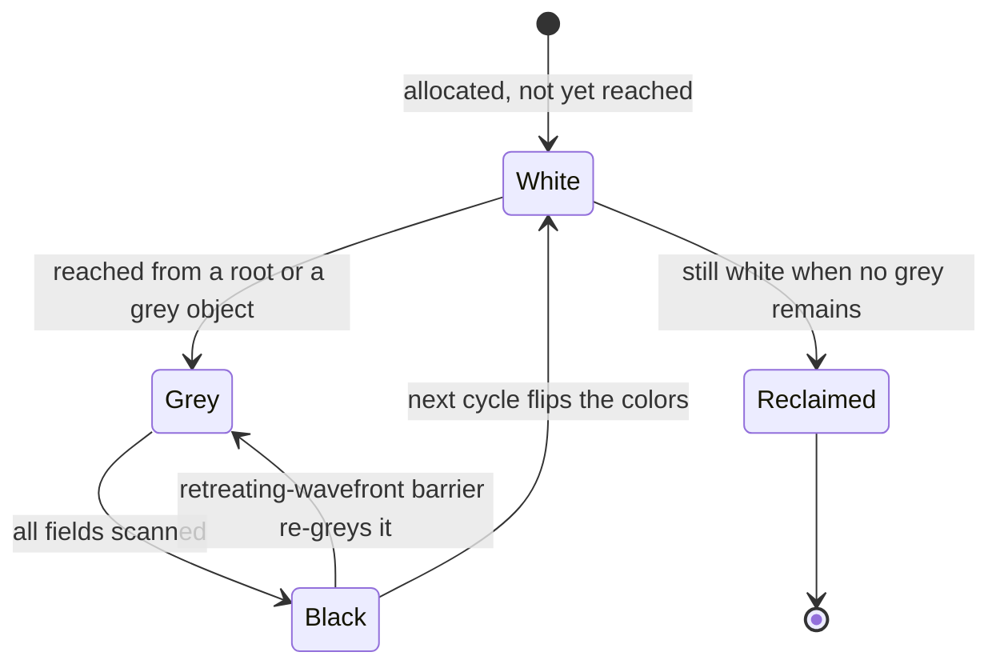
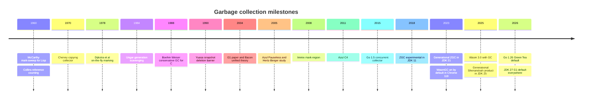

---
tags:
  - compilers
  - garbage-collection
  - memory-management
  - runtimes
  - write-barriers
  - jit
status: complete
sources:
  - https://web.eecs.umich.edu/~weimerw/2014-4610/reading/bacon-garbage.pdf
  - https://people.cs.umass.edu/~emery/pubs/gcvsmalloc.pdf
  - https://cacmb4.acm.org/magazines/1970/11/12288-a-nonrecursive-list-compacting-algorithm
  - https://www.cs.utexas.edu/~EWD/transcriptions/EWD04xx/EWD496A.html
  - https://www.cs.kent.ac.uk/pubs/2007/2506/content.pdf
  - https://people.cs.umass.edu/%7Eemery/classes/cmpsci691s-fall2004/papers/p157-ungar.pdf
  - https://hboehm.info/spe_gc_paper
  - https://www.cs.williams.edu/~dbarowy/cs334s18/assets/p37-detlefs.pdf
  - https://usenix.org/legacy/events/vee05/full_papers/p46-click.pdf
  - https://www.azul.com/sites/default/files/images/c4_paper_acm.pdf
  - https://www.cs.williams.edu/~dbarowy/cs334s18/assets/immix-pldi-2008.pdf
  - https://arxiv.org/abs/2210.17175v1
  - https://www.microsoft.com/en-us/research/publication/perceus-garbage-free-reference-counting-with-reuse-2/
  - https://arxiv.org/abs/1908.05647v3
  - https://apple-swift.readthedocs.io/en/latest/ARCOptimization.html
  - https://www.llvm.org/docs/Statepoints.html
  - https://openjdk.org/jeps/189
  - https://openjdk.org/jeps/439
  - https://openjdk.org/jeps/474
  - https://openjdk.org/jeps/490
  - https://openjdk.org/jeps/404
  - https://openjdk.org/jeps/521
  - https://openjdk.org/jeps/522
  - https://openjdk.org/jeps/523
  - https://infoq.com/news/2026/09/java27-released
  - https://llvm.org/devmtg/2014-10/Slides/Reames-GarbageCollection.pdf
  - https://go.dev/blog/go15gc
  - https://go.dev/doc/gc-guide
  - https://github.com/golang/proposal/blob/master/design/17503-eliminate-rescan.md
  - https://go.dev/blog/greenteagc
  - https://go.dev/doc/go1.26
  - https://devblogs.microsoft.com/dotnet/put-a-dpad-on-that-gc
  - https://learn.microsoft.com/en-us/dotnet/standard/garbage-collection/datas
  - https://devblogs.microsoft.com/dotnet/preparing-for-dotnet-10-gc/
  - https://v8.dev/blog/trash-talk
  - https://v8.dev/blog/concurrent-marking
  - https://v8.dev/blog/high-performance-cpp-gc
  - https://wingolog.org/archives/2023/12/07/the-last-5-years-of-v8s-garbage-collector
  - https://wingolog.org/archives/2025/11/13/the-last-couple-years-in-v8s-garbage-collector
  - https://webkit.org/blog/7122/
  - https://developer.chrome.com/blog/wasmgc
  - https://web.dev/blog/web-platform-12-2024?hl=en
  - https://webassembly.org/news/2025-09-17-wasm-3.0/
  - https://discuss.python.org/t/reverting-the-incremental-gc-in-python-3-14-and-3-15/107014
  - https://pydevtools.com/blog/python-3145-rolls-back-the-incremental-garbage-collector/
  - https://railsatscale.com/2025-01-08-new-for-ruby-3-4-modular-garbage-collectors-and-mmtk/
  - https://docs.julialang.org/en/v1.13-dev/devdocs/gc-mmtk/
created: 2026-11-26
updated: 2026-11-26
---

## Table Of Contents

- [[#TL;DR|TL;DR]]
- [[#The Problem|The Problem]]
- [[#Foundations|Foundations]]
    - [[#Reachability and Roots|Reachability and Roots]]
    - [[#Counting vs Tracing|Counting vs Tracing]]
    - [[#The Tri-Color Abstraction|The Tri-Color Abstraction]]
    - [[#The Generational Hypothesis|The Generational Hypothesis]]
    - [[#Memory Buys Speed|Memory Buys Speed]]
- [[#How We Got Here|How We Got Here]]
- [[#How It Works|How It Works]]
    - [[#Reference Counting and the Compiler|Reference Counting and the Compiler]]
    - [[#Tracing Algorithms|Tracing Algorithms]]
    - [[#Write Barriers and Remembered Sets|Write Barriers and Remembered Sets]]
    - [[#Concurrent Marking Barriers|Concurrent Marking Barriers]]
    - [[#Load Barriers and Concurrent Compaction|Load Barriers and Concurrent Compaction]]
    - [[#Stack Maps and Safepoints|Stack Maps and Safepoints]]
    - [[#Precise vs Conservative Stack Scanning|Precise vs Conservative Stack Scanning]]
    - [[#GC in WebAssembly|GC in WebAssembly]]
- [[#Where It Is Now|Where It Is Now]]
    - [[#The JVM|The JVM]]
    - [[#Go and Green Tea|Go and Green Tea]]
    - [[#.NET|.NET]]
    - [[#JavaScript Engines|JavaScript Engines]]
    - [[#Reference-Counted Languages|Reference-Counted Languages]]
    - [[#MMTk and Research Collectors|MMTk and Research Collectors]]
- [[#Trade-offs & Open Problems|Trade-offs & Open Problems]]
- [[#Resources|Resources]]
- [[#Related Notes|Related Notes]]

## ***TL;DR***
---
*A garbage collector frees memory the program can no longer reach. It is a runtime component, but it only works because the compiler cooperates: it tells the collector where pointers live, emits barrier code on pointer writes or reads, and places safepoints where threads can stop.*

- **Two families.** *Reference counting* (RC) frees an object when its count of incoming pointers hits zero; *tracing* finds everything reachable from the roots and frees the rest. Bacon, Cheng and Rajan showed they are duals: every practical collector is a hybrid of the two ([Bacon et al., OOPSLA 2004](https://web.eecs.umich.edu/~weimerw/2014-4610/reading/bacon-garbage.pdf)).
- **The compiler's three jobs.** (1) *Stack maps* at *safepoints* so the collector can find (and, for a moving collector, update) every pointer in registers and stack slots; LLVM exposes this as `gc.statepoint`/`gc.relocate` ([LLVM docs](https://www.llvm.org/docs/Statepoints.html)). (2) *Barriers*: a few instructions on every pointer store (and, for concurrent compaction, every pointer load). (3) For RC languages, inserting and then optimizing away `retain`/`release` pairs (Swift ARC, Lean, Koka's Perceus).
- **The modern design space.** Generational (most objects die young), concurrent (marking and even compaction run beside the program), region-based (G1, .NET regions, Immix). Low-latency collectors (Azul C4, Shenandoah, ZGC) move objects while the program runs by guarding loads with *load barriers*.
- **The fixed cost.** GC trades memory for speed. Hertz and Berger measured that a generational collector (GenMS) matched explicit `malloc`/`free` with **5x** as much memory, ran 17% slower on average with 3x, and nearly 70% slower with 2x ([Hertz & Berger, OOPSLA 2005](https://people.cs.umass.edu/~emery/pubs/gcvsmalloc.pdf)).
- **As of November 2026.** ZGC is generational-only (JDK 24), generational Shenandoah is a product feature (JDK 25), G1 is the default in every environment (JDK 27, Sept 2026), Go 1.26 made the Green Tea collector default (Feb 2026), WasmGC is in all major browsers and in the Wasm 3.0 standard, and CPython rolled back its incremental cycle collector in 3.14.5.

## ***The Problem***
---
*Manual memory management is fast but error-prone; a collector removes use-after-free and double-free bugs at the cost of memory, CPU and pauses. The hard part is doing it without stopping the program for long and without slowing every pointer operation.*

The program (the *mutator*, in GC literature) allocates objects and links them into a graph. Some objects become unreachable. Freeing them by hand invites dangling pointers and leaks; freeing them automatically raises four engineering problems:

- **Finding pointers.** The collector must know which words in registers, stack frames and objects are pointers. Only the compiler knows the frame layout and which register holds a reference at a given instruction.
- **Pauses.** A naive collector stops all threads (*stop-the-world*, STW) for time proportional to the heap. For a 100 GB heap that is seconds. Concurrent collectors shrink pauses to milliseconds or less, but then the mutator changes the graph while the collector reads it.
- **Fragmentation.** Non-moving collectors leave holes. Moving collectors compact, but then every pointer to a moved object must be fixed, including ones in registers the compiler holds.
- **Overhead on ordinary code.** Every barrier the compiler emits costs a few instructions on hot paths. RC adds an increment and decrement on every pointer copy unless the compiler can prove them redundant.

## ***Foundations***
---
*Five ideas carry most of the field: roots and reachability, the duality of counting and tracing, the tri-color invariant that makes concurrent marking correct, the generational hypothesis, and the space-time trade.*

### Reachability and Roots

*An object is live if a chain of pointers reaches it from a root; collectors approximate "will be used again" with "is reachable".*

**Roots** are pointers the program can use without loading them from another heap object: global variables, stack slots, registers, and runtime handles (JNI handles, V8 `HandleScope`s). The **live set** is the transitive closure of the roots under "points to". Reachability is a conservative stand-in for liveness: a reachable object that is never touched again is still kept. This is why compilers help by ending a variable's liveness early. [[Dataflow Analysis|Liveness analysis]] lets a stack map omit a slot whose value is dead, so the object it points to can be freed sooner.

### Counting vs Tracing

*RC computes the dead objects directly; tracing computes the live ones. Each is the other's mirror image, with opposite strengths.*

| | Reference counting | Tracing |
|---|---|---|
| Works on | Dead objects (count drops to 0) | Live objects (reachable from roots) |
| When memory is freed | Immediately, incrementally | In batches, per collection |
| Cost scales with | Pointer mutations | Live data (mark) or heap (sweep) |
| Cycles | Leaks them without a backup | Handled naturally |
| Compiler involvement | `inc`/`dec` at every pointer copy | Stack maps, barriers |

Bacon et al. formalize both as fixed-point computations over the same object graph: tracing starts counts at zero and increments from roots (least fixed point); RC starts from the true counts and decrements from dead objects (greatest fixed point, which is why cycles survive). Real systems mix them: *deferred RC* skips counting stack references and periodically scans the stack; generational tracing treats old-to-young pointers as extra roots, which is a form of counting ([Bacon et al., 2004](https://web.eecs.umich.edu/~weimerw/2014-4610/reading/bacon-garbage.pdf)).

### The Tri-Color Abstraction

*Dijkstra's coloring lets a collector mark while the mutator runs, provided one invariant holds; barriers exist to keep it.*

Each object is **white** (not yet seen, presumed garbage), **grey** (seen, fields not yet scanned) or **black** (seen and fully scanned). Marking starts with roots grey and ends when no grey objects remain; whatever is still white is garbage ([Dijkstra et al., 1978](https://www.cs.utexas.edu/~EWD/transcriptions/EWD04xx/EWD496A.html)).



A concurrent mutator can break marking only if **both** happen: it stores a pointer to a white object into a black object, **and** it destroys every other path to that white object from grey objects. Barriers break one of the two conditions:

- **Strong invariant (Dijkstra, insertion barrier):** no black object ever points to a white one. On each pointer store, shade the *new* target grey.
- **Weak invariant (Yuasa, deletion barrier, "snapshot at the beginning"):** any white object a black one points to is still reachable from some grey object. On each pointer store, shade the *old* value being overwritten, so everything reachable at the start of marking survives (Yuasa, 1990, as described in [Jones's survey](https://www.cs.kent.ac.uk/pubs/2007/2506/content.pdf)).

### The Generational Hypothesis

*Most objects die young, so collect the young space often and the old space rarely.*

Ungar's generation scavenging (1984) observed that most objects in Smalltalk died soon after allocation, and that copying only the survivors of a small nursery is cheap because the work scales with survivors, not garbage ([Ungar, 1984](https://people.cs.umass.edu/%7Eemery/classes/cmpsci691s-fall2004/papers/p157-ungar.pdf)). The catch: to collect only the young space, the collector must know about every pointer from old objects into young ones without scanning the old space. That is the job of the **write barrier** plus a **remembered set** or **card table**, and it is the main reason compilers emit barrier code at all.

### Memory Buys Speed

*A tracing collector's work per collection scales with live data, so a bigger heap means fewer collections and less total work.*

For a semispace copying collector with heap $H$ (two halves) and live data $L$, each collection copies $L$ bytes and then the program can allocate $H/2 - L$ bytes before the next one:

$$
\text{GC cost per allocated byte} \;\approx\; \frac{c \cdot L}{H/2 - L}
$$

**In plain English:** as the heap shrinks toward twice the live data, the denominator goes to zero and the collector runs constantly; as the heap grows, cost per byte falls toward zero. Hertz and Berger's measurements put numbers on this curve: parity with explicit freeing at 5x as much memory, 17% slower on average at 3x, nearly 70% slower at 2x, and an order of magnitude slower once physical memory is scarce and the system pages ([Hertz & Berger, 2005](https://people.cs.umass.edu/~emery/pubs/gcvsmalloc.pdf)).

## ***How We Got Here***
---
*Mark-sweep and RC both date from 1960 Lisp work. The next sixty years added copying, generations, concurrency, regions and finally concurrent compaction, each step demanding more from the compiler.*



- **1960s to 1970s.** McCarthy's Lisp used mark-sweep and Collins proposed RC, the two families Bacon et al. later unify ([Bacon et al.](https://web.eecs.umich.edu/~weimerw/2014-4610/reading/bacon-garbage.pdf)). Cheney's 1970 algorithm copied live data breadth-first using the to-space itself as the queue, with no recursion or extra stack ([Cheney, CACM 1970](https://cacmb4.acm.org/magazines/1970/11/12288-a-nonrecursive-list-compacting-algorithm)).
- **Concurrency (1978 to 1990).** Dijkstra, Lamport and colleagues introduced the tri-color invariant for a collector running beside the mutator ([EWD496A](https://www.cs.utexas.edu/~EWD/transcriptions/EWD04xx/EWD496A.html)); Yuasa's deletion barrier gave the snapshot alternative ([Jones's survey](https://www.cs.kent.ac.uk/pubs/2007/2506/content.pdf)).
- **Uncooperative compilers (1988).** Boehm and Weiser showed C programs could be collected with no compiler help by treating any word that looks like a heap address as a pointer ([Boehm & Weiser](https://hboehm.info/spe_gc_paper)).
- **Regions and pause targets (2004).** Garbage-First split the heap into equal regions, collected the ones with the most garbage first, and aimed for a user-set pause goal ([Detlefs et al., ISMM 2004](https://www.cs.williams.edu/~dbarowy/cs334s18/assets/p37-detlefs.pdf)).
- **Concurrent compaction (2005 to 2011).** Azul's Pauseless used a hardware read barrier on its Vega processors ([Click, Tene & Wolf, VEE 2005](https://usenix.org/legacy/events/vee05/full_papers/p46-click.pdf)); C4 brought the idea to x86 and made both generations concurrent ([Tene, Iyengar & Wolf, ISMM 2011](https://www.azul.com/sites/default/files/images/c4_paper_acm.pdf)). Shenandoah (Red Hat, [JEP 189](https://openjdk.org/jeps/189)) and ZGC followed in OpenJDK.

## ***How It Works***
---
*This section follows the collector's needs back into the compiler: RC instructions, tracing algorithms, the barrier code each design requires, and the metadata that lets the collector find roots.*

### Reference Counting and the Compiler

*Naive RC is slow because of the counting traffic; the compiler's job is to delete most of it.*

In Swift, the compiler inserts `strong_retain`/`strong_release` (lowered to `swift_retain`/`swift_release` calls) around every copy and end of lifetime, then an ARC optimizer removes pairs it can prove redundant, for example a retain followed by a release of the same object with nothing in between that could free it ([Swift ARC Optimization docs](https://apple-swift.readthedocs.io/en/latest/ARCOptimization.html)). Swift's newer *OSSA* (ownership SSA) form makes ownership explicit in the [[Intermediate Representations|IR]] so these proofs become local def-use questions rather than whole-function dataflow.

```swift
func area(_ s: Shape) -> Double {
    let t = s          // naive: retain(s)
    return t.width * t.height
}                      // naive: release(t)
// After ARC optimization: no retain/release; `s` is borrowed for the call.
```

Functional languages go further (see [[Reference Counting and Reuse]]). Lean 4 marks parameters as *borrowed* (no count change) when inferred safe, and reuses a dead cell's memory for a new cell of the same shape ("reset/reuse") ([Ullrich & de Moura, IFL 2019](https://arxiv.org/abs/1908.05647v3)). Koka's **Perceus** inserts precise `dup`/`drop` so each object is freed at its last use, not at scope end, making the program *garbage free*; with reuse analysis, a `match` that consumes a uniquely owned list cell can build the new cell in the same memory, so functional updates become in-place updates ([Reinking et al., PLDI 2021](https://www.microsoft.com/en-us/research/publication/perceus-garbage-free-reference-counting-with-reuse-2/)).

RC still needs a cycle answer. CPython uses RC plus a separate tracing cycle detector over container objects; Swift has none and relies on `weak`/`unowned` references; Perceus relies on Koka's types making most data acyclic.

### Tracing Algorithms

*Mark-sweep, mark-compact and copying differ in what they do with the live objects once found; mark-region sits between them.*

| Algorithm | After marking | Moves objects? | Strength | Weakness |
|---|---|---|---|---|
| Mark-sweep | Put dead cells on free lists | No | Simple, no pointer updates | Fragmentation, slow allocation |
| Mark-compact | Slide live objects together | Yes | Dense heap, bump allocation | Several heap passes |
| Copying (semispace) | Copy live objects to to-space | Yes | Work scales with live data only | Half the heap reserved |
| Mark-region (Immix) | Free whole lines and blocks; copy only fragmented blocks | Opportunistically | Bump allocation, locality, little copying | Line-granularity waste |

**Cheney's copying collector** in C. The to-space is the BFS queue: `scan` chases `free`.

```c
void collect(void) {
    char *scan = to_space, *free = to_space;
    for (Obj **root = roots; root < roots_end; root++)
        *root = forward(*root, &free);          // copy roots
    while (scan < free) {                        // BFS over to-space
        Obj *o = (Obj *)scan;
        for (int i = 0; i < o->nfields; i++)
            o->field[i] = forward(o->field[i], &free);
        scan += size_of(o);
    }
    swap(&from_space, &to_space);                // old from-space is now free
}
Obj *forward(Obj *o, char **free) {
    if (!in_from_space(o)) return o;
    if (o->forwarded) return o->forwardee;       // already copied
    Obj *copy = (Obj *)*free; memcpy(copy, o, size_of(o)); *free += size_of(o);
    o->forwarded = 1; return o->forwardee = copy;
}
```

**Immix** divides the heap into 32 KB blocks of 128-byte lines. Marking records live lines; the allocator bump-allocates into runs of free lines; during a collection it copies objects out of only the most fragmented blocks ([Blackburn & McKinley, 2008](https://www.cs.williams.edu/~dbarowy/cs334s18/assets/immix-pldi-2008.pdf)). **LXR** (PLDI 2022) puts reference counting on top of an Immix heap, reclaiming most memory without copying and using a concurrent trace only as needed to find cyclic garbage; on the Lucene search engine with a generous heap it reported 6x higher throughput and 30x lower 99.9th-percentile latency than Shenandoah in its default configuration ([Zhao, Blackburn & McKinley, 2022](https://arxiv.org/abs/2210.17175v1)).

### Write Barriers and Remembered Sets

*A generational collector needs every old-to-young pointer; the compiler emits a short sequence after each pointer store to record it.*

The **card table** is a byte array with one entry per small chunk of heap (512 bytes in HotSpot's classic design). The barrier marks the card holding the updated object dirty; a minor collection scans only dirty cards in the old generation for young pointers.

```asm
; obj.field = val  (x86-64, card-marking post-write barrier)
mov   [rdi + 16], rsi          ; the store itself
shr   rdi, 9                   ; card index = address / 512
mov   byte [r12 + rdi], 0      ; r12 = card table base; 0 = dirty
```

Three instructions, no branch: unconditional card marking trades precision (some cards are dirtied for no reason) for a tiny barrier. G1 uses a heavier, filtered post-barrier: it skips null stores and same-region stores, then dirties the card and logs it to a queue for refinement threads that maintain per-region remembered sets ([Detlefs et al., 2004](https://www.cs.williams.edu/~dbarowy/cs334s18/assets/p37-detlefs.pdf)). JDK 26's JEP 522 simplified that barrier by giving G1's background threads a second card table to work on, so application threads update the first table without synchronization; the x64 barrier shrank from about 50 instructions to 12, for a reported 5–15% throughput gain on reference-heavy applications ([JEP 522](https://openjdk.org/jeps/522)).

The compiler's leverage: barriers can be **elided** when the stored value is null, when the target object was just allocated in the young generation (no old-to-young edge possible), or when the store is to a stack-allocated object after [[Escape Analysis|escape analysis]]. JIT compilers do all three; barrier elision is one of the payoffs of [[Classic Optimizations|classic optimizations]] like constant propagation.

### Concurrent Marking Barriers

*When marking runs concurrently, the write barrier also has to keep the tri-color invariant.*

```c
// Dijkstra insertion barrier: keep "no black -> white"
void write_dijkstra(Obj **slot, Obj *ptr) { shade(ptr);   *slot = ptr; }

// Yuasa / SATB deletion barrier: keep everything reachable at mark start
void write_yuasa(Obj **slot, Obj *ptr)    { shade(*slot); *slot = ptr; }

// Go's hybrid barrier (Go 1.8): no stack re-scan at the end of marking
void write_go(Obj **slot, Obj *ptr) {
    shade(*slot);
    if (current_stack_is_grey()) shade(ptr);
    *slot = ptr;
}
```

The trade-off is subtle. An insertion barrier lets the collector finish with a re-scan of stacks (stack writes are not barriered, so stacks can go grey again), which before Go 1.8 meant a stop-the-world rescan. SATB needs no rescan but keeps everything alive at mark start, so it frees less per cycle. Go's hybrid combines both so that stacks, once scanned, stay black, eliminating the rescan ([Clements & Hudson, Go proposal 17503](https://github.com/golang/proposal/blob/master/design/17503-eliminate-rescan.md)). G1 and Shenandoah use SATB-style marking barriers, while V8 uses a Dijkstra-style insertion barrier that shades the newly written value ([V8 concurrent marking](https://v8.dev/blog/concurrent-marking)); WebKit's Riptide uses a *retreating wavefront* barrier that turns a black object back to grey when it is stored into ([WebKit, 2017](https://webkit.org/blog/7122/)).

### Load Barriers and Concurrent Compaction

*To move objects while threads run, every reference loaded from the heap must be checked and, if stale, fixed before use.*

Pauseless, C4, Shenandoah (since its 2.0 rework) and ZGC all guard **loads** of references. The fast path is a test and a rarely taken branch; the slow path marks, relocates or remaps the object and *self-heals* the field in memory so the next load is fast ([Click et al., 2005](https://usenix.org/legacy/events/vee05/full_papers/p46-click.pdf); [Tene et al., 2011](https://www.azul.com/sites/default/files/images/c4_paper_acm.pdf)).

```c
// Colored-pointer load barrier (ZGC-style, simplified)
Obj *load_ref(Obj **field) {
    uintptr_t p = (uintptr_t)*field;
    if (p & bad_color_mask)            // stale color for this GC phase?
        p = slow_path_mark_or_relocate(field, p);   // fixes *field too
    return (Obj *)strip_color(p);
}
```

ZGC stores GC state ("colors") in spare bits of each 64-bit pointer, so the check needs no memory access beyond the load itself. Generational ZGC (JDK 21) changed the encoding: it dropped the multi-mapped address-space trick, added explicit store barriers for remembered sets and concurrent marking, and keeps references held in registers and stacks colorless ([JEP 439](https://openjdk.org/jeps/439)). The price of a load barrier is paid on the most common operation in object-heavy code, which is why these collectors give up some throughput for sub-millisecond pauses.

### Stack Maps and Safepoints

*The collector can only stop a thread where the compiler has recorded which stack slots and registers hold pointers.*

A **safepoint** is a program point where the runtime may pause a thread for GC; a **stack map** lists, for that point, the locations of live references. Compilers place safepoints at calls, allocation sites, and polls on loop back-edges and function returns, so a long loop cannot delay a collection indefinitely. Between safepoints the compiler is free to hold derived pointers (`base + offset`) in registers, which is why the map must also say which base each derived pointer belongs to.

LLVM's approach rewrites calls into **statepoints**. The `RewriteStatepointsForGC` pass finds GC pointers (in the `statepoint-example` strategy, pointers in `addrspace(1)`; custom strategies can decide otherwise), computes which are live across each call, and makes the possible relocation explicit in [[SSA Form|SSA]]: after the call, uses read a `gc.relocate` result, never the old value ([LLVM Statepoints](https://www.llvm.org/docs/Statepoints.html)).

```llvm
; source: %obj (a GC pointer) is live across `call void @foo()`
; after RewriteStatepointsForGC:
  %statepoint_token = call token (i64, i32, ptr, i32, i32, ...)
         @llvm.experimental.gc.statepoint.p0(i64 2882400000, i32 0,
           ptr elementtype(void ()) @foo, i32 0, i32 0, i32 0, i32 0)
         [ "gc-live"(ptr addrspace(1) %obj) ]
  %obj.relocated = call coldcc ptr addrspace(1)
         @llvm.experimental.gc.relocate.p1(token %statepoint_token, i32 0, i32 0)
  ret ptr addrspace(1) %obj.relocated
```

Because the relocation is an SSA def, later passes cannot accidentally keep using a stale address, and [[Register Allocation|register allocation]] decides where each live pointer sits; the backend then emits a stack-map section the runtime reads. The LLVM docs say the mechanism has shipped in a commercial Java implementation with a fully relocating collector; it was presented by Philip Reames and Sanjoy Das of Azul Systems at the 2014 LLVM Developers' Meeting ([Reames, 2014](https://llvm.org/devmtg/2014-10/Slides/Reames-GarbageCollection.pdf)). The older `gcroot` intrinsic marks stack slots (allocas) as roots and is now mostly of historical interest apart from its shadow-stack support. See [[LLVM]] and [[JIT Compilation]].

### Precise vs Conservative Stack Scanning

*If the compiler gives no stack maps, the collector can treat anything that looks like a pointer as one, at the cost of pinning those objects.*

*Precise* scanning (HotSpot, .NET, Go, LLVM statepoints) needs compiler-emitted maps but can move any object. *Conservative* scanning needs nothing from the compiler, but every object referenced from the stack is pinned, and an integer that happens to look like an address keeps garbage alive.

The Boehm-Demers-Weiser collector scans stacks, registers and (optionally) the heap conservatively, which is how C and C++ programs get GC without compiler support ([Boehm & Weiser](https://hboehm.info/spe_gc_paper)). WebKit's JavaScriptCore scans native stacks conservatively and keeps objects they reference in place, while still being generational and concurrent ([WebKit Riptide](https://webkit.org/blog/7122/)). Chromium's Oilpan (now V8's `cppgc` library) collects Blink's C++ objects, tracing across the C++/JavaScript boundary in a unified heap ([V8, 2020](https://v8.dev/blog/high-performance-cpp-gc)). Conservative scanning is attractive because handle bookkeeping in C++ is error-prone and slow; Andy Wingo's reviews of V8's collector discuss V8's own work toward conservative stack scanning, which as of late 2025 had still not shipped in V8 proper ([Wingo, 2023](https://wingolog.org/archives/2023/12/07/the-last-5-years-of-v8s-garbage-collector); [Wingo, Nov 2025](https://wingolog.org/archives/2025/11/13/the-last-couple-years-in-v8s-garbage-collector)).

### GC in WebAssembly

*Wasm code cannot scan its own stack, so before WasmGC every managed language had to ship a collector and a shadow stack inside linear memory.*

In core [[WebAssembly]], locals live in an engine-managed stack the program cannot inspect. A compiler targeting it (for Java, Kotlin, C# or Go) had to spill every root to a "shadow stack" in linear memory around each call and bundle its own collector into the module: bigger binaries, slower code, and no way to collect cycles that pass through JavaScript objects.

The **WasmGC** proposal adds typed `struct` and `array` heap types (declared like `(type $Point (struct (field $x (mut f64))))` and allocated with `struct.new`), `i31ref`, and subtyping, all allocated and collected by the host engine's GC. The compiler's job changes from "emit a collector and root bookkeeping" to "map the source language's object model to Wasm struct types". Chrome enabled it by default in Chrome 119 (late 2023), citing Kotlin/Wasm and Dart/Flutter as early toolchains ([Chrome, 2023](https://developer.chrome.com/blog/wasmgc)); Safari 18.2 added it in December 2024, making it Baseline ([web.dev, Dec 2024](https://web.dev/blog/web-platform-12-2024?hl=en)); and the Wasm 3.0 standard, announced September 2025, includes it ([WebAssembly.org](https://webassembly.org/news/2025-09-17-wasm-3.0/)).

## ***Where It Is Now***
---
*As of November 2026, every major managed runtime ships a concurrent, generational or region-based collector, and the recent work is about memory footprint, barrier cost and making low-pause collection the default rather than an option.*

### The JVM

| Release | GC change |
|---|---|
| JDK 21 (Sept 2023) | Generational ZGC added ([JEP 439](https://openjdk.org/jeps/439)) |
| JDK 23 (Sept 2024) | ZGC defaults to generational mode ([JEP 474](https://openjdk.org/jeps/474)) |
| JDK 24 (Mar 2025) | Non-generational ZGC removed ([JEP 490](https://openjdk.org/jeps/490)); generational Shenandoah experimental ([JEP 404](https://openjdk.org/jeps/404)) |
| JDK 25 LTS (Sept 2025) | Generational Shenandoah becomes a product feature, still opt-in via a mode flag ([JEP 521](https://openjdk.org/jeps/521)) |
| JDK 26 (Mar 2026) | G1 throughput improved with a simpler post-write barrier ([JEP 522](https://openjdk.org/jeps/522)) |
| JDK 27 (Sept 2026) | G1 is the default GC in all environments, replacing the Serial GC default on small machines ([JEP 523](https://openjdk.org/jeps/523); [InfoQ](https://infoq.com/news/2026/09/java27-released)) |

### Go and Green Tea

*Go keeps a non-moving, non-generational concurrent mark-sweep and instead attacks the memory-access cost of marking.*

Go's collector became concurrent in Go 1.5 (2015) ([Go blog](https://go.dev/blog/go15gc)) and is tuned with `GOGC` (heap growth target) and `GOMEMLIMIT` (soft memory limit) ([GC guide](https://go.dev/doc/gc-guide)). It is non-moving, so its compiler needs precise stack maps but no load barriers, and has no generations, relying on escape analysis to keep short-lived values on the stack.

**Green Tea** changes how marking walks memory: instead of chasing individual objects in pointer order (poor cache locality), it queues whole small-object *pages* (spans, in the runtime's terms) and scans the marked objects in each page together. The Go team shipped it as an experiment in Go 1.25 (`GOEXPERIMENT=greenteagc`) and reported 10% to 40% less GC CPU in its benchmark suite, with about 10% as the typical gain ([Go blog, Green Tea](https://go.dev/blog/greenteagc)). Go 1.26 (February 2026) made it the default, expecting a 10–40% cut in GC overhead for GC-heavy programs plus roughly another 10% from vector instructions on Intel Ice Lake, AMD Zen 4 and newer; `GOEXPERIMENT=nogreenteagc` opts out ([Go 1.26 release notes](https://go.dev/doc/go1.26)).

### .NET

.NET's GC is precise, generational and compacting; the JIT emits GC info (live-slot tables) for each method. .NET 7 switched the heap from large segments to **regions**, which can be moved between generations and returned to the OS individually ([.NET blog](https://devblogs.microsoft.com/dotnet/put-a-dpad-on-that-gc)). **DATAS** (Dynamic Adaptation To Application Sizes) starts with one heap and grows or shrinks the number of GC heaps with load, up to the core count; it was opt-in in .NET 8 and is on by default in .NET 9 ([Microsoft Learn](https://learn.microsoft.com/en-us/dotnet/standard/garbage-collection/datas)); the GC team's October 2025 post prepares users moving to .NET 10 for DATAS's effects on memory and throughput ([.NET blog, 2025](https://devblogs.microsoft.com/dotnet/preparing-for-dotnet-10-gc/)).

### JavaScript Engines

V8's **Orinoco** project turned a mostly stop-the-world collector into one with a parallel young-generation scavenger, concurrent marking, and parallel compaction, with much of the work moved to helper threads and idle time ([V8, Trash talk](https://v8.dev/blog/trash-talk)). Blink's C++ objects are managed by Oilpan/`cppgc` in a unified heap with JavaScript objects ([V8, 2020](https://v8.dev/blog/high-performance-cpp-gc)); V8 has also experimented with a non-moving mark-sweep young generation, which by Wingo's 2025 account lost out to the copying nursery, and with conservative stack scanning, not yet shipped in V8 proper as of November 2025 ([Wingo, 2023](https://wingolog.org/archives/2023/12/07/the-last-5-years-of-v8s-garbage-collector); [Wingo, 2025](https://wingolog.org/archives/2025/11/13/the-last-couple-years-in-v8s-garbage-collector)). WebKit's Riptide is concurrent and generational with conservative stack scanning ([WebKit](https://webkit.org/blog/7122/)).

### Reference-Counted Languages

- **CPython.** RC plus a generational cycle collector. Python 3.14.0 through 3.14.4 shipped an incremental cycle collector to cut pause times; after reports of significant memory pressure in production, the release team announced in April 2026 that 3.14 and 3.15 would return to 3.13's generational collector, and 3.14.5 shipped the revert on 10 May 2026, ahead of its planned June date ([discuss.python.org](https://discuss.python.org/t/reverting-the-incremental-gc-in-python-3-14-and-3-15/107014); [pydevtools](https://pydevtools.com/blog/python-3145-rolls-back-the-incremental-garbage-collector/)).

### MMTk and Research Collectors

MMTk is a Rust library of collectors (Immix, generational Immix, LXR and others) with bindings for several runtimes. Ruby 3.4 (December 2024) added a modular GC interface with an experimental MMTk build ([Rails at Scale, Jan 2025](https://railsatscale.com/2025-01-08-new-for-ruby-3-4-modular-garbage-collectors-and-mmtk/)), and Julia's development docs describe building Julia with MMTk ([Julia devdocs](https://docs.julialang.org/en/v1.13-dev/devdocs/gc-mmtk/)). Both are experimental, but they plug a research GC toolkit into the upstream runtimes rather than a fork.

## ***Trade-offs & Open Problems***
---
*Every collector picks a point among throughput, latency and memory, and the compiler pays for the latency end in barrier instructions.*

| Collector | Moving | Generational | Concurrent | Barriers the compiler emits | Typical pause (project targets, not benchmarks) |
|---|---|---|---|---|---|
| Boehm-Demers-Weiser | No | Optional | Optional | None (conservative) | Proportional to heap |
| HotSpot Parallel | Yes | Yes | No (parallel STW) | Card-marking store | Hundreds of ms on large heaps |
| G1 | Yes | Yes | Marking only | SATB pre + filtered card post | Tens of ms, user-set target |
| Generational ZGC | Yes | Yes | Mark and relocate | Load + store barriers | Sub-millisecond |
| Generational Shenandoah | Yes | Yes | Mark and evacuate | Load-reference + SATB | Low milliseconds |
| Azul C4 | Yes | Yes | Both generations | Loaded value barrier | Sub-millisecond |
| Go (Green Tea) | No | No | Mark and sweep | Hybrid write barrier | Sub-millisecond STW phases |
| .NET (regions) | Yes | Yes | Background gen 2 | Card-marking store | Tens of ms |
| V8 Orinoco | Yes (young, compaction) | Yes | Marking | Generational + marking store | Milliseconds |
| Swift ARC | No | n/a | n/a | Retain/release calls | None, but no cycle collection |

**Open problems.**

- **Barrier cost vs pause time.** Load barriers make pauses nearly independent of heap size but tax every reference load; JEP 522 shows store-barrier cost still matters for G1 too.
- **Memory footprint.** Hertz and Berger's 3x to 5x headroom is costly in containers billed by memory; .NET DATAS, Go's `GOMEMLIMIT` aim at smaller heaps, and JDK 27 dropped the Serial default on small machines because G1 now serves constrained environments too.
- **RC without regressions.** LXR and Perceus show RC can compete with tracing, but CPython's 3.14 reversal shows how hard it is to change a mature collector without surprising users.
- **Locality during marking.** Green Tea shows the mark phase's memory access pattern, not just its algorithmic work, dominates on modern CPUs.
- **Wasm.** WasmGC gives languages the host's collector but not its features: no finalization hooks beyond what JS offers, and the language must fit its object model to Wasm struct types. Linear-memory languages (C, Rust) still bring their own allocators.

## ***Resources***
---
*Start with Bacon et al. for the big picture and Hertz and Berger for the cost model; read the JEPs and Go design docs for how barriers look in production; read the LLVM statepoint docs for the compiler side.*

**Foundational papers**
- [A Unified Theory of Garbage Collection](https://web.eecs.umich.edu/~weimerw/2014-4610/reading/bacon-garbage.pdf): Bacon, Cheng and Rajan, OOPSLA 2004.
- [Quantifying the Performance of Garbage Collection vs. Explicit Memory Management](https://people.cs.umass.edu/~emery/pubs/gcvsmalloc.pdf): Hertz and Berger, OOPSLA 2005.
- [A Nonrecursive List Compacting Algorithm](https://cacmb4.acm.org/magazines/1970/11/12288-a-nonrecursive-list-compacting-algorithm): Cheney, CACM 1970.

**Modern collectors**
- [Garbage-First Garbage Collection](https://www.cs.williams.edu/~dbarowy/cs334s18/assets/p37-detlefs.pdf): Detlefs et al., ISMM 2004.
- [The Pauseless GC Algorithm](https://usenix.org/legacy/events/vee05/full_papers/p46-click.pdf): Click, Tene and Wolf, VEE 2005.
- [C4: The Continuously Concurrent Compacting Collector](https://www.azul.com/sites/default/files/images/c4_paper_acm.pdf): Tene, Iyengar and Wolf, ISMM 2011.
- [Immix](https://www.cs.williams.edu/~dbarowy/cs334s18/assets/immix-pldi-2008.pdf): Blackburn and McKinley, PLDI 2008.
- [Low-Latency, High-Throughput Garbage Collection (LXR)](https://arxiv.org/abs/2210.17175v1): Zhao, Blackburn and McKinley, PLDI 2022.
- [Perceus](https://www.microsoft.com/en-us/research/publication/perceus-garbage-free-reference-counting-with-reuse-2/): Reinking et al., PLDI 2021.
- [Counting Immutable Beans](https://arxiv.org/abs/1908.05647v3): Ullrich and de Moura, IFL 2019.

**Compiler side**
- [Garbage Collection Safepoints in LLVM](https://www.llvm.org/docs/Statepoints.html).
- [Practical Fully Relocating Garbage Collection in LLVM](https://llvm.org/devmtg/2014-10/Slides/Reames-GarbageCollection.pdf): Reames and Das (Azul), LLVM Developers' Meeting 2014.
- [ARC Optimization for Swift](https://apple-swift.readthedocs.io/en/latest/ARCOptimization.html).
- [Go proposal: Eliminate STW stack re-scanning](https://github.com/golang/proposal/blob/master/design/17503-eliminate-rescan.md).

**Runtimes and release notes**
- JEPs [189](https://openjdk.org/jeps/189), [404](https://openjdk.org/jeps/404), [439](https://openjdk.org/jeps/439), [474](https://openjdk.org/jeps/474), [490](https://openjdk.org/jeps/490), [521](https://openjdk.org/jeps/521), [522](https://openjdk.org/jeps/522), [523](https://openjdk.org/jeps/523); [Java 27 released (InfoQ)](https://infoq.com/news/2026/09/java27-released).
- [Go GC guide](https://go.dev/doc/gc-guide), [Green Tea blog](https://go.dev/blog/greenteagc), [Go 1.26 notes](https://go.dev/doc/go1.26).
- [.NET regions](https://devblogs.microsoft.com/dotnet/put-a-dpad-on-that-gc), [DATAS](https://learn.microsoft.com/en-us/dotnet/standard/garbage-collection/datas), [Preparing for the .NET 10 GC](https://devblogs.microsoft.com/dotnet/preparing-for-dotnet-10-gc/).
- [V8: Trash talk](https://v8.dev/blog/trash-talk), [Concurrent marking](https://v8.dev/blog/concurrent-marking), [cppgc](https://v8.dev/blog/high-performance-cpp-gc); Andy Wingo on V8's GC ([2023](https://wingolog.org/archives/2023/12/07/the-last-5-years-of-v8s-garbage-collector), [2025](https://wingolog.org/archives/2025/11/13/the-last-couple-years-in-v8s-garbage-collector)).
- [WebKit Riptide](https://webkit.org/blog/7122/), [WasmGC in Chrome](https://developer.chrome.com/blog/wasmgc), [Wasm 3.0](https://webassembly.org/news/2025-09-17-wasm-3.0/).
- [Ruby 3.4 modular GC and MMTk](https://railsatscale.com/2025-01-08-new-for-ruby-3-4-modular-garbage-collectors-and-mmtk/), [Julia + MMTk](https://docs.julialang.org/en/v1.13-dev/devdocs/gc-mmtk/).

## Related Notes

- [[JIT Compilation]] — JITs emit barriers, safepoint polls and GC maps, and elide barriers using profile data.
- [[LLVM]] — `gc.statepoint`, `gc.relocate` and the stack-map section.
- [[SSA Form]] — Why statepoints model relocation as new SSA values.
- [[Dataflow Analysis]] — Liveness decides which slots a stack map must list.
- [[Register Allocation]] — Where live GC pointers sit at each safepoint.
- [[Intermediate Representations]] — Ownership SSA (OSSA) and GC-aware address spaces in IR.
- [[Classic Optimizations]] — Barrier elision and retain/release pair removal.
- [[WebAssembly]] — Linear memory vs WasmGC.
- [[Type Systems and Inference]] — Types that make data acyclic or unique, which Perceus exploits.
- [[Reference Counting and Reuse]] — The RC family in depth: Perceus, Lean's reset/reuse, borrowing, biased RC, trial deletion, LXR.
- [[Compiler Pipeline]] — Where GC lowering sits in a compiler.
- [[Closure Conversion and Defunctionalization]] — Heap closures and their environments, and why linked environments retain dead data.
- [[Escape Analysis]] — Stack allocation and barrier removal for objects that never escape.
- [[Compiler, Assembler, Linker, and Loader]] — The C build stages, a world without a collector.
