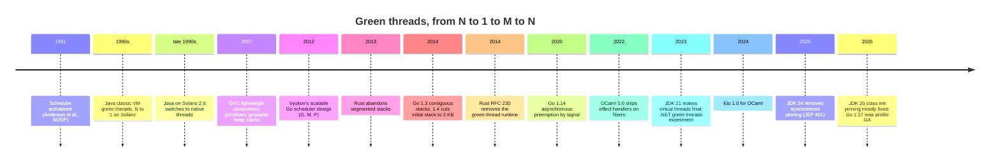
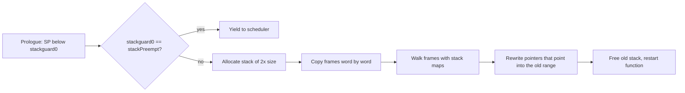
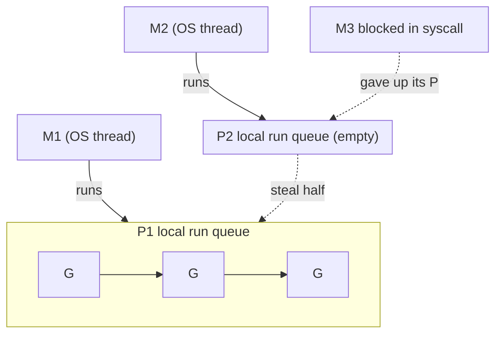
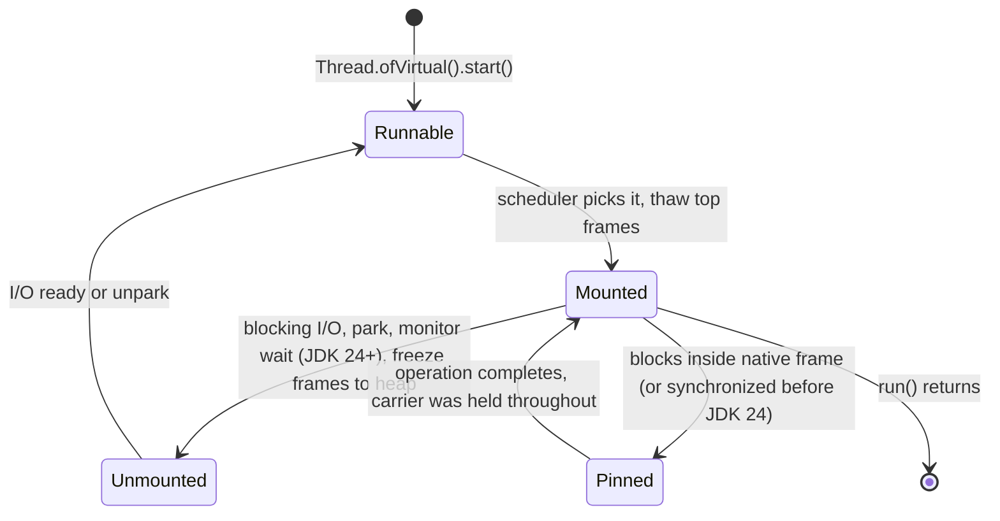
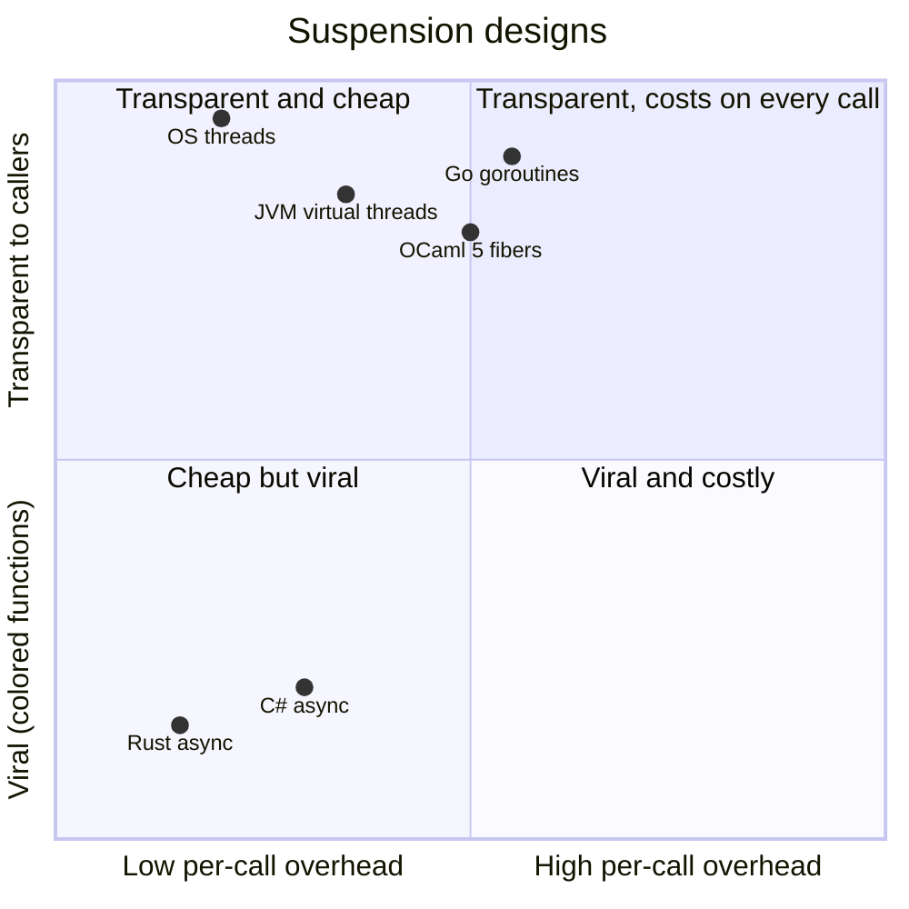

---
tags:
  - compilers
  - runtimes
  - concurrency
  - green-threads
  - virtual-threads
  - goroutines
  - loom
  - stacks
  - scheduling
  - go
  - jvm
  - ocaml
status: complete
sources:
  - https://docs.google.com/document/d/1TTj4T2JO42uD5ID9e89oa0sLKhJYD0Y_kqxDv3I3XMw/mobilebasic
  - https://docs.google.com/document/d/1wAaf1rYoM4S4gtnPh0zOlGzWtrZFQ5suE8qr2sD8uWQ/pub
  - https://go.dev/doc/go1.3
  - https://go.dev/doc/go1.4
  - https://go.dev/doc/go1.14
  - https://go.dev/doc/go1.26
  - https://go.dev/doc/go1.27
  - https://go.googlesource.com/go/+/master/src/runtime/stack.go
  - https://go.googlesource.com/go/+/HEAD/src/runtime/cgocall.go
  - https://mail.openjdk.org/pipermail/loom-dev/2018-March/000037.html
  - https://cr.openjdk.org/~rpressler/loom/Loom-Proposal.html
  - https://openjdk.org/jeps/491
  - https://builds.shipilev.net/patch-openjdk-loom-fibers/src/hotspot/share/runtime/continuationFreezeThaw.cpp.html
  - https://mail.openjdk.org/pipermail/hotspot-dev/2024-April/087576.html
  - https://www.oracle.com/news/announcement/oracle-releases-java-27-2026-09-15/
  - https://mail.openjdk.org/pipermail/jdk-dev/2024-November/009600.html
  - https://mail.openjdk.org/pipermail/loom-dev/2025-November/008027.html
  - https://docs.oracle.com/en/java/javase/26/core/virtual-threads.html
  - https://sapmachine.io/docs/essential-information-on-virtual-threads/
  - https://infoq.com/articles/virtual-threads-after-jdk24
  - https://infoq.com/news/2026/08/java-27-so-far
  - https://docs.oracle.com/cd/E19455-01/806-3461/6jck06gqh/index.html
  - https://mail.openjdk.org/pipermail/loom-dev/2019-October/000784.html
  - https://arxiv.org/pdf/2104.00250
  - https://discuss.ocaml.org/t/ann-eio-1-0-first-major-release/14334
  - https://github.com/ocaml-multicore/eio
  - https://www.microsoft.com/en-us/research/wp-content/uploads/2016/07/lw-conc.pdf
  - https://www.erlang.org/doc/system/eff_guide_processes
  - https://mail-archive.com/rust-dev@mozilla.org/msg06296.html
  - https://rust-lang.github.io/rfcs/0230-remove-runtime.html
  - https://github.com/dotnet/runtimelab/issues/2398
  - https://homes.cs.washington.edu/~tom/pubs/sched_act.html
  - https://journal.stuffwithstuff.com/2015/02/01/what-color-is-your-function
  - https://docs.wasmtime.dev/stability-wasm-proposals.html
  - https://github.com/WebAssembly/stack-switching
  - https://arxiv.org/html/2512.03083v1
created: 2026-11-28
updated: 2026-11-28
---

## Table Of Contents

- [[#TL;DR|TL;DR]]
- [[#The Problem|The Problem]]
- [[#Foundations|Foundations]]
    - [[#Threading Models - 1 to 1, N to 1, M to N|Threading Models - 1 to 1, N to 1, M to N]]
    - [[#Stackful vs Stackless|Stackful vs Stackless]]
    - [[#Why Thread Count Matters - Little's Law|Why Thread Count Matters - Little's Law]]
    - [[#Three Ways to Hold a Small Stack|Three Ways to Hold a Small Stack]]
- [[#How We Got Here|How We Got Here]]
- [[#How It Works|How It Works]]
    - [[#Go - Stack Checks in Every Prologue|Go - Stack Checks in Every Prologue]]
    - [[#Go - Growing by Copying|Go - Growing by Copying]]
    - [[#Go - The G, M, P Scheduler|Go - The G, M, P Scheduler]]
    - [[#JVM - Continuations That Copy Frames to the Heap|JVM - Continuations That Copy Frames to the Heap]]
    - [[#JVM - Pinning and How It Was Fixed|JVM - Pinning and How It Was Fixed]]
    - [[#OCaml 5 - Fibers Under Effect Handlers|OCaml 5 - Fibers Under Effect Handlers]]
    - [[#The Native Code Boundary|The Native Code Boundary]]
- [[#Where It Is Now|Where It Is Now]]
- [[#Trade-offs & Open Problems|Trade-offs & Open Problems]]
- [[#Resources|Resources]]
- [[#Related Notes|Related Notes]]

## ***TL;DR***
---
*Green threads (goroutines, JVM virtual threads, OCaml fibers, Erlang processes) are threads the language runtime schedules itself onto a few OS threads, each with its own small, movable stack. They let you write plain blocking code and still run a million concurrent tasks, and almost all of the difficulty lands on the compiler and runtime: stack checks, stack maps, preemption and the boundary with native code.*

- **What they are.** A user-level thread is a stack plus saved registers that the runtime, not the kernel, switches between. Many of them (M) are multiplexed onto a few OS threads (N), hence *M:N scheduling*.
- **Why they exist.** OS threads cost a big fixed stack reservation and a kernel switch each. Code that spends most of its life waiting on I/O needs one *task* per request, not one *CPU*, and OS threads don't scale to hundreds of thousands. Green threads keep the simple "one thread per request" style without that cost, as opposed to `async`/`await`, which splits the language into two colors of function ([Nystrom, 2015](https://journal.stuffwithstuff.com/2015/02/01/what-color-is-your-function)).
- **The compiler's part.** Small stacks must be able to grow, so the compiler emits an **overflow check in every function prologue** (Go, OCaml 5). Growing by copying needs **precise [[Safepoints and Stack Maps|stack maps]]** to fix up pointers into the stack. Preemption needs safepoints or signal-based interruption. The JVM instead **copies frames to and from heap objects** on every park and resume.
- **The persistent pain point is native code.** A C frame can hold raw pointers into the stack and expects a big stack, so runtimes either switch to a system stack for every C call (Go, OCaml) or **pin** the green thread to its carrier (Java). Pinning on `synchronized` was Java's best-known problem until JDK 24 fixed it ([JEP 491](https://openjdk.org/jeps/491)).
- **Late 2026.** Go 1.27 (August 2026) made the GC-based goroutine leak profile generally available ([Go 1.27](https://go.dev/doc/go1.27)); JDK 26 removed most class-initialization pinning ([loom-dev, Nov 2025](https://mail.openjdk.org/pipermail/loom-dev/2025-November/008027.html)); JDK 27 (September 2026) carried Structured Concurrency into a seventh preview ([InfoQ](https://infoq.com/news/2026/08/java-27-so-far)); .NET shelved its green-threads experiment for runtime-level async ([runtimelab #2398](https://github.com/dotnet/runtimelab/issues/2398)).

## ***The Problem***
---
*A server spends most of its time waiting. If each waiting request needs an OS thread, the thread count, not the CPU, becomes the limit. The problem is to make a waiting thread nearly free without making every function in the program async.*

An OS thread is expensive in two ways: memory (a fixed stack reservation, usually in megabytes of address space, plus kernel bookkeeping) and switching (a trip through the kernel scheduler). That is fine for a few hundred threads and fails at a few hundred thousand.

The industry's first answer was asynchronous code: callbacks, then futures, then `async`/`await`. It scales, but it changes the language. An `async` function can only be awaited from another `async` function, so the "color" (an effect that the type tracks, in the sense of [[Effect Types]]) spreads up the call graph, and blocking calls inside async code stall everything ([Nystrom, 2015](https://journal.stuffwithstuff.com/2015/02/01/what-color-is-your-function)). Stack traces, debuggers and profilers also lose the logical thread of control.

The green-thread answer keeps blocking code and makes the thread cheap instead. The JVM documentation puts the design rule plainly: virtual threads "are plentiful, and so each should represent not some shared, pooled, resource but a task" and "should never be pooled" ([Oracle, Java 26 docs](https://docs.oracle.com/en/java/javase/26/core/virtual-threads.html)).

What that asks of the implementation:

| Requirement | Why it is hard | Who solves it |
|---|---|---|
| Tiny initial stacks (KB, not MB) | Code doesn't know how deep it will recurse | Compiler: prologue overflow checks |
| Stacks that grow | Moving a stack invalidates every pointer into it | Compiler: precise [[Safepoints and Stack Maps|stack maps]]; [[Escape Analysis]] to keep pointers to stack data local |
| Blocking calls that don't block the OS thread | The kernel only knows about OS threads | Runtime: non-blocking I/O plus a scheduler that parks the green thread |
| Fair sharing of the CPU | A tight loop never yields | Compiler and runtime: safepoint polls or signal-based preemption |
| Calling C | C expects a large, fixed stack and can keep raw stack pointers | Runtime: switch to a system stack, or pin |

## ***Foundations***
---
*Four ideas carry the rest of the note: the threading models, the difference between stackful and stackless suspension, why concurrency needs many threads, and the three ways to store a stack that starts small.*

### Threading Models - 1 to 1, N to 1, M to N

| Model | Mapping | Example | Weakness |
|---|---|---|---|
| 1:1 | Each language thread is a kernel thread | HotSpot platform threads, Rust `std::thread`, pthreads | Thread count limited by kernel and memory |
| N:1 | Many user threads on one kernel thread | Early Java "green threads" on Solaris | One blocking call stalls all; no multicore |
| M:N | Many user threads on a pool of kernel threads | Go, JVM virtual threads, Erlang, GHC, OCaml Eio across domains | Two schedulers that can't see each other |

The N:1 failure is historical, and it gave green threads a bad name. Before Solaris 2.6, the Java runtime used "a user-level threads library called 'green threads'", so "Java threads could not run in parallel on multiprocessors" ([Oracle, Java on Solaris guide](https://docs.oracle.com/cd/E19455-01/806-3461/6jck06gqh/index.html)). M:N fixes parallelism but adds the problem that the kernel and the runtime schedule independently. Anderson, Bershad, Lazowska and Levy argued in 1991 that "kernel threads are the wrong abstraction on which to support user-level management of parallelism" and proposed *scheduler activations*, kernel upcalls telling the user scheduler when a thread blocks ([SOSP 1991 / TOCS 1992](https://homes.cs.washington.edu/~tom/pubs/sched_act.html)). Modern runtimes mostly avoid needing that by never letting a green thread make a truly blocking system call without telling the scheduler first.

### Stackful vs Stackless

There are two ways to suspend a computation and resume it later.

- **Stackless** (C++20 coroutines, Rust `async`, C# `async`, Kotlin coroutines): the compiler rewrites one function into a state machine whose locals live in a heap object. Only that one frame can suspend; a caller that wants to wait must itself be rewritten, which is where function coloring comes from. Cheap and precise, but viral.
- **Stackful** (goroutines, virtual threads, OCaml fibers): the whole call stack is suspended as a unit. Any function, at any depth, can block, and none of its callers need to know. That is what makes green threads transparent. It costs a separate stack per thread and a way to switch stacks.

In the vocabulary of [[Effect Handlers and Delimited Continuations]], a green thread is a **one-shot, stackful delimited continuation** plus a scheduler; the Loom proposal says as much, building fibers from a continuation primitive and a scheduler ([Loom proposal](https://cr.openjdk.org/~rpressler/loom/Loom-Proposal.html)).

### Why Thread Count Matters - Little's Law

For a system in steady state, the number of requests in flight equals arrival rate times time in the system:

$$L = \lambda \cdot W$$

*Plain English:* if a service handles $\lambda = 10{,}000$ requests per second and each one spends $W = 0.1$ s mostly waiting on a database, then $L = 1{,}000$ requests are in progress at any instant. In thread-per-request style, that is 1,000 threads, and they are almost all idle. Raise the latency to 1 s and you need 10,000. The CPU isn't the bottleneck; the cost of an idle thread is. Green threads make $L$ large and cheap.

### Three Ways to Hold a Small Stack

| Strategy | How it works | Good | Bad | Used by |
|---|---|---|---|---|
| **Fixed reservation** | Reserve a large virtual range per thread, commit pages on touch | No checks, no moving | Address space per thread; guard pages; hard to shrink | OS threads; some C coroutine libraries |
| **Segmented (linked) stacks** | On overflow, allocate a new chunk and link it | Never copies | "Hot split": a call at a chunk boundary inside a loop allocates and frees a chunk every iteration | Go before 1.3, early Rust, GCC `-fsplit-stack` |
| **Contiguous, grow by copying** | On overflow, allocate double, copy all frames, fix pointers | Fast steady state; amortized cheap | Needs to find and fix every pointer into the stack | Go since 1.3, OCaml 5 fibers, GHC |
| **Copy frames to the heap on park** | Run on an ordinary thread stack; on park, copy frames into a heap object | No new GC machinery for foreign stacks | Copy cost on every park/resume (lazy, but real) | JVM virtual threads |

Why doubling is cheap overall: if a stack grows from $s_0$ by doubling to a final size $S$, the bytes copied are at most

$$\frac{S}{2} + \frac{S}{4} + \dots + s_0 \;<\; S$$

*Plain English:* all the copying a stack ever does adds up to less than its final size, so each byte of stack is copied about once on average. The Go design document describes exactly this: "using powers of two sizes and just doubling each realloc" ([contiguous stacks design](https://docs.google.com/document/d/1wAaf1rYoM4S4gtnPh0zOlGzWtrZFQ5suE8qr2sD8uWQ/pub)).

## ***How We Got Here***
---
*Green threads were popular in the 1990s, then abandoned for 1:1 OS threads, then came back in the 2010s once runtimes had precise stack maps, non-blocking I/O and cheap preemption. The comeback is mostly a compiler story.*



- **The first retreat (1990s).** Java's classic VM used green threads; the JDK 1.1 Solaris port "was only m:n at that point", and "lack of control of threads and thread scheduling was an issue", while "Hotspot used native threading on all platforms" ([loom-dev thread, 2019](https://mail.openjdk.org/pipermail/loom-dev/2019-October/000784.html)). OS threads won because the user-level runtimes of the time could not use multiple cores, call C safely, or preempt.
- **Functional runtimes kept the idea alive.** Erlang processes start at 327 words, including "233 words for the heap area (which includes the stack)" ([Erlang efficiency guide](https://www.erlang.org/doc/system/eff_guide_processes)). GHC ran threads on "a stack object allocated in the run-time heap" that "can grow by being copied into a larger area if it overflows" ([Li, Marlow, Peyton Jones and Tolmach, Haskell 2007](https://www.microsoft.com/en-us/research/wp-content/uploads/2016/07/lw-conc.pdf)). Both own their compilers and their GC, which is the precondition for moving stacks.
- **Go makes it mainstream (2009 to 2014).** Go launched with segmented stacks. Dmitry Vyukov's 2012 design replaced a scheduler that "limits scalability of concurrent programs" with per-processor run queues and work stealing ([Vyukov, 2012](https://docs.google.com/document/d/1TTj4T2JO42uD5ID9e89oa0sLKhJYD0Y_kqxDv3I3XMw/mobilebasic)). Go 1.3 moved goroutine stacks "away from the old, 'segmented' model to a contiguous model", made possible because the GC became precise on the stack in the same release ([Go 1.3](https://go.dev/doc/go1.3)). Go 1.4 cut the initial stack "from 8192 bytes to 2048 bytes" ([Go 1.4](https://go.dev/doc/go1.4)).
- **Rust goes the other way (2013 to 2014).** Brian Anderson's note abandoning segmented stacks gave the reasons in one breath: "switching stacks has a cost", stack boundaries inside tight loops cause "unpredictable and severe drops in performance", and "foreign code typically expects to have large stacks" ([rust-dev, Nov 2013](https://mail-archive.com/rust-dev@mozilla.org/msg06296.html)). RFC 230 then removed the runtime and moved `libgreen` out of tree, because "the current design couples threading and I/O models together" ([RFC 230, 2014](https://rust-lang.github.io/rfcs/0230-remove-runtime.html)). Rust chose stackless `async` instead, and C FFI with zero overhead.
- **Preemption (2020).** Go 1.14 made goroutines preemptible by signal, which needs stack and register maps at nearly every instruction (see [[Safepoints and Stack Maps]] and [Go 1.14](https://go.dev/doc/go1.14)).
- **Effects and fibers (2021 to 2024).** Multicore OCaml retrofitted heap-allocated fibers with "a mean 1% overhead" on code that does not use them ([Sivaramakrishnan et al., PLDI 2021](https://arxiv.org/pdf/2104.00250)), shipped in OCaml 5.0; Eio 1.0 (March 2024) built direct-style I/O on top ([announcement](https://discuss.ocaml.org/t/ann-eio-1-0-first-major-release/14334)).
- **Loom (2017 to 2026).** Ron Pressler's Project Loom put stackful continuations into HotSpot, previewed virtual threads, finalized them in JDK 21 (JEP 444, as cited by [JEP 491](https://openjdk.org/jeps/491)), then spent JDK 24 to 26 removing pinning.

## ***How It Works***
---
*Three production designs, each making different compiler and runtime choices: Go grows contiguous stacks with prologue checks and copies them; the JVM keeps frames on ordinary stacks and copies them into heap chunks when a thread parks; OCaml 5 gives each fiber its own heap-allocated stack and switches between them.*

### Go - Stack Checks in Every Prologue

Every Go function that isn't marked `NOSPLIT` starts with a stack check. The runtime's own comment: "Each function compares its stack pointer against g->stackguard to check for overflow", and "Functions with large frames don't bother with the check and always call morestack" ([runtime/stack.go](https://go.googlesource.com/go/+/master/src/runtime/stack.go)).

A simplified amd64 prologue (illustrative, not exact compiler output):

```asm
TEXT main.work(SB)
    CMPQ  SP, 16(R14)           ; R14 holds g; offset 16 is g.stackguard0
    JLS   grow                  ; below the guard: need more stack
    SUBQ  $40, SP               ; normal frame setup
    ...                         ; body
grow:
    CALL  runtime.morestack_noctxt(SB)   ; grow (or yield), then
    JMP   main.work(SB)                  ; restart the function
```

Two details make this more than an overflow check:

- **Red zone below the guard.** "The stack is allowed to protrude StackSmall bytes below the stack guard", and the guard "leaves enough room for a stackNosplit chain of NOSPLIT calls plus one stackSmall frame" ([stack.go](https://go.googlesource.com/go/+/master/src/runtime/stack.go)). Small leaf functions and runtime-internal `NOSPLIT` functions can skip the check because the space is guaranteed.
- **The check doubles as a preemption point.** The runtime can store a special value, `stackPreempt`, into `g.stackguard0` "to force the next stack check to fail" ([stack.go](https://go.googlesource.com/go/+/master/src/runtime/stack.go)). `morestack` then sees it was a preemption request, not a real overflow, and yields to the scheduler. Before Go 1.14, this was the *only* way to preempt a goroutine, so a loop with no calls could starve others; signals filled that gap ([[Safepoints and Stack Maps]]).

### Go - Growing by Copying

When `morestack` finds a real overflow, the runtime allocates a new stack twice the size, copies the frames, and adjusts every pointer that pointed into the old stack: "When a stack limit is reached, a new, larger stack is allocated, all active frames for the goroutine are copied there, and any pointers into the stack are updated" ([Go 1.4](https://go.dev/doc/go1.4)).

This works because of two compiler guarantees:

1. **Pointers into a stack stay on that stack.** [[Escape Analysis]] moves anything whose address outlives its frame to the heap, so "pointers to data on the stack are only ever passed down in the call tree" ([design doc](https://docs.google.com/document/d/1wAaf1rYoM4S4gtnPh0zOlGzWtrZFQ5suE8qr2sD8uWQ/pub)). The copier only has to look inside the stack itself (plus a few runtime structures such as `defer` records).
2. **Every word on the stack is known to be pointer or not.** The design doc says it plainly: "we need a data structure that tells us, for each pointer-sized word on the stack, whether it is a pointer or not" ([design doc](https://docs.google.com/document/d/1wAaf1rYoM4S4gtnPh0zOlGzWtrZFQ5suE8qr2sD8uWQ/pub)). That is the same [[Safepoints and Stack Maps|stack map]] the precise [[Garbage Collection|GC]] uses. The runtime's `adjustpointer` "checks whether *vpp is in the old stack ... If so, it rewrites *vpp to point into the new stack" ([stack.go](https://go.googlesource.com/go/+/master/src/runtime/stack.go)).



Shrinking happens during GC, and only when it is safe. The runtime will not move a stack in a syscall or at an asynchronous safepoint, because "we don't have precise pointer maps" there, and it only shrinks "if gp is using less than a quarter of its" stack ([stack.go](https://go.googlesource.com/go/+/master/src/runtime/stack.go)). That is the price of signal preemption: an interrupted instruction may sit inside a sequence the compiler marked unsafe.

### Go - The G, M, P Scheduler

Go's scheduler has three kinds of objects ([Vyukov, 2012](https://docs.google.com/document/d/1TTj4T2JO42uD5ID9e89oa0sLKhJYD0Y_kqxDv3I3XMw/mobilebasic)):

| Object | Meaning | Count |
|---|---|---|
| **G** | A goroutine: stack, saved registers, status | Up to millions |
| **M** | An OS thread ("machine") | As many as needed, many may be blocked in syscalls |
| **P** | A "processor": the right to run Go code, plus per-CPU caches and a local run queue | Exactly `GOMAXPROCS` |

"An M holds a P only while executing Go code. When M is idle or in syscall, it does not need P" ([Vyukov](https://docs.google.com/document/d/1TTj4T2JO42uD5ID9e89oa0sLKhJYD0Y_kqxDv3I3XMw/mobilebasic)). This separation is what makes blocking system calls safe: when an M blocks in the kernel, its P is handed to another M, so the number of threads running Go code stays at `GOMAXPROCS`.



Work stealing: when a P runs dry it "picks a random victim P and steals half of its runnable goroutines", and idle Ms spin briefly, capped at "at most GOMAXPROCS spinning M's", to avoid block and wake churn ([Vyukov](https://docs.google.com/document/d/1TTj4T2JO42uD5ID9e89oa0sLKhJYD0Y_kqxDv3I3XMw/mobilebasic)).

### JVM - Continuations That Copy Frames to the Heap

HotSpot took a different road because it already had heavily optimized JIT code that assumes the normal thread stack. Pressler's 2018 design note explains the choice: "Execution proceeds only on ordinary thread stacks, and continuation frames are copied to and from the heap" ([loom-dev, March 2018](https://mail.openjdk.org/pipermail/loom-dev/2018-March/000037.html)). The alternatives were rejected:

- A separate stack region per continuation would need "what amounts to creating a new and non-trivial garbage collection mechanism", and treating every such stack as a GC root "is unviable" at millions of threads.
- Running JIT code directly on a movable continuation stack "would prove to be quite a challenge" for code generation and the GC handshake.
- Copying the *whole* stack on every mount "incurs a cost that is linear in the entire depth of the continuation stack."

So the copy is **lazy**. On unmount (the runtime calls it *freeze*), the frames of the virtual thread on the carrier's stack are copied into a heap object (a *stack chunk*). On mount (*thaw*), only the top frame or a few are copied back, and a **return barrier** is installed so that "when the bottom-most of the copied frames is popped", the next frame is fetched from the heap ([loom-dev](https://mail.openjdk.org/pipermail/loom-dev/2018-March/000037.html)). A thread that parks deep in a call stack and then returns one level only pays for one frame.

In HotSpot the two directions live in `continuationFreezeThaw.cpp`, and the frozen frames sit in `StackChunk` heap objects ([HotSpot source](https://builds.shipilev.net/patch-openjdk-loom-fibers/src/hotspot/share/runtime/continuationFreezeThaw.cpp.html)). Because stack chunks are ordinary heap objects, the GC must walk compiled and interpreted frame layouts *inside a heap object*, concurrently with threads thawing them; bugs such as "Stack chunk thawing races with concurrent GC stack iteration" show how delicate that is ([hotspot-dev, Apr 2024](https://mail.openjdk.org/pipermail/hotspot-dev/2024-April/087576.html)). See [[Safepoints and Stack Maps]] for the frame maps involved.



The scheduler is a work-stealing pool of *carrier* platform threads. In the Oracle docs' words, the runtime "assigns or mounts the virtual thread on a platform thread", and "after a virtual thread unmounts from its carrier, the carrier is free" for another ([Oracle, Java 26 docs](https://docs.oracle.com/en/java/javase/26/core/virtual-threads.html)).

### JVM - Pinning and How It Was Fixed

A virtual thread is **pinned** when it cannot unmount during a blocking operation, so its carrier blocks too. With a handful of carriers, a few pinned threads can stall the whole application or deadlock it.

The best-known cause was `synchronized`. Until JDK 24, "the JVM records the virtual thread's carrier platform thread as holding the monitor", so unmounting would let another virtual thread on the same carrier appear to own the lock; the JVM therefore "actively prevents a virtual thread from unmounting inside a synchronized method" ([JEP 491](https://openjdk.org/jeps/491)).

```java
// Before JDK 24: pins the carrier for the whole HTTP call.
synchronized (cache) {
    var body = httpClient.send(req, ofString()).body();  // blocks
    cache.put(key, body);
}
// Workaround used in JDK 21 to 23: ReentrantLock, which parks and unmounts.
lock.lock();
try { var body = httpClient.send(req, ofString()).body(); cache.put(key, body); }
finally { lock.unlock(); }
```

JEP 491 changed the JVM's monitor implementation so "virtual threads can acquire, hold, and release monitors, independently of their carriers", including while blocked entering a monitor or in `Object.wait()`; it was proposed to target JDK 24 ([JEP 491](https://openjdk.org/jeps/491); [jdk-dev, Nov 2024](https://mail.openjdk.org/pipermail/jdk-dev/2024-November/009600.html)).

What still pins or blocks a carrier, as of late 2026:

| Case | Status | Source |
|---|---|---|
| `synchronized`, `Object.wait()` | Fixed in JDK 24 | [JEP 491](https://openjdk.org/jeps/491) |
| Waiting for another thread's class initializer | Mostly fixed in JDK 26: the thread "will, in most cases, be unmounted"; only "the most common initialization paths" are covered | [loom-dev, Nov 2025](https://mail.openjdk.org/pipermail/loom-dev/2025-November/008027.html); [SapMachine](https://sapmachine.io/docs/essential-information-on-virtual-threads/) |
| Native method or foreign function on the stack | Still pins: "A virtual thread is pinned when it runs a native method or a foreign function" | [Oracle, Java 26](https://docs.oracle.com/en/java/javase/26/core/virtual-threads.html) |
| Local file I/O | Doesn't pin, but blocks the carrier; the scheduler "compensates" by temporarily adding a carrier | [SapMachine](https://sapmachine.io/docs/essential-information-on-virtual-threads/); [InfoQ, Jul 2026](https://infoq.com/articles/virtual-threads-after-jdk24) |

Diagnosis: the JFR event `jdk.VirtualThreadPinned` is "enabled by default with a threshold of 20 ms" ([Oracle, Java 26](https://docs.oracle.com/en/java/javase/26/core/virtual-threads.html)).

### OCaml 5 - Fibers Under Effect Handlers

OCaml 5 has no built-in green threads; it has [[Effect Handlers and Delimited Continuations|effect handlers]] over **fibers**, and libraries like Eio build schedulers on top. The fiber design is a third point in the space ([Sivaramakrishnan et al., PLDI 2021](https://arxiv.org/pdf/2104.00250); the paper describes the Multicore OCaml prototype that became OCaml 5):

- Each fiber is a separate stack: "Fibers are allocated on the C heap using malloc", with a frame area "initially 16 words in length" and "a stack cache of recently freed stacks."
- Overflow is caught by "stack overflow checks into the function prologue of OCaml functions", as in Go; leaf functions that fit in a 16-word red zone skip it.
- Growth copies: "On stack overflow, we copy the whole fiber to a new area with double the size."
- C code always runs on the system stack; the OCaml side saves the fiber's stack pointer and switches before calling C.
- Costs: about 23 ns to allocate and switch into a fiber, 5 ns to perform and handle an effect, 11 ns to resume; "a mean 1% overhead" on code that does not use effects, but the extra prologue checks grow the text section by about 19%.

Eio uses this to give OCaml direct-style I/O: a fiber that reads a socket `perform`s an effect, the scheduler's handler captures the continuation, registers interest with the OS backend, and resumes the continuation when data arrives ([Eio](https://github.com/ocaml-multicore/eio)). Unlike Go and Java, the scheduler is an ordinary library.

### The Native Code Boundary

Every green-thread runtime has to answer the same question: what happens when green-thread code calls C?

| Runtime | Strategy | Cost |
|---|---|---|
| Go | `cgocall` "calls entersyscall so as not to block other goroutines or the garbage collector", then switches to "the m->g0 stack", an OS-allocated stack "safe to run gcc-compiled code on" ([cgocall.go](https://go.googlesource.com/go/+/HEAD/src/runtime/cgocall.go)) | Per-call overhead; Go 1.26 cut "the baseline runtime overhead of cgo calls" by about 30% ([Go 1.26](https://go.dev/doc/go1.26)) |
| OCaml 5 | Switch to the system stack for every C call | Callbacks slow by up to 65% in microbenchmarks ([PLDI 2021](https://arxiv.org/pdf/2104.00250)) |
| JVM | Run native code on the carrier's own stack; pin while native frames are present | Lost concurrency while pinned |
| .NET experiment | Switch stacks on P/Invoke | 100 million minimal P/Invoke calls went from about 300 ms to about 1800 ms ([runtimelab #2398](https://github.com/dotnet/runtimelab/issues/2398)) |

The underlying reason is the same one Rust gave in 2013: C "expects to have large stacks", may keep raw pointers into the stack, and has no stack maps, so its frames can be neither moved nor scanned ([rust-dev](https://mail-archive.com/rust-dev@mozilla.org/msg06296.html)).

## ***Where It Is Now***
---
*As of late November 2026: Go and the JVM are the two big stackful M:N runtimes in production, both now polishing rather than redesigning; OCaml's ecosystem runs on effect-based fibers; Rust and .NET have committed to stackless async; WebAssembly is still standardizing the primitive that would let all of these compile to Wasm.*

- **Go (1.26 Feb 2026, 1.27 Aug 2026).** The scheduler and contiguous stacks are stable. Go 1.26 added scheduler metrics under `/sched/goroutines` ([Go 1.26](https://go.dev/doc/go1.26)). Go 1.27 made the **goroutine leak profile** generally available: "if a goroutine G is blocked on concurrency primitive P, and P is unreachable from any runnable goroutine ... then P cannot be unblocked", so the GC itself can find goroutines that will never wake ([Go 1.27](https://go.dev/doc/go1.27)). It is a neat reuse of reachability: a blocked green thread is garbage if nothing that can run can reach what it waits on.
- **JVM (JDK 26 Mar 2026, JDK 27 released 15 Sep 2026 per [Oracle](https://www.oracle.com/news/announcement/oracle-releases-java-27-2026-09-15/)).** Pinning is down to native frames and a few uncommon class-initialization paths ([loom-dev](https://mail.openjdk.org/pipermail/loom-dev/2025-November/008027.html)). JDK 27's only Loom JEP is Structured Concurrency in its seventh preview (JEP 533); none of its nine JEPs changes virtual threads themselves ([InfoQ, Aug 2026](https://infoq.com/news/2026/08/java-27-so-far)). There is still "no production-ready io_uring integration" in the JDK, so local file I/O relies on carrier compensation ([InfoQ, Jul 2026](https://infoq.com/articles/virtual-threads-after-jdk24)).
- **OCaml.** Eio (1.0 in March 2024) is the effects-based I/O library for OCaml 5 ([announcement](https://discuss.ocaml.org/t/ann-eio-1-0-first-major-release/14334); [Eio repo](https://github.com/ocaml-multicore/eio)).
- **.NET.** The green-threads prototype was "competitive with the current async/await" (ASP.NET Plaintext: 162,019 vs 178,620 requests per second), but interop was slow, thread-local statics caused "surprising functional issues", and shadow-stack security mitigations would be "quite challenging". The team put it on hold "primarily due to concerns about introducing a new programming model" and moved to runtime-level async ([runtimelab #2398](https://github.com/dotnet/runtimelab/issues/2398)).
- **WebAssembly.** The stack-switching proposal, which gives Wasm first-class continuations so Go, Java and OCaml can compile green threads to it without whole-program CPS, is not yet standard; Wasmtime's implementation is work in progress and "currently only for x86_64 Linux" ([Wasmtime proposal status](https://docs.wasmtime.dev/stability-wasm-proposals.html); [proposal repo](https://github.com/WebAssembly/stack-switching)). See [[WebAssembly]].

## ***Trade-offs & Open Problems***
---
*Green threads trade per-call costs (stack checks, copying, slower FFI) for a large cut in per-thread cost and a simpler programming model. The open problems are at the edges: native code, tooling, preemption precision and choosing a stack strategy for a new runtime.*



*The positions are qualitative, drawn from the sources above: stackless async adds no per-call cost to ordinary code but colors functions; Go and OCaml pay a prologue check on most calls; the JVM avoids prologue checks but pays copying on park and resume; OS threads are transparent but expensive per thread, which this chart does not show.*

- **Prologue checks cost code size.** OCaml measured about 19% text growth for its stack checks ([PLDI 2021](https://arxiv.org/pdf/2104.00250)). Go pays a compare and branch on most calls; inlining hides much of it.
- **Copying needs precise maps everywhere it can happen.** Go can't move a stack at an async safepoint or in a syscall ([stack.go](https://go.googlesource.com/go/+/master/src/runtime/stack.go)). Any runtime that wants movable stacks must give up conservative stack scanning, which is why C and C++ coroutine libraries rarely do it.
- **Segmented stacks keep coming back.** They avoid copying and pointer fixups, but the hot-split problem made both Go and Rust abandon them ([Go 1.3](https://go.dev/doc/go1.3); [rust-dev](https://mail-archive.com/rust-dev@mozilla.org/msg06296.html)). A 2025 University of Edinburgh study of the libseff C library measured fixed and segmented stacks at about 1 µs per basic switch, with kernel overcommit (large `MAP_NORESERVE` reservations) growing stacks far faster than segmented chaining (about 115 µs vs about 3,700 µs in its expansion test) ([Yu, 2025](https://arxiv.org/html/2512.03083v1)). It is a student evaluation, but it shows the space is still being explored for C.
- **Native code remains the hard boundary.** Pinning in Java, stack switches in Go and OCaml, and the .NET interop slowdown are the same problem ([runtimelab #2398](https://github.com/dotnet/runtimelab/issues/2398)).
- **Thread-local storage stops meaning "per task".** Caching objects in thread-locals is "fundamentally at odds with virtual threads" because they are never reused ([Oracle, Java 26](https://docs.oracle.com/en/java/javase/26/core/virtual-threads.html)); the JDK points to scoped values instead.
- **Tooling must see unmounted threads.** Signal-based profilers sample whatever is on the CPU and can't naturally see a parked virtual thread; this was one objection raised against JEP 435 (see [[Sampling Profilers and Safepoint Bias]]). Debuggers and thread dumps with a million entries need new formats.
- **Security hardware assumes one stack per thread.** Shadow stacks (Intel CET) were flagged by the .NET team as a hard interaction ([runtimelab #2398](https://github.com/dotnet/runtimelab/issues/2398)).
- **Two schedulers, one CPU.** M:N runtimes still can't see when the kernel deschedules a carrier, the problem scheduler activations addressed in 1991 ([Anderson et al.](https://homes.cs.washington.edu/~tom/pubs/sched_act.html)).
- **Leaks are a new kind of bug.** A million cheap threads means a million forgotten ones; Go's GC-based leak profile and Java's structured concurrency are two answers ([Go 1.27](https://go.dev/doc/go1.27); [InfoQ](https://infoq.com/news/2026/08/java-27-so-far)).

## ***Resources***
---
*Design documents from the people who built the runtimes come first; release notes give the dates; the history items explain why the idea was dropped and revived.*

**Go**
- [Scalable Go Scheduler Design Doc](https://docs.google.com/document/d/1TTj4T2JO42uD5ID9e89oa0sLKhJYD0Y_kqxDv3I3XMw/mobilebasic): Dmitry Vyukov, May 2012. The G, M, P design and work stealing.
- [Contiguous stacks design document](https://docs.google.com/document/d/1wAaf1rYoM4S4gtnPh0zOlGzWtrZFQ5suE8qr2sD8uWQ/pub): hot split, doubling, pointer adjustment, shrinking.
- [runtime/stack.go](https://go.googlesource.com/go/+/master/src/runtime/stack.go): the authoritative comments on guards, `stackPreempt` and copying; [runtime/cgocall.go](https://go.googlesource.com/go/+/HEAD/src/runtime/cgocall.go) for the C boundary.
- Release notes: [Go 1.3](https://go.dev/doc/go1.3), [Go 1.4](https://go.dev/doc/go1.4), [Go 1.14](https://go.dev/doc/go1.14), [Go 1.26](https://go.dev/doc/go1.26), [Go 1.27](https://go.dev/doc/go1.27).

**JVM**
- [Loom proposal](https://cr.openjdk.org/~rpressler/loom/Loom-Proposal.html) and [Loom implementation design update](https://mail.openjdk.org/pipermail/loom-dev/2018-March/000037.html): Ron Pressler; why frames are copied to the heap, lazy thaw and the return barrier.
- [JEP 491: Synchronize Virtual Threads without Pinning](https://openjdk.org/jeps/491).
- [Class-initialization pinning change in JDK 26](https://mail.openjdk.org/pipermail/loom-dev/2025-November/008027.html): Patricio Chilano Mateo, loom-dev, November 2025.
- [Oracle: Virtual Threads (Java 26 core libraries guide)](https://docs.oracle.com/en/java/javase/26/core/virtual-threads.html).
- [SapMachine: Essential information on virtual threads](https://sapmachine.io/docs/essential-information-on-virtual-threads/): the clearest table of what pins, what compensates and in which JDK.
- [InfoQ: Virtual threads after JDK 24](https://infoq.com/articles/virtual-threads-after-jdk24) (July 2026) and [Java 27 so far](https://infoq.com/news/2026/08/java-27-so-far).

**OCaml, GHC, Erlang**
- [Retrofitting Effect Handlers onto OCaml](https://arxiv.org/pdf/2104.00250): Sivaramakrishnan et al., PLDI 2021. Fiber layout, prologue checks, costs.
- [Eio](https://github.com/ocaml-multicore/eio) and its [1.0 announcement](https://discuss.ocaml.org/t/ann-eio-1-0-first-major-release/14334).
- [Lightweight Concurrency Primitives for GHC](https://www.microsoft.com/en-us/research/wp-content/uploads/2016/07/lw-conc.pdf): Li, Marlow, Peyton Jones, Tolmach, Haskell 2007.
- [Erlang efficiency guide: processes](https://www.erlang.org/doc/system/eff_guide_processes).

**Why others said no**
- [Abandoning segmented stacks in Rust](https://mail-archive.com/rust-dev@mozilla.org/msg06296.html): Brian Anderson, November 2013; and [RFC 230](https://rust-lang.github.io/rfcs/0230-remove-runtime.html).
- [.NET green threads experiment report](https://github.com/dotnet/runtimelab/issues/2398).
- [What Color is Your Function?](https://journal.stuffwithstuff.com/2015/02/01/what-color-is-your-function): Bob Nystrom, 2015, the case against colored async.

**Foundations and history**
- [Scheduler Activations](https://homes.cs.washington.edu/~tom/pubs/sched_act.html): Anderson, Bershad, Lazowska, Levy, SOSP 1991 / TOCS 1992.
- [Java on Solaris: green threads](https://docs.oracle.com/cd/E19455-01/806-3461/6jck06gqh/index.html) and the [2019 loom-dev history thread](https://mail.openjdk.org/pipermail/loom-dev/2019-October/000784.html).
- [Evaluate the Stack Management in Effect Handlers using libseff](https://arxiv.org/html/2512.03083v1): Yu, 2025.
- [WebAssembly stack switching proposal](https://github.com/WebAssembly/stack-switching) and [Wasmtime proposal status](https://docs.wasmtime.dev/stability-wasm-proposals.html).

## ***Related Notes***
---
*Green threads sit where stack maps, effect handlers and the garbage collector meet; these are the notes they lean on.*

- [[Effect Handlers and Delimited Continuations]] — Green threads are one-shot stackful continuations plus a scheduler; OCaml 5 fibers and Loom's continuation primitive.
- [[Effect Types]] — Typed effects as the general form of function colouring, and how effect polymorphism avoids splitting the world.
- [[Safepoints and Stack Maps]] — The maps that let stacks be copied and scanned, and Go's signal-based preemption.
- [[Garbage Collection]] — Precise stack scanning, stack chunks as heap objects, and Go's GC-based leak detection.
- [[Escape Analysis]] — Why pointers to stack data never leave the stack in Go, which makes copying possible.
- [[Sampling Profilers and Safepoint Bias]] — Sampling threads that are not mounted on a CPU.
- [[WebAssembly]] — The stack switching proposal that would let these runtimes target Wasm.
- [[CPS and ANF]] — The stackless alternative: compile suspension away into continuations and state machines.
- [[Closure Conversion and Defunctionalization]] — How stackless coroutines turn frames into heap objects.
- [[Deoptimization and Speculation]] — Frame descriptions shared with freeze and thaw.
- [[JIT Compilation]] — Why HotSpot chose to keep JIT code on ordinary stacks.
- [[Reference Counting and Reuse]] — The other runtime-memory design space covered in this area.
- [[Sanitizers]] — ThreadSanitizer's runtime tracks goroutines as threads.
- [[Stack Unwinding and Exception Tables]] — Unwinding across fibers and stack switches, and what native profilers see of green threads.
- [[Calling Conventions and ABIs]] — Planned: the C ABI boundary that forces stack switches and pinning.
