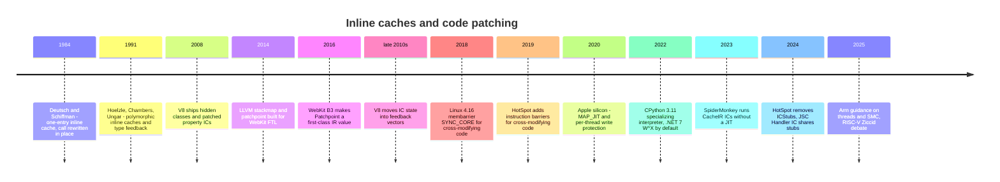
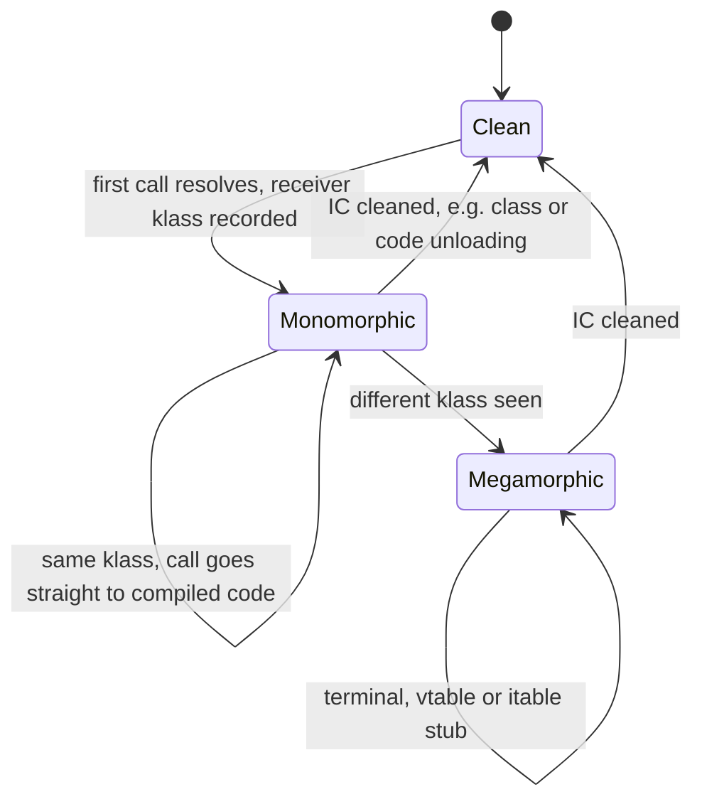
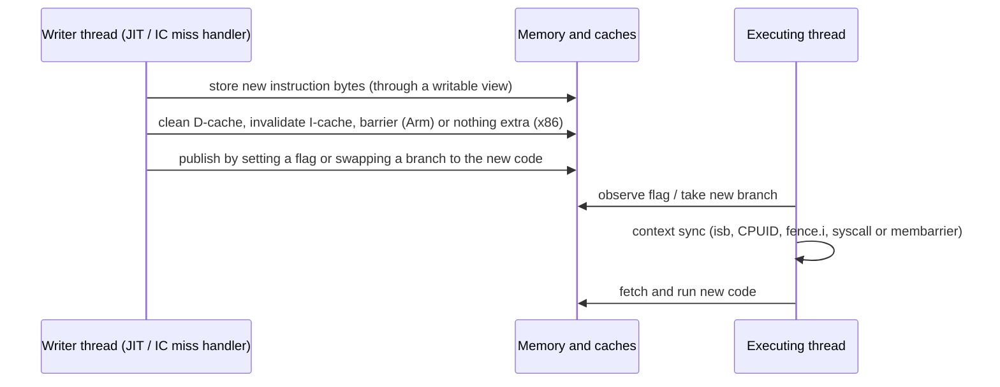

---
tags:
  - compilers
  - runtimes
  - jit
  - inline-caches
  - code-patching
  - self-modifying-code
  - w-xor-x
  - hotspot
  - javascriptcore
  - v8
  - spidermonkey
  - cpython
  - llvm
status: complete
sources:
  - https://www.cs.tufts.edu/~nr/cs257/archive/peter-deutsch/efficient-smalltalk.pdf
  - https://jnamaral.github.io/CDOL/papers/HolzleECOOP91.pdf
  - https://llvm.org/docs/StackMaps.html
  - https://webkit.org/docs/b3/intermediate-representation.html
  - https://webkit.googlesource.com/WebKit/+/master/Source/JavaScriptCore/b3/B3StackmapGenerationParams.h
  - https://lists.webkit.org/pipermail/webkit-changes/2024-May/301474.html
  - https://lists.webkit.org/pipermail/webkit-changes/2023-April/285460.html
  - https://raw.githubusercontent.com/openjdk/jdk/master/src/hotspot/share/code/compiledIC.hpp
  - https://raw.githubusercontent.com/openjdk/jdk/master/src/hotspot/share/code/compiledIC.cpp
  - https://raw.githubusercontent.com/openjdk/jdk/master/src/hotspot/cpu/x86/macroAssembler_x86.cpp
  - https://raw.githubusercontent.com/openjdk/jdk/master/src/hotspot/cpu/x86/nativeInst_x86.cpp
  - https://raw.githubusercontent.com/openjdk/jdk/master/src/hotspot/cpu/aarch64/nativeInst_aarch64.cpp
  - https://mail.openjdk.org/pipermail/graal-dev/2024-January/006863.html
  - https://mail.openjdk.org/pipermail/jdk-changes/2024-February/026008.html
  - https://mail.openjdk.org/pipermail/hotspot-dev/2019-March/037269.html
  - https://firefox-source-docs.mozilla.org/js/cacheir.html
  - https://cfallin.org/blog/2023/10/11/spidermonkey-pbl/
  - https://ripsawridge.github.io/articles/stack-changes
  - https://chromium.googlesource.com/v8/v8.git/+/refs/heads/main/src/objects/feedback-vector.h
  - https://chromium.googlesource.com/v8/v8/+/refs/heads/main/src/common/code-memory-access.h
  - https://groups.google.com/g/v8-dev/c/PYk2_GGP2Wk/m/gf-YwHp3AgAJ
  - https://peps.python.org/pep-0659/
  - https://xem.github.io/minix86/manual/intel-x86-and-64-manual-vol3/o_fe12b1e2a880e0ce-261.html
  - https://developer.arm.com/community/arm-community-blogs/b/architectures-and-processors-blog/posts/caches-self-modifying-code-working-with-threads
  - https://research.redhat.com/blog/publication/just-in-time-compilation-on-arm-a-closer-look-at-call-site-code-consistency/
  - https://lists.infradead.org/pipermail/linux-riscv/2025-October/078664.html
  - https://man.he.net/man2/membarrier
  - https://developer.apple.com/documentation/apple-silicon/porting-just-in-time-compilers-to-apple-silicon
  - https://startdebugging.net/2026/09/what-is-the-w-xor-x-flag-in-dotnet-and-does-native-aot-need-it/
  - https://programming-journal.org/2025/10/6/
created: 2026-11-28
updated: 2026-11-28
---

## Table Of Contents

- [[#TL;DR|TL;DR]]
- [[#The Problem|The Problem]]
- [[#Foundations|Foundations]]
    - [[#Why Caching at the Site Works|Why Caching at the Site Works]]
    - [[#Two Kinds of Inline Cache|Two Kinds of Inline Cache]]
    - [[#What Gets Rewritten|What Gets Rewritten]]
    - [[#Why Rewriting Code Is Hard on Real Hardware|Why Rewriting Code Is Hard on Real Hardware]]
- [[#How We Got Here|How We Got Here]]
- [[#How It Works|How It Works]]
    - [[#A Call Inline Cache - HotSpot|A Call Inline Cache - HotSpot]]
    - [[#Property Caches and Stub Chains - JSC and SpiderMonkey|Property Caches and Stub Chains - JSC and SpiderMonkey]]
    - [[#Data-Driven Caches - V8 and CPython|Data-Driven Caches - V8 and CPython]]
    - [[#Reserving Room - LLVM patchpoint and B3 Patchpoint|Reserving Room - LLVM patchpoint and B3 Patchpoint]]
    - [[#Making a Patch Visible - Caches, Pipelines and Atomicity|Making a Patch Visible - Caches, Pipelines and Atomicity]]
    - [[#Writing Code Under W^X|Writing Code Under W^X]]
- [[#Where It Is Now|Where It Is Now]]
- [[#Trade-offs & Open Problems|Trade-offs & Open Problems]]
- [[#Resources|Resources]]
- [[#Related Notes|Related Notes]]

---

## ***TL;DR***

---

*An inline cache remembers, at one call or property access, what happened last time, so the next time costs a compare and a jump instead of a lookup. Keeping that memory fresh used to mean rewriting machine code while other threads run it, which drags in instruction caches, atomic stores and memory protection.*

- **The idea.** Dynamic dispatch and property lookup are slow in general but almost always see the same receiver class at a given site. Deutsch and Schiffman measured a one-entry cache at the call site hitting "about 95% of the time", against 85 to 90% for a global cache ([POPL 1984](https://www.cs.tufts.edu/~nr/cs257/archive/peter-deutsch/efficient-smalltalk.pdf)).
- **The states.** A site starts *clean*, becomes *monomorphic* after its first receiver, may grow *polymorphic* (a short chain of type tests), and gives up as *megamorphic* (a table or hash lookup). See [[JIT Compilation]] for the shape and hidden-class basics.
- **Code patching.** The classic implementation rewrites the call target, the cached class constant or the field offset *inside the instructions*. That needs room reserved in advance (LLVM `patchpoint`, B3 `Patchpoint`), a store the CPU sees atomically, and cache maintenance so the new bytes reach instruction fetch on every core.
- **The trend is away from patching.** HotSpot (2024) now patches only a call's 4-byte target, keeping all other cache state in a per-site data record. V8 keeps IC state in feedback vectors. SpiderMonkey and JavaScriptCore share one compiled stub across many sites, with per-site data. CPython stores caches as plain data inside the bytecode.
- **W^X.** Modern platforms forbid memory that is writable and executable at once, so every patch goes through a permission flip, a second writable mapping, or a per-thread permission register (Apple `MAP_JIT`, Intel PKU).

---

## ***The Problem***

---

*Dynamic languages and virtual calls ask a question at runtime that a static compiler answers once: "which method?" or "where is this field?". Answering it from scratch every time is far too slow, and the answer depends on data the compiler never saw.*

Consider `p.x` in JavaScript, or `shape.area()` in Java. In the general case the runtime must find the object's class or hidden class, search a dictionary or method table, handle inheritance, getters and proxies, and only then load a value or call a function. That is dozens to hundreds of instructions for something a C compiler does with one load.

Two observations make the problem tractable:

1. **Sites are boringly consistent.** A given `p.x` almost always sees objects built the same way; a given `shape.area()` almost always sees one concrete class.
2. **The answer is cheap to check.** "Is this object's hidden class still `M2`?" is one load and one compare. If yes, the field is at the offset we found last time.

So the runtime should remember the last answer *at the site*. The hard parts are where to keep that memory, how to change it safely while code runs, and how to make it useful to the optimizing compiler later. Getting this wrong has real costs: patching the wrong bytes or skipping cache maintenance produces crashes that appear only on some CPUs, and patching that needs every thread to stop costs latency ([HotSpot ICStub removal, 2024](https://mail.openjdk.org/pipermail/graal-dev/2024-January/006863.html)).

---

## ***Foundations***

---

*Four ideas carry the rest of the note: locality of types at a site, the split between call caches and property caches, the choice between patching code and updating data, and the hardware rules for changing instructions that may be running.*

### Why Caching at the Site Works

*The expected cost of a site is a weighted average of a cheap hit and an expensive miss, and real programs keep the hit rate high.*

$$
T_{\text{site}} = h \cdot c_{\text{hit}} + (1 - h) \cdot c_{\text{miss}}
$$

*In words: if a hit costs a compare and a jump and a miss costs a full lookup plus updating the cache, the average is dominated by hits as long as the hit rate $h$ is high.* With Deutsch and Schiffman's 95% one-entry hit rate, misses are rare, though they also found the whole-system gain was modest (9 to 11%) because their translator had other costs ([POPL 1984](https://www.cs.tufts.edu/~nr/cs257/archive/peter-deutsch/efficient-smalltalk.pdf)). The bigger payoff came later, when the cached types became *input to the optimizer*: Hölzle, Chambers and Ungar reported a median 11% from polymorphic caches alone and 27% once the recorded types drove recompilation ([ECOOP 1991](https://jnamaral.github.io/CDOL/papers/HolzleECOOP91.pdf)). That second use is the root of [[Profile-Guided Optimization]] in JITs and of [[Deoptimization and Speculation]].

### Two Kinds of Inline Cache

*Call caches choose a method; property caches find a field. Both check a cheap key and fall back to a slow path.*

| | Call inline cache | Property inline cache |
|---|---|---|
| Question | Which method does this receiver's class select? | Where does this object keep property `x`? |
| Key checked | Receiver class (Java `Klass`, Smalltalk class) | Hidden class / shape / map / structure |
| Cached answer | Target entry point | Field offset, or a getter, or a prototype holder |
| Megamorphic fallback | vtable / itable stub, global method cache | Global stub cache or megamorphic hash cache |
| Typical users | Smalltalk, Self, HotSpot, .NET | V8, JavaScriptCore, SpiderMonkey, CPython |

### What Gets Rewritten

*An inline cache needs a mutable slot. It can live in the instruction stream (patch the code) or beside it (update data the code reads).*

| Where the state lives | What changes on an update | Examples |
|---|---|---|
| **Instruction immediates** | Class constant in a `cmp`, offset in a `mov` | Early V8 and JSC property ICs, Smalltalk-80 |
| **Call or jump target** | The displacement of one `call` / `jmp` / `bl` | HotSpot call ICs, PIC stub chains |
| **Reserved nops** | A whole new instruction sequence over the nop region | LLVM `patchpoint`, B3 `Patchpoint` |
| **Data next to the code** | A word in a feedback vector, stub field or bytecode cache entry | V8 feedback vectors, SpiderMonkey Baseline stub fields, CPython cache entries |

Patching code is fastest at the hit (no extra load) but turns every update into self-modifying code. Data-driven caches pay a load on every execution but update with an ordinary store and let many sites share one piece of handler code. Michael Stanton described exactly this trade when V8 moved IC state into feedback vectors: patching was undesirable "for security reasons" and flushed the instruction cache, while "a data structure solution means more memory loads no matter how you slice it" ([Stanton](https://ripsawridge.github.io/articles/stack-changes)).

### Why Rewriting Code Is Hard on Real Hardware

*CPUs fetch instructions through their own caches and pipelines, which do not automatically see a store to code. Another core may be executing the bytes you are changing.*

- **Split caches.** Arm cores have separate instruction and data caches; a store lands in the data side and is "not automatically visible to instruction fetch" until it is cleaned and the instruction cache is invalidated ([Arm, Jan 2025](https://developer.arm.com/community/arm-community-blogs/b/architectures-and-processors-blog/posts/caches-self-modifying-code-working-with-threads)). x86 snoops code stores in hardware, but Intel still warns that self-modifying code runs "at a lower level of performance" ([Intel SDM Vol. 3A, 8.1.3](https://xem.github.io/minix86/manual/intel-x86-and-64-manual-vol3/o_fe12b1e2a880e0ce-261.html)).
- **Pipelines.** Even with coherent caches, a core may already have fetched and decoded the old instruction. Something must discard that work on the *executing* core: a serializing instruction on x86, an `isb` on Arm, `fence.i` on RISC-V.
- **Self- vs cross-modifying code.** Intel defines *cross-modifying code* as one processor writing code that another will execute, and requires the executing processor to run a serializing instruction (for example `CPUID`) after it sees a flag set by the writer ([Intel SDM](https://xem.github.io/minix86/manual/intel-x86-and-64-manual-vol3/o_fe12b1e2a880e0ce-261.html)).
- **Torn writes.** If another thread can execute the site *while* you write it, it must see either the whole old instruction or the whole new one. That limits safe patches to aligned stores of a size the hardware writes atomically, or, on Arm, to swapping between instructions in a short architecturally blessed list such as direct branches and `nop` ([Arm](https://developer.arm.com/community/arm-community-blogs/b/architectures-and-processors-blog/posts/caches-self-modifying-code-working-with-threads)).
- **W^X.** Security policy says a page is writable or executable, never both, so the runtime must change permissions or write through another view before any patch.

---

## ***How We Got Here***

---

*Inline caching was invented as a dispatch speed-up in 1984, became the source of type feedback in Self, and spent the 2010s and 2020s being rebuilt around data instead of self-modifying code as security rules and multicore Arm made patching expensive.*



- **Smalltalk-80 (1984).** Sends were compiled "unlinked", as calls to the lookup routine. After a lookup, the method address was "placed in-line with a call instruction, overwriting the former call", and each method's entry code checked the receiver class stored at the call site. The authors noted this was "a kind of dynamic code modification, which is generally condemned in modern practice" ([Deutsch and Schiffman](https://www.cs.tufts.edu/~nr/cs257/archive/peter-deutsch/efficient-smalltalk.pdf)).
- **Self (1991).** Polymorphic inline caches replaced the one-entry cache with a growing stub of type tests; a site with more than ten types was treated as megamorphic. The PIC doubled as "a call-specific type database", cost "typically less than 2% of the compiled code", and recompiling with its contents halved the number of sends ([ECOOP 1991](https://jnamaral.github.io/CDOL/papers/HolzleECOOP91.pdf)).
- **The JavaScript engines (2008 on).** V8 launched with hidden classes and inline caches (see [[JIT Compilation]]). Its early ICs patched dispatcher code into compiled functions ([Stanton](https://ripsawridge.github.io/articles/stack-changes)).
- **Compilers that leave a hole (2014 to 2016).** WebKit's FTL tier needed LLVM to emit code it could later rewrite for ICs and OSR exits, producing `llvm.experimental.patchpoint`; when WebKit replaced LLVM with B3, patchpoints became a native IR value whose code is produced by a C++ callback ([LLVM StackMaps](https://llvm.org/docs/StackMaps.html), [B3 IR](https://webkit.org/docs/b3/intermediate-representation.html), [[Safepoints and Stack Maps]]).
- **Multicore correctness (2018 to 2019).** Linux added `MEMBARRIER_CMD_PRIVATE_EXPEDITED_SYNC_CORE`, which guarantees that all the process's running threads "have executed a core serializing instruction" ([membarrier(2)](https://man.he.net/man2/membarrier)). HotSpot added an instruction barrier in patched threads after safepoint polls, because a thread could have prefetched an instruction carrying a stale immediate ([hotspot-dev, 2019](https://mail.openjdk.org/pipermail/hotspot-dev/2019-March/037269.html)).
- **W^X everywhere (2020 to 2022).** Apple silicon enforces that "a thread cannot write to a memory region and run instructions in that region at the same time" for all apps ([Apple](https://developer.apple.com/documentation/apple-silicon/porting-just-in-time-compilers-to-apple-silicon)). .NET turned W^X on by default in .NET 7 ([Bughiu, 2026](https://startdebugging.net/2026/09/what-is-the-w-xor-x-flag-in-dotnet-and-does-native-aot-need-it/)).
- **Caches as data (2021 to 2024).** CPython's specializing interpreter put inline caches in the bytecode array ([PEP 659](https://peps.python.org/pep-0659/)); SpiderMonkey shares Baseline stub code across sites and interprets it without a JIT ([CacheIR](https://firefox-source-docs.mozilla.org/js/cacheir.html), [Fallin, 2023](https://cfallin.org/blog/2023/10/11/spidermonkey-pbl/)); HotSpot stopped patching IC data altogether ([JDK-8322630](https://mail.openjdk.org/pipermail/graal-dev/2024-January/006863.html)).

---

## ***How It Works***

---

*Six pieces, from the cache itself down to the hardware: a call IC, property IC chains, data-driven ICs, reserving patchable space in a compiler, making a patch visible on each ISA, and writing code under W^X.*

### A Call Inline Cache - HotSpot

*Since 2024, a HotSpot virtual call site changes only one thing over its life: where its `call` instruction points. Everything the cache needs to know is in a data record fixed per site.*

The class comment in `compiledIC.hpp` gives the life cycle: "Typically an inline cache starts in the clean state, meaning it will resolve the call when called. Then it typically transitions to monomorphic, assuming the first dynamic receiver will be the only one observed. If that speculation fails, we transition to megamorphic", and "It's safe to transition from any state to any state" ([compiledIC.hpp](https://raw.githubusercontent.com/openjdk/jdk/master/src/hotspot/share/code/compiledIC.hpp)).



**The call site (x86-64).** The C1/C2 code generator emits a 64-bit move of a data pointer into `rax` and then the call ([macroAssembler_x86.cpp `ic_call`](https://raw.githubusercontent.com/openjdk/jdk/master/src/hotspot/cpu/x86/macroAssembler_x86.cpp)):

```asm
; caller: virtual call shape.area()
    movabs rax, <CompiledICData* for this site>  ; per-site record
    call   <target>                              ; the only thing that is ever patched
```

**The callee's unverified entry point.** Every compiled method starts with the cache check, comparing the receiver's class to the speculated class stored in the record ([`ic_check`](https://raw.githubusercontent.com/openjdk/jdk/master/src/hotspot/cpu/x86/macroAssembler_x86.cpp)):

```asm
; callee unverified entry (UEP), receiver in j_rarg0
    mov   r10d, dword [rsi + klass_offset]                    ; receiver's compressed klass
    cmp   r10d, dword [rax + CompiledICData::speculated_klass] ; same as the first receiver?
    jne   ic_miss_stub                                        ; no: runtime updates the IC
verified_entry:                                               ; yes: the method body
    ...
```

**What each state points at.** `set_to_clean` aims the call at the resolve stub; `set_to_monomorphic` aims it at the speculated method's compiled entry (or an interpreter adapter); `set_to_megamorphic` aims it at a shared vtable or itable stub; `update` stays put once megamorphic ("Terminal state") ([compiledIC.cpp](https://raw.githubusercontent.com/openjdk/jdk/master/src/hotspot/share/code/compiledIC.cpp)). The record holds "The first receiver klass and its selected method" plus itable metadata, written once at resolution.

**Why this design.** Before 2024 the monomorphic state needed *two* writes, the expected class and the target, which cannot be made atomic together. HotSpot staged the pair in "ICStubs", which caused "safepoint carpets" when threads refilled the stub buffer and "spurious ... 'Cleanup' safepoints every second". Erik Österlund's change installs all state at resolution so a transition only redirects the call, deleting the ICStub machinery (455 insertions, 3,099 deletions) ([graal-dev, Jan 2024](https://mail.openjdk.org/pipermail/graal-dev/2024-January/006863.html)).

**The one remaining patch.** On x86, `NativeCall::set_destination_mt_safe` requires the call's 32-bit displacement to lie "within a single cache line", so the store is atomic for threads executing it ([nativeInst_x86.cpp](https://raw.githubusercontent.com/openjdk/jdk/master/src/hotspot/cpu/x86/nativeInst_x86.cpp)). On AArch64 a `bl` only reaches ±128 MiB, so when the target is out of range the runtime rewrites the 64-bit address in a *trampoline stub* and points the `bl` at the trampoline, then invalidates the instruction cache for the call ([nativeInst_aarch64.cpp](https://raw.githubusercontent.com/openjdk/jdk/master/src/hotspot/cpu/aarch64/nativeInst_aarch64.cpp)).

### Property Caches and Stub Chains - JSC and SpiderMonkey

*A property IC is a chain of small stubs, each a list of guards followed by one action. Modern engines compile those stubs once and share them, keeping the per-site constants as data.*

SpiderMonkey writes each stub in CacheIR, a linear IR of guards, side-effect-free operations and one final result op; "If a guard fails, the entire stub fails" ([CacheIR docs](https://firefox-source-docs.mozilla.org/js/cacheir.html)). A monomorphic `p.x` becomes:

```text
GuardToObject   input0
GuardShape      input0, <shape field>       ; field: per-stub data
LoadFixedSlotResult input0, <offset field>  ; field: per-stub data
```

- **Chains, not patches.** Each IC starts with a fallback stub that runs C++, does the operation and tries to attach a new stub at the front; next time "we will try that stub before calling into the fallback". After six attached stubs, or repeated failures, the IC goes megamorphic or generic.
- **Code shared across sites.** In Baseline the shape and offset are *stub fields* stored in the `ICStub`, so one piece of jitcode serves "many different values of stub fields". Ion bakes the values into code, which the docs call "probably a mistake".
- **Feeding the optimizer.** Warp reads the chain; if only the newest stub has run, it transpiles that stub's CacheIR into MIR, "effectively inlining that stub into the bytecode" ([CacheIR docs](https://firefox-source-docs.mozilla.org/js/cacheir.html)).

JavaScriptCore took the same road in 2023 and 2024: it added a megamorphic cache ([WebKit, Apr 2023](https://lists.webkit.org/pipermail/webkit-changes/2023-April/285460.html)) and then *Handler IC*, where each site's stub is "hash-consed via SharedJITStubSet" so identical stubs are compiled once and shared by many owners; as of the May 2024 reland it applies to the Baseline JIT only, with splitting into one handler per access case as the next step ([WebKit, May 2024](https://lists.webkit.org/pipermail/webkit-changes/2024-May/301474.html)).

### Data-Driven Caches - V8 and CPython

*Here the "inline" cache lives in a data array beside the code. Updates are plain stores; the handler code is generic and reads the cached facts.*

**V8.** Each function's *feedback vector* has a slot per IC site holding the recorded maps and handlers; the interpreter, Sparkplug and the IC miss handlers read and update it, and the optimizing tiers read it as type feedback ([feedback-vector.h](https://chromium.googlesource.com/v8/v8.git/+/refs/heads/main/src/objects/feedback-vector.h), [[Tiering Policies and Warm-up]]). Stanton's stated goal was to "eliminate patching entirely", for security and to avoid instruction-cache flushes ([Stanton](https://ripsawridge.github.io/articles/stack-changes)).

**CPython.** PEP 659's specializing interpreter stores "a number of 16 bit entries immediately following the instruction", calling this "a form of inline cache". Adaptive instructions count executions, then rewrite themselves into a specialized form ("quickening"); a specialized instruction keeps a saturating counter and reverts when its guard keeps failing ([PEP 659](https://peps.python.org/pep-0659/)). Real output from CPython 3.13.18, run for this note:

```python
class Point:
    def __init__(self, x, y): self.x = x; self.y = y
def get_x(p): return p.x
```

```text
# before any calls (dis.dis(get_x, adaptive=True))
  LOAD_FAST                0 (p)
  LOAD_ATTR                0 (x)
  RETURN_VALUE

# after 2,000 calls with Point objects (show_caches=True)
  LOAD_FAST                0 (p)
  LOAD_ATTR_INSTANCE_VALUE 0 (x)
  CACHE                    0 (counter: 832)
  CACHE                    0 (version: 5636928)   ; type version tag the guard checks
  CACHE                    0
  CACHE                    0 (keys_version: 5636928)
  CACHE                    0
  CACHE                    0 (descr: ...)
  ...                                             ; 9 cache entries in total
  RETURN_VALUE
```

The bytecode itself was rewritten (`LOAD_ATTR` became `LOAD_ATTR_INSTANCE_VALUE`), but it is bytecode in a data array, so no instruction cache or W^X rule is involved. The PEP estimated 10 to 60% speedups, mostly from attribute lookup, globals and calls ([PEP 659](https://peps.python.org/pep-0659/)). This line of work continues in [[Partial Evaluation and Self-Specializing Interpreters]].

### Reserving Room - LLVM patchpoint and B3 Patchpoint

*An optimizing compiler normally owns every byte it emits. A patchpoint is a hole it promises not to touch, plus a record of where the live values are, so the runtime can drop an inline cache into optimized code later.*

LLVM's intrinsic ([StackMaps docs](https://llvm.org/docs/StackMaps.html)):

```llvm
declare i64 @llvm.experimental.patchpoint.i64(i64 <id>, i32 <numBytes>,
                                              ptr <target>, i32 <numArgs>, ...)

; reserve 15 bytes for a property-load IC on %obj; result anywhere the RA likes
%x = call anyregcc i64 (i64, i32, ptr, i32, ...)
       @llvm.experimental.patchpoint.i64(i64 7, i32 15, ptr null, i32 1, ptr %obj)
```

- **What the backend emits.** A call to `<target>` if it is not null, then nops "to cover at least `<numBytes>`"; with a null target there is no minimum. The client must make `numBytes` large enough for a call on each target.
- **`anyregcc`.** Arguments must be in registers, but which registers is up to the allocator; the chosen registers go into the stack map record for this `id`, so the runtime's patch can use them. The docs' example has the runtime write a `movslq 4(%reg)` load into the reserved space.
- **Rules for the runtime.** It "may patch the code emitted for the patch point, including the call sequence and nops", "may not assume anything about the code LLVM emits within the reserved space", and "Partial patching is not allowed ... padding with nops if necessary". The intrinsics are still experimental, with no compatibility guarantee between releases ([LLVM](https://llvm.org/docs/StackMaps.html)). Stack map format details are in [[Safepoints and Stack Maps]] and [[LLVM]].

B3 made the idea first-class: "A Patchpoint is a customizable value" whose machine code comes from a C++ *generator* lambda run during code generation, with per-operand register constraints, early or late clobbers and optional effect bounds; the docs say this is enough for "custom calling conventions, inline caches, and side-exits" ([B3 IR](https://webkit.org/docs/b3/intermediate-representation.html)). The generator receives the representations the allocator actually chose and can request scratch registers or add out-of-line *late paths* for the slow case ([B3StackmapGenerationParams.h](https://webkit.googlesource.com/WebKit/+/master/Source/JavaScriptCore/b3/B3StackmapGenerationParams.h)). Because the generator runs inside the compiler, the IC's fast path is emitted directly instead of patched over nops afterwards.

### Making a Patch Visible - Caches, Pipelines and Atomicity

*A correct patch has two halves: the writer makes the new bytes reach instruction fetch, and every executing core discards anything it fetched before. The rules differ by ISA.*



**Arm (AArch64).** The single-threaded sequence from Arm ([Bramley, Jan 2025](https://developer.arm.com/community/arm-community-blogs/b/architectures-and-processors-blog/posts/caches-self-modifying-code-working-with-threads)):

```asm
    str  w1, [x0]      ; write the new instruction
    dc   cvau, x0      ; clean data cache to the point of unification
    dsb  ish           ; wait for the clean
    ic   ivau, x0      ; invalidate the instruction cache line
    dsb  ish           ; wait for the invalidate
    isb                ; discard already-fetched instructions on THIS core
```

The `dc` and `ic` operations are seen by other cores, but the `isb` is not broadcast, so each executing thread needs its own context synchronization (an `isb`, an exception or a system call), which Linux can force with `membarrier`. The exception is *concurrent modification*: replacing one instruction from a small allowed set (direct branches and `nop` are the examples) with another from that set, where a core runs either the old or the new one. Arm also guarantees that if you finish the full maintenance sequence on a new function *before* swapping in a direct `bl` to it, any thread that takes the new branch sees the new function; this does not hold for indirect branches ([Arm](https://developer.arm.com/community/arm-community-blogs/b/architectures-and-processors-blog/posts/caches-self-modifying-code-working-with-threads)). Hartley et al. compared four call-site patching schemes for JVMs on Arm and found up to 12% performance difference among them ([TACO 2022](https://research.redhat.com/blog/publication/just-in-time-compilation-on-arm-a-closer-look-at-call-site-code-consistency/)).

**Per ISA, at a glance.**

| ISA | Writer must | Executing core must | Atomic patch unit used in practice |
|---|---|---|---|
| **x86-64** | Store; caches are coherent with code stores | Run a serializing instruction (e.g. `CPUID`) before running cross-modified code ([Intel SDM](https://xem.github.io/minix86/manual/intel-x86-and-64-manual-vol3/o_fe12b1e2a880e0ce-261.html)) | Aligned 4-byte `call` displacement inside one cache line (HotSpot) |
| **AArch64** | `dc cvau` / `dsb` / `ic ivau` / `dsb` | `isb` or another context sync event | Whole 4-byte instruction from the concurrent-modification set (`b`, `bl`, `nop`, ...) |
| **RISC-V** | Store, then `fence.i` locally; remote harts traditionally via IPI | `fence.i` | 4-byte instruction; Ziccid only promises stores "eventually become visible to instruction fetches" ([linux-riscv, Oct 2025](https://lists.infradead.org/pipermail/linux-riscv/2025-October/078664.html)) |

**Why safepoints show up.** HotSpot patches some code only with threads stopped or handshaked, and in 2019 it added an instruction barrier after the safepoint poll on every platform ("x86 needs cpuid in all in patchee threads"), because a thread could have prefetched an instruction past the poll and run a stale immediate ([hotspot-dev](https://mail.openjdk.org/pipermail/hotspot-dev/2019-March/037269.html)). The connection to polls and stop-the-world is covered in [[Safepoints and Stack Maps]].

### Writing Code Under W^X

*Every patch is a write to code. Runtimes use one of three tricks to write without ever having a page that is writable and executable to the same thread at the same time.*

| Approach | How it works | Cost | Used by |
|---|---|---|---|
| **Permission flip** | `mprotect` the page writable, patch, flip back | A system call and TLB shootdown per batch | Fallback on many platforms |
| **Double mapping** | Two virtual mappings of the same physical pages: RX to run, RW to write | Two addresses per code page; startup cost | .NET 7+ (a memfd named `doublemapper` on Linux); 5 to 10% startup regression cited, no steady-state cost ([Bughiu](https://startdebugging.net/2026/09/what-is-the-w-xor-x-flag-in-dotnet-and-does-native-aot-need-it/)) |
| **Per-thread permission** | A register flips the region writable for *this thread only* | A few cycles | Apple silicon `MAP_JIT`; Intel PKU in V8 |

**Apple.** An app may create one `MAP_JIT` region (with the `allow-jit` entitlement under the Hardened Runtime). Writes go through a callback passed to `pthread_jit_write_with_callback_np()`, which checks the callback is on an allowlist fixed at startup, makes the region writable and not executable "for the current thread only", runs the callback, then flips it back. The older `pthread_jit_write_protect_np()` is unavailable on iOS. After writing, apps must call `sys_icache_invalidate` because "the instruction caches aren't coherent with data caches" ([Apple](https://developer.apple.com/documentation/apple-silicon/porting-just-in-time-compilers-to-apple-silicon)).

**V8.** `RwxMemoryWriteScope` "uses per-thread permissions": on Apple arm64 it toggles `MAP_JIT` pages; with Intel PKU it flips the protection key between writable and not writable (PKU cannot remove execute permission, so this is write protection only); elsewhere it is a no-op. The `ThreadIsolation` API keeps JIT-region metadata in write-protected memory, and "All writes to executable memory need to go through one of these Writable* objects" ([code-memory-access.h](https://chromium.googlesource.com/v8/v8/+/refs/heads/main/src/common/code-memory-access.h)). The data-driven design above means ordinary IC updates do not need a write scope at all. The isolation side of this is covered in [[Software Fault Isolation]].

---

## ***Where It Is Now***

---

*As of November 2026: every major engine still uses inline caches, but patched instruction immediates are nearly gone. State moved into data, stub code is shared, and the remaining patching is single-instruction branch swaps under W^X.*

| Engine | IC state lives in | What is still patched | Recent change |
|---|---|---|---|
| **HotSpot** (OpenJDK) | Per-site `CompiledICData` | One call target per transition | ICStubs and their safepoints removed (integrated Feb 2024, [jdk-changes](https://mail.openjdk.org/pipermail/jdk-changes/2024-February/026008.html)); follow-up dead-code cleanup Oct 2024 ([JDK-8341168](https://bugs.openjdk.org/browse/JDK-8341168)) |
| **JavaScriptCore** | `StructureStubInfo` plus shared handler stubs | Site's jump into the stub | Handler IC with hash-consed shared stubs, Baseline only (May 2024) |
| **SpiderMonkey** | Stub fields in `ICStub` | Nothing at the site; stubs are chained | CacheIR interpreted with no JIT in Portable Baseline (Oct 2023): 1.26x on Octane, up to about 2.4x with weval ([Fallin](https://cfallin.org/blog/2023/10/11/spidermonkey-pbl/)) |
| **V8** | Feedback vector slots | Code entry via leaptiering dispatch, not ICs | Leaptiering, built for the sandbox, default from V8 13.4 ([v8-dev, Dec 2024](https://groups.google.com/g/v8-dev/c/PYk2_GGP2Wk/m/gf-YwHp3AgAJ)) |
| **CPython** | Cache entries in the bytecode array | Bytecode (data) | Specializing interpreter since 3.11; verified on 3.13.18 above |

- **Hardware and OS (2025 to 2026).** Arm published threading guidance for self-modifying code in January 2025. The RISC-V community argued in October 2025 over whether Ziccid lets Linux drop remote `fence.i` IPIs; maintainers held that it only guarantees *eventual* visibility, so `fence.i` is still needed when a race is not acceptable ([linux-riscv](https://lists.infradead.org/pipermail/linux-riscv/2025-October/078664.html)). Apple's 2026 porting guide centers on the allowlisted `pthread_jit_write_with_callback_np` API ([Apple](https://developer.apple.com/documentation/apple-silicon/porting-just-in-time-compilers-to-apple-silicon)).
- **Research (2025).** Poirier, Rohou and Serrano used dynamic binary modification to optimize inline caches in the Hopc ahead-of-time JavaScript compiler. It cut memory accesses but not run time on current x86-64 CPUs; their conclusion is that removing instructions or loads only pays when the processor cannot already hide them ([Programming 2025](https://programming-journal.org/2025/10/6/)). This supports the industry move to an extra data load in exchange for no code patching. [[Microarchitectural Performance Models]] explains why a predicted load is nearly free.
- **No-JIT targets.** iOS forbids JIT for most apps and WebAssembly cannot generate code at runtime, so "inline caches without a JIT" (interpreting the IC, as in PBL and CPython) now matters as much as the patched kind. See [[WebAssembly]].

---

## ***Trade-offs & Open Problems***

---

*The core tension is hit-path speed against safety and sharing. Patching gives the shortest fast path but costs atomicity headaches, cache maintenance, stop-the-world pauses and W^X traffic; data-driven caches pay one load and win almost everything else.*

| Choice | Wins | Loses |
|---|---|---|
| Patch immediates in place | Fewest instructions at the hit | Multi-word updates are not atomic; needs safepoints or staging (HotSpot's ICStubs); i-cache flushes; W^X writes |
| Patch only branch targets | One atomic store per transition; data stays fixed | Branch range limits on Arm need trampolines; an extra jump in some states |
| Data-driven (feedback slots, stub fields) | Plain stores, shared handler code, easy to read as type feedback, no W^X writes | An extra load on every execution; more memory per site |
| Reserved patchpoints in optimized code | Lets an optimizing compiler host ICs | Nops in the hot path until patched; register and stack constraints on the optimizer |

**Open problems.**

- **Polymorphism cliffs.** Megamorphic fallbacks are much slower, and the threshold (six stubs in SpiderMonkey, ten types in the 1991 PICs) is a heuristic. Small changes in object construction order can flip a hot site into the slow state (see [[JIT Compilation]]).
- **Sharing optimized-tier ICs.** SpiderMonkey's docs call Ion's baked-in stub values "probably a mistake" and aim to share them like Baseline's; JSC's Handler IC is still Baseline-only ([CacheIR](https://firefox-source-docs.mozilla.org/js/cacheir.html), [WebKit](https://lists.webkit.org/pipermail/webkit-changes/2024-May/301474.html)).
- **Weak hardware models.** Exactly which patch sequences are safe on Arm and RISC-V cores, especially for indirect branches and multi-instruction updates, remains subtle; Arm warns that a mixture of old and new instructions "may run in any order" ([Arm](https://developer.arm.com/community/arm-community-blogs/b/architectures-and-processors-blog/posts/caches-self-modifying-code-working-with-threads)).
- **Security versus speed.** Writable code is a classic exploit target. Per-thread permission schemes shrink the window, but the cost of W^X lands at startup, the phase [[Tiering Policies and Warm-up]] tries hardest to shorten.
- **Keeping IC state alive across runs.** Caches start empty every run; shipping recorded feedback (AOT caches, baseline profiles) is part of the warm-up work in [[Tiering Policies and Warm-up]].

---

## ***Resources***

---

*Primary sources first, then the engineering write-ups that explain current designs.*

**Papers**
- [Efficient Implementation of the Smalltalk-80 System](https://www.cs.tufts.edu/~nr/cs257/archive/peter-deutsch/efficient-smalltalk.pdf): Deutsch and Schiffman, POPL 1984. The first inline cache.
- [Optimizing Dynamically-Typed Object-Oriented Languages With Polymorphic Inline Caches](https://jnamaral.github.io/CDOL/papers/HolzleECOOP91.pdf): Hölzle, Chambers and Ungar, ECOOP 1991.
- [Just-In-Time Compilation on ARM: A Closer Look at Call-Site Code Consistency](https://research.redhat.com/blog/publication/just-in-time-compilation-on-arm-a-closer-look-at-call-site-code-consistency/): Hartley et al., ACM TACO 2022.
- [An Attempt to Catch Up with JIT Compilers: The False Lead of Optimizing Inline Caches](https://programming-journal.org/2025/10/6/): Poirier, Rohou and Serrano, Programming 2025.
- [PEP 659: Specializing Adaptive Interpreter](https://peps.python.org/pep-0659/): Mark Shannon.

**Compiler and runtime documentation**
- [Stack maps and patch points in LLVM](https://llvm.org/docs/StackMaps.html).
- [B3 Intermediate Representation](https://webkit.org/docs/b3/intermediate-representation.html): the `Patchpoint` value.
- [SpiderMonkey: Inline caches / CacheIR](https://firefox-source-docs.mozilla.org/js/cacheir.html).
- HotSpot sources: [compiledIC.hpp](https://raw.githubusercontent.com/openjdk/jdk/master/src/hotspot/share/code/compiledIC.hpp), [compiledIC.cpp](https://raw.githubusercontent.com/openjdk/jdk/master/src/hotspot/share/code/compiledIC.cpp), [nativeInst_x86.cpp](https://raw.githubusercontent.com/openjdk/jdk/master/src/hotspot/cpu/x86/nativeInst_x86.cpp), [nativeInst_aarch64.cpp](https://raw.githubusercontent.com/openjdk/jdk/master/src/hotspot/cpu/aarch64/nativeInst_aarch64.cpp).
- V8 sources: [feedback-vector.h](https://chromium.googlesource.com/v8/v8.git/+/refs/heads/main/src/objects/feedback-vector.h), [code-memory-access.h](https://chromium.googlesource.com/v8/v8/+/refs/heads/main/src/common/code-memory-access.h).

**Hardware and platform**
- [Caches and Self-Modifying Code: Working with Threads](https://developer.arm.com/community/arm-community-blogs/b/architectures-and-processors-blog/posts/caches-self-modifying-code-working-with-threads): Jacob Bramley, Arm, 2025.
- [Intel SDM Vol. 3A, Handling Self- and Cross-Modifying Code](https://xem.github.io/minix86/manual/intel-x86-and-64-manual-vol3/o_fe12b1e2a880e0ce-261.html) (mirror).
- [membarrier(2)](https://man.he.net/man2/membarrier): `SYNC_CORE` commands.
- [Porting just-in-time compilers to Apple silicon](https://developer.apple.com/documentation/apple-silicon/porting-just-in-time-compilers-to-apple-silicon): Apple.

**Engineering posts and threads**
- [RFR 8322630: Remove ICStubs and related safepoints](https://mail.openjdk.org/pipermail/graal-dev/2024-January/006863.html): Erik Österlund, 2024.
- [JSC: Reland Handler IC](https://lists.webkit.org/pipermail/webkit-changes/2024-May/301474.html): Yusuke Suzuki, 2024.
- [Stack changes](https://ripsawridge.github.io/articles/stack-changes): Michael Stanton on moving V8 ICs to feedback vectors.
- [SpiderMonkey's Portable Baseline Interpreter](https://cfallin.org/blog/2023/10/11/spidermonkey-pbl/): Chris Fallin, 2023.
- [HotSpot cross-modifying code thread (JDK-8220351)](https://mail.openjdk.org/pipermail/hotspot-dev/2019-March/037269.html), 2019.
- [What is the W^X flag in .NET](https://startdebugging.net/2026/09/what-is-the-w-xor-x-flag-in-dotnet-and-does-native-aot-need-it/): Marius Bughiu, 2026 (secondary; summarizes dotnet/runtime PRs).

---

## ***Related Notes***

---

*Where inline caches come from and where their data goes.*

- [[JIT Compilation]] — Hidden classes, IC states and the worked `p.x` example; tiers that consume IC feedback.
- [[Deoptimization and Speculation]] — How the optimizer turns IC feedback into guarded fast code, and what happens when it is wrong.
- [[Safepoints and Stack Maps]] — `stackmap`/`patchpoint` records, B3 `Check`, and stopping threads for patching.
- [[On-Stack Replacement]] — The other big reason JITs emit patchable entry points and transition code.
- [[Tiering Policies and Warm-up]] — V8 waits for IC feedback to settle before tiering up; W^X costs land in warm-up.
- [[Profile-Guided Optimization]] — Type feedback as online PGO; indirect-call promotion as the AOT cousin of an inline cache.
- [[LLVM]] — Where `llvm.experimental.patchpoint` lives.
- [[Partial Evaluation and Self-Specializing Interpreters]] — Self-specializing interpreters taken to their limit: Truffle, PyPy, weval and Deegen.
- [[Software Fault Isolation]] — Memory protection keys and isolation of JIT code.
- [[WebAssembly]] — A target with no runtime code generation, which pushes ICs into interpreters.
- [[Microarchitectural Performance Models]] — Why an extra predicted load often costs nothing.
- [[Code Layout]] — Instruction-cache pressure, which self-modifying code makes worse.
- [[Garbage Collection]] — Cached classes and targets must be cleaned when code or classes unload.
