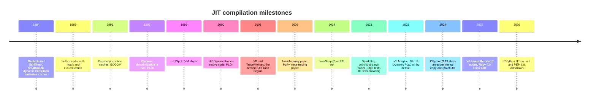
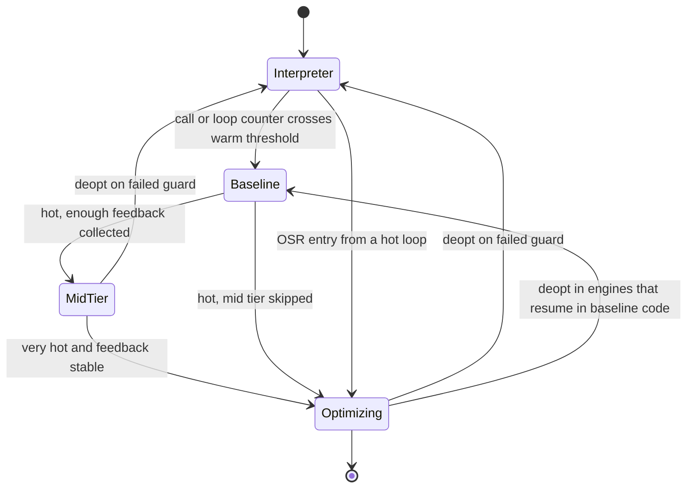

---
tags:
  - compilers
  - jit
  - runtimes
  - dynamic-languages
  - deoptimization
  - inline-caching
  - tiered-compilation
status: complete
sources:
  - https://www.cs.tufts.edu/~nr/cs257/archive/peter-deutsch/efficient-smalltalk.pdf
  - https://bibliography.selflanguage.org/pics.html
  - https://bibliography.selflanguage.org/dynamic-deoptimization.html
  - https://www.cse.iitm.ac.in/~krishna/courses/2022/odd-cs6013/BalaDusterwaldBanerjiaPLDI2000.pdf
  - https://www.cs.williams.edu/~freund/cs434/gal-trace.pdf
  - https://fg-sr.gi.de/fileadmin/FG/SR/Abstracts/2009/Bolz.pdf
  - https://arxiv.org/abs/2011.13127
  - https://arxiv.org/pdf/1711.03050
  - https://v8.dev/blog/sparkplug
  - https://v8.dev/blog/maglev
  - https://v8.dev/blog/leaving-the-sea-of-nodes
  - https://v8.dev/docs/hidden-classes
  - https://v8.dev/blog/liftoff
  - https://v8.dev/blog/spectre
  - https://v8.dev/blog/sandbox
  - https://webkit.org/blog/10308/speculation-in-javascriptcore/
  - https://webkit.org/blog/3362/introducing-the-webkit-ftl-jit/
  - https://webkit.org/blog/5852/introducing-the-b3-jit-compiler/
  - https://devblogs.microsoft.com/java/how-tiered-compilation-works-in-openjdk/
  - https://openjdk.org/jeps/515
  - https://openjdk.org/jeps/8335368
  - https://blogs.oracle.com/java/post/detaching-graalvm-from-the-java-ecosystem-train
  - https://learn.microsoft.com/en-us/dotnet/core/whats-new/dotnet-10/runtime
  - https://devclass.com/2023/09/18/most-valuable-change-in-net-8-dynamic-optimization-on-by-default-says-microsoft
  - https://softwaremill.com/project-leyden-and-jdk-26-bringing-aot-caching-to-zgc/
  - https://openjdk.org/jeps/516
  - https://www.oracle.com/news/announcement/oracle-releases-java-26-2026-03-17/
  - https://learn.microsoft.com/en-us/dotnet/core/whats-new/dotnet-11/runtime
  - https://devblogs.microsoft.com/dotnet/?p=61205
  - https://peps.python.org/pep-0744/
  - https://www.python.org/downloads/release/python-3140/
  - https://peps.python.org/pep-0836/
  - https://blog.python.org/2026/03/jit-on-track/
  - https://discuss.python.org/t/an-announcement-from-the-steering-council-regarding-the-jit-project/107638
  - https://www.infoworld.com/article/4241003/python-jettisons-the-native-jit-at-least-for-now.html
  - https://docs.python.org/3.15/whatsnew/3.15.html
  - https://infoq.com/news/2026/09/java27-released
  - https://www.theregister.com/devops/2026/06/08/python_jit_compiler_may_be_removed/5252079
  - https://doc.pypy.org/release-v7.3.23.html
  - https://www.ruby-lang.org/en/news/2025/12/25/ruby-4-0-0-released/
  - https://bernsteinbear.com/blog/launch-zjit/
  - https://railsatscale.com/2026-03-18-how-zjit-removes-redundant-object-loads-and-stores/
  - https://luajit.org/download.html
  - https://luajit.org/status.html
  - https://docs.kernel.org/bpf/classic_vs_extended.html
  - https://faculty.cc.gatech.edu/~jarulraj/courses/4420-s19/papers/03-compilation/p539-neumann.pdf
  - https://ar5iv.labs.arxiv.org/html/2305.13241
  - https://static.usenix.org/legacy/events/woot10/tech/full_papers/Blazakis.pdf
  - https://www.malwarebytes.com/blog/news/2021/08/edges-super-duper-secure-mode-benchmarked-how-much-speed-would-you-trade-for-security
  - https://learn.microsoft.com/en-us/DeployEdge/microsoft-edge-security-browse-safer
  - https://daringfireball.net/2024/06/apple_disables_webkits_jit_in_lockdown_mode
  - https://developer.apple.com/tutorials/data/documentation/browserenginekit/protecting-code-compiled-just-in-time.md
created: 2026-11-26
updated: 2026-11-28
---

## Table Of Contents

- [[#TL;DR|TL;DR]]
- [[#The Problem|The Problem]]
- [[#Foundations|Foundations]]
    - [[#Interpreters, AOT and JIT|Interpreters, AOT and JIT]]
    - [[#Why Dynamic Languages Want a JIT|Why Dynamic Languages Want a JIT]]
    - [[#The Tiering Bet|The Tiering Bet]]
- [[#How We Got Here|How We Got Here]]
- [[#How It Works|How It Works]]
    - [[#Profiling and Tiers|Profiling and Tiers]]
    - [[#Hidden Classes and Inline Caches|Hidden Classes and Inline Caches]]
    - [[#Speculation, Guards and Type Feedback|Speculation, Guards and Type Feedback]]
    - [[#Deoptimization and On-Stack Replacement|Deoptimization and On-Stack Replacement]]
    - [[#Method JITs vs Tracing JITs|Method JITs vs Tracing JITs]]
    - [[#Copy-and-Patch Compilation|Copy-and-Patch Compilation]]
    - [[#JITs Outside Language VMs|JITs Outside Language VMs]]
    - [[#Security|Security]]
- [[#Where It Is Now|Where It Is Now]]
    - [[#JavaScript Engines|JavaScript Engines]]
    - [[#Python|Python]]
    - [[#JVM and .NET|JVM and .NET]]
    - [[#Ruby, Lua and the Rest|Ruby, Lua and the Rest]]
- [[#Trade-offs & Open Problems|Trade-offs & Open Problems]]
- [[#Resources|Resources]]
- [[#Related Notes|Related Notes]]

## ***TL;DR***
---
*A just-in-time (JIT) compiler turns code into machine code while the program runs, so it can compile for the types, shapes and paths it has actually seen. That is why every fast JavaScript, Java, C# and Lua runtime has one, and why they are some of the hardest compilers to get right.*

- **What it is.** A JIT watches a program run in an interpreter or a quick first-tier compiler, finds the hot functions or loops, and compiles them again with optimizations specialized to what it observed. It is the [[Compiler Pipeline]] run at run time, on a budget of milliseconds.
- **Why it wins for dynamic languages.** In `a.x + b`, JavaScript or Python can't know until run time whether `a.x` is an integer, a string or a getter. An AOT compiler must emit the slow general case; a JIT emits the fast case for what it saw, plus a cheap *guard* that checks the assumption.
- **The four core mechanisms.** *Tiering* (interpreter → baseline → optimizing), *inline caches* keyed on *hidden classes* (shapes), *speculation with guards* driven by type feedback, and *deoptimization*: when a guard fails, rebuild the interpreter's frame and continue there. Deoptimization goes back to Self in 1992 ([Hölzle, Chambers and Ungar, PLDI 1992](https://bibliography.selflanguage.org/dynamic-deoptimization.html)).
- **Two shapes of JIT.** *Method JITs* compile whole functions (HotSpot, V8, JavaScriptCore, .NET). *Tracing JITs* record one hot path through a loop and compile it as a straight line (Dynamo, TraceMonkey, LuaJIT, PyPy).
- **Cheap compilers matter now.** *Copy-and-patch* builds machine code by gluing precompiled templates and filling holes ([Xu and Kjolstad, OOPSLA 2021](https://arxiv.org/abs/2011.13127)); CPython's experimental JIT used it.
- **As of November 2026.** V8 runs four tiers (Ignition, Sparkplug, Maglev, TurboFan) and has moved its optimizing back end to the CFG-based Turboshaft ([V8, 2025](https://v8.dev/blog/leaving-the-sea-of-nodes)). CPython's experimental JIT reached 4 to 12% over the interpreter in 3.15, but the Steering Council froze new JIT development on CPython's main branch in June 2026 pending a PEP, and PEP 836, that PEP, was withdrawn on 19 October, so mainline work has stopped ([PEP 836](https://peps.python.org/pep-0836/); [InfoWorld, Oct 2026](https://www.infoworld.com/article/4241003/python-jettisons-the-native-jit-at-least-for-now.html)). The JVM is attacking warm-up with Project Leyden's AOT cache ([JEP 515](https://openjdk.org/jeps/515)), and Ruby 4.0 shipped a second JIT, ZJIT ([Ruby 4.0.0](https://www.ruby-lang.org/en/news/2025/12/25/ruby-4-0-0-released/)).

## ***The Problem***
---
*Fast code needs facts the source doesn't state: which types flow where, which branch is taken, which call target is used. A dynamic language only reveals these at run time, and a static compiler for any language can only guess them.*

Take one line of JavaScript:

```javascript
function getX(p) { return p.x; }
```

A C compiler for `struct Point { int x; }` emits one load at a fixed offset. A JavaScript engine can't: `p` could be any object, `x` could live at any offset, be missing (walk the prototype chain), be a getter (call a function) or `p` could be a proxy. A naive interpreter does a hash-table lookup on every call. Python's `a + b` is worse: it dispatches through `__add__` and `__radd__` and may allocate a new integer object for the result.

Three facts make a JIT pay off:

- **Programs are far more regular than their languages allow.** A given `p.x` site usually sees one or two object layouts. Deutsch and Schiffman found Smalltalk send sites so stable that caching the last receiver class at each site was worth building a whole compiler around ([Deutsch and Schiffman, POPL 1984](https://www.cs.tufts.edu/~nr/cs257/archive/peter-deutsch/efficient-smalltalk.pdf)).
- **Time is concentrated.** Most time is spent in a small fraction of the code, so it pays to compile *only that*, and to compile it well.
- **Some facts don't exist until run time**, even for static languages: which class actually implements an interface at a call site (Java, C#), which classes are loaded, which plugins exist. Profile-guided AOT compilation can approximate this, but the profile may not match production; a JIT's profile always does.

## ***Foundations***
---
*Three ideas carry the rest of the note: the spectrum from interpreting to compiling ahead of time, why dynamic typing makes run-time facts so valuable, and the bet every tiered JIT makes about when compiling pays for itself.*

### Interpreters, AOT and JIT

*They differ in when machine code is made, and so in what the compiler can know.*

| Strategy | When code is generated | Knows | Start-up | Peak speed | Examples |
|---|---|---|---|---|---|
| Interpreter (tree or bytecode) | Never | Everything, but uses none of it | Instant | Slowest; dispatch per operation | CPython's default build, V8's Ignition, JSC's LLInt |
| AOT compiler | Before shipping | Static types; maybe an old profile | Fast, no warm-up | Good for static languages, weak for dynamic ones | GCC, Clang, Go, Native AOT for .NET, GraalVM Native Image |
| Baseline JIT | First calls | Bytecode only; removes dispatch | Small delay | Faster; dispatch overhead gone | V8 Sparkplug, JSC Baseline, HotSpot C1 level 1 |
| Optimizing JIT | Hot code | Live types, shapes, branch and call profiles | Long warm-up | Best for dynamic code | V8 TurboFan, JSC FTL, HotSpot C2, .NET RyuJIT tier 1 |

The [[Compiler Pipeline]] note covers the same split from the AOT side. A JIT still runs the usual phases ([[Intermediate Representations|IR]] building, [[SSA Form|SSA]], [[Classic Optimizations]], [[Register Allocation]], [[Instruction Selection]]), but chooses cheaper algorithms: linear scan instead of graph coloring, one pass instead of many.

### Why Dynamic Languages Want a JIT

*In a dynamically typed language every operation is generic; the JIT's job is to make the common case concrete.*

Every value carries its type at run time, so `a + b` means "look at both tags, then pick integer add, float add, string concatenation, or a user method". Static [[Type Systems and Inference|type inference]] can remove some checks, but for JavaScript or Python it gives up quickly (any call, any property read can produce anything). A JIT replaces inference with *observation*: it records what each operation saw, assumes the future will look the same, and compiles that.

What the JIT specializes on:

| Run-time fact | Where it's recorded | What it buys |
|---|---|---|
| Object layout (hidden class, shape, map) | Inline cache at each property access | Property access becomes one compare and one load |
| Operand types (small int, double, string) | Type feedback slots per arithmetic op | Unboxed machine arithmetic with an overflow check |
| Call targets | Call-site caches | Direct calls, then inlining |
| Branch frequencies | Counters | [[Code Layout]]; never-taken paths left out entirely |
| Loaded classes (static languages too) | Class hierarchy analysis | Devirtualizing a call with one implementer |

### The Tiering Bet

*Compile a function only once it has run long enough that faster code will win back the compile time.*

$$
\text{compile at tier } k \iff N_{\text{future}} \cdot (t_{k-1} - t_k) > C_k
$$

**In plain English:** $N_{\text{future}}$ is how many more times the code will run, $t_{k-1}$ and $t_k$ are the per-run costs before and after compiling at tier $k$, and $C_k$ is the cost of compiling. Compile only if the time saved beats the time spent. No JIT knows $N_{\text{future}}$, so all of them use the past as a proxy: a function that has run 1,000 times will probably run 1,000 more. That is why tiers have counters and thresholds, and why each higher tier has a higher threshold: its $C_k$ is larger.

**Worked example.** A function takes 10 µs per call in the interpreter, 4 µs after a baseline compile costing 50 µs, and 1 µs after an optimizing compile costing 5 ms. The baseline compile pays for itself after $50 / (10-4) \approx 9$ calls. The optimizing compile, from baseline, needs $5000 / (4-1) \approx 1{,}700$ more calls. A function called 100 times should stop at baseline; one called a million times should go all the way. Tiering exists because no single compiler is right for both.

## ***How We Got Here***
---
*JIT ideas came out of Smalltalk and Self in the 1980s, reached the mainstream with Java's HotSpot, became a browser arms race after 2008, and in the 2020s turned toward cheaper compilers, more tiers, and security limits.*



- **Smalltalk-80 (1984).** Deutsch and Schiffman translated bytecode to native code on first use, cached the result, and invented the *inline cache*: each send site remembers the last receiver class and jumps straight to its method ([Deutsch and Schiffman, POPL 1984](https://www.cs.tufts.edu/~nr/cs257/archive/peter-deutsch/efficient-smalltalk.pdf)).
- **Self (1989 to 1994).** Chambers, Ungar and Hölzle added *maps* (today's hidden classes), *customization* (compile a copy of a method per receiver type), *polymorphic inline caches* ([Hölzle, Chambers and Ungar, ECOOP 1991](https://bibliography.selflanguage.org/pics.html)), *dynamic deoptimization* for debugging optimized code ([PLDI 1992](https://bibliography.selflanguage.org/dynamic-deoptimization.html)), and type feedback. Nearly every idea in a modern JIT appears here.
- **HotSpot (1999).** Built from the Strongtalk/Self lineage, it brought adaptive optimization, deoptimization and [[On-Stack Replacement|on-stack replacement]] to Java, with the C1 (client) and C2 (server) compilers.
- **Tracing (2000 to 2012).** HP's Dynamo re-optimized *native* code by recording hot traces ([Bala, Duesterwald and Banerjia, PLDI 2000](https://www.cse.iitm.ac.in/~krishna/courses/2022/odd-cs6013/BalaDusterwaldBanerjiaPLDI2000.pdf)). TraceMonkey applied trace trees to JavaScript in Firefox 3.5 ([Gal et al., PLDI 2009](https://www.cs.williams.edu/~freund/cs434/gal-trace.pdf)); LuaJIT 2 and PyPy made tracing work well; Mozilla later dropped tracing for method JITs.
- **The browser race (2008 onward).** V8 launched with Chrome in 2008 with hidden classes and inline caches from day one. Each engine grew more tiers: JSC went to four tiers with FTL in 2014 ([WebKit, 2014](https://webkit.org/blog/3362/introducing-the-webkit-ftl-jit/)) and replaced LLVM inside FTL with its own B3 in 2016 ([Pizlo, 2016](https://webkit.org/blog/5852/introducing-the-b3-jit-compiler/)); V8 added Sparkplug in 2021 ([V8, 2021](https://v8.dev/blog/sparkplug)) and Maglev in 2023 ([V8, 2023](https://v8.dev/blog/maglev)).

## ***How It Works***
---
*A modern JIT is a pipeline of tiers joined by profiles going up and deoptimization going down. Inline caches feed the profiles; speculation turns them into fast code; guards and deopt make the speculation safe.*

### Profiling and Tiers

*Each tier is cheaper to enter and slower to run than the one above it; counters decide when to move up, failed guards send code back down.*



The interpreter and baseline tiers *collect* feedback (inline-cache states, type slots, counters); the upper tiers *consume* it. After a deopt, the function keeps running in a low tier, gathers fresh feedback, and may be recompiled later; engines cap how often this can happen so a function can't flip forever.

| Engine | Tiers, low to high | Notes |
|---|---|---|
| **V8** (Chrome, Node) | Ignition (bytecode interpreter) → Sparkplug (baseline) → Maglev (mid-tier) → TurboFan (top tier, Turboshaft back end) | Sparkplug compiles bytecode to machine code in one linear pass with no IR, and improved Speedometer by 5 to 10% when it shipped in Chrome 91 ([V8, 2021](https://v8.dev/blog/sparkplug)). Maglev compiles about 10x slower than Sparkplug and about 10x faster than TurboFan ([V8, 2023](https://v8.dev/blog/maglev)). Deopts land in Ignition |
| **JavaScriptCore** (Safari) | LLInt → Baseline → DFG → FTL (B3 back end) | Each tier collects profiling for the next; speculation and OSR exit are described in detail by Pizlo ([WebKit, 2020](https://webkit.org/blog/10308/speculation-in-javascriptcore/)) |
| **HotSpot** (JVM) | Level 0 interpreter → levels 1 to 3 C1 (no, light, full profiling) → level 4 C2 | Usual path is 0 → 3 → 4; trivial methods stop at 1; level 2 stands in for 3 when C2's queue is long. Default invocation thresholds are 200 for level 3 and 5,000 for level 4, with loop iterations also counted ([Microsoft for Java, 2023](https://devblogs.microsoft.com/java/how-tiered-compilation-works-in-openjdk/)) |
| **.NET CoreCLR** | Tier 0 (quick JIT, or precompiled ReadyToRun code) → instrumented tier → tier 1 (full RyuJIT) | Tiered compilation default since .NET Core 3.0; OSR and Dynamic PGO, the latter on by default since .NET 8 ([DevClass, 2023](https://devclass.com/2023/09/18/most-valuable-change-in-net-8-dynamic-optimization-on-by-default-says-microsoft)) |

### Hidden Classes and Inline Caches

*Give objects with the same layout a shared descriptor, then cache "if the descriptor is X, the field is at offset Y" at every access site.*

A *hidden class* (V8 calls it a *map*, JSC a *structure*, SpiderMonkey a *shape*) describes an object's layout: which properties it has, in what order, at what offsets. Objects built the same way share one, and adding a property moves an object along a *transition tree* to a new one ([V8 docs](https://v8.dev/docs/hidden-classes)):

```javascript
function Point(x, y) { this.x = x; this.y = y; }
const p = new Point(1, 2);   // map M0 {} → M1 {x@0} → M2 {x@0, y@1}
const q = new Point(3, 4);   // follows the same transitions, ends at M2
q.z = 5;                     // new transition M2 → M3 {x@0, y@1, z@2}
```

An *inline cache* (IC) sits at each property access or call site and remembers what it saw. Its states:

| State | Means | Code at the site |
|---|---|---|
| Uninitialized | Never run | Call the generic lookup, then record |
| Monomorphic | One shape seen | One compare, one load |
| Polymorphic | 2 to 4 shapes (engine-dependent) | Short chain of compares (a PIC) |
| Megamorphic | Too many shapes | Fall back to a global hash-table cache |

**Worked example: `return p.x` in pseudo-assembly.** The generic path is a call into the runtime. After the first call with a `Point`, the site is *patched* (or, in V8 today, its feedback slot updated) so it becomes:

```asm
; rdi = p (tagged pointer)
getX_ic:
    test   dil, 1                  ; is p a heap object? (Smi tag check)
    jz     miss                    ; small integers have no properties
    mov    rax, [rdi + MAP_OFFSET] ; load p's hidden class
    cmp    rax, M2                 ; same shape as last time? (patched-in constant)
    jne    miss
    mov    rax, [rdi + FIELD0]     ; x lives in slot 0 for map M2 (patched-in offset)
    ret
miss:
    call   runtime_load_ic_miss    ; full lookup, then update the cache
    ret
```

A full dictionary lookup became a tag test, a load, a compare and a load. If `getX` is later called with an object of map `M5`, the miss handler extends the site to a polymorphic chain (`cmp M2 / cmp M5`); Hölzle, Chambers and Ungar's PICs did exactly this, and also recorded *which* types were seen, which became the input to type feedback ([ECOOP 1991](https://bibliography.selflanguage.org/pics.html)). Programs that build objects in different orders create different maps and turn monomorphic sites megamorphic, which is why "initialize all fields in the constructor, in the same order" is standard JavaScript performance advice.

### Speculation, Guards and Type Feedback

*The optimizing tier compiles the case the feedback says is common, and protects it with a guard that exits to slower code when the guess is wrong.*

Given feedback that `a + b` has only seen small integers, the optimizer emits:

```text
v1 = CheckSmi a            ; guard: deopt if a is not a small int
v2 = CheckSmi b            ; guard
v3 = Int32AddCheckOverflow v1, v2   ; guard: deopt on overflow
```

instead of a call to the generic `Add` builtin. Once the guards are in place, later code can *rely* on `v3` being an int32: it can keep it in a register, skip boxing, hoist it out of loops ([[Loop Optimizations]]) and feed it into bounds-check elimination. Guards are cheap (a compare and a rarely-taken branch) and are often merged or hoisted, since one shape check can cover many field loads on the same object.

Kinds of speculation in production engines:

- **Type and shape**: operand is a small int, a double, a string; object has map M.
- **Call target**: the callee is function F, so inline it. This is *type feedback* in Hölzle and Ungar's sense, and inlining is where most of the speed comes from, because it exposes everything else to optimization.
- **Value and range**: an array index is in bounds; a value is a constant.
- **Global invariants**: a prototype has not changed, a class has one subclass. These are watched by *dependencies* rather than inline guards: if the invariant breaks, the runtime invalidates all code that relied on it (*lazy deopt*), as HotSpot does when a newly loaded class adds a second implementer.

### Deoptimization and On-Stack Replacement

*Deopt rebuilds the interpreter's view of a frame from optimized machine state; OSR moves a running loop between tiers without waiting for the function to return.*

At every point where optimized code might exit (each guard), the compiler records a *frame state* (V8), *OSR exit* (JSC) or *scope descriptor* (HotSpot): which bytecode offset to resume at, and where each interpreter-visible variable now lives (a register, a stack slot, a constant, or "this object was never allocated; here are its fields", after [[Escape Analysis|escape analysis]]). Deopt runs that recipe backwards; [[Deoptimization and Speculation]] covers eager and lazy deopt, exit counting and deopt loops in depth.

```mermaid
sequenceDiagram
    participant Opt as Optimized code
    participant D as Deoptimizer
    participant R as Runtime
    participant I as Interpreter
    Opt->>Opt: CheckSmi a fails
    Opt->>D: jump to deopt exit with exit id
    D->>D: look up frame state for exit id
    D->>D: read registers and spill slots
    D->>R: materialize scalar-replaced objects on the heap
    D->>D: build interpreter frame at bytecode offset
    D->>R: mark feedback, maybe discard optimized code
    D->>I: resume at the bytecode after the last side effect
    I->>I: continue slowly, collect fresh feedback
```

The key rule: the resume point must be *before* any side effect the optimized code has not already performed, or *after* all those it has, never halfway. Engines resume at the start of the bytecode whose guard failed, which is safe because guards are placed before effects.

**On-stack replacement** goes both ways ([[On-Stack Replacement]] covers entry in depth):

- **OSR entry (up).** A function called once but containing a long loop never hits its call counter. The interpreter counts *back-edges*; when the loop is hot, the JIT compiles a version with an extra entry at the loop header, copies the live interpreter values into it, and jumps in mid-loop. HotSpot, V8 and .NET (since .NET 7) all do this.
- **OSR exit (down)** is deoptimization itself: leaving optimized code in the middle of a function.

### Method JITs vs Tracing JITs

*A method JIT compiles a function with all its paths; a tracing JIT compiles one hot path through a loop, as a straight line, and exits when execution leaves it.*

| | Method JIT | Tracing JIT |
|---|---|---|
| Unit | Function (plus inlined callees) | Recorded path through a hot loop, crossing calls |
| Control flow | Full CFG; the optimizer must handle merges | Straight line; every branch becomes a guard (*side exit*) |
| Inlining | Heuristic, by size and frequency | Free: the trace just follows the call |
| Weak spot | Compile cost, inlining heuristics | Branchy code: trace explosion, many side traces |
| Examples | HotSpot, V8, JSC, .NET, ZJIT | Dynamo, TraceMonkey, LuaJIT, PyPy |

A trace is recorded by running the interpreter in a logging mode for one loop iteration; since it is a single path, optimizations like redundant-guard removal and allocation removal are simple forward passes. Hot side exits grow their own traces, forming *trace trees* ([Gal et al., PLDI 2009](https://www.cs.williams.edu/~freund/cs434/gal-trace.pdf)).

**Meta-tracing.** PyPy's insight was to trace the *interpreter*, not the user program. You write an interpreter for your language in RPython (a restricted, statically analyzable Python), add a few hints marking the dispatch loop, and the RPython toolchain generates a tracing JIT for your language ([Bolz et al., ICOOOLPS 2009](https://fg-sr.gi.de/fileadmin/FG/SR/Abstracts/2009/Bolz.pdf)). Truffle/Graal does the analogous thing for method JITs via *partial evaluation* of AST interpreters. Both turn "write an interpreter" into "get a JIT".

Tracing lost in JavaScript (TraceMonkey was removed from Firefox in favor of method JITs) because web code is branchy and type-unstable, but it remains the design behind two of the fastest dynamic-language runtimes, LuaJIT and PyPy.

### Copy-and-Patch Compilation

*Build machine code by copying precompiled snippets and patching their holes, so a baseline compiler gets close to optimized-template quality at almost memcpy speed.*

Xu and Kjolstad's idea: write each operation's implementation in C, with placeholders for constants, jump targets and operands; compile those *stencils* ahead of time with Clang/LLVM at full optimization; extract the bytes and the relocation records that mark the holes. At run time, compiling a sequence of operations is just copying stencils into a buffer and writing values into the holes ([Xu and Kjolstad, OOPSLA 2021](https://arxiv.org/abs/2011.13127)).

```c
/* A stencil for "load local i, add constant k" in a CPython-like VM.
   _JIT_OPARG and _JIT_CONTINUE are holes, filled at JIT time. */
extern char _JIT_OPARG, _JIT_CONTINUE;
PyObject *stencil(Frame *f, PyObject **sp) {
    long k = (long)&_JIT_OPARG;            /* hole: becomes an immediate */
    sp[-1] = add_small_int(sp[-1], k);
    __attribute__((musttail)) return ((Cont)&_JIT_CONTINUE)(f, sp); /* hole: next stencil */
}
```

Because LLVM did the instruction selection and register allocation ahead of time, the stencils are good code; because nothing is optimized at run time, compiling is very fast. The paper reports code generation "two orders of magnitude faster than LLVM -O0", with the output running 14% faster than LLVM -O0's; its WebAssembly compiler generates code 4.9x to 6.5x faster than V8's Liftoff, and that code runs 39% to 63% faster ([Xu and Kjolstad](https://arxiv.org/abs/2011.13127)). CPython adopted it as the back end of its experimental JIT: specialized bytecode is translated into *micro-ops* (uops), optimized lightly, and each uop is emitted as a stencil, with LLVM needed only at CPython's build time ([PEP 744](https://peps.python.org/pep-0744/)). The limits: code quality is capped at "good templates", registers can't be allocated across stencils without extra tricks, and stencils are tied to one C compiler's output.

### JITs Outside Language VMs

*The same idea, specialize at run time when you finally know the inputs, shows up in kernels, regex engines, databases, Wasm runtimes and GPU drivers.*

| Domain | What gets JIT-compiled | Example |
|---|---|---|
| **eBPF** | Verified bytecode programs loaded into the Linux kernel, compiled to native code (x86-64, arm64 and others) after the verifier proves them safe | `net.core.bpf_jit_enable`; the kernel docs describe the eBPF instruction set as designed to map one-to-one onto native instructions for JITing ([kernel docs](https://docs.kernel.org/bpf/classic_vs_extended.html)) |
| **Regular expressions** | The regex's automaton, compiled to a machine-code matcher (see [[Regular Expression Engines]]) | PCRE2 JIT, V8's Irregexp, .NET `RegexOptions.Compiled` |
| **Databases** | Query plans fused into tight loops instead of interpreted operator by operator | HyPer's data-centric code generation via LLVM ([Neumann, VLDB 2011](https://faculty.cc.gatech.edu/~jarulraj/courses/4420-s19/papers/03-compilation/p539-neumann.pdf)); PostgreSQL's LLVM JIT for expressions |
| **[[WebAssembly]]** | Wasm modules: a fast single-pass baseline first, an optimizing compiler for hot code | V8's Liftoff then TurboFan ([V8, 2018](https://v8.dev/blog/liftoff)); Wasmtime's Winch then Cranelift; Titzer surveys the baselines ([Titzer, 2023](https://ar5iv.labs.arxiv.org/html/2305.13241)) |
| **GPU drivers** | Shaders and kernels shipped as SPIR-V, DXIL or PTX, compiled for the exact GPU at load time | Mesa's ACO for AMD; NVIDIA's driver compiles PTX to SASS. See [[GPU Kernel Compilers]] |
| **ML frameworks** | Tensor programs traced and compiled for the actual shapes | `torch.compile`, JAX's `jit`; see [[ML Compilers]] |

### Security

*A JIT writes executable code at run time from attacker-influenced input, which breaks the "code is read-only" assumption most defenses rely on. JIT bugs are among the most exploited bugs in browsers.*

| Threat or defense | What it is |
|---|---|
| **W^X** | A page is writable or executable, never both. JITs write to one mapping and execute from another, or flip permissions per thread: Apple Silicon's `MAP_JIT` with per-thread write protection. On iOS only entitled processes (WebKit) may JIT; third-party browser engines built on BrowserEngineKit need JIT entitlements and must toggle each page between writable and executable through its W^X functions ([Apple](https://developer.apple.com/tutorials/data/documentation/browserenginekit/protecting-code-compiled-just-in-time.md)) |
| **JIT spraying** | Attacker-chosen constants (`x ^ 0x3c909090 ^ ...`) become instruction bytes in JIT output; jumping into the middle of them runs shellcode ([Blazakis, WOOT 2010](https://static.usenix.org/legacy/events/woot10/tech/full_papers/Blazakis.pdf)). Defense: constant blinding, randomized code placement |
| **Speculation bugs** | The JIT's own logic errors: a wrong range analysis or a missing guard turns into out-of-bounds memory access, then full exploitation. From 2021 to 2023, 60% of in-the-wild Chrome exploits that started with renderer memory corruption were V8 bugs, often logic bugs ([V8, 2024](https://v8.dev/blog/sandbox)) |
| **Spectre** | JIT output can be shaped into speculative-execution gadgets. V8 concluded that software mitigations could not fully stop it and relied on process isolation instead ([V8, 2019](https://v8.dev/blog/spectre)) |
| **V8 sandbox** | Contains memory corruption in the V8 heap: heap objects refer to each other by offsets inside a reserved region, and external objects go through a pointer table, so a JIT bug can corrupt the heap but not the rest of the process. It joined Chrome's Vulnerability Reward Program in April 2024, with Chrome 123 described as a sort of beta release for it ([V8, 2024](https://v8.dev/blog/sandbox)) |
| **JIT-less modes** | Microsoft Edge's "Super Duper Secure Mode" (2021), now Enhanced Security mode, turns off JIT JavaScript compilation ([Microsoft Learn](https://learn.microsoft.com/en-us/DeployEdge/microsoft-edge-security-browse-safer)); the rationale was that "a little under half" of V8 CVEs related to the JIT, and SunSpider ran about 1.9x slower without it ([Malwarebytes, 2021](https://www.malwarebytes.com/blog/news/2021/08/edges-super-duper-secure-mode-benchmarked-how-much-speed-would-you-trade-for-security)). Apple's Lockdown Mode disables WebKit's JIT ([Daring Fireball, 2024](https://daringfireball.net/2024/06/apple_disables_webkits_jit_in_lockdown_mode)) |

## ***Where It Is Now***
---
*As of November 2026: JavaScript engines are rebuilding their optimizing tiers around CFG IRs and a mid tier, the JVM and .NET are attacking warm-up with AOT caches and built-in PGO, CPython's JIT experiment has stopped in the main branch, and Ruby is replacing one JIT with another.*

### JavaScript Engines

- **V8.** Four tiers: Ignition, Sparkplug, Maglev and TurboFan. In March 2025 V8 explained that it was leaving the sea-of-nodes IR: all of TurboFan's JavaScript back end and the whole Wasm pipeline use the CFG-based *Turboshaft*, the JavaScript front end is being replaced by Maglev's CFG IR, and compile time was "divided by 2" compared to sea of nodes ([V8, 2025](https://v8.dev/blog/leaving-the-sea-of-nodes)). That post describes the Maglev-based front end as work in progress, and I found no later V8 post confirming it is finished; treat it as in progress. See [[Intermediate Representations]] for the IR side.
- **JavaScriptCore.** Still LLInt, Baseline, DFG and FTL (B3), as described in the WebKit docs and Pizlo's speculation write-up ([WebKit, 2020](https://webkit.org/blog/10308/speculation-in-javascriptcore/)); no new tier was announced that I found.
- **Security pressure** keeps rising: the V8 sandbox is a security boundary in Chrome's bug bounty, and Edge and Apple both ship JIT-less modes.

### Python

- **CPython's JIT, 2024 to 2026.** PEP 744 described the experimental copy-and-patch JIT added in 3.13 ([PEP 744](https://peps.python.org/pep-0744/)); 3.14's official Windows and macOS binaries included it ([Python 3.14.0](https://www.python.org/downloads/release/python-3140/)), built but disabled by default ([PEP 836](https://peps.python.org/pep-0836/)). Its simple initial tracing implementation "yielded no speedups initially in 3.13 and 3.14" ([PEP 836](https://peps.python.org/pep-0836/)). After the Faster CPython team lost its main sponsor in 2025, the remaining contributors rewrote the front end to *record* traces (raising JIT code coverage by about 50%) and worked on removing reference-count branches. By March 2026 the 3.15 alphas were about 11 to 12% faster than the tail-calling interpreter on macOS AArch64 and 5 to 6% faster than the standard interpreter on x86-64 Linux (preliminary geometric means), with individual benchmarks from 20% slower to over 2x faster ([Python Insider, Mar 2026](https://blog.python.org/2026/03/jit-on-track/)). Free-threaded builds were not supported.
- **The stop.** On 5 June 2026 the Steering Council asked for a Standards Track PEP for the JIT, froze new JIT development on main (bug and security fixes excepted), and said the JIT code would be removed from main if no PEP was accepted within six months, a deadline it later called flexible ([discuss.python.org](https://discuss.python.org/t/an-announcement-from-the-steering-council-regarding-the-jit-project/107638); [The Register](https://www.theregister.com/devops/2026/06/08/python_jit_compiler_may_be_removed/5252079)). PEP 836, created 2 July 2026, reported 4 to 12% geometric-mean gains on pyperformance across tier-1 platforms and was withdrawn on 19 October ([PEP 836](https://peps.python.org/pep-0836/)). InfoWorld reports that the Council found the plan thin on support, performance evaluation and debugger and profiler integration, and too optimistic on gains; co-author Savannah Ostrowski said "we don't feel we have the personal bandwidth to carry the current version forward", and InfoWorld concludes that mainline JIT work "won't go forward" ([InfoWorld, Oct 2026](https://www.infoworld.com/article/4241003/python-jettisons-the-native-jit-at-least-for-now.html)). Python 3.15, released 9 October 2026, still ships the "significantly upgraded" experimental JIT ([What's New in 3.15](https://docs.python.org/3.15/whatsnew/3.15.html)).
- **PyPy** keeps its meta-tracing JIT current: v7.3.23 (26 May 2026) ships Python 2.7 and 3.11 ([PyPy](https://doc.pypy.org/release-v7.3.23.html)), still several language versions behind CPython.

### JVM and .NET

- **HotSpot.** C1/C2 tiering is unchanged; the work is on warm-up through Project Leyden's *AOT cache*. JDK 25 added *AOT method profiling*: profiles from a training run are stored in the cache so the JIT compiles hot methods sooner. On the JEP's small Stream example, run time fell from about 90 ms to 73 ms, for about 250 KB of extra cache ([JEP 515](https://openjdk.org/jeps/515)). JDK 26 (17 March 2026) shipped [JEP 516](https://openjdk.org/jeps/516), Ahead-of-Time Object Caching with Any GC ([Oracle, Mar 2026](https://www.oracle.com/news/announcement/oracle-releases-java-26-2026-03-17/)), which brings the AOT cache to ZGC ([SoftwareMill](https://softwaremill.com/project-leyden-and-jdk-26-bringing-aot-caching-to-zgc/)). Caching compiled code itself is still a draft JEP with no release target ([JEP draft 8335368](https://openjdk.org/jeps/8335368)), and none of JDK 27's nine JEPs (September 2026) is a Leyden or JIT feature ([InfoQ, Sep 2026](https://infoq.com/news/2026/09/java27-released)).
- **Graal.** Oracle JDK 24 was the last to include the experimental Graal JIT, and the GraalVM team now focuses on GraalJS and GraalPy, while start-up, peak-performance and footprint work is "being pursued further in OpenJDK's Project Leyden" ([Oracle, Sep 2025](https://blogs.oracle.com/java/post/detaching-graalvm-from-the-java-ecosystem-train)).
- **.NET.** .NET 10's JIT added array-interface devirtualization, inlining through `try/finally`, escape analysis that stack-allocates small arrays and non-escaping delegates (their closures stay on the heap), graph-based loop inversion, and block layout as an asymmetric travelling-salesman problem solved with 3-opt ([What's new in the .NET 10 runtime](https://learn.microsoft.com/en-us/dotnet/core/whats-new/dotnet-10/runtime)). .NET 11 shipped on 10 November 2026 ([Announcing .NET 11](https://devblogs.microsoft.com/dotnet/?p=61205)); its JIT removes more bounds checks ([[Bounds Check Elimination]]) and redundant overflow checks and branches, folds small multi-constant switch expressions and `SequenceEqual` on constants, and devirtualizes generic virtual methods and default interface methods on generic interfaces ([What's new in the .NET 11 runtime](https://learn.microsoft.com/en-us/dotnet/core/whats-new/dotnet-11/runtime)).

### Ruby, Lua and the Rest

- **Ruby.** YJIT is still "the default compiler choice". Ruby 4.0 (25 December 2025) added **ZJIT**, built by the same team as a "more traditional method compiler" with a "bigger compilation unit size and SSA IR"; it is compiled in but off by default (`--zjit`), faster than the interpreter but not yet as fast as YJIT ([Bernstein, Dec 2025](https://bernsteinbear.com/blog/launch-zjit/)). 2026 work added load and store elimination ([Rails at Scale, Mar 2026](https://railsatscale.com/2026-03-18-how-zjit-removes-redundant-object-loads-and-stores/)).
- **LuaJIT** uses rolling releases, with v2.1 as the production branch ([download](https://luajit.org/download.html); [status](https://luajit.org/status.html)).

## ***Trade-offs & Open Problems***
---
*A JIT trades start-up time, memory, predictability and attack surface for peak speed. Each tier, cache and speculation adds speed and adds a way to be slow, wrong or exploitable.*

| Choice | You get | You pay |
|---|---|---|
| More tiers | Good code sooner for warm functions | More compilers to build, test and secure; more deopt paths |
| Aggressive speculation | Fast common case, unboxed values | Deopt storms when behavior changes; harder correctness |
| Tracing | Free inlining, simple optimizer | Trace explosion on branchy code; unpredictable performance |
| Copy-and-patch / template baseline | Very fast compiles | Limited optimization; tied to one C toolchain |
| AOT cache (Leyden, ReadyToRun) | Short warm-up | Training runs; profile must match production |
| JIT-less mode | Smaller attack surface | Large slowdowns on compute-heavy code |

**Open problems.**

- **Warm-up and performance cliffs.** A tiny code change can move a site from monomorphic to megamorphic or trigger repeated deopts, with large slowdowns and no compiler message. Tooling to explain JIT decisions is still poor.
- **Proving the optimizer safe.** Most browser JIT exploits start from an optimizer bug, a wrong range or a missing guard. Formal models of speculation and deopt exist ([Flückiger et al., POPL 2018](https://arxiv.org/pdf/1711.03050)), but production JITs are tested, not verified; fuzzing is the main defense ([[Compiler Testing and Fuzzing]], [[Verified Compilers]]).
- **Funding a JIT for a community language.** CPython's experience shows the engineering and maintenance cost of a JIT can outlast the funding that started it, and that a JIT needs a governance path, not just benchmarks.
- **JIT versus AOT, again.** Native Image, .NET Native AOT and Leyden show the static languages moving partly back toward AOT for start-up, while dynamic languages still need run-time facts for peak speed.

## ***Resources***
---
*Start with Deutsch and Schiffman and the Self papers for the ideas, then Pizlo's JavaScriptCore essay for how a modern engine fits them together. The V8 blog covers each tier as it shipped; the copy-and-patch and meta-tracing papers show the two most interesting ways to build a JIT cheaply.*

**Foundational papers**
- Inline caches and Self: [Deutsch and Schiffman, POPL 1984](https://www.cs.tufts.edu/~nr/cs257/archive/peter-deutsch/efficient-smalltalk.pdf); [Polymorphic inline caches, ECOOP 1991](https://bibliography.selflanguage.org/pics.html); [Dynamic deoptimization, PLDI 1992](https://bibliography.selflanguage.org/dynamic-deoptimization.html).
- Tracing: [Dynamo, PLDI 2000](https://www.cse.iitm.ac.in/~krishna/courses/2022/odd-cs6013/BalaDusterwaldBanerjiaPLDI2000.pdf); [TraceMonkey, PLDI 2009](https://www.cs.williams.edu/~freund/cs434/gal-trace.pdf); [PyPy meta-tracing, ICOOOLPS 2009](https://fg-sr.gi.de/fileadmin/FG/SR/Abstracts/2009/Bolz.pdf).
- Cheap code generation and correctness: [Copy-and-Patch Compilation, OOPSLA 2021](https://arxiv.org/abs/2011.13127); [Correctness of Speculative Optimizations with Dynamic Deoptimization, POPL 2018](https://arxiv.org/pdf/1711.03050).
- Databases: [Efficiently Compiling Efficient Query Plans, VLDB 2011](https://faculty.cc.gatech.edu/~jarulraj/courses/4420-s19/papers/03-compilation/p539-neumann.pdf).

**Engine teams**
- V8: [Sparkplug](https://v8.dev/blog/sparkplug), [Maglev](https://v8.dev/blog/maglev), [Leaving the Sea of Nodes](https://v8.dev/blog/leaving-the-sea-of-nodes), [Maps (hidden classes)](https://v8.dev/docs/hidden-classes), [Liftoff](https://v8.dev/blog/liftoff), [A year with Spectre](https://v8.dev/blog/spectre), [The V8 Sandbox](https://v8.dev/blog/sandbox).
- WebKit: [Speculation in JavaScriptCore](https://webkit.org/blog/10308/speculation-in-javascriptcore/), [FTL](https://webkit.org/blog/3362/introducing-the-webkit-ftl-jit/), [B3](https://webkit.org/blog/5852/introducing-the-b3-jit-compiler/).
- JVM: [How tiered compilation works in OpenJDK](https://devblogs.microsoft.com/java/how-tiered-compilation-works-in-openjdk/), [JEP 515](https://openjdk.org/jeps/515), [JEP 516](https://openjdk.org/jeps/516), [Detaching GraalVM](https://blogs.oracle.com/java/post/detaching-graalvm-from-the-java-ecosystem-train).
- .NET: [What's new in the .NET 10 runtime](https://learn.microsoft.com/en-us/dotnet/core/whats-new/dotnet-10/runtime), [What's new in the .NET 11 runtime](https://learn.microsoft.com/en-us/dotnet/core/whats-new/dotnet-11/runtime).
- Python: [PEP 744](https://peps.python.org/pep-0744/), [PEP 836](https://peps.python.org/pep-0836/), [Python 3.15's JIT is now back on track](https://blog.python.org/2026/03/jit-on-track/), [PyPy 7.3.23](https://doc.pypy.org/release-v7.3.23.html), [Python 3.14.0](https://www.python.org/downloads/release/python-3140/).
- Ruby: [ZJIT is now available in Ruby 4.0](https://bernsteinbear.com/blog/launch-zjit/), [ZJIT load/store elimination](https://railsatscale.com/2026-03-18-how-zjit-removes-redundant-object-loads-and-stores/).

**Other domains and security**
- [Classic BPF vs eBPF](https://docs.kernel.org/bpf/classic_vs_extended.html) (kernel docs); [Whose Baseline Compiler Is It Anyway?](https://ar5iv.labs.arxiv.org/html/2305.13241) (Titzer).
- [Interpreter Exploitation: Pointer Inference and JIT Spraying](https://static.usenix.org/legacy/events/woot10/tech/full_papers/Blazakis.pdf) (Blazakis, WOOT 2010); [Edge security modes](https://learn.microsoft.com/en-us/DeployEdge/microsoft-edge-security-browse-safer); [Protecting code compiled just in time](https://developer.apple.com/tutorials/data/documentation/browserenginekit/protecting-code-compiled-just-in-time.md) (Apple).

## Related Notes

- [[Compiler Pipeline]] — Where JITs sit next to AOT compilers and interpreters.
- [[Intermediate Representations]] — Bytecode, uops, sea of nodes and V8's move to CFG IRs.
- [[SSA Form]] — The IR form every optimizing tier builds.
- [[Classic Optimizations]] — GVN, DCE and constant folding run under a JIT's time budget.
- [[Loop Optimizations]] — Guard hoisting and OSR entry at loop headers.
- [[Register Allocation]] — Linear scan in baseline tiers, heavier allocators at the top.
- [[Instruction Selection]] — What the optimizing tier and copy-and-patch stencils emit.
- [[Type Systems and Inference]] — The static alternative to type feedback.
- [[Garbage Collection]] — Shares object layouts, [[Safepoints and Stack Maps|safepoints and stack maps]] with the JIT.
- [[WebAssembly]] — Baseline and optimizing Wasm compilers (Liftoff, Winch, Cranelift).
- [[LLVM]] — Used as a JIT back end (early FTL, PostgreSQL, HyPer, Julia) and to build CPython's stencils.
- [[ML Compilers]] — `torch.compile` and JAX `jit`: JIT compilation for tensor programs.
- [[GPU Kernel Compilers]] — Drivers that JIT shaders and PTX at load time.
- [[Compiler Testing and Fuzzing]] — The main defense against JIT optimizer bugs.
- [[Verified Compilers]] — Formal models of speculation and deoptimization.
- [[Profile-Guided Optimization]] — Offline PGO, AutoFDO and BOLT versus a JIT's online profiles.
- [[Sea of Nodes]] — The graph IR of HotSpot C2, Graal and (until 2025) TurboFan.
- [[Escape Analysis]] — Removing heap allocations that never escape a method.
- [[Deoptimization and Speculation]] — Guards, frame states, lazy invalidation and deopt loops.
- [[Regular Expression Engines]] — Irregexp and PCRE2 JIT compile one pattern to native code.
- [[Bounds Check Elimination]] — Range check elimination and loop predication in HotSpot, V8, JavaScriptCore and .NET.
- [[Safepoints and Stack Maps]] — The polls and per-pc maps every optimizing tier emits.
- [[On-Stack Replacement]] — Back-edge counters, OSR entry at loop headers, and how each engine moves the frame.
- [[Sampling Profilers and Safepoint Bias]] — Attributing samples to JIT code: safepoint bias, AsyncGetCallTrace, JFR, perf maps and jitdump.
- [[Tiering Policies and Warm-up]] — How each engine sets its tier-up thresholds, and how warm-up is measured and skipped.
