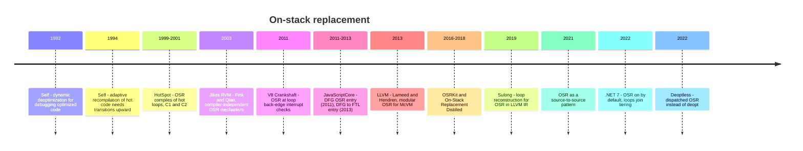
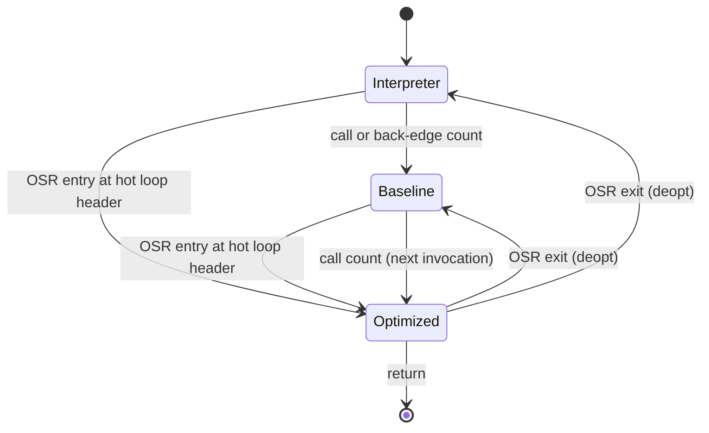
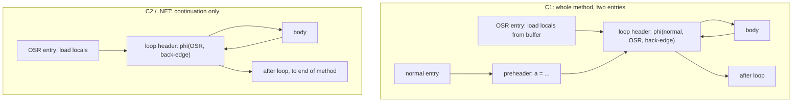
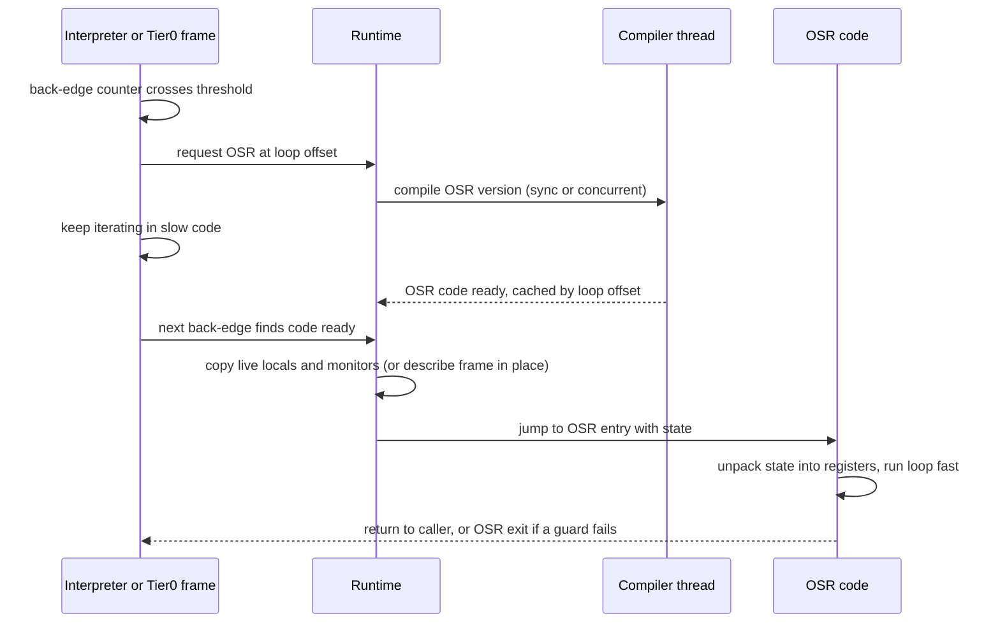
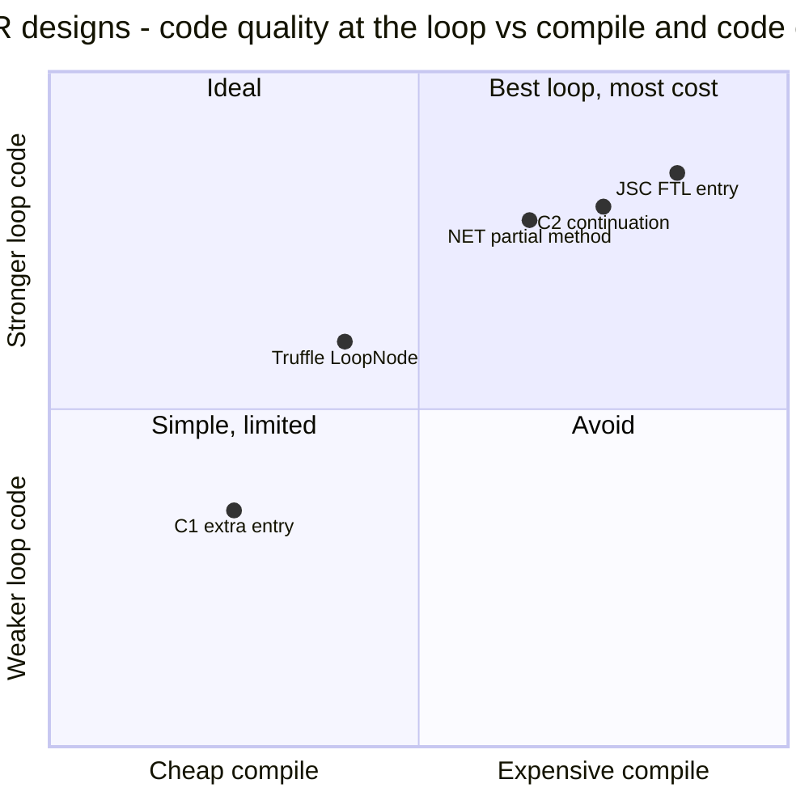

---
tags:
  - compilers
  - runtimes
  - jit
  - osr
  - tiered-compilation
  - deoptimization
  - hotspot
  - v8
  - dotnet
  - javascriptcore
  - truffle
  - llvm
status: complete
sources:
  - https://prl.khoury.northeastern.edu/img/cs7600-mhyee-survey-paper-osr.pdf
  - https://arxiv.org/pdf/1708.02512
  - https://pldi18.sigplan.org/event/pldi-2018-papers-on-stack-replacement-distilled
  - https://www.research.ibm.com/publications/design-implementation-and-evaluation-of-adaptive-recompilation-with-on-stack-replacement
  - https://unpaywall.org/10.1145%2F2451512.2451541
  - https://plg.uwaterloo.ca/~olhotak/cdp12/lameed.txt
  - https://arxiv.org/pdf/1909.08815
  - https://www.cs.purdue.edu/~rompf/papers/essertel-gpce21.pdf
  - https://arxiv.org/abs/2203.02340
  - https://wingolog.org/archives/2011/06/20/on-stack-replacement-in-v8
  - https://v8pedia.void.app/pipeline/osr
  - https://chromium.googlesource.com/v8/v8/+/refs/heads/main/src/runtime/runtime-compiler.cc
  - https://v8.dev/docs/wasm-compilation-pipeline
  - https://webkit.org/blog/10308/speculation-in-javascriptcore/
  - https://webkit.googlesource.com/WebKit/+/master/Source/JavaScriptCore/dfg/DFGOSREntry.cpp
  - https://webkit.googlesource.com/WebKit/+/master/Source/JavaScriptCore/ftl/FTLOSREntry.cpp
  - https://webkit.googlesource.com/WebKit/+/532f1e51a72c31701e1cdef2aa39c6d184f4dfca%5E%21/Source/JavaScriptCore/dfg
  - https://github.com/AdoptOpenJDK/jitwatch/wiki/Understanding-the-On-Stack-Replacement-(OSR)-optimisation-in-the-HotSpot-C1-compiler
  - https://mail.openjdk.org/pipermail/hotspot-compiler-dev/2012-August/008170.html
  - https://technology.lmax.com/posts/observing-jvm-warm-up-effects/
  - https://android.googlesource.com/platform/libcore/+/c127592320a/src/hotspot/share/runtime/compilationPolicy.cpp
  - https://openjdk.org/jeps/8335368
  - https://github.com/dotnet/runtime/blob/main/docs/design/features/OnStackReplacement.md
  - https://github.com/dotnet/runtime/blob/main/docs/design/features/OsrDetailsAndDebugging.md
  - https://devblogs.microsoft.com/dotnet/performance_improvements_in_net_7/
  - https://codemag.com/Article/2211042/Highlighted-Performance-Wins-with-.NET-7
  - https://learn.microsoft.com/dotnet/core/whats-new/dotnet-7
  - https://learn.microsoft.com/et-ee/dotnet/core/whats-new/dotnet-8/runtime
  - https://docs.oracle.com/en/graalvm/jdk/21/docs/graalvm-as-a-platform/language-implementation-framework/OnStackReplacement/
  - https://chromium.googlesource.com/external/github.com/python/cpython/+/01a683a3d4dcc8fa2b28873dbe6f57183899ad31/InternalDocs/jit.md
created: 2026-11-27
updated: 2026-11-27
---

## Table Of Contents

- [[#TL;DR|TL;DR]]
- [[#The Problem|The Problem]]
- [[#Foundations|Foundations]]
    - [[#Two Directions - OSR Entry and OSR Exit|Two Directions - OSR Entry and OSR Exit]]
    - [[#Why Loop Headers|Why Loop Headers]]
    - [[#The State Mapping|The State Mapping]]
    - [[#Why Entry Is Harder Than Exit|Why Entry Is Harder Than Exit]]
- [[#How We Got Here|How We Got Here]]
- [[#How It Works|How It Works]]
    - [[#Step 1 - Noticing a Hot Loop|Step 1 - Noticing a Hot Loop]]
    - [[#Step 2 - Compiling an Enterable Version|Step 2 - Compiling an Enterable Version]]
    - [[#Step 3 - Moving the Frame|Step 3 - Moving the Frame]]
    - [[#Step 4 - Checking Before Jumping|Step 4 - Checking Before Jumping]]
    - [[#Step 5 - Leaving Again - OSR Exit and Code Lifetime|Step 5 - Leaving Again - OSR Exit and Code Lifetime]]
    - [[#OSR Without a VM - LLVM and Source-to-Source|OSR Without a VM - LLVM and Source-to-Source]]
- [[#Where It Is Now|Where It Is Now]]
- [[#Trade-offs & Open Problems|Trade-offs & Open Problems]]
- [[#Resources|Resources]]
- [[#Related Notes|Related Notes]]

## ***TL;DR***
---
*On-stack replacement (OSR) swaps the code a function is running for a different version of the same function while it is still running, mid-loop, without waiting for the call to return. Going up (OSR entry) rescues long loops stuck in slow code; going down (OSR exit) is [[Deoptimization and Speculation|deoptimization]].*

- **The gap it fills.** Tiered [[JIT Compilation|JITs]] count calls, so a function called once, like `main` with a billion-iteration loop, would run in the interpreter forever. OSR counts *loop back-edges* too, compiles an optimized version, and jumps into it at the loop header with the current values of every live variable.
- **Who does it.** HotSpot (C1 and C2, since early Java), V8 (Maglev and TurboFan, compiled concurrently in production), JavaScriptCore (into Baseline, DFG and FTL), .NET (on by default since .NET 7), and Truffle languages on GraalVM. V8's WebAssembly pipeline says plainly that it does *not* do OSR ([V8 docs](https://v8.dev/docs/wasm-compilation-pipeline)).
- **The three hard parts.** (1) Compiling code with a second entry point without ruining loop optimizations, (2) translating the slow frame's layout into the fast one's, and (3) refusing to enter when the live values break the optimizer's assumptions.
- **Rule of thumb from the people who build it.** "OSR entry is hard but OSR exit is easy," because compilers are built around single-entry, multiple-exit code ([Pizlo, WebKit](https://webkit.org/blog/10308/speculation-in-javascriptcore/)).
- **Theory caught up late.** D'Elia and Demetrescu (PLDI 2018) gave OSR a formal model and showed that with the right compensation code, transitions are possible at almost every program point in LLVM-optimized code ([arXiv](https://arxiv.org/pdf/1708.02512)).

## ***The Problem***
---
*A JIT decides what to optimize by counting, and the natural thing to count is calls. Any program whose work sits in one long-running call escapes that count, and stays in the slowest tier for its whole life.*

Take a program whose entire cost is one loop in a function that runs once:

```java
public static void main(String[] args) {
    long sum = 0;
    for (int i = 0; i < 1_000_000_000; i++) {
        sum += (long) i * i;
    }
    System.out.println(sum);
}
```

A call-counting JIT sees `main` invoked exactly once. Even if it decided to compile `main`, the compiled code would only help the *next* call, which never comes. Truffle's docs describe the result: "a long-running target can get 'stuck' in the interpreter, harming warmup performance" ([GraalVM docs](https://docs.oracle.com/en/graalvm/jdk/21/docs/graalvm-as-a-platform/language-implementation-framework/OnStackReplacement/)).

This is not an edge case. Benchmarks, scientific code, data-processing loops, game loops and server event loops all look like this. The .NET team worked around it for years by not tiering methods with loops at all: before .NET 7, "methods with by-default loops previously were opted-out of tiered compilation," so they were compiled fully optimized up front, paying full JIT cost at startup and losing the profile data that later tiers use ([CODE Magazine](https://codemag.com/Article/2211042/Highlighted-Performance-Wins-with-.NET-7)). Turning on quick JIT for loops without OSR made a loop-heavy test about **2.5x slower** in .NET 6 ([Toub, .NET 7 performance](https://devblogs.microsoft.com/dotnet/performance_improvements_in_net_7/)).

The fix needs the runtime to do something ordinary compilers never do: change which machine code a frame is executing *while that frame is live*, carrying over every local variable, the loop counter and any held locks.

## ***Foundations***
---
*OSR is a transfer of state between two versions of one function at one program point. To understand it you need the two directions, why loop headers are where entry happens, and what "the state" has to include.*

### Two Directions - OSR Entry and OSR Exit

*Entry moves a running frame to faster code; exit moves it to slower, safer code. The machinery is shared, but the goals and failure modes differ.*

| | OSR entry ("up") | OSR exit ("down") |
|---|---|---|
| From → to | Interpreter or baseline → optimized | Optimized → interpreter or baseline |
| Why | A loop got hot (adaptive optimization) | A speculation failed, or a debugger needs source-level state |
| Where | Loop headers (back-edge targets) | Any guard, call or safepoint |
| Who builds the new frame | The optimized code's entry block, from a copy of the old frame | The deoptimizer, from metadata recorded at the exit |
| Covered in | This note | [[Deoptimization and Speculation]] |

Yee's survey generalizes OSR to "a programming language implementation technique that allows a running program to switch to a different version of code," and sorts transitions by direction (up for hot code, down for failed assumptions or debugging) and by trigger (adaptive, from profiling, versus speculative, from assumptions) ([Yee, 2018](https://prl.khoury.northeastern.edu/img/cs7600-mhyee-survey-paper-osr.pdf)). V8's internals describe OSR entry as deoptimization run in reverse: deopt builds an unoptimized frame from an optimized one, OSR builds an optimized frame from an unoptimized one, and the two share frame-mapping code ([v8pedia](https://v8pedia.void.app/pipeline/osr)).

### Why Loop Headers

*Entry happens at the top of a loop because that is where the runtime can count, where the stack is clean, and where the next iteration is about to repeat work the new code does faster.*

- **It's where the count lives.** A back-edge is the jump from the end of the loop body to its header. Counting back-edges counts iterations, so the runtime notices a hot loop at the same place it would jump in.
- **The operand stack is empty.** At a loop header in bytecode, there are no half-evaluated expressions on the interpreter's operand stack, so the state is just locals (and held monitors). .NET puts patchpoints exactly at "stack-empty IL boundaries that are sources or targets of lexical back edges" ([dotnet/runtime OSR design](https://github.com/dotnet/runtime/blob/main/docs/design/features/OnStackReplacement.md)).
- **No half-done side effects.** Between iterations, every effect of the previous iteration has happened and none of the next one has, which makes the handoff point unambiguous, the same rule deopt follows when it picks a resume point.

Unstructured languages complicate this: LLVM IR has no loop statement, only jumps between blocks, so Sulong (an LLVM IR interpreter on Truffle) has to *reconstruct* loops from the control-flow graph before it can offer OSR at all ([Mosaner et al., MPLR 2019](https://arxiv.org/pdf/1909.08815)). See [[Loop Optimizations]] for natural loops and back-edges.

### The State Mapping

*Every OSR transition is a function from "where I am and what's in my frame" in one version to the same in the other. Most of the engineering is building that function cheaply and correctly.*

D'Elia and Demetrescu formalize a program as several *versions* of each function plus OSR mappings between them. A mapping pairs a point in one version with a point in another, plus *compensation code* $\chi$ that rebuilds the target's live state from the source's:

$$
\text{OSR}:\; (\ell,\ \sigma) \;\longmapsto\; (\ell',\ \chi(\sigma))
$$

*In plain English: if version $f$ is at location $\ell$ with variable store $\sigma$, we may continue in version $f'$ at location $\ell'$ with the store $\chi(\sigma)$, provided that what $f'$ does from there matches what $f$ would have done.* The paper's requirement is that the two versions be "live-variable bisimilar" at those points, and it proves that constant propagation, dead-code elimination and code hoisting preserve this, so their effects can be undone or redone by compensation code ([arXiv 1708.02512](https://arxiv.org/pdf/1708.02512)).

In a production JIT, $\chi$ for OSR entry is usually just "copy each live local into the slot or register the optimized code expects," sometimes with re-boxing or type conversion (JavaScriptCore converts values to raw doubles or Int52 integers if the optimized code keeps them unboxed). The state includes:

- Every live local and argument, including `this`.
- Held monitors or locks (Java `synchronized` blocks inside the loop).
- The bytecode offset of the loop header, which selects which OSR version to use.
- Callee-saved registers and the return address, so that returning from the optimized code still lands in the caller.

### Why Entry Is Harder Than Exit

*An exit is just another branch out of optimized code. An entry is a new way in, and every way in weakens what the compiler can assume at the merge point.*

Compilers optimize single-entry regions. A loop header normally has two predecessors: the preheader (first time in) and the back-edge. Add an OSR entry and the header gets a third predecessor whose values the compiler knows nothing about. In [[SSA Form]], every value flowing into the header becomes a φ with an extra, opaque input. Pizlo's summary: "Entering into a function somewhere other than at its primary entrypoint pessimises optimizations" at merge points, and allowing entry "just at loop headers would break lots of loop optimizations" ([WebKit](https://webkit.org/blog/10308/speculation-in-javascriptcore/)).

Here is the damage in IR. Before OSR, `scale` is a known constant at the loop:

```llvm
entry:
  br label %header
header:
  %i     = phi i64 [ 0, %entry ], [ %i.next, %body ]
  %sum   = phi i64 [ 0, %entry ], [ %sum.next, %body ]
  ; scale is the literal 3 here: constant-folds into the body
```

With an OSR entry bolted on, `scale` arrives from the interpreter's frame and is no longer a constant:

```llvm
osr_entry:                          ; jumped to from the interpreter
  %i.osr     = load i64, ptr %buf
  %sum.osr   = load i64, ptr %buf.1
  %scale.osr = load i64, ptr %buf.2
  br label %header
header:
  %i     = phi i64 [ 0, %entry ], [ %i.osr, %osr_entry ], [ %i.next, %body ]
  %sum   = phi i64 [ 0, %entry ], [ %sum.osr, %osr_entry ], [ %sum.next, %body ]
  %scale = phi i64 [ 3, %entry ], [ %scale.osr, %osr_entry ], [ %scale, %body ]
  ; scale is now unknown: no constant folding, no strength reduction
```

The production answer, used by HotSpot's C2 and by .NET, is to make the OSR entry the *only* entry: compile a version of the function that starts at the loop header and contains only the code reachable from there. Then there is no merge with the normal entry, and the only unknowns are the copied-in values themselves.

## ***How We Got Here***
---
*OSR came out of Self in the early 1990s as a debugging tool, became a performance tool with adaptive recompilation, went mainstream in HotSpot, and was only later separated from VM internals and given a formal footing.*



- **Self (1992 to 1994).** Hölzle, Chambers and Ungar introduced *dynamic deoptimization* so that optimized Self code could be debugged at the source level, with transitions at interrupt points that record "the locations and values of local variables." Adaptive optimization, recompiling hot methods with type feedback, then required transitions in the upward direction as well ([Yee survey](https://prl.khoury.northeastern.edu/img/cs7600-mhyee-survey-paper-osr.pdf)).
- **HotSpot.** Built from the Self/Strongtalk lineage, HotSpot made OSR part of everyday Java: the interpreter counts back-edges, and in the old non-tiered policy the trigger was `CompileThreshold * OnStackReplacePercentage / 100`, which with the defaults of 10,000 and 140 gives **14,000** back-edges ([Kozlov, hotspot-compiler-dev](https://mail.openjdk.org/pipermail/hotspot-compiler-dev/2012-August/008170.html)). C1 has supported OSR since JDK 1.3 ([JITWatch wiki](https://github.com/AdoptOpenJDK/jitwatch/wiki/Understanding-the-On-Stack-Replacement-(OSR)-optimisation-in-the-HotSpot-C1-compiler)).
- **Jikes RVM (2003).** Fink and Qian presented "a new, simple, mostly compiler-independent mechanism to transfer execution into compiled code," and used it for profile-driven *deferred compilation*: rarely taken branches are compiled as stubs that trigger recompilation plus an OSR transition when reached ([IBM Research](https://www.research.ibm.com/publications/design-implementation-and-evaluation-of-adaptive-recompilation-with-on-stack-replacement)). Yee reports an average gain of 2.6% on SPECjvm98, 8% at best.
- **V8 Crankshaft (2011).** Andy Wingo's walkthrough shows OSR triggered by "the interrupt check in the loop back-edge," with the optimized function given "an alternate entry point to the function, used only once" ([wingolog](https://wingolog.org/archives/2011/06/20/on-stack-replacement-in-v8)).
- **OSR leaves the VM (2013 to 2021).** Lameed and Hendren built a modular OSR for LLVM in McVM, a MATLAB VM, and used it for dynamic inlining ([VEE 2013](https://unpaywall.org/10.1145%2F2451512.2451541), [abstract](https://plg.uwaterloo.ca/~olhotak/cdp12/lameed.txt)). D'Elia and Demetrescu generalized it to OSR "from any point" (OSRKit, CGO 2016) and then formalized it (PLDI 2018). Essertel, Tahboub and Rompf showed OSR as a plain source transformation for program generators (GPCE 2021).
- **.NET 7 (2022).** dotnet/runtime#65675 "enables OSR (and as a result `DOTNET_TC_QuickJitForLoops`) by default," after Arm64 support landed in #62831; methods with loops finally start at tier 0 like everything else ([Toub](https://devblogs.microsoft.com/dotnet/performance_improvements_in_net_7/)).
- **Deoptless (2022).** Flückiger et al. used OSR in a new direction: instead of deoptimizing to the interpreter when a guard fails, dispatch to another *optimized* continuation specialized for the new situation ([PLDI 2022](https://arxiv.org/abs/2203.02340)). See [[Deoptimization and Speculation]].

## ***How It Works***
---
*Every engine does the same five things: count back-edges, compile a version that can be entered at the loop, move the frame's contents, check that the contents fit the new code's assumptions, and handle leaving again. They differ mostly in how they move the frame.*



### Step 1 - Noticing a Hot Loop

*Each back-edge decrements or increments a counter; crossing a threshold asks for an OSR compile. The thresholds are high because an OSR compile is expensive and only pays off for loops that will keep running.*

| Engine | Where the counter lives | Default trigger (as documented) |
|---|---|---|
| HotSpot (tiered) | Per-method back-edge counter, checked by the interpreter and C1 code | `Tier3BackEdgeThreshold` = 60,000 to start a profiled C1 OSR compile; a separate tier-4 threshold for C2 ([LMAX](https://technology.lmax.com/posts/observing-jvm-warm-up-effects/)) |
| V8 | "OSR urgency" on the function's FeedbackVector; the `JumpLoop` bytecode checks it on every back-edge | Urgency rises as the interrupt budget runs out and is never lowered by the loop check ([v8pedia](https://v8pedia.void.app/pipeline/osr)) |
| JavaScriptCore | Execution counter per code block: a loop iteration adds 1 point, a call adds 15 | LLInt → Baseline at 500 points, Baseline → DFG at 1,000, DFG → FTL at 100,000, scaled by code size and past recompiles ([Pizlo](https://webkit.org/blog/10308/speculation-in-javascriptcore/)) |
| .NET | One counter per Tier0 frame, set on entry, decremented at each patchpoint | 1,000 to the first helper call, then an OSR method after the patchpoint is hit more than 16 times, refilling the counter by 4,096 each time: "roughly 69,000" iterations at one site ([OsrDetailsAndDebugging](https://github.com/dotnet/runtime/blob/main/docs/design/features/OsrDetailsAndDebugging.md)) |
| Truffle (GraalVM) | `LoopNode` iteration count, or `pollOSRBackEdge` in bytecode interpreters | `engine.OSRCompilationThreshold` = 100,352 ([GraalVM docs](https://docs.oracle.com/en/graalvm/jdk/21/docs/graalvm-as-a-platform/language-implementation-framework/OnStackReplacement/)) |
| CPython JIT (3.13+) | Counter in the inline cache of `JUMP_BACKWARD` | Threshold in the counter; on success `JUMP_BACKWARD` is replaced by `ENTER_EXECUTOR` ([CPython InternalDocs](https://chromium.googlesource.com/external/github.com/python/cpython/+/01a683a3d4dcc8fa2b28873dbe6f57183899ad31/InternalDocs/jit.md)) |

What the .NET Tier0 code looks like at a loop head, in pseudo-C (from the design doc's description and Toub's disassembly):

```c
// method prolog (Tier0)
int patchpointCounter = 1000;           // DOTNET_TC_OnStackReplacement_InitialCounter

loop_head:                              // a patchpoint: stack-empty, back-edge target
    if (--patchpointCounter <= 0)
        CORINFO_HELP_PATCHPOINT(&patchpointCounter, ilOffset);
        // helper finds this site by return address, counts hits,
        // and after the hit limit jits an OSR method and jumps into it
    ... loop body ...
    goto loop_head;
```

In HotSpot you see the result with `-XX:+PrintCompilation`: OSR compiles carry a `%` and an `@ bci` naming the loop's bytecode index, and older OSR versions show up as "made not entrant" when they are replaced ([LMAX](https://technology.lmax.com/posts/observing-jvm-warm-up-effects/), [JITWatch wiki](https://github.com/AdoptOpenJDK/jitwatch/wiki/Understanding-the-On-Stack-Replacement-(OSR)-optimisation-in-the-HotSpot-C1-compiler)).

### Step 2 - Compiling an Enterable Version

*The compiler builds a variant of the function whose entry point is the hot loop header. Engines choose between keeping the whole function with a second entry and building only the continuation from the loop onward.*

| Strategy | Used by | What the compiled code contains | Cost |
|---|---|---|---|
| **Whole method, extra entry block** | HotSpot C1 | Full CFG plus an OSR entry block at the back-edge bci that loads state and merges into the header with φs | Simple and robust with nested loops; merges pessimize the header |
| **Continuation from the loop** | HotSpot C2, .NET | Only code reachable from the loop header; method entry is dead | Best code at the loop; one OSR version per loop header; nested loops need peeling of the outer iteration |
| **Separate OSR target per loop** | Truffle `LoopNode` | Just the loop, returning to the interpreter when it exits | Loop-sized compiles; work after the loop stays slow |
| **Separate OSR target to end of function** | Truffle bytecode OSR | From the back-edge target "until the end of the call target" | Avoids returning to the interpreter |
| **Special-purpose entry compile** | JavaScriptCore FTL | A separate "FTL for OSR entry" code block tied to one bytecode index; entry at any other index is refused | Extra compile, used only "in cases where the reward is high" |

Kris Mok's explanation of C1's approach: C1 builds HIR for the entire method and "bolts on" an OSR entry block at the loop's back-edge, whose values merge with normal-entry values through φ nodes, giving "compiled code for the whole method." C2 instead "aggressively prunes not-yet-executed code and unresolved calls," so it goes through a series of OSR compiles, each made not entrant as execution moves to the next loop ([JITWatch wiki](https://github.com/AdoptOpenJDK/jitwatch/wiki/Understanding-the-On-Stack-Replacement-(OSR)-optimisation-in-the-HotSpot-C1-compiler)).



.NET's JIT gets the IL offset of the patchpoint plus a description of the Tier0 frame and uses "the logical PC (IL offset) to determine the scope of the OSR method fragment"; IL unreachable from there is dead ([design doc](https://github.com/dotnet/runtime/blob/main/docs/design/features/OnStackReplacement.md)). The pay-off can be large because the OSR method is a fully optimized Tier1 compile made *late*: in one benchmark the .NET 7 OSR version treated a `static readonly` field (already initialized by then) as a constant, deleted a dead branch, and ran a million-iteration loop in **237.3 µs** versus **858.9 µs** in .NET 6 ([CODE Magazine](https://codemag.com/Article/2211042/Highlighted-Performance-Wins-with-.NET-7)).

### Step 3 - Moving the Frame

*The interpreter's frame and the optimized code's frame lay out values differently. Engines either copy everything into a buffer and let the optimized code unpack it, or let the optimized frame sit on top of the old one and read from it in place.*



Three concrete designs:

- **Copy-out buffer (HotSpot).** "The interpreter will malloc() an 'OSR buffer' and copy the required JVM state into that buffer," passes a pointer to it as the only argument, and the compiled code migrates the state out and frees the buffer. C1 keeps migrated monitors in reserved stack slots rather than φs ([JITWatch wiki](https://github.com/AdoptOpenJDK/jitwatch/wiki/Understanding-the-On-Stack-Replacement-(OSR)-optimisation-in-the-HotSpot-C1-compiler)). The interpreter frame is popped and the compiled frame replaces it.
- **Frame reuse (.NET).** The OSR frame "logically incorporates" the Tier0 frame and extends it; locals that have Tier0 homes keep their Tier0 stack slots, which also keeps address-taken locals at their original addresses. The jit records a `PatchpointInfo` describing the Tier0 frame when it compiles Tier0 code, and uses it to compute slot addresses in the OSR method. The prolog and epilog are asymmetric: the OSR method is entered by a jump, not a call, and when it returns it pops both its own extension and the Tier0 frame ([OSR design](https://github.com/dotnet/runtime/blob/main/docs/design/features/OnStackReplacement.md), [OsrDetailsAndDebugging](https://github.com/dotnet/runtime/blob/main/docs/design/features/OsrDetailsAndDebugging.md)).
- **Scratch buffer with reshuffle (JavaScriptCore DFG).** The runtime writes the new frame into a scratch buffer: the frame size, the target PC, then every local, converting forced-double locals to raw doubles and Int52 locals to shifted integers, reshuffling slots in two passes so no source is overwritten before it is read, and clearing unused slots to avoid "stale pointer pathologies" for the GC ([DFGOSREntry.cpp](https://webkit.googlesource.com/WebKit/+/master/Source/JavaScriptCore/dfg/DFGOSREntry.cpp)).

Truffle shows the subtle cost of the in-place approach: if OSR code uses the interpreter's `Frame` object directly, the frame "escapes" and blocks scalar replacement, so the default is to copy state into a separate OSR frame and copy it back afterwards (`copyIntoOSRFrame` and `restoreParentFrame`) ([GraalVM docs](https://docs.oracle.com/en/graalvm/jdk/21/docs/graalvm-as-a-platform/language-implementation-framework/OnStackReplacement/)). See [[Escape Analysis]].

The frame description used here is the same kind of per-point metadata that [[Safepoints and Stack Maps]] records for the GC and the deoptimizer, read in the opposite direction.

### Step 4 - Checking Before Jumping

*Optimized code was compiled against a profile. The values actually in the frame at the moment of entry may not fit it, and entering anyway would mean an immediate deopt or a wrong answer.*

JavaScriptCore's DFG makes this explicit. Each OSR entry point carries `m_expectedValues`: what the compiler assumed about `this`, each argument and each local. Before committing, the runtime checks every live value against them (and that locals forced to Int52 or double really are numbers). On any mismatch it refuses: "the wisest course of action is to simply not OSR at this time." It also refuses if the stack cannot grow to the DFG frame's size. Past that point, "we're already past the point of no return and we must succeed at entering" ([DFGOSREntry.cpp](https://webkit.googlesource.com/WebKit/+/master/Source/JavaScriptCore/dfg/DFGOSREntry.cpp)). A separate path enters optimized code at `catch` blocks, allowed only "if we've proven we have compatible argument types."

Engines that compile the continuation only (C2, .NET) sidestep most of this: they compile from the current frame's types and values, and any remaining speculation is guarded inside the OSR code like any other guard. Truffle's `prepareOSR` hook exists for the same reason: to force initialization that only the interpreter can do, "so OSR code doesn't deoptimize" right after entry.

### Step 5 - Leaving Again - OSR Exit and Code Lifetime

*OSR code is still speculative optimized code, so it can deopt. It is also tied to one loop of one call, which makes deciding when to keep, reuse or throw it away its own small problem.*

- **Exit is ordinary deopt.** A failed guard in OSR code exits to the interpreter or baseline exactly as any optimized code would ([[Deoptimization and Speculation]]).
- **OSR code is not installed as the function's code.** V8 keeps OSR code in a cache keyed by loop rather than on the function; when it deopts, "OSR code that deopts outside of its loop stays cached, so each later call enters it and may deopt again," so V8 tiers up the function itself instead. It only deoptimizes OSR code when the exit is inside the loop. V8 also handles nesting: a TurboFan-compiled inner loop and a Maglev-compiled outer loop causes the outer loop to be compiled with the top tier too ([runtime-compiler.cc](https://chromium.googlesource.com/v8/v8/+/refs/heads/main/src/runtime/runtime-compiler.cc)).
- **.NET OSR methods never return to Tier0.** "The OSR method does not return control to the Tier0 method"; it is a full continuation. Other frames of the same method on other threads move over as they reach the patchpoint, and recursive frames transition one by one as the stack unwinds ([OsrDetailsAndDebugging](https://github.com/dotnet/runtime/blob/main/docs/design/features/OsrDetailsAndDebugging.md)).
- **The function still needs a normal compile.** OSR rescues the *current* call. HotSpot's policy bumps the invocation counter after an OSR request so the whole method gets compiled for later calls ([compilationPolicy.cpp](https://android.googlesource.com/platform/libcore/+/c127592320a/src/hotspot/share/runtime/compilationPolicy.cpp)).

### OSR Without a VM - LLVM and Source-to-Source

*LLVM has no OSR built in, so systems that use it as a JIT back end either build OSR on its stack-map machinery or move OSR up into the generated source.*

- **Inside LLVM.** McVM (Lameed and Hendren) and OSRKit (D'Elia and Demetrescu) generate an OSR continuation function whose arguments are the live values at the OSR point, plus compensation code. With the `avail` reconstruction strategy, OSR from base to optimized code is possible at close to 100% of program points across SPEC CPU2006 and Phoronix benchmarks, and in the deopt direction at over 90% on all of them; without compensation code it is under 10% for most ([arXiv 1708.02512](https://arxiv.org/pdf/1708.02512)). The same reconstruction helps debuggers show correct values for "endangered" variables in optimized code. See [[LLVM]].
- **As a code pattern.** Essertel, Tahboub and Rompf's "Duplicate, Optimize, Trampoline" lambda-lifts each loop into several versions (cheap to compile, heavily optimized, speculated), checks at the top of each iteration which version should run, and hands over at an iteration boundary. Because the switching is ordinary generated code, GCC or Clang can serve as the "JIT"; they used TCC for fast first versions and GCC for later ones in an SQL-to-C query compiler ([GPCE 2021](https://www.cs.purdue.edu/~rompf/papers/essertel-gpce21.pdf)). See [[Closure Conversion and Defunctionalization]] for lambda lifting.
- **In unstructured interpreters.** Sulong rebuilds loops from LLVM IR basic blocks, wraps each in a Truffle `LoopNode`, and bails out on irreducible control flow. Warm-up improved by 1.5x to 9x on benchmarks where OSR triggered; fannkuch at size 11 went from not finishing in a day to under 30 minutes ([MPLR 2019](https://arxiv.org/pdf/1909.08815)).

## ***Where It Is Now***
---
*As of November 2026: OSR entry is standard in every major managed-language JIT, compiled in the background where possible, and joined up with profile-guided tiering. The gaps are WebAssembly, ahead-of-time code caches, and the cost of one compile per hot loop.*

| System | OSR entry | Notes, Nov 2026 |
|---|---|---|
| **HotSpot** (JDK 25, 26) | Yes, C1 (tier 3) and C2 (tier 4) | Long-stable design; `%` in PrintCompilation. The Leyden draft JEP for ahead-of-time code compilation does not mention OSR compiles ([JEP draft 8335368](https://openjdk.org/jeps/8335368)) |
| **V8** (Chrome) | Yes, into Maglev or TurboFan | `JumpLoop` checks OSR urgency; target is Maglev when Maglev OSR is enabled, else TurboFan; source comments say "all production configurations enable concurrent OSR," with synchronous OSR kept for tests; in efficiency and battery-saver modes an OSR request from Maglev code resets the urgency instead of compiling ([runtime-compiler.cc](https://chromium.googlesource.com/v8/v8/+/refs/heads/main/src/runtime/runtime-compiler.cc)) |
| **V8 WebAssembly** | No | A running Liftoff call finishes in Liftoff; only new calls use TurboFan code: "we don’t do on-stack-replacement" ([V8 docs](https://v8.dev/docs/wasm-compilation-pipeline)). See [[WebAssembly]] |
| **JavaScriptCore** (Safari) | Yes, into Baseline, DFG and FTL | Entry validated against expected values; used only "where the reward is high" |
| **.NET** (8, 9, 10) | Yes, x64 and Arm64, on by default since .NET 7 | Dynamic PGO, on by default since .NET 8, works through OSR: Tier0 code is instrumented, OSR methods read that profile and are themselves instrumented so the later Tier1 compile sees full data ([.NET 8 runtime](https://learn.microsoft.com/et-ee/dotnet/core/whats-new/dotnet-8/runtime), [OsrDetailsAndDebugging](https://github.com/dotnet/runtime/blob/main/docs/design/features/OsrDetailsAndDebugging.md)) |
| **GraalVM Truffle** | Yes, automatic for `LoopNode`, opt-in API for bytecode interpreters | Threshold 100,352; OSR targets labeled `<OSR>` or `<OSR@n>` in logs |
| **CPython JIT** (3.13+) | Trace entry at hot `JUMP_BACKWARD` | Not frame-replacing OSR in the HotSpot sense: the back-edge is rewritten to `ENTER_EXECUTOR`, which runs a tier-2 trace and returns the next tier-1 instruction on exit |

Research has moved from "how do we do OSR" to "what else can the mechanism do": dispatching between optimized versions instead of deoptimizing (Deoptless), OSR for program generators, and formal models that let tools check which optimizations keep OSR possible. See [[Verified Compilers]].

## ***Trade-offs & Open Problems***
---
*OSR buys warm-up for loop-heavy code at the price of extra compiles, extra code and harder-to-optimize entry points. Each engine picks a different point on those curves.*



*(Positions are qualitative, drawn from the descriptions above, not measured.)*

| Choice | Buys | Costs |
|---|---|---|
| Whole method with extra entry (C1) | One compile covers every loop and later calls | φs at the header with unknown inputs; weaker loop code |
| Continuation from the loop (C2, .NET) | Clean single entry; the best code for this loop | One compile per hot loop header; nested loops need outer-iteration peeling; work before the loop never benefits |
| Copy-out buffer (HotSpot) | Frames stay independent; simple to reason about | Copy plus malloc at entry |
| Frame reuse (.NET) | No copy; address-taken locals keep their addresses | Non-standard prolog and epilog; the OSR epilog's two stack adjustments broke x64 unwind info once |
| Validate before entry (JSC) | No entry into code that will instantly deopt | Sometimes refuses and keeps running slow code |
| Concurrent OSR compile (V8) | The loop keeps running while the compiler works | The hot loop may finish before the code is ready |
| No OSR (V8 Wasm) | Simpler tiers, no frame translation for Wasm | A single long-running Wasm call stays in baseline code |

**Open problems.**

- **Code bloat from many loops.** One OSR method per patchpoint can produce "a lot of codegen" in the worst case, and each is only useful for frames currently inside that loop ([.NET OSR details](https://github.com/dotnet/runtime/blob/main/docs/design/features/OsrDetailsAndDebugging.md)). This feeds directly into [[Code Cache Management]].
- **Partial profiles.** OSR methods "may also see only partial PGO data," since the code before the loop may never have run in the instrumented tier ([.NET](https://github.com/dotnet/runtime/blob/main/docs/design/features/OsrDetailsAndDebugging.md)). How much this costs versus waiting is workload-dependent and rarely measured. See [[Profile-Guided Optimization]].
- **Wasm and other "no OSR" tiers.** Wasm modules often put long-running work (an emulator loop, a game loop) in one call. V8's Wasm pipeline does not OSR, so that call stays in Liftoff. Adding OSR to Wasm engines means building frame descriptions for every baseline Wasm frame.
- **Ahead-of-time code caches.** Leyden's AOT code work and other code caches store method-entry compiles; whether OSR compiles are worth caching, and how to key them, is unaddressed in the current JDK draft.
- **Irreducible and unstructured control flow.** Loop reconstruction for OSR bails out on irreducible loops (Sulong), and source-to-source OSR depends on structured loops.
- **Correctness.** OSR entry code is rarely exercised and easy to get wrong (monitors, stale profiles, frames under construction). Formal work on speculation and deopt (Flückiger et al., POPL 2018) and on live-variable bisimulation (D'Elia and Demetrescu) exists, but production engines rely on stress modes and fuzzing. See [[Compiler Testing and Fuzzing]] and [[Translation Validation]].

## ***Resources***
---
*Start with the .NET design docs for a complete, current, readable design; then the JITWatch wiki for HotSpot; then the D'Elia and Demetrescu paper for the theory. Pizlo's JavaScriptCore post explains why entry is the harder direction.*

**Surveys and theory**
- [On-Stack Replacement (survey)](https://prl.khoury.northeastern.edu/img/cs7600-mhyee-survey-paper-osr.pdf): Ming-Ho Yee, Northeastern, 2018. History from Self to Truffle.
- [On-Stack Replacement à la Carte / On-Stack Replacement, Distilled](https://arxiv.org/pdf/1708.02512): D'Elia and Demetrescu ([PLDI 2018](https://pldi18.sigplan.org/event/pldi-2018-papers-on-stack-replacement-distilled)). Formal model, LLVM implementation, debugging application.
- [Deoptless](https://arxiv.org/abs/2203.02340): Flückiger et al., PLDI 2022.

**Systems papers**
- [Design, Implementation and Evaluation of Adaptive Recompilation with On-Stack Replacement](https://www.research.ibm.com/publications/design-implementation-and-evaluation-of-adaptive-recompilation-with-on-stack-replacement): Fink and Qian, CGO 2003 (Jikes RVM).
- [A Modular Approach to On-Stack Replacement in LLVM](https://unpaywall.org/10.1145%2F2451512.2451541): Lameed and Hendren, VEE 2013 (McVM).
- [Supporting On-Stack Replacement in Unstructured Languages by Loop Reconstruction and Extraction](https://arxiv.org/pdf/1909.08815): Mosaner et al., MPLR 2019 (Sulong).
- [On-Stack Replacement for Program Generators and Source-to-Source Compilers](https://www.cs.purdue.edu/~rompf/papers/essertel-gpce21.pdf): Essertel, Tahboub and Rompf, GPCE 2021.

**HotSpot**
- [Understanding OSR in the HotSpot C1 compiler](https://github.com/AdoptOpenJDK/jitwatch/wiki/Understanding-the-On-Stack-Replacement-(OSR)-optimisation-in-the-HotSpot-C1-compiler): JITWatch wiki, with Kris Mok's and Vladimir Ivanov's explanations.
- [CompileThreshold and BackEdgeThreshold](https://mail.openjdk.org/pipermail/hotspot-compiler-dev/2012-August/008170.html): Vladimir Kozlov on how OSR thresholds are computed.
- [Observing JVM warm-up effects](https://technology.lmax.com/posts/observing-jvm-warm-up-effects/): LMAX, reading PrintCompilation output.
- [compilationPolicy.cpp](https://android.googlesource.com/platform/libcore/+/c127592320a/src/hotspot/share/runtime/compilationPolicy.cpp): back-branch events and OSR lookup.

**V8 and JavaScriptCore**
- [On-stack replacement in V8](https://wingolog.org/archives/2011/06/20/on-stack-replacement-in-v8): Andy Wingo, 2011.
- [V8 OSR pipeline notes](https://v8pedia.void.app/pipeline/osr) and [runtime-compiler.cc](https://chromium.googlesource.com/v8/v8/+/refs/heads/main/src/runtime/runtime-compiler.cc).
- [WebAssembly compilation pipeline](https://v8.dev/docs/wasm-compilation-pipeline): V8 docs.
- [Speculation in JavaScriptCore](https://webkit.org/blog/10308/speculation-in-javascriptcore/): Filip Pizlo, 2020; [DFGOSREntry.cpp](https://webkit.googlesource.com/WebKit/+/master/Source/JavaScriptCore/dfg/DFGOSREntry.cpp), [FTLOSREntry.cpp](https://webkit.googlesource.com/WebKit/+/master/Source/JavaScriptCore/ftl/FTLOSREntry.cpp) and the [DFG-to-FTL OSR entry commit](https://webkit.googlesource.com/WebKit/+/532f1e51a72c31701e1cdef2aa39c6d184f4dfca%5E%21/Source/JavaScriptCore/dfg) (r155023, 2013).

**.NET**
- [On Stack Replacement in the CLR](https://github.com/dotnet/runtime/blob/main/docs/design/features/OnStackReplacement.md) and [OSR Details and Debugging](https://github.com/dotnet/runtime/blob/main/docs/design/features/OsrDetailsAndDebugging.md): dotnet/runtime design docs.
- [Performance Improvements in .NET 7](https://devblogs.microsoft.com/dotnet/performance_improvements_in_net_7/): Stephen Toub, OSR section.
- [Highlighted Performance Wins with .NET 7](https://codemag.com/Article/2211042/Highlighted-Performance-Wins-with-.NET-7): CODE Magazine.
- [What's new in .NET 7](https://learn.microsoft.com/dotnet/core/whats-new/dotnet-7) and [.NET 8 runtime](https://learn.microsoft.com/et-ee/dotnet/core/whats-new/dotnet-8/runtime).

**GraalVM and CPython**
- [Truffle On-Stack Replacement](https://docs.oracle.com/en/graalvm/jdk/21/docs/graalvm-as-a-platform/language-implementation-framework/OnStackReplacement/): GraalVM docs.
- [CPython JIT internals](https://chromium.googlesource.com/external/github.com/python/cpython/+/01a683a3d4dcc8fa2b28873dbe6f57183899ad31/InternalDocs/jit.md).

## ***Related Notes***
---
*OSR sits between tiering policy, deoptimization metadata and loop structure; these are the notes it leans on.*

- [[JIT Compilation]] — Tiers and call counters, the policy OSR fills the gap in.
- [[Tiering Policies and Warm-up]] — The back-edge thresholds that trigger OSR, and the rest of the tier-up policy.
- [[Deoptimization and Speculation]] — OSR exit, frame states and Deoptless.
- [[Safepoints and Stack Maps]] — The same per-point frame descriptions, read in the other direction.
- [[Loop Optimizations]] — Back-edges, natural loops, and why an extra loop entry weakens LICM and friends.
- [[SSA Form]] — φ nodes at the loop header gain an OSR input.
- [[Profile-Guided Optimization]] — Dynamic PGO flowing through .NET OSR methods.
- [[Escape Analysis]] — Why Truffle copies into a separate OSR frame.
- [[Classic Optimizations]] — Constant propagation lost at an OSR merge, regained in late OSR compiles.
- [[LLVM]] — McVM and OSRKit built OSR on top of LLVM.
- [[WebAssembly]] — A major tiered pipeline without OSR.
- [[Partial Evaluation and Self-Specializing Interpreters]] — Truffle's OSR targets are partially evaluated loops.
- [[Code Cache Management]] — Where per-loop OSR code lives and is retired.
- [[Closure Conversion and Defunctionalization]] — Lambda lifting in source-level OSR.
- [[Garbage Collection]] — Frames under construction must stay scannable.
- [[Verified Compilers]] — Formal models of speculation, deopt and OSR.
- [[Compiler Testing and Fuzzing]] — Stress modes for rarely run transitions.
- [[Translation Validation]] — Checking OSR-compatible transformations case by case.
