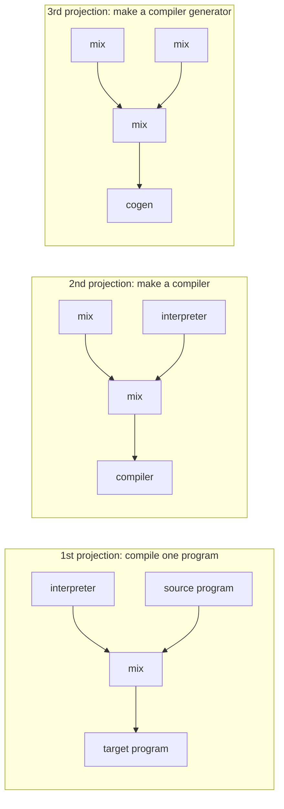
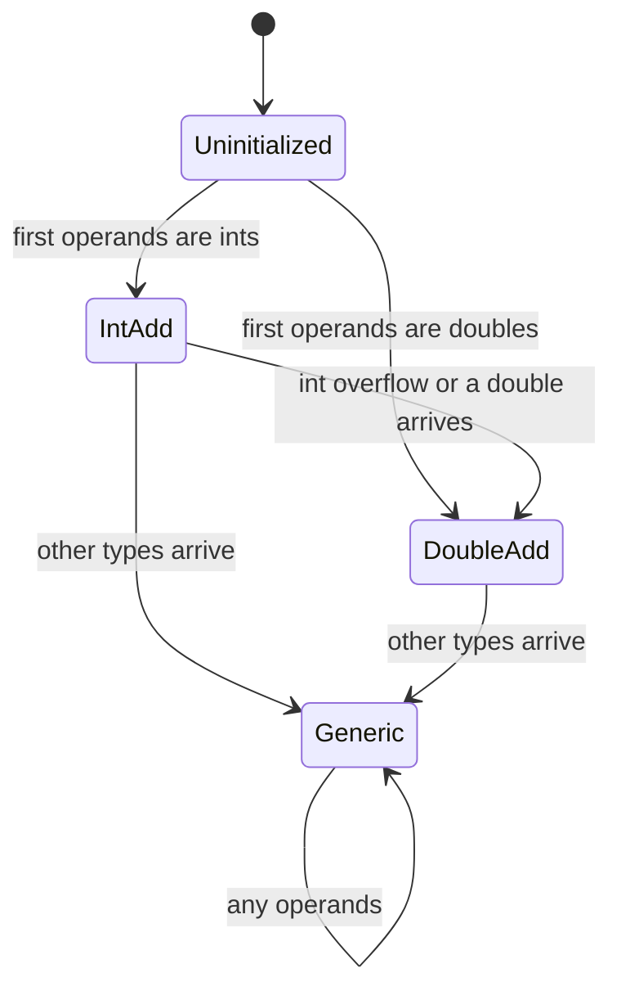
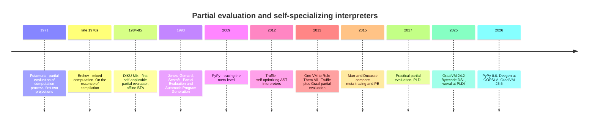
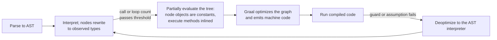

---
tags:
  - compilers
  - runtimes
  - jit
  - partial-evaluation
  - futamura-projections
  - binding-time-analysis
  - truffle
  - graalvm
  - pypy
  - rpython
  - meta-tracing
  - weval
  - deegen
status: complete
sources:
  - https://static.aminer.org/pdf/PDF/001/006/665/partial_evaluation_of_computation_process_an_approach_to_a_compiler.pdf
  - https://www.itu.dk/~sestoft/pebook/
  - https://www.cs.utexas.edu/~novak/jonesgomardsestoft.pdf
  - https://www.itu.dk/~sestoft/papers/sestoft-sondergaard-pepm2024-final.pdf
  - https://www.cl.cam.ac.uk/teaching/2526/R277/slides-partial-evaluation.pdf
  - https://research.jku.at/en/publications/self-optimizing-ast-interpreters/
  - https://lafo.ssw.uni-linz.ac.at/pub/papers/2013_Onward_OneVMToRuleThemAll.pdf
  - https://research.jku.at/en/publications/practical-partial-evaluation-for-high-performance-dynamic-languag/
  - https://lafo.ssw.uni-linz.ac.at/pub/papers/2016_PLDI_Truffle
  - https://www.graalvm.org/dev/graalvm-as-a-platform/language-implementation-framework/Optimizing
  - https://www.graalvm.org/dev/graalvm-as-a-platform/language-implementation-framework/HostOptimization
  - https://www.graalvm.org/dev/graalvm-as-a-platform/language-implementation-framework/one-compilation-per-bytecode-handler/
  - https://code.yawk.at/graal/21.0.0.2/truffle/com.oracle.truffle.api/com/oracle/truffle/api/Assumption.java
  - https://www.graalvm.org/truffle/javadoc/com/oracle/truffle/api/bytecode/package-summary.html
  - https://www.graalvm.org/truffle/javadoc/com/oracle/truffle/api/bytecode/GenerateBytecode.html
  - https://www.graalvm.org/release-notes/25.6/
  - https://blogs.oracle.com/java/detaching-graalvm-from-the-java-ecosystem-train
  - https://fg-sr.gi.de/fileadmin/FG/SR/Abstracts/2009/Bolz.pdf
  - https://pypy.org/posts/2011/03/controlling-tracing-of-interpreter-with_15-3281215865169782921.html
  - https://raw.githubusercontent.com/pypy/pypy/main/rpython/rlib/jit.py
  - https://raw.githubusercontent.com/pypy/pypy/main/rpython/jit/metainterp/quasiimmut.py
  - https://stefan-marr.de/papers/oopsla-marr-ducasse-meta-tracing-vs-partial-evaluation/
  - https://doc.pypy.org/release-v7.3.23.html
  - https://pypy.org/2026
  - https://alternativeto.net/news/2026/9/pypy-8-0-brings-python-3-12-beta-support-better-rpython-code-generation-and-drops-hpy/
  - https://arxiv.org/html/2411.10559v1
  - https://cfallin.org/pubs/pldi2025_weval.pdf
  - https://cfallin.org/blog/2024/08/28/weval/
  - https://arxiv.org/html/2411.11469v2
  - https://2026.splashcon.org/details/oopsla-2026/46/Deegen-A-JIT-Capable-VM-Generator-for-Dynamic-Languages
created: 2026-11-28
updated: 2026-11-28
---

## Table Of Contents

- [[#TL;DR|TL;DR]]
- [[#The Problem|The Problem]]
- [[#Foundations|Foundations]]
    - [[#What a Partial Evaluator Promises|What a Partial Evaluator Promises]]
    - [[#The Three Futamura Projections|The Three Futamura Projections]]
    - [[#Static, Dynamic and Binding Times|Static, Dynamic and Binding Times]]
    - [[#Why Interpreters Are the Perfect Target|Why Interpreters Are the Perfect Target]]
    - [[#Self-Specialization - Interpreters That Rewrite Themselves|Self-Specialization - Interpreters That Rewrite Themselves]]
- [[#How We Got Here|How We Got Here]]
- [[#How It Works|How It Works]]
    - [[#A Worked First Projection|A Worked First Projection]]
    - [[#Truffle - Self-Specializing AST Nodes Plus Partial Evaluation|Truffle - Self-Specializing AST Nodes Plus Partial Evaluation]]
    - [[#Assumptions - Speculating on Global Facts|Assumptions - Speculating on Global Facts]]
    - [[#PyPy and RPython - Meta-Tracing|PyPy and RPython - Meta-Tracing]]
    - [[#weval - Partial Evaluation of a Compiled Interpreter|weval - Partial Evaluation of a Compiled Interpreter]]
    - [[#Deegen - Generating the Tiers From Bytecode Semantics|Deegen - Generating the Tiers From Bytecode Semantics]]
    - [[#One Idea, Four Spellings|One Idea, Four Spellings]]
- [[#Where It Is Now|Where It Is Now]]
- [[#Trade-offs & Open Problems|Trade-offs & Open Problems]]
- [[#Resources|Resources]]
- [[#Related Notes|Related Notes]]

---

## ***TL;DR***

---

*Partial evaluation runs the parts of a program whose inputs are already known and leaves behind a smaller program for the rest. Run on an interpreter with a fixed source program, it produces compiled code for that program, so a language team can write only an interpreter and get a JIT "for free". That idea from 1971 now powers GraalVM's Truffle languages, PyPy, and newer systems like weval and Deegen.*

- **Partial evaluation (PE).** Give a program some of its inputs early. The partial evaluator runs everything that depends only on those *static* inputs and emits a *residual program* that waits for the *dynamic* rest. The residual program must give the same answer as the original ([Jones, Gomard and Sestoft, 1993](https://www.itu.dk/~sestoft/pebook/)).
- **The first Futamura projection.** Specialize an interpreter to one source program and the residual program is a compiled version of that program. Specialize the partial evaluator to an interpreter (second projection) and you get a compiler. Specialize it to itself (third) and you get a compiler generator ([Futamura, 1971/1999](https://static.aminer.org/pdf/PDF/001/006/665/partial_evaluation_of_computation_process_an_approach_to_a_compiler.pdf)).
- **Self-specializing interpreters.** An interpreter that rewrites its own nodes or bytecodes to match the types it has seen (`+` becomes "add two ints") collects exactly the facts a compiler wants. Truffle partially evaluates such an AST interpreter into machine code and falls back to the interpreter on [[Deoptimization and Speculation|deoptimization]] ([Würthinger et al., Onward! 2013](https://lafo.ssw.uni-linz.ac.at/pub/papers/2013_Onward_OneVMToRuleThemAll.pdf)).
- **Meta-tracing.** PyPy takes a different road to the same place: it records a trace of the *interpreter* running one user loop, then optimizes that trace ([Bolz et al., 2009](https://fg-sr.gi.de/fileadmin/FG/SR/Abstracts/2009/Bolz.pdf)). Marr and Ducasse found the two approaches reach similar peak speed, with tracing needing less engineering ([OOPSLA 2015](https://stefan-marr.de/papers/oopsla-marr-ducasse-meta-tracing-vs-partial-evaluation/)).
- **Assumptions.** A global flag that compiled code treats as a constant, such as "nobody has redefined `Integer#+`". Flipping it deoptimizes every piece of code that relied on it ([Truffle `Assumption`](https://code.yawk.at/graal/21.0.0.2/truffle/com.oracle.truffle.api/com/oracle/truffle/api/Assumption.java)).
- **Late 2026.** GraalVM 25.6 (24 Nov 2026) ships Truffle with a Bytecode DSL for PE-friendly bytecode interpreters; PyPy 8.0 (18 Sep 2026) adds Python 3.12 in beta; weval (PLDI 2025) applies the first projection to interpreters compiled to WebAssembly; Deegen (OOPSLA 2026) generates an interpreter and baseline JIT from C++ bytecode semantics.

---

## ***The Problem***

---

*A fast dynamic-language runtime is normally three implementations of the same language: an interpreter, one or more compilers, and a runtime library. Keeping them in agreement is expensive and error-prone, and only the biggest language teams can afford it.*

Look at any production JavaScript engine: an interpreter, a baseline compiler and an optimizing compiler each know what `a + b` means, including string concatenation, number overflow and `valueOf` calls. Würthinger and colleagues put it bluntly: high-performance VMs repeat language semantics across the interpreter, compiler and runtime, which breaks "don't repeat yourself" ([PLDI 2017 abstract](https://research.jku.at/en/publications/practical-partial-evaluation-for-high-performance-dynamic-languag/)).

The interpreter is the easiest part to write and the easiest to get right, because it reads like the language specification. It is also slow, mostly for reasons that have nothing to do with the user's program:

- **Dispatch.** Each operation pays for fetching and decoding the next instruction or visiting the next AST node.
- **Genericity.** Every `+` checks every type it might see, every variable access goes through a frame object, every call goes through a general calling convention.
- **No cross-operation optimization.** The interpreter handles one operation at a time, so it can never keep a value in a register across two operations or fold two type checks into one.

All three costs depend on the *program text*, which is fixed once the program is loaded. Partial evaluation is the technique that removes everything that depends only on fixed data. So the question becomes: can we get the compiler by partially evaluating the interpreter, and what does it take to make the result fast?

---

## ***Foundations***

---

*Five ideas carry the rest of the note: the contract a partial evaluator must keep, the three Futamura projections, the split of every value into static or dynamic, why interpreters suit PE so well, and how an interpreter that rewrites itself feeds the partial evaluator.*

### What a Partial Evaluator Promises

*A partial evaluator, traditionally called `mix`, takes a program and part of its input and returns a new program that only needs the rest.*

$$
[\![p]\!]\,[in_1,\ in_2] \;=\; [\![\, [\![\text{mix}]\!]\,[p,\ in_1] \,]\!]\; in_2
$$

*In words: running program $p$ on both inputs gives the same result as first running `mix` on $p$ and the early input $in_1$, then running the program `mix` produced on the late input $in_2$.* The double brackets mean "the meaning of", that is, "run it" ([Jones, Gomard and Sestoft, ch. 1](https://www.cs.utexas.edu/~novak/jonesgomardsestoft.pdf)). The output $p_{in_1} = [\![\text{mix}]\!][p, in_1]$ is the *specialized* or *residual* program. Yallop's Cambridge notes give the same contract as $PE(q,s) = q_s$ with $q_s(d) \equiv q(s,d)$ ([R277 slides, 2025](https://www.cl.cam.ac.uk/teaching/2526/R277/slides-partial-evaluation.pdf)).

The textbook example is a power function with the exponent `n` static and the base `x` dynamic:

```python
def power(n, x):
    if n == 0:
        return 1
    elif n % 2 == 0:
        return square(power(n // 2, x))
    else:
        return x * power(n - 1, x)
```

Specialized to `n = 5`, every test on `n` runs at specialization time, every recursive call unfolds, and `x * 1` simplifies to `x`. What is left is:

```python
def power_5(x):
    return x * square(square(x))
```

The book's residual program is the same, written `x * ((x^2)^2)`. The speedup comes entirely from the fact that the *control flow* depends only on `n`; specializing on `x` instead would buy almost nothing ([Jones, Gomard and Sestoft, ch. 1](https://www.cs.utexas.edu/~novak/jonesgomardsestoft.pdf)). Hold on to that observation: an interpreter's control flow depends mostly on the program it is interpreting.

### The Three Futamura Projections

*Yoshihiko Futamura noticed in 1971 that applying a partial evaluator to an interpreter, and then to itself, gives you an object program, a compiler and a compiler-compiler.*

Let `int` be an interpreter for language L, `source` a program in L, and `mix` a partial evaluator written in the same language `int` is written in. Then:

$$
\begin{aligned}
\text{target}   &= [\![\text{mix}]\!]\,[\text{int},\ \text{source}] \\
\text{compiler} &= [\![\text{mix}]\!]\,[\text{mix},\ \text{int}] \\
\text{cogen}    &= [\![\text{mix}]\!]\,[\text{mix},\ \text{mix}]
\end{aligned}
$$

*In words:*
1. *Specialize the interpreter to a source program and you get a target program: same behavior, no interpretation overhead.*
2. *Specialize the partial evaluator to the interpreter and you get a program that takes source and returns target: a compiler.*
3. *Specialize the partial evaluator to itself and you get a program that takes an interpreter and returns a compiler: a compiler generator.*

These are the forms in [Jones, Gomard and Sestoft](https://www.cs.utexas.edu/~novak/jonesgomardsestoft.pdf). Futamura's own paper writes the first two with an operator $\alpha$ for the partial evaluation algorithm: $int(s', r') = \alpha(int, s')(r')$ for the object program and $\alpha(int, s')(r') = \alpha(\alpha, int)(s')(r')$, concluding that $\alpha(\alpha, int)$ "can be considered to be a compiler". The third projection is only implied, as a compiler-compiler that takes an interpreter as its description ([Futamura, HOSC 1999 reprint](https://static.aminer.org/pdf/PDF/001/006/665/partial_evaluation_of_computation_process_an_approach_to_a_compiler.pdf)).



Every production system in this note uses only the **first** projection, at run time, for hot code. The second and third need a partial evaluator good enough to specialize *itself* usefully ("self-application"), which was the research breakthrough of the mid-1980s and remains rare outside research.

### Static, Dynamic and Binding Times

*Everything a partial evaluator does follows from labelling each value as known now (static) or known later (dynamic). Getting good labels is most of the art.*

- **Static** values are known at specialization time. Operations on them run and disappear.
- **Dynamic** values are known only at run time. Operations on them are copied into the residual program.
- **Binding-time analysis (BTA)** works out the labels before specialization. A partial evaluator that does this first is **offline**; one that decides as it goes, by looking at actual values, is **online**. Offline PE suits self-application, and all the partial evaluators in the Jones, Gomard and Sestoft book are offline ([ch. 7](https://www.cs.utexas.edu/~novak/jonesgomardsestoft.pdf)).
- **Binding-time improvements** rewrite code so more of it is static. Yallop's example: `s + (d + 1)` has a dynamic sum, but `d + (s + 1)` lets `s + 1` fold ([R277](https://www.cl.cam.ac.uk/teaching/2526/R277/slides-partial-evaluation.pdf)). BTA can be read as a type inference or as an [[Abstract Interpretation|abstract interpretation]] over the two-point lattice $S \sqsubseteq D$.
- **Polyvariant specialization** makes several specialized copies of one function or program point, one per distinct static context, instead of merging them. It is what lets an interpreter's single dispatch loop turn into many residual blocks, one per bytecode.
- **"The Trick"** handles a dynamic value known to lie in a small finite set: branch on it, and inside each branch treat it as the static constant for that branch. It is listed among the classic binding-time improvements alongside CPS conversion and eta-expansion ([R277](https://www.cl.cam.ac.uk/teaching/2526/R277/slides-partial-evaluation.pdf)). A JIT guard that checks "is this the class I saw?" and then treats the class as constant is The Trick with a fallback.

Two failures dog every partial evaluator: **non-termination** (unfolding a loop whose bound is dynamic forever) and **code explosion** (too many polyvariant copies). Production systems manage both with explicit boundaries written by the interpreter author.

### Why Interpreters Are the Perfect Target

*In an interpreter, the program being interpreted is static and the user's data is dynamic, and almost all of the interpreter's own control flow depends only on the program.*

| Inside the interpreter | Binding time once `source` is fixed | What PE does with it |
|---|---|---|
| The current AST node, or the bytecode and its operands at `pc` | Static | Dispatch disappears; the handler for that operation is inlined |
| `pc` itself, while it follows straight-line code | Static | The dispatch loop unrolls into one block per instruction |
| Branch targets, jump offsets, constant operands | Static | Become direct jumps and immediates |
| Values on the operand stack or in locals | Dynamic | Kept, ideally in registers rather than a frame array |
| Types the interpreter observed at a node | Static if the node has rewritten itself | Type checks fold, or become one guard |
| A loop back to a `pc` set by the program | Static per program point | Needs polyvariance keyed by `pc` so the loop does not merge |

This is why the first projection works in practice where general-purpose PE struggles: the interpreter writer can mark exactly which state is "the program", and the partial evaluator only has to be clever about that.

### Self-Specialization - Interpreters That Rewrite Themselves

*A plain interpreter's nodes know nothing about the values that flow through them, so PE of it still yields generic code. A self-specializing interpreter records what it has seen in the shape of its own code, which turns run-time profile information into static data.*

Würthinger et al. describe AST nodes that "replace themselves" with versions specialized to what they have observed: an addition node starts *uninitialized*, rewrites to an integer or double version after its first execution, and falls back to a *generic* version if types keep changing; a generic version must always exist ([Onward! 2013](https://lafo.ssw.uni-linz.ac.at/pub/papers/2013_Onward_OneVMToRuleThemAll.pdf); [DLS 2012](https://research.jku.at/en/publications/self-optimizing-ast-interpreters/)).



The specialized node *is* the profile. When the partial evaluator later treats the node object as a constant, it sees "this `+` adds ints" and emits an `add` with an overflow check, not a call to the generic addition routine. Bytecode interpreters do the same by rewriting opcodes in place ("quickening"), as CPython's specializing interpreter does with `LOAD_ATTR` (see [[Inline Caches and Code Patching]] and the planned [[Quickening and Interpreter Specialization]]).

---

## ***How We Got Here***

---

*Partial evaluation started as a compiler-generation idea in early-1970s Japan and Soviet Union, became practical in Copenhagen in the 1980s, then went quiet as a research topic until JIT builders rediscovered it in 2009 to 2013 as a way to get JITs from interpreters.*



- **Futamura (1971).** In *Systems, Computers, Controls* 2(5), Futamura defined partial evaluation of a "computation process" with respect to some of its variables and showed that specializing an interpreter yields an object program and that specializing the specializer to an interpreter yields a compiler. The paper was revised and reprinted in *Higher-Order and Symbolic Computation* 12 (1999) ([reprint](https://static.aminer.org/pdf/PDF/001/006/665/partial_evaluation_of_computation_process_an_approach_to_a_compiler.pdf)).
- **Ershov and mixed computation.** Andrei Ershov developed the same ideas independently under the name *mixed computation*; a canteen conversation at DIKU about his paper "On the essence of compilation" started the Mix project in late 1983 ([Sestoft and Søndergaard, PEPM 2024](https://www.itu.dk/~sestoft/papers/sestoft-sondergaard-pepm2024-final.pdf)).
- **Mix (1984 to 1985).** Neil Jones's group at DIKU, with Peter Sestoft and Harald Søndergaard doing the core work, built the first self-applicable partial evaluator. Their early designs that decided "unfold or suspend" on the fly kept failing; the breakthrough in the second half of 1984 was to decide binding times in a separate pre-pass, which "led to the successful generation of compilers and compiler generators with manageable sizes". The 1985 system did automatic BTA, reported in DIKU report 85/1 and at RTA '85 ([PEPM 2024](https://www.itu.dk/~sestoft/papers/sestoft-sondergaard-pepm2024-final.pdf)). Offline PE was born here.
- **The book (1993).** Jones, Gomard and Sestoft's *Partial Evaluation and Automatic Program Generation* collected the theory: the projections, BTA, termination, self-application, and partial evaluators for flowchart languages, Scheme, the lambda calculus and C. It is free online ([pebook](https://www.itu.dk/~sestoft/pebook/)).
- **PyPy (2009).** Bolz, Cuni, Fijałkowski and Rigo applied a tracing JIT to an *interpreter* written in RPython. On its own, tracing a bytecode interpreter gives "very limited or no speedup"; the crucial step was to unroll the interpreter's dispatch loop, guided by two hints from the interpreter author ([ICOOOLPS 2009 abstract](https://fg-sr.gi.de/fileadmin/FG/SR/Abstracts/2009/Bolz.pdf)). See [[JIT Compilation]] for tracing in general.
- **Truffle (2012 to 2013).** Würthinger and colleagues at Oracle Labs and JKU Linz introduced self-optimizing AST interpreters (DLS 2012), then combined them with the Graal compiler: "Partial evaluation, i.e., compilation with aggressive method inlining, eliminates the interpreter dispatch code", which they describe as "a special form of the first Futamura projection" applied only to hot, stable code ([Onward! 2013](https://lafo.ssw.uni-linz.ac.at/pub/papers/2013_Onward_OneVMToRuleThemAll.pdf)).
- **Head to head (2015).** Marr and Ducasse built the same SOM Smalltalk twice, on RPython and on Truffle, and found "neither of the two approaches has a fundamental advantage for the reached peak-performance", while "meta-tracing has significant benefits from the engineering perspective" ([OOPSLA 2015](https://stefan-marr.de/papers/oopsla-marr-ducasse-meta-tracing-vs-partial-evaluation/)).
- **Production scale (2017).** The PLDI 2017 paper showed Truffle JavaScript, Ruby and R at 0.83x V8, 3.8x JRuby and 5x GNU R, with speculation failures returning to the interpreter, which re-specializes, and then recompiling ([abstract](https://research.jku.at/en/publications/practical-partial-evaluation-for-high-performance-dynamic-languag/)).
- **Beyond Java and RPython (2024 to 2026).** weval brought the first projection to interpreters compiled to WebAssembly (blog 2024, PLDI 2025), and Deegen generated an interpreter and a baseline JIT from C++ bytecode definitions (ICOOOLPS 2023, OOPSLA 2026) ([weval](https://arxiv.org/html/2411.10559v1), [Deegen](https://2026.splashcon.org/details/oopsla-2026/46/Deegen-A-JIT-Capable-VM-Generator-for-Dynamic-Languages)).

---

## ***How It Works***

---

*Five systems, one idea. We start with a hand-worked first projection, then look at how Truffle, PyPy, weval and Deegen each decide what is static, where to stop, and how to recover when a speculation fails.*

### A Worked First Projection

*Specializing a tiny accumulator interpreter to a three-instruction program shows dispatch, decoding and the loop all evaporating. This is a hand-worked illustration, not output from a real tool.*

```python
def run(code, x):            # code: static, x: dynamic
    pc, acc = 0, x
    while True:
        op, arg = code[pc]   # static: code and pc are both known
        if op == "MUL":
            acc = acc * arg
        elif op == "ADD":
            acc = acc + arg
        elif op == "RET":
            return acc
        pc += 1              # static
```

Fix `code = [("MUL", 3), ("ADD", 1), ("RET", 0)]` and walk through it as a partial evaluator would:

| Step | Static state | What runs at PE time | What is emitted |
|---|---|---|---|
| 1 | `pc = 0`, `op = "MUL"`, `arg = 3` | Fetch, decode, the three `if` tests | `acc = x * 3` |
| 2 | `pc = 1`, `op = "ADD"`, `arg = 1` | Fetch, decode, the tests | `acc = acc + 1` |
| 3 | `pc = 2`, `op = "RET"` | Fetch, decode, the tests | `return acc` |

Residual program:

```python
def run_code(x):
    return x * 3 + 1
```

The `while` loop vanished because `pc` is static: each iteration is a different static state, so PE unrolls it. Now add a backward jump to `code`. Unrolling forever would not terminate, so the partial evaluator has to notice that it has reached a static state it has seen before (same `pc`) and emit a jump to the block it already made. Keying residual blocks by `pc` is the polyvariance from [[#Static, Dynamic and Binding Times|Foundations]], and it is exactly what Truffle's loop nodes, RPython's *green* variables and weval's *contexts* are for. The residual loop's control flow is the *user program's*, and if the user program's loop is irreducible, so is the residual ([[Irreducible Control Flow]]).

What PE cannot do alone is make `acc` fast. It is dynamic and untyped, so `acc * arg` is still a generic multiply. The type information has to come from self-specialization or from speculation with a guard.

### Truffle - Self-Specializing AST Nodes Plus Partial Evaluation

*A Truffle language is a Java AST (or, now, bytecode) interpreter written with a few annotations that tell the partial evaluator what is constant and where to stop. Graal partially evaluates the hot tree into a graph, optimizes it, and emits machine code.*

The cycle, as the Onward! 2013 and PLDI 2017 papers describe it:



The interpreter writer controls the partial evaluator with a small vocabulary ([Wimmer, PLDI 2016 tutorial](https://lafo.ssw.uni-linz.ac.at/pub/papers/2016_PLDI_Truffle); [Truffle optimizing guide](https://www.graalvm.org/dev/graalvm-as-a-platform/language-implementation-framework/Optimizing)):

| Directive | Binding-time meaning | Use |
|---|---|---|
| `final` fields of a node, `@Child` / `@Children` | Static: read during PE and folded | The tree's shape and each node's configuration |
| `@CompilationFinal` | Static for compiled code even though the interpreter may write it | Cached values, profile bits, a specialization state |
| `@ExplodeLoop` | Unroll this loop fully during PE | Loops over child nodes, argument lists |
| `@Specialization` (Truffle DSL) | Generates the self-rewriting state machine, with guards and a `limit` for polymorphic inline caches | Typed operations, property access |
| `CompilerDirectives.transferToInterpreter()` / `...AndInvalidate()` | "This path is not compiled": a deopt point | Rare cases, rewrite paths |
| `@TruffleBoundary` | Stop PE here and emit a real call | Big or cold code: printing, parsing, hashing |
| `Assumption` | Global static fact with an invalidation hook | Class hierarchy, redefinable builtins |
| Profiles (`BranchProfile`, `ConditionProfile`, `ValueProfile`) | Local speculation without hand-written annotations | Branch and value feedback |

A sketch of a self-specializing addition, written against the documented Truffle DSL API (illustrative; real languages add more cases):

```java
@NodeChild("left") @NodeChild("right")
abstract class AddNode extends ExprNode {

    @Specialization(rewriteOn = ArithmeticException.class)
    int addInts(int a, int b) {
        return Math.addExact(a, b);          // overflow -> rewrite to the next case
    }

    @Specialization
    double addDoubles(double a, double b) {
        return a + b;
    }

    @Specialization
    @TruffleBoundary                          // too big to partially evaluate
    Object addGeneric(Object a, Object b) {
        return Runtime.genericAdd(a, b);
    }
}
```

While the node has only seen ints, PE inlines just `addInts`, and the compiled code is an `add` with an overflow check whose failure deoptimizes. A `@TruffleBoundary` call, by contrast, is a black box: the optimizing guide warns that such calls "cause objects to escape" and "should generally be minimized" ([guide](https://www.graalvm.org/dev/graalvm-as-a-platform/language-implementation-framework/Optimizing)). That is why boundaries are a performance tool and a liability at once.

Two details make the result competitive. First, **AST cloning**: every node can copy itself, so a call site can get its own copy of a callee's tree and its own type feedback ([Onward! 2013](https://lafo.ssw.uni-linz.ac.at/pub/papers/2013_Onward_OneVMToRuleThemAll.pdf)). Second, the guest frame is an object, and the partial evaluator relies on Graal's [[Escape Analysis|escape analysis]] to keep its slots in registers; anything that lets the frame escape (a boundary call taking it, an OSR entry using it directly) costs real performance (see [[On-Stack Replacement]]).

### Assumptions - Speculating on Global Facts

*Profiles and node rewriting handle facts about one site. Some facts are global ("this method has never been redefined"), and checking them at every use would cost a load and a branch each time. An assumption makes the check free in compiled code and moves the cost to the rare moment the fact stops being true.*

Truffle's `Assumption` is "a global boolean flag that starts with the value true", and once invalidated "can never get valid again". The compiler "has special knowledge of this class", so when the assumption object is a PE constant, checking it emits no code at all; the compiled method instead registers a dependency ([Assumption javadoc](https://code.yawk.at/graal/21.0.0.2/truffle/com.oracle.truffle.api/com/oracle/truffle/api/Assumption.java)). When the value changes, "any compiled code relying on the value is deoptimized"; the Onward! paper uses Ruby operator redefinition as the motivating case ([Onward! 2013](https://lafo.ssw.uni-linz.ac.at/pub/papers/2013_Onward_OneVMToRuleThemAll.pdf)).

```java
final class IntPlusNode extends ExprNode {
    @Child ExprNode left, right;
    @CompilationFinal Assumption plusNotRedefined;   // shared, from the language's Integer class

    int executeInt(VirtualFrame f) {
        if (!plusNotRedefined.isValid()) {           // no machine code when compiled
            CompilerDirectives.transferToInterpreterAndInvalidate();
            return replaceWithDynamicCall().executeInt(f);
        }
        return Math.addExact(left.executeInt(f), right.executeInt(f));
    }
}
```

*Illustrative sketch.* The pattern is speculation with lazy invalidation, the same mechanism HotSpot uses for class-hierarchy analysis (see [[Deoptimization and Speculation]]). RPython has an analogue: **quasi-immutable fields**, whose writes call an invalidation function on every compiled loop that read them ([quasiimmut.py](https://raw.githubusercontent.com/pypy/pypy/main/rpython/jit/metainterp/quasiimmut.py)). The cost is the classic one: invalidate too often and you get a deoptimization cycle, which GraalVM now detects and reports (see [[Deoptimization and Speculation]]).

### PyPy and RPython - Meta-Tracing

*RPython does not partially evaluate the interpreter ahead of time. It runs the interpreter, records one path through it for one user-level loop, and optimizes that trace. The hints play the role of binding-time annotations.*

The interpreter author creates a `JitDriver` that names the **green** variables (those that identify a position in the user program, like `pc` and the code object: static) and the **red** variables (everything else: dynamic), and calls `jit_merge_point` at the top of the dispatch loop and `can_enter_jit` on user-level backward jumps ([rlib/jit.py](https://raw.githubusercontent.com/pypy/pypy/main/rpython/rlib/jit.py)). An illustrative interpreter:

```python
from rpython.rlib import jit

driver = jit.JitDriver(greens=["pc", "code"], reds=["acc", "frame"])

def run(code, frame):
    pc, acc = 0, frame.x
    while True:
        driver.jit_merge_point(pc=pc, code=code, acc=acc, frame=frame)
        op, arg = code[pc]
        if op == "JUMP_BACK":
            pc = arg
            driver.can_enter_jit(pc=pc, code=code, acc=acc, frame=frame)
            continue
        ...
```

Because the trace is keyed by the greens, one trace covers one *user* loop, and inside it every read of `code[pc]` folds to a constant: the dispatch loop is unrolled, which is the fix the 2009 paper identified ([Bolz et al.](https://fg-sr.gi.de/fileadmin/FG/SR/Abstracts/2009/Bolz.pdf)). Two more hints turn run-time values into trace constants:

- **`promote(x)`** "Promotes a variable in a trace to a constant": a guard checks the value seen while tracing, and code after it folds. If the guard fails often, bridges pile up, and the docstring warns that over-promotion leads to "a cascade of bridges" ([jit.py](https://raw.githubusercontent.com/pypy/pypy/main/rpython/rlib/jit.py)). This is The Trick, done lazily.
- **`@elidable`** marks a function as constant-foldable when its arguments are constant; side effects are allowed only if idempotent, like a cache ([jit.py](https://raw.githubusercontent.com/pypy/pypy/main/rpython/rlib/jit.py)). PyPy's 2011 blog shows promoting an object and calling an elidable `compute()` on it reducing a trace to `guard(x == 4)` and `v2 = 9 + y` ([PyPy blog](https://pypy.org/posts/2011/03/controlling-tracing-of-interpreter-with_15-3281215865169782921.html)).

Compared with Truffle: the trace follows one path, so branchy interpreter code costs side exits rather than compile-time code size, and RPython builds a static binary, so there is no host JIT to warm up. Marr and Ducasse measured SOM on RPython starting about 1.5x slower than Java and SOM on Truffle about 16.3x slower, with Truffle needing about 200 iterations to catch up; at peak they averaged about 3x and 2.3x slower than Java respectively ([OOPSLA 2015](https://stefan-marr.de/papers/oopsla-marr-ducasse-meta-tracing-vs-partial-evaluation/)).

### weval - Partial Evaluation of a Compiled Interpreter

*weval applies the first projection to an interpreter that has already been compiled to WebAssembly, working on SSA basic blocks rather than source code. Its design is the clearest modern explanation of why naive constant propagation fails on interpreters.*

Plain constant propagation merges all iterations of the dispatch loop at its header, so `pc` becomes unknown and nothing specializes. weval adds **context specialization**: the interpreter calls `update_context(pc)` before the back edge, and analysis keeps a separate copy of each block per (block, context) pair, so each bytecode is analyzed on its own and the loop unrolls ([Fallin et al., arXiv 2411.10559](https://arxiv.org/html/2411.10559v1)). Other intrinsics:

- `push_context` / `pop_context` nest contexts, for example to unroll a loop inside a handler.
- `specialized_value(v, lo, hi)` splits the context on a run-time value in a known range: The Trick again.
- Register and stack intrinsics lift interpreter locals and the operand stack into SSA values, writing them back only at flush points.

Soundness does not depend on the annotations: a wrong context just degrades to the original interpreter. On SpiderMonkey's Portable Baseline Interpreter running Octane under Wasmtime, weval reports a 2.17x average speedup (up to 2.93x on Richards) for a +1045 line change; on PUC-Rio Lua, 1.84x for a +173/−57 line diff done in about three hours. The cost is size and build time: SpiderMonkey's Wasm grows from 8 MiB to 52 MiB and specialization takes 350 CPU-seconds ([arXiv 2411.10559](https://arxiv.org/html/2411.10559v1)). The paper appeared at PLDI 2025 ([pdf](https://cfallin.org/pubs/pldi2025_weval.pdf)). The same paper is candid about the ceiling: the weval tier is 2.53x over the generic interpreter while SpiderMonkey's native baseline compiler is 5.37x, a gap the authors put down mainly to type specialization and inline caching. See [[WebAssembly]].

### Deegen - Generating the Tiers From Bytecode Semantics

*Deegen is not a partial evaluator in the textbook sense, but it chases the same goal: write the semantics once and get the fast tiers mechanically. It is the strongest 2026 evidence that a generated baseline JIT can rival a hand-built one.*

Users write each bytecode's semantics as a C++ function. Deegen produces a register-pinned interpreter in which each bytecode handler tail-calls the next, with inline caching and optional quickening, and a baseline JIT that stitches together pre-compiled machine-code stencils ("copy-and-patch") with polymorphic inline caches and hot-cold splitting, plus profiling, tier-up and OSR entry ([arXiv 2411.11469](https://arxiv.org/html/2411.11469v2)). On 44 benchmarks, LuaJIT Remake's interpreter averaged 2.79x faster than PUC Lua and 1.31x faster than LuaJIT's interpreter; its baseline JIT averaged 4.60x faster than PUC Lua and about 33% slower than LuaJIT's optimizing tracing JIT, while beating it on 13 benchmarks ([OOPSLA 2026](https://2026.splashcon.org/details/oopsla-2026/46/Deegen-A-JIT-Capable-VM-Generator-for-Dynamic-Languages)). An optimizing tier is designed but deferred to future work ([arXiv](https://arxiv.org/html/2411.11469v2)). See [[JIT Compilation]] for copy-and-patch and [[Tiering Policies and Warm-up]] for why a strong baseline tier matters.

### One Idea, Four Spellings

*Each system has to answer the same three questions: what identifies a static program point, how does a run-time value become a constant, and where does specialization stop.*

| | Static program point | Run-time value to constant | Stop specializing | Recovery |
|---|---|---|---|---|
| **Textbook offline PE** | Static variables from BTA | The Trick | Generalization, termination analysis | None needed (no speculation) |
| **Truffle** | The AST node object (`this`) or bytecode index; `@CompilationFinal` fields | Node rewriting, profiles, `Assumption` | `@TruffleBoundary`, `transferToInterpreter` | Deoptimize to the interpreter, rewrite, recompile |
| **RPython** | Green variables at `jit_merge_point` | `promote`, `@elidable`, quasi-immutable fields | End of the traced loop; non-inlined calls | Guard failure, then bridges |
| **weval** | Context set by `update_context` | `specialized_value` | Context merges; the result stays an interpreter if unannotated | None: specialization is ahead of time and non-speculative |
| **Deegen** | Each bytecode's stencil | Quickening and inline caches in the generated tiers | Per bytecode (baseline JIT, no cross-bytecode optimization yet) | Fall back to slow paths and IC misses |

---

## ***Where It Is Now***

---

*As of late November 2026, the first Futamura projection is a production technique in GraalVM and PyPy, and two research systems from 2025 and 2026 have shown it working outside the JVM and RPython. Interpreter speed, not just compiled speed, has become the focus.*

- **GraalVM and Truffle.** GraalVM 25.6.5.1 shipped on 24 Nov 2026. Its Truffle changes include automatic splitting that now clones marked call targets before compilation, new `RootNode.call(...)` overloads to speed interpreter calls, and Bytecode DSL additions such as a `BytecodeIndexMode` option ([25.6 release notes](https://www.graalvm.org/release-notes/25.6/)). Strategically, Oracle announced in September 2025 that the GraalVM team is "transitioning to focus on non-Java Graal Languages including GraalPy and GraalJS", that Oracle JDK 24 was the last to include the Graal JIT, and that Native Image is discontinued for Java SE customers ([Oracle Java blog, 15 Sep 2025](https://blogs.oracle.com/java/detaching-graalvm-from-the-java-ecosystem-train)). Truffle, the PE-based language framework, is now the centre of GraalVM rather than a side project.
- **From ASTs to bytecode.** The Truffle Bytecode DSL (since GraalVM 24.2) generates bytecode interpreters that still partially evaluate like AST interpreters ([package docs](https://www.graalvm.org/truffle/javadoc/com/oracle/truffle/api/bytecode/package-summary.html)). Its options include quickening (on by default), boxing elimination for chosen primitive types, an *uncached* interpreter that "improves start-up performance" and switches to the cached one after 16 calls or back-edges by default, built-in `yield` for coroutines, and serialization to skip reparsing ([`@GenerateBytecode`](https://www.graalvm.org/truffle/javadoc/com/oracle/truffle/api/bytecode/GenerateBytecode.html)).
- **Making the interpreter itself fast.** Truffle's *host inlining* forces inlining of runtime-compilable paths when the interpreter's own Java code is compiled, on the premise that "code important for runtime compilation is also important for interpreter execution" ([HostOptimization](https://www.graalvm.org/dev/graalvm-as-a-platform/language-implementation-framework/HostOptimization)). GraalVM 25.1 added *one compilation per bytecode handler*: each handler compiled separately, hot interpreter fields passed as parameters, values returned in the argument registers, and tail-call threading between handlers ([docs](https://www.graalvm.org/dev/graalvm-as-a-platform/language-implementation-framework/one-compilation-per-bytecode-handler/)). This is the Truffle world adopting the register-pinned, tail-calling interpreter style that Deegen and LuaJIT use.
- **PyPy.** PyPy 7.3.23 (26 May 2026) ships Python 2.7 and 3.11 with "an integrated tracing JIT compiler" ([release notes](https://doc.pypy.org/release-v7.3.23.html)). PyPy 8.0.0 followed on 18 Sep 2026 and 8.0.1 on 14 Oct 2026 ([pypy.org, 2026](https://pypy.org/2026)); 8.0 adds Python 3.12 in beta, drops the HPy backend and teaches RPython's C code generator computed gotos and more inlining, with small gains so far (secondary summary: [AlternativeTo, Sep 2026](https://alternativeto.net/news/2026/9/pypy-8-0-brings-python-3-12-beta-support-better-rpython-code-generation-and-drops-hpy/)). Binary releases for some platforms depend on sponsorship ([7.3.23 notes](https://doc.pypy.org/release-v7.3.23.html)).
- **The projection outside managed runtimes.** weval (PLDI 2025) is the first practical first-projection tool for interpreters compiled to Wasm, aimed at platforms that forbid runtime code generation ([paper](https://cfallin.org/pubs/pldi2025_weval.pdf); [Fallin's blog, Aug 2024](https://cfallin.org/blog/2024/08/28/weval/)). Its authors argue the method should carry over to any CFG-based IR, such as LLVM ([arXiv](https://arxiv.org/html/2411.10559v1)).
- **Generated VMs.** Deegen (OOPSLA 2026, Oct 2026) shows a generated interpreter beating LuaJIT's hand-written assembly interpreter by 1.31x on average ([SPLASH 2026](https://2026.splashcon.org/details/oopsla-2026/46/Deegen-A-JIT-Capable-VM-Generator-for-Dynamic-Languages)).

---

## ***Trade-offs & Open Problems***

---

*The first projection gives you a compiler for the price of an interpreter only if the interpreter is written in a style the specializer understands, and only after paying compile time and warm-up. Most open problems are about those two hidden costs.*

- **"For free" is not free.** The interpreter must be written for PE: binding-time improvements become `@CompilationFinal` fields, boundaries, explicit loop unrolling and careful frame handling. Marr and Ducasse found SOM on Truffle gained 78.1x from its minimal to its fully optimized version but SOM on RPython only 1.8x, meaning PE needed far more of those optimizations to reach good speed; the optimized Truffle code base grew about 103% versus about 57% for RPython ([OOPSLA 2015](https://stefan-marr.de/papers/oopsla-marr-ducasse-meta-tracing-vs-partial-evaluation/)).
- **Warm-up.** PE compiles whole hot trees through a heavy optimizer, and the interpreter runs on a host VM that is itself warming up. SOM on Truffle started 16.3x slower than Java against 1.5x for RPython ([OOPSLA 2015](https://stefan-marr.de/papers/oopsla-marr-ducasse-meta-tracing-vs-partial-evaluation/)). The Bytecode DSL's uncached tier, host inlining and per-handler compilation are all responses ([GraalVM docs](https://www.graalvm.org/truffle/javadoc/com/oracle/truffle/api/bytecode/GenerateBytecode.html)). See [[Tiering Policies and Warm-up]].
- **Code size and termination.** Polyvariance multiplies code: weval's SpiderMonkey grows 6.5x in Wasm size ([arXiv](https://arxiv.org/html/2411.10559v1)). Without boundaries, PE of a recursive or loop-heavy interpreter may not terminate; with too many, the optimizer sees only black boxes.
- **Tracing versus PE.** Tracing is cheaper to engineer and has no compile-size blow-up on branchy interpreter code, but suffers on branchy *user* code, where traces fragment into many bridges ([[JIT Compilation]]). PE handles control flow well but pays in compile time and annotation effort. The 2015 study found no fundamental peak-speed winner.
- **Annotations are trusted.** An `@elidable` function with real side effects, or a `@CompilationFinal` field written without invalidating code, gives wrong answers in compiled code only. weval's contexts are a counter-example worth copying: a bad annotation costs speed, not correctness ([arXiv](https://arxiv.org/html/2411.10559v1)).
- **Performance is hard to see.** A missing annotation or a boundary in the wrong place silently leaves a generic call in hot code, and repeated invalidation produces deopt cycles. GraalVM now fails compilations permanently when it detects a cycle (on by default on JDK 25+) and offers tracing flags for performance warnings ([optimizing guide](https://www.graalvm.org/dev/graalvm-as-a-platform/language-implementation-framework/Optimizing)).
- **The ceiling of a pure first projection.** Without speculation, specializing an interpreter removes dispatch but not dynamic typing; weval reaches about half of SpiderMonkey's native baseline speedup and attributes the gap to type specialization and inline caching ([arXiv](https://arxiv.org/html/2411.10559v1)). Speculation, assumptions and deoptimization are what turn PE into a competitive JIT.
- **The second and third projections in practice.** Generating a stand-alone compiler by self-application works in research settings ([PEPM 2024](https://www.itu.dk/~sestoft/papers/sestoft-sondergaard-pepm2024-final.pdf)) but no production runtime in this note does it; they all specialize lazily, at run time, using profile data a static compiler would not have.

---

## ***Resources***

---

*Start with chapter 1 of the Jones, Gomard and Sestoft book for the theory, then the Onward! 2013 paper for how Truffle turns it into a JIT, then Marr and Ducasse for an honest comparison with meta-tracing. weval's paper is the best modern account of making PE work on a real interpreter.*

**Foundations**
- [Partial Evaluation of Computation Process: An Approach to a Compiler-Compiler](https://static.aminer.org/pdf/PDF/001/006/665/partial_evaluation_of_computation_process_an_approach_to_a_compiler.pdf): Yoshihiko Futamura, 1971, revised reprint in HOSC 12 (1999).
- [Partial Evaluation and Automatic Program Generation](https://www.itu.dk/~sestoft/pebook/): Neil D. Jones, Carsten K. Gomard, Peter Sestoft, 1993 (free book; [PDF](https://www.cs.utexas.edu/~novak/jonesgomardsestoft.pdf)).
- [The Genesis of Mix: Early Days of Self-Applicable Partial Evaluation](https://www.itu.dk/~sestoft/papers/sestoft-sondergaard-pepm2024-final.pdf): Sestoft and Søndergaard, PEPM 2024.
- [Partial evaluation lecture slides](https://www.cl.cam.ac.uk/teaching/2526/R277/slides-partial-evaluation.pdf): Jeremy Yallop, Cambridge R277, 2025.

**Truffle and GraalVM**
- [Self-Optimizing AST Interpreters](https://research.jku.at/en/publications/self-optimizing-ast-interpreters/): Würthinger et al., DLS 2012.
- [One VM to Rule Them All](https://lafo.ssw.uni-linz.ac.at/pub/papers/2013_Onward_OneVMToRuleThemAll.pdf): Würthinger et al., Onward! 2013.
- [Practical Partial Evaluation for High-Performance Dynamic Language Runtimes](https://research.jku.at/en/publications/practical-partial-evaluation-for-high-performance-dynamic-languag/): Würthinger et al., PLDI 2017.
- [One VM to Rule Them All (tutorial slides)](https://lafo.ssw.uni-linz.ac.at/pub/papers/2016_PLDI_Truffle): Christian Wimmer, PLDI 2016.
- Truffle docs: [Optimizing Truffle Interpreters](https://www.graalvm.org/dev/graalvm-as-a-platform/language-implementation-framework/Optimizing), [Host Compilation](https://www.graalvm.org/dev/graalvm-as-a-platform/language-implementation-framework/HostOptimization), [One Compilation per Bytecode Handler](https://www.graalvm.org/dev/graalvm-as-a-platform/language-implementation-framework/one-compilation-per-bytecode-handler/), [Bytecode DSL package](https://www.graalvm.org/truffle/javadoc/com/oracle/truffle/api/bytecode/package-summary.html), [`@GenerateBytecode`](https://www.graalvm.org/truffle/javadoc/com/oracle/truffle/api/bytecode/GenerateBytecode.html), [`Assumption` source](https://code.yawk.at/graal/21.0.0.2/truffle/com.oracle.truffle.api/com/oracle/truffle/api/Assumption.java).
- [GraalVM 25.6 release notes](https://www.graalvm.org/release-notes/25.6/), Nov 2026; [Detaching GraalVM from the Java Ecosystem Train](https://blogs.oracle.com/java/detaching-graalvm-from-the-java-ecosystem-train), Oracle, Sep 2025.

**PyPy and meta-tracing**
- [Tracing the Meta-Level: PyPy's Tracing JIT Compiler](https://fg-sr.gi.de/fileadmin/FG/SR/Abstracts/2009/Bolz.pdf): Bolz, Cuni, Fijałkowski, Rigo, ICOOOLPS 2009 (abstract).
- [Controlling the Tracing of an Interpreter With Hints](https://pypy.org/posts/2011/03/controlling-tracing-of-interpreter-with_15-3281215865169782921.html): PyPy blog, 2011.
- RPython source: [rlib/jit.py](https://raw.githubusercontent.com/pypy/pypy/main/rpython/rlib/jit.py) (hint docstrings), [quasiimmut.py](https://raw.githubusercontent.com/pypy/pypy/main/rpython/jit/metainterp/quasiimmut.py).
- [Tracing vs. Partial Evaluation](https://stefan-marr.de/papers/oopsla-marr-ducasse-meta-tracing-vs-partial-evaluation/): Stefan Marr and Stéphane Ducasse, OOPSLA 2015.
- [PyPy 7.3.23 release notes](https://doc.pypy.org/release-v7.3.23.html); [PyPy 2026 posts](https://pypy.org/2026).

**Newer systems**
- [Partial Evaluation, Whole-Program Compilation (weval)](https://arxiv.org/html/2411.10559v1): Chris Fallin and Maxwell Bernstein, PLDI 2025 ([pdf](https://cfallin.org/pubs/pldi2025_weval.pdf); [blog](https://cfallin.org/blog/2024/08/28/weval/)).
- [Deegen: A JIT-Capable VM Generator for Dynamic Languages](https://arxiv.org/html/2411.11469v2): Haoran Xu and Fredrik Kjolstad, OOPSLA 2026 ([SPLASH page](https://2026.splashcon.org/details/oopsla-2026/46/Deegen-A-JIT-Capable-VM-Generator-for-Dynamic-Languages)).

---

## ***Related Notes***

---

*Partial evaluation sits between the interpreter and the JIT: these notes cover what it feeds, what it relies on, and its cousins.*

- [[JIT Compilation]] — Method versus tracing JITs, meta-tracing in context, copy-and-patch.
- [[Deoptimization and Speculation]] — What happens when a Truffle guard or assumption fails; deopt cycles.
- [[Inline Caches and Code Patching]] — The per-site caches that self-specializing nodes implement with `@Specialization` limits.
- [[Quickening and Interpreter Specialization]] — Planned: bytecode-level self-specialization (CPython PEP 659, SpiderMonkey PBL).
- [[Tiering Policies and Warm-up]] — Why PE-based runtimes warm up slowly and how thresholds are set.
- [[On-Stack Replacement]] — Truffle's OSR targets are partially evaluated loops.
- [[Sea of Nodes]] — Graal's graph IR, where partially evaluated Truffle code is optimized.
- [[Escape Analysis]] — Keeping the guest frame and temporary objects out of the heap after PE.
- [[Classic Optimizations]] — Constant folding and propagation, the engine inside every partial evaluator.
- [[Abstract Interpretation]] — Binding-time analysis as an abstract interpretation.
- [[WebAssembly]] — weval's target, where runtime code generation is often forbidden.
- [[Irreducible Control Flow]] — Residual code inherits the interpreted program's control flow.
- [[Regular Expression Engines]] — A compiled regex is a regex interpreter specialized to one pattern.
- [[Closure Conversion and Defunctionalization]] — Lambda dropping and related transformations from the PE literature.
- [[Compiler Pipeline]] — Where a generated compiler would sit if you used the second projection.
