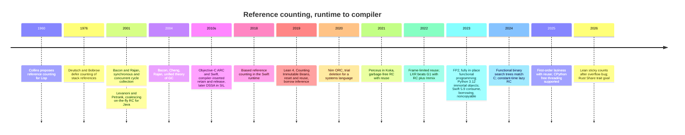
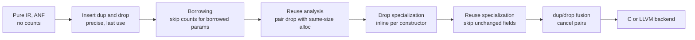
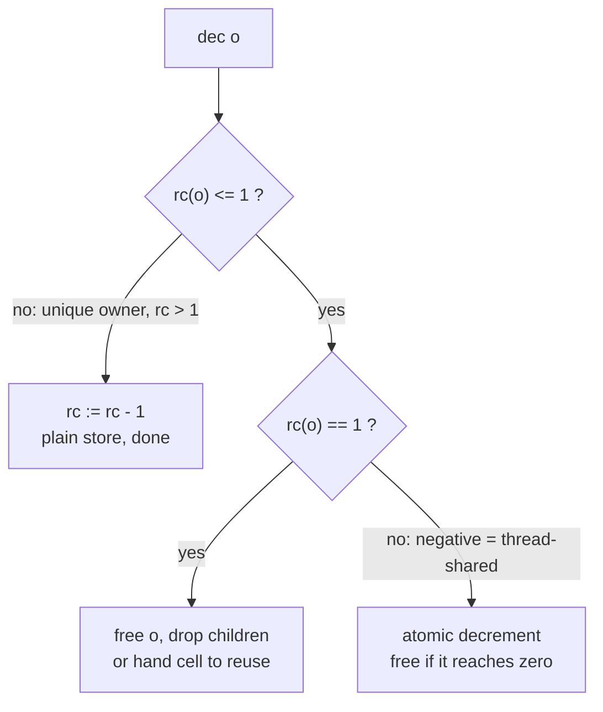
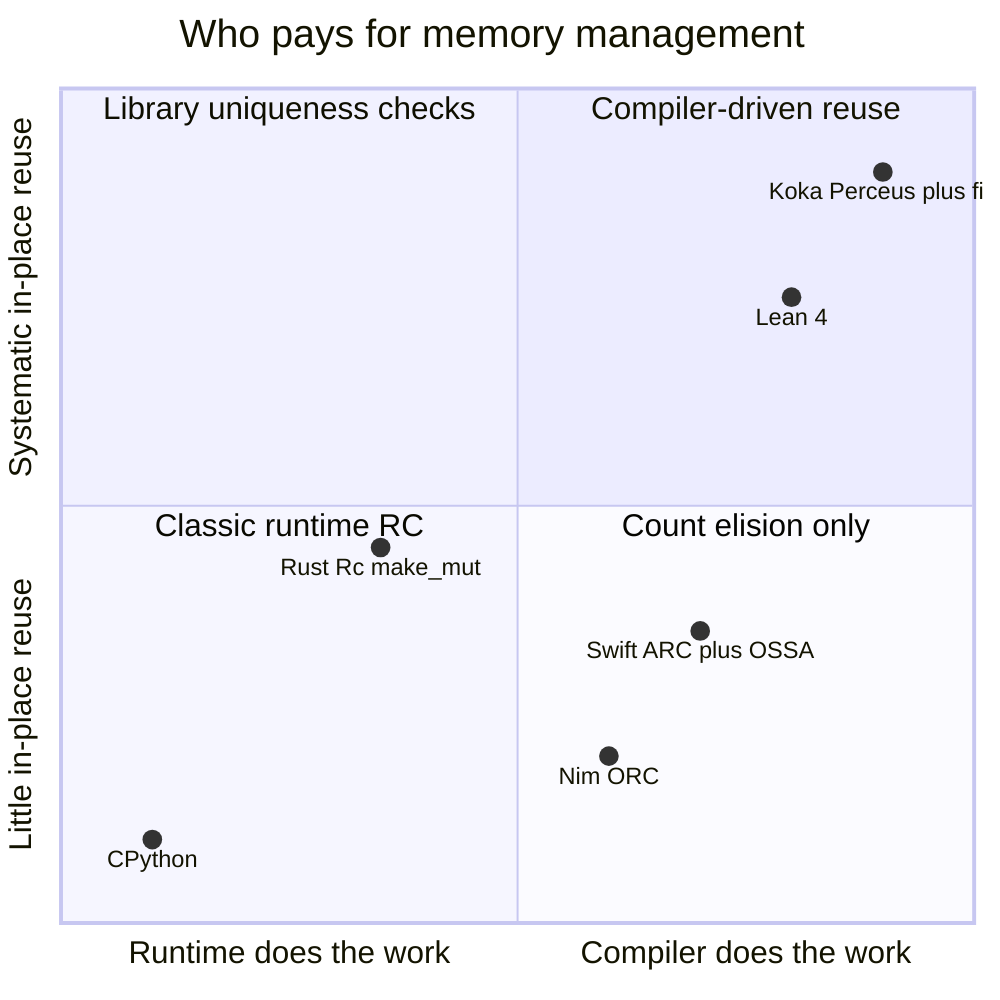

---
tags:
  - compilers
  - reference-counting
  - memory-management
  - perceus
  - koka
  - lean
  - swift
  - cpython
  - functional-programming
  - in-place-update
status: complete
sources:
  - https://www.microsoft.com/en-us/research/publication/perceus-garbage-free-reference-counting-with-reuse-2/
  - https://microsoft.com/en-us/research/uploads/prod/2020/11/perceus-tr-v4.pdf
  - https://arxiv.org/pdf/1908.05647
  - https://www.microsoft.com/en-us/research/uploads/prod/2023/07/flreuse.pdf
  - https://www.microsoft.com/en-us/research/publication/fp2-fully-in-place-functional-programming-2/
  - https://www.microsoft.com/en-us/research/blog/fp2-fully-in-place-functional-programming-provides-memory-reuse-for-pure-functional-programs/
  - https://webspace.science.uu.nl/~swier004/publications/2024-pldi.pdf
  - https://webspace.science.uu.nl/~swier004/publications/2025-icfp.pdf
  - https://lptk.github.io/files/ctrc-2024-05-09.pdf
  - https://cse.hkust.edu.hk/~parreaux/publication/flops24/
  - https://docs.rs/crate/biasedrc/latest/source/paper.pdf
  - https://pages.cs.wisc.edu/%7Ecymen/misc/interests/Bacon01Concurrent.pdf
  - https://user.it.uu.se/~kostis/Seminars/PLI/Papers/levanoni.pdf
  - https://people.cs.umass.edu/~emery/classes/cmpsci691s-fall2004/papers/p522-deutsch.pdf
  - https://arxiv.org/pdf/2210.17175
  - https://web.eecs.umich.edu/~weimerw/2014-4610/reading/bacon-garbage.pdf
  - https://gottesmm.github.io/drafts/sil-ownership-model
  - https://apple-swift.readthedocs.io/en/latest/ARCOptimization.html
  - https://forums.swift.org/t/a-roadmap-for-improving-swift-performance-predictability-arc-improvements-and-ownership-control/54206
  - https://mjtsai.com/blog/2023/09/19/swift-5-9/
  - https://pldi26.sigplan.org/details/pldi-2026-pldi-events/1/Balancing-High-and-Low-Level-Programming-in-Swift
  - https://docs.python.org/3.15/howto/free-threading-python.html
  - https://peps.python.org/pep-0683/
  - https://peps.python.org/pep-0779/
  - https://nim-lang.org/docs/mm.html
  - https://nim-lang.org/blog/2020/12/08/introducing-orc.html
  - https://lean-lang.org/doc/reference/4.36.0/releases/v4.34.0/
  - https://lean-lang.org/doc/reference/4.36.0/releases/v4.35.0/
  - https://goals.rust-lang.org/2026/ergonomic-rc.html
  - https://github.com/rust-lang/rfcs/pull/3680
  - https://github.com/koka-lang/koka
  - https://tamnd.github.io/brain/research/memory-management/runtime/02_roc_rc_reuse/
created: 2026-11-26
updated: 2026-11-26
---

## Table Of Contents

- [[#TL;DR|TL;DR]]
- [[#The Problem|The Problem]]
- [[#Foundations|Foundations]]
    - [[#The Counting Invariant|The Counting Invariant]]
    - [[#Owned and Borrowed References|Owned and Borrowed References]]
    - [[#Scope-Based versus Precise RC|Scope-Based versus Precise RC]]
    - [[#Uniqueness Is a Run-Time Fact|Uniqueness Is a Run-Time Fact]]
    - [[#Cycles|Cycles]]
    - [[#Atomic Counts|Atomic Counts]]
- [[#How We Got Here|How We Got Here]]
- [[#How It Works|How It Works]]
    - [[#Inserting dup and drop - Perceus|Inserting dup and drop - Perceus]]
    - [[#Worked Example - map Through the Perceus Pipeline|Worked Example - map Through the Perceus Pipeline]]
    - [[#Reset and Reuse in Lean|Reset and Reuse in Lean]]
    - [[#Borrow Inference and Its Cost|Borrow Inference and Its Cost]]
    - [[#Frame-Limited Reuse|Frame-Limited Reuse]]
    - [[#Functional but In-Place|Functional but In-Place]]
    - [[#Swift ARC and Ownership SSA|Swift ARC and Ownership SSA]]
    - [[#Making Counts Cheap Across Threads|Making Counts Cheap Across Threads]]
    - [[#Cycle Collection by Trial Deletion|Cycle Collection by Trial Deletion]]
    - [[#RC as a High-Performance Tracing Alternative - LXR|RC as a High-Performance Tracing Alternative - LXR]]
    - [[#Seeing It on a Real Toolchain|Seeing It on a Real Toolchain]]
- [[#Where It Is Now|Where It Is Now]]
- [[#Trade-offs & Open Problems|Trade-offs & Open Problems]]
- [[#Resources|Resources]]
- [[#Related Notes|Related Notes]]

## ***TL;DR***
---
*Reference counting (RC) frees an object the moment its last reference goes away. That makes memory use tight and timing predictable, but every pointer copy costs a counter update, so the modern story is about compilers deleting most of those updates and, when a dying object is about to be replaced by a new one of the same shape, reusing its memory in place.*

- **Counting is easy; counting cheaply is a compiler problem.** Naive RC adds an increment and a decrement around every pointer copy. In Swift, non-deferred RC was measured at about **32%** of execution time on average ([Choi, Shull, Torrellas, PACT 2018](https://docs.rs/crate/biasedrc/latest/source/paper.pdf)). Compilers fight this with *ownership*: a reference is either *owned* (it carries a count) or *borrowed* (someone else keeps the object alive, so no count change is needed).
- **Perceus (Koka, PLDI 2021)** inserts precise `dup`/`drop` so an object dies at its last use, not at the end of its scope, making programs *garbage free*. It then specializes drops, fuses matching dups and drops, and pairs each dying cell with a same-size allocation so the cell is overwritten instead of freed and reallocated ([Reinking et al.](https://microsoft.com/en-us/research/uploads/prod/2020/11/perceus-tr-v4.pdf)).
- **Lean 4 got there first in 2019** with `reset`/`reuse` and *borrow inference* in *Counting Immutable Beans*; turning reuse off made its red-black tree benchmark 3.23x slower ([Ullrich and de Moura](https://arxiv.org/pdf/1908.05647)).
- **Reuse turns functional code into in-place code at run time.** If a list or tree is uniquely referenced, a "pure" `map` or tree insert rewrites it in place; if it is shared, it copies only what changed. Koka calls this *FBIP*, and its `fip` keyword statically checks that a function allocates nothing and uses constant stack when its arguments are unique ([MSR blog](https://www.microsoft.com/en-us/research/blog/fp2-fully-in-place-functional-programming-provides-memory-reuse-for-pure-functional-programs/)).
- **Threads and cycles are the two classic weaknesses.** Atomic counts cost about 2.4x per increment; biased RC, Koka's negative "shared" counts and Lean's ST/MT tags keep the common single-thread case non-atomic. Cycles need either acyclic data (Lean, Koka), weak references (Swift), trial deletion (Nim ORC, CPython's cycle detector) or a backup tracer (LXR).
- **As of November 2026:** Koka is at v3.2.9; Lean 4.34 (September 2026) made 32-bit counts sticky on overflow "following the sticky-counter approach used by Koka" after an overflow could be turned into a kernel use-after-free; CPython's free-threaded build is officially supported and uses biased and deferred RC plus immortal objects; Rust's 2026 project goals target a `Share` trait to make `Arc`/`Rc` cloning more ergonomic.

## ***The Problem***
---
*Tracing collectors need headroom and pause the program at times it does not choose. Manual memory management is fast but unsafe. RC promises prompt, deterministic freeing with no headroom, but only if the compiler can make the counting traffic and the thread synchronization nearly disappear.*

The [[Garbage Collection]] note frames RC and tracing as duals. RC's selling points are the ones tracing struggles with:

- **Promptness.** Memory comes back when the last reference dies, so peak memory tracks the live set closely. Hertz and Berger's measurements in the GC note (a tracing collector needs several times the live heap to match `malloc`) are exactly the overhead RC avoids.
- **Determinism.** Destructors run at known points, which is why C++ `shared_ptr`, Rust `Rc`/`Arc`, Swift and Objective-C use RC for objects that own files, sockets or GPU buffers.
- **Uniqueness information for free.** A count of 1 at run time tells you nobody else can see the object. That is what makes in-place updates of "immutable" data legal, and it is the idea this note is mostly about.

The costs are just as concrete:

| Cost | Where it comes from | Typical answer |
|---|---|---|
| Counter traffic | `inc`/`dec` on every pointer copy, argument pass and scope exit | Ownership and borrowing, pair elimination, deferral, coalescing |
| Cache and memory traffic | Each update writes the object header, even for read-only use | Borrowing; deferral of stack references |
| Atomics | Objects visible to several threads need atomic read-modify-write | Biased RC, thread-shared tags, immortal objects |
| Cascading frees | Dropping the head of a long list frees the whole list right now | Lazy decrements (CTRC, LXR) |
| Cycles | A cycle keeps its own counts above zero forever | Acyclic data, weak refs, trial deletion, backup tracing |
| Overflow | Fixed-width counts can wrap | Sticky (saturating) counts, overflow aborts |

The compiler question is: given a program written as if values were freely copyable, where must counts change, and how many of those changes can be proven redundant or turned into reuse?

## ***Foundations***
---
*Six ideas carry the topic: the counting invariant, the split between owned and borrowed references, the difference between scope-based and precise RC, uniqueness as a run-time fact, and the two classic weak spots, cycles and threads.*

### The Counting Invariant

*Every heap object carries a number that must equal the number of owned references to it; an object is freed exactly when that number reaches zero.*

For an object $o$, RC maintains

$$
\mathrm{rc}(o) \;=\; \big|\{\, r \mid r \text{ is an owned reference to } o \,\}\big|
$$

In plain English: the count is how many places currently "own" a pointer to the object. Copying an owned pointer increments it (`inc`, `retain`, Koka's `dup`), dropping one decrements it (`dec`, `release`, `drop`), and the decrement that reaches zero frees the object and then decrements everything it points to. Bacon, Cheng and Rajan describe this as computing the *greatest* fixed point of the reference relation, starting from true counts and removing dead objects, which is why a cycle, whose members count each other, never reaches zero ([Bacon et al., OOPSLA 2004](https://web.eecs.umich.edu/~weimerw/2014-4610/reading/bacon-garbage.pdf)).

### Owned and Borrowed References

*Most of RC optimization is deciding which references need to be counted at all. A borrowed reference is a pointer used under the guarantee that some owned reference keeps the object alive for the whole use.*

| Kind | Count changes? | Who frees? | Examples |
|---|---|---|---|
| **Owned** | The holder is responsible for one decrement | The holder, when it drops | Swift `consuming`, Koka/Lean owned parameters, OSSA `@owned` |
| **Borrowed** | None | Not the borrower | Swift `borrowing` (default for most arguments), Lean `@&` parameters, OSSA borrowed/guaranteed values |
| **Weak / unowned** | Does not keep the object alive | Never | Swift `weak`/`unowned`, used to break cycles |
| **Immortal / persistent** | Never changes | Never freed | CPython immortal objects, Lean persistent objects |

Lean's paper states the borrowed contract exactly: a borrowed reference "asserts that the value is kept alive by another, owned reference" ([Ullrich and de Moura](https://arxiv.org/pdf/1908.05647)). Swift's ownership model encodes the same thing in SIL: every owned value must be "used by a consuming operation exactly once along any program path dominated by its definition", and borrowed values exist only inside borrow scopes of a live owner ([SIL Ownership Model](https://gottesmm.github.io/drafts/sil-ownership-model)). That rule is linear typing of references, checked by the compiler rather than written by the programmer.

### Scope-Based versus Precise RC

*Scope-based RC drops references when a variable goes out of scope; precise RC drops them right after their last use. The difference decides whether an algorithm runs in half the memory.*

C++ `shared_ptr` and Rust `Rc` release at the end of the variable's scope. Perceus releases at the last use and passes ownership into callees, so in `map` the input list's cells are freed while the output is being built, which "halves peak memory" in the paper's example. The paper calls the result *garbage free*: at every allocation, every live heap object is still reachable from the program ([Perceus TR](https://microsoft.com/en-us/research/uploads/prod/2020/11/perceus-tr-v4.pdf)). Swift went the other way for observable lifetimes: after optimizer-driven early releases surprised users (a `weak` delegate freed mid-expression), the 2021 performance roadmap anchored local releases to the end of scope, with "deinitialization barriers" limiting how early the optimizer may release ([Swift forums roadmap](https://forums.swift.org/t/a-roadmap-for-improving-swift-performance-predictability-arc-improvements-and-ownership-control/54206)). Languages with side-effecting destructors care when a `deinit` runs; pure languages only care how much memory is held.

### Uniqueness Is a Run-Time Fact

*If an object's count is 1, its owner is the only one who can see it, so mutating it in place is unobservable. RC gives you that fact at run time, for free, without a uniqueness type system.*

This is the bridge between RC and functional programming. A pure function that "updates" a list must, in principle, return a fresh list. But if the old list's cell is about to die anyway and nobody else holds it, the new cell can be written into the old one's memory. Linear or uniqueness types prove this statically but need two versions of a function, one for unique and one for shared data; reuse analysis instead tests the count at run time, so one function serves both cases ([Perceus TR](https://microsoft.com/en-us/research/uploads/prod/2020/11/perceus-tr-v4.pdf)). Lean applies the same check to arrays and strings, which are updated in place "when the array is not shared" ([Counting Immutable Beans](https://arxiv.org/pdf/1908.05647)). Rust exposes it to programmers as `Rc::make_mut` (see [[#Seeing It on a Real Toolchain|below]]).

### Cycles

*A cycle of objects keeps every member's count above zero even when nothing outside points to it. Every RC language picks one of four answers.*

1. **Make cycles impossible.** Lean and λpure cannot build cyclic data ([Counting Immutable Beans](https://arxiv.org/pdf/1908.05647)). Koka's inductive and coinductive types are acyclic, so cycles arise only through mutable references, and "we leave the responsibility to the programmer to break cycles" ([Perceus TR](https://microsoft.com/en-us/research/uploads/prod/2020/11/perceus-tr-v4.pdf)).
2. **Weak references.** Swift has no cycle collector; programmers mark back-pointers `weak` or `unowned`.
3. **Trial deletion.** Find candidate cycle roots and test whether their counts are explained entirely by internal edges ([[#Cycle Collection by Trial Deletion|below]]). Nim's ORC and the Recycler use this; CPython runs a separate tracing cycle detector over container objects (see [[Garbage Collection]]).
4. **Backup tracing.** LXR runs a concurrent tracer occasionally to catch cyclic garbage and stuck counts ([LXR](https://arxiv.org/pdf/2210.17175)).

### Atomic Counts

*If two threads can update a count at once, the update must be an atomic read-modify-write, which is several times slower than a plain increment and serializes cores on shared cache lines.*

Choi et al. measured an atomic increment at 13.84 ns versus 5.77 ns non-atomic, "about 2.40x" slower, in a single-threaded microbenchmark ([BRC paper](https://docs.rs/crate/biasedrc/latest/source/paper.pdf)). The key empirical fact is that "most objects are only accessed by a single thread", so every serious design keeps a cheap path for thread-local objects and a slow path for shared ones. Turning every count atomic slowed Koka by about 5% (rbtree) to 59% (nqueens) ([Perceus TR](https://microsoft.com/en-us/research/uploads/prod/2020/11/perceus-tr-v4.pdf)) and Lean by up to 1.71x on rbmap ([Counting Immutable Beans](https://arxiv.org/pdf/1908.05647)). See [[Memory Models and Pointer Provenance]] for why the decrement that may free needs acquire/release ordering.

## ***How We Got Here***
---
*RC is as old as tracing. For forty years the research was about making the runtime cheaper (deferral, coalescing, cycle collection); the 2010s and 2020s moved the work into the compiler, which now proves most counts redundant and turns frees into reuse.*



- **Deferral (1976).** Deutsch and Bobrow observed that most pointer updates are to local variables, so they stopped counting stack references and reconciled them periodically ([Deutsch and Bobrow, CACM 1976](https://people.cs.umass.edu/~emery/classes/cmpsci691s-fall2004/papers/p522-deutsch.pdf)). CPython's free-threaded build does the same per object today.
- **Coalescing (2001).** Levanoni and Petrank noted that if a pointer slot is overwritten $n$ times between collections, the naive $2n$ updates collapse to two: decrement the first old value and increment the final one. Logging only the first write per slot per epoch gives an on-the-fly collector whose write barrier needs no synchronized operation ([Levanoni and Petrank, OOPSLA 2001](https://user.it.uu.se/~kostis/Seminars/PLI/Papers/levanoni.pdf)).
- **Cycle collection (2001).** Bacon and Rajan made trial deletion practical by processing all candidate roots as one graph, an "enormous difference in run-time" ([Bacon and Rajan, ECOOP 2001](https://pages.cs.wisc.edu/%7Ecymen/misc/interests/Bacon01Concurrent.pdf)).
- **Compiler-inserted RC (2010s).** Objective-C ARC and then Swift moved retain/release insertion into the compiler and added an optimizer to remove redundant pairs ([Swift ARC Optimization](https://apple-swift.readthedocs.io/en/latest/ARCOptimization.html)). Swift's SIL later gained an *ownership SSA* form with a verifier ([SIL Ownership Model](https://gottesmm.github.io/drafts/sil-ownership-model)).
- **Functional reuse (2019 to 2025).** Lean showed that a purely functional language with RC and reuse could beat tracing-GC functional compilers on allocation-heavy code; Koka's Perceus made the scheme precise and proved it garbage free; follow-ups bounded space, added static in-place checking (`fip`), and extended reuse to laziness.

## ***How It Works***
---
*A modern RC compiler runs a small pipeline: make every ownership transfer explicit, insert counts at the last use, specialize the drops, pair dying cells with new allocations, and only then let the backend see the code. Around it sit runtime tricks for threads and cycles.*



(The stage order is a composite of Perceus and its drop-guided successor; Lean's pipeline runs `insertResetReuse` before `inferBorrow` and `explicitRc`, as shown in [[Dependent and Refinement Types]].)

### Inserting dup and drop - Perceus

*Perceus treats every owned variable as a linear resource that must be consumed exactly once; a variable used twice gets a `dup`, a variable never used gets a `drop`.*

The formal basis is a linear resource calculus. Owned variables live in a linear environment $\Gamma$ and each "is consumed exactly once"; a separate borrowed environment $\Delta$ lets a subexpression use a variable without consuming it ([Perceus TR](https://microsoft.com/en-us/research/uploads/prod/2020/11/perceus-tr-v4.pdf)). The deterministic algorithm pushes `dup`s as late as possible (to the leaves) and emits `drop`s as early as possible: right after a binding whose variable is unused, or at the start of a `match` branch for variables that branch does not mention. The effect is that each object is freed at the precise moment its last reference dies.

### Worked Example - map Through the Perceus Pipeline

*Watching one function go through the stages shows why the fast path ends up with almost no counting at all.*

The source, in Koka (adapted from Section 2 of the [Perceus TR](https://microsoft.com/en-us/research/uploads/prod/2020/11/perceus-tr-v4.pdf)):

```koka
fun map( xs : list<a>, f : a -> e b ) : e list<b>
  match xs
    Cons(x, xx) -> Cons(f(x), map(xx, f))
    Nil         -> Nil
```

**1. After dup/drop insertion.** Matching on `xs` binds its fields; the fields are now extra references, so they are `dup`ed and `xs` itself is dropped. `f` is used twice in the `Cons` branch, so one use gets a `dup`; in the `Nil` branch `f` is unused and is dropped.

```koka
match xs
  Cons(x, xx) -> dup(x); dup(xx); drop(xs)
                 Cons( dup(f)(x), map(xx, f) )
  Nil         -> drop(xs); drop(f); Nil
```

**2. Drop specialization.** `drop(xs)` is inlined for the `Cons` case: if `xs` is unique, drop its children and free the cell; otherwise just decrement. The `dup(x); dup(xx)` before it now meet `drop(x); drop(xx)` inside the unique branch and cancel (*dup/drop fusion*):

```koka
Cons(x, xx) ->
  if is-unique(xs) then free(xs)
  else { dup(x); dup(xx); decref(xs) }
  Cons( dup(f)(x), map(xx, f) )
```

The paper's summary: "almost all reference count operations in the fast path are gone."

**3. Reuse.** The cell `xs` is a `Cons` of the same size as the `Cons` about to be allocated. Instead of freeing it, `drop-reuse` returns a *reuse token*: the cell's address if `xs` was unique, `NULL` otherwise. The allocation `Cons@ru` writes into the token's memory when it is non-null and allocates fresh memory when it is null.

```koka
Cons(x, xx) ->
  val ru = if is-unique(xs) then &xs
           else { dup(x); dup(xx); decref(xs); NULL }
  Cons@ru( dup(f)(x), map(xx, f) )
```

| Path | Allocations | Count updates per cell |
|---|---|---|
| Naive RC, scope-based | 1 new cell, old list freed at the end | `dup` x, `dup` xx, `dup` f, later frees |
| After Perceus, list unique | **0** (cell overwritten in place) | `dup f` only |
| After Perceus, list shared | 1 new cell | `dup` x, `dup` xx, `decref` xs, `dup` f |

So a "pure" `map` over a list nobody else holds is an in-place loop over the cells, and over a shared list it is an ordinary copying map. The same compiled function handles both.

**Reuse specialization** goes one step further: when the new constructor keeps some fields unchanged (a red-black tree insert rebuilding a node with the same key, value and right child), only the changed fields are written ([Perceus TR](https://microsoft.com/en-us/research/uploads/prod/2020/11/perceus-tr-v4.pdf)).

### Reset and Reuse in Lean

*Lean's 2019 design splits reuse into two instructions: `reset` frees a cell's children and hands back the cell if it is unique, and `reuse` builds a new constructor in it.*

Lean compiles through λpure, an untyped [[CPS and ANF|A-normal-form]] IR with constructors, projections and `case`, and extends it to λRC with `inc`, `dec`, `reset` and `reuse` ([Counting Immutable Beans](https://arxiv.org/pdf/1908.05647)). The insertion pass is a short heuristic: at each `case x`, in each arm, find where `x` becomes dead, insert `let w = reset x`, and replace the first constructor of the same arity with `reuse w in ctor_i ...`; if none is found, use a plain `dec`. On a shared cell, `reset` behaves like `dec` and returns a marker, so the `reuse` allocates normally. The same `map`, in the paper's notation (a sketch):

```text
map f xs := case xs of
  (ret xs)                              -- nil
  (let x  := proj1 xs; inc x;
   let s  := proj2 xs; inc s;
   let w  := reset xs;                  -- frees children refs if unique
   let y  := f x;
   let ys := map f s;
   let r  := reuse w in ctor2 y ys;     -- writes into xs's cell if unique
   ret r)
```

The authors chose not to fuse `reset` and `reuse` into one instruction: keeping the `reset` early means the recursive call does not see `xs` as shared, which would block reuse further down ([Counting Immutable Beans](https://arxiv.org/pdf/1908.05647)). The ablation numbers show what reuse buys:

| Benchmark | Slowdown without reset/reuse | Without borrow inference | All-atomic counts |
|---|---|---|---|
| rbmap | 3.23x | | 1.71x |
| const_fold | 1.64x | | |
| unionfind | 1.41x | | |
| deriv | | 1.16x | 1.42x |
| binarytrees | | 1.14x | 1.22x |

(Figure 6 of the paper, normalized to the full build; blank cells were not among the highlighted results.) Lean's current compiler runs these passes on its LCNF IR as `insertResetReuse`, `inferBorrow`, `explicitRc` and `expandResetReuse`, covered in [[Dependent and Refinement Types]].

### Borrow Inference and Its Cost

*Inferring which parameters can be borrowed removes count traffic on every call, but a borrowed parameter cannot be reused or freed early, so borrowing trades memory for speed.*

Lean starts with every parameter borrowed and marks one owned if it is `reset`, or passed to a function that takes it owned, iterating to a fixed point; tail calls force owned parameters so they stay tail calls, and partial applications get an all-owned wrapper because borrowed arguments cannot escape. The paper notes the pass-to-owned rule "is a heuristic and is not required for correctness" ([Counting Immutable Beans](https://arxiv.org/pdf/1908.05647)). The catch, stated in the frame-limited reuse paper: unrestricted borrowing "can increase the memory usage of a program by an arbitrary amount", because a borrowed list stays alive in the caller even after the callee is done with it ([Lorenzen and Leijen, ICFP 2022](https://www.microsoft.com/en-us/research/uploads/prod/2023/07/flreuse.pdf)). Koka therefore has no automatic borrow inference, only borrowing for built-in primitives (as of that paper).

### Frame-Limited Reuse

*Perceus's first reuse algorithm was fragile and Lean's could hold memory too long; the fix is a precise space bound that allows a little extra memory per stack frame.*

Lorenzen and Leijen compared the two earlier algorithms. Koka's original reuse (their algorithm K) attempts reuse at the start of a branch, where a still-live variable can block it, so in one example the token "will always be NULL at runtime"; Lean's (algorithm D) places `reset` after the last use, which can extend a value's life, so the program "also holds on to the full xs list" while a function runs ([flreuse](https://www.microsoft.com/en-us/research/uploads/prod/2023/07/flreuse.pdf)). Their criterion:

$$
|H_2| \;\le\; c \cdot |E|
$$

In plain English: at every allocation, the memory held beyond what is reachable ($H_2$) may be at most a constant times the depth of the evaluation context (roughly, the number of stack frames). A reuse token carried across a recursive call, as in `map`, costs one cell per frame and fits; holding a whole list does not. Their *drop-guided reuse* runs reuse analysis *after* `dup`/`drop` insertion, because "the drop operations signify precisely when a cell may become available for reuse", and proves the result frame-limited. It was "always as fast (and sometimes up to 1.6x faster)" than the old Koka scheme, and the Koka red-black tree beat C++ `std::map` by almost 20%.

### Functional but In-Place

*Once reuse is reliable, programmers can write functional code whose run-time behavior is an in-place imperative algorithm, and the compiler can check that claim.*

**FBIP** (functional but in-place) is the style: write purely functional code that, when its input is unique, compiles to in-place updates. The Perceus paper's example is a tree traversal written with an explicit visitor (zipper) type, where every call is a tail call, so it runs in constant stack like the Morris traversal without the pointer swapping ([Perceus TR](https://microsoft.com/en-us/research/uploads/prod/2020/11/perceus-tr-v4.pdf)).

**FP² (ICFP 2023)** makes the guarantee static. A function marked `fip` is checked to execute "using constant stack space without needing any heap allocation as long as the arguments are unique"; zipper moves are in place because the source and target constructors have the same number of fields ([MSR blog](https://www.microsoft.com/en-us/research/blog/fp2-fully-in-place-functional-programming-provides-memory-reuse-for-pure-functional-programs/); [FP² paper](https://www.microsoft.com/en-us/research/publication/fp2-fully-in-place-functional-programming-2/)).

```koka
// Accumulating reverse: each Cons cell is reused by rewiring its tail.
fip fun reverse-acc( xs : list<a>, acc : list<a> ) : list<a>
  match xs
    Cons(x, xx) -> reverse-acc(xx, Cons(x, acc))
    Nil         -> acc
```

**Payoff (PLDI 2024).** Lorenzen, Leijen, Swierstra and Lindley derived functional move-to-root, splay and zip trees that update in place, proved them equivalent to the imperative originals in Coq/Iris, and report that the derived versions "always outperform C" in the standard comparison; with C given the same allocator, the top-down versions are only slightly slower ([PLDI 2024](https://webspace.science.uu.nl/~swier004/publications/2024-pldi.pdf)).

**Laziness (ICFP 2025).** *First-Order Laziness* adds lazy constructors that overwrite their own cell when forced, so they combine with Perceus reuse; across Okasaki's queues and heaps, thunk overhead in Koka drops from about 150% to about 43%. Reuse still "is limited to first-order data constructors" and never looks under closures ([ICFP 2025](https://webspace.science.uu.nl/~swier004/publications/2025-icfp.pdf)).

### Swift ARC and Ownership SSA

*Swift is the largest RC deployment with a compiler optimizer. Its newer IR makes every value's ownership explicit, so the optimizer can reason about one value's lifetime from its def-use chain.*

Swift inserts retains and releases around copies and ends of lifetime, then an ARC optimizer removes pairs it can prove redundant ([ARC Optimization](https://apple-swift.readthedocs.io/en/latest/ARCOptimization.html)). In OSSA, `copy_value` "produces a new copy of the value with `Owned` ownership", `destroy_value` "acts as a consuming use", and borrows are bracketed by `begin_borrow`/`end_borrow`; the verifier rejects any path where an owned value is consumed twice or not at all ([SIL Ownership Model](https://gottesmm.github.io/drafts/sil-ownership-model)). The surface language then exposed the same model in Swift 5.9: `consume` to end a binding's lifetime (SE-0366), `borrowing`/`consuming` parameter modifiers (SE-0377) and noncopyable structs and enums (SE-0390) ([Swift 5.9 summary](https://mjtsai.com/blog/2023/09/19/swift-5-9/)).

```swift
final class Buffer { var bytes: [UInt8] = [] }

func checksum(_ b: borrowing Buffer) -> Int {   // no retain/release on entry
    b.bytes.reduce(0) { $0 &+ Int($1) }
}

func archive(_ b: consuming Buffer) { /* takes ownership: caller's ref moves in */ }

func run() {
    let buf = Buffer()
    _ = checksum(buf)
    archive(consume buf)   // ends buf's lifetime here; using buf afterwards is an error
}
```

Where Swift and Koka differ: Swift lets copy-on-write collections (`Array`, `Dictionary`) check `isKnownUniquelyReferenced` to mutate in place, which is the same uniqueness test as reuse but done in library code, while Koka's compiler pairs arbitrary constructor cells automatically.

### Making Counts Cheap Across Threads

*Every multi-threaded RC system splits objects into "only my thread touches this" and "shared", and pays for atomics only on the second kind.*

| Scheme | Fast path | Shared path | Cost of the split |
|---|---|---|---|
| **Biased RC** (Choi et al. 2018) | Owner thread updates a biased counter non-atomically | Other threads update a shared counter atomically; owner merges, negative shared counts queue the object | Two counters per object; +1.5% peak memory in Swift |
| **Koka** | Single test `rc <= 1` sends both "shared" and "about to free" to the slow path | Thread-shared objects have *negative* counts and use atomics | `tshare` marks an object graph once, when it crosses threads |
| **Lean** | ST objects: no fences | MT objects: relaxed atomic increment, release/acquire on decrement | `markMT` walks everything reachable, so task creation is not constant time |
| **CPython free-threaded** | Biased RC fast path for objects owned by the current thread | Atomic slow path | Plus deferred RC and immortal objects for hot shared objects |

Biased RC cut average client execution time by 22.5% and raised server throughput by 7.3% in the Swift 3.1.1 runtime ([BRC](https://docs.rs/crate/biasedrc/latest/source/paper.pdf)). Koka also makes counts *sticky* at a large bound ($2^{30}$) so they never overflow and never change again ([Perceus TR](https://microsoft.com/en-us/research/uploads/prod/2020/11/perceus-tr-v4.pdf)); Lean adopted the same idea in 2026 (see [[#Where It Is Now|Where It Is Now]]). CPython's immortal objects use a fixed magic count checked by a bit test, so even an old extension that increments the count cannot make the object mortal ([PEP 683](https://peps.python.org/pep-0683/)).



(Koka's decrement fast path as described in the Perceus TR, Section 2.7.2; the diagram is my rendering.)

### Cycle Collection by Trial Deletion

*Trial deletion asks: if I pretend to delete the internal edges of a suspicious subgraph, do any counts stay positive? If not, the subgraph is a garbage cycle.*

Bacon and Rajan's synchronous algorithm ([ECOOP 2001](https://pages.cs.wisc.edu/%7Ecymen/misc/interests/Bacon01Concurrent.pdf)):

1. **Candidates.** When a decrement leaves a count above zero, the object might now be the root of a garbage cycle. Color it *purple* and buffer it.
2. **MarkGray.** From each candidate, traverse depth-first, color nodes gray and subtract one for every internal edge, "removing internal reference counts as it goes".
3. **Scan.** A gray node whose count is still positive is referenced from outside, so it and everything it reaches are live: recolor black and restore counts. Gray nodes at zero become white.
4. **CollectWhite.** Free the white nodes.

Formally, for the candidate subgraph $S$:

$$
\mathrm{rc}'(o) \;=\; \mathrm{rc}(o) - \big|\{\, p \in S \mid p \to o \,\}\big|, \qquad o \text{ is garbage} \iff \mathrm{rc}'(q) = 0 \text{ for every } q \text{ that reaches } o \text{ within } S
$$

In plain English: subtract the references that come from inside the suspicious group; anything still referenced from outside, and everything it can reach, survives. Classes that cannot form cycles are marked *green* and skipped, which cut candidates "by an order of magnitude". Nim's ORC is "based on the pretty well known 'trial deletion' algorithm", invokes the collector only for types its analysis finds potentially cyclic, and lets programmers mark types `{.acyclic.}` ([ORC announcement](https://nim-lang.org/blog/2020/12/08/introducing-orc.html)).

### RC as a High-Performance Tracing Alternative - LXR

*RC is not only for functional languages. LXR showed in 2022 that a Java collector built mostly on RC can beat the best tracing collectors on tail latency and throughput.*

LXR runs on OpenJDK: an Immix heap of 32 KB blocks and 256 B lines, 2-bit counts in a side table, coalescing RC fed by a field-logging write barrier (1.6% geometric-mean overhead), deferred counting of roots, and a concurrent SATB tracer only as a backup for cycles and stuck counts. Young objects that die before being counted are reclaimed "implicitly dead". On lusearch in a tight heap its 99.99th-percentile latency was about 13 ms against about 16 ms for G1 and about 128 ms for Shenandoah, and across 17 benchmarks at 2x heap it was about 4% faster than G1 ([LXR, PLDI 2022](https://arxiv.org/pdf/2210.17175)). The lesson matches the compiler side: the historical cost of RC came from counting every pointer change, and "temporal coarsening" (deferral and coalescing) removes most of it.

### Seeing It on a Real Toolchain

*Three small experiments on tools installed here (Python 3.13.18, rustc 1.97.0) show immortal counts, uniqueness-driven in-place update, and the price of atomic counts in the machine code.*

**CPython: counts and immortal objects.**

```python
import sys
print(sys.getrefcount(None))   # 4294967295  (immortal: fixed magic count)
print(sys.getrefcount(7))      # 4294967295  (small ints are immortal too)
x = object()
print(sys.getrefcount(x))      # 2  (x plus the call's argument)
y = x
print(sys.getrefcount(x))      # 3
```

**Rust: `Rc::make_mut` is reuse by hand.** It mutates in place when the count is 1 and clones first when it is shared, exactly the `is-unique` test that Perceus inserts automatically.

```rust
let mut a = Rc::new(vec![1, 2, 3]);
let p0 = Rc::as_ptr(&a);
Rc::make_mut(&mut a).push(4);   // unique: same allocation
let b = Rc::clone(&a);          // count = 2
Rc::make_mut(&mut a).push(5);   // shared: copy, then push
```

Output:

```text
unique: same alloc = true, count = 1
shared: count = 2
after make_mut: same alloc = false, a = [1, 2, 3, 4, 5], b = [1, 2, 3, 4]
counts: a = 1, b = 1
```

**Rust: non-atomic versus atomic increment.** `rustc -O --emit=asm` for `Rc::clone` and `Arc::clone` on x86-64:

```asm
clone_rc:                      clone_arc:
    movq  (%rdi), %rax             movq  (%rdi), %rax
    incq  (%rax)                   lock incq (%rax)     ; atomic RMW
    je    .LBB1_1   ; wrapped      jle   .LBB0_2   ; overflow past isize::MAX
    retq                           retq
```

The only difference in the hot path is the `lock` prefix, which is the cost Choi et al. measured at about 2.4x per increment. Both versions also check for overflow and abort, which is Rust's answer to the problem Lean fixed with sticky counts in 2026.

## ***Where It Is Now***
---
*As of late November 2026, RC with reuse is the production memory strategy of Lean and Koka, a maturing part of Swift's ownership model, the basis of CPython's free-threaded build, and an active research line in fully in-place functional programming.*

| System | State in late 2026 | Source |
|---|---|---|
| **Koka** | v3.2.9 (17 September 2026), compiling to C with Perceus and reuse | [Koka repo](https://github.com/koka-lang/koka) |
| **Lean 4** | 4.34.0 (14 September 2026) "freezes objects whose 32-bit reference count overflows, following the sticky-counter approach used by Koka", after a wrapped count could become a use-after-free "in the official kernel" on machines with at least 18 GB free; 4.35.0 (12 October 2026) continued the RC work, fixed an MT-sharing problem and added `markLinear` for arrays and strings | [v4.34.0](https://lean-lang.org/doc/reference/4.36.0/releases/v4.34.0/), [v4.35.0](https://lean-lang.org/doc/reference/4.36.0/releases/v4.35.0/) |
| **CPython** | Free-threaded build officially supported since 3.14 (PEP 779, Phase II); biased RC, per-object deferred RC and immortalization (limited in 3.14 to code constants and interned strings); pyperformance overhead about 1% (macOS aarch64) to 8% (x86-64 Linux) | [PEP 779](https://peps.python.org/pep-0779/), [free-threading HOWTO](https://docs.python.org/3.15/howto/free-threading-python.html) |
| **Swift** | Ownership features shipped since 5.9; John McCall's PLDI 2026 industry talk (18 June 2026) covered ongoing design of explicit ownership and lifetime analysis under source and ABI stability constraints | [PLDI 2026](https://pldi26.sigplan.org/details/pldi-2026-pldi-events/1/Balancing-High-and-Low-Level-Programming-in-Swift) |
| **Rust** | 2026 project goal "Ergonomic ref-counting" (accepted): a `Share` trait for alias-creating clones of `Arc`/`Rc` and `move($expr)` in closures, with nightly prototypes targeted by summer 2026; the earlier `.use` design (RFC 3680) stays on nightly | [Rust goals](https://goals.rust-lang.org/2026/ergonomic-rc.html), [RFC 3680](https://github.com/rust-lang/rfcs/pull/3680) |
| **Nim** | ORC (RC plus trial-deletion cycle collector) is the default; ARC drops the cycle collector; `atomicArc` and `yrc` for cross-thread refs | [Nim memory management](https://nim-lang.org/docs/mm.html) |
| **Roc** | Pre-1.0 (May 2026); Perceus-style RC with reuse at join points, plus alias analysis to expose uniqueness (secondary summary) | [summary](https://tamnd.github.io/brain/research/memory-management/runtime/02_roc_rc_reuse/) |

**Research directions.**

- **Static in-place guarantees** keep spreading from `fip` to whole algorithm families: the PLDI 2024 BST paper and the ICFP 2025 laziness paper both build on FP².
- **Bounded-time freeing.** CTRC (Lam and Parreaux, FLOPS 2024) defers each object's child decrements until its cell is reused, giving constant-time allocation and deallocation with uniform 32-byte cells in about 150 lines of C, at the cost of more memory; unmodified Koka showed latency spikes of around 10 µs or more from freeing large structures ([CTRC](https://lptk.github.io/files/ctrc-2024-05-09.pdf)).
- **RC in high-performance GCs.** LXR's RC-first design for OpenJDK remains the reference point for RC competing with G1, Shenandoah and ZGC.

## ***Trade-offs & Open Problems***
---
*RC buys promptness, predictability and run-time uniqueness at the price of counting work, header space, and careful handling of threads and cycles. The open questions are about making reuse predictable, borrowing safe for space, and freeing bounded in time.*



(Positions are my qualitative reading of the sources, not measurements.)

- **Predictability of reuse.** Reuse depends on a run-time count and on the compiler finding a same-size allocation in the right place. Small rewrites, like inlining a helper, used to break Koka's original reuse ([flreuse](https://www.microsoft.com/en-us/research/uploads/prod/2023/07/flreuse.pdf)). `fip` fixes this for checked functions only; everywhere else performance can still change with refactoring, much like [[Escape Analysis]] results.
- **Borrowing versus space.** Borrow inference removes count traffic but can hold memory arbitrarily long; Lean infers borrows, Koka mostly does not. A borrow analysis that is frame-limited by construction is still open.
- **Closures and laziness.** Reuse is limited to first-order constructors; closures and thunks are not reused ([ICFP 2025](https://webspace.science.uu.nl/~swier004/publications/2025-icfp.pdf)). See [[Closure Conversion and Defunctionalization]] for why closure environments are hard to reason about.
- **Thread sharing has a cost somewhere.** Biased RC adds a second counter and merge logic; Koka and Lean pay a graph walk when an object is first shared; CPython layers biased RC, deferral and immortality and still pays 1% to 8% in its free-threaded build.
- **Cascading frees.** Precise RC frees a dead structure immediately and recursively, which is O(n) work at an unpredictable moment for latency-sensitive code. Lazy decrements fix the latency but give up some promptness.
- **Cycles.** Acyclic-by-construction languages are safe until mutable references appear; weak references push the work onto programmers; trial deletion and backup tracing reintroduce a tracer.
- **Counter width and overflow.** 32-bit counts save header space but can wrap, as Lean's 2026 kernel use-after-free showed; sticky counts or overflow aborts are mandatory for soundness, not just robustness.
- **Interaction with other optimizations.** Reuse results shift with inlining (inlining a small helper changed what Koka's first reuse algorithm could pair, per the frame-limited paper); count placement also constrains [[Classic Optimizations|code motion]], since moving a `drop` earlier or later changes peak memory, and it needs [[Memory Models and Pointer Provenance|memory-ordering]] care at the decrement that frees.
- **Formal guarantees.** Perceus's garbage-freedom and the frame-limited bound are proved for core calculi; production compilers add borrowing, FFI and threads that the proofs do not cover. See [[Verified Compilers]].

## ***Resources***
---
*Read Perceus for the precise algorithm, Counting Immutable Beans for the first production design, the frame-limited reuse paper for the space story, and FP² plus the PLDI 2024 trees paper for what reuse enables. For the runtime side, Bacon and Rajan (cycles), Choi et al. (threads) and LXR (performance).*

**Compiler-side RC and reuse**
- [Perceus: Garbage Free Reference Counting with Reuse](https://microsoft.com/en-us/research/uploads/prod/2020/11/perceus-tr-v4.pdf): Reinking, Xie, de Moura, Leijen, PLDI 2021 ([publication page](https://www.microsoft.com/en-us/research/publication/perceus-garbage-free-reference-counting-with-reuse-2/)). Precise dup/drop, drop and reuse specialization, FBIP, benchmarks against OCaml, GHC, Swift, Java and C++.
- [Counting Immutable Beans](https://arxiv.org/pdf/1908.05647): Ullrich and de Moura, IFL 2019. λRC, reset/reuse, borrow inference, ST/MT objects.
- [Reference Counting with Frame Limited Reuse](https://www.microsoft.com/en-us/research/uploads/prod/2023/07/flreuse.pdf): Lorenzen and Leijen, ICFP 2022. Space bounds, drop-guided reuse.
- [FP²: Fully in-Place Functional Programming](https://www.microsoft.com/en-us/research/publication/fp2-fully-in-place-functional-programming-2/): Lorenzen, Leijen, Swierstra, ICFP 2023 ([MSR blog](https://www.microsoft.com/en-us/research/blog/fp2-fully-in-place-functional-programming-provides-memory-reuse-for-pure-functional-programs/)).
- [The Functional Essence of Imperative Binary Search Trees](https://webspace.science.uu.nl/~swier004/publications/2024-pldi.pdf): Lorenzen, Leijen, Swierstra, Lindley, PLDI 2024.
- [First-Order Laziness](https://webspace.science.uu.nl/~swier004/publications/2025-icfp.pdf): Lorenzen, Leijen, Swierstra, Lindley, ICFP 2025.
- [Being Lazy When It Counts](https://lptk.github.io/files/ctrc-2024-05-09.pdf): Lam and Parreaux, FLOPS 2024 ([publication page](https://cse.hkust.edu.hk/~parreaux/publication/flops24/)). Constant-time RC in Koka.

**Runtime-side RC**
- [An Efficient, Incremental, Automatic Garbage Collector](https://people.cs.umass.edu/~emery/classes/cmpsci691s-fall2004/papers/p522-deutsch.pdf): Deutsch and Bobrow, CACM 1976. Deferred RC.
- [Concurrent Cycle Collection in Reference Counted Systems](https://pages.cs.wisc.edu/%7Ecymen/misc/interests/Bacon01Concurrent.pdf): Bacon and Rajan, ECOOP 2001. Trial deletion.
- [An On-the-Fly Reference Counting Garbage Collector for Java](https://user.it.uu.se/~kostis/Seminars/PLI/Papers/levanoni.pdf): Levanoni and Petrank, OOPSLA 2001. Coalescing.
- [A Unified Theory of Garbage Collection](https://web.eecs.umich.edu/~weimerw/2014-4610/reading/bacon-garbage.pdf): Bacon, Cheng, Rajan, OOPSLA 2004.
- [Biased Reference Counting](https://docs.rs/crate/biasedrc/latest/source/paper.pdf): Choi, Shull, Torrellas, PACT 2018.
- [Low-Latency, High-Throughput Garbage Collection](https://arxiv.org/pdf/2210.17175): Zhao, Blackburn, McKinley, PLDI 2022. LXR.

**Language docs and design notes**
- [SIL Ownership Model](https://gottesmm.github.io/drafts/sil-ownership-model): Michael Gottesman's draft of Swift's OSSA rules; [ARC Optimization](https://apple-swift.readthedocs.io/en/latest/ARCOptimization.html); [Swift performance roadmap](https://forums.swift.org/t/a-roadmap-for-improving-swift-performance-predictability-arc-improvements-and-ownership-control/54206) (Joe Groff, 2021).
- [PEP 683: Immortal Objects](https://peps.python.org/pep-0683/), [PEP 779](https://peps.python.org/pep-0779/) and the [free-threading HOWTO](https://docs.python.org/3.15/howto/free-threading-python.html).
- [Nim's Memory Management](https://nim-lang.org/docs/mm.html) and [ORC announcement](https://nim-lang.org/blog/2020/12/08/introducing-orc.html) (Andreas Rumpf, 2020).
- Lean release notes [v4.34.0](https://lean-lang.org/doc/reference/4.36.0/releases/v4.34.0/) and [v4.35.0](https://lean-lang.org/doc/reference/4.36.0/releases/v4.35.0/); [Koka repository](https://github.com/koka-lang/koka); [Rust ergonomic ref-counting goal](https://goals.rust-lang.org/2026/ergonomic-rc.html).

## ***Related Notes***
---
*Where this topic connects in the vault.*

- [[Garbage Collection]] — RC as tracing's dual; this note goes deep on the compiler side of the RC family.
- [[Escape Analysis]] — The other way to avoid heap work: prove an object never escapes instead of counting references to it.
- [[Dependent and Refinement Types]] — Lean 4's compiler pipeline, where `insertResetReuse`, `inferBorrow` and `explicitRc` run on LCNF.
- [[Effect Handlers and Delimited Continuations]] — Koka compiles effects by evidence passing on top of Perceus.
- [[Closure Conversion and Defunctionalization]] — Closure environments are reference counted too, and are outside reuse analysis.
- [[CPS and ANF]] — λpure and Koka's core IR are A-normal form, which makes last-use analysis simple.
- [[Memory Models and Pointer Provenance]] — Ordering needed at the decrement that frees a shared object.
- [[Concurrency Memory Models]] — Planned: atomics and happens-before behind biased and atomic RC.
- [[Dataflow Analysis]] — Liveness decides where the last use is, and so where `drop` goes.
- [[Type Systems and Inference]] — Linear and uniqueness types are the static cousins of run-time uniqueness.
- [[Value Types and Flattening]] — Value types avoid counting altogether by having no identity; Swift's copy-on-write sits on top of RC uniqueness.
- [[Safepoints and Stack Maps]] — Deferred RC and LXR scan roots the same way tracing collectors do.
- [[Verified Compilers]] — Garbage-freedom and frame-limited proofs, and the PLDI 2024 Coq/Iris equivalence proofs.
- [[Classic Optimizations]] — Count elision is a cousin of redundancy elimination and code motion.
