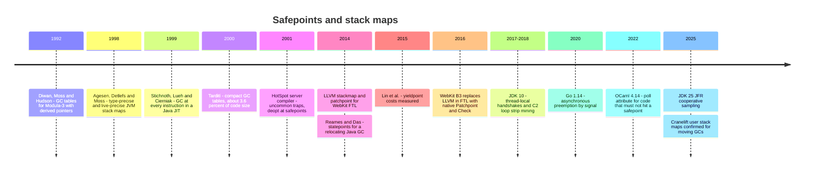
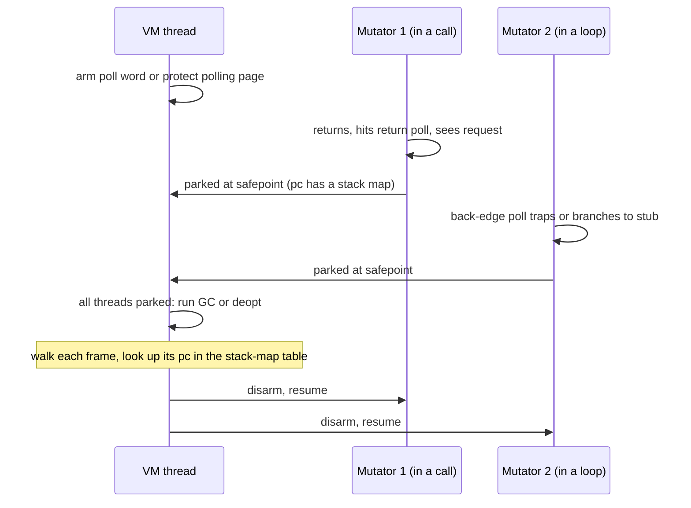
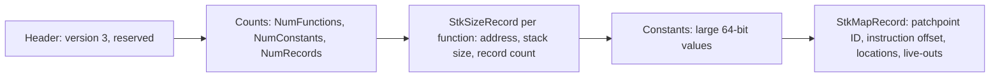
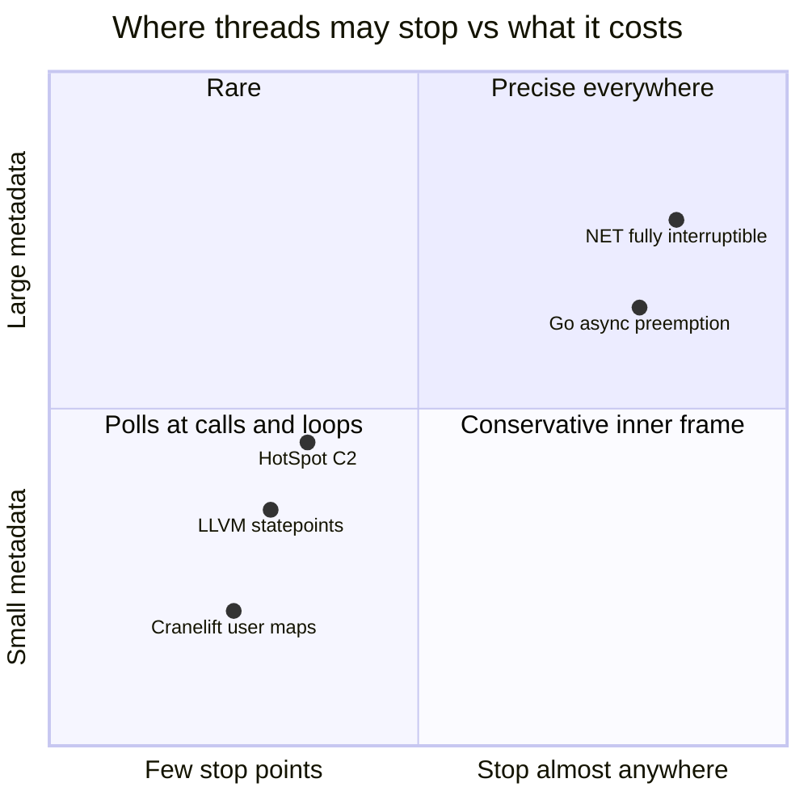

---
tags:
  - compilers
  - runtimes
  - jit
  - garbage-collection
  - safepoints
  - stack-maps
  - deoptimization
  - llvm
  - hotspot
  - go
  - dotnet
  - v8
  - cranelift
status: complete
sources:
  - https://www.llvm.org/docs/StackMaps.html
  - https://www.llvm.org/docs/Statepoints.html
  - https://llvm.org/devmtg/2014-10/Slides/Reames-GarbageCollection.pdf
  - https://openjdk.org/jeps/312
  - https://shipilev.net/jvm/anatomy-quarks/22-safepoint-polls/
  - https://mail.openjdk.org/pipermail/hotspot-compiler-dev/2017-October/027193.html
  - https://bugs.openjdk.org/browse/JDK-8186027
  - https://bugs.openjdk.org/browse/JDK-8322631
  - https://bugs.openjdk.org/browse/JDK-8342605
  - https://cr.openjdk.org/~rkennke/JDK-8211279/webrev.01/src/hotspot/share/compiler/oopMap.cpp.html
  - https://android.googlesource.com/platform/libcore/+/8064294c77a%5E/src/hotspot/share/code/debugInfoRec.hpp
  - https://mail.openjdk.org/pipermail/jdk-dev/2025-May/010057.html
  - https://egahlin.github.io/2025/05/31/whats-new-in-jdk-25.html
  - https://go.googlesource.com/proposal/+/HEAD/design/24543-non-cooperative-preemption.md
  - https://go.dev/doc/go1.14
  - https://mattwarren.org/2016/08/08/GC-Pauses-and-Safe-Points/
  - https://github.com/dotnet/runtime/pull/131708
  - https://chromium.googlesource.com/v8/v8.git/+/main/docs/runtime/stack-walking.md
  - https://webkit.org/blog/5852/
  - https://docs.wasmtime.dev/api/src/cranelift_codegen/ir/user_stack_maps.rs.html
  - https://bytecodealliance.github.io/zulip-archive/stream/217117-cranelift/topic/Support.20for.20moving.20GCs.20via.20user.20stack.20maps.html
  - https://discuss.ocaml.org/t/using-poll-error-attribute-to-implement-systhread-safe-data-structures/12804
  - https://ocaml.org/releases/4.14.0
  - https://www.trustworthy.systems/publications/nicta_full_text/8594.pdf
  - https://bibtex.github.io/PLDI-1992-DiwanMH.html
  - https://people.cs.umass.edu/~moss/papers/pldi-1998-liveness.pdf
  - https://dblp.uni-trier.de/rec/conf/pldi/StichnothLC99.html
  - https://www.cs.purdue.edu/homes/hosking/ismm2000/papers/tarditi.pdf
created: 2026-11-27
updated: 2026-11-28
---

## Table Of Contents

- [[#TL;DR|TL;DR]]
- [[#The Problem|The Problem]]
- [[#Foundations|Foundations]]
    - [[#Safepoints, GC Points and Yieldpoints|Safepoints, GC Points and Yieldpoints]]
    - [[#What a Stack Map Records|What a Stack Map Records]]
    - [[#Derived Pointers|Derived Pointers]]
    - [[#Time to Safepoint|Time to Safepoint]]
- [[#How We Got Here|How We Got Here]]
- [[#How It Works|How It Works]]
    - [[#Stopping the World - The Handshake|Stopping the World - The Handshake]]
    - [[#Polls - What the Compiler Emits|Polls - What the Compiler Emits]]
    - [[#Counted Loops and Strip Mining|Counted Loops and Strip Mining]]
    - [[#Building the Map - Liveness at Each Safepoint|Building the Map - Liveness at Each Safepoint]]
    - [[#LLVM Statepoints and the Stack Map Section|LLVM Statepoints and the Stack Map Section]]
    - [[#One Table, Three Clients - GC, Deopt and Stack Walks|One Table, Three Clients - GC, Deopt and Stack Walks]]
    - [[#Stopping Without Polls - Signals and Hijacking|Stopping Without Polls - Signals and Hijacking]]
- [[#Where It Is Now|Where It Is Now]]
- [[#Trade-offs & Open Problems|Trade-offs & Open Problems]]
- [[#Resources|Resources]]
- [[#Related Notes|Related Notes]]

## ***TL;DR***
---
*A safepoint is a place in compiled code where a thread may be stopped and its frame understood; a stack map is the compiler's record, for that place, of where every live object pointer sits. Together they let a runtime pause threads for [[Garbage Collection]], [[Deoptimization and Speculation|deoptimization]], stack walks and profiling without guessing.*

- **The contract.** Between safepoints the compiler may do anything: keep pointers in registers, form interior pointers, reorder loads. At a safepoint it promises a precise picture: which stack slots and registers hold references, and (for deopt) how to rebuild the source-level frame. A moving collector relies on that picture to find and *update* every pointer.
- **Where safepoints go.** Calls and allocations are safepoints for free. Loops and long straight-line code need explicit *polls*: a cheap check of a flag or a load from a page the runtime can make unreadable. HotSpot polls on loop back-edges and returns; LLVM's `PlaceSafepoints` pass polls at method entry and back-edges ([LLVM Statepoints](https://www.llvm.org/docs/Statepoints.html)).
- **What it costs.** On Java benchmarks yieldpoints run about **100 million times a second** and only about **1 in 20,000** is taken; untaken polls cost **0.3% to 2.5%** depending on the mechanism ([Lin et al., ISMM 2015](https://www.trustworthy.systems/publications/nicta_full_text/8594.pdf)). The tables cost space: 16% of code size in 1992, about 3.6% with sharing by 2000 ([Tarditi](https://www.cs.purdue.edu/homes/hosking/ismm2000/papers/tarditi.pdf)).
- **The latency side.** A stop-the-world pause can't start until the *slowest* thread reaches a safepoint. Counted loops without polls were the classic culprit; HotSpot's *loop strip mining* adds a poll every 1,000 iterations, and Go 1.14 gave up on polls in loops entirely and preempts with signals instead ([Go 1.14](https://go.dev/doc/go1.14)).
- **As of November 2026.** HotSpot uses per-thread polling (JEP 312) with strip mining on for G1, ZGC and Shenandoah but still not for Parallel and Serial ([JDK-8322631](https://bugs.openjdk.org/browse/JDK-8322631), open); JDK 25's JFR samples stacks only at safepoints ([JEP 518](https://mail.openjdk.org/pipermail/jdk-dev/2025-May/010057.html)); LLVM statepoints are still marked experimental; Cranelift's *user stack maps* support moving collectors for Wasmtime's GC; .NET fixed a return-hijacking GC hole in .NET 10 in mid-2026 ([dotnet/runtime #131708](https://github.com/dotnet/runtime/pull/131708)).

## ***The Problem***
---
*A garbage collector or deoptimizer has to read and sometimes rewrite another thread's registers and stack. Only the compiler knows what those bits mean, and what they mean changes from one instruction to the next.*

Picture a moving collector that wants to compact the heap. It must find every reference to every object it moves, including the ones a running method holds in `rax` or in spill slot `[rsp+16]`, and rewrite them. Three things stand in the way:

- **The machine state is untyped.** A 64-bit register might hold a pointer, an integer, a float or half of a 128-bit value. [V8's docs](https://chromium.googlesource.com/v8/v8.git/+/main/docs/runtime/stack-walking.md) put it bluntly: in optimized frames, "local stack slots and CPU registers may hold raw unboxed 32-bit/64-bit integers or floats that look like heap pointers."
- **The layout moves under you.** [[Register Allocation]] puts the same variable in different places at different instructions, and dead variables leave stale pointers behind. A map that is correct at instruction 40 is wrong at instruction 41.
- **Threads are mid-flight.** A thread may be halfway through a write barrier, or holding an interior pointer `base + 8` while `base` itself has gone dead in a register. Stopping it *anywhere* means describing *everywhere*.

The engineering answer is to agree on a small set of program points where the compiler guarantees a description, and to make every thread reach one of them quickly when asked. That splits into two problems: **what to record** (the stack map) and **how to get threads there** (polls, signals, hijacking). The rest of this note is how compilers solve each, and what they pay.

## ***Foundations***
---
*Four ideas carry the topic: the safepoint as a contract point, the stack map as liveness plus location, derived pointers that must be re-derived after a move, and time-to-safepoint as the latency a pause can't hide.*

### Safepoints, GC Points and Yieldpoints

*The same idea goes by several names; what matters is who asks the thread to stop and what the thread promises when it does.*

| Term | Usual meaning | Typical users |
|---|---|---|
| **Safepoint** | A point where the thread's frame is fully described, so the VM may inspect or change it | HotSpot, LLVM, .NET |
| **GC point** | A safepoint as seen by the collector: a stack map exists here | Older literature ([Diwan et al.](https://bibtex.github.io/PLDI-1992-DiwanMH.html), [Tarditi](https://www.cs.purdue.edu/homes/hosking/ismm2000/papers/tarditi.pdf)) |
| **Yieldpoint** | The *check* inserted so a thread notices it should stop (a poll) | Jikes RVM, [Lin et al.](https://www.trustworthy.systems/publications/nicta_full_text/8594.pdf) |
| **Handshake** | A request to one thread (not all) to run an operation at its next safepoint | HotSpot since [JEP 312](https://openjdk.org/jeps/312) |

Two cases are worth keeping apart. At a **call site**, the caller's frame is frozen while the callee runs, so the caller needs a map at the return address no matter what: if the callee triggers a GC, the collector walks *through* this frame. At a **poll**, the thread itself stops. Both need maps; only polls need extra code.

### What a Stack Map Records

*A stack map answers one question for one program counter: which locations hold live references right now?*

For a safepoint $s$, the map is the set of live GC references and where each one lives:

$$
\text{Map}(s) = \{\, (v, \ell) \;:\; v \in \text{LiveOut}(s),\ v \text{ is a reference},\ \ell = \text{loc}(v, s) \,\}
$$

In plain English: take the variables still needed after this point (from [[Dataflow Analysis|liveness analysis]]), keep only the references, and write down the register or stack slot each one occupies at this exact instruction. Real formats add a few things:

| Entry kind | What it says | Example |
|---|---|---|
| Reference in a stack slot | Offset from SP or FP | HotSpot `oop_value`, V8 spill-slot bitmap bit |
| Reference in a register | Which register (often only callee-saved ones survive a call) | LLVM `Register` location |
| Compressed reference | A 32-bit narrow pointer to widen before use | HotSpot `narrowoop_value` |
| Callee-saved register | "The caller's value of r12 was saved in my slot X" | HotSpot `callee_saved_value` |
| Derived pointer | Interior pointer plus the base it came from | HotSpot `derived_oop_value` |

The HotSpot names come from its [`oopMap.cpp`](https://cr.openjdk.org/~rkennke/JDK-8211279/webrev.01/src/hotspot/share/compiler/oopMap.cpp.html). Liveness is not a luxury: Agesen, Detlefs and Moss found that scanning only *live* reference slots cut the time-space product by about 11% on average across their JVM suite, with one stress test dropping to about 21% of the type-precise figure, because a dead slot can pin a large structure across a long call ([PLDI 1998](https://people.cs.umass.edu/~moss/papers/pldi-1998-liveness.pdf)).

### Derived Pointers

*An interior pointer has no object header of its own, so after the object moves it can only be fixed by remembering its offset from the base.*

Optimizers love interior pointers: `&arr[i]` hoisted out of a loop, a field address kept in a register. If `arr` moves by $\Delta$, the derived pointer $d = b + k$ must become $b' + k$. The map therefore records the *pair* (base location, derived location). The collector's job is mechanical:

$$
k = d - b \quad \text{(before moving)}, \qquad d' = b' + k \quad \text{(after moving)}
$$

That is, record how far the interior pointer sits from the start of its object, move the object, then rebuild the interior pointer from the new start. HotSpot does exactly this with its `DerivedPointerTable`: it processes derived pointers *first*, because "otherwise base pointer may be changed before derived pointer offset has been collected", then re-derives each one after GC ([oopMap.cpp](https://cr.openjdk.org/~rkennke/JDK-8211279/webrev.01/src/hotspot/share/compiler/oopMap.cpp.html)). The consequence for the compiler: a base must stay live (and in the map) as long as any pointer derived from it does, even if the program never uses the base again. LLVM states the same rule: base and derived operands "must stay live across the safepoint even if the base is otherwise unused" ([LLVM Statepoints](https://www.llvm.org/docs/Statepoints.html)).

### Time to Safepoint

*A global pause starts only when every thread has stopped, so the pause includes the wait for the slowest one.*

If thread $i$ needs $t_i$ to reach its next safepoint after the request, the extra delay before a stop-the-world operation can begin is

$$
\text{TTSP} = \max_i \, t_i
$$

In words: one thread in a long loop without a poll holds up everyone, including the threads that stopped instantly. This is why poll *placement* matters as much as poll *cost*: the cost is paid on every iteration by every thread, while the latency is set by the worst gap between polls in the whole program. Lin et al. measured 95th-percentile time-to-yield of about 278k cycles for conditional polling on Haswell, and found the worst cases were driven mostly by the OS and the benchmark, not the poll mechanism ([ISMM 2015](https://www.trustworthy.systems/publications/nicta_full_text/8594.pdf)).

## ***How We Got Here***
---
*Precise GC for compiled code started with tables at call sites, grew to "GC anywhere" for multithreaded Java, then shrank again with sharing and compression. JIT engines later reused the same records for deoptimization, and LLVM turned them into a public interface.*



- **Tables at GC points (1992).** Diwan, Moss and Hudson built compiler-generated GC tables for a statically typed language, including the derived-pointer problem; their tables came to about 16% of VAX code size ([PLDI 1992](https://bibtex.github.io/PLDI-1992-DiwanMH.html); size figure as reported by [Tarditi](https://www.cs.purdue.edu/homes/hosking/ismm2000/papers/tarditi.pdf)).
- **Precision in the JVM (1998).** Java bytecode let `javac` reuse one local slot for a reference and an integer at different times, and `jsr`/`ret` made a slot's type path-dependent. Agesen, Detlefs and Moss fixed this by splitting conflicting slots, and measured the payoff of liveness ([PLDI 1998](https://people.cs.umass.edu/~moss/papers/pldi-1998-liveness.pdf)).
- **GC at every instruction (1999).** For multithreaded programs, waiting for every thread to reach a call is slow, so Stichnoth, Lueh and Cierniak made Intel's Java JIT describe almost every instruction, at a cost of about 20% of x86 code size, compressed with Huffman coding ([PLDI 1999](https://dblp.uni-trier.de/rec/conf/pldi/StichnothLC99.html); figures as summarized by [Tarditi](https://www.cs.purdue.edu/homes/hosking/ismm2000/papers/tarditi.pdf)). .NET's "fully interruptible" methods are the same idea still in production.
- **Sharing (2000).** Tarditi observed that live-pointer sets repeat across call sites, grouped identical ones, and got tables to an average of 3.6% of code size on 20 Java programs, 20% to 25% of the space earlier work reported ([Compact GC Tables](https://www.cs.purdue.edu/homes/hosking/ismm2000/papers/tarditi.pdf)).
- **Deopt joins in (2001).** HotSpot's server compiler recorded, at each safepoint, both the GC map and the interpreter-level scopes needed to deoptimize, so one table served GC, stack traces and deopt; see [[Deoptimization and Speculation]].
- **LLVM opens it up (2014).** WebKit's FTL JIT needed LLVM to tell it where values lived at OSR exits and [[Inline Caches and Code Patching|inline caches]], which produced `llvm.experimental.stackmap` and `patchpoint` ([LLVM StackMaps](https://www.llvm.org/docs/StackMaps.html)). The same year Philip Reames and Sanjoy Das (Azul) presented `gc.statepoint` for a fully relocating collector ([LLVM Dev Meeting 2014](https://llvm.org/devmtg/2014-10/Slides/Reames-GarbageCollection.pdf)). In 2016 WebKit replaced LLVM with B3, partly because "the overwhelming majority – often three quarters or more – of the FTL compile time is LLVM" and partly because parsing LLVM's stackmap blobs was awkward; B3 made `Patchpoint` and `Check` first-class ([WebKit, 2016](https://webkit.org/blog/5852/)).
- **Cheaper stops (2017 to 2020).** HotSpot moved from one global polling page to per-thread polling so it could stop threads one at a time ([JEP 312](https://openjdk.org/jeps/312)), and fixed long time-to-safepoint in counted loops with strip mining ([Westrelin, 2017](https://mail.openjdk.org/pipermail/hotspot-compiler-dev/2017-October/027193.html)). Go took the other road and made goroutines preemptible by signal in 1.14 ([Go 1.14](https://go.dev/doc/go1.14)).

## ***How It Works***
---
*The machinery has three parts: a protocol that brings threads to a stop, code the compiler emits so threads notice the request, and metadata the compiler emits so the runtime can read the stopped frames.*

### Stopping the World - The Handshake

*The runtime arms a flag, every thread notices it at its next poll or call, parks itself, and the VM operation runs once all are parked.*



Threads running native code (JNI, system calls) are usually treated as already safe: they can't touch the managed heap without passing a transition check, so the VM doesn't wait for them. A per-thread variant (a *handshake*) does the same dance for one thread, which is how HotSpot can deoptimize or revoke a lock on a single thread without stopping all of them ([JEP 312](https://openjdk.org/jeps/312)).

### Polls - What the Compiler Emits

*A poll must be nearly free when nothing is happening, since it runs on every loop iteration and almost never fires.*

Shipilev's listings show a C2-compiled loop with the old global poll (JDK 8u191) and the per-thread poll (JDK 11.0.1) ([JVM Anatomy Quark #22](https://shipilev.net/jvm/anatomy-quarks/22-safepoint-polls/)):

```asm
; JDK 8u191: global polling page
  movzbl 0x94(%r8),%r10d        ; load "isDone" field
  add    $0x1,%rbp              ; iterations++
  test   %eax,0x1765654c(%rip)  ; global safepoint poll: faults if page protected
  test   %r10d,%r10d            ; if !isDone, loop again
  je     loop

; JDK 11.0.1: thread-local handshake poll
  movzbl 0x94(%r9),%r10d        ; load "isDone" field
  mov    0x108(%r15),%r11       ; load this thread's poll page address (r15 = thread)
  add    $0x1,%rbp              ; iterations++
  test   %eax,(%r11)            ; poll: faults if this thread's page is armed
  test   %r10d,%r10d
  je     loop
```

The `test` has no architectural effect when the page is readable. To arm it, the VM makes the page unreadable (on Linux via `mprotect`), the load faults, and the signal handler recognises the faulting pc as a poll and parks the thread. The per-thread version costs one extra load: Shipilev measured +0.2 ns, +1 load and +0.5 cycles per iteration on an empty benchmark. The four mechanisms in the literature:

| Mechanism | Fast path | Armed by | Untaken overhead (Lin et al., Haswell, thread-local) |
|---|---|---|---|
| Conditional poll | `cmp flag; jne slow` | Store to a flag | 1.9% |
| Load trap | `test reg, [page]` | `mprotect` the page | 1.2% |
| Store trap | Store to a page | `mprotect` the page | 1.5% (36% when global, from contention) |
| Code patching | 6-byte no-op | Patch no-ops into calls | 0.3%, but patching all sites costs 13.4% |
| Signal (no poll) | Nothing | `pthread_kill` + async map | 0 in the code; needs maps almost everywhere |

The first four rows are from [Lin et al.](https://www.trustworthy.systems/publications/nicta_full_text/8594.pdf), who also found that a conditional yieldpoint on every back-edge, prologue and epilogue grew static code by 7.2%, that about 315 sites (roughly 1%) accounted for 99% of executions, and concluded that "conditional polling has the most desirable characteristics". The last row is Go's approach, below.

### Counted Loops and Strip Mining

*A poll per iteration is wasteful in a tight `int` loop, but no poll at all can stall every other thread; strip mining splits the difference.*

C2 historically dropped the poll from *counted* loops (an `int` induction variable with a known bound), on the theory that they finish quickly. A loop over two billion elements does not. Roland Westrelin's loop strip mining ([JDK-8186027](https://bugs.openjdk.org/browse/JDK-8186027), JDK 10) rewrites the loop as a nest: an inner loop with no poll that runs a fixed strip, and an outer loop that polls between strips.

```java
// before: no poll, so TTSP is the whole loop
for (int i = 0; i < n; i++) sum += a[i];

// after strip mining (conceptually), LoopStripMiningIter = 1000
for (int i = 0; i < n; ) {
    int limit = Math.min(n, i + 1000);
    for (; i < limit; i++) sum += a[i];   // inner loop: vectorized, unrolled, no poll
    safepointPoll();                        // outer loop: one poll per 1000 iterations
}
```

The inner loop keeps every [[Loop Optimizations|loop optimization]] (unrolling, [[Vectorization|vectorization]], [[Bounds Check Elimination|range-check elimination]]), and the poll cost is divided by 1,000. Westrelin reported that time-to-safepoint matched always-polling while "most performance regressions due to -XX:+UseCountedLoopSafepoints [are] gone" ([RFR, 2017](https://mail.openjdk.org/pipermail/hotspot-compiler-dev/2017-October/027193.html)). HotSpot enables it with G1, ZGC and Shenandoah but not with Parallel or Serial GC, on the theory that throughput collectors care less about pauses ([JDK-8322631](https://bugs.openjdk.org/browse/JDK-8322631)).

### Building the Map - Liveness at Each Safepoint

*The compiler computes liveness, picks the safepoints, lets the register allocator place values, and only then writes down locations.*

Take a small method and one call site:

```java
static long sumFirst(Node head, long[] buf) {
    Node n = head.next;        // n: reference
    long k = buf.length;       // k: primitive
    log(k);                    // safepoint: call
    return n.value + buf[0];   // n and buf are used after the call
}
```

At the return address of `log`, `LiveOut` is `{n, buf}`; `head` and `k` are dead. If the register allocator spilled `n` to `[rsp+8]` and kept `buf` in callee-saved `rbx`, the record for that pc is:

| pc offset | Location | Kind |
|---|---|---|
| `+0x2c` (after `call log`) | `[rsp+8]` | reference (`n`) |
| | `rbx` | reference (`buf`) |

`head` is not listed, so if `log` triggers a GC and nothing else holds the old head node, it can be freed. Because the collector may *move* `n`'s object and rewrite `[rsp+8]`, the compiler must reload `n` from that slot after the call instead of reusing a copy it stashed elsewhere; a stale copy is a *GC hole*. LLVM makes this explicit in [[SSA Form]] (below). HotSpot instead lets the map name callee-saved registers too (`callee_saved_value`), so the collector can update a pointer wherever the allocator left it. Most pipelines compute maps late, after [[Register Allocation]], and many only keep callee-saved registers in maps at calls, because caller-saved registers are spilled around the call anyway.

### LLVM Statepoints and the Stack Map Section

*LLVM models "the collector may move this pointer during the call" by giving each live pointer a new SSA name after the call, then emits a binary table the runtime parses.*

The [[Garbage Collection]] note shows the basic `gc.statepoint` / `gc.relocate` form. Here is the version with a derived pointer and deopt state, simplified, after `RewriteStatepointsForGC`:

```llvm
; before: %elt = &arr[4] is used after the call
  %elt = getelementptr i64, ptr addrspace(1) %arr, i64 4
  call void @foo()
  store i64 0, ptr addrspace(1) %elt

; after RewriteStatepointsForGC (simplified)
  %tok = call token (i64, i32, ptr, i32, i32, ...)
           @llvm.experimental.gc.statepoint.p0(i64 2882400000, i32 0,
             ptr elementtype(void ()) @foo, i32 0, i32 0, i32 0, i32 0)
           [ "deopt"(i32 7),                                   ; interpreter state for deopt
             "gc-live"(ptr addrspace(1) %arr, ptr addrspace(1) %elt) ]
  %arr.r = call ptr addrspace(1) @llvm.experimental.gc.relocate.p1(token %tok, i32 0, i32 0) ; (base, base)
  %elt.r = call ptr addrspace(1) @llvm.experimental.gc.relocate.p1(token %tok, i32 0, i32 1) ; (base, derived)
  store i64 0, ptr addrspace(1) %elt.r
```

Each `gc.relocate` names a base and a derived index into the `gc-live` list, so the runtime knows to fix `%elt` relative to `%arr` even though the program never reads `%arr` again ([LLVM Statepoints](https://www.llvm.org/docs/Statepoints.html)). GC pointers live in `addrspace(1)` under the built-in `statepoint-example` and `coreclr` strategies, and LLVM keeps them *non-integral* during optimization so passes can't assume a stable integer address. `PlaceSafepoints` adds polls at method entry and back-edges by calling a user-supplied `gc.safepoint_poll` function.

The backend writes a `.llvm_stackmaps` section (ELF) or `__llvm_stackmaps` (Mach-O), currently version 3 ([LLVM StackMaps](https://www.llvm.org/docs/StackMaps.html)):



Each location is one of five kinds: `Register`, `Direct` (an address of a frame slot), `Indirect` (a value spilled to a frame slot), `Constant` or `ConstantIndex`. For a statepoint, the record's locations start with a calling-convention constant, a flags constant and the number of deopt locations, then the deopt values, then **pairs** of (base, derived) for relocation; the live-out section is empty ([LLVM Statepoints](https://www.llvm.org/docs/Statepoints.html)). The runtime looks up a frame's return address in this table, reads the pairs, and updates the slots.

### One Table, Three Clients - GC, Deopt and Stack Walks

*Because a safepoint is where the frame is fully described, the same record serves the collector, the deoptimizer, exception unwinding and profilers.*

HotSpot's `DebugInformationRecorder` describes itself as collecting debug information for "garbage collecting compiled frames", "stack tracing across compiled frames" and "deoptimizating compiled frames" ([debugInfoRec.hpp](https://android.googlesource.com/platform/libcore/+/8064294c77a%5E/src/hotspot/share/code/debugInfoRec.hpp)). For each safepoint pc it stores an oop map plus a chain of *scopes* (one per inlined method) with locals, expression-stack values and held monitors:

| Client | Reads | Why |
|---|---|---|
| Garbage collector | Oop map (references and derived pairs) | Mark and relocate roots |
| Deoptimizer | Scopes: locals, expressions, monitors per inlined frame | Rebuild interpreter frames; see [[Deoptimization and Speculation]] |
| Stack walker / exceptions | Scopes: method and bytecode index | Stack traces, exception dispatch; see [[Stack Unwinding and Exception Tables]] |
| Profiler | pc to scope | Attribute samples to source; JFR in JDK 25 walks stacks only at safepoints ([JEP 518](https://mail.openjdk.org/pipermail/jdk-dev/2025-May/010057.html)) |

LLVM mirrors this split: the `"deopt"` bundle and the `"gc-live"` bundle land in the same stack-map record. V8 does the same with its `SafepointTable` (and `MaglevSafepointTable` for Maglev), which records "a bitmap of which stack spill slots ... and callee-saved registers hold tagged pointers at each call PC" ([V8 stack walking](https://chromium.googlesource.com/v8/v8.git/+/main/docs/runtime/stack-walking.md)). Interpreter and baseline frames need no table at all, because V8 guarantees every bytecode register slot holds a valid tagged value, initialised to `undefined` or a sentinel. That is a recurring design trick: make one tier's frames uniformly typed so only optimized frames need maps.

The deopt connection has a catch: deopt metadata is often *larger* than the GC map, because it must describe primitives and scalar-replaced objects ([[Escape Analysis]]) too. Profilers have a catch of their own: sampling only at safepoints attributes time to the nearest poll rather than the hot instruction (*safepoint bias*, covered in [[Sampling Profilers and Safepoint Bias]]), which is why JEP 518 aims to walk stacks at safepoints "while minimizing safepoint bias".

### Stopping Without Polls - Signals and Hijacking

*Instead of the thread checking in, the runtime can interrupt it from outside, then either describe the exact instruction it stopped at or nudge it forward to a place that is described.*

**Go (signals plus maps nearly everywhere).** Before 1.14 Go switched goroutines only at function calls; a loop spinning on an atomic load could starve the goroutine that would set it. Polls on loop back-edges were prototyped, but a fault-based version cost 7.8% geomean on Go's suite and was rejected ([proposal 24543](https://go.googlesource.com/proposal/+/HEAD/design/24543-non-cooperative-preemption.md)). The chosen design sends a POSIX signal and captures the CPU state, which needs stack *and register* maps at nearly every instruction. Some sequences can't be interrupted safely: an `unsafe.Pointer`-to-`uintptr` conversion, a write barrier between its flag check and its store, and loops that could form past-the-end pointers. The compiler marks these as **unsafe points**; a thread caught in one is resumed and tried again later. Go 1.14 shipped it on all platforms except `windows/arm`, `darwin/arm`, `js/wasm` and `plan9`, with a visible side effect: more `EINTR` from slow system calls ([Go 1.14](https://go.dev/doc/go1.14)).

**.NET (two kinds of methods, plus hijacking).** The JIT marks each method *fully interruptible* (every instruction has GC info, the Stichnoth model, typically for tight loops) or *partially interruptible* (GC info only at calls and explicit polls) ([Warren, 2016](https://mattwarren.org/2016/08/08/GC-Pauses-and-Safe-Points/)). To stop a thread in partially interruptible code, the runtime suspends it and **hijacks** its return address so that when the current method returns, it lands in a stub that parks the thread. This is subtle: in 2026 a .NET 10 regression let a hijacked return value go unreported when the caller was hand-written assembly with no GC info, and the fix simply declines to hijack there, since "hijacking is one of several ways to bring a thread to a safe point" ([dotnet/runtime #131708](https://github.com/dotnet/runtime/pull/131708)).

**OCaml (the opposite need).** OCaml's systhreads switch at safepoints, which are allocations plus polls the compiler adds in loops. Since 4.14, `[@poll error]` lets a programmer demand that a function contain *no* safepoint, which makes its reads and writes atomic with respect to other threads in the same domain ([OCaml 4.14](https://ocaml.org/releases/4.14.0); [discussion](https://discuss.ocaml.org/t/using-poll-error-attribute-to-implement-systhread-safe-data-structures/12804)). It is Go's unsafe points turned into a user-facing guarantee.

## ***Where It Is Now***
---
*As of November 2026: the core designs are settled and stable, and the action is in latency tails, new backends adopting maps (Cranelift for Wasm GC), and bugs where the map and the code disagree.*

| System | Safepoint mechanism | Map format | State, Nov 2026 |
|---|---|---|---|
| **HotSpot (C1/C2)** | Per-thread poll on back-edges and returns; handshakes | Oop maps + scope descriptors per pc | Strip mining on for G1/ZGC/Shenandoah only; [JDK-8322631](https://bugs.openjdk.org/browse/JDK-8322631) to enable for all GCs and [JDK-8342605](https://bugs.openjdk.org/browse/JDK-8342605) to move the poll-address load into the poll are both open |
| **Go** | Calls + async preemption by signal (since 1.14) | Stack and register maps, unsafe points | Default on all major platforms |
| **.NET (RyuJIT)** | Fully vs partially interruptible methods; return hijacking | GC info per method | Hijack GC-hole fix landed in `main` June 2026 and was backported to 10.0 ([#131708](https://github.com/dotnet/runtime/pull/131708)) |
| **V8 (TurboFan, Maglev)** | Calls and stack/interrupt checks | `SafepointTable` / `MaglevSafepointTable` bitmaps | Interpreter frames fully tagged; C++ frames handled by a conservative visitor in the current design doc ([V8](https://chromium.googlesource.com/v8/v8.git/+/main/docs/runtime/stack-walking.md)) |
| **LLVM** | `gc.statepoint` + `PlaceSafepoints` | `.llvm_stackmaps` v3 | Still "experimental", x86-64 and AArch64 only, no compatibility guarantee across versions ([LLVM](https://www.llvm.org/docs/Statepoints.html)) |
| **Cranelift / Wasmtime** | Non-tail calls are safepoints | *User stack maps*: frontend spills GC values to stack slots | Supports moving GCs; docs corrected Sept 2025 ([Zulip](https://bytecodealliance.github.io/zulip-archive/stream/217117-cranelift/topic/Support.20for.20moving.20GCs.20via.20user.20stack.20maps.html)) |
| **OCaml 5** | Allocations + loop polls | Frame tables | `[@poll error]` since 4.14 |

Highlights worth knowing:

- **HotSpot profiling moved onto safepoints.** JEP 518 (JDK 25) improves JFR stability by "walking call stacks only at safepoints, while minimizing safepoint bias" ([jdk-dev, May 2025](https://mail.openjdk.org/pipermail/jdk-dev/2025-May/010057.html)); Erik Gahlin's summary: "Stack walking now happens from a safepoint, but without the safepoint bias that JVM TI-based profilers suffer from" ([Gahlin, 2025](https://egahlin.github.io/2025/05/31/whats-new-in-jdk-25.html)). Async stack walking from a signal handler had been a long-running source of crashes, because the sampled pc may not have a map.
- **Cranelift chose simplicity over register maps.** Its user stack maps make the frontend (Wasmtime) declare which values need maps; "Cranelift will not insert spills and record these stack map entries automatically" ([user_stack_maps.rs](https://docs.wasmtime.dev/api/src/cranelift_codegen/ir/user_stack_maps.rs.html)). Since PR #8978 every GC value lives in a stack slot, spilled at its definition and reloaded after each safepoint, which is what makes moving collectors work; maps hold only stack slots, never registers. This backs [[WebAssembly]] GC in Wasmtime.
- **LLVM statepoints remain niche but alive.** The docs still say they've been used "in a commercial Java implementation with a fully relocating collector", still warn that relocations along exceptional paths are "currently broken in ToT", and that the IR verifier does not yet check the relocation invariant ([LLVM Statepoints](https://www.llvm.org/docs/Statepoints.html)).

## ***Trade-offs & Open Problems***
---
*Every design trades code speed, metadata size and pause latency against each other; the remaining hard problems are worst-case latency and proving the maps match the code.*



*(Positions are qualitative, drawn from the sources above, not measured.)*

| Choice | Buys | Costs |
|---|---|---|
| Safepoints only at calls and polls | Small tables (about 3.6% of code with sharing) | Poll overhead (0.3% to 2.5%), long TTSP if a loop lacks a poll |
| Maps at nearly every instruction (.NET fully interruptible, Go) | Stop a thread instantly by signal, no polls in loops | Tables about 20% of code without heavy compression; unsafe-point bookkeeping |
| Drop polls from counted loops | Fastest inner loops | Unbounded TTSP; strip mining recovers most of both |
| All GC values in stack slots (Cranelift) | Simple, obviously correct, moving GC works | Extra spills and reloads around every call |
| Conservative scanning of some frames | No maps needed for those frames | Pinned objects; see [[Garbage Collection]] |
| Share deopt and GC metadata | One table, one lookup | Deopt state dominates size |

**Open problems.**

- **Latency tails.** Polls bound the *gap*, not the time: page faults, the OS scheduler and threads stuck in VM-internal code still produce long time-to-safepoint outliers, and Lin et al. found worst-case latency "not well correlated" with the poll mechanism ([ISMM 2015](https://www.trustworthy.systems/publications/nicta_full_text/8594.pdf)). Per-thread handshakes reduce how often everyone must stop, but a full GC pause still waits for the slowest thread.
- **GC holes.** A stale pointer kept across a safepoint, a missing derived pair, or an unmapped return address is a memory-safety bug that shows up only when a GC happens at the wrong moment. The .NET 10 hijack bug ([#131708](https://github.com/dotnet/runtime/pull/131708)) and LLVM's unverified relocation invariant are current examples; stress modes that force GC at every safepoint are the main defence, and formal checking is rare. See [[Compiler Testing and Fuzzing]] and [[Translation Validation]].
- **Unsafe points and atomic regions.** Go needs the compiler to mark sequences that must not be interrupted, and OCaml exposes the same need as `[@poll error]`. Getting these regions right as optimizations reorder code is an ongoing source of subtle bugs.
- **Metadata size and AOT caches.** Maps plus deopt scopes are a sizable fraction of compiled code, which matters for code caches, mobile devices and ahead-of-time caches that want to store optimized code ([[Code Cache Management]]).
- **Where polls should go.** Lin et al. found 1% of yieldpoints account for 99% of executions, which suggests profile-guided poll placement or patching only hot sites, but they had not shown code patching paying off in practice ([ISMM 2015](https://www.trustworthy.systems/publications/nicta_full_text/8594.pdf)).
- **Green threads and stack switching.** Runtimes with many small stacks ([[Green Threads and Virtual Threads]]) and Wasm stack switching need maps that work for stacks that are not currently running, and fast ways to scan only the stacks that changed.

## ***Resources***
---
*Start with Shipilev for what a poll looks like, the LLVM Statepoints page for a clean model of relocation, and the Go preemption proposal for the signal-based alternative. Then read the 1990s papers for why the tables look the way they do.*

**Foundational papers**
- [Compiler Support for Garbage Collection in a Statically Typed Language](https://bibtex.github.io/PLDI-1992-DiwanMH.html): Diwan, Moss and Hudson, PLDI 1992. GC tables and derived pointers.
- [Garbage Collection and Local Variable Type-Precision and Liveness in Java Virtual Machines](https://people.cs.umass.edu/~moss/papers/pldi-1998-liveness.pdf): Agesen, Detlefs and Moss, PLDI 1998.
- [Support for Garbage Collection at Every Instruction in a Java Compiler](https://dblp.uni-trier.de/rec/conf/pldi/StichnothLC99.html): Stichnoth, Lueh and Cierniak, PLDI 1999.
- [Compact Garbage Collection Tables](https://www.cs.purdue.edu/homes/hosking/ismm2000/papers/tarditi.pdf): David Tarditi, ISMM 2000.
- [Stop and Go: Understanding Yieldpoint Behavior](https://www.trustworthy.systems/publications/nicta_full_text/8594.pdf): Lin, Blackburn and colleagues (ANU), ISMM 2015.

**LLVM and WebKit**
- [Stack maps and patch points in LLVM](https://www.llvm.org/docs/StackMaps.html) and [Garbage Collection Safepoints in LLVM](https://www.llvm.org/docs/Statepoints.html): LLVM docs.
- [Statepoint slides](https://llvm.org/devmtg/2014-10/Slides/Reames-GarbageCollection.pdf): Reames and Das, LLVM Dev Meeting 2014.
- [Introducing the B3 JIT Compiler](https://webkit.org/blog/5852/): Filip Pizlo, WebKit, 2016. Patchpoints and `Check` as first-class IR.

**HotSpot**
- [JVM Anatomy Quark #22: Safepoint Polls](https://shipilev.net/jvm/anatomy-quarks/22-safepoint-polls/): Aleksey Shipilev.
- [JEP 312: Thread-Local Handshakes](https://openjdk.org/jeps/312) and [JEP 518 announcement](https://mail.openjdk.org/pipermail/jdk-dev/2025-May/010057.html).
- [C2 loop strip mining review](https://mail.openjdk.org/pipermail/hotspot-compiler-dev/2017-October/027193.html) (Westrelin, 2017), [JDK-8186027](https://bugs.openjdk.org/browse/JDK-8186027), [JDK-8322631](https://bugs.openjdk.org/browse/JDK-8322631), [JDK-8342605](https://bugs.openjdk.org/browse/JDK-8342605).
- Source: [oopMap.cpp](https://cr.openjdk.org/~rkennke/JDK-8211279/webrev.01/src/hotspot/share/compiler/oopMap.cpp.html), [debugInfoRec.hpp](https://android.googlesource.com/platform/libcore/+/8064294c77a%5E/src/hotspot/share/code/debugInfoRec.hpp).

**Go, .NET, V8, Cranelift, OCaml**
- [Proposal: Non-cooperative goroutine preemption](https://go.googlesource.com/proposal/+/HEAD/design/24543-non-cooperative-preemption.md): Austin Clements; [Go 1.14 release notes](https://go.dev/doc/go1.14).
- [GC Pauses and Safe Points](https://mattwarren.org/2016/08/08/GC-Pauses-and-Safe-Points/): Matt Warren, 2016; [dotnet/runtime #131708](https://github.com/dotnet/runtime/pull/131708) for a current hijacking bug.
- [Stack Walking in V8](https://chromium.googlesource.com/v8/v8.git/+/main/docs/runtime/stack-walking.md): V8 runtime docs.
- [Cranelift user stack maps](https://docs.wasmtime.dev/api/src/cranelift_codegen/ir/user_stack_maps.rs.html) and the [moving-GC discussion](https://bytecodealliance.github.io/zulip-archive/stream/217117-cranelift/topic/Support.20for.20moving.20GCs.20via.20user.20stack.20maps.html), Sept 2025.
- [OCaml 4.14 changes](https://ocaml.org/releases/4.14.0) and the [`[@poll error]` discussion](https://discuss.ocaml.org/t/using-poll-error-attribute-to-implement-systhread-safe-data-structures/12804).

## Related Notes

- [[Garbage Collection]] — The main client: roots, moving collectors, precise vs conservative scanning.
- [[Deoptimization and Speculation]] — Frame states recorded at the same safepoints as GC maps.
- [[JIT Compilation]] — Tiers that each need maps (or uniformly tagged frames).
- [[On-Stack Replacement]] — Entering and leaving optimized code at loop headers, using the same frame descriptions.
- [[Register Allocation]] — Decides where each live reference sits at each safepoint.
- [[Dataflow Analysis]] — Liveness decides which references a map lists.
- [[SSA Form]] — Why statepoints give relocated pointers new names.
- [[LLVM]] — `stackmap`, `patchpoint`, `gc.statepoint` and the stack-map section.
- [[Sea of Nodes]] — How C2 and Graal carry safepoints and frame states through the graph.
- [[Loop Optimizations]] — Strip mining and why counted loops lose their polls.
- [[Vectorization]] — Inner strip-mined loops stay vectorizable.
- [[Bounds Check Elimination]] — Another optimization that needs poll-free inner loops.
- [[Escape Analysis]] — Scalar-replaced objects that deopt metadata must describe.
- [[Reference Counting and Reuse]] — Deferred RC scans stack roots the same way tracing does.
- [[WebAssembly]] — Wasm GC in Wasmtime relies on Cranelift's user stack maps.
- [[Effect Handlers and Delimited Continuations]] — Captured stacks still need scanning.
- [[Green Threads and Virtual Threads]] — Planned: many suspended stacks, preemption without OS threads.
- [[Stack Unwinding and Exception Tables]] — Planned: the other per-pc table compilers emit.
- [[Calling Conventions and ABIs]] — Planned: callee-saved registers decide which references survive a call in registers.
- [[Code Cache Management]] — Planned: maps and scopes are part of every compiled method's footprint.
- [[Compiler Testing and Fuzzing]] — GC stress modes that catch GC holes.
- [[Translation Validation]] — Checking that maps match the code they describe.
- [[Sampling Profilers and Safepoint Bias]] — Why profilers that sample only at polls blame the wrong code, and how JFR's cooperative sampling corrects it.
- [[Inline Caches and Code Patching]] — What runtimes write into `patchpoint` regions, and how patches are made visible to running threads.
