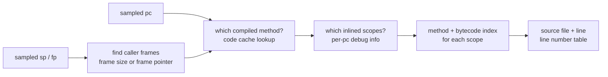
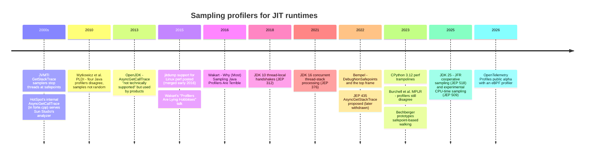
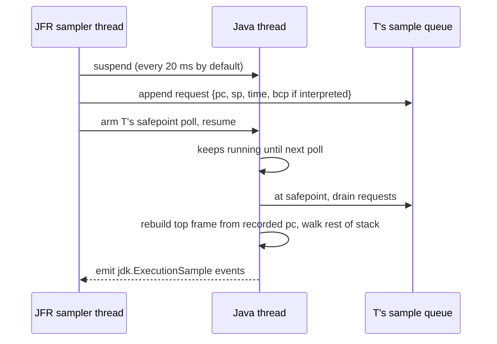
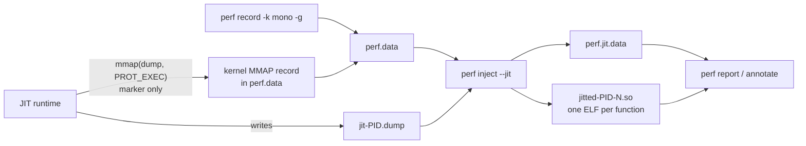

---
tags:
  - compilers
  - runtimes
  - jit
  - profiling
  - sampling
  - safepoints
  - hotspot
  - jfr
  - async-profiler
  - linux-perf
  - jitdump
  - v8
  - cpython
  - dotnet
  - wasmtime
status: complete
sources:
  - https://plv.colorado.edu/papers/profilers-pldi10.html
  - https://dx.doi.org/10.1145/1806596.1806618
  - https://stefan-marr.de/downloads/mplr23-burchell-et-al-dont-trust-your-profiler.pdf
  - https://psy-lob-saw.blogspot.com/2016/02
  - https://qconsf.com/sf2015/system/files/presentation-slides/profilers_are_lying_hobbitses.pdf
  - https://mail.openjdk.org/pipermail/serviceability-dev/2013-August/011084.html
  - https://jpbempel.github.io/2022/06/22/debug-non-safepoints.html
  - https://github.com/async-profiler/async-profiler/blob/v2.10/README.md
  - https://openjdk.org/jeps/8350338
  - https://mail.openjdk.org/pipermail/jdk-dev/2025-May/010057.html
  - https://ionutbalosin.com/2026/04/jfr-cooperative-sampling-safe-and-precise-thread-stack-profiling/
  - https://openjdk.org/jeps/509
  - https://www.datadoghq.com/blog/engineering/jfr-cpu-time-profiling/
  - https://egahlin.github.io/2026/05/26/whats-new-in-jdk-26-27.html
  - https://openjdk.org/jeps/435
  - https://foojay.io/today/taming-the-bias-unbiased-safepoint-based-stack-walking/
  - https://blogs.sap.com/2023/04/21/couldnt-we-just-use-asyncgetcalltrace-in-a-separate-thread/
  - https://www.ej-technologies.com/blog/2024/02/why-jvmti-sampling-is-better-than-async-sampling-on-modern-jvms/
  - https://stuff.mit.edu/afs/sipb/contrib/linux/tools/perf/Documentation/jit-interface.txt
  - https://tomoyo.sourceforge.net/cgi-bin/lxr/source/tools/perf/Documentation/jitdump-specification.txt
  - https://lore.kernel.org/all/20160122204405.GB2470@redhat.com/T/
  - https://docs.wasmtime.dev/api/src/wasmtime_jit_debug/perf_jitdump.rs.html
  - https://docs.wasmtime.dev/examples-profiling-perf.html
  - https://v8.dev/docs/linux-perf
  - https://nodejs.org/learn/diagnostics/poor-performance/using-linux-perf
  - https://docs.python.org/3.13/howto/perf_profiling.html
  - https://learn.microsoft.com/en-us/dotnet/core/runtime-config/debugging-profiling
  - https://www.elastic.co/observability-labs/blog/continuous-profiling-opentelemetry
  - https://opentelemetry.io/blog/2026/profiles-alpha
created: 2026-11-28
updated: 2026-11-28
---

## Table Of Contents

- [[#TL;DR|TL;DR]]
- [[#The Problem|The Problem]]
- [[#Foundations|Foundations]]
    - [[#Sampling as Statistics|Sampling as Statistics]]
    - [[#From a Program Counter to a Source Line|From a Program Counter to a Source Line]]
    - [[#Safepoint Bias|Safepoint Bias]]
    - [[#The Other Biases - Skid, Missed Threads and the Observer Effect|The Other Biases - Skid, Missed Threads and the Observer Effect]]
- [[#How We Got Here|How We Got Here]]
- [[#How It Works|How It Works]]
    - [[#Safepoint Sampling Through JVMTI|Safepoint Sampling Through JVMTI]]
    - [[#AsyncGetCallTrace - Walking From a Signal Handler|AsyncGetCallTrace - Walking From a Signal Handler]]
    - [[#async-profiler - Merging Kernel and JVM Stacks|async-profiler - Merging Kernel and JVM Stacks]]
    - [[#The Top Frame - DebugNonSafepoints|The Top Frame - DebugNonSafepoints]]
    - [[#JFR Cooperative Sampling - Record Now, Walk Later|JFR Cooperative Sampling - Record Now, Walk Later]]
    - [[#JFR CPU-Time Sampling|JFR CPU-Time Sampling]]
    - [[#Naming JIT Code for System Profilers - Perf Maps|Naming JIT Code for System Profilers - Perf Maps]]
    - [[#jitdump and perf inject|jitdump and perf inject]]
    - [[#Interpreters in a Native Profile - Trampolines|Interpreters in a Native Profile - Trampolines]]
- [[#Where It Is Now|Where It Is Now]]
- [[#Trade-offs & Open Problems|Trade-offs & Open Problems]]
- [[#Resources|Resources]]
- [[#Related Notes|Related Notes]]

## ***TL;DR***
---
*A sampling profiler is only as honest as the moments it chooses to look. In a JIT runtime the cheap, safe moments are [[Safepoints and Stack Maps|safepoints]], and code is rarely hot exactly there, so naive profilers blame the wrong code. The fixes are either to look at any instruction (and then work hard to decode the frame) or to note the instruction now and decode the frame later.*

- **The bias.** A profiler that asks the JVM for stack traces gets them only once each thread reaches a safepoint poll: a loop back-edge, a method return, a call. Samples pile up on those polls instead of on the code that burned the time. Mytkowicz et al. showed four Java profilers "often disagree on the identity of the hot methods" and traced it to samples that are not taken at random ([PLDI 2010](https://plv.colorado.edu/papers/profilers-pldi10.html)).
- **Async sampling.** async-profiler and Honest Profiler sample from a timer signal at *any* instruction, then call HotSpot's internal `AsyncGetCallTrace` to decode the interrupted Java stack; JFR's pre-JDK 25 sampler did the same with its own code. That removes most of the bias, but the stack walk happens while the thread is in an arbitrary state, so it needs heuristics, can fail, and can crash the VM ([JEP 518 draft](https://openjdk.org/jeps/8350338)).
- **The top frame still lies a little.** The JIT keeps precise pc-to-line metadata mainly at safepoints. Without `-XX:+DebugNonSafepoints`, a sample in the middle of a long method is credited to the nearest recorded spot, often the first line ([Bempel, 2022](https://jpbempel.github.io/2022/06/22/debug-non-safepoints.html)).
- **JDK 25's answer.** JFR *cooperative sampling* (JEP 518) records only the pc and sp in the signal path, then lets the thread walk its own stack at its next safepoint, using the recorded pc to rebuild the true top frame. JEP 509 adds experimental CPU-time sampling on Linux built on the same mechanism ([JEP 509](https://openjdk.org/jeps/509)).
- **System profilers need names.** `perf` sees JIT code as anonymous memory. Runtimes publish `/tmp/perf-<pid>.map` (address, size, name) or a richer `jit-<pid>.dump` that `perf inject --jit` turns into one ELF file per function, enabling annotation. V8, CPython 3.12+, .NET and Wasmtime all speak these formats.
- **As of November 2026.** JEP 518 is on by default in JDK 25; JEP 509 is still experimental (no change listed in [Gahlin's JDK 26–27 summary](https://egahlin.github.io/2026/05/26/whats-new-in-jdk-26-27.html), May 2026); the AsyncGetStackTrace API (JEP 435) was withdrawn; OpenTelemetry Profiles reached public alpha in March 2026 with an eBPF profiler that reads runtime internals itself ([OTel blog](https://opentelemetry.io/blog/2026/profiles-alpha)).

## ***The Problem***
---
*A profiler answers "where does the time go?" by interrupting the program and asking "where are you?" In a JIT runtime both halves are hard: it is unsafe to ask at most instructions, and the answer ("pc 0x7f3a...") means nothing until the runtime translates it.*

Take a Java method that spends nearly all its time in one tight loop:

```java
static long work(int[] a) {
    long sum = 0;
    for (int i = 0; i < a.length; i++) {   // counted int loop
        sum += a[i] * 31 + (a[i] >>> 3);    // the real cost is here
    }
    return finish(sum);                       // cheap call
}
```

C2 compiles the loop with no safepoint poll inside it (an `int`-indexed counted loop; see [[Loop Optimizations]] and the strip-mining discussion in [[Safepoints and Stack Maps]]). The next places this thread can stop for the VM are the call to `finish` and the method return. A profiler that only looks at safepoints will report `finish` or the `return` as hot, and the loop body as cold. Wakart's "mind the gap" example is exactly this: time spent in a loop before a call to `setResult` was blamed on `setResult`, because "the hot code can be anywhere between the indicated safepoint poll and the previous one" ([Wakart, 2016](https://psy-lob-saw.blogspot.com/2016/02)).

So a profiler for a JIT runtime has to solve three separate problems:

1. **When to look.** Pick sample moments that are not correlated with the program's structure.
2. **How to walk.** Turn raw registers and stack memory into a list of Java (or JS, Python, Wasm) frames, including frames that the JIT inlined away.
3. **How to name.** Map each machine pc in JIT code back to a method, bytecode index and line, either inside the VM or by publishing names to an external profiler such as Linux `perf`.

Each technique in this note trades safety, overhead and accuracy among those three.

## ***Foundations***
---
*Four ideas carry the topic: sampling as a statistical estimate, the chain from pc to source line, safepoint bias as non-random sampling, and the smaller biases that remain even when sampling is fair.*

### Sampling as Statistics

*A sampling profiler estimates the share of time each piece of code takes. The estimate is only unbiased if every instant is equally likely to be sampled.*

If $n$ samples are taken and $k$ land in method $m$, the profiler reports $\hat{f}_m = k/n$ as $m$'s share of time. When samples are taken at random instants, $k$ is binomial and

$$
\hat{f}_m = \frac{k}{n}, \qquad \mathrm{SE}(\hat{f}_m) \approx \sqrt{\frac{\hat{f}_m\,(1-\hat{f}_m)}{n}}
$$

In plain English: with 10,000 samples, a method that really takes 10% of the time will be reported as 10% give or take about 0.3 points. More samples shrink this *random* error. They do nothing about *systematic* error: if the sampler can only see certain instructions, a million samples will confidently report the wrong answer. That is the point of Mytkowicz et al.'s requirement that "to be correct, a sampling-based profiler must collect samples randomly" ([PLDI 2010](https://research.ibm.com/publications/evaluating-the-accuracy-of-java-profilers)).

Two more choices change what $\hat{f}$ means:

| Clock | What a sample measures | Example |
|---|---|---|
| CPU time (on-CPU) | Where running threads burn cycles | `perf` cycles, async-profiler `cpu`, JFR `jdk.CPUTimeSample` |
| Wall-clock | Where threads are, running or not | async-profiler `wall`, JVMTI-based samplers that include waiting threads |
| Allocation / lock events | Where bytes are allocated or locks contended | async-profiler `alloc`, `lock` ([README](https://github.com/async-profiler/async-profiler/blob/v2.10/README.md)) |

### From a Program Counter to a Source Line

*A sample is just a pc and a stack pointer. Turning it into "line 4 of `work`, inlined into `run`" needs the same per-pc metadata the JIT keeps for deoptimization and GC.*

For JIT code the chain is:



The middle step is the subtle one. HotSpot records *scope descriptors* (method, bytecode index, inlining chain) at every safepoint, because [[Deoptimization and Speculation|deoptimization]] and stack walks need them there. Between safepoints, by default, it records little. A profiler that samples between safepoints therefore has a precise pc but has to *guess* the scope from the nearest recorded one ([Bempel, 2022](https://jpbempel.github.io/2022/06/22/debug-non-safepoints.html)).

Inlining matters doubly. One machine frame may stand for five source-level frames, and a profiler that ignores inlining metadata will credit the whole frame to the outermost method. Burchell et al. suspect exactly this for why `perf` and JProfiler disagree with other profilers on one benchmark ([MPLR 2023](https://stefan-marr.de/downloads/mplr23-burchell-et-al-dont-trust-your-profiler.pdf)).

### Safepoint Bias

*A safepoint-biased profiler samples the next poll a thread reaches, not the instruction it was running. The error is the gap between the two.*

Where HotSpot code can stop, per Wakart's 2015 talk ([slides](https://qconsf.com/sf2015/system/files/presentation-slides/profilers_are_lying_hobbitses.pdf)):

| Code | Polls |
|---|---|
| Interpreter | Between bytecodes |
| C1 / C2 compiled code | Method exits, back-edges of loops that are not counted, calls |
| Native (JNI) | On return to Java |

Formally, if the thread is at instruction $x$ when the sampler fires, a safepoint sampler records $\text{next\_poll}(x)$ instead of $x$. Every instruction in the span between two polls is credited to the poll that ends it:

$$
\Pr[\text{sample credited to poll } p] = \sum_{x \in \text{span}(p)} \Pr[\text{thread at } x]
$$

In plain English: the profile is a histogram of polls, each weighted by the total time of the code *leading up to* it. Long poll-free spans (counted loops, long straight-line methods, heavily inlined code) make the error large, and the time shows up on whatever happens after them. Wakart's three examples: an inlined method whose time was blamed about 99% on the caller's loop line, a loop blamed on the call after it, and a cheap method nine frames deep blamed for a loop at the top of the stack ([2016](https://psy-lob-saw.blogspot.com/2016/02)).

### The Other Biases - Skid, Missed Threads and the Observer Effect

*Removing safepoint bias does not make a profile exact. Hardware, scheduling and the profiler's own presence each tilt the numbers.*

- **Skid.** Out-of-order CPUs and interrupt latency mean the pc recorded for a hardware sample is often a few instructions *after* the expensive one. Wakart's verdict: "This is as good as it gets," so read pc-to-line attribution as approximate and check nearby code ([QCon SF 2015](https://qconsf.com/sf2015/system/files/presentation-slides/profilers_are_lying_hobbitses.pdf)). See [[Microarchitectural Performance Models]] for why the "expensive instruction" is itself fuzzy on an out-of-order core.
- **Missed threads and failed samples.** Signal-based samplers may skip rarely scheduled threads, and samples that `AsyncGetCallTrace` cannot decode end up in an "unknown" bucket that does not count toward the total, which skews the percentages ([ej-technologies, 2024](https://www.ej-technologies.com/blog/2024/02/why-jvmti-sampling-is-better-than-async-sampling-on-modern-jvms/)). JFR's old execution sampler looked at only a rotating subset of threads per interval ([JEP 509](https://openjdk.org/jeps/509)).
- **Observer effect.** An attached profiler changes timing, and in a JIT that can change which methods get compiled or inlined. Burchell et al. offer this as the likely cause of bimodal results and of runs that got *faster* with a profiler attached ([MPLR 2023](https://stefan-marr.de/downloads/mplr23-burchell-et-al-dont-trust-your-profiler.pdf)).

The upshot from the most recent large comparison: six maintained Java profilers (async-profiler, Honest Profiler, JFR, JProfiler, perf, YourKit) were each fairly consistent run to run, but they "cannot reliably agree on the set of top 5 hottest methods," and JFR named 8 different hottest methods across runs of DeltaBlue ([Burchell et al., MPLR 2023](https://stefan-marr.de/2023/09/dont-blindly-trust-your-profiler/)).

## ***How We Got Here***
---
*The story runs from profilers that stopped the world to look, through a decade of signal-handler hacks around an unsupported HotSpot function, to a VM-supported design in JDK 25 that splits "when" from "how".*



Key turns, in order:

- **Safepoint samplers.** Generic commercial profilers used JVMTI, which "offers only safepoint sampling stack trace collection options." A timer thread called `GetAllStackTraces`, which forced a global safepoint each time: costly (a 5 ms pause every 100 ms is about 5% overhead) and biased ([Wakart, 2016](https://psy-lob-saw.blogspot.com/2016/02)).
- **The unsupported escape hatch.** HotSpot had long carried `AsyncGetCallTrace` in `forte.cpp`, named for Sun's Forte (later Sun/Oracle Studio) tools. Jeremy Manson's lightweight-java-profiler popularized calling it from a `SIGPROF` handler. In 2013 Oracle's Alan Bateman described it as "not technically supported" but "known to be used by some products" ([serviceability-dev](https://mail.openjdk.org/pipermail/serviceability-dev/2013-August/011084.html)). Honest Profiler and async-profiler followed the same model. JFR's original sampler used its own code, independent of `AsyncGetCallTrace` ([Burchell et al.](https://stefan-marr.de/downloads/mplr23-burchell-et-al-dont-trust-your-profiler.pdf)), but the same idea: stop the thread wherever it is and parse its stack with heuristics.
- **Naming JIT code for perf.** Linux `perf` gained a simple text map file for JIT symbols, then in 2015–16 Stephane Eranian's *jitdump* format, which carries the code bytes too and supports "annotate mode" and "rejitted code" ([cover letter](https://lore.kernel.org/all/20160122204405.GB2470@redhat.com/T/)).
- **Cheaper safepoints.** JEP 312 (JDK 10) let the VM stop *one* thread with a handshake instead of all of them, and JEP 376 (JDK 16) let stacks be processed lazily. By 2024 ej-technologies argued that JVMTI sampling built on these had overhead comparable to async sampling and only a "local" safepoint bias "irrelevant for the vast majority of applications" ([2024](https://www.ej-technologies.com/blog/2024/02/why-jvmti-sampling-is-better-than-async-sampling-on-modern-jvms/)). That is a vendor's claim, and the bias examples above show it is not irrelevant for tight loops.
- **Trying to make AGCT official.** JEP 435 proposed `AsyncGetStackTrace`, a documented successor that could also report inlined frames, compilation tiers and native frames ([JEP 435](https://openjdk.org/jeps/435)). Review raised safety, virtual threads, and concurrent stack scanning; Bechberger's answer was to walk only the top frame in the handler and the rest at a safepoint ([foojay, 2023](https://foojay.io/today/taming-the-bias-unbiased-safepoint-based-stack-walking/)). JEP 435 was withdrawn; the *idea* landed in JFR as JEP 518.

## ***How It Works***
---
*Every technique below answers the same three questions differently: when to sample, who walks the stack and when, and where the names come from.*

### Safepoint Sampling Through JVMTI

*The VM-sanctioned way: ask for stack traces, and the VM brings threads to a safepoint to produce them. Safe and complete, but biased toward poll sites.*

1. A timer thread wakes every interval.
2. It calls JVMTI `GetAllStackTraces` (or `GetStackTrace` per thread).
3. The VM requests a safepoint (globally in older JVMs, per thread via handshake in newer ones) and each thread stops at its next poll.
4. Stacks are walked with full, precise metadata; the profiler resumes everyone.

**Strength.** Can report thread *states* (waiting, blocked, I/O), which signal samplers cannot ([ej-technologies](https://www.ej-technologies.com/blog/2024/02/why-jvmti-sampling-is-better-than-async-sampling-on-modern-jvms/)). Blocked-thread stacks are accurate, because a blocked thread is already at a safe place ([Wakart](https://psy-lob-saw.blogspot.com/2016/02)).
**Weakness.** Running-thread samples land on polls, as in [[#Safepoint Bias|Safepoint Bias]].

### AsyncGetCallTrace - Walking From a Signal Handler

*Interrupt the thread wherever it is, then decode its stack from inside the signal handler. Unbiased in time, but the decoding runs in the most dangerous possible context.*

```c
// The shape of an AGCT profiler (simplified)
void on_sigprof(int sig, siginfo_t* info, void* ucontext) {
    ASGCT_CallTrace trace;
    trace.env    = jni_env_of_current_thread();
    trace.frames = frame_buffer;              // preallocated, no malloc here
    AsyncGetCallTrace(&trace, MAX_DEPTH, ucontext);
    if (trace.num_frames > 0) record(trace);  // (method id, bci) per frame
    else          record_failure(trace.num_frames);
}
```

- The `ucontext` carries the interrupted pc, sp and registers. HotSpot finds the compiled method or interpreter frame for that pc and walks outward, emitting a method and bytecode index per Java frame ([JEP 435](https://openjdk.org/jeps/435)).
- The thread may be in a prologue, mid-way through a stub, or with a half-built frame. The walker uses heuristics to cope, and the JEP 518 authors are blunt: "when their results are incorrect then they can crash the JVM," and crash protection "can fail in the presence of concurrent activity such as class unloading" ([JEP 518 draft](https://openjdk.org/jeps/8350338)).
- Only async-signal-safe work is allowed: no allocation, no locks. Bechberger notes even the JNIEnv lookup relies on an implementation detail that is unsafe in a handler ([SAP blog, 2023](https://blogs.sap.com/2023/04/21/couldnt-we-just-use-asyncgetcalltrace-in-a-separate-thread/)).
- It is Java-only, not exported in any header, cannot run from another thread, and depends on POSIX `SIGPROF`, which has no Windows equivalent ([JEP 435](https://openjdk.org/jeps/435), [JEP 518 draft](https://openjdk.org/jeps/8350338)).

### async-profiler - Merging Kernel and JVM Stacks

*async-profiler gets the timing from the kernel and the Java frames from AsyncGetCallTrace, then stitches the two together so native and Java code appear in one flame graph.*

In `cpu` mode it uses Linux `perf_events` to deliver samples and collect native and kernel call stacks, and "match[es] them up with call stacks generated by `AsyncGetCallTrace`" ([README](https://github.com/async-profiler/async-profiler/blob/v2.10/README.md)). `itimer` mode does the same without `perf_events`; `wall` samples all threads equally regardless of state; `alloc` piggybacks on TLAB refills; `lock` records contended monitors. The README "highly recommend[s]" `-XX:+UnlockDiagnosticVMOptions -XX:+DebugNonSafepoints`, for the reason in the next section.

Burchell et al.'s verdict on the AGCT family: it "does not fully eliminate safepoint bias, but it reduces it" ([MPLR 2023](https://stefan-marr.de/downloads/mplr23-burchell-et-al-dont-trust-your-profiler.pdf)). The remaining bias lives in the top frame.

### The Top Frame - DebugNonSafepoints

*An async sampler knows the exact pc, but HotSpot only knows what source line that pc belongs to if it bothered to record it. By default it records it at safepoints.*

When the sampled pc has no debug entry, the lookup takes the nearest entry toward the end of the method, so the sample is credited to the next recorded location ([Bempel, 2022](https://jpbempel.github.io/2022/06/22/debug-non-safepoints.html)). Bempel's measurements without the flag:

| Case | What the profile showed |
|---|---|
| ~50-line method with no safepoint but its entry | Almost every sample on the first line |
| Counted `int` loop | Two lines only; switching to a `long` counter (not counted, so polled) spread samples across the loop |
| Three small methods inlined into a caller | Reported as a single caller line |

With `-XX:+DebugNonSafepoints`, the JIT writes pc-to-scope entries for many more pcs, including inside inlined code. The cost is paid at compile time in native memory; his JMH run showed no significant throughput change. The flag turns on automatically when a JVMTI agent registers a `CompiledMethodLoad` callback, but JFR does not enable it by default, and it affects only methods compiled after it is on. Better *line* precision does not guarantee better *time* attribution; the post cites JDK-8201516 and JDK-8281677.

### JFR Cooperative Sampling - Record Now, Walk Later

*JDK 25 splits sampling into two halves: an unsafe-but-trivial capture at a random instant, and a safe-but-delayed stack walk on the thread itself. Recording the real pc lets the walk undo most of the delay's bias.*



From the JEP: the sampler "just records the target's program counter and stack pointer in a sample request," appends it to a thread-local queue, "arranges for the target thread to stop at its next safepoint, and resumes the thread." At the safepoint, the thread reconstructs a stack trace for each request, "adjusting for safepoint bias" ([JEP 518 draft](https://openjdk.org/jeps/8350338)). The summary line: "walking call stacks only at safepoints, while minimizing safepoint bias" ([jdk-dev](https://mail.openjdk.org/pipermail/jdk-dev/2025-May/010057.html)).

How the adjustment works, per Ionuț Baloșin's walk-through of the HotSpot code ([2026](https://ionutbalosin.com/2026/04/jfr-cooperative-sampling-safe-and-precise-thread-stack-profiling/)):

- **Compiled frame.** The recorded pc is looked up in the compiled method's `PcDesc` table and a synthetic top frame is built *at the sampled pc*, not at the poll. The caller frames have not changed between sample and safepoint if the thread is still in the same method, so the rest of the walk is the ordinary, safe one.
- **Interpreted frame.** The recorded frame pointer uniquely identifies the frame, and the saved bytecode pointer gives the bytecode index.
- **Fallback.** If neither the last Java frame nor the captured context can be resolved, JFR takes a *biased* sample at the safepoint rather than risk a crash.
- **Not covered.** Samples that land inside a HotSpot intrinsic may not be parsable and are attributed to the last Java frame, "thereby introducing some bias" ([JEP 518 draft](https://openjdk.org/jeps/8350338)). Threads in native code keep the old sampling path; a JFR engineer notes in the comments that this path is safe because such a thread's Java stack is already consistent.

Baloșin reports (without published methodology) sampler work per thread falling from about 50 µs to 5 µs on Linux x64, about 70% of compiled samples at a poll-return being successfully adjusted, and a tight-loop test moving from about 70% of samples in post-loop code to about 85% in the loop body. Treat those as indicative.

The key design point: cheap capture means the capture can run in a signal handler *or* a hardware event handler, and the expensive walk runs where it can allocate memory and see consistent metadata, because "it runs on the target thread" ([JEP 518 draft](https://openjdk.org/jeps/8350338)).

### JFR CPU-Time Sampling

*`jdk.ExecutionSample` samples on wall-clock ticks and only some threads per tick. JEP 509 adds a Linux CPU-time timer per thread, so busy threads get proportionally more samples.*

- The Linux timer "emits signals at fixed intervals of CPU time rather than fixed intervals of elapsed real time," configured per thread (for example every 10 ms of CPU) or as a total rate ([JEP 509](https://openjdk.org/jeps/509)).
- Each sample becomes a `jdk.CPUTimeSample` with a `biased` field and a `stacktrace` that is null if the walk failed. `jdk.CPUTimeSamplesLost` reports dropped samples, so "the event stream, as a whole, correctly reflects the program's overall CPU activity."
- The implementation "leverages the cooperative-sampling mechanism introduced by JEP 518." It is Linux-only and experimental in JDK 25. Datadog engineers describe it as "an unbiased CPU-time sampling primitive built directly into the JVM" ([Datadog, 2025](https://www.datadoghq.com/blog/engineering/jfr-cpu-time-profiling/)).

### Naming JIT Code for System Profilers - Perf Maps

*A system profiler like `perf` resolves pcs through ELF symbol tables. JIT code has none, so the runtime writes a side file that says which address range is which function.*

The perf JIT interface is a text file `/tmp/perf-<pid>.map` with one line per function: start address and size in hex (no `0x`), then the name, which is everything after the second space, so it may contain spaces ([perf jit-interface.txt](https://stuff.mit.edu/afs/sipb/contrib/linux/tools/perf/Documentation/jit-interface.txt)). An illustrative pair of lines:

```text
7f3a2c001000 1e0 LazyCompile:*work /app/sum.js:3
7f3a2c0011e0 98 py::finish:/src/script.py
```

`perf report` consults the file when it meets an address it cannot resolve. The file must be owned by the process's owner. Limits: names only (no code bytes, so no `perf annotate`), no record of *when* a range was valid, so a code cache that frees and reuses memory (see [[Code Cache Management]]) leaves ambiguous lines, and files pile up in `/tmp`.

### jitdump and perf inject

*jitdump is a binary log of every code load, with the code bytes and timestamps. A post-processing step turns each JIT function into a tiny ELF file, so perf treats JIT code like any other shared object.*

The format, per the spec ([jitdump-specification.txt](https://tomoyo.sourceforge.net/cgi-bin/lxr/source/tools/perf/Documentation/jitdump-specification.txt)):

| Part | Contents |
|---|---|
| Header | magic `0x4A695444` ("JiTD"), version, ELF machine, pid, timestamp, flags |
| `JIT_CODE_LOAD` (0) | Name, address, size, and the raw code bytes of one compiled function |
| `JIT_CODE_MOVE` (1) | A function's code moved |
| `JIT_CODE_DEBUG_INFO` (2) | pc-to-source-line entries; must come before the matching load record |
| `JIT_CODE_CLOSE` (3) | End of the run |
| `JIT_CODE_UNWINDING_INFO` (4) | `.eh_frame` data so perf can unwind through JIT frames |

"All timestamps must use the same clock source," `CLOCK_MONOTONIC` recommended, which is why `perf record` needs `-k mono` ([spec](https://tomoyo.sourceforge.net/cgi-bin/lxr/source/tools/perf/Documentation/jitdump-specification.txt), [Wasmtime docs](https://docs.wasmtime.dev/examples-profiling-perf.html)).



The trick is the marker: the runtime maps one page of the dump file with execute permission purely so the kernel emits an `MMAP` record naming the file; `perf inject` spots that record, reads the dump, and synthesizes an ELF image for each function, which "makes processing for perf report and annotate automatic and transparent" ([cover letter](https://lore.kernel.org/all/20160122204405.GB2470@redhat.com/T/); Wasmtime's [`perf_jitdump.rs`](https://docs.wasmtime.dev/api/src/wasmtime_jit_debug/perf_jitdump.rs.html) shows the `PROT_EXEC` mapping).

Who speaks which format:

| Runtime | Perf map | jitdump | Notes |
|---|---|---|---|
| V8 / Node.js | `--perf-basic-prof`, `--perf-basic-prof-only-functions` | `--perf-prof` | The full map can grow without bound; jitdump needs `perf inject --jit` ([Node.js docs](https://nodejs.org/learn/diagnostics/poor-performance/using-linux-perf), [v8.dev](https://v8.dev/docs/linux-perf)) |
| CPython 3.12+ | `-X perf` | `-X perf_jit` | Covered in the next section ([docs](https://docs.python.org/3.13/howto/perf_profiling.html)) |
| .NET | `DOTNET_PerfMapEnabled=3` | `=2` (`=1` both) | Also `/tmp/perfinfo-<pid>.map` for ReadyToRun images; jitdump needs kernel 5.4+; "up to a 20% overhead" while JITing ([Microsoft Learn](https://learn.microsoft.com/en-us/dotnet/core/runtime-config/debugging-profiling)) |
| Wasmtime | `--profile=perfmap` | `--profile=jitdump` | jitdump enables `perf annotate` on Wasm functions ([docs](https://docs.wasmtime.dev/examples-profiling-perf.html)) |
| HotSpot | Not built in; perf-map-agent writes one | Not built in | The agent needs `DebugNonSafepoints` for good frames and gives no line numbers ([Wakart, 2015](https://qconsf.com/sf2015/system/files/presentation-slides/profilers_are_lying_hobbitses.pdf)) |

### Interpreters in a Native Profile - Trampolines

*In a native profile every interpreted function looks the same: one C function running a dispatch loop. Runtimes fix this by giving each function its own tiny entry stub, so the address itself carries the name.*

Without help, a CPython profile under `perf` shows `_PyEval_EvalFrameDefault` everywhere, because "all Python functions use the same C function to evaluate bytecode." Since 3.12, `-X perf` makes the interpreter "interpose a small piece of code compiled on the fly before the execution of every Python function" and describe each stub in a perf map, so frames appear as `py::foo:/src/script.py` ([Python docs](https://docs.python.org/3.13/howto/perf_profiling.html)). The stubs work best when CPython is built with `-fno-omit-frame-pointer -mno-omit-leaf-frame-pointer`, so perf can unwind with frame pointers alone. Without frame pointers, `-X perf_jit` emits jitdump with unwind info for every stub, at higher cost, and needs `perf record --call-graph dwarf` plus `perf inject --jit`.

V8 does the same for Ignition: `--interpreted-frames-native-stack` creates "copied versions of InterpreterEntryTrampoline" per function "so they can be distinguished by `perf` based on the address alone," at a "slight performance and memory regression" ([v8.dev](https://v8.dev/docs/linux-perf)).

## ***Where It Is Now***
---
*As of November 2026: HotSpot has moved its own profiler off the unsafe path, the external Java profilers still depend on it, and whole-host eBPF profilers are reading runtime internals without any cooperation from the runtime.*

- **HotSpot / JFR.** Cooperative sampling (JEP 518) is the default for `jdk.ExecutionSample` from JDK 25, with no flag to turn it off according to [Baloșin](https://ionutbalosin.com/2026/04/jfr-cooperative-sampling-safe-and-precise-thread-stack-profiling/). CPU-time sampling (JEP 509) shipped as experimental and Linux-only in JDK 25; [Erik Gahlin's JDK 26–27 summary](https://egahlin.github.io/2026/05/26/whats-new-in-jdk-26-27.html) (May 26, 2026) describes JDK 26 as mostly maintenance and lists no change to its status, and the JDK 27 JFR JEP it covers is about in-process data redaction (JEP 536). `DebugNonSafepoints` is still off by default for JFR.
- **External Java profilers.** async-profiler and its relatives still rely on `AsyncGetCallTrace`. The proposed supported replacement, JEP 435 `AsyncGetStackTrace`, is closed as withdrawn (last updated September 2024) ([JEP 435](https://openjdk.org/jeps/435)). The JEP 518 draft points out that JFR's CPU-time path could be the safer foundation others want ([draft](https://openjdk.org/jeps/8350338)); a public, supported API for third parties to get cooperative-sampled stacks did not exist as of this writing.
- **Accuracy research.** The MPLR 2023 study remains the most cited recent measurement, and its suggested next steps (reduce the observer effect, use optimization decisions from unprofiled runs, combine profiles) are open ([Burchell et al.](https://stefan-marr.de/2023/09/dont-blindly-trust-your-profiler/)).
- **Native profilers and JIT runtimes.** perf maps and jitdump are the common language: V8, CPython (3.12+), .NET and Wasmtime all emit them. .NET 8 and later let profiling tools turn perf maps on at run time, though `perf` itself still needs the environment variable ([Microsoft Learn](https://learn.microsoft.com/en-us/dotnet/core/runtime-config/debugging-profiling)).
- **eBPF whole-host profilers.** OpenTelemetry Profiles entered public alpha on March 26, 2026, with the eBPF profiler shipping as a Collector receiver and recent additions including .NET 9/10 support, Node.js on ARM64 and initial BEAM support ([OTel blog](https://opentelemetry.io/blog/2026/profiles-alpha)). Elastic's integration "resolves Java frames by reading the HotSpot Java Virtual Machine's (JVM's) internal structures," with no agent in the JVM, and was still a technical preview in September 2026 ([Elastic](https://www.elastic.co/observability-labs/blog/continuous-profiling-opentelemetry)).

## ***Trade-offs & Open Problems***
---
*There is no free lunch: the safest walk is the most biased, the least biased walk is the least safe, and every naming scheme costs memory or a post-processing step.*

| Approach | Bias | Safety | Cost | Sees native code |
|---|---|---|---|---|
| JVMTI safepoint sampling | High for running threads (poll sites) | Safe | Global or per-thread safepoint per sample | No |
| AsyncGetCallTrace in signal handler | Low (top-frame line still approximate) | Heuristic walk; can fail or crash | Cheap per sample | No, unless merged with `perf_events` |
| async-profiler (AGCT + perf_events) | Low | As AGCT | Cheap | Yes |
| JFR cooperative (JEP 518) | Low; most samples corrected to the real pc | Walk at safepoint, on own thread | Cheap capture, deferred walk | Old path for native threads |
| `perf` + perf map | Hardware skid only | Kernel side | Map file grows with code | Yes; no inlining info |
| `perf` + jitdump | Hardware skid only | Kernel side | Dump has code bytes; `perf inject` step | Yes; annotate works |

**Open problems.**

- **Inlining in system profiles.** perf maps name one machine function; they cannot say that a pc belongs to `b` inlined into `a`. jitdump's debug-info records map addresses to source lines, and the spec describes no inlining chain, so `perf` tends to attribute inlined time to the outer function. Burchell et al. suspect this kind of gap explains some disagreement in their study ([Burchell et al.](https://stefan-marr.de/downloads/mplr23-burchell-et-al-dont-trust-your-profiler.pdf)).
- **Code that changes.** Deoptimization, recompilation and code-cache reuse mean an address can mean different functions over time. jitdump's timestamps and `JIT_CODE_MOVE` handle this; a plain perf map cannot. See [[Deoptimization and Speculation]], [[On-Stack Replacement]] and [[Code Cache Management]].
- **Unwinding through JIT frames.** Native profilers need frame pointers or unwind tables for every frame. JITs that omit frame pointers need jitdump unwind records or a runtime-aware unwinder (as eBPF profilers do), and both are fragile across runtime versions. See [[Stack Unwinding and Exception Tables]].
- **Intrinsics and stubs.** Samples inside VM-generated stubs and intrinsics are still hard to attribute; JEP 518 accepts some bias there ([draft](https://openjdk.org/jeps/8350338)).
- **Virtual threads.** Signal-handler APIs like AGCT cannot naturally sample unmounted virtual threads, one of the objections raised against JEP 435 ([Bechberger, 2023](https://foojay.io/today/taming-the-bias-unbiased-safepoint-based-stack-walking/)). See [[Green Threads and Virtual Threads]].
- **A supported third-party API.** Until HotSpot exposes cooperative sampling to agents, the most popular open-source Java profiler depends on an unsupported function the JDK's own team calls risky.
- **Warm-up and the observer effect.** Profiling while the JIT is still deciding what to compile can change those decisions ([[Tiering Policies and Warm-up]]); short profiles of warming programs are the least trustworthy.

## ***Resources***
---
*Read Wakart's post for the intuition, Mytkowicz and Burchell for the evidence, the JEP 518 draft for the modern HotSpot design, and the perf jitdump spec for how JIT code becomes visible to system tools.*

**Papers**
- [Evaluating the Accuracy of Java Profilers](https://plv.colorado.edu/papers/profilers-pldi10.html): Mytkowicz, Diwan, Hauswirth and Sweeney, PLDI 2010 ([DOI](https://dx.doi.org/10.1145/1806596.1806618)).
- [Don't Trust Your Profiler](https://stefan-marr.de/downloads/mplr23-burchell-et-al-dont-trust-your-profiler.pdf): Burchell, Larose, Kaleba and Marr, MPLR 2023 ([blog summary](https://stefan-marr.de/2023/09/dont-blindly-trust-your-profiler/)).

**Explainers**
- [Why (Most) Sampling Java Profilers Are Terrible](https://psy-lob-saw.blogspot.com/2016/02): Nitsan Wakart, 2016, and his [QCon SF 2015 slides](https://qconsf.com/sf2015/system/files/presentation-slides/profilers_are_lying_hobbitses.pdf).
- [Why JVM modern profilers are still safepoint biased](https://jpbempel.github.io/2022/06/22/debug-non-safepoints.html): Jean-Philippe Bempel, 2022.
- [JFR Cooperative Sampling walk-through](https://ionutbalosin.com/2026/04/jfr-cooperative-sampling-safe-and-precise-thread-stack-profiling/): Ionuț Baloșin, April 2026.
- [Why JVMTI sampling is better than async sampling on modern JVMs](https://www.ej-technologies.com/blog/2024/02/why-jvmti-sampling-is-better-than-async-sampling-on-modern-jvms/): ej-technologies (JProfiler), 2024. A vendor's counterpoint.

**OpenJDK**
- [JEP 518 draft text](https://openjdk.org/jeps/8350338) and [announcement](https://mail.openjdk.org/pipermail/jdk-dev/2025-May/010057.html); [JEP 509](https://openjdk.org/jeps/509); [JEP 435 (withdrawn)](https://openjdk.org/jeps/435).
- [Unbiased Java CPU profiling with JFR in JDK 25](https://www.datadoghq.com/blog/engineering/jfr-cpu-time-profiling/): Datadog, 2025.
- Johannes Bechberger: [Couldn't we just use AsyncGetCallTrace in a separate thread?](https://blogs.sap.com/2023/04/21/couldnt-we-just-use-asyncgetcalltrace-in-a-separate-thread/) and [Taming the bias](https://foojay.io/today/taming-the-bias-unbiased-safepoint-based-stack-walking/), 2023.
- [serviceability-dev thread on AsyncGetCallTrace](https://mail.openjdk.org/pipermail/serviceability-dev/2013-August/011084.html), 2013; [What's new in JFR, JDK 26–27](https://egahlin.github.io/2026/05/26/whats-new-in-jdk-26-27.html).
- [async-profiler README](https://github.com/async-profiler/async-profiler/blob/v2.10/README.md).

**Linux perf and other runtimes**
- [perf jit-interface.txt](https://stuff.mit.edu/afs/sipb/contrib/linux/tools/perf/Documentation/jit-interface.txt), [jitdump specification](https://tomoyo.sourceforge.net/cgi-bin/lxr/source/tools/perf/Documentation/jitdump-specification.txt), and the [jitdump patch series cover letter](https://lore.kernel.org/all/20160122204405.GB2470@redhat.com/T/).
- [V8's Linux perf integration](https://v8.dev/docs/linux-perf) and [Node.js: using Linux perf](https://nodejs.org/learn/diagnostics/poor-performance/using-linux-perf); [Python support for the Linux perf profiler](https://docs.python.org/3.13/howto/perf_profiling.html); [.NET PerfMapEnabled](https://learn.microsoft.com/en-us/dotnet/core/runtime-config/debugging-profiling); [Wasmtime: using perf](https://docs.wasmtime.dev/examples-profiling-perf.html) and [`perf_jitdump.rs`](https://docs.wasmtime.dev/api/src/wasmtime_jit_debug/perf_jitdump.rs.html).
- [OpenTelemetry Profiles public alpha](https://opentelemetry.io/blog/2026/profiles-alpha), March 2026; [Elastic continuous profiling with OpenTelemetry](https://www.elastic.co/observability-labs/blog/continuous-profiling-opentelemetry).

## Related Notes

- [[Safepoints and Stack Maps]] — Where polls go, and the per-pc metadata a profiler reuses.
- [[JIT Compilation]] — Tiers, code caches and why JIT code is invisible to native tools.
- [[Deoptimization and Speculation]] — Scope descriptors at safepoints, and code that changes under a profiler.
- [[On-Stack Replacement]] — Another reason the same loop runs from different code over time.
- [[Loop Optimizations]] — Counted loops and strip mining decide where polls are, and so where bias appears.
- [[Classic Optimizations]] — Inlining folds many source frames into one machine frame.
- [[Profile-Guided Optimization]] — AutoFDO and BOLT consume `perf` samples, so sampling accuracy feeds the compiler.
- [[Code Layout]] — Uses sampled profiles to order hot code.
- [[Microarchitectural Performance Models]] — Why a sample's pc is fuzzy on out-of-order cores.
- [[Garbage Collection]] — The other main client of safepoints and handshakes.
- [[WebAssembly]] — Wasmtime's perf map and jitdump support.
- [[LLVM]] — LLVM-based JITs can publish perf symbols through a perf JIT event listener.
- [[Code Cache Management]] — Planned: freed and reused JIT code breaks naive perf maps.
- [[Stack Unwinding and Exception Tables]] — Planned: frame pointers vs unwind tables, which native profilers need.
- [[Tiering Policies and Warm-up]] — Profiling a program whose compiled code is still changing.
- [[Green Threads and Virtual Threads]] — Planned: sampling threads that are not mounted on a CPU.
