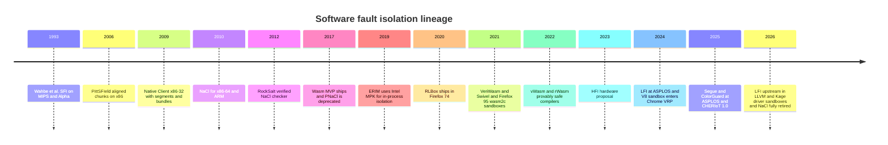

---
tags:
  - compilers
  - software-fault-isolation
  - sandboxing
  - webassembly
  - native-client
  - security
  - runtimes
  - spectre
  - memory-protection
status: complete
sources:
  - https://homes.cs.washington.edu/~tom/pubs/sfi.pdf
  - https://www.scs.stanford.edu/~zyedidia/docs/papers/sfi-survey.pdf
  - https://css.csail.mit.edu/6.858/2018/readings/nacl.pdf
  - https://www.scs.stanford.edu/~zyedidia/docs/papers/nacl2.pdf
  - https://cs.nyu.edu/~jt4767/papers/rocksalt/rocksalt.pdf
  - https://blog.chromium.org/2017/05/goodbye-pnacl-hello-webassembly.html
  - https://groups.google.com/a/chromium.org/g/chromium-extensions/c/v8H1UHnPotY
  - https://developer.chrome.com/docs/native-client?hl=en
  - https://chromeos.dev/en/releases/chromeos-132
  - https://docs.wasmtime.dev/api/src/wasmtime_cranelift/bounds_checks.rs.html
  - https://docs.wasmtime.dev/api/wasmtime/struct.Config.html
  - https://docs.wasmtime.dev/security.html
  - https://docs.rs/crate/wasmtime-cli/45.0.1/source/tests/disas/load-store/x64/
  - https://docs.rs/crate/wasmtime-cli/45.0.1/source/tests/disas/load-store/x64/load_store_static_kind_i32_index_0xffffffff_guard_yes_spectre_i32_access_0_offset.wat
  - https://docs.rs/crate/wasmtime-cli/45.0.1/source/tests/disas/load-store/x64/load_store_dynamic_kind_i64_index_0_guard_no_spectre_i32_access_0_offset.wat
  - https://docs.rs/crate/wasmtime-cli/45.0.1/source/tests/disas/load-store/x64/load_store_dynamic_kind_i64_index_0_guard_yes_spectre_i32_access_0_offset.wat
  - https://chromium.googlesource.com/v8/v8.git/+/refs/heads/main/src/objects/backing-store.cc
  - https://spidermonkey.dev/blog/2025/01/15/is-memory64-actually-worth-using.html
  - https://home.cit.tum.de/~engelke/pubs/2410-vmil.pdf
  - https://www.ndss-symposium.org/ndss-paper/%d0%b4%d0%be%d0%b2%d0%b5%d1%80%d1%8f%d0%b9-%d0%bd%d0%be-%d0%bf%d1%80%d0%be%d0%b2%d0%b5%d1%80%d1%8f%d0%b9-sfi-safety-for-native-compiled-wasm/
  - https://www.usenix.org/conference/usenixsecurity22/presentation/bosamiya
  - https://www.cs.cmu.edu/~csd-phd-blog/2023/provably-safe-sandboxing-wasm
  - https://awesome.ecosyste.ms/projects/github.com%2Fbytecodealliance%2Flucet
  - https://arxiv.org/pdf/2105.00033
  - https://arxiv.org/pdf/2003.00572
  - https://hacks.mozilla.org/2021/12/webassembly-and-back-again-fine-grained-sandboxing-in-firefox-95/
  - https://searchfox.org/firefox-main/source/security/rlbox/rlbox.mozbuild
  - https://arxiv.org/abs/2102.12730
  - https://cseweb.ucsd.edu/~dstefan/pubs/narayan:2025:segue.pdf
  - https://www.cfallin.org/pubs/asplos2023_hfi.pdf
  - https://www.usenix.org/conference/usenixsecurity19/presentation/vahldiek-oberwagner
  - https://arxiv.org/abs/2408.11456v2
  - https://cheriot.org/sail/specification/release/2025/11/03/cheriot-1.0.html
  - https://cheri-alliance.org/wp-content/uploads/2025/11/3.1-Robert-Watson-Progress-of-CHERI-1-CHERITech25.pdf
  - https://cheri-alliance.org/wp-content/uploads/2026/04/D2-1.6-Simon-Moore-CHERI-RvsD-CHERI-Blossoms-2026.pdf
  - https://discourse.llvm.org/t/rfc-upstream-target-support-for-cheri-enabled-architectures/87623
  - https://lists.llvm.org/pipermail/cfe-commits/Week-of-Mon-20260119/800145.html
  - https://docs.kernel.org/6.16/bpf/verifier.html
  - https://v8.dev/blog/sandbox
  - https://chromium.googlesource.com/v8/v8.git/+/main/docs/heap/pointer-compression.md
  - https://saelo.github.io/presentations/offensivecon_24_the_v8_heap_sandbox.pdf
  - https://chromium.googlesource.com/v8/v8.git/+/refs/heads/main/src/sandbox/README.md
  - https://popl26.sigplan.org/details/prisc-2026-papers/1/The-V8-Sandbox-From-Compiler-Correctness-to-Runtime-Containment
  - https://www.arxiv.org/abs/2509.07757
  - https://groups.google.com/a/chromium.org/g/security-dev/c/K47tKuaOPUU
  - https://www.scs.stanford.edu/~zyedidia/docs/papers/lfi.pdf
  - https://releases.llvm.org/22.1.0/docs/LFI.html
  - https://llvm.org/devmtg/2025-10/slides/technical_talks/garkinfel_yedidia.pdf
  - https://phoronix.com/news/LLVM-x86-LFI-Merged
  - https://www.phoronix.com/news/Kage-Linux-Driver-Isolation
  - https://lpc.events/event/20/contributions/2398/
created: 2026-11-26
updated: 2026-11-26
---

## Table Of Contents

- [[#TL;DR|TL;DR]]
- [[#The Problem|The Problem]]
- [[#Foundations|Foundations]]
    - [[#Fault Domains and the Threat Model|Fault Domains and the Threat Model]]
    - [[#Masking versus Checking|Masking versus Checking]]
    - [[#Why SFI Needs Control-Flow Integrity|Why SFI Needs Control-Flow Integrity]]
    - [[#Guard Regions and Reserved Registers|Guard Regions and Reserved Registers]]
- [[#How We Got Here|How We Got Here]]
- [[#How It Works|How It Works]]
    - [[#Wahbe et al. 1993|Wahbe et al. 1993]]
    - [[#Native Client on x86-32|Native Client on x86-32]]
    - [[#Native Client on x86-64 and ARM|Native Client on x86-64 and ARM]]
    - [[#Validators and RockSalt|Validators and RockSalt]]
    - [[#Wasm Linear Memory Bounds Checks|Wasm Linear Memory Bounds Checks]]
    - [[#Real Wasmtime Codegen With and Without Checks|Real Wasmtime Codegen With and Without Checks]]
    - [[#Verifying the Output VeriWasm vWasm and Friends|Verifying the Output VeriWasm vWasm and Friends]]
    - [[#RLBox Sandboxing Libraries in Firefox|RLBox Sandboxing Libraries in Firefox]]
    - [[#Spectre and SFI|Spectre and SFI]]
    - [[#Hardware Assists|Hardware Assists]]
    - [[#LFI Native SFI Without Bundles|LFI Native SFI Without Bundles]]
    - [[#Related Approaches eBPF and the V8 Heap Sandbox|Related Approaches eBPF and the V8 Heap Sandbox]]
    - [[#Measured Overheads at a Glance|Measured Overheads at a Glance]]
- [[#Where It Is Now|Where It Is Now]]
- [[#Trade-offs & Open Problems|Trade-offs & Open Problems]]
- [[#Resources|Resources]]
- [[#Related Notes|Related Notes]]

## ***TL;DR***
---
*Software fault isolation (SFI) lets untrusted native code share an address space with its host by having the compiler insert cheap checks before every dangerous store, load and jump, and having a small verifier prove the checks are there. It is how WebAssembly engines, Firefox's library sandboxes, V8's heap sandbox and the new LLVM LFI target all keep code in its box without paying for a process switch.*

- **The idea (1993).** Wahbe, Lucco, Anderson and Graham carved the address space into aligned "fault domains" and rewrote every unsafe store or jump to force its address into the domain with two ALU instructions. Overhead was about 4% for stores and jumps, about 22% if loads were also sandboxed, and a cross-domain call cost microseconds instead of the hundreds of microseconds of an IPC round trip ([Wahbe et al., SOSP 1993](https://homes.cs.washington.edu/~tom/pubs/sfi.pdf)).
- **Two halves, always.** A *compiler* (or rewriter) inserts the guards; a much smaller *verifier* checks the binary so the compiler need not be trusted. Native Client's x86-32 validator was under 600 C statements; RockSalt later proved a NaCl checker correct in Coq ([Yee et al., 2009](https://css.csail.mit.edu/6.858/2018/readings/nacl.pdf); [Morrisett et al., PLDI 2012](https://cs.nyu.edu/~jt4767/papers/rocksalt/rocksalt.pdf)).
- **Control flow is the hard part.** A guard only works if code cannot jump past it, so SFI must also restrict indirect jumps: NaCl used 32-byte aligned bundles, Wasm uses structured control flow and typed indirect calls, and LFI makes "jump anywhere in the sandbox" safe by guarding every register that can hold an address.
- **Wasm's trick is virtual memory.** For 32-bit memories on 64-bit hosts, engines reserve 4 GiB plus a guard region (V8 reserves 8 GiB) so a load needs no compare at all; `memory64` breaks this and explicit checks cost roughly 10% to over 100% in SpiderMonkey's experience ([SpiderMonkey, 2025](https://spidermonkey.dev/blog/2025/01/15/is-memory64-actually-worth-using.html); [V8 source](https://chromium.googlesource.com/v8/v8.git/+/refs/heads/main/src/objects/backing-store.cc)).
- **As of November 2026,** NaCl is gone (last ChromeOS LTS refresh April 2026), Wasm is the mainstream SFI target, Firefox ships wasm2c-sandboxed libraries with the Segue segment-register optimization on x86-64, LLVM has an upstream LFI target (AArch64 in LLVM 22, x86-64 merged for LLVM 23) that Google is using to prototype in-kernel driver sandboxes (Kage), and V8's heap sandbox is a shipped, bounty-covered boundary that research keeps finding holes in.

## ***The Problem***
---
*Processes give strong isolation but every crossing costs a context switch; running a plugin, codec or JIT in the same process is fast but one memory bug owns the host. SFI asks the compiler to make in-process isolation safe.*

Programs routinely load code they do not fully trust: database extensions, browser codecs and font shapers, kernel drivers, serverless functions, JavaScript. The classic way to contain such code is a separate address space ([[Processes and Threads]], [[Virtual Memory and Paging]]), but then every call is an IPC round trip. Wahbe et al. measured a Unix pipe round trip at about 205 to 228 µs on 1993 DEC hardware against about 0.1 µs for a local procedure call ([Wahbe et al.](https://homes.cs.washington.edu/~tom/pubs/sfi.pdf)). Modern numbers move but the ratio does not: on a Pixel 7 the LFI team measured a native function call at 2 cycles, an LFI sandbox call at 74 cycles, and a native process context switch at 15,770 cycles ([Yedidia and Garfinkel, LLVM Dev Meeting 2025](https://llvm.org/devmtg/2025-10/slides/technical_talks/garkinfel_yedidia.pdf)).

| Isolation option | Boundary enforced by | Crossing cost | Typical use |
|---|---|---|---|
| Separate process or VM | MMU page tables, kernel | Context switch, IPC | Browser site isolation, [[MicroVMs and Sandboxing]] |
| Language safety | Type system of a safe language | A function call | Rust, Java, JS (when the JIT is correct) |
| **SFI** | **Compiler-inserted guards plus a verifier** | **A function call plus a few register moves** | **Wasm, NaCl, RLBox, LFI, V8 heap sandbox** |
| Hardware in-process | MPK, CHERI, proposed HFI | One special instruction | Research and emerging deployments |

The compiler's job is to make a guarantee that is a property of *machine code*: no store, load or jump executed by the untrusted code reaches outside its region. That requires codegen choices (reserved registers, addressing modes, alignment), optimizations that remove redundant guards without breaking the invariant, and a binary format simple enough to verify quickly.

## ***Foundations***
---
*SFI rests on four ideas: a fault domain with a known address range, guards that either mask or check addresses, control-flow restrictions that stop code skipping the guards, and virtual-memory tricks (guard regions, reserved registers) that make the guards cheap.*

### Fault Domains and the Threat Model

*A fault domain is a contiguous, aligned region of the host's address space; the untrusted code may do anything inside it and nothing outside it except call approved entry points.*

In the original design each untrusted module gets a code segment and a data segment, all addresses in a segment share the same upper bits (the *segment identifier*), and code and data are kept apart so a module cannot overwrite its own instructions ([Wahbe et al.](https://homes.cs.washington.edu/~tom/pubs/sfi.pdf)). The threat model has three layers that later systems spell out more carefully:

| Property | What it stops | Who provides it |
|---|---|---|
| **Write and jump integrity** | Untrusted code corrupting host memory or running host code it was not given | All SFI systems; the original 1993 scheme only did this |
| **Read confidentiality** | Untrusted code reading host secrets | Sandboxing loads too (more expensive), or Wasm's typed memory |
| **Interface safety** | The *host* misusing data the sandbox returns (a bad length, a pointer into host memory) | Not SFI itself; RLBox's tainted types, Kage's BTF signature checks |

Transient-execution attacks add a fourth row (speculative reads past a guard) that classic SFI ignored; see [[#Spectre and SFI|Spectre and SFI]] and [[Transient Execution Attacks and Mitigations]].

### Masking versus Checking

*Masking forces any address into the domain with bitwise arithmetic and never traps; checking compares and traps. Masking is cheaper and branch-free, checking reports the bug.*

For a power-of-two sized, aligned region with base $B$ and size $2^k$:

$$
\text{addr}' = (\text{addr} \mathbin{\&} (2^k - 1)) \mathbin{|} B
$$

**In plain English:** clear the high bits that would pick a different region, then paste in this region's high bits. Whatever garbage `addr` held, `addr'` lands inside the sandbox. An out-of-bounds access does not fail; it silently hits some other byte of the sandbox's own memory, which harms only the sandbox.

The checking alternative is a compare and branch:

$$
\text{if } \text{addr} - B \ge 2^k \text{ then trap}
$$

**In plain English:** subtract the base, treat the result as unsigned, and fault if it is past the end. This needs a branch (a Spectre gadget) but pinpoints the bad access. Gang Tan's survey notes that most implementations adopt masking for speed, at the cost of hiding the violating instruction ([Tan, Foundations and Trends 2017](https://www.scs.stanford.edu/~zyedidia/docs/papers/sfi-survey.pdf)). Wasm's semantics require a *trap* on out-of-bounds access, so Wasm engines cannot use pure masking; LFI and NaCl, which define no such semantics, can.

### Why SFI Needs Control-Flow Integrity

*A guard protects only the instruction after it. If the untrusted code can jump into the middle of a guard sequence, or into the middle of an x86 instruction, the guard is skipped.*

Three ways systems close this hole:

- **Dedicated registers.** Wahbe et al. made the masked address live in a register that only inserted code writes. Jumping past the mask lands on a store whose address register still holds a previously sandboxed value ([Wahbe et al.](https://homes.cs.washington.edu/~tom/pubs/sfi.pdf)).
- **Aligned chunks (bundles).** PittSFIeld and NaCl split code into fixed-size aligned chunks, forbid instructions from crossing chunk boundaries, and mask indirect jump targets to a chunk start, so a guard and its guarded instruction can always sit in one chunk ([Tan](https://www.scs.stanford.edu/~zyedidia/docs/papers/sfi-survey.pdf)). The price is no-op padding; for a NaCl JIT, no-ops were about half the sandboxing cost ([Tan](https://www.scs.stanford.edu/~zyedidia/docs/papers/sfi-survey.pdf)).
- **A safe source language.** Wasm has only structured control flow, keeps return addresses on a stack the module cannot address, and checks the signature on every `call_indirect`, so the *compiler* can rely on the absence of wild jumps and emit no bundles at all ([[WebAssembly]]). Kolosick et al. showed these same properties also make "zero-cost" transitions safe: no springboard, just a call ([Kolosick et al., POPL 2022](https://arxiv.org/pdf/2105.00033)).

### Guard Regions and Reserved Registers

*Unmapped memory around the sandbox turns many guards into free page faults; a register pinned to the sandbox base turns the remaining ones into a single addressing mode.*

Wahbe et al. already sandboxed only the base register of a `reg + offset` access and placed unmapped guard zones around each segment to catch the small offset, and they sandboxed the stack pointer only when it was set, not at every use ([Wahbe et al.](https://homes.cs.washington.edu/~tom/pubs/sfi.pdf)). Every later system uses the same two levers:

- **Guard regions** let the compiler drop or hoist checks (redundant check elimination, loop hoisting) because a slightly out-of-range address faults instead of escaping ([Tan](https://www.scs.stanford.edu/~zyedidia/docs/papers/sfi-survey.pdf)).
- **Reserved registers** hold the sandbox base or an always-valid address. They come out of the [[Register Allocation]] pool; Wahbe et al. reported that removing five registers from gcc had no significant effect on average SPEC92 time on MIPS.

## ***How We Got Here***
---
*SFI went from a RISC research trick (1993) to a browser plug-in (NaCl, 2009 to 2026), lost to WebAssembly as the portable format, and is now returning as native compiler support (LFI in LLVM) and as engine-internal hardening (V8 sandbox).*



| Year | Event | Source |
|---|---|---|
| 1993 | Wahbe, Lucco, Anderson, Graham: SFI by segment matching and sandboxing on DEC MIPS and Alpha | [SOSP 1993](https://homes.cs.washington.edu/~tom/pubs/sfi.pdf) |
| 2009 | Native Client: x86-32 inner sandbox using segments, 32-byte bundles, a small validator | [Yee et al.](https://css.csail.mit.edu/6.858/2018/readings/nacl.pdf) |
| 2010 | NaCl ported to x86-64 (4 GiB sandbox, `r15` base) and ARM (masking with `bic`, 16-byte bundles) | [Sehr et al., USENIX Security 2010](https://www.scs.stanford.edu/~zyedidia/docs/papers/nacl2.pdf) |
| 2012 | RockSalt: NaCl checker generated and proven in Coq | [Morrisett et al., PLDI 2012](https://cs.nyu.edu/~jt4767/papers/rocksalt/rocksalt.pdf) |
| May 2017 | Chrome deprecates PNaCl in favor of WebAssembly | [Chromium Blog](https://blog.chromium.org/2017/05/goodbye-pnacl-hello-webassembly.html) |
| 2020 | RLBox's libGraphite sandbox ships in Firefox 74 (Linux) and 75 (Mac) | [Narayan et al., USENIX Security 2020](https://arxiv.org/pdf/2003.00572) |
| Dec 2021 | Firefox 95 sandboxes Graphite, Hunspell, Ogg via wasm2c; Expat and Woff2 in 96 | [Mozilla Hacks](https://hacks.mozilla.org/2021/12/webassembly-and-back-again-fine-grained-sandboxing-in-firefox-95/) |
| Sep 2023 | Chrome M117 removes NaCl for extensions outside ChromeOS | [Chromium PSA](https://groups.google.com/a/chromium.org/g/chromium-extensions/c/v8H1UHnPotY) |
| Apr 2024 | V8 sandbox declared non-experimental and added to Chrome's VRP | [V8 blog](https://v8.dev/blog/sandbox) |
| 2024 | LFI: bundle-free SFI for AArch64, about 7% overhead | [Yedidia, ASPLOS 2024](https://www.scs.stanford.edu/~zyedidia/docs/papers/lfi.pdf) |
| 2025 | Segue and ColorGuard: x86 segment registers and MPK for Wasm SFI | [Narayan et al., ASPLOS 2025](https://cseweb.ucsd.edu/~dstefan/pubs/narayan:2025:segue.pdf) |
| ChromeOS 138 / Apr 2026 | Last ChromeOS release with NaCl; LTS devices with the policy keep it until the April 2026 refresh | [ChromeOS 132 notes](https://chromeos.dev/en/releases/chromeos-132) |
| Jul 2026 | x86-64 LFI target merged into LLVM 23 | [Phoronix](https://phoronix.com/news/LLVM-x86-LFI-Merged) |
| Oct 2026 | Kage: in-kernel LFI sandboxes for Linux drivers presented at LPC | [LPC 2026](https://lpc.events/event/20/contributions/2398/) |

**Why NaCl was retired.** Google's own reasons were that PNaCl "did not provide a solution that worked seamlessly across all browsers" and usage was "sufficiently low to warrant deprecation", while WebAssembly had cross-browser momentum ([Chromium Blog, 2017](https://blog.chromium.org/2017/05/goodbye-pnacl-hello-webassembly.html)). The technical design also aged badly: the x86-32 scheme depended on segmentation that x86-64 long mode does not provide, and the 64-bit ports needed bundles, padding and a second, more complex validator per architecture ([Tan](https://www.scs.stanford.edu/~zyedidia/docs/papers/sfi-survey.pdf); [Sehr et al.](https://www.scs.stanford.edu/~zyedidia/docs/papers/nacl2.pdf)). Wasm moved the verification target up a level, from machine code to a typed bytecode, which every engine validates before compiling.

## ***How It Works***
---
*The mechanics differ by system, but every design answers the same four questions: how addresses are confined, how jumps are confined, how the host is entered, and who checks the result.*

### Wahbe et al. 1993

*Two transformations, both inserted by a modified gcc and checked by a verifier on the MIPS object code.*

**Segment matching** copies the target address into a dedicated register, shifts out the segment identifier, compares it with the expected one and traps on mismatch: about four instructions, and it identifies the faulting instruction, which helps debugging. It needs four dedicated registers. **Sandboxing** (address masking) clears the segment-identifier bits and ORs in the right ones with two arithmetic instructions and five dedicated registers ([Wahbe et al.](https://homes.cs.washington.edu/~tom/pubs/sfi.pdf)).

A hand sketch of the sandboxing transform in MIPS-like pseudo-assembly (register names illustrative, not from the paper's listings):

```asm
# original:   sw  t1, 0(a0)
and   dr, a0, mask_reg      # dr is a dedicated register: keep only the offset bits
or    dr, dr, seg_reg       # paste in this domain's segment identifier
sw    t1, 0(dr)             # store through the dedicated register only
```

Results on a 40 MHz DECstation 5000/240 and a DEC Alpha 400: about 4% average execution overhead for store and jump isolation (4.3% in the MIPS table), 21.8% average when loads are also sandboxed, and cross-domain calls of 1.11 µs (MIPS) and 0.75 µs (Alpha) against pipe round trips of about 205 and 228 µs. In a POSTGRES extension workload, software isolation overhead was 1.7% to 5.7% against an estimated 18.6% to 38.6% for hardware address spaces ([Wahbe et al.](https://homes.cs.washington.edu/~tom/pubs/sfi.pdf)). The paper's break-even condition:

$$
(1 - r)\, t_c > h\, t_d
$$

**In plain English:** software isolation wins when the time saved on domain crossings (fraction of time crossing $t_c$, times how much faster software crossings are, $1-r$) exceeds the time lost to slower code in the untrusted module (encapsulation overhead $h \approx 0.043$, times the fraction of time spent in untrusted code $t_d$). Frequent crossings favor SFI; long compute inside the sandbox favors hardware isolation.

### Native Client on x86-32

*NaCl used x86 segment registers for data, so loads and stores needed no guards at all, and 32-byte bundles plus a two-instruction `nacljmp` for control flow.*

The inner sandbox's seven rules: the binary is not writable while running; it is statically linked at zero with text starting at 64 KiB; all indirect transfers use `nacljmp`; the binary is padded to a page with `hlt`; no instruction crosses a 32-byte boundary; every valid instruction is reachable by fall-through disassembly; and all direct jumps target valid instructions ([Yee et al.](https://css.csail.mit.edu/6.858/2018/readings/nacl.pdf)). The indirect jump pseudo-instruction, verbatim from the paper:

```asm
and  %eax, 0xffffffe0     ; clear the low 5 bits: target is a bundle start
jmp  *%eax                ; CS segment limits the target to the module's text
```

Data references were confined by 80386 segments, so ordinary loads and stores needed no instrumentation. Calls into the runtime went through *trampolines* in the first 64 KiB (each at a 0 mod 32 address) that reset `%ds`, far-called to reset `%cs` and switched to a trusted stack; a *springboard* went the other way. Null runtime calls cost 123 to 156 ns depending on the OS. On SPEC2000 the average overhead was under 5%, with several benchmarks in the 7% to 13% range (gcc 9.0%, vortex 11%, crafty 12%, perlbmk 13%), mostly from alignment; Quake ran at 143.7 fps against 143.3 native ([Yee et al.](https://css.csail.mit.edu/6.858/2018/readings/nacl.pdf)).

### Native Client on x86-64 and ARM

*Without segments, the 64-bit ports had to guard addresses in software, and the guards became architecture-specific puzzles.*

**x86-64.** The module lives in an aligned 4 GiB region flanked by guard regions of $10 \times 4$ GiB above and below; `r15` holds the base and is read-only to untrusted code; `rsp` and `rbp` must always hold valid sandbox addresses; and 32-bit operations naturally zero the upper half of a register, so `base + 32-bit value` is in range ([Sehr et al.](https://www.scs.stanford.edu/~zyedidia/docs/papers/nacl2.pdf)). An indirect jump, from the paper:

```asm
and  $0xffffffe0, %edx        ; align to a 32-byte bundle (32-bit op zero-extends)
lea  (%r15, %rdx, 1), %rdx    ; rebase into the sandbox
jmp  *%rdx
```

**ARM.** Stores and control flow are confined to the low 1 GiB; branches are masked with one `bic` that clears both the top two bits and the low four (16-byte bundles), and stores use a test plus a *predicated* store so no branch is needed:

```asm
bic   r0, r0, #0xc000000f     ; in-sandbox and bundle-aligned
bx    r0

tst   r0, #0xc0000000         ; Z set only if r0 is inside the low 1 GiB
streq r1, [r0, #12]           ; store executes only when the test passed
```

Data embedded in text starts each bundle with an invalid `bkpt 0x7777` so it cannot be executed. Measured SPEC2000 geomean overhead: 6.9% against `-m64` on x86-64 (5.24% against `-m32`), and 5.17% on a Cortex-A9 ([Sehr et al.](https://www.scs.stanford.edu/~zyedidia/docs/papers/nacl2.pdf)). Code got roughly 60% larger on x86-64 after rewriting ([Tan](https://www.scs.stanford.edu/~zyedidia/docs/papers/sfi-survey.pdf)).

### Validators and RockSalt

*The validator is the trusted computing base; the compiler is not. That split is what makes SFI deployable with an unverified, optimizing compiler.*

NaCl's x86-32 validator was under 600 C statements, about 6,000 bytes of compiled code, and checked roughly 30 MB/s ([Yee et al.](https://css.csail.mit.edu/6.858/2018/readings/nacl.pdf)). Still, x86 decoding is notoriously error-prone, so RockSalt built a Coq model of IA-32 (minus floating point) and *generated* the checker from regular-expression grammars as table-driven DFAs (largest 61 states). The checker core is about 80 lines of Coq (under 100 lines of C after hand translation), with about 5,000 lines of model and checker and 10,000 lines of proof. It was faster than Google's checker on a large synthetic program (0.24 s against 0.90 s) and checks about a million instructions per second ([Morrisett et al.](https://cs.nyu.edu/~jt4767/papers/rocksalt/rocksalt.pdf)). This is the SFI instance of a general pattern in [[Verified Compilers]] and [[Translation Validation]]: verify a small checker instead of the big transformer.

### Wasm Linear Memory Bounds Checks

*Wasm compilers implement SFI for every load and store; the strategy depends on index width, host word size, the reserved address space and whether Spectre hardening is on.*

The [[WebAssembly]] note covers the basic guard-region argument. The compiler-side detail is that Wasmtime's Cranelift front end picks among several cases per access ([Wasmtime `bounds_checks.rs`](https://docs.wasmtime.dev/api/src/wasmtime_cranelift/bounds_checks.rs.html)):

| Case | Code emitted |
|---|---|
| 32-bit index, reservation plus guard covers `index + offset + size` | No check; address is `heap_base + zext(index) + offset` |
| Constant index known in bounds of the minimum size | No check |
| `offset + size` exceeds the maximum memory size | Unconditional trap |
| Guard covers `offset + size` but not the index | Compare `index > bound` only, guard catches the rest |
| General case | `uadd_overflow_trap` on `index + offset + size`, then compare with the bound, then `trapnz` |
| Spectre mitigation on | Same compare, but the result feeds `select_spectre_guard(oob, null, addr)` so an out-of-bounds address becomes 0 and faults |

The defaults that make the first row the common case on 64-bit hosts are a 4 GiB `memory_reservation` and a 32 MiB `memory_guard_size`, which "allows eliminating almost all bounds checks on loads/stores with an immediate offset of less than 32MiB" ([Wasmtime `Config`](https://docs.wasmtime.dev/api/wasmtime/struct.Config.html)). Wasmtime's security docs add a 2 GB guard region *before* each memory to catch sign-extension bugs in Cranelift ([Wasmtime security](https://docs.wasmtime.dev/security.html)). Other engines size things differently: V8's `kFullGuardSize32` reserves 8 GiB per 32-bit memory ([V8 `backing-store.cc`](https://chromium.googlesource.com/v8/v8.git/+/refs/heads/main/src/objects/backing-store.cc)), while SpiderMonkey reserves 4 GiB plus "just 32MiB + 64KiB for guard pages" and emits explicit checks for larger offsets ([SpiderMonkey](https://spidermonkey.dev/blog/2025/01/15/is-memory64-actually-worth-using.html)). The elision condition is:

$$
\underbrace{(2^{32} - 1)}_{\max\ \text{u32 index}} + \text{offset} + \text{size} \;\le\; \text{reservation} + \text{guard}
$$

**In plain English:** if even the largest possible 32-bit index plus the instruction's constant offset and access width still lands inside reserved address space, the worst case is a page fault in an unmapped page, which the runtime's signal handler turns into a Wasm trap.

**What memory64 does.** With a 64-bit index no reservation covers the index space, so every access needs a compare; SpiderMonkey reports slowdowns that "can range from just 10% to over 100%" ([SpiderMonkey](https://spidermonkey.dev/blog/2025/01/15/is-memory64-actually-worth-using.html)). Döllerer and Engelke measured the options in a 64-bit Wasm runtime: plain software bounds checks averaged 109.8% overhead (up to 242%), guard pages plus a test of the high bits 76% to 142%, and a *two-level guard* (compress the index into a huge, zero-page-backed macro guard region probed by an extra load, no branch) averaged 12.7% (max 17.3%); they rejected MPK because `wrpkru` is too costly when frequent ([Döllerer and Engelke, VMIL 2024](https://home.cit.tum.de/~engelke/pubs/2410-vmil.pdf)). V8's source also has a flag-gated mode (`wasm_memory64_trap_handling`) that reserves the maximum memory64 size with guard regions ([V8 `backing-store.cc`](https://chromium.googlesource.com/v8/v8.git/+/refs/heads/main/src/objects/backing-store.cc)); how its codegen handles the high index bits is not described in that file.

### Real Wasmtime Codegen With and Without Checks

*Wasmtime's test suite pins the exact x86-64 code for every combination of memory kind, index width, guard size and Spectre flag; three of them show the whole spectrum.*

All three come from Wasmtime 45.0.1's `tests/disas/load-store/x64` expectations for a function `do_load(i32 or i64 index) -> i32` doing `i32.load offset=0` ([Wasmtime test list](https://docs.rs/crate/wasmtime-cli/45.0.1/source/tests/disas/load-store/x64/)). In each, `%rdi` is the instance context (vmctx), the index arrives in `%rdx`, the heap base is at `0x38(%rdi)` and the current bound at `0x40(%rdi)`. Prologue and epilogue are shown as in the expectation files; the trailing jump target address is omitted.

**1. 32-bit index, static memory, 4 GiB guard: no check at all** ([test](https://docs.rs/crate/wasmtime-cli/45.0.1/source/tests/disas/load-store/x64/load_store_static_kind_i32_index_0xffffffff_guard_yes_spectre_i32_access_0_offset.wat)):

```asm
pushq   %rbp
movq    %rsp, %rbp
movq    0x38(%rdi), %rsi      ; heap base
movl    %edx, %edi            ; zero-extend the 32-bit index (this IS the sandboxing)
movl    (%rsi, %rdi), %eax    ; base + index, guard pages catch anything past 4 GiB
movq    %rbp, %rsp
popq    %rbp
retq
```

**2. 64-bit index (memory64), no guard, Spectre mitigation off: compare and branch to a trap** ([test](https://docs.rs/crate/wasmtime-cli/45.0.1/source/tests/disas/load-store/x64/load_store_dynamic_kind_i64_index_0_guard_no_spectre_i32_access_0_offset.wat)):

```asm
pushq   %rbp
movq    %rsp, %rbp
movq    0x40(%rdi), %rsi      ; current memory length
subq    $4, %rsi              ; last valid start for a 4-byte access
cmpq    %rsi, %rdx
ja      <trap>                ; out of bounds -> ud2 below
movq    0x38(%rdi), %r8       ; heap base
movl    (%r8, %rdx), %eax
movq    %rbp, %rsp
popq    %rbp
retq
ud2                           ; heap_oob trap site
```

**3. Same, Spectre mitigation on: branch-free select to null** ([test](https://docs.rs/crate/wasmtime-cli/45.0.1/source/tests/disas/load-store/x64/load_store_dynamic_kind_i64_index_0_guard_yes_spectre_i32_access_0_offset.wat)):

```asm
pushq   %rbp
movq    %rsp, %rbp
movq    0x40(%rdi), %r8
subq    $4, %r8               ; bound - access size
xorq    %r9, %r9              ; r9 = 0 (null)
movq    %rdx, %r10
addq    0x38(%rdi), %r10      ; r10 = base + index
cmpq    %r8, %rdx
cmovaq  %r9, %r10             ; out of bounds -> address becomes 0, even speculatively
movl    (%r10), %eax          ; faults at address 0 -> trap handler raises heap_oob
movq    %rbp, %rsp
popq    %rbp
retq
```

The difference between 1 and 3 is the whole Wasm SFI tax in miniature: one load of the bound, a subtract, a compare, a conditional move, and a longer dependency chain into every memory access. The `cmov` matters because it is a data dependency, which a CPU does not predict, unlike the `ja` in version 2 ([Wasmtime `bounds_checks.rs`](https://docs.wasmtime.dev/api/src/wasmtime_cranelift/bounds_checks.rs.html)). [[Classic Optimizations]] and [[Loop Optimizations]] (hoisting the bound load, eliminating repeated checks on the same index) are what keep version 2 and 3 from being even slower.

### Verifying the Output VeriWasm vWasm and Friends

*A Wasm engine's compiler is in the trusted base; post-compilation verification and verified compilers take it back out.*

- **VeriWasm** (NDSS 2021, UCSD, Stanford and Fastly) is "a static offline verifier for native x86-64 binaries compiled from Wasm" with a soundness proof, reporting that it "can detect bugs with no false positives"; the NDSS page says it was deployed at Fastly ([Johnson et al.](https://www.ndss-symposium.org/ndss-paper/%d0%b4%d0%be%d0%b2%d0%b5%d1%80%d1%8f%d0%b9-%d0%bd%d0%be-%d0%bf%d1%80%d0%be%d0%b2%d0%b5%d1%80%d1%8f%d0%b9-sfi-safety-for-native-compiled-wasm/)). This is NaCl's validator idea applied to an optimizing Wasm compiler's output.
- **VeriZero** extended this to check the conditions (callee-saved registers restored, well-bracketed control flow, type-directed CFI, no reads of uninitialized state) that make zero-cost host transitions safe; on Firefox's font shaping, zero-cost transitions cut runtime from 2246 ms to 2032 ms and a direct call from 120 ns to 7 ns ([Kolosick et al., POPL 2022](https://arxiv.org/pdf/2105.00033)).
- **vWasm** (CMU, USENIX Security 2022) is a Wasm to x86-64 compiler written in F* whose sandboxing pass is machine-checked for every input (about 15,000 lines of F* code and proof, roughly two person-years); disabling the sandboxing pass changes runtime by only 0.2%, so its remaining slowdown is from the unverified, unoptimized front end. **rWasm** instead translates Wasm into safe Rust (`#![forbid(unsafe)]`) and lets rustc produce fast code, a one person-month effort competitive with speed-focused compilers ([Bosamiya, Lim and Parno](https://www.usenix.org/conference/usenixsecurity22/presentation/bosamiya); [CMU blog](https://www.cs.cmu.edu/~csd-phd-blog/2023/provably-safe-sandboxing-wasm)).
- **Lucet** itself has reached end of life; its team moved to Wasmtime in mid-2020 and its features (ahead-of-time compilation, pooling allocator) went into Wasmtime ([Lucet README via ecosyste.ms](https://awesome.ecosyste.ms/projects/github.com%2Fbytecodealliance%2Flucet)). A shared Lucet and Wasmtime sandbox escape from an optimization bug (CVE-2021-32629) is the canonical example of why these verifiers exist ([CMU blog](https://www.cs.cmu.edu/~csd-phd-blog/2023/provably-safe-sandboxing-wasm)).

See [[Verified Compilers]], [[Formal Methods in Practice]] and [[Compiler Testing and Fuzzing]] for the broader landscape.

### RLBox Sandboxing Libraries in Firefox

*RLBox uses SFI for memory isolation and the C++ type system for the part SFI cannot do: making the host treat every value from the sandbox as hostile.*

SFI keeps a compromised libpng from writing to Firefox's heap, but Firefox can still be tricked by a malicious return value (a length that overflows a host buffer). RLBox wraps every value from the sandbox as `tainted<T>`, forces explicit validation to unwrap it, routes calls through `sandbox_invoke()` and callbacks through `sandbox_callback()`, and automates pointer swizzling; misuse is a compile error ([Narayan et al., USENIX Security 2020](https://arxiv.org/pdf/2003.00572)). Its threat model explicitly puts Spectre and other side channels out of scope.

Measured in the paper: the research prototype added 3% end-to-end page latency with an SFI backend (NaCl-based) against 13% with process isolation, and empty control transfers cost 0.22 µs (SFI) against 0.47 µs (process, spinlocks). The first production backend, Wasm via Lucet for libGraphite, showed 85% overhead in the font shaping code itself, slowing font rendering by 50%, with median peak memory overhead of 0.68% ([Narayan et al.](https://arxiv.org/pdf/2003.00572)).

Mozilla then switched to **wasm2c**: compile the library to Wasm, translate the Wasm back to C, and build it with Clang alongside the rest of Firefox, keeping PGO, inlining, crash reporting and debugging, and shipping no `.wasm` files ([Mozilla Hacks](https://hacks.mozilla.org/2021/12/webassembly-and-back-again-fine-grained-sandboxing-in-firefox-95/)). Here the C compiler is the SFI compiler: wasm2c's emitted C contains the bounds logic, and Clang optimizes it like any other code. Firefox's current build template enables Segue by default on x86-64 (non-Android, non-sanitizer builds) via `WASM_RT_ALLOW_SEGUE` and `-mfsgsbase`, uses mmap-style memories, and routes traps to `MOZ_CRASH` ([Firefox `rlbox.mozbuild`](https://searchfox.org/firefox-main/source/security/rlbox/rlbox.mozbuild)).

### Spectre and SFI

*Classic SFI guards are architectural: they hold for instructions that retire. A mispredicted bounds check or indirect jump can still read across the sandbox boundary speculatively.*

Swivel (USENIX Security 2021) classifies the problem for Wasm: malicious Wasm code breaking out of its sandbox speculatively, and Wasm code coercing a victim (another Wasm client or the host) into leaking secrets. It offers a software-only scheme for current CPUs and a hardware-assisted one using an Intel 11th-generation extension, each in a randomized and a deterministic variant. Overheads on the Wasm-compatible subset of SPEC 2006: under 10.3% for the randomized variant, 3.3% to 240.2% for the deterministic one, and 9x to 36.3x smaller than fence-based defenses ([Narayan et al., Swivel](https://arxiv.org/abs/2102.12730)).

Production engines use cheaper, narrower hardening. Wasmtime's `select_spectre_guard` (version 3 above) is on for dynamic memories, and it also mitigates `call_indirect` table bounds and `br_table`; on AArch64 the `csdb` barrier is off by default for performance ([Wasmtime security](https://docs.wasmtime.dev/security.html)). Wasmtime's bounds-check code also notes that the static offset must be added *before* the select, so speculation cannot read the first 4 GiB of memory ([Wasmtime `bounds_checks.rs`](https://docs.wasmtime.dev/api/src/wasmtime_cranelift/bounds_checks.rs.html)). LFI argues that pure masking is naturally resistant to sandbox *breakout*, because a guarded register is always in bounds and no branch is involved; cross-sandbox and host poisoning need hardware context separation such as Arm's CSV2_2 software context numbers ([Yedidia, ASPLOS 2024](https://www.scs.stanford.edu/~zyedidia/docs/papers/lfi.pdf)). The same masking-versus-branch argument underlies Linux's `array_index_nospec()` ([[Transient Execution Attacks and Mitigations]]).

### Hardware Assists

*Hardware can make the base addition free, add more sandboxes per process, replace guard regions, or make pointers themselves unforgeable.*

| Mechanism | What it gives SFI | Measured result (primary source) |
|---|---|---|
| **Segue** (x86 `%gs` segment base) | Hardware adds the sandbox base: `mov r11, gs:[ecx + edx*4 + 0x8]` replaces an `lea` plus `mov [rax + rdi]`, freeing a register | Removes 44.7% of wasm2c's SPEC 2006 overhead; Firefox font rendering 356 to 287 ms; LFI x86 SPEC 2017 overhead 17.4% to 9.4% ([Narayan et al., ASPLOS 2025](https://cseweb.ucsd.edu/~dstefan/pubs/narayan:2025:segue.pdf)) |
| **ColorGuard** (Intel MPK colors) | Stripe sandboxes so identically colored ones are 8 GB apart and `pkru` blocks the others, replacing most guard space | About 15x more instances (14,582 to 218,716 slots of 408 MB); transition 30.34 to 51.52 ns ([same paper](https://cseweb.ucsd.edu/~dstefan/pubs/narayan:2025:segue.pdf)) |
| **ERIM** (Intel MPK domains) | Fast userspace domain switches; binary inspection stops untrusted `wrpkru` | Under 1% overhead at 100,000 switches per second ([Vahldiek-Oberwagner et al., USENIX Security 2019](https://www.usenix.org/conference/usenixsecurity19/presentation/vahldiek-oberwagner)) |
| **Cage** (Arm MTE and PAC) | Memory safety *inside* Wasm plus faster sandboxing; PAC stops pointer reuse across instances | Under 5.8% runtime and 3.7% memory overhead, sandboxing speedup over 5.1% ([Cage, CGO 2025](https://arxiv.org/abs/2408.11456v2)) |
| **HFI** (proposed ISA extension) | `hfi_enter`/`hfi_exit` plus base-and-bound regions checked in parallel with the TLB, no guard regions | Emulated: SPEC 2006 about 3.2% faster than guard pages (bounds checks cost 34.7%); 256,000 1 GiB sandboxes per process ([Narayan et al., ASPLOS 2023](https://www.cfallin.org/pubs/asplos2023_hfi.pdf)) |
| **CHERI** capabilities | Every pointer carries hardware-checked bounds and permissions, so compartments need no address-range guards | Not an SFI overhead number; status below |

Two details that matter for compiler writers. First, Segue changes *instruction selection*: the sandbox base becomes a segment prefix, so complex addressing modes come back and register pressure drops ([[Instruction Selection]]). The same paper notes Segue *slowed* some WAMR benchmarks (sieve by 48.7%) because of interactions with vectorized code, fixed by applying Segue to loads only. Second, MPK helps density and switching but not per-access checks: ERIM and ColorGuard still rely on SFI or guard pages for the accesses themselves, and Döllerer and Engelke found `wrpkru` too slow to use as a bounds check ([VMIL 2024](https://home.cit.tum.de/~engelke/pubs/2410-vmil.pdf)).

### LFI Native SFI Without Bundles

*LFI shows that on a fixed-width ISA, SFI for arbitrary native code (not just Wasm) can cost about 7% with a few hundred lines of verifier and no alignment padding.*

LFI's key observation is that if *every* register that can hold an address (the stack pointer, the link register, a few reserved registers) is always a valid sandbox address, then a jump to any instruction is safe, so no bundles or CFI are needed. A 4 GiB sandbox with small guard regions at each end means tens of thousands of sandboxes (around 65,000 by default) fit in one 48-bit address space ([Yedidia, ASPLOS 2024](https://www.scs.stanford.edu/~zyedidia/docs/papers/lfi.pdf)). The rewrite happens at the MC layer in LLVM (a custom `MCStreamer`), so inline and hand-written assembly are covered too, and an external `lfi-verify` checks the result ([LLVM Dev Meeting 2025](https://llvm.org/devmtg/2025-10/slides/technical_talks/garkinfel_yedidia.pdf)). Rewrites from the LLVM 22 documentation, with `x27` as the sandbox base and `x28` as the always-valid address register ([LLVM LFI docs](https://releases.llvm.org/22.1.0/docs/LFI.html)):

```asm
// load or store through a register: zero extra instructions
ldr  x0, [x1]            ->  ldr  x0, [x27, w1, uxtw]

// with an immediate offset: one add into x28
ldr  x0, [x1, #16]       ->  add  x28, x27, w1, uxtw
                             ldr  x0, [x28, #16]

// indirect branch
br   x3                  ->  add  x28, x27, w3, uxtw
                             br   x28

// system call becomes a call into the runtime's entry table
svc  #0                  ->  mov  w26, w30
                             ldr  x30, [x27]
                             blr  x30
                             add  x30, x27, w26, uxtw
```

The `[x27, wN, uxtw]` addressing mode zero-extends the low 32 bits of the register and adds the base in the load itself, the same move as the `movl %edx, %edi` in Wasmtime's version 1 above. Options let you drop load sandboxing (`+nolfi-loads`, integrity only) or both loads and stores (jumps only, to pair with MPK). On x86-64, LFI uses 32-byte bundles for control flow and `%gs`-relative (Segue-style) addressing for memory.

Measured: SPEC 2017 geomean 6.4% (Apple M1) and 7.3% (GCP T2A) with full isolation, around 1% without load sandboxing; code size up 12.9% in text. On the 7 SPEC benchmarks Wasm toolchains could compile, Wasmtime was 47.0% and 67.1% slower than native, wasm2c 40.7% and 37.5%, WAMR 22.3% and 18.2%, against LFI's 7.3% and 6.4% ([Yedidia, ASPLOS 2024](https://www.scs.stanford.edu/~zyedidia/docs/papers/lfi.pdf)). The 2025 LLVM talk reported SPEC 2017 geomeans of 6.9% full, 1.6% stores-only and 0.9% jumps-only (the slide does not name the ISA; AArch64 is the primary target), and 7.1%, 5.5% and 4.4% on x86-64, with verification at "500+ MiB/s" in about 400 lines ([LLVM Dev Meeting 2025](https://llvm.org/devmtg/2025-10/slides/technical_talks/garkinfel_yedidia.pdf)). Note the comparison is unequal: Wasm also gives portability, typed indirect calls and a trap-on-OOB semantics; LFI gives none of these, only isolation.

### Related Approaches eBPF and the V8 Heap Sandbox

*eBPF moves all the checking to load time by static analysis; V8's sandbox applies SFI ideas to a JIT's own heap, assuming the JIT itself will be compromised.*

**[[eBPF]].** The Linux verifier checks the control-flow graph, then simulates every path, tracking each register's type (scalar, pointer to stack, map value, packet) plus signed and unsigned ranges and known bits (`tnum`); loads and stores must be provably in bounds before the program runs, and states already covered are pruned ([kernel docs](https://docs.kernel.org/6.16/bpf/verifier.html)). This is SFI with the guards replaced by proofs, a form of [[Abstract Interpretation]]. It works because eBPF is a restricted language; it cannot sandbox arbitrary C.

**V8 heap sandbox.** V8 assumes an attacker who can read and write arbitrarily *inside* a 1 TB reserved region, because a single JIT optimization bug in [[JIT Compilation]] can produce memory-unsafe machine code. All heap references inside are offsets from the sandbox base (40-bit for 1 TB), pointers to things outside go through an external pointer table with type tags, code pointers through a code pointer table ("essentially a form of CFI"), and bytecode and JIT metadata live in a separate trusted space. Overhead is "1% or less on typical workloads" on Speedometer and JetStream ([Groß, V8 blog 2024](https://v8.dev/blog/sandbox); [OffensiveCon 2024](https://saelo.github.io/presentations/offensivecon_24_the_v8_heap_sandbox.pdf); [README](https://chromium.googlesource.com/v8/v8.git/+/refs/heads/main/src/sandbox/README.md)). The arm64 decode from Groß's talk:

```asm
ldr  x3, [x0, #7]           ; load the stored sandboxed pointer
add  x3, x28, x3, lsr #24   ; shift out tag bits, add the sandbox base in x28
```

It builds on **pointer compression**: V8 keeps heap pointers as 32-bit offsets into a 4 GB cage whose base lives in a register (`r14` on x64, `x28` on arm64), decompressed as `cage_base + static_cast<Address>(raw_value)`. The sandbox requires the shared-cage mode, and trusted objects sit in a separate cage outside the sandbox, reached through indirect pointers ([V8 pointer compression doc](https://chromium.googlesource.com/v8/v8.git/+/main/docs/heap/pointer-compression.md)). Unlike Wasm, the threat is the engine's own output, so this is SFI as defense in depth around a JIT.

### Measured Overheads at a Glance

*Every number below is from the primary paper or project page; workloads, machines and baselines differ, so compare within a row, not across rows.*

| System | Workload | Overhead | Source |
|---|---|---|---|
| Wahbe et al. (stores, jumps) | SPEC92-era C, MIPS | 4.3% avg (21.8% with loads) | [SOSP 1993](https://homes.cs.washington.edu/~tom/pubs/sfi.pdf) |
| NaCl x86-32 | SPEC2000 | under 5% avg, up to 13% | [Yee et al.](https://css.csail.mit.edu/6.858/2018/readings/nacl.pdf) |
| NaCl x86-64 / ARM | SPEC2000 | 6.9% vs `-m64` / 5.17% | [Sehr et al.](https://www.scs.stanford.edu/~zyedidia/docs/papers/nacl2.pdf) |
| Wasm, 32-bit memory with guards | various | near zero for the checks themselves | [Döllerer and Engelke](https://home.cit.tum.de/~engelke/pubs/2410-vmil.pdf) |
| Wasm, explicit software checks | 64-bit runtime benchmarks | 109.8% avg, up to 242% | [Döllerer and Engelke](https://home.cit.tum.de/~engelke/pubs/2410-vmil.pdf) |
| Wasm memory64 (SpiderMonkey) | engine experience | 10% to over 100% | [SpiderMonkey](https://spidermonkey.dev/blog/2025/01/15/is-memory64-actually-worth-using.html) |
| Wasmtime / wasm2c / WAMR vs native | 7 SPEC 2017 benchmarks, T2A | 47.0% / 40.7% / 22.3% | [LFI paper](https://www.scs.stanford.edu/~zyedidia/docs/papers/lfi.pdf) |
| LFI AArch64 full | SPEC 2017 | 6.4% to 7.3% | [LFI paper](https://www.scs.stanford.edu/~zyedidia/docs/papers/lfi.pdf) |
| LFI x86-64 full | SPEC 2017 | 7.1% | [LLVM Dev Meeting 2025](https://llvm.org/devmtg/2025-10/slides/technical_talks/garkinfel_yedidia.pdf) |
| Swivel deterministic | SPEC 2006 Wasm subset | 3.3% to 240.2% | [Swivel](https://arxiv.org/abs/2102.12730) |
| RLBox SFI (prototype) | page load latency | 3% | [RLBox](https://arxiv.org/pdf/2003.00572) |
| V8 heap sandbox | Speedometer, JetStream | about 1% or less | [V8 blog](https://v8.dev/blog/sandbox) |

## ***Where It Is Now***
---
*As of November 2026, SFI has split into three live lines: Wasm as the portable, typed sandbox; LFI as compiler-native SFI for existing C, C++ and assembly, now upstream in LLVM; and engine-internal sandboxes like V8's. NaCl is fully retired, and hardware assists are arriving piecemeal.*

- **NaCl is gone.** NaCl was removed for extensions outside ChromeOS in Chrome M117 (stable September 2023) ([Chromium PSA](https://groups.google.com/a/chromium.org/g/chromium-extensions/c/v8H1UHnPotY)); ChromeOS 132 was the last release with NaCl for consumer devices, ChromeOS 138 the last for managed devices with a policy, and LTS devices kept it until the "LTS Last Refresh in April 2026" ([ChromeOS 132 notes](https://chromeos.dev/en/releases/chromeos-132); [Chrome docs](https://developer.chrome.com/docs/native-client?hl=en)).
- **LFI is in LLVM.** LLVM 22.1's documentation describes an `aarch64_lfi` target (Armv8.1, static-PIE only, basic guard elimination implemented, guard hoisting and stack guard elimination not yet) ([LLVM LFI docs](https://releases.llvm.org/22.1.0/docs/LFI.html)). The x86-64 LFI target was merged in July 2026 for LLVM 23, with Google contributing engineering effort ([Phoronix, July 2026](https://phoronix.com/news/LLVM-x86-LFI-Merged)); an October 2026 report says x86 support is "aiming to be finished by LLVM 24" ([Phoronix, October 2026](https://www.phoronix.com/news/Kage-Linux-Driver-Isolation)). Ongoing work listed at the 2025 LLVM Dev Meeting: LFI-sandboxed SpiderMonkey, kernel module isolation, and third-party native libraries on Android ([slides](https://llvm.org/devmtg/2025-10/slides/technical_talks/garkinfel_yedidia.pdf)).
- **SFI in the kernel.** Google's **Kage** is an experimental Linux subsystem that runs kernel modules in LFI sandboxes at kernel privilege but confined to a region of virtual memory, using BTF type information to check call signatures and swap kernel pointers for opaque handles; it was presented at Linux Plumbers on 5 October 2026, currently handles simple computational modules, and a VirtIO-based variant (VKage) has prototyped NVMe, network and WiFi drivers ([LPC 2026](https://lpc.events/event/20/contributions/2398/); [Phoronix](https://www.phoronix.com/news/Kage-Linux-Driver-Isolation)). Compare [[Rust in the Linux Kernel]], which attacks the same driver-bug problem by language safety instead.
- **Wasm SFI keeps getting cheaper.** Segue is upstream in wasm2c and on by default in Firefox's x86-64 RLBox builds; ColorGuard is upstream in Wasmtime; WAMR ships a limited Segue behind a flag ([Segue and ColorGuard](https://cseweb.ucsd.edu/~dstefan/pubs/narayan:2025:segue.pdf); [Firefox `rlbox.mozbuild`](https://searchfox.org/firefox-main/source/security/rlbox/rlbox.mozbuild)). Wasmtime's defaults are a 4 GiB reservation and 32 MiB guard ([Wasmtime `Config`](https://docs.wasmtime.dev/api/wasmtime/struct.Config.html)). Memory64 is shipped but still pays for explicit checks ([[WebAssembly]]).
- **V8 sandbox.** Shipped and covered by Chrome's VRP since 2024 ([V8 blog](https://v8.dev/blog/sandbox)). In Q4 2025 the V8 team reported "driving down known issues" and building a bytecode verifier meant to ensure verified bytecode "does not lead to out-of-sandbox corruption", to ship "where performance allows" ([Chrome Security Q4 2025](https://groups.google.com/a/chromium.org/g/security-dev/c/K47tKuaOPUU)). Samuel Groß presented it at PriSC 2026 (co-located with POPL 2026), naming hardware support and code validation as future hardening ([PriSC 2026](https://popl26.sigplan.org/details/prisc-2026-papers/1/The-V8-Sandbox-From-Compiler-Correctness-to-Runtime-Containment)). Fault-injection research found 19 sandbox bypass bugs in V8 by corrupting data that trusted code loads from the sandbox ([Bars et al., 2025](https://www.arxiv.org/abs/2509.07757)): the interface, not the guards, is the weak point.
- **CHERI.** CHERIoT 1.0 was released on 3 November 2025, with SCI's first ICENI chips "on the way back from the fab" and mass production planned for 2026 ([CHERIoT](https://cheriot.org/sail/specification/release/2025/11/03/cheriot-1.0.html)). For the RISC-V "Y" extension, the team was "close to having a specification with finalised opcodes" in November 2025, with three independent RV64Y FPGA implementations running CheriBSD ([Watson, CHERITech 2025](https://cheri-alliance.org/wp-content/uploads/2025/11/3.1-Robert-Watson-Progress-of-CHERI-1-CHERITech25.pdf)); a March 2026 talk called the base mechanisms "ready for standardisation" ([Moore, CHERI Blossoms 2026](https://cheri-alliance.org/wp-content/uploads/2026/04/D2-1.6-Simon-Moore-CHERI-RvsD-CHERI-Blossoms-2026.pdf)). On the compiler side, an LLVM RFC (July 2025) proposed upstreaming about 40 KLOC of CHERI support, and in January 2026 LLVM gained an experimental RVY ("Base Y") feature at version 0.96 ([LLVM RFC](https://discourse.llvm.org/t/rfc-upstream-target-support-for-cheri-enabled-architectures/87623); [LLVM commit](https://lists.llvm.org/pipermail/cfe-commits/Week-of-Mon-20260119/800145.html)). I could not confirm a ratification date for RVY.

## ***Trade-offs & Open Problems***
---
*SFI trades a small, predictable per-instruction tax for very cheap crossings. The open problems are the parts the guards cannot see: speculation, the host interface, address-space density and trust in the compiler.*

- **Integrity versus confidentiality.** Sandboxing only stores and jumps is nearly free (about 1% for LFI on AArch64, 4% for Wahbe et al.); sandboxing loads costs several times more. Many deployments (V8, RLBox's original threat model) protect integrity and treat reads and side channels separately.
- **Address-space density.** Guard regions make 32-bit Wasm fast but cost 4 to 8 GiB of virtual space per instance, capping a process at roughly 16K classic Wasm instances; ColorGuard (MPK) and HFI attack this, LFI's smaller guards avoid it ([Segue and ColorGuard](https://cseweb.ucsd.edu/~dstefan/pubs/narayan:2025:segue.pdf)).
- **64-bit addressing.** Memory64 removes the free check. The two-level guard idea and V8's experimental trap-handling mode are partial answers; none is standard ([VMIL 2024](https://home.cit.tum.de/~engelke/pubs/2410-vmil.pdf)).
- **The compiler is in the TCB unless something checks it.** NaCl and LFI verify machine code; Wasm engines mostly do not, relying on fuzzing and selective verification ([[Compiler Testing and Fuzzing]]). VeriWasm, vWasm and rWasm show it can be done, but no mainstream optimizing Wasm JIT ships a machine-code verifier.
- **The interface is the new attack surface.** Isolation is only as good as the host's handling of sandbox data: RLBox's tainted types, Kage's BTF checks and V8's pointer tables all exist because SFI alone does not stop confused-deputy bugs; Bars et al.'s 19 V8 bypasses are interface bugs ([Bars et al.](https://www.arxiv.org/abs/2509.07757)).
- **Spectre.** Deterministic protection is expensive in software (Swivel up to 240%); production engines use targeted masking and accept residual risk, while hardware context tags (CSV2_2, HFI) are not yet widely deployed ([Swivel](https://arxiv.org/abs/2102.12730); [LFI](https://www.scs.stanford.edu/~zyedidia/docs/papers/lfi.pdf)).
- **Portability versus speed.** Wasm costs roughly 18% to 67% on the SPEC subset LFI measured; LFI costs about 7% but is per-ISA and gives no portability or language-level semantics ([LFI](https://www.scs.stanford.edu/~zyedidia/docs/papers/lfi.pdf)). Which one wins depends on whether you are shipping code to unknown machines or retrofitting a library you already compile.
- **Hardware is slow to arrive.** MPK has 16 keys and costly `wrpkru`; MTE has 4-bit tags; CHERI needs new silicon and a recompiled world; HFI is a proposal. Software SFI keeps being the deployable answer.

## ***Resources***
---
*Start with Wahbe et al. for the idea, Gang Tan's survey for the design space, the LFI paper for the modern native design, and Wasmtime's `bounds_checks.rs` plus its disassembly tests for what a production compiler actually emits.*

**Primary papers**
- [Efficient Software-Based Fault Isolation](https://homes.cs.washington.edu/~tom/pubs/sfi.pdf): Wahbe, Lucco, Anderson, Graham, SOSP 1993. The origin; segment matching, sandboxing, break-even analysis.
- [Native Client: A Sandbox for Portable, Untrusted x86 Native Code](https://css.csail.mit.edu/6.858/2018/readings/nacl.pdf): Yee et al., IEEE S&P 2009. Segments, bundles, validator.
- [Adapting Software Fault Isolation to Contemporary CPU Architectures](https://www.scs.stanford.edu/~zyedidia/docs/papers/nacl2.pdf): Sehr et al., USENIX Security 2010. NaCl on x86-64 and ARM.
- [RockSalt: Better, Faster, Stronger SFI for the x86](https://cs.nyu.edu/~jt4767/papers/rocksalt/rocksalt.pdf): Morrisett, Tan, Tassarotti, Tristan, Gan, PLDI 2012. Verified checker.
- [Lightweight Fault Isolation](https://www.scs.stanford.edu/~zyedidia/docs/papers/lfi.pdf): Yedidia, ASPLOS 2024. Bundle-free AArch64 SFI, Wasm comparison.
- [Segue & ColorGuard](https://cseweb.ucsd.edu/~dstefan/pubs/narayan:2025:segue.pdf): Narayan et al., ASPLOS 2025. Segment registers and MPK for SFI.
- [HFI](https://www.cfallin.org/pubs/asplos2023_hfi.pdf): Narayan et al., ASPLOS 2023. Hardware-assisted fault isolation proposal.
- [Swivel](https://arxiv.org/abs/2102.12730): Narayan et al., USENIX Security 2021. Spectre hardening for Wasm.
- [Retrofitting Fine Grain Isolation in the Firefox Renderer](https://arxiv.org/pdf/2003.00572): Narayan et al., USENIX Security 2020. RLBox.
- [Isolation Without Taxation](https://arxiv.org/pdf/2105.00033): Kolosick et al., POPL 2022. Zero-cost transitions and VeriZero.
- [VeriWasm](https://www.ndss-symposium.org/ndss-paper/%d0%b4%d0%be%d0%b2%d0%b5%d1%80%d1%8f%d0%b9-%d0%bd%d0%be-%d0%bf%d1%80%d0%be%d0%b2%d0%b5%d1%80%d1%8f%d0%b9-sfi-safety-for-native-compiled-wasm/): Johnson et al., NDSS 2021. Post-compilation verifier.
- [Provably-Safe Multilingual Software Sandboxing using WebAssembly](https://www.usenix.org/conference/usenixsecurity22/presentation/bosamiya): Bosamiya, Lim, Parno, USENIX Security 2022. vWasm and rWasm.
- [ERIM](https://www.usenix.org/conference/usenixsecurity19/presentation/vahldiek-oberwagner): Vahldiek-Oberwagner et al., USENIX Security 2019. MPK isolation.
- [Cage: Hardware-Accelerated Safe WebAssembly](https://arxiv.org/abs/2408.11456v2): CGO 2025 (arXiv 2408.11456). MTE and PAC for Wasm.
- [Performant Bounds Checking for 64-Bit WebAssembly](https://home.cit.tum.de/~engelke/pubs/2410-vmil.pdf): Döllerer and Engelke, VMIL 2024. Memory64 check strategies measured.
- [Empirical Security Analysis of SFI through Controlled Fault Injection](https://www.arxiv.org/abs/2509.07757): Bars, Bernhard, Schloegel, Holz, 2025. 19 V8 sandbox bypasses.

**Docs and code**
- [Wasmtime `bounds_checks.rs`](https://docs.wasmtime.dev/api/src/wasmtime_cranelift/bounds_checks.rs.html), [`Config`](https://docs.wasmtime.dev/api/wasmtime/struct.Config.html), [security](https://docs.wasmtime.dev/security.html), [disassembly tests](https://docs.rs/crate/wasmtime-cli/45.0.1/source/tests/disas/load-store/x64/): Bytecode Alliance. The real codegen.
- [LFI in LLVM](https://releases.llvm.org/22.1.0/docs/LFI.html): LLVM 22.1 documentation. Rewrite rules and reserved registers.
- [The V8 Sandbox](https://v8.dev/blog/sandbox): Groß, V8 blog 2024; plus the [sandbox README](https://chromium.googlesource.com/v8/v8.git/+/refs/heads/main/src/sandbox/README.md) and [pointer compression doc](https://chromium.googlesource.com/v8/v8.git/+/main/docs/heap/pointer-compression.md).
- [eBPF verifier](https://docs.kernel.org/6.16/bpf/verifier.html): Linux kernel docs.
- [Firefox `rlbox.mozbuild`](https://searchfox.org/firefox-main/source/security/rlbox/rlbox.mozbuild): how Firefox builds wasm2c sandboxes today.

**Practitioners and talks**
- [WebAssembly and Back Again](https://hacks.mozilla.org/2021/12/webassembly-and-back-again-fine-grained-sandboxing-in-firefox-95/): Mozilla Hacks, 2021. Why wasm2c.
- [Is Memory64 actually worth using?](https://spidermonkey.dev/blog/2025/01/15/is-memory64-actually-worth-using.html): SpiderMonkey team, 2025.
- [LFI at the LLVM Dev Meeting](https://llvm.org/devmtg/2025-10/slides/technical_talks/garkinfel_yedidia.pdf): Yedidia and Garfinkel, October 2025.
- [The V8 Heap Sandbox](https://saelo.github.io/presentations/offensivecon_24_the_v8_heap_sandbox.pdf): Groß, OffensiveCon 2024.
- [Kage: device driver isolation with LFI](https://lpc.events/event/20/contributions/2398/): Yedidia, Watson, Garfinkel, LPC 2026.
- [Provably-safe sandboxing with Wasm](https://www.cs.cmu.edu/~csd-phd-blog/2023/provably-safe-sandboxing-wasm): CMU CSD blog, 2023.

**Courses and books**
- [Principles and Implementation Techniques of Software-Based Fault Isolation](https://www.scs.stanford.edu/~zyedidia/docs/papers/sfi-survey.pdf): Gang Tan, Foundations and Trends in Privacy and Security, 2017. The best single survey of the design space.
- MIT 6.858 reading: the [NaCl paper](https://css.csail.mit.edu/6.858/2018/readings/nacl.pdf) is assigned in the security course.

## Related Notes

- [[WebAssembly]] — Wasm's linear memory and guard regions are the most widely deployed SFI design; this note goes deeper on the codegen.
- [[JIT Compilation]] — V8's sandbox exists because JIT bugs produce unsafe machine code.
- [[Instruction Selection]] — Folding the sandbox base into addressing modes (`uxtw`, `%gs:`) is an isel problem.
- [[Register Allocation]] — SFI reserves registers for the base and guarded addresses.
- [[Classic Optimizations]] — Redundant guard elimination and bound-load hoisting.
- [[Loop Optimizations]] — Hoisting bounds checks out of loops relies on guard regions.
- [[Verified Compilers]] — vWasm, RockSalt and VeriWasm verify the sandboxing step.
- [[Translation Validation]] — Post-hoc binary verifiers are translation validation for one safety property.
- [[Abstract Interpretation]] — The eBPF verifier and SFI binary verifiers are abstract interpreters over machine states.
- [[Formal Methods in Practice]] — Where proof effort for sandboxes pays off.
- [[Compiler Testing and Fuzzing]] — How Wasm engines hunt sandbox-escaping miscompiles.
- [[Compiler, Assembler, Linker, and Loader]] — LFI rewrites at the assembler stage and needs static-PIE linking.
- [[MicroVMs and Sandboxing]] — The process and VM end of the isolation spectrum.
- [[Transient Execution Attacks and Mitigations]] — Why architectural guards are not enough under speculation.
- [[Virtual Memory and Paging]] — Guard regions, segmentation and MPK all build on the MMU.
- [[eBPF]] — Static verification as an alternative to runtime guards.
- [[Rust in the Linux Kernel]] — The language-safety alternative to Kage's driver sandboxing.
- [[Memory Models and Pointer Provenance]] — CHERI capabilities make provenance a hardware property.
- [[Sanitizers]] — ASan, HWASan and MTE: memory-error detection by shadow memory and tags, from testing to production.
- [[Bounds Check Elimination]] — Proving checks redundant or hoisting them, the compiler side of cheap bounds enforcement.
