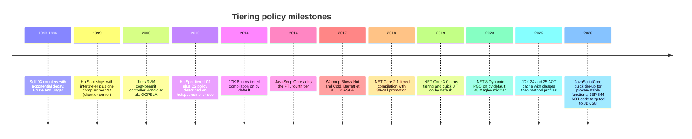
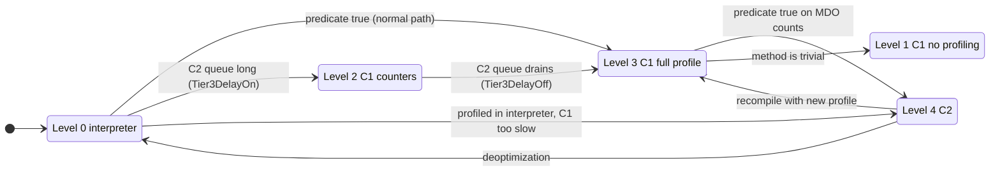
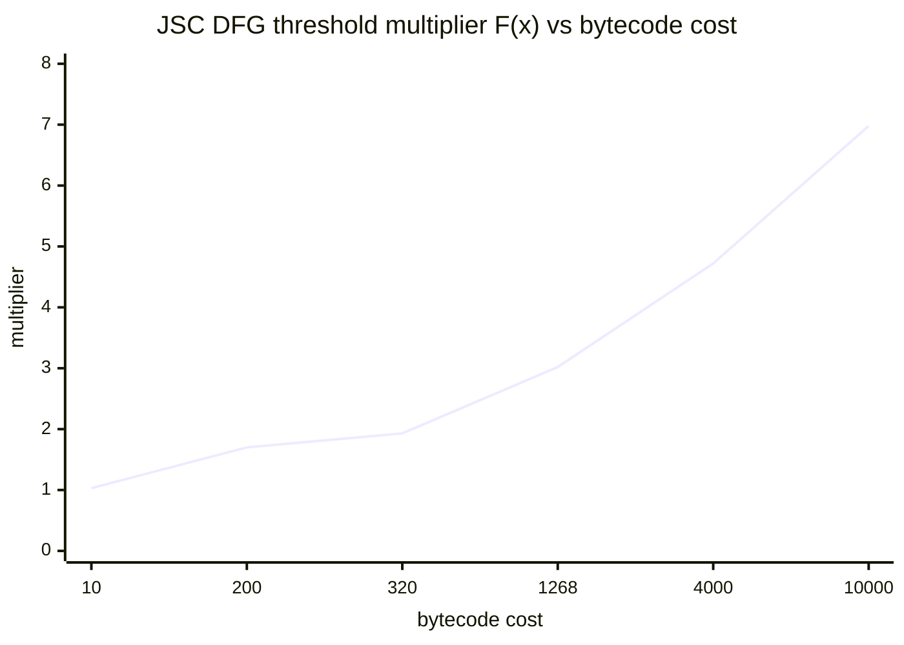
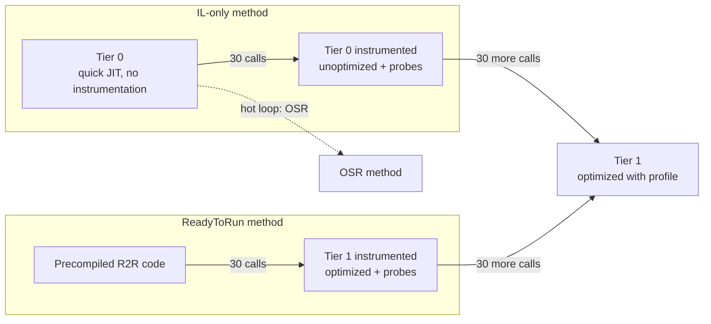
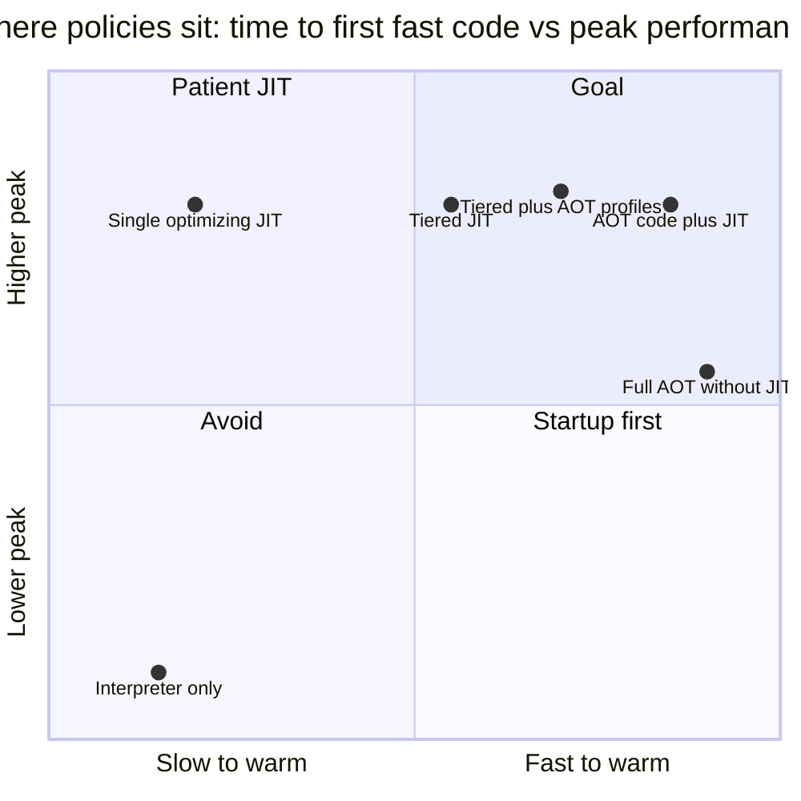

---
tags:
  - compilers
  - runtimes
  - jit
  - tiered-compilation
  - warm-up
  - benchmarking
  - hotspot
  - javascriptcore
  - v8
  - dotnet
  - project-leyden
  - aot-cache
status: complete
sources:
  - https://raw.githubusercontent.com/openjdk/jdk/master/src/hotspot/share/compiler/compilationPolicy.hpp
  - https://raw.githubusercontent.com/openjdk/jdk/master/src/hotspot/share/compiler/compilationPolicy.cpp
  - https://raw.githubusercontent.com/openjdk/jdk/master/src/hotspot/share/compiler/compiler_globals.hpp
  - https://android.googlesource.com/platform/libcore/+/ad85e18f236/hotspot/test/compiler/arguments/CheckCompileThresholdScaling.java
  - https://mail.openjdk.org/pipermail/hotspot-compiler-dev/2010-November/004239.html
  - https://docs.oracle.com/en/java/javase/11/jrockit-hotspot/compilation-optimization.html
  - https://bugs.openjdk.org/browse/JDK-8318480
  - https://raw.githubusercontent.com/WebKit/WebKit/main/Source/JavaScriptCore/bytecode/CodeBlock.cpp
  - https://webkit.googlesource.com/WebKit/+/master/Source/JavaScriptCore/bytecode/ExecutionCounter.cpp
  - https://raw.githubusercontent.com/WebKit/WebKit/main/Source/JavaScriptCore/runtime/OptionsList.h
  - https://raw.githubusercontent.com/WebKit/WebKit/main/Source/JavaScriptCore/runtime/Options.h
  - https://raw.githubusercontent.com/WebKit/WebKit/main/Source/JavaScriptCore/runtime/Options.cpp
  - https://commits.webkit.org/296392@main
  - https://commits.webkit.org/308663@main
  - https://bugs.webkit.org/show_bug.cgi?id=308315
  - https://webkit.googlesource.com/WebKit/+/29abafe9fce0ade50ac74190da4ff71bcd93162d/Source/JavaScriptCore/runtime/Options.h
  - https://raw.githubusercontent.com/v8/v8/main/src/flags/flag-definitions.h
  - https://raw.githubusercontent.com/v8/v8/main/src/execution/tiering-manager.cc
  - https://raw.githubusercontent.com/v8/v8/main/src/interpreter/interpreter-assembler.cc
  - https://v8pedia.void.app/pipeline/feedback
  - https://v8.dev/blog/maglev
  - https://groups.google.com/g/v8-dev/c/PYk2_GGP2Wk/m/gf-YwHp3AgAJ
  - https://chromium-review.googlesource.com/c/v8/v8/+/8287604
  - https://github.com/dotnet/runtime/blob/main/docs/design/features/tiered-compilation.md
  - https://raw.githubusercontent.com/dotnet/runtime/main/src/coreclr/inc/clrconfigvalues.h
  - https://mattwarren.org/2017/12/15/How-does-.NET-JIT-a-method-and-Tiered-Compilation/
  - https://devblogs.microsoft.com/dotnet/performance-improvements-in-net-8/
  - https://learn.microsoft.com/en-ca/dotnet/Core/whats-new/dotnet-8/runtime
  - https://devblogs.microsoft.com/dotnet/bing-on-dotnet-8-the-impact-of-dynamic-pgo/
  - https://learn.microsoft.com/en-us/dotnet/core/whats-new/dotnet-11/runtime
  - https://learn.microsoft.com/dotnet/core/runtime-config/compilation
  - https://www.jikesrvm.org/UserGuide/AdaptiveOptimizationSystem/index.html
  - https://bazaar.launchpad.net/~mwhudson/pypy/imported-funding-16_42/download/head:/reconciling-responsiveness-with-performance.pdf
  - https://arxiv.org/abs/1602.00602v6
  - https://blog.acolyer.org/2017/11/07/virtual-machine-warmup-blows-hot-and-cold/
  - https://arxiv.org/abs/2209.15369
  - https://openjdk.org/jeps/483
  - https://openjdk.org/jeps/515
  - https://openjdk.org/jeps/516
  - https://openjdk.org/jeps/8335368
  - https://inside.java/2026/10/25/jep544-target-jdk28/
  - https://www.infoq.com/news/2026/09/java-news-roundup-sep07-2026/
  - https://developer.android.com/baseline-profiles
created: 2026-11-27
updated: 2026-11-27
---

## Table Of Contents

- [[#TL;DR|TL;DR]]
- [[#The Problem|The Problem]]
- [[#Foundations|Foundations]]
    - [[#The Break-Even Bet|The Break-Even Bet]]
    - [[#Counters, Samples and Rates|Counters, Samples and Rates]]
    - [[#Why Thresholds Scale|Why Thresholds Scale]]
    - [[#What Warm Means|What Warm Means]]
- [[#How We Got Here|How We Got Here]]
- [[#How It Works|How It Works]]
    - [[#HotSpot - Five Levels and a Load-Aware Predicate|HotSpot - Five Levels and a Load-Aware Predicate]]
    - [[#JavaScriptCore - Counters Scaled by Size and Failure|JavaScriptCore - Counters Scaled by Size and Failure]]
    - [[#V8 - A Budget Measured in Bytes|V8 - A Budget Measured in Bytes]]
    - [[#.NET - Call Counting, a Startup Delay and an Instrumented Tier|.NET - Call Counting, a Startup Delay and an Instrumented Tier]]
    - [[#Measuring Warm-up|Measuring Warm-up]]
    - [[#Skipping Warm-up - AOT Caches and Shipped Profiles|Skipping Warm-up - AOT Caches and Shipped Profiles]]
- [[#Where It Is Now|Where It Is Now]]
- [[#Trade-offs & Open Problems|Trade-offs & Open Problems]]
- [[#Resources|Resources]]
- [[#Related Notes|Related Notes]]

## ***TL;DR***
---
*A tiered [[JIT Compilation|JIT]] has several compilers and must keep deciding which one each function deserves, and when. That decision, the tiering policy, is a bet on the future made from counters about the past, and warm-up is the time the program spends paying for the bet before it wins.*

- **The core rule.** Compile a function at a higher tier only once it has run enough that the faster code will win back the compile time. No engine knows the future, so all of them assume that code which has run a lot will keep running; Jikes RVM wrote it down as "if the program has run for time t, then the program will run for another t units" ([Jikes RVM guide](https://www.jikesrvm.org/UserGuide/AdaptiveOptimizationSystem/index.html)).
- **The signals.** Per-function counters bumped on calls and loop back-edges (HotSpot, JavaScriptCore, V8, .NET), or timer samples (Jikes RVM). Back-edge counts are what let long loops trigger [[On-Stack Replacement]].
- **Thresholds are not constants.** HotSpot raises them as compile queues grow; JavaScriptCore scales them with the square root of function size and doubles them after each failed speculation; V8 multiplies them by bytecode length; .NET holds all promotions back while startup is still loading new code.
- **The defaults, as of November 2026 source.** HotSpot: tier 3 (profiled C1) after 200 calls, C2 after 5,000 profiled calls. .NET: 30 calls, after a 100 ms quiet period. V8: Maglev after about 400 runs' worth of bytecode, TurboFan after 3,000. JavaScriptCore: Baseline after a counter of 500 where each call adds 15 and each loop iteration adds 1.
- **Warm-up is messier than the textbook curve.** In the largest careful study, at most 43.5% of VM and benchmark pairs consistently reached a steady state, and many got *slower* over time ([Barrett et al., OOPSLA 2017](https://arxiv.org/abs/1602.00602v6)).
- **The current direction is to skip it.** Project Leyden caches loaded classes (JDK 24), method profiles (JDK 25) and, with JEP 544 targeted to JDK 28, compiled code; .NET ships ReadyToRun code as tier 0; Android ships Baseline Profiles for about 30% faster first launches.

## ***The Problem***
---
*Every tier above the interpreter costs compile time and memory up front and pays back only later. A policy that compiles too early wastes both on code that will soon stop running; one that compiles too late leaves hot code in slow tiers. Users feel the second as slow starts and the first as pauses and memory bloat.*

Take a function that costs 10 µs per call in the interpreter, 4 µs in baseline code that takes 50 µs to compile, and 1 µs in optimized code that takes 5 ms to compile (the worked example in [[JIT Compilation#The Tiering Bet|JIT Compilation]]). The right choice depends entirely on how many more calls are coming:

| Future calls | Best choice | Why |
|---|---|---|
| 5 | Stay in the interpreter | Baseline would save 30 µs but cost 50 µs |
| 100 | Baseline | Saves 600 µs for 50 µs; optimizing would cost 5 ms to save 300 µs |
| 1,000,000 | Optimize | Saves about 3 s for 5 ms |

The engine sees none of the right-hand column. It sees how many times the function *has* run, how long its loops spin, whether its types have been stable, and how busy the compiler threads are. Everything else is policy.

Three facts make this harder than it looks:

- **Compilation competes with the program.** On a machine with few cores, a background compile steals time from the application, and a long compile queue means the code that was hot when it was queued may have gone cold by the time it compiles. HotSpot's policy says so outright: "by the time a method gets compiled it can become unused" ([compilationPolicy.hpp](https://raw.githubusercontent.com/openjdk/jdk/master/src/hotspot/share/compiler/compilationPolicy.hpp)).
- **Optimizing too early is worse than wasted time.** Speculative tiers compile against the types seen so far. Compile before the profile has settled and the code [[Deoptimization and Speculation|deoptimizes]] and must be compiled again, so engines deliberately wait for feedback to stabilize.
- **Startup is a burst.** A server or a web page loads thousands of functions at once, each called a few times. Bing's .NET 8 servers built a re-JIT queue of "over 300,000 methods" before their first query ([.NET blog, 2024](https://devblogs.microsoft.com/dotnet/bing-on-dotnet-8-the-impact-of-dynamic-pgo/)).

Warm-up is the visible result: the stretch from process start until the code that matters is running in its final tier. For a CLI tool, a serverless function or a freshly scaled-up server replica, warm-up can be most of the process's life.

## ***Foundations***
---
*Tiering policies rest on four ideas: a cost-benefit rule that needs a guess about the future, counters that approximate that guess, thresholds that bend with function size and machine load, and a definition of "warm" that turns out to be shaky.*

### The Break-Even Bet

*Every policy is an approximation of one inequality: compile when the time it will save exceeds the time it costs.*

Jikes RVM's adaptive system is the cleanest written-down version. For a method currently compiled at level $i$, it estimates how long the method will run in future ($T_i$) and, for each candidate level $j$, the compile cost ($C_j$) and the future run time at that level ($T_j$). It picks the level that minimizes their sum ([Jikes RVM guide](https://www.jikesrvm.org/UserGuide/AdaptiveOptimizationSystem/index.html); Arnold et al., OOPSLA 2000):

$$
j^* = \arg\min_{j \ge i} \; \big( C_j + T_j \big), \qquad T_j = T_i \cdot \frac{S_i}{S_j}, \qquad C_i = 0
$$

*In plain English: stay put unless some higher level's compile time plus its (faster) future running time beats just continuing as you are. $S_i$ and $S_j$ are the measured speeds of each level, so $T_i \cdot S_i / S_j$ is "the same work, done at level $j$'s speed".* The future time $T_i$ is the one thing nobody can measure, and Jikes simply sets it equal to the time already spent: a method that has run for 2 s is assumed to have 2 s left. Compile cost is modeled "as a linear function of the size of m", with constants measured offline ([Jikes RVM guide](https://www.jikesrvm.org/UserGuide/AdaptiveOptimizationSystem/index.html)).

Counter-based engines never evaluate this formula, but their thresholds encode it: a call threshold is a guess that "N calls so far" predicts enough future calls to pay for the compile at that tier. Higher tiers have higher thresholds because their $C_j$ is larger.

### Counters, Samples and Rates

*Engines learn which code is hot either by counting events in the code itself or by periodically sampling where the program is. Raw counts eventually make everything look hot, so some policies count rates instead.*

| Signal | How it is collected | Used by | Strength | Weakness |
|---|---|---|---|---|
| Invocation counter | Incremented in the prologue of each call | HotSpot, JSC, V8, .NET | Cheap, exact | Misses work inside one long call |
| Back-edge counter | Incremented at the jump back to a loop header | HotSpot, JSC, V8 | Catches hot loops; drives [[On-Stack Replacement|OSR]] | Adds code to every loop |
| Timer samples | Record the running method at each timer tick | Jikes RVM | Measures time, not events | Needs a sampling point (see [[Sampling Profilers and Safepoint Bias]]) |
| Event rate | Counter increments per unit time | HotSpot's compile queue | Spots code that just stopped being hot | Needs periodic bookkeeping |

The pure-count problem was spotted early. In Self-93, Hölzle and Ungar let invocation counters "decay exponentially over time", which turns counts into rates; without decay, "every single method will eventually exceed the recompilation threshold, and thus will be optimized" ([Hölzle and Ungar, TOPLAS 1996](https://bazaar.launchpad.net/~mwhudson/pypy/imported-funding-16_42/download/head:/reconciling-responsiveness-with-performance.pdf)). Their example halves a counter's value every 15 seconds by dividing all counters by about 1.2 every 4 seconds:

$$
c(t + \Delta) = c(t) \cdot 2^{-\Delta / h}, \qquad 2^{-4/15} \approx \frac{1}{1.2}
$$

*In plain English: with half-life $h = 15$ s, a counter left alone for 15 seconds is worth half as much; dividing by 1.2 every 4 seconds achieves exactly that.* The paper reports that decay "significantly reduces compile pauses by reducing the number of recompilations", and that it is "possible to trade around 10% execution speed for much better interactive behavior". Modern HotSpot dropped the idea in its counters (the `UseCounterDecay` flag was found unused and obsoleted, [JDK-8318480](https://bugs.openjdk.org/browse/JDK-8318480)) and uses rates in a different place: to order its compile queue.

### Why Thresholds Scale

*A fixed threshold treats a 3-line getter and a 3,000-line function alike. Every production engine adjusts thresholds for at least one of function size, compiler load, and past failure.*

- **Size.** Compile cost grows with function size, so a big function should prove itself longer before an optimizing compile. JavaScriptCore scales its optimization thresholds by a fitted curve in the square root of bytecode cost; V8 multiplies its budget by bytecode length.
- **Load.** If compiler threads are behind, adding work only lengthens the queue. HotSpot multiplies its thresholds by a factor that grows with queue length per compiler thread.
- **Failure.** Code that deoptimized once may do so again. JavaScriptCore doubles its thresholds for each reoptimization; V8 delays Maglev for functions whose earlier Maglev code deoptimized early.
- **Machine.** Fewer cores mean background compiles hurt more. JavaScriptCore raises its DFG and FTL thresholds on Apple silicon Macs with two or fewer performance cores and its FTL thresholds on small Linux ARM64 devices ([Options.cpp](https://raw.githubusercontent.com/WebKit/WebKit/main/Source/JavaScriptCore/runtime/Options.cpp)). .NET multiplies its startup delay by 10 on a single processor ([clrconfigvalues.h](https://raw.githubusercontent.com/dotnet/runtime/main/src/coreclr/inc/clrconfigvalues.h)).

### What Warm Means

*The textbook picture is a curve that starts slow, drops as hot code is compiled, and flattens at a steady peak. Benchmarks discard the slow part and report the flat part. That picture is often wrong.*

The traditional model, as Barrett et al. describe it, is that a JIT-based VM "runs slowly while it identifies and compiles hot code, then runs fast at a steady state of peak performance", so benchmark harnesses throw away early iterations ([arXiv 1602.00602](https://arxiv.org/abs/1602.00602v6)). They classified each run of in-process iterations as:

| Class | Meaning | Good? |
|---|---|---|
| Flat | Reached a steady state, with no visible warm-up | Yes |
| Warmup | Reached a steady state faster than the start | Yes |
| Slowdown | Reached a steady state *slower* than some earlier segment | No |
| No steady state | Still changing at the end of 2,000 iterations | No |

Their results are in [[#Measuring Warm-up]]; the short version is that "warmed up" is a hypothesis to test, not an assumption to make.

## ***How We Got Here***
---
*Adaptive recompilation started in Self, became the default design with HotSpot and Jikes RVM, gained more tiers as JavaScript engines competed, and in the 2020s turned toward carrying tiering knowledge across runs.*

- **Self (1990s).** Self-93 kept an invocation counter per unoptimized method, invoked a recompilation driver when a counter passed its limit, and let counts decay so only *currently* hot methods qualified. Its goal was responsiveness: pauses short enough that an interactive programmer wouldn't notice ([Hölzle and Ungar](https://bazaar.launchpad.net/~mwhudson/pypy/imported-funding-16_42/download/head:/reconciling-responsiveness-with-performance.pdf)).
- **HotSpot and Jikes RVM (1999 to 2000).** HotSpot shipped two separate VMs, "client" (C1) and "server" (C2), each with one compile threshold; the server VM waited for 10,000 interpreted invocations by default ([Oracle docs](https://docs.oracle.com/en/java/javase/11/jrockit-hotspot/compilation-optimization.html)). Jikes RVM, with no interpreter, took the sampling and cost-benefit route above.
- **Tiered HotSpot (2010 to 2014).** Tiered compilation combined C1 for quick, profiling code with C2 for peak code. Igor Veresov's 2010 mailing-list answer gave the tier 3 thresholds still used today, 200, 100 and 2000 ([hotspot-compiler-dev](https://mail.openjdk.org/pipermail/hotspot-compiler-dev/2010-November/004239.html)); it became the default "from JDK 8" ([Oracle docs](https://docs.oracle.com/en/java/javase/11/jrockit-hotspot/compilation-optimization.html)).
- **JavaScript engines (2008 onward).** Browser competition produced four-tier pipelines (JSC: LLInt, Baseline, DFG, FTL; V8: Ignition, Sparkplug, Maglev, TurboFan), each with its own thresholds and a stability check before speculative tiers.
- **.NET (2018 onward).** .NET had no interpreter, so it added a quick, unoptimized "tier 0" JIT and promoted methods after 30 calls ([Matt Warren, 2017](https://mattwarren.org/2017/12/15/How-does-.NET-JIT-a-method-and-Tiered-Compilation/); [design doc](https://github.com/dotnet/runtime/blob/main/docs/design/features/tiered-compilation.md)). Tiering and quick JIT became defaults in .NET Core 3.0 ([runtime config docs](https://learn.microsoft.com/dotnet/core/runtime-config/compilation)), and .NET 8 put an instrumented tier between them by turning on Dynamic PGO.
- **Across runs (2020s).** Profiles and compiled code started to outlive the process: Android Baseline and Cloud Profiles, Leyden's AOT cache, V8's per-function cached tiering decisions and JSC's per-function stability flags.

## ***How It Works***
---
*Four production engines show four styles of the same idea: HotSpot's load-aware predicates, JavaScriptCore's size- and failure-scaled counters, V8's byte budget, and .NET's call counting with a startup delay. Then: how to measure warm-up, and how to avoid it.*

### HotSpot - Five Levels and a Load-Aware Predicate

*HotSpot runs every method through some path over five levels, chosen by one predicate on invocation and back-edge counts, scaled by how backed up the compilers are.*

The levels, as the current source defines them ([compilationPolicy.hpp](https://raw.githubusercontent.com/openjdk/jdk/master/src/hotspot/share/compiler/compilationPolicy.hpp)):

| Level | What runs | Profiling |
|---|---|---|
| 0 | Interpreter | Counters; full profile in an MDO (MethodData object) if started |
| 1 | C1, fully optimized | None (for trivial methods) |
| 2 | C1 | Invocation and back-edge counters only |
| 3 | C1 | Full profiling into the MDO |
| 4 | C2 | None; uses the MDO for profile-guided optimization |

**The predicate.** For a transition to level X, with $i$ invocations, $b$ back-edges and a scaling factor $s$:

$$
i > I_X \cdot s \;\;\lor\;\; \big(i > I^{\min}_X \cdot s \;\land\; i + b > C_X \cdot s\big)
$$

*In plain English: compile if the method has been called a lot, or if it has been called a fair amount and its calls plus loop iterations add up to a lot. The second clause lets a method that is called rarely but loops heavily qualify.* The source's stated intuition is "to equalize the time that is spend profiling each method" ([compilationPolicy.hpp](https://raw.githubusercontent.com/openjdk/jdk/master/src/hotspot/share/compiler/compilationPolicy.hpp)). OSR is separate: it triggers when $b > B_X \cdot s$. For the 3 to 4 step, $i$ and $b$ come from the MDO, so they count only profiled executions.

The default thresholds on JDK master ([compiler_globals.hpp](https://raw.githubusercontent.com/openjdk/jdk/master/src/hotspot/share/compiler/compiler_globals.hpp)):

| Flag | Tier 3 (to profiled C1) | Tier 4 (to C2) |
|---|---|---|
| InvocationThreshold $I_X$ | 200 | 5,000 |
| MinInvocationThreshold $I^{\min}_X$ | 100 | 600 |
| CompileThreshold $C_X$ | 2,000 | 15,000 |
| BackEdgeThreshold $B_X$ (OSR) | 60,000 | 40,000 |

`-XX:CompileThresholdScaling` multiplies all of them linearly (0.75 turns 200 into 150, 2.0 turns it into 400) ([CheckCompileThresholdScaling test](https://android.googlesource.com/platform/libcore/+/ad85e18f236/hotspot/test/compiler/arguments/CheckCompileThresholdScaling.java)).

**The load feedback.** The scaling factor grows with the queue:

$$
s = \frac{q_X}{L_X \cdot n_X} + 1
$$

*In plain English: $q_X$ is how many methods wait in level X's compile queue, $n_X$ is how many compiler threads serve it, and $L_X$ is the load-feedback setting. Every $L_X$ queued methods per thread add 1 to the multiplier.* Defaults: `Tier3LoadFeedback` = 5, `Tier4LoadFeedback` = 3, so tier 3 thresholds "increase twofold when C1 queue size reaches this amount per compiler thread" ([compiler_globals.hpp](https://raw.githubusercontent.com/openjdk/jdk/master/src/hotspot/share/compiler/compiler_globals.hpp)).

**Worked example.** A method has been called $i = 150$ times and its loop has run $b = 3{,}000$ iterations in total.

- Empty C1 queue, $s = 1$: $150 > 200$ fails, but $150 > 100$ and $150 + 3000 = 3150 > 2000$, so it goes to tier 3.
- Ten methods queued for one C1 thread: $s = 10/(5 \cdot 1) + 1 = 3$. Now it needs $i > 300$, or $i > 300$ and $i + b > 6000$. It waits. If it stops being called, it never takes a queue slot.

**Tier3Delay, the congestion escape.** Level 3 code is "about 30% slower" than level 2 because of its profiling. Normally methods go 0 → 3 → 4, but if the C2 queue is long, a method would sit in slow level 3 code waiting for C2. So when the C2 queue exceeds `Tier3DelayOn` = 5 methods per C2 thread, the policy switches to 0 → 2, and returns to 2 → 3 transitions once it falls below `Tier3DelayOff` = 2; the gap is hysteresis "to avoid jitter" ([compilationPolicy.hpp](https://raw.githubusercontent.com/openjdk/jdk/master/src/hotspot/share/compiler/compilationPolicy.hpp); [compiler_globals.hpp](https://raw.githubusercontent.com/openjdk/jdk/master/src/hotspot/share/compiler/compiler_globals.hpp)).

**Other moves.**

- **Priority by rate.** Compile queues are priority queues keyed on each method's event rate $d(i+b)/dt$, so the hottest method compiles next, and methods whose rate has been zero for a while are dropped as stale.
- **Trivial methods** go to level 1 instead of 4, since C2 would produce the same code.
- **Interpreter profiling.** If C1 is slow to deliver level 3 code and the C2 queue is short, the interpreter starts profiling once counters reach `Tier0ProfilingStartPercentage` = 200% of the tier 3 thresholds, and can go straight from 0 to 4.

### JavaScriptCore - Counters Scaled by Size and Failure

*JSC counts calls and loop iterations in one counter with different weights, and scales its optimization thresholds by function size, past failures, memory pressure and core count.*

**One counter, two weights.** Each call adds 15 and each loop iteration adds 1 (`executionCounterIncrementForEntry` = 15, `executionCounterIncrementForLoop` = 1). The counter is stored negative and counts up toward zero: `setThreshold` stores `m_counter = -threshold`, so the hot-path check is just "has it crossed zero" ([ExecutionCounter.cpp](https://webkit.googlesource.com/WebKit/+/master/Source/JavaScriptCore/bytecode/ExecutionCounter.cpp)).

**Base thresholds** on WebKit main ([OptionsList.h](https://raw.githubusercontent.com/WebKit/WebKit/main/Source/JavaScriptCore/runtime/OptionsList.h)):

| Tier-up | Option | Default | Roughly means |
|---|---|---|---|
| LLInt → Baseline | `thresholdForJITAfterWarmUp` | 500 | About 34 calls of a loop-free function, or 500 loop iterations |
| Baseline → DFG | `thresholdForOptimizeAfterWarmUp` | 1,000 | Before size scaling |
| DFG → FTL | `thresholdForFTLOptimizeAfterWarmUp` | 64,000 | Lowered from 100,000 in June 2025 ([commit](https://commits.webkit.org/296392@main)) |
| Reoptimize after exits | `osrExitCountForReoptimization` | 100 | OSR exits before jettisoning optimized code |

The 100,000 FTL value is what older sources show ([2014-era Options.h](https://webkit.googlesource.com/WebKit/+/29abafe9fce0ade50ac74190da4ff71bcd93162d/Source/JavaScriptCore/runtime/Options.h)); the June 2025 change says only that "from various metrics collection, this number is right now the best".

**Size scaling.** Optimization thresholds are multiplied by a curve in the function's bytecode cost $x$ ([CodeBlock.cpp](https://raw.githubusercontent.com/WebKit/WebKit/main/Source/JavaScriptCore/bytecode/CodeBlock.cpp)):

$$
F(x) = 0.825914 + 0.061504 \sqrt{x + 1.02406}
$$

*In plain English: small functions get a multiplier near 1, and the multiplier grows only with the square root of size, so a function 100 times bigger waits only about 7 times longer.* The comment explains the shape: "Small code blocks are cheap to optimize and so we should do it sooner", "Large code blocks are expensive to optimize and so we should postpone doing so", and the square root reflects the intuition that the threshold should be "more sensitive to small changes in small values of x". The constants came from a least-squares fit, in Mathematica, to six hand-picked points, two of them from a function in the 3d-cube benchmark that was compiled too eagerly. The fit set the linear term to zero.

*(Values computed from the formula above.)*

**Failure scaling.** The final threshold is

$$
\text{threshold} = \text{base} \cdot F(x) \cdot 2^{R}
$$

where $R$ is the function's reoptimization retry counter: each time optimized code is thrown away after too many speculation failures, the next attempt needs twice the evidence, and the exit-count threshold doubles the same way ([CodeBlock.cpp](https://raw.githubusercontent.com/WebKit/WebKit/main/Source/JavaScriptCore/bytecode/CodeBlock.cpp)). This is the $100 \cdot 2^R$ rule in [[Deoptimization and Speculation]].

**Memory pressure.** On top, `applyMemoryUsageHeuristics` multiplies by `ExecutableAllocator::memoryPressureMultiplier` of the function's predicted machine-code size, so thresholds rise as the JIT's executable memory fills ([ExecutionCounter.cpp](https://webkit.googlesource.com/WebKit/+/master/Source/JavaScriptCore/bytecode/ExecutionCounter.cpp)). See [[Code Cache Management]].

**Worked example.** A function with bytecode cost 200, running in Baseline, has never deoptimized. Its DFG threshold is $1000 \times 1.70 \times 2^0 \approx 1{,}700$ counter units: about 113 calls if it has no loops, or one call whose loop runs 1,700 times. After two rounds of failed speculation, it needs $1000 \times 1.70 \times 4 \approx 6{,}800$.

### V8 - A Budget Measured in Bytes

*V8 gives each function a budget of bytecode bytes to execute before it reconsiders the function's tier. Because the budget is proportional to the function's length, "400 invocations" means "400 runs' worth of this function's bytecode", however that work is split between calls and loop iterations.*

**The budget.** `InterruptBudgetFor` computes `invocations * bytecode_length`, clamped ([tiering-manager.cc](https://raw.githubusercontent.com/v8/v8/main/src/execution/tiering-manager.cc)). The interpreter subtracts from it at loop back-jumps (the jump distance plus the current bytecode) and at returns, where it charges the bytes from the start of the function "to simulate backedge to start of function" ([interpreter-assembler.cc](https://raw.githubusercontent.com/v8/v8/main/src/interpreter/interpreter-assembler.cc)). When the budget runs out, the `TieringManager` decides.

The thresholds, from V8's main branch ([flag-definitions.h](https://raw.githubusercontent.com/v8/v8/main/src/flags/flag-definitions.h)):

| Flag | Default | Purpose |
|---|---|---|
| `invocation_count_for_feedback_allocation` | 8 | Allocate a feedback vector (inline-cache storage) |
| `invocation_count_for_maglev` | 400 (1,000 on Android) | Tier up to Maglev |
| `invocation_count_for_turbofan` | 3,000 | Tier up to TurboFan |
| `invocation_count_for_osr` / `_maglev_osr` | 500 / 100 | Budget for loop OSR |
| `minimum_invocations_after_ic_update` | 500 | Wait after an inline cache changes before tiering |
| `max_optimized_bytecode_size` | 60 KB | Larger functions are never TurboFan-compiled |
| `invocation_count_for_early_optimization` | 30 | Budget when a cached decision says "optimize early" |

**Rules on top of the budget.**

- **Wait for stable feedback.** If an inline cache changed recently, the budget is reset so tiering waits for `minimum_invocations_after_ic_update` more runs; speculating on churning types only buys a deopt.
- **Don't interrupt yourself.** While a non-OSR compile is already in flight, the budget is set to its maximum; while an OSR compile is in flight, the loop budget is stretched 3x (`invocation_count_for_osr_factor_while_tiering_in_progress`).
- **Cached tiering decisions.** Each function's `SharedFunctionInfo` (the per-source-function record that all its closures share) stores a 3-bit `CachedTieringDecision`. `kEarlyMaglev` and `kEarlyTurbofan` cut the budget to 30 runs; `kDelayMaglev` adds 600 runs for functions likely to deoptimize, and `kEarlyTurbofan` can skip Maglev entirely ([tiering-manager.cc](https://raw.githubusercontent.com/v8/v8/main/src/execution/tiering-manager.cc)). An August 2026 change by Intel's Tao Pan also sets `kDelayMaglev` when a Maglev compile aborts, "avoiding immediate re-compilation that would likely lead to another deoptimization or abort" ([CL 8287604](https://chromium-review.googlesource.com/c/v8/v8/+/8287604)).
- **Power modes.** Efficiency or battery-saving modes can skip or delay tier-up steps ([v8pedia](https://v8pedia.void.app/pipeline/feedback)).
- **Fuzzing.** `--jit-fuzzing` lowers Maglev to 10 and TurboFan to 20 runs, so fuzzers reach the optimizing tiers quickly ([flag-definitions.h](https://raw.githubusercontent.com/v8/v8/main/src/flags/flag-definitions.h)). See [[Compiler Testing and Fuzzing]].

**Why a mid tier changes the policy.** Maglev compiles "roughly 10x slower than Sparkplug, and 10x faster than TurboFan", so V8 can use it "much earlier than we'd want to deploy TurboFan", since a wrong speculation costs little; and because Maglev code is already fast, TurboFan compiles can wait longer. V8 reported energy savings of about 3.5% on JetStream and 10% on Speedometer from Maglev, partly from "less off-thread CPU time" ([V8 blog, Dec 2023](https://v8.dev/blog/maglev)).

### .NET - Call Counting, a Startup Delay and an Instrumented Tier

*.NET has no interpreter by default, so its first tier is a fast, unoptimized JIT. Methods are promoted after 30 calls, but only once startup has quieted down, and since .NET 8 they pass through an instrumented tier that feeds Dynamic PGO.*

*(Flow per Toub's .NET 8 performance post and `TieredPGO_InstrumentOnlyHotCode` = 1; the 30-call figure applies at each counted step.)*

**Call counting.** Calls go through a stub that counts them; after `TC_CallCountThreshold` = 30 calls the method is queued for the next tier and the stub is back-patched to point to the new code ([clrconfigvalues.h](https://raw.githubusercontent.com/dotnet/runtime/main/src/coreclr/inc/clrconfigvalues.h); [Matt Warren](https://mattwarren.org/2017/12/15/How-does-.NET-JIT-a-method-and-Tiered-Compilation/)).

**The startup delay.** `TC_CallCountingDelayMs` = 100 is "a perpetual delay in milliseconds that is applied to call counting in tier 0 and jitting at higher tiers, while there is startup-like activity" ([clrconfigvalues.h](https://raw.githubusercontent.com/dotnet/runtime/main/src/coreclr/inc/clrconfigvalues.h)). The original design: a 100 ms timer starts, any new tier 0 JIT activity resets it, and call counting begins only once 100 ms pass with no new tier 0 code ([design doc](https://github.com/dotnet/runtime/blob/main/docs/design/features/tiered-compilation.md)). The idea is that while new methods are still being loaded, the program is in startup and the CPU is better spent on tier 0 than on optimizing. On a single processor the delay is multiplied by 10 (`TC_DelaySingleProcMultiplier`). Bing set it to 0 to cut time spent in instrumented code ([.NET blog](https://devblogs.microsoft.com/dotnet/bing-on-dotnet-8-the-impact-of-dynamic-pgo/)).

**Background compilation.** Tier 1 compiles run on a background worker, so promotion never blocks the calling thread.

**The instrumented tier.** "Instrumentation isn't free", so .NET 8 does not instrument tier 0. Code first runs uninstrumented; after enough calls it is recompiled with probes, still unoptimized, and after more calls compiled optimized with the collected profile. ReadyToRun code, already optimized, is recompiled optimized *and* instrumented before final tier 1 ([Toub, .NET 8](https://devblogs.microsoft.com/dotnet/performance-improvements-in-net-8/)). Dynamic PGO "is now enabled by default" in .NET 8 and "increases performance by about 15%" on average ([What's new in .NET 8](https://learn.microsoft.com/en-ca/dotnet/Core/whats-new/dotnet-8/runtime)). Bing measured 13% fewer CPU cycles per query, but first had to add warm-up queries and a pause before taking traffic so the re-JIT queue could drain ([.NET blog](https://devblogs.microsoft.com/dotnet/bing-on-dotnet-8-the-impact-of-dynamic-pgo/)).

**Loops.** Methods with loops tier like the rest because OSR covers long-running loops: `TC_QuickJitForLoops` defaults to on where OSR is built in, and an OSR patchpoint must be hit `OSR_HitLimit` = 10 times, with counters reloaded at 1,000 ([clrconfigvalues.h](https://raw.githubusercontent.com/dotnet/runtime/main/src/coreclr/inc/clrconfigvalues.h)). The details are in [[On-Stack Replacement]].

### Measuring Warm-up

*Measuring warm-up means running a program many times, each for many iterations, and testing statistically whether and when performance settles. When people have done this carefully, they found that "settles" often fails to happen.*

**Barrett et al. (OOPSLA 2017).** Seven VMs (Graal, HHVM, JRuby+Truffle, HotSpot, LuaJIT, PyPy, V8) plus GCC as a non-JIT baseline ran five Benchmarks Game microbenchmarks on three machines: 3,660 process executions of 2,000 in-process iterations each. A harness called Krun rebooted the machine before each process, waited for temperatures to return to baseline, and shut down network interfaces and most daemons. Changepoint analysis then classified each run ([arXiv 1602.00602](https://arxiv.org/abs/1602.00602v6); [the morning paper](https://blog.acolyer.org/2017/11/07/virtual-machine-warmup-blows-hot-and-cold/)).

| Machine | Flat | Warmup | Slowdown | No steady state |
|---|---|---|---|---|
| Linux, Xeon E3-1240 v5 | 20.9% | 51.5% | 17.9% | 9.6% |
| Linux, i7-4790 | 26.4% | 48.3% | 16.7% | 8.7% |
| OpenBSD, i7-4790 | 34.0% | 52.1% | 11.1% | 2.8% |

*(Percentages of process executions, read from the paper's table in row order.)*

Only 30% to 43.5% of (VM, benchmark) pairs consistently reached a steady state, depending on the machine, and the paper says none of the seven VMs consistently reached a steady state of peak performance. These are small, deterministic, heavily studied programs; the problem is not noisy benchmarks.

**Traini et al. (Empirical Software Engineering, 2022).** On 586 JMH microbenchmarks from 30 Java projects (about 9 billion invocations over about 93 days), 10.9% of forks never reached a steady state. Developers' configured warm-up periods were wrong most of the time: too long in 48.29% of forks (wasting on average 37 seconds per fork) and too short in 32.42%, where the measurements were off by at least 5% in 57% of cases ([arXiv 2209.15369](https://arxiv.org/abs/2209.15369)).

**What this means in practice.**

- Run several *processes* (see [[Compiler Benchmarking Methodology]]), not just many iterations in one process: tiering decisions, code layout and GC timing differ from process to process.
- Plot every iteration and look for slowdowns and late jumps before averaging. A late deopt-then-recompile, a compile-queue backlog or a GC change can each show up as a step.
- Report time-to-steady-state (or its absence) as a result in its own right; for short-lived processes it matters more than peak speed.
- Engine logs help to attribute steps: HotSpot's `-XX:+PrintCompilation` shows each compile with its level, and profilers that understand JIT code are covered in [[Sampling Profilers and Safepoint Bias]].

### Skipping Warm-up - AOT Caches and Shipped Profiles

*If warm-up is the price of learning what the program does, the fix is to learn it once, in a training run, and ship the knowledge. The JVM, .NET and Android now all do some version of this.*

**Project Leyden's AOT cache.** A training run records what the application did; a later run starts from that record.

| JEP | Release | What is cached | Reported effect |
|---|---|---|---|
| 483 | JDK 24 | Loaded and linked classes | Spring PetClinic startup 4.486 s → 2.604 s, 42%, for a 130 MB cache ([JEP 483](https://openjdk.org/jeps/483)) |
| 515 | JDK 25 | Method profiles | Small Stream program 90 ms → 73 ms for 250 KB more cache ([JEP 515](https://openjdk.org/jeps/515)) |
| 516 | JDK 26 | Heap objects, with any GC including ZGC | Brings the cache to ZGC ([JEP 516](https://openjdk.org/jeps/516)) |
| 544 | Targeted to JDK 28 | Compiled native code | Targeted in October 2026 ([inside.java](https://inside.java/2026/10/25/jep544-target-jdk28/)) |

The workflow is three steps: run with `-XX:AOTMode=record`, create the cache with `-XX:AOTMode=create`, then start production runs with `-XX:AOTCache=app.aot`; an unusable cache only produces a warning ([JEP 483](https://openjdk.org/jeps/483)).

The policy interacts with these caches in two ways:

- **Profiles move the thresholds.** With JEP 515, "the JIT runs earlier and with more accuracy", while HotSpot "continues to profile and optimize the application as it runs" ([JEP 515](https://openjdk.org/jeps/515)). On JDK master, the compilation policy has explicit *trained transitions*: a method that reached C2 during training, with a stored profile, can be compiled without waiting for the usual counters, and methods can be compiled early once their classes' initialization dependencies are met ([compilationPolicy.cpp](https://raw.githubusercontent.com/openjdk/jdk/master/src/hotspot/share/compiler/compilationPolicy.cpp)).
- **Cached code is a tier, not the end.** The AOT code draft says the JIT "is then free to delay the generation of native code, unless and until the previously generated code proves insufficiently performant", that AOT code "might be deoptimized and replaced" when production differs from training, and that "totally excluding the JIT often leads to lower peak performance" ([JEP draft 8335368](https://openjdk.org/jeps/8335368)). JDK master's policy already considers "replacing conservatively compiled AOT Preload code with faster AOT code or normal JITed code" ([compilationPolicy.cpp](https://raw.githubusercontent.com/openjdk/jdk/master/src/hotspot/share/compiler/compilationPolicy.cpp)).

**.NET ReadyToRun.** "For methods that are precompiled in ReadyToRun images, the precompiled code is the tier0 version" ([design doc](https://github.com/dotnet/runtime/blob/main/docs/design/features/tiered-compilation.md)): startup skips the JIT, and hot methods still tier up through the instrumented tier to profile-optimized tier 1.

**Android Baseline and Cloud Profiles.** Apps ship a list of hot code that ART compiles ahead of time at install, which Google says improves "code execution speed by about 30% from the first launch". Google Play adds Cloud Profiles aggregated from real users, which "take several hours to days after an update to be distributed" ([Android Developers](https://developer.android.com/baseline-profiles)). Without either, code is interpreted, JIT-compiled, or compiled to an `odex` file in the background when the device is idle.

The common catch: a training run must look like production. See [[Profile-Guided Optimization]] for the same problem in static compilers.

## ***Where It Is Now***
---
*As of November 2026: the thresholds themselves move slowly, the active work is on carrying knowledge across runs (Leyden, cached tiering decisions, quick tier-up), and on tuning policies per device class.*

- **HotSpot.** The tiered thresholds on JDK master are the ones Veresov listed in 2010 (200, 100, 2000 for tier 3) ([compiler_globals.hpp](https://raw.githubusercontent.com/openjdk/jdk/master/src/hotspot/share/compiler/compiler_globals.hpp)). The change is in what feeds the policy: AOT method profiles shipped in JDK 25, the AOT cache works with any GC since JDK 26, and JEP 544, Ahead-of-Time Code Compilation, moved from draft to Candidate in September 2026 ([InfoQ](https://www.infoq.com/news/2026/09/java-news-roundup-sep07-2026/)) and was targeted to JDK 28 in October ([inside.java](https://inside.java/2026/10/25/jep544-target-jdk28/)). JDK 27 (September 2026) included no Leyden JEP (see [[JIT Compilation]]).
- **JavaScriptCore.** In February and March 2026 WebKit added *quick DFG tier-up* and *quick FTL tier-up*: each function's shared unlinked code block records whether its DFG compile has proved stable, and "functions with proven DFG stability from previous iterations use an aggressive threshold" ([bug 308315](https://bugs.webkit.org/show_bug.cgi?id=308315)). Only speculation failures (OSR exits, watchpoint invalidations, failed OSR entry) mark a function unstable, not GC or debugger events, and "once False, always False". The default factors are 0.15 on Mac and 0.2 elsewhere for DFG; quick FTL tier-up is on only on macOS ([Options.h](https://raw.githubusercontent.com/WebKit/WebKit/main/Source/JavaScriptCore/runtime/Options.h); [commit 308663](https://commits.webkit.org/308663@main)). The FTL threshold fell from 100,000 to 64,000 in June 2025, and current source raises thresholds on low-core Apple silicon Macs and small Linux ARM64 devices.
- **V8.** Four tiers with the budgets above, cached per-function tiering decisions that are still being extended (the August 2026 Maglev-abort change), and "Leaptiering", a new tier-up infrastructure that its author planned to enable by default in V8 13.4 ([v8-dev, Dec 2024](https://groups.google.com/g/v8-dev/c/PYk2_GGP2Wk/m/gf-YwHp3AgAJ)). I found no later public post confirming the default switch.
- **.NET.** The policy (30 calls, 100 ms delay, Dynamic PGO on, OSR for loops) is unchanged in current source ([clrconfigvalues.h](https://raw.githubusercontent.com/dotnet/runtime/main/src/coreclr/inc/clrconfigvalues.h)). .NET 11 (November 2026) makes async method bodies go through tiering too, "so hot async methods get tier 1 optimizations after warm-up", and raises the ReadyToRun hardware baseline, which "might result in additional jitting overhead" on older CPUs ([What's new in .NET 11](https://learn.microsoft.com/en-us/dotnet/core/whats-new/dotnet-11/runtime)).
- **Android.** Baseline Profiles plus Cloud Profiles remain the recommended route for first-launch speed ([Android Developers](https://developer.android.com/baseline-profiles)).

## ***Trade-offs & Open Problems***
---
*Every knob in a tiering policy trades startup against peak, compile CPU against application CPU, and code memory against speed. Most knobs were tuned by hand against a few benchmark suites, and nobody knows how well they fit any particular application.*

*(Positions are qualitative, based on the sources above; the JEP draft notes that excluding the JIT "often leads to lower peak performance".)*

| Knob | Lower | Higher |
|---|---|---|
| Call and loop thresholds | Faster warm-up; more compiles of code that goes cold; more deopts from immature profiles | Fewer wasted compiles; longer time in slow tiers |
| Number of tiers | Less code and fewer transitions | Smoother warm-up curve; more code memory and more [[Deoptimization and Speculation|deopt]] paths |
| Compiler threads | Less CPU taken from the app | Shorter queues, earlier fast code |
| Profiling tier length | Code reaches fast tiers sooner | Better profiles for [[Profile-Guided Optimization|PGO]] decisions |
| Startup delay (.NET) | Faster promotion during startup | Less compile work competing with loading |

**Open problems.**

- **Hand-tuned constants.** JSC's size curve was fitted to six points, one chosen because a 3d-cube function "was expensive to compile and didn't run often enough"; its FTL threshold changed by 36% in 2025 on internal metrics. Learned or adaptive policies are an obvious research direction (see [[ML-Guided Optimization]]), but no production engine I found uses one.
- **Rates versus counts.** Self showed that decayed counts reduce pauses; modern HotSpot dropped counter decay and uses rates only to order its queue. Neither approach handles phase changes well, where a program switches to new hot code.
- **Benchmark validity.** Barrett et al. and Traini et al. show that warm-up is often absent, inconsistent across runs, or misjudged by developers. Engines tuned on benchmarks that discard warm-up may be optimizing the wrong part of the curve.
- **Training-production mismatch.** AOT profiles and code assume the training run is "a good source of observations" ([JEP 515](https://openjdk.org/jeps/515)). When it isn't, the engine pays to deopt and recompile, and the training cost moves to the build.
- **Cross-run caching versus security.** Persisting tiering decisions and compiled code adds cache-invalidation and integrity questions similar to those in [[Persistent Compiler Caches]], and JIT memory is already a security boundary (see [[Software Fault Isolation]]).
- **Interaction with OSR and code caches.** OSR compiles count against the same queues and memory as normal compiles, and per-loop OSR code can bloat the cache. See [[On-Stack Replacement]] and [[Code Cache Management]].
- **Energy and small devices.** V8 measured energy savings from a mid tier, and JSC and V8 now set per-platform thresholds. On battery-powered or few-core devices, the break-even point of the [[#The Break-Even Bet|bet]] moves, and policies are only beginning to model it.

## ***Resources***
---
*Start with HotSpot's `compilationPolicy.hpp` comment, the best plain-English description of a production policy; then JSC's `optimizationThresholdScalingFactor` comment for the honest story of how thresholds get picked; then Barrett et al. for why "warmed up" needs measuring.*

**Theory and history**
- [Reconciling Responsiveness with Performance in Pure Object-Oriented Languages](https://bazaar.launchpad.net/~mwhudson/pypy/imported-funding-16_42/download/head:/reconciling-responsiveness-with-performance.pdf): Hölzle and Ungar, TOPLAS 1996. Counters, decay and pause times in Self-93.
- [Jikes RVM Adaptive Optimization System](https://www.jikesrvm.org/UserGuide/AdaptiveOptimizationSystem/index.html): the cost-benefit controller from Arnold et al., OOPSLA 2000.

**HotSpot**
- [compilationPolicy.hpp](https://raw.githubusercontent.com/openjdk/jdk/master/src/hotspot/share/compiler/compilationPolicy.hpp) and [compilationPolicy.cpp](https://raw.githubusercontent.com/openjdk/jdk/master/src/hotspot/share/compiler/compilationPolicy.cpp): the policy, its predicates and trained transitions.
- [compiler_globals.hpp](https://raw.githubusercontent.com/openjdk/jdk/master/src/hotspot/share/compiler/compiler_globals.hpp): every threshold with its description.
- [Tiered compilation and CompileThreshold](https://mail.openjdk.org/pipermail/hotspot-compiler-dev/2010-November/004239.html): Igor Veresov, 2010.
- [CheckCompileThresholdScaling.java](https://android.googlesource.com/platform/libcore/+/ad85e18f236/hotspot/test/compiler/arguments/CheckCompileThresholdScaling.java): how scaling changes each flag.

**JavaScriptCore**
- [CodeBlock.cpp](https://raw.githubusercontent.com/WebKit/WebKit/main/Source/JavaScriptCore/bytecode/CodeBlock.cpp): size scaling and retry doubling; [ExecutionCounter.cpp](https://webkit.googlesource.com/WebKit/+/master/Source/JavaScriptCore/bytecode/ExecutionCounter.cpp): counters and memory heuristics.
- [OptionsList.h](https://raw.githubusercontent.com/WebKit/WebKit/main/Source/JavaScriptCore/runtime/OptionsList.h), [Options.h](https://raw.githubusercontent.com/WebKit/WebKit/main/Source/JavaScriptCore/runtime/Options.h) and [Options.cpp](https://raw.githubusercontent.com/WebKit/WebKit/main/Source/JavaScriptCore/runtime/Options.cpp): thresholds and per-device scaling.
- [Quick DFG tier-up, bug 308315](https://bugs.webkit.org/show_bug.cgi?id=308315) and [quick FTL tier-up, commit 308663](https://commits.webkit.org/308663@main), 2026.

**V8**
- [tiering-manager.cc](https://raw.githubusercontent.com/v8/v8/main/src/execution/tiering-manager.cc), [flag-definitions.h](https://raw.githubusercontent.com/v8/v8/main/src/flags/flag-definitions.h) and [interpreter-assembler.cc](https://raw.githubusercontent.com/v8/v8/main/src/interpreter/interpreter-assembler.cc).
- [Feedback and tiering decisions](https://v8pedia.void.app/pipeline/feedback): v8pedia's walk-through.
- [Maglev - V8's Fastest Optimizing JIT](https://v8.dev/blog/maglev): V8 blog, December 2023.

**.NET**
- [Tiered compilation design doc](https://github.com/dotnet/runtime/blob/main/docs/design/features/tiered-compilation.md) (2018) and [clrconfigvalues.h](https://raw.githubusercontent.com/dotnet/runtime/main/src/coreclr/inc/clrconfigvalues.h) (current defaults).
- [Performance Improvements in .NET 8](https://devblogs.microsoft.com/dotnet/performance-improvements-in-net-8/): Stephen Toub, the instrumented tier.
- [Bing on .NET 8: the impact of Dynamic PGO](https://devblogs.microsoft.com/dotnet/bing-on-dotnet-8-the-impact-of-dynamic-pgo/): a production warm-up story.
- [How does .NET JIT a method](https://mattwarren.org/2017/12/15/How-does-.NET-JIT-a-method-and-Tiered-Compilation/): Matt Warren, 2017, call-counting stubs.

**Measuring warm-up**
- [Virtual Machine Warmup Blows Hot and Cold](https://arxiv.org/abs/1602.00602v6): Barrett, Bolz-Tereick, Killick, Mount and Tratt, OOPSLA 2017; [summary](https://blog.acolyer.org/2017/11/07/virtual-machine-warmup-blows-hot-and-cold/).
- [Towards effective assessment of steady state performance in Java software](https://arxiv.org/abs/2209.15369): Traini, Cortellessa, Di Pompeo and Tucci, Empirical Software Engineering 2022.

**Skipping warm-up**
- [JEP 483](https://openjdk.org/jeps/483), [JEP 515](https://openjdk.org/jeps/515), [JEP 516](https://openjdk.org/jeps/516) and the [AOT code compilation draft](https://openjdk.org/jeps/8335368) (now JEP 544, [targeted to JDK 28](https://inside.java/2026/10/25/jep544-target-jdk28/)).
- [Baseline Profiles overview](https://developer.android.com/baseline-profiles): Android Developers.

## ***Related Notes***
---
*Tiering policy decides when the other runtime machinery runs; these are the notes on that machinery.*

- [[JIT Compilation]] — Tiers, inline caches and speculation; the break-even bet in its simplest form.
- [[On-Stack Replacement]] — Back-edge counters and moving a running loop into a new tier.
- [[Deoptimization and Speculation]] — Why policies wait for stable feedback and back off after failures.
- [[Profile-Guided Optimization]] — What the profiling tiers collect, and training runs in static compilers.
- [[Sampling Profilers and Safepoint Bias]] — Sampling as a hotness signal, and profiling code whose compiled form is still changing.
- [[Safepoints and Stack Maps]] — Where counters and samples can safely hand control to the runtime.
- [[Code Cache Management]] — Planned: the code memory that higher tiers and OSR consume.
- [[Inline Caches and Code Patching]] — Planned: the feedback whose stability gates tier-up.
- [[Compiler Benchmarking Methodology]] — Planned: measurement practice beyond warm-up, from SPEC run rules to noise control.
- [[Persistent Compiler Caches]] — Planned: caching compiler output across runs, the build-system cousin of AOT caches.
- [[Partial Evaluation and Self-Specializing Interpreters]] — Planned: Truffle's compilation thresholds for partially evaluated code.
- [[WebAssembly]] — Liftoff and dynamic tiering, a lower-speculation tiered pipeline.
- [[ML-Guided Optimization]] — Learned heuristics, a candidate for replacing hand-tuned thresholds.
- [[Compiler Testing and Fuzzing]] — Fuzzing modes that lower thresholds to reach rare tiers.
- [[Software Fault Isolation]] — JIT memory as a security boundary.
- [[Garbage Collection]] — GC pauses and heap growth that show up in warm-up curves.
