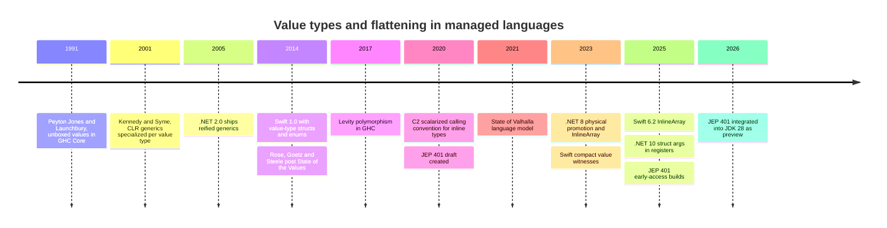
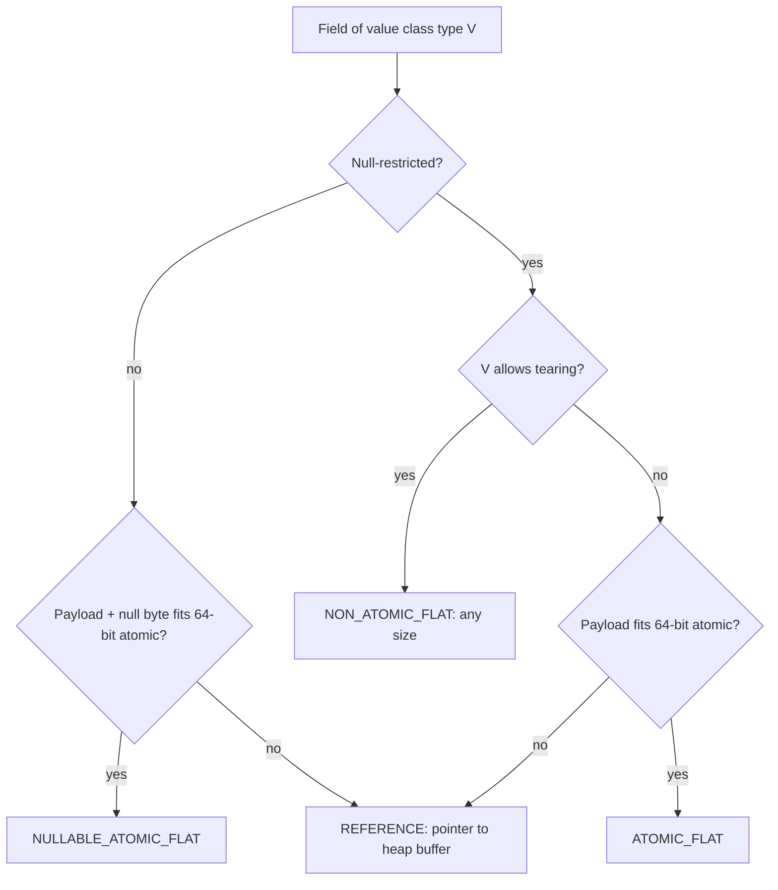
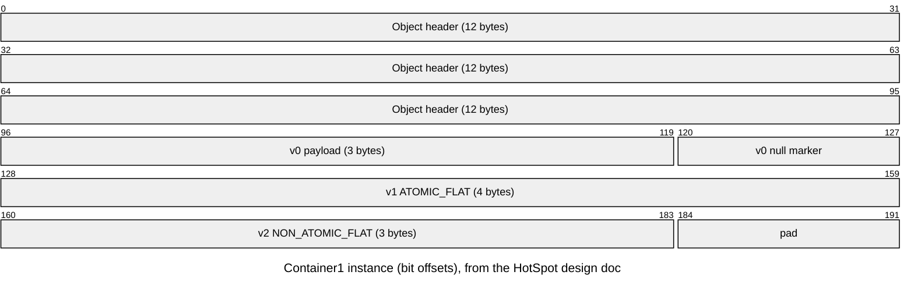

---
tags:
  - compilers
  - value-types
  - flattening
  - scalarization
  - unboxing
  - memory-layout
  - valhalla
  - jvm
  - dotnet
  - swift
  - rust
  - ocaml
status: complete
sources:
  - https://openjdk.org/jeps/401
  - https://openjdk.org/jeps/8316779
  - https://bugs.openjdk.org/secure/attachment/111673/Heap%20flattening%20for%20JEP%20401.pdf
  - https://openjdk.org/projects/valhalla/design-notes/state-of-valhalla/02-object-model
  - https://mail.openjdk.org/pipermail/coin-dev/2014-May/003474.html
  - https://mail.openjdk.org/pipermail/valhalla-dev/2020-October/008138.html
  - https://mail.openjdk.org/pipermail/valhalla-dev/2022-April/010198.html
  - https://inside.java/2025/10/27/try-jep-401-value-classes/
  - https://www.theregister.com/a/5255557
  - https://infoq.com/news/2026/08/jep401-value-objects-preview
  - https://infoq.com/news/2026/07/java-news-roundup-jul13-2026
  - https://web.eecs.umich.edu/~bchandra/courses/papers/Kennedy_Generics.pdf
  - https://learn.microsoft.com/et-ee/dotnet/core/whats-new/dotnet-8/runtime
  - https://learn.microsoft.com/en-us/dotnet/core/whats-new/dotnet-10/runtime
  - https://github.com/dotnet/runtime/issues/76928
  - https://learn.microsoft.com/dotnet/csharp/language-reference/proposals/csharp-12.0/inline-arrays
  - https://forums.swift.org/t/implementation-of-swifts-value-types/3404
  - https://www.llvm.org/devmtg/2023-10/slides/techtalks/Rexin-CompactValueWitnessesInSwift.pdf
  - https://github.com/swiftlang/swift-evolution/blob/main/proposals/0453-vector.md
  - https://doc.rust-lang.org/nomicon/repr-rust.html
  - https://www.microsoft.com/en-us/research/wp-content/uploads/1991/01/unboxed-values.pdf
  - https://www.microsoft.com/en-us/research/publication/levity-polymorphism/
  - https://github.com/goldfirere/ocaml-rfcs/blob/unboxed-types/rfcs/unboxed-types.md
  - https://conf.researchr.org/details/icfp-splash-2025/ocaml-2025-papers/6/Taming-the-Flat-Float-Array-Optimization-Tracking-Separability-in-the-Type-System
  - https://docs.julialang.org/en/v1/devdocs/isbitsunionarrays/
created: 2026-11-26
updated: 2026-11-26
---

## Table Of Contents

- [[#TL;DR|TL;DR]]
- [[#The Problem|The Problem]]
- [[#Foundations|Foundations]]
    - [[#Identity and What Giving It Up Buys|Identity and What Giving It Up Buys]]
    - [[#Boxed and Unboxed Representations|Boxed and Unboxed Representations]]
    - [[#Scalarization versus Flattening|Scalarization versus Flattening]]
    - [[#Tearing, Nullability and the Zero Value|Tearing, Nullability and the Zero Value]]
    - [[#Generics - Box, Specialize or Pass a Witness|Generics - Box, Specialize or Pass a Witness]]
- [[#How We Got Here|How We Got Here]]
- [[#How It Works|How It Works]]
    - [[#Measured - What a Box Costs on Today's JVM|Measured - What a Box Costs on Today's JVM]]
    - [[#LLVM SROA - Scalarization Before and After|LLVM SROA - Scalarization Before and After]]
    - [[#Rust - Layout, Niches and repr(C)|Rust - Layout, Niches and repr(C)]]
    - [[#HotSpot Valhalla - Four Flat Layouts|HotSpot Valhalla - Four Flat Layouts]]
    - [[#HotSpot Valhalla - The Scalarized Calling Convention|HotSpot Valhalla - The Scalarized Calling Convention]]
    - [[#.NET - Structs, Promotion and Reified Generics|.NET - Structs, Promotion and Reified Generics]]
    - [[#Swift - Value Witnesses and Existential Boxes|Swift - Value Witnesses and Existential Boxes]]
    - [[#Functional Languages - Unboxed Types and Layouts|Functional Languages - Unboxed Types and Layouts]]
- [[#Where It Is Now|Where It Is Now]]
- [[#Trade-offs & Open Problems|Trade-offs & Open Problems]]
- [[#Resources|Resources]]
- [[#Related Notes|Related Notes]]

## ***TL;DR***
---
*A value type is data that is known only by its contents, not by where it lives. Once a value has no identity, the compiler may copy it, keep its fields in registers (scalarization), or store it inline inside another object or array (flattening), which removes pointer chasing, headers and GC work. The hard parts are nulls, atomicity under data races, and generic code that does not know the value's size.*

- **Identity is the obstacle.** An object with identity must live at one address so that `==`, locking and weak references can see it. Brian Goetz's 2021 design note says "many of the impediments to optimization that Valhalla seeks to remove center around unwanted object identity" ([State of Valhalla](https://openjdk.org/projects/valhalla/design-notes/state-of-valhalla/02-object-model)).
- **Two optimizations follow.** *Scalarization* keeps a value's fields in separate locals or registers and "is not constrained by the size of the data"; *heap flattening* embeds a value's fields in its container, but must be read and written atomically, which "limits the size of most flattened references to no more than 64 bits" on common platforms ([JEP 401](https://openjdk.org/jeps/401)).
- **Measured here:** on JDK 21, an array of one million `record Point(int x, int y)` allocates 28 bytes per point, against 8 bytes for two `int[]` arrays; LLVM's SROA turns three stack `Point` structs into three `add` instructions; rustc 1.97 fits `Option<&u64>` and `Option<NonZeroU64>` in 8 bytes but needs 16 for `Option<u64>`.
- **Languages split three ways on generics:** .NET specializes generic code per value type, so `List<int>` stores raw ints ([Kennedy and Syme, PLDI 2001](https://web.eecs.umich.edu/~bchandra/courses/papers/Kennedy_Generics.pdf)); Swift passes a *value witness table* with size, stride, alignment and copy/destroy functions ([Rexin, LLVM Dev Meeting 2023](https://www.llvm.org/devmtg/2023-10/slides/techtalks/Rexin-CompactValueWitnessesInSwift.pdf)); GHC and OCaml forbid unboxed types where polymorphic code expects a pointer, then add *kinds* or *layouts* to relax that.
- **As of November 2026:** JEP 401 value classes were integrated into the JDK 28 mainline as a preview in mid-2026, with JDK 28 expected in March 2027 and Goetz calling an exit from preview in JDK 29 "optimistic" ([The Register](https://www.theregister.com/a/5255557); [InfoQ](https://infoq.com/news/2026/08/jep401-value-objects-preview)); .NET 10 passes promoted struct fields directly in registers and stack-allocates small arrays; Swift 6.2 added `InlineArray`; OxCaml is bringing unboxed types and layouts to OCaml.

## ***The Problem***
---
*In Java, OCaml, Haskell and most dynamic languages, every non-primitive value is a pointer to a heap object. For small, immutable data such as a point, a date, a complex number or an optional, the pointer, the header and the garbage collector cost more than the data.*

Take `record Point(int x, int y)` in Java today. The data is 8 bytes. A heap `Point` carries an object header (12 bytes with compressed class pointers on 64-bit HotSpot), is padded to 24 bytes, and is reached through a 4-byte compressed reference. An array of a million points is therefore an array of a million references to a million separate objects, and summing the `x` fields means a dependent load per element into memory that may be anywhere in the heap. The measurement below shows 28 bytes allocated per point instead of 8.

The waste has three parts:

| Cost | Where it comes from | Who pays |
|---|---|---|
| **Footprint** | Header, padding and the reference itself, per value | Memory, cache capacity |
| **Indirection** | Each access is a pointer load first, often a cache miss | Loops over collections |
| **Allocation and GC** | Every new value is a new object to allocate, trace and copy | Throughput and pause times |

[[Escape Analysis]] can delete an allocation when the object never leaves the method, but JEP 401 notes that such optimizations "do not help with objects that escape the scope of the optimization" ([JEP 401](https://openjdk.org/jeps/401)). Values stored in fields and arrays always escape, and that is exactly where footprint and locality matter most.

C, C++, Rust, Go and C# never had this problem for their `struct`s: a struct is stored inline wherever it is declared. Their problem is the reverse: the compiler must still decide when to keep a struct in registers instead of memory, how to pass it across calls, how to lay out fields, and how generic code handles a type whose size it does not know.

## ***Foundations***
---
*Five ideas carry the topic: identity, the boxed versus unboxed distinction, the two optimizations identity-free values allow, the three semantic snags (tearing, null and the default value), and how polymorphic code copes with values of unknown size.*

### Identity and What Giving It Up Buys

*An object has identity if two objects with equal fields can still be told apart. Every identity-sensitive operation pins the object to one heap address.*

In Java, `new Point(1, 2) == new Point(1, 2)` is false, because `==` compares addresses. Locking (`synchronized`), `System.identityHashCode`, weak references and mutation through one alias seen through another all depend on identity. If any of these might happen, the runtime must keep exactly one copy at one address.

A value type drops identity on purpose. JEP 401 describes value objects as "class instances that have only final fields and lack object identity"; for them `==` tests "statewise equivalence", meaning same class, bit-identical primitive fields, and recursively `==` reference fields ([JEP 401](https://openjdk.org/jeps/401)). With no address to preserve and no mutation, a copy is indistinguishable from the original, so the compiler may duplicate, split or inline the value freely.

Languages with built-in structs get the same freedom a different way: a C# `struct` or Swift `struct` is copied on assignment, so there is never a second alias to observe. Swift's core team put it plainly in 2016: "Plain struct types are not copy on write. But really create a copy." ([Schwaighofer, Swift Forums](https://forums.swift.org/t/implementation-of-swifts-value-types/3404)).

### Boxed and Unboxed Representations

*A boxed value is a pointer to a heap cell holding the value; an unboxed value is the raw bits. Uniform representation (everything is one word, usually a pointer) makes polymorphism and GC easy and arithmetic slow.*

Peyton Jones and Launchbury's 1991 paper made this explicit for Haskell. In a lazy language a number is normally a pointer to a box that might hold an unevaluated thunk, so "a simple arithmetic operation, which would take a single machine instruction in a strict language" becomes unbox, compute, rebox. Their fix was to expose unboxed types in the compiler's Core language: `data Int = Int Int#`, where `Int#` is the raw machine integer, so that ordinary transformations such as case-of-case can delete boxes ([Unboxed Values as First Class Citizens, FPCA 1991](https://www.microsoft.com/en-us/research/wp-content/uploads/1991/01/unboxed-values.pdf)).

The same split appears everywhere:

| Language | Boxed | Unboxed |
|---|---|---|
| Java | `Integer`, any object | `int`, `double`; value objects when flattened or scalarized |
| C# | `object` holding a boxed struct | `int`, any `struct` |
| GHC Haskell | `Int` | `Int#`, unboxed tuples and sums |
| OCaml | `float` in most positions, `Int32.t` | immediate `int`; flat float arrays; OxCaml `#float`, `#int32` |
| Swift | an existential `any P` holding a large value | concrete structs and enums |

### Scalarization versus Flattening

*Scalarization breaks a value into its fields and keeps them in registers or locals; flattening embeds the fields inside the object or array that contains the value. Both remove the separate heap object; they differ in where the bits live and what constraints apply.*

JEP 401 defines both. A scalarized parameter or local "can hold the object's field values in separate local variables", and "unlike heap flattening, scalarization is not constrained by the size of the data". A flattened field or array element encodes the field values in place of a reference. In both cases "it has no independent presence in the heap", and both are "optimizations, not language features" that programmers "cannot directly control" ([JEP 401](https://openjdk.org/jeps/401)).

| | Scalarization | Flattening |
|---|---|---|
| **Where** | Locals, parameters, return values (registers, stack) | Fields, array elements (heap) |
| **Compiler analogue** | SROA in [[LLVM]], struct promotion in RyuJIT, scalar replacement after [[Escape Analysis]] | C struct layout, .NET struct fields, Swift stored properties |
| **Size limit** | None in principle; limited by registers | Atomicity limits flat size on the JVM |
| **Main cost** | Re-boxing ("buffering") at boundaries the compiler cannot see through | Tearing, null encoding, copying large values |

### Tearing, Nullability and the Zero Value

*Three semantic questions decide how dense a flattened value can be: can a racing reader see half of one write and half of another, how is null represented, and what is the value of a field nobody has written yet.*

- **Tearing.** A reference is written atomically, so a racing reader sees the old object or the new one. A flattened multi-word value is written field by field unless the hardware has an atomic store wide enough. Goetz notes that Java already lets `long` and `double` fields "tear" under a data race ([State of Valhalla](https://openjdk.org/projects/valhalla/design-notes/state-of-valhalla/02-object-model)). JEP 401 keeps value objects safe by requiring that "a flattened reference must always be read and written atomically, or it could become corrupted" ([JEP 401](https://openjdk.org/jeps/401)). See [[Concurrency Memory Models]].
- **Null.** "Nullability is an affordance of object references, not objects themselves" ([State of Valhalla](https://openjdk.org/projects/valhalla/design-notes/state-of-valhalla/02-object-model)). A flattened nullable field needs an extra flag: JEP 401's example says each flattened `Integer` reference "flags whether the original Integer reference was null" ([JEP 401](https://openjdk.org/jeps/401)). Rust avoids the flag when the payload has an impossible bit pattern to borrow (the *niche*, below).
- **The zero value.** A null-free field still needs a value before anyone writes it. C# structs default to all-zero bits. Valhalla's draft null-restricted types say "the default value of a null-restricted type is a zero instance", which the class must authorize with an `implicit` constructor, because zero is meaningless for types like `LocalDate` ([JEP draft 8316779](https://openjdk.org/jeps/8316779)).

On the JVM these combine into a simple size rule. If a value's fields take $s$ bytes, $n = 1$ if it is nullable (one null-marker byte) and $0$ otherwise, and the hardware's widest naturally atomic access is $A$ bytes (8 on most 64-bit targets), the atomic flat size is the next power of two:

$$
\text{flat size} = 2^{\lceil \log_2 (s + n) \rceil}, \qquad \text{flattenable atomically} \iff \text{flat size} \le A
$$

In plain English: add a byte for null if needed, round up to 1, 2, 4 or 8 bytes, and if that does not fit in one atomic load, the field stays a pointer. A `Point` of two ints has $s = 8$; null-free it fits exactly, nullable it needs 9 bytes and does not. This follows the HotSpot design document, which rounds an `int` plus a `boolean` (5 bytes) up to 8 and notes that a nullable two-int `Point` needs 65 bits "which atomic instructions cannot represent" ([Heap flattening for JEP 401](https://bugs.openjdk.org/secure/attachment/111673/Heap%20flattening%20for%20JEP%20401.pdf)).

### Generics - Box, Specialize or Pass a Witness

*Generic code compiled once cannot know the size of `T`. A language must box values when they enter generic code, compile a specialized copy per value type, or pass a runtime description of the type.*

| Strategy | How it works | Who uses it | Cost |
|---|---|---|---|
| **Box** | Every `T` is a pointer; values are boxed on entry | Java erased generics, OCaml, GHC (default) | Allocation per value; no flattening in `List<T>` |
| **Specialize** | One compiled copy per value-type instantiation | .NET for value types, C++ templates, Rust (see [[Monomorphization]]) | Code size and compile time |
| **Witness** | One compiled copy, plus a table telling it the size and how to copy, move and destroy `T` | Swift unspecialized generics | Indirect calls, size computed at run time |

The choice is visible in the type system: GHC's original restriction was that "polymorphic functions cannot manipulate unboxed values" ([Peyton Jones and Launchbury](https://www.microsoft.com/en-us/research/wp-content/uploads/1991/01/unboxed-values.pdf)); Eisenberg and Peyton Jones later argued that "kinds, not types, are calling conventions" and made polymorphism range over representations too ([Levity Polymorphism, PLDI 2017](https://www.microsoft.com/en-us/research/publication/levity-polymorphism/)). JEP 401 says flattening and scalarization "generally do not apply" to variables typed `Object` or a type variable `T` ([JEP 401](https://openjdk.org/jeps/401)), which is why specialized generics are a later Valhalla phase.

## ***How We Got Here***
---
*Value types are old in systems languages and new in managed ones. The thread runs from unboxed types in functional compilers (1991), through .NET structs with specialized generics (2001 to 2005), Swift's value-first design (2014), and Java's decade-long Valhalla project, which reached a mainline preview in 2026.*



| Year | Milestone | Why it mattered |
|---|---|---|
| 1991 | **Peyton Jones and Launchbury**, "Unboxed Values as First Class Citizens" | Boxing becomes an ordinary program transformation; `#` names unboxed types ([paper](https://www.microsoft.com/en-us/research/wp-content/uploads/1991/01/unboxed-values.pdf)) |
| 2001 | **Kennedy and Syme**, generics for the .NET CLR (PLDI) | Shared code for references, specialized code for value types; "the implementation never needs to box values of primitive type" ([paper](https://web.eecs.umich.edu/~bchandra/courses/papers/Kennedy_Generics.pdf)) |
| 2014 | **"State of the Values"** (Rose, Goetz, Steele), posted to OpenJDK lists | Start of Valhalla's design for identity-free values on the JVM (announced on [coin-dev](https://mail.openjdk.org/pipermail/coin-dev/2014-May/003474.html), May 2014) |
| 2017 | **Levity polymorphism** (PLDI) | Polymorphism over calling conventions in GHC ([paper](https://www.microsoft.com/en-us/research/publication/levity-polymorphism/)) |
| 2020 | **C2 scalarized calling convention** described on valhalla-dev; JEP draft 8251554 (later JEP 401) created | Value arguments passed field by field in registers ([Hartmann](https://mail.openjdk.org/pipermail/valhalla-dev/2020-October/008138.html); [InfoQ](https://infoq.com/news/2026/07/java-news-roundup-jul13-2026)) |
| 2021 | **State of Valhalla** splits value classes from primitive classes | "Make objects safer, make primitives faster" ([design note](https://openjdk.org/projects/valhalla/design-notes/state-of-valhalla/02-object-model)) |
| 2023 | **.NET 8** physical promotion and `InlineArray`; **Swift** compact value witnesses | General scalar replacement of struct locals; fixed-size inline buffers; 10% smaller Swift code |
| 2025 | **Swift 6.2** `InlineArray`; **.NET 10** promoted struct args in shared registers; JEP 401 EA builds | Inline fixed-size arrays, fewer spills, Java value classes testable |
| 2026 | **JEP 401 integrated** into the JDK 28 mainline as a preview | Value classes in mainline Java for the first time ([InfoQ](https://infoq.com/news/2026/08/jep401-value-objects-preview)) |

The Java arc is the instructive one. Early Valhalla prototypes assumed values were non-nullable and allowed tearing; the HotSpot design document calls this the "LW4" model, with four properties: no identity, immutability, non-atomicity and null-freeness ([Heap flattening for JEP 401](https://bugs.openjdk.org/secure/attachment/111673/Heap%20flattening%20for%20JEP%20401.pdf)). JEP 401 shipped only the first: value classes are nullable and atomic by default, and null-restricted types and opt-in non-atomicity are left to later JEPs. Goetz describes JEP 401 as "just the first part of Valhalla" ([The Register](https://www.theregister.com/a/5255557)).

## ***How It Works***
---
*Below: the cost of boxing measured on a real JVM, scalarization in LLVM shown in IR, real Rust layout sizes, the four field layouts HotSpot chooses between for value classes, Valhalla's calling convention, then .NET, Swift and the functional languages.*

### Measured - What a Box Costs on Today's JVM

*Before value classes, a collection of small records is a collection of pointers to separate objects. Measured on JDK 21, one million `Point` records cost 3.5 times the memory of the same data in primitive arrays.*

This program counts bytes allocated by the current thread with `ThreadMXBean.getThreadAllocatedBytes` (run on OpenJDK 21.0.13, November 2026):

```java
record Point(int x, int y) {}

Point[] pts = new Point[n];
for (int i = 0; i < n; i++) pts[i] = new Point(i, -i);   // boxed

int[] xs = new int[n], ys = new int[n];                    // manual "flattening"
for (int i = 0; i < n; i++) { xs[i] = i; ys[i] = -i; }
```

```text
$ java Alloc.java
Point[] of 1000000 records: 28.0 bytes per point
two int[] arrays:      8.0 bytes per point

$ java -XX:-UseCompressedOops Alloc.java
Point[] of 1000000 records: 32.0 bytes per point
two int[] arrays:      8.0 bytes per point
```

28 bytes is a 4-byte compressed reference plus a 24-byte object (12-byte header, 8 bytes of fields, 4 bytes of alignment padding). Escape analysis cannot help: every `Point` is stored into an array, so it escapes. The JEP 401 early-access write-up reports the payoff of removing this: summing `getYear()` over 50 million `LocalDate`s went from about 72 ms to about 25 ms per pass with `--enable-preview`, which the author calls a "nearly 3x speedup" on one laptop, not a JMH benchmark ([inside.java, Oct 2025](https://inside.java/2025/10/27/try-jep-401-value-classes/)).

### LLVM SROA - Scalarization Before and After

*In C, C++, Rust and Swift, structs start life in stack memory (`alloca`) and LLVM's Scalar Replacement of Aggregates pass breaks them into SSA values. After inlining, nothing of the struct remains.*

```c
typedef struct { long x, y; } Point;
static Point add(Point a, Point b) { Point r = { a.x + b.x, a.y + b.y }; return r; }
long norm1(long x1, long y1, long x2, long y2) {
  Point a = { x1, y1 }, b = { x2, y2 };
  Point c = add(a, b);
  return c.x + c.y;
}
```

Clang 18 output before any LLVM pass (`-O1 -Xclang -disable-llvm-passes`), trimmed: three `alloca %struct.Point`, stores of each field, and a call that already passes and returns the struct as scalars, because the x86-64 calling convention puts a 16-byte struct of two integers in two registers.

```llvm
  %9  = alloca %struct.Point, align 8
  %10 = alloca %struct.Point, align 8
  %11 = alloca %struct.Point, align 8
  ...
  %12 = getelementptr inbounds %struct.Point, ptr %9, i32 0, i32 0
  store i64 %13, ptr %12, align 8
  ...
  %28 = call { i64, i64 } @add(i64 %21, i64 %23, i64 %25, i64 %27)
  %30 = extractvalue { i64, i64 } %28, 0
  store i64 %30, ptr %29, align 8
```

After `opt -passes='always-inline,inline,sroa,instcombine'`:

```llvm
define dso_local i64 @norm1(i64 noundef %0, i64 noundef %1, i64 noundef %2, i64 noundef %3) {
  %5 = add nsw i64 %0, %2
  %6 = add nsw i64 %1, %3
  %7 = add nsw i64 %5, %6
  ret i64 %7
}
```

SROA can only do this because no pointer to the `alloca` escapes; it is the static-language form of the scalar replacement that [[Escape Analysis]] enables in JITs, and it feeds [[SSA Form]] and [[Classic Optimizations]].

### Rust - Layout, Niches and repr(C)

*Rust values are unboxed by default, and the compiler owns the layout: it reorders fields to cut padding and stores enum tags in impossible bit patterns of the payload.*

The Rustonomicon says layout "is not specified by default" (arrays excepted), that Rust inserts padding so size is a multiple of alignment, and that it may give different monomorphizations "different field orderings". Its "null pointer optimization" means "`size_of::<Option<&T>>() == size_of::<&T>()`", because null is never a valid reference ([Rustonomicon, repr(Rust)](https://doc.rust-lang.org/nomicon/repr-rust.html)). Real sizes from rustc 1.97.0 on x86-64:

```rust
struct Mixed { a: u8, b: u32, c: u8 }
#[repr(C)] struct MixedC { a: u8, b: u32, c: u8 }
```

| Type | Bytes | Why |
|---|---|---|
| `&u64` / `Option<&u64>` | 8 / 8 | `None` is the null bit pattern (a niche) |
| `u64` / `Option<u64>` | 8 / 16 | Every bit pattern is valid, so the tag needs its own word |
| `Option<NonZeroU64>` | 8 | Zero is the niche |
| `Mixed` (default repr) | 8 | Fields reordered: `b`, `a`, `c`, 2 bytes padding |
| `MixedC` (`repr(C)`) | 12 | Declaration order: 1 + 3 pad + 4 + 1 + 3 pad |
| `[MixedC; 4]` | 48 | Arrays are dense: four 12-byte elements inline |

The niche is the same idea as Valhalla's null marker, done for free when the payload has spare bit patterns. Julia does a similar thing for unions of plain-data types in arrays, adding "one byte per element" of type tag after the data ([Julia devdocs](https://docs.julialang.org/en/v1/devdocs/isbitsunionarrays/)).

### HotSpot Valhalla - Four Flat Layouts

*For each field of value-class type, HotSpot picks one of several layouts depending on whether the field is null-restricted, whether the class tolerates tearing, and whether the encoded size fits an atomic access.*

The HotSpot design document for JEP 401 lists these layout kinds ([Heap flattening for JEP 401](https://bugs.openjdk.org/secure/attachment/111673/Heap%20flattening%20for%20JEP%20401.pdf)):

| Layout | Null marker | Atomic | When |
|---|---|---|---|
| `REFERENCE` | no (null pointer) | yes | Fallback: too big, or flattening not possible |
| `NULLABLE_ATOMIC_FLAT` | 1 byte, 0 = null | yes | Plain JEP 401 fields that fit 64 bits with the marker |
| `ATOMIC_FLAT` | none | yes | Null-restricted fields |
| `NON_ATOMIC_FLAT` | none | no, may tear | Null-restricted fields of classes that opt in to loose consistency (internal APIs for now) |
| `PAYLOAD` | as most constraining layout | n/a | Standalone heap buffers, so copies in and out are plain memory copies |



The document's worked example is a 3-byte value class `Value1` held in three fields of a `Container1` object (24 bytes): `v0` plain (nullable, atomic, 4 bytes with a null marker at offset 15), `v1` null-restricted and `volatile` (atomic, 4 bytes), `v2` null-restricted (non-atomic, 3 bytes). Drawn as bits:



Reading a nullable flat field checks the marker first; writing a non-null value writes payload and marker "in one atomic operation"; writing null zeroes the marker and clears any object pointers in the payload. C2 accesses individual embedded fields directly, while the interpreter and C1 copy the whole payload ([design doc](https://bugs.openjdk.org/secure/attachment/111673/Heap%20flattening%20for%20JEP%20401.pdf)). The draft null-restricted JEP proposes the language surface for the other rows: `Point!` types, `implicit` constructors for the zero instance, and a `LooselyConsistentValue` interface by which a class accepts that a race may produce instances "accidentally created by intermixing field values from other instances" ([JEP draft 8316779](https://openjdk.org/jeps/8316779)).

### HotSpot Valhalla - The Scalarized Calling Convention

*Inside one compiled method, C2 keeps value objects as bundles of fields. Across calls, it passes "each field of an inline type ... individually in registers or on the stack"; anything it cannot see through forces the value back into a heap buffer.*

Tobias Hartmann's 2020 summary of the optimization: only C2 code uses the scalarized convention; the interpreter and C1 "always use buffers"; it applies only to arguments whose static type is the exact value class, "not ... the reference projection or interface types"; and "buffering" means "a full-blown Java heap allocation with all the expected impact on the GC and footprint". Because it depends on inlining and on static types, "there will always be 'boundaries' at which we have to buffer" ([valhalla-dev, Oct 2020](https://mail.openjdk.org/pipermail/valhalla-dev/2020-October/008138.html)).

Nullable values made this harder. The 2022 change that scalarized nullable value types adds an extra `IsInit` argument per scalarized parameter "to keep track of null". For returns, the first return register encodes three cases: all zero for null, an object pointer for a non-null value already buffered in the heap, or a tagged class pointer for a non-null value whose fields are in the other registers ([valhalla-dev, Apr 2022](https://mail.openjdk.org/pipermail/valhalla-dev/2022-April/010198.html)). Methods must agree on the convention at link time, which is why JEP 401 adds a `LoadableDescriptors` class-file attribute so the JVM loads value classes early, and recommends recompiling code built against older versions of a value class ([JEP 401](https://openjdk.org/jeps/401)).

```mermaid
sequenceDiagram
    participant Caller as C2 caller
    participant Callee as C2 callee
    participant Interp as Interpreter or C1
    Caller->>Callee: x, y, IsInit in registers (no allocation)
    Callee-->>Caller: return regs: fields plus tagged class pointer
    Caller->>Interp: call through an adapter
    Note over Caller,Interp: adapter allocates a heap buffer and passes a pointer
    Interp-->>Caller: returns pointer to buffer; caller reads fields
```

### .NET - Structs, Promotion and Reified Generics

*C# has had value types since 2002. The CLR stores structs inline, specializes generic code per value type, and the JIT does scalar replacement on struct locals, which .NET 8 and .NET 10 generalized.*

- **Generics.** Kennedy and Syme designed CLR generics so one body serves all reference instantiations, because "all reference types are compatible with each other", while primitive instantiations get their own code because "floats and ints have different parameter passing conventions". In their `Stack` benchmark with `int` elements, `object`-based code took 8.5 s, generic code 1.8 s and a hand-specialized version 2.0 s ([PLDI 2001](https://web.eecs.umich.edu/~bchandra/courses/papers/Kennedy_Generics.pdf)). So `List<Point>` in .NET stores `Point`s inline in its backing array, which Java cannot do until specialized generics arrive.
- **Struct promotion.** RyuJIT's scalar replacement "replaces structs with their constituent fields". The old version only handled whole structs "with at most 4 fields", no nesting, and "must be promoted for the full duration of the function or not at all" ([dotnet/runtime #76928](https://github.com/dotnet/runtime/issues/76928)). .NET 8's *physical promotion* pass "removes these limitations" ([What's new in .NET 8](https://learn.microsoft.com/et-ee/dotnet/core/whats-new/dotnet-8/runtime)).
- **Calls.** .NET 10 "can place the promoted members of struct arguments into shared registers directly": a `Point` of two `int`s passed to a non-inlined method becomes `mov rdi, 0x140000000A`, both fields packed into one register with no stack round trip ([What's new in .NET 10](https://learn.microsoft.com/en-us/dotnet/core/whats-new/dotnet-10/runtime)).
- **Fixed-size buffers.** `[InlineArray(10)]` on a one-field struct makes the runtime lay out ten copies of the field contiguously, with "regular GC tracking for all elements", and C# 12 gives it bounds-checked indexing and `Span<T>` conversion ([C# 12 spec](https://learn.microsoft.com/dotnet/csharp/language-reference/proposals/csharp-12.0/inline-arrays)).
- **Escape analysis meets value types.** .NET 10 stack-allocates "small, fixed-sized arrays of value types that don't contain GC pointers" when they cannot outlive the method, and stops treating objects referenced from fields of non-escaping local structs as escaping ([What's new in .NET 10](https://learn.microsoft.com/en-us/dotnet/core/whats-new/dotnet-10/runtime)).

### Swift - Value Witnesses and Existential Boxes

*Swift is value-first: structs, enums, `Array` and `String` are value types. Concrete code knows each struct's layout; unspecialized generic code learns it at run time from a value witness table, and protocol-typed values sit in a three-word inline buffer or a heap box.*

- **Value witness tables.** Each type has a table of functions (`destroy`, `initializeWithCopy`, `assignWithCopy`, `initializeWithTake`, `assignWithTake`, ...) plus `size`, `stride` and `alignment`, so a single compiled generic function can call `type->vw_size()` and `type->vw_destroy(object)` on values it knows nothing about ([Rexin, LLVM Dev Meeting 2023](https://www.llvm.org/devmtg/2023-10/slides/techtalks/Rexin-CompactValueWitnessesInSwift.pdf)). The 2023 *compact value witnesses* work replaces per-type witness code with a small layout string interpreted at run time, reporting "10% code size reductions" and "5-10% lower application startup time", with about a 15% slowdown in one micro-case and "negligible real world performance difference" overall.
- **Existentials.** A value of protocol type is stored in an existential container whose payload is a "three word value buffer"; a class reference fits, and a large struct is moved to heap memory allocated on demand ([Schwaighofer and Trick, Swift Forums 2016](https://forums.swift.org/t/implementation-of-swifts-value-types/3404)). This is Swift's "buffering" boundary, analogous to the JVM's.
- **Copy-on-write is library code.** `Array` and `String` are structs holding a reference to shared storage and check uniqueness before writing. Andrew Trick: "It needs be done by hand because the compiler doesn't do it" ([Swift Forums](https://forums.swift.org/t/implementation-of-swifts-value-types/3404)). See [[Reference Counting and Reuse]] for the uniqueness test.
- **Inline arrays.** SE-0453 `InlineArray<count, Element>`, implemented in Swift 6.2, has size and stride equal to element stride times count and never allocates; the proposal's motivation is that "these implicit allocations are becoming more and more of a bottleneck, especially in embedded domains" ([SE-0453](https://github.com/swiftlang/swift-evolution/blob/main/proposals/0453-vector.md)).

### Functional Languages - Unboxed Types and Layouts

*ML and Haskell compilers use one pointer-sized representation for everything so polymorphism and GC are simple; adding unboxed types means teaching the type system how big each value is.*

- **GHC.** `Int#`, `Double#`, unboxed tuples and the `UNPACK` pragma expose raw representations; levity polymorphism classifies types by representation so that, in Eisenberg and Peyton Jones's phrase, kinds become calling conventions ([PLDI 2017](https://www.microsoft.com/en-us/research/publication/levity-polymorphism/)).
- **OCaml and OxCaml.** Richard Eisenberg's unboxed-types RFC for OCaml, now being built in Jane Street's OxCaml, starts from a record of two `Int32.t` whose values "carry 8 bytes of actual data" but are stored as a pointer plus boxed blocks. It classifies types by *layout* (`value`, `immediate`, `bits32`, `bits64`, `float64`, `word`, products and sums), because "we must know the representation of a type before we can ever manipulate a value of that type". Ordinary type variables default to layout `value`, so `#int32 list` is rejected, and a box may not mix GC-scanned and unscanned words ([unboxed-types RFC](https://github.com/goldfirere/ocaml-rfcs/blob/unboxed-types/rfcs/unboxed-types.md)).
- **OCaml's flat float arrays.** OCaml has long stored `float array` unboxed, which requires every type to be *separable* (all floats or no floats). Kalinichenko and Eisenberg track separability in OxCaml's kind system so that unboxed existentials and unboxed options are allowed and arrays of known non-float types can skip the float check ([OCaml Workshop 2025](https://conf.researchr.org/details/icfp-splash-2025/ocaml-2025-papers/6/Taming-the-Flat-Float-Array-Optimization-Tracking-Separability-in-the-Type-System)).
- **Julia.** Arrays store elements inline when the element type has "a fixed, determinate size" (an `isbits` type), and store pointers otherwise ([Julia devdocs](https://docs.julialang.org/en/v1/devdocs/isbitsunionarrays/)).

## ***Where It Is Now***
---
*As of November 2026, Java has value classes in its mainline as a preview, .NET is pushing scalarization and stack allocation further each release, Swift is adding fixed-size inline storage, and OCaml is getting layouts through OxCaml.*

- **Java (JDK 28 preview).** In June 2026 Oracle's Lois Foltan announced that JEP 401 would be integrated into mainline for JDK 28; the pull request added more than 197,000 lines across 1,816 files ([The Register, Jun 2026](https://www.theregister.com/a/5255557)). InfoQ reported in August 2026 that it "has been integrated into JDK 28" as a preview, enabled with `--enable-preview` ([InfoQ, Aug 2026](https://infoq.com/news/2026/08/jep401-value-objects-preview)). Under the preview, `Integer` and the other boxes, `Optional`, and most `java.time` classes become value classes; synchronizing on one throws `IdentityException` ([JEP 401](https://openjdk.org/jeps/401)). JDK 28 is expected in March 2027 and JDK 29, the next LTS, in September 2027; Goetz expects JEP 401 still to be in preview then: "Hoping for it to exit preview for 29 seems ... optimistic" ([The Register](https://www.theregister.com/a/5255557)). Null-restricted types (`Point!`) remain a draft JEP last updated in 2024 ([JEP draft 8316779](https://openjdk.org/jeps/8316779)), so plain value-class fields wider than about 7 bytes still stay pointers.
- **.NET (10, Nov 2025).** Promoted struct arguments go straight into registers, small value-type arrays and some delegates go on the stack, and the runtime team says it plans to stack-allocate closures in a future release ([What's new in .NET 10](https://learn.microsoft.com/en-us/dotnet/core/whats-new/dotnet-10/runtime)).
- **Swift (6.2).** `InlineArray` is shipping; together with noncopyable types it lets embedded and systems Swift code avoid implicit heap allocation ([SE-0453](https://github.com/swiftlang/swift-evolution/blob/main/proposals/0453-vector.md)). See [[Linear and Uniqueness Types]].
- **OCaml.** Unboxed types and layouts are developed in OxCaml, with separability tracking presented at the OCaml Workshop 2025 ([Kalinichenko and Eisenberg](https://conf.researchr.org/details/icfp-splash-2025/ocaml-2025-papers/6/Taming-the-Flat-Float-Array-Optimization-Tracking-Separability-in-the-Type-System)).

## ***Trade-offs & Open Problems***
---
*Value types trade identity, null and atomicity for density, and the trade is only as good as the compiler's ability to keep values unboxed across calls, generics and data races.*

- **Atomicity versus density.** Safe-by-default flattening on the JVM caps flat values at the platform's atomic width; anything bigger stays a pointer unless the class accepts tearing. JEP 401 mentions 128-bit flattening only as a possible future for platforms with wide atomics or for final fields ([JEP 401](https://openjdk.org/jeps/401)).
- **Null costs a byte.** A nullable flat field needs a marker, which pushed a two-int `Point` from 8 bytes to 9 and out of the flattenable range ([design doc](https://bugs.openjdk.org/secure/attachment/111673/Heap%20flattening%20for%20JEP%20401.pdf)). Rust gets the marker free only when the payload has a niche.
- **Boundaries rebox.** Interface-typed parameters, `Object`, erased generic `T`, interpreted and C1 frames, and Swift existentials all force a heap box ("buffering"). Performance becomes sensitive to inlining and static types the programmer cannot see ([Hartmann](https://mail.openjdk.org/pipermail/valhalla-dev/2020-October/008138.html)).
- **Specialization costs code.** .NET and Rust avoid boxing in generics by compiling a copy per value type; Swift instead pays indirect calls through value witnesses and then spent effort shrinking them ([Rexin](https://www.llvm.org/devmtg/2023-10/slides/techtalks/Rexin-CompactValueWitnessesInSwift.pdf)). See [[Monomorphization]].
- **Equality semantics.** Statewise `==` can differ from `equals` (different `NaN` encodings in `float` fields), can take unbounded time on deep structures, and can expose private field values; JEP 401 lists these as known risks ([JEP 401](https://openjdk.org/jeps/401)).
- **Migration breaks identity users.** Code that locks on `Integer`, uses boxes as weak-map keys, or relies on `new` returning a fresh object fails under value semantics; Goetz: "code that synchronizes on Integer objects now fails with an exception" ([The Register](https://www.theregister.com/a/5255557)).
- **Big values copy.** Values are copied on assignment and passing, so large structs cost more than a pointer; compilers pass them by hidden reference, and Swift moves large existential payloads to the heap ([Swift Forums](https://forums.swift.org/t/implementation-of-swifts-value-types/3404)).
- **Layout freedom versus ABI.** Rust leaves `repr(Rust)` layout unspecified so the compiler can reorder fields ([Rustonomicon](https://doc.rust-lang.org/nomicon/repr-rust.html)); the JVM requires recompilation for best calling conventions; anything that must be stable across separately compiled code gives up some of these optimizations.
- **Open:** specialized generics for the JVM, wider atomic flattening, and type systems that track representation (layouts, levity) without making ordinary polymorphic code harder to write.

## ***Resources***
---
*Start with JEP 401 for the cleanest statement of what giving up identity buys, the HotSpot heap-flattening document for how a VM actually lays values out, Kennedy and Syme for the generics question, and the 1991 unboxed-values paper for the functional-language view.*

**Primary papers**
- [Unboxed Values as First Class Citizens in a Non-Strict Functional Language](https://www.microsoft.com/en-us/research/wp-content/uploads/1991/01/unboxed-values.pdf): Peyton Jones and Launchbury, FPCA 1991.
- [Design and Implementation of Generics for the .NET Common Language Runtime](https://web.eecs.umich.edu/~bchandra/courses/papers/Kennedy_Generics.pdf): Kennedy and Syme, PLDI 2001.
- [Levity Polymorphism](https://www.microsoft.com/en-us/research/publication/levity-polymorphism/): Eisenberg and Peyton Jones, PLDI 2017.
- [Taming the Flat Float Array Optimization](https://conf.researchr.org/details/icfp-splash-2025/ocaml-2025-papers/6/Taming-the-Flat-Float-Array-Optimization-Tracking-Separability-in-the-Type-System): Kalinichenko and Eisenberg, OCaml Workshop 2025.

**Specifications and design documents**
- [JEP 401: Value Classes and Objects (Preview)](https://openjdk.org/jeps/401): Dan Smith et al.
- [JEP draft: Null-Restricted Value Class Types (Preview)](https://openjdk.org/jeps/8316779): Dan Smith.
- [Heap flattening for JEP 401](https://bugs.openjdk.org/secure/attachment/111673/Heap%20flattening%20for%20JEP%20401.pdf): HotSpot design document; layout kinds and access protocols.
- [State of Valhalla, Part 2: The Language Model](https://openjdk.org/projects/valhalla/design-notes/state-of-valhalla/02-object-model): Brian Goetz, December 2021.
- [State of the Values](https://mail.openjdk.org/pipermail/coin-dev/2014-May/003474.html): Rose, Goetz and Steele, 2014.
- [Unboxed types for OCaml (RFC)](https://github.com/goldfirere/ocaml-rfcs/blob/unboxed-types/rfcs/unboxed-types.md): Richard Eisenberg.
- [SE-0453: InlineArray](https://github.com/swiftlang/swift-evolution/blob/main/proposals/0453-vector.md) and [C# 12 inline arrays](https://learn.microsoft.com/dotnet/csharp/language-reference/proposals/csharp-12.0/inline-arrays).
- [The Rustonomicon, repr(Rust)](https://doc.rust-lang.org/nomicon/repr-rust.html) and [Julia isbits Union optimizations](https://docs.julialang.org/en/v1/devdocs/isbitsunionarrays/).

**Engineering posts and talks**
- [Limitations of the Calling Convention Optimization](https://mail.openjdk.org/pipermail/valhalla-dev/2020-October/008138.html) and [Scalarization of nullable inline types](https://mail.openjdk.org/pipermail/valhalla-dev/2022-April/010198.html): Tobias Hartmann, valhalla-dev.
- [Try Out JEP 401 Value Classes and Objects](https://inside.java/2025/10/27/try-jep-401-value-classes/): inside.java, October 2025.
- [Compact Value Witnesses in Swift](https://www.llvm.org/devmtg/2023-10/slides/techtalks/Rexin-CompactValueWitnessesInSwift.pdf): Dario Rexin, LLVM Dev Meeting 2023.
- [Implementation of Swift's value types](https://forums.swift.org/t/implementation-of-swifts-value-types/3404): Swift Forums, 2016.
- [What's new in the .NET 8 runtime](https://learn.microsoft.com/et-ee/dotnet/core/whats-new/dotnet-8/runtime), [What's new in the .NET 10 runtime](https://learn.microsoft.com/en-us/dotnet/core/whats-new/dotnet-10/runtime), [Physical promotion tracking issue](https://github.com/dotnet/runtime/issues/76928).
- News: [The Register, June 2026](https://www.theregister.com/a/5255557), [InfoQ, August 2026](https://infoq.com/news/2026/08/jep401-value-objects-preview).

## ***Related Notes***
---
*The analyses that recover value semantics without language help, the runtimes that pay for boxes, and the type-system ideas that make representation explicit.*

- [[Escape Analysis]] — Scalar replacement for objects that might have identity; value types make the same result a language guarantee.
- [[Garbage Collection]] — What flattening saves: headers, pointers to trace, allocation rate.
- [[Reference Counting and Reuse]] — Swift's copy-on-write relies on the uniqueness check; values without identity need no count.
- [[JIT Compilation]] — C2 keeps value objects scalarized and chooses calling conventions at link time.
- [[Deoptimization and Speculation]] — How JITs rebuild scalar-replaced objects when optimized code falls back.
- [[LLVM]] — SROA and the platform calling conventions that pass small structs in registers.
- [[SSA Form]] — Scalarization turns aggregate memory into SSA values.
- [[Classic Optimizations]] — Constant folding and DCE run on fields once the struct is gone.
- [[Register Allocation]] — Struct fields passed and returned in registers compete for them.
- [[Vectorization]] — Inline arrays of values, and struct-of-arrays layouts, are what vectorizers need.
- [[Type Systems and Inference]] — Kinds, layouts and levity classify types by representation.
- [[Closure Conversion and Defunctionalization]] — Typed closure conversion keeps the types needed for unboxed representations.
- [[Memory Models and Pointer Provenance]] — Niches and null markers are bit-level facts about valid representations.
- [[Monomorphization]] — Planned: specializing generic code per type, the .NET and Rust answer to boxing in generics.
- [[Linear and Uniqueness Types]] — Planned: Swift noncopyable types and ownership, which pair with inline storage.
- [[Concurrency Memory Models]] — Planned: why flattened values may tear under a data race.
