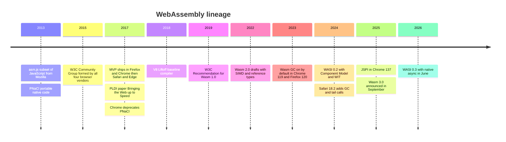
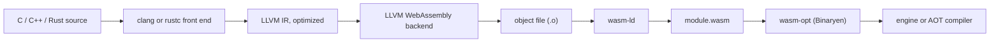
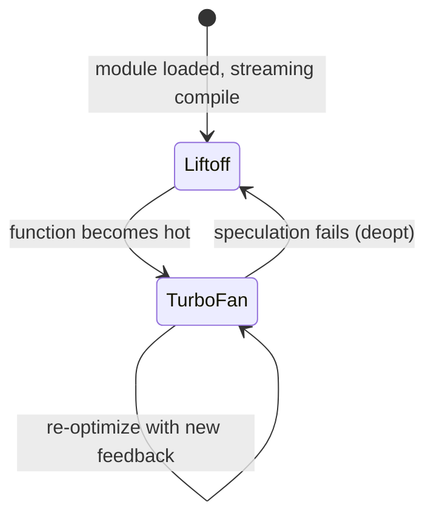

---
tags:
  - compilers
  - webassembly
  - wasm
  - runtimes
  - jit
  - sandboxing
  - wasi
  - baseline-compilers
status: complete
sources:
  - https://research.google/pubs/bringing-the-web-up-to-speed-with-webassembly/
  - https://www.cs.tufts.edu/~nr/cs257/archive/andreas-rossberg/wasm-cacm.pdf
  - https://blog.acolyer.org/2017/09/18/bringing-the-web-up-to-speed-with-webassembly/
  - https://blog.chromium.org/2017/05/goodbye-pnacl-hello-webassembly.html
  - https://developer.mozilla.org/en-US/docs/Games/Tools/asm.js
  - https://www.w3.org/press-releases/2019/wasm
  - https://webassembly.org/news/2025-09-17-wasm-3.0/
  - https://www.w3.org/news/2022/webassembly-2-0-first-public-working-drafts/
  - https://www.w3.org/TR/wasm-core-2/
  - https://www.w3.org/groups/wg/wasm/activity/2026/
  - https://github.com/WebAssembly/proposals
  - https://v8.dev/blog/liftoff
  - https://v8.dev/docs/wasm-compilation-pipeline
  - https://v8.dev/blog/wasm-dynamic-tiering
  - https://v8.dev/blog/wasm-speculative-optimizations
  - https://v8.dev/blog/leaving-the-sea-of-nodes
  - https://v8.dev/blog/jspi
  - https://conf.researchr.org/details/cgo-2024/cgo-2024-main-conference/39/Whose-Baseline-Compiler-Is-It-Anyway-
  - https://wingolog.org/archives/2020/04/14/understanding-webassembly-code-generation-throughput
  - https://bytecodealliance.org/articles/winch-aarch64-support
  - https://bytecodealliance.org/articles/wasmtime-and-cranelift-in-2023
  - https://bytecodealliance.org/articles/wasmtime-27.0
  - https://bytecodealliance.org/articles/wasmtime-lts
  - https://docs.wasmtime.dev/stability-wasm-proposals.html
  - https://newreleases.io/project/github/bytecodealliance/wasmtime/release/v51.0.0
  - https://thehackernews.com/2026/10/two-critical-wasmtime-flaws-could-let.html
  - https://www.cfallin.org/blog/2026/04/09/aegraph
  - https://spidermonkey.dev/blog/2025/01/15/is-memory64-actually-worth-using.html
  - https://arxiv.org/abs/2408.11456
  - https://developer.chrome.com/blog/wasmgc
  - https://webkit.org/blog/16301/webkit-features-in-safari-18-2/
  - https://web.dev/blog/wasmgc-wasm-tail-call-optimizations-baseline
  - https://caniuse.com/wf-wasm-memory64
  - https://caniuse.com/wasm-threads
  - https://web.dev/coop-coep
  - https://developer.chrome.com/release-notes/137
  - https://github.com/WebAssembly/stack-switching
  - https://cs.au.dk/~birke/papers/2026-pldi-iris-wasmfx.pdf
  - https://llvm.googlesource.com/llvm/+/master/lib/Target/WebAssembly/README.txt
  - https://www.llvm.org/doxygen/WebAssemblyRegStackify_8cpp_source.html
  - https://icfp22.sigplan.org/details/icfp-2022-papers/1/Beyond-Relooper-Recursive-Translation-of-Unstructured-Control-Flow-to-Structured-Con
  - https://chromium.googlesource.com/external/github.com/WebAssembly/binaryen/+show/refs/heads/docs/README.md
  - https://blog.rust-lang.org/2024/11/26/wasip2-tier-2/
  - https://doc.rust-lang.org/rustc/platform-support/wasm32-wasip3.html
  - https://go.dev/blog/wasi
  - https://go.dev/blog/wasmexport
  - https://kotlinlang.org/docs/wasm-overview.html
  - https://blog.jetbrains.com/kotlin/2025/09/compose-multiplatform-1-9-0-compose-for-web-beta/
  - https://dart.dev/web/wasm
  - https://flutter.dev/blog/landing-flutter-3-22-and-dart-3-4-at-google-i-o-2024
  - https://web.dev/case-studies/google-sheets-wasmgc
  - https://bytecodealliance.org/articles/WASI-0.2
  - https://bytecodealliance.org/articles/WASI-0.3
  - https://wasi.dev/releases/wasi-p3
  - https://component-model.bytecodealliance.org/design/migrating-to-p3.html
  - https://wasi.dev/roadmap
  - https://component-model.bytecodealliance.org/design/async.html
  - https://bytecodealliance.org/articles/the-road-to-component-model-1-0
  - https://goals.rust-lang.org/2026/wasm-components.html
  - https://www.intel.com/content/www/us/en/developer/articles/technical/webassembly-interpreter-design-wasm-micro-runtime.html
  - https://GitHub.Com/wasm3/wasm3
  - https://fastly.com/blog/how-fastly-and-developer-community-invest-in-webassembly-ecosystem
  - https://developers.cloudflare.com/workers/runtime-apis/webassembly/index.md
  - https://shopify.dev/docs/apps/build/functions/optimize-instruction-counts
  - https://docs.rs/crate/wasmtime-cli/41.0.3/source/ADOPTERS.md
created: 2026-11-26
updated: 2026-11-26
---

## Table Of Contents

- [[#TL;DR|TL;DR]]
- [[#The Problem|The Problem]]
- [[#Foundations|Foundations]]
    - [[#A Typed Stack Machine|A Typed Stack Machine]]
    - [[#Structured Control Flow|Structured Control Flow]]
    - [[#Linear Memory and the Sandbox|Linear Memory and the Sandbox]]
- [[#How We Got Here|How We Got Here]]
- [[#How It Works|How It Works]]
    - [[#Wasm as a Compiler Target|Wasm as a Compiler Target]]
    - [[#Worked Example From C to Wasm to Machine Code|Worked Example From C to Wasm to Machine Code]]
    - [[#Engines and Their Tiers|Engines and Their Tiers]]
    - [[#Why Single-Pass Baseline Compilers Work|Why Single-Pass Baseline Compilers Work]]
    - [[#Bounds Checks Guard Pages vs Explicit Checks|Bounds Checks Guard Pages vs Explicit Checks]]
    - [[#Post-MVP Features|Post-MVP Features]]
    - [[#WASI and the Component Model|WASI and the Component Model]]
    - [[#Outside the Browser|Outside the Browser]]
- [[#Where It Is Now|Where It Is Now]]
- [[#Trade-offs & Open Problems|Trade-offs & Open Problems]]
- [[#Resources|Resources]]
- [[#Related Notes|Related Notes]]

## ***TL;DR***
---
*WebAssembly (Wasm) is a portable, typed, sandboxed instruction format designed to be both a compiler target and a compiler input. Its shape (a typed stack machine with only structured control flow and a bounds-checked linear memory) is chosen so an engine can validate and compile it in one fast pass and still run it near native speed.*

- **What it is.** A binary format for a virtual instruction set: modules of functions over `i32`, `i64`, `f32`, `f64` (plus `v128` and references later), operating on an implicit operand stack, with `block`/`loop`/`if` instead of arbitrary jumps, and a separate byte-array "linear memory" ([Haas et al., PLDI 2017](https://research.google/pubs/bringing-the-web-up-to-speed-with-webassembly/)).
- **Two compiler roles.** As a *target*, it sits at the end of LLVM, Emscripten, rustc, Go, Kotlin, Dart and others. As a *source*, every engine is itself a compiler, from interpreters (WAMR, wasm3) to single-pass baseline JITs (V8 Liftoff, Wasmtime Winch) to optimizing JITs (TurboFan, SpiderMonkey Ion, Cranelift) and ahead-of-time compilers.
- **The design trick.** Types are known at every instruction and every branch target is lexically scoped, so validation is one linear pass and a baseline compiler can emit machine code while decoding, with no IR, no CFG construction and no type feedback ([V8, Liftoff](https://v8.dev/blog/liftoff)).
- **Safety model.** Code can only touch its own linear memory, call functions through typed tables and reach the outside world through imports. On 64-bit hosts, 32-bit memories can use virtual-memory guard regions so most loads need no explicit bounds check; `memory64` loses that trick ([SpiderMonkey, Jan 2025](https://spidermonkey.dev/blog/2025/01/15/is-memory64-actually-worth-using.html)).
- **Where it is.** Wasm 3.0 (announced 17 September 2025) folded in GC, 64-bit memory, tail calls, exception handling, relaxed SIMD and more ([WebAssembly CG, Sep 2025](https://webassembly.org/news/2025-09-17-wasm-3.0/)). Outside browsers, WASI 0.2 brought the Component Model and WIT, and WASI 0.3 with native async launched on 11 June 2026 ([Bytecode Alliance](https://bytecodealliance.org/articles/WASI-0.3)).

## ***The Problem***
---
*Browsers had one fast language, JavaScript, and it was a poor compilation target for C, C++ and other statically typed languages. The goal was a target that was fast, safe, portable, compact and quick to compile, which earlier attempts each achieved only partly.*

The PLDI 2017 paper frames the requirements as two sets ([Haas et al.](https://research.google/pubs/bringing-the-web-up-to-speed-with-webassembly/); summary in [Colyer, 2017](https://blog.acolyer.org/2017/09/18/bringing-the-web-up-to-speed-with-webassembly/)):

| Goal | What it means for the format |
|---|---|
| **Safe** | Untrusted code from the network must not escape its sandbox, so every program must be checkable before it runs |
| **Fast** | Near-native speed, so the format must map onto real hardware without dynamic type checks |
| **Portable** | Language-, hardware- and platform-independent; no assumptions about pointer width beyond what the module declares |
| **Compact** | A binary that downloads faster than equivalent JS or native code |
| **Fast to load** | Decoding, validation and compilation must be streamable and parallel, since users wait on them |
| **Formally specified** | A precise semantics, not "whatever the reference engine does" |

Earlier answers each missed something. **asm.js** (Mozilla, 2013) was a strict subset of JavaScript that engines could recognize and compile ahead of time; it was portable but large, slow to parse, and limited by what JS could express ([MDN, asm.js](https://developer.mozilla.org/en-US/docs/Games/Tools/asm.js)). **Native Client** and its portable variant **PNaCl** gave real native code with software fault isolation but only shipped in Chrome; Google announced its retirement in favor of WebAssembly in May 2017 ([Chromium Blog, 2017](https://blog.chromium.org/2017/05/goodbye-pnacl-hello-webassembly.html)). The Java and Flash plug-ins had been sandboxed by large, buggy runtimes. Wasm was the first design all four browser vendors built together.

## ***Foundations***
---
*Three ideas explain almost every Wasm design decision: it is a stack machine whose stack is fully typed at validation time; its control flow is a tree of nested blocks; and all memory accesses go to a bounds-checked array that the module cannot escape.*

### A Typed Stack Machine

*Instructions pop and push values on an implicit stack, but the type of every stack slot is known statically, so the stack is really a compact encoding of expression trees and SSA-like temporaries.*

Each instruction has a type of the form $[t_1^*] \to [t_2^*]$: it consumes the top values of types $t_1^*$ and produces $t_2^*$. Validation checks a sequence by composing these ([Rossberg et al., CACM](https://www.cs.tufts.edu/~nr/cs257/archive/andreas-rossberg/wasm-cacm.pdf)):

$$
\frac{}{C \vdash \texttt{i32.add} : [\texttt{i32}\ \texttt{i32}] \to [\texttt{i32}]}
\qquad
\frac{C \vdash e_1^* : [t_1^*] \to [t_2^*] \quad C \vdash e_2 : [t_2^*] \to [t_3^*]}{C \vdash e_1^*\, e_2 : [t_1^*] \to [t_3^*]}
$$

**In plain English:** `i32.add` needs two `i32`s on top of the stack and leaves one. A sequence is well typed if each instruction finds on the stack exactly what the previous ones left. The context $C$ holds the types of locals, globals, functions and enclosing labels.

Why a stack machine rather than registers? The encoding is denser (operands are implicit), and an engine can recover expression trees or SSA values cheaply because stack heights are static. Locals (`local.get`/`local.set`) play the role of mutable variables, much like pre-SSA virtual registers in a front end; see [[SSA Form]] and [[Intermediate Representations]]. The type system is deliberately simple, close to a typed assembly language; [[Type Systems and Inference]] covers the general machinery.

### Structured Control Flow

*There is no `goto`. Branches name an enclosing `block` (jump to its end) or `loop` (jump to its start), so the control-flow graph is reducible by construction and every merge point is known when it is first seen.*

```wat
(block $exit                 ;; label 1: br here jumps forward to the end
  (loop $top                 ;; label 0: br here jumps back to the start
    ...
    (br_if $exit (i32.eqz (local.get $n)))
    ...
    (br $top)))
```

A validator keeps two stacks: an operand stack of types and a *control stack* of frames, each recording the block's result types and the operand-stack height at entry. After an unconditional branch the rest of the block is *unreachable* and its stack becomes polymorphic, so dead code still type-checks. This is the whole validation algorithm; it runs in one pass over the bytes, interleaved with decoding ([Haas et al.](https://research.google/pubs/bringing-the-web-up-to-speed-with-webassembly/)). Indirect calls go through a *table* of function references and check the callee's signature at run time, which gives a coarse form of control-flow integrity: you can only call a function of the right type that the module put in the table.

### Linear Memory and the Sandbox

*A module's memory is one (now possibly several) resizable byte array, addressed by integer offsets. Every load and store is checked against its current size, and out-of-bounds accesses trap instead of touching host memory.*

The effective address of `i32.load offset=o` with dynamic index $i$ is checked like this:

$$
ea = \operatorname{zext}_{64}(i) + o, \qquad \text{trap if } ea + N > |\text{mem}|
$$

**In plain English:** take the 32-bit index as unsigned, add the instruction's constant offset, and trap if the $N$ bytes read would run past the current memory size. Because the computation happens in 64 bits, the index cannot wrap around and alias low memory.

The sandbox is the sum of a few properties: memory isolation as above; no access to the engine's own stack (the call stack, return addresses and spilled locals live outside linear memory, so a buffer overflow in C code compiled to Wasm cannot overwrite a return address); typed indirect calls; and capabilities supplied only through imports. Bugs inside the module (a C buffer overflow corrupting its own heap) are still possible; escapes out of the module require an engine bug.

## ***How We Got Here***
---
*Wasm grew out of asm.js and PNaCl, was designed jointly by the four browser engines from 2015, shipped its MVP in 2017, and has since gained features in batches, culminating in Wasm 3.0 in 2025.*



- **1.0 to Recommendation.** The W3C made the WebAssembly Core Specification, JavaScript Interface and Web API official Recommendations in December 2019, describing Wasm as the fourth language to run natively in browsers after HTML, CSS and JavaScript ([W3C, Dec 2019](https://www.w3.org/press-releases/2019/wasm)).
- **Wasm 2.0** collected the first post-MVP batch: sign-extension ops, non-trapping float-to-int, multi-value, bulk memory, reference types and 128-bit SIMD; the W3C published its First Public Working Drafts in April 2022 ([W3C, 2022](https://www.w3.org/news/2022/webassembly-2-0-first-public-working-drafts/)).
- **Wasm 3.0** (17 September 2025) collected the second: 64-bit address space, multiple memories, typed function references, garbage collection, tail calls, exception handling with `exnref`, relaxed SIMD, a deterministic profile and a custom-annotation syntax for the text format, plus JS string builtins as an extension of the JS API ([WebAssembly CG](https://webassembly.org/news/2025-09-17-wasm-3.0/)). Threads are not part of 3.0: that proposal is still at Phase 4 ([WebAssembly proposals](https://github.com/WebAssembly/proposals)).

## ***How It Works***
---
*A Wasm toolchain lowers a language to a stack-machine binary, and an engine compiles it back down to machine code, usually in tiers. The interesting compiler problems sit at both ends: restructuring CFGs and register code into a stack form, and turning the stack form back into good machine code quickly.*

### Wasm as a Compiler Target

*LLVM-based toolchains dominate for C, C++ and Rust; garbage-collected languages now target Wasm GC directly instead of shipping their own collector.*



- **LLVM's WebAssembly backend** treats Wasm as a register machine with infinite virtual registers until late, then runs Wasm-specific passes: *CFGStackify* rebuilds `block`/`loop` nesting from the CFG, *RegStackify* turns single-use values into implicit stack operands, and *ExplicitLocals* maps the remaining virtual registers to `local`s ([LLVM WebAssembly README](https://llvm.googlesource.com/llvm/+/master/lib/Target/WebAssembly/README.txt); [RegStackify source](https://www.llvm.org/doxygen/WebAssemblyRegStackify_8cpp_source.html)). There is no real register allocation: the engine does that. See [[LLVM]], [[Register Allocation]] and [[Instruction Selection]].
- **Restructuring control flow** is the classic hard part. Emscripten's *Relooper* algorithm turned arbitrary CFGs into loops and multi-way branches for asm.js; Ramsey's "Beyond Relooper" gives a simpler recursive translation based on dominator trees for reducible CFGs ([Ramsey, ICFP 2022](https://icfp22.sigplan.org/details/icfp-2022-papers/1/Beyond-Relooper-Recursive-Translation-of-Unstructured-Control-Flow-to-Structured-Con)). Irreducible loops need node splitting or a dispatch variable.
- **wasm-ld** is LLD's Wasm port; it links Wasm object files, resolves symbols, lays out data segments in linear memory and builds the function table. See [[Linking and LTO]] and [[Compiler, Assembler, Linker, and Loader]].
- **Binaryen** is a Wasm-to-Wasm optimizer and compiler infrastructure; `wasm-opt` runs size and speed passes (inlining, dead-code removal, local coalescing, GC-type refinement) and is used as the back end or post-pass of Emscripten, AssemblyScript, J2Wasm and other toolchains ([Binaryen README](https://chromium.googlesource.com/external/github.com/WebAssembly/binaryen/+show/refs/heads/docs/README.md)).
- **Languages.** Rust has `wasm32-unknown-unknown`, `wasm32-wasip1` and `wasm32-wasip2` (tier 2 since November 2024) ([Rust Blog, 2024](https://blog.rust-lang.org/2024/11/26/wasip2-tier-2/)), and a tier 2 `wasm32-wasip3` target now appears in the rustc platform list ([rustc book](https://doc.rust-lang.org/rustc/platform-support/wasm32-wasip3.html)). Go added a `wasip1` port in Go 1.21 ([Go Blog, Sep 2023](https://go.dev/blog/wasi)) and `//go:wasmexport` in Go 1.24 ([Go Blog, 2025](https://go.dev/blog/wasmexport)); Go ships its own collector and uses its own compiler back end, not LLVM. Kotlin/Wasm ([Kotlin docs](https://kotlinlang.org/docs/wasm-overview.html)), Dart's `dart2wasm` ([Dart docs](https://dart.dev/web/wasm)) and Google's J2CL-based J2Wasm for Java target **Wasm GC**, so the browser's collector manages their objects.

Targeting Wasm GC changes the compiler's job: instead of laying objects out in linear memory and shipping a collector, the compiler emits `struct` and `array` types with subtyping, and uses `ref.cast` and `br_on_cast` for downcasts. Google Sheets moved its calculation worker from JavaScript to WasmGC through J2Wasm and reported it ran about twice as fast as the JS version ([web.dev case study, 2024](https://web.dev/case-studies/google-sheets-wasmgc)). See [[Garbage Collection]].

### Worked Example From C to Wasm to Machine Code

*A short loop shows how the stack form encodes ordinary code, and how Cranelift turns the stack back into SSA and folds the address arithmetic into one load.*

```c
int sum(const int *a, int n) {
    int s = 0;
    for (int i = 0; i < n; i++) s += a[i];
    return s;
}
```

Compiled with `clang --target=wasm32 -Os -S` (Clang 18.1.3), the function body is this stack-machine code (LLVM's flat assembly syntax, directives trimmed; at `-O2` LLVM also unrolls the loop by four):

```asm
sum:
	i32.const	0
	local.set	2            # s = 0 (local 2)
	block
	local.get	1
	i32.const	1
	i32.lt_s
	br_if   	0            # if n < 1, jump past the loop
	loop                     # label1:
	local.get	0
	i32.load	0            # load a[0] from linear memory
	local.get	2
	i32.add
	local.set	2            # s += *a
	local.get	0
	i32.const	4
	i32.add
	local.set	0            # a += 4 bytes
	local.get	1
	i32.const	-1
	i32.add
	local.tee	1            # n -= 1, keep it on the stack
	br_if   	0            # loop while n != 0
	end_loop
	end_block
	local.get	2            # return s
	end_function
```

LLVM has already strength-reduced `a[i]` into a pointer bump and counted `n` down to zero. A pointer is just an `i32` offset into linear memory.

Wasmtime's translator walks the operator stream once, keeping a stack of Cranelift SSA values in place of the Wasm operand stack and turning each `local` into an SSA variable with block parameters at merges, the same construction any front end uses ([[SSA Form]]). A hand-simplified sketch of the resulting CLIF, Cranelift's IR (not literal Wasmtime output):

```clif
function %sum(i64 vmctx, i32, i32) -> i32 {
    gv0 = vmctx
    gv1 = load.i64 notrap aligned readonly gv0+8     ; heap base
block0(v0: i64, v1: i32, v2: i32):
    v3 = iconst.i32 0
    v4 = icmp_imm slt v2, 1
    brif v4, block2(v3), block1(v1, v2, v3)
block1(v5: i32, v6: i32, v7: i32):                   ; loop header
    v8  = global_value.i64 gv1
    v9  = uextend.i64 v5                              ; zero-extend the 32-bit index
    v10 = iadd v8, v9                                 ; base + index, no bounds check
    v11 = load.i32 little heap v10
    v12 = iadd v11, v7
    v13 = iadd_imm v5, 4
    v14 = iadd_imm v6, -1
    brif v14, block1(v13, v14, v12), block2(v12)
block2(v15: i32):
    return v15
}
```

Two things to notice. First, the operand stack and the `local`s have vanished into SSA values and block parameters. Second, there is no compare-and-trap before the load: with a 4 GiB memory reservation plus a guard region, any `uextend(i32) + 0` lands either inside the memory or on an unmapped page, so the hardware fault *is* the bounds check (see below). Cranelift's mid-end then hoists the loop-invariant heap base, and ISLE lowering rules fold `iadd(base, uextend(idx))` into an addressing mode. On AArch64 that becomes a single `ldr w12, [x10, w9, uxtw]`, where the `uxtw` modifier does the zero-extension in the load itself. See [[Instruction Selection]] and [[E-Graphs and Equality Saturation]] for how those rewrites are written.

### Engines and Their Tiers

*Every engine balances startup against peak speed. The common answer is a fast baseline tier for everything and an optimizing tier for hot functions, swapped in at run time.*

| Engine | Interpreter / baseline | Optimizing tier | Notes |
|---|---|---|---|
| **V8** (Chrome, Node, Deno, Workers) | Liftoff, a single-pass compiler | TurboFan, with a Turboshaft CFG backend | Dynamic tiering, first offered for testing (flag and origin trial) in Chrome 96 ([V8](https://v8.dev/blog/wasm-dynamic-tiering)); speculative inlining with deopts added for Wasm in Chrome 137 in 2025 ([V8](https://v8.dev/blog/wasm-speculative-optimizations)) |
| **SpiderMonkey** (Firefox) | Wasm baseline compiler | Ion | Compared with other baselines in [Titzer, CGO 2024](https://conf.researchr.org/details/cgo-2024/cgo-2024-main-conference/39/Whose-Baseline-Compiler-Is-It-Anyway-) |
| **Wasmtime** | Winch, a single-pass baseline | Cranelift | Winch gained AArch64 in Wasmtime 35 ([Bytecode Alliance](https://bytecodealliance.org/articles/winch-aarch64-support)); Cranelift is the default |
| **WAMR** | Classic and "fast" interpreters | LLVM-based JIT and AOT (`wamrc`) | Fast interpreter pre-compiles to a register-style internal code ([Intel](https://www.intel.com/content/www/us/en/developer/articles/technical/webassembly-interpreter-design-wasm-micro-runtime.html)) |
| **wasm3** | Interpreter only | none | Built for portability to microcontrollers ([wasm3](https://GitHub.Com/wasm3/wasm3)) |



V8 compiles every function with Liftoff as the bytes stream in, counts execution with a budget per function, and recompiles hot functions with TurboFan in the background ([V8 compilation pipeline](https://v8.dev/docs/wasm-compilation-pipeline)). Until 2025 Wasm needed no deoptimization, because static types made speculation unnecessary for MVP code. Wasm GC and `call_ref` changed that: indirect calls through function references benefit from feedback-driven inlining, so V8 now collects call-target feedback in Liftoff and can deopt back ([V8, 2025](https://v8.dev/blog/wasm-speculative-optimizations)). V8 also moved its Wasm pipeline off the [[Sea of Nodes|sea-of-nodes]] graph onto the CFG-based Turboshaft IR ([V8](https://v8.dev/blog/leaving-the-sea-of-nodes)). This is [[JIT Compilation]] with far less speculation than for JavaScript.

AOT is the other end of the spectrum: Wasmtime can precompile modules with Cranelift (`wasmtime compile`) and load the native code later; WAMR's `wamrc` does the same with LLVM. Edge platforms favor AOT for predictable cold starts.

### Why Single-Pass Baseline Compilers Work

*Wasm's static types, lexical control structure and per-function independence let a compiler emit code while it decodes, keeping only a small abstract stack in memory.*

A single-pass compiler like Liftoff or Winch keeps, for each slot of the Wasm operand stack, a description of *where* the value lives: a register, a spill slot, or a constant not yet materialized ([V8, Liftoff](https://v8.dev/blog/liftoff)). Each opcode is handled once:

```text
i32.add:   rhs = pop(); lhs = pop()
           if rhs is constant: emit add lhs_reg, imm
           else:               emit add lhs_reg, rhs_reg
           push(register(lhs_reg))
block/loop: push control frame (label, stack height, merge state)
br_if L:   spill/move values to L's merge state, emit conditional jump
end:       bind label, reset abstract stack to merge state
```

What makes this possible is the design, not clever engineering:

1. **Types are static.** The validator already knows every value's type, so code selection needs no type feedback and no tagging.
2. **Merge points are known up front.** A `block`'s label is in scope only inside it, and a `loop`'s target is its own start, so the compiler always knows which register state a branch must match without building a CFG or computing dominators.
3. **No irreducible control flow.** Loops have a single entry; a baseline compiler never needs to discover them.
4. **Functions are independent.** The code section gives each function's size, so functions can be compiled in parallel as soon as their bytes arrive (`WebAssembly.compileStreaming`).
5. **Validation and compilation fuse.** One decoder loop validates and emits code at once.

The cost is code quality: values are spilled at every merge and call, and there is no global register allocation. Titzer's comparison of six baseline compilers (Wizard's, V8's Liftoff, SpiderMonkey's, wazero's, Wasmer's single-pass and the research WasmNow) discusses these trade-offs in detail ([Titzer, CGO 2024](https://conf.researchr.org/details/cgo-2024/cgo-2024-main-conference/39/Whose-Baseline-Compiler-Is-It-Anyway-)), and Andy Wingo's survey explains why throughput in bytes per second, not code quality, decides baseline design ([Wingo, 2020](https://wingolog.org/archives/2020/04/14/understanding-webassembly-code-generation-throughput)).

### Bounds Checks Guard Pages vs Explicit Checks

*Bounds checks are Wasm's main runtime tax. On 64-bit hosts, 32-bit memories can hide them behind virtual memory; 64-bit memories cannot.*

| Strategy | How | Cost |
|---|---|---|
| **Guard regions** | Reserve $2^{32}$ bytes of address space plus a guard (several GiB), map only the live memory, let out-of-range accesses fault and turn the signal into a trap | Nearly zero per access; costs virtual address space, which limits how many instances fit in one process |
| **Explicit checks** | Compare $ea + N$ against the current size before each access, branch to a trap | A compare and branch per access, partly removable by check elimination |
| **Masking** | Clamp the index with `and` (used for Spectre hardening) | Cheap, but changes semantics unless combined with traps |
| **Hardware tagging** | Use memory-tagging hardware (Arm MTE) to enforce bounds | Research; "Cage" proposes this for Wasm ([Cage, arXiv 2024; CGO 2025](https://arxiv.org/abs/2408.11456)) |

The guard trick works because a 32-bit index plus a modest constant offset can never exceed the reservation:

$$
\operatorname{zext}(i) + o + N \le (2^{32} - 1) + o_{\max} + N \le \text{reservation}
$$

**In plain English:** if you reserve 4 GiB plus enough slack for the largest offset you expect, every possible address either hits real memory or a page that faults. Offsets larger than the guard still get an explicit check.

With `memory64` the index is 64 bits, so no reservation can cover it and every access needs an explicit check. SpiderMonkey's analysis found memory64 code running roughly 10% to over 100% slower than the same code in a 32-bit memory, depending on the workload, and recommends using it only when you truly need more than 4 GiB ([SpiderMonkey, Jan 2025](https://spidermonkey.dev/blog/2025/01/15/is-memory64-actually-worth-using.html)). In browsers, a 64-bit memory is still capped far below its theoretical size: the JS API limits it to 16 GiB on the web ([WebAssembly CG](https://webassembly.org/news/2025-09-17-wasm-3.0/); [SpiderMonkey](https://spidermonkey.dev/blog/2025/01/15/is-memory64-actually-worth-using.html)).

### Post-MVP Features

*Most post-MVP proposals either give compilers a construct they had to emulate (tail calls, exceptions, GC, stack switching) or expose hardware the MVP hid (SIMD, threads, 64-bit addressing).*

| Feature | What it adds for compilers | Status (Nov 2026) |
|---|---|---|
| Bulk memory, reference types, multi-value, SIMD-128 | `memory.copy/fill`, `externref`/`funcref`, multiple results, `v128` ops | Wasm 2.0, shipped everywhere |
| Threads and atomics | Shared memories, atomic ops, `wait`/`notify` | Shipped since Chrome 74, Firefox 79 and Safari 14.1 ([caniuse](https://caniuse.com/wasm-threads)), with shared memory needing cross-origin isolation ([web.dev](https://web.dev/coop-coep)); the proposal is at Phase 4 and not part of 3.0 ([proposals](https://github.com/WebAssembly/proposals)) |
| Tail calls | `return_call`, `return_call_indirect` for functional languages and CPS | Wasm 3.0; Baseline across browsers since Safari 18.2 ([web.dev](https://web.dev/blog/wasmgc-wasm-tail-call-optimizations-baseline)) |
| Exception handling (`exnref`) | `try_table`, `throw`, `throw_ref`; zero-cost C++ and Kotlin exceptions | Wasm 3.0; the earlier `try`/`catch` design is legacy |
| Typed function refs and GC | `struct`, `array`, `i31ref`, subtyping, casts | Wasm 3.0; Chrome 119 ([Chrome](https://developer.chrome.com/blog/wasmgc)), Firefox 120, Safari 18.2 ([WebKit](https://webkit.org/blog/16301/webkit-features-in-safari-18-2/)) |
| Memory64, multiple memories | 64-bit indices; several memories per module | Wasm 3.0; memory64 in Chrome 133 and Firefox 134 but not yet Safari ([caniuse](https://caniuse.com/wf-wasm-memory64)), capped at 16 GiB on the web |
| Relaxed SIMD | Faster SIMD ops whose results may differ by platform (FMA, swizzle) | Wasm 3.0; a *deterministic profile* pins one behavior |
| JS string builtins | Import JS string operations that engines can inline | Wasm 3.0 |
| JSPI | Suspend Wasm while awaiting a JS promise, so synchronous C code can call async web APIs | Shipped in Chrome 137 ([Chrome](https://developer.chrome.com/release-notes/137); [V8](https://v8.dev/blog/jspi)) |
| Stack switching | First-class continuations (`cont.new`, `resume`, `suspend`) for green threads, generators, effect handlers | Phase 3, not part of 3.0 ([proposals](https://github.com/WebAssembly/proposals); [proposal repo](https://github.com/WebAssembly/stack-switching)); Wasmtime has an experimental x86-64 Linux implementation ([Wasmtime docs](https://docs.wasmtime.dev/stability-wasm-proposals.html)); a separation-logic semantics appeared at PLDI 2026 ([Iris-WasmFX](https://cs.au.dk/~birke/papers/2026-pldi-iris-wasmfx.pdf)) |

Wasmtime keeps a per-proposal table of what it supports and at what tier ([Wasmtime docs](https://docs.wasmtime.dev/stability-wasm-proposals.html)); Wasmtime 27 completed Wasm GC support ([Bytecode Alliance](https://bytecodealliance.org/articles/wasmtime-27.0)).

### WASI and the Component Model

*WASI gives Wasm a system interface outside the browser. Its second generation replaced a POSIX-like ABI with typed, language-neutral components described in WIT.*

- **Preview 1 (`wasi_snapshot_preview1`)** was a flat set of POSIX-flavored imports (`fd_read`, `path_open`) over integers and pointers into linear memory. It is what Go's `wasip1` and Rust's `wasm32-wasip1` target ([Go Blog](https://go.dev/blog/wasi)).
- **WASI 0.2 (January 2024)** ([Bytecode Alliance](https://bytecodealliance.org/articles/WASI-0.2)) rebuilt everything on the **Component Model**. A component wraps core modules and declares typed imports and exports in **WIT** (records, variants, lists, strings, resources). The *canonical ABI* defines how those types are lowered into and lifted out of linear memory, so a Rust component and a Python component can call each other without sharing a memory or a language runtime.
- **WASI 0.3** adds native async to the Component Model: `stream<T>` and `future<T>` types, async functions in WIT and runtime-managed concurrency, so components no longer need the poll-based `wasi:io` pattern of 0.2 ([component model docs](https://component-model.bytecodealliance.org/design/async.html); [WASI 0.3 release page](https://wasi.dev/releases/wasi-p3)).

```wit
package example:kv;

interface store {
  get: async func(key: string) -> option<list<u8>>;
  set: async func(key: string, value: list<u8>);
}

world service {
  import store;
  export handle: async func(req: list<u8>) -> list<u8>;
}
```

For a compiler, the component model adds a new linking layer above [[Linking and LTO|linking]]: bindings generators (`wit-bindgen`) emit glue that lowers language values to the canonical ABI, and tools like `wasm-tools component` wrap core modules. The Bytecode Alliance has published its plan toward Component Model 1.0 ([Bytecode Alliance](https://bytecodealliance.org/articles/the-road-to-component-model-1-0)).

### Outside the Browser

*Wasm's cheap instantiation and capability sandbox make it a good unit of isolation for multi-tenant servers, plugins and constrained devices.*

- **Edge compute.** Fastly's Compute platform runs customer code in Wasmtime, and Fastly is a major Wasmtime contributor ([Fastly](https://fastly.com/blog/how-fastly-and-developer-community-invest-in-webassembly-ecosystem)). Cloudflare Workers run in V8 isolates and accept Wasm modules alongside JavaScript ([Cloudflare docs](https://developers.cloudflare.com/workers/runtime-apis/webassembly/index.md)).
- **Commerce extensions.** Shopify Functions run merchant logic as Wasm modules with a hard instruction-count budget, so Shopify can meter untrusted code deterministically ([Shopify docs](https://shopify.dev/docs/apps/build/functions/optimize-instruction-counts)).
- **Plugin systems and embedding.** Wasmtime's adopters list includes edge and serverless platforms (Fastly, Fermyon), a database (SingleStore), streaming data transforms (Redpanda, InfinyOn), Shopify and a blockchain (DFINITY), all running third-party code as Wasm ([Wasmtime ADOPTERS](https://docs.rs/crate/wasmtime-cli/41.0.3/source/ADOPTERS.md)).
- **Blockchains.** Several smart-contract platforms use Wasm because validation is deterministic and execution can be metered; relaxed SIMD and NaN bits are why the 3.0 *deterministic profile* matters there.

## ***Where It Is Now***
---
*As of November 2026, Wasm 3.0 is the current feature set and is shipping in the major browsers to varying degrees (Safari still lacks memory64), WASI 0.3 has launched with async, Wasmtime ships monthly with Cranelift and Winch, and GC languages (Kotlin, Dart, Java) target Wasm GC in production.*

- **Wasm 3.0 status.** The Community Group declared Wasm 3.0 complete on 17 September 2025 ([WebAssembly CG](https://webassembly.org/news/2025-09-17-wasm-3.0/)). On the W3C side, the Core Specification "Release 3.0" is published as a Candidate Recommendation Draft (under the `wasm-core-2` shortname, latest dated 24 November 2026), not yet a Recommendation ([W3C TR](https://www.w3.org/TR/wasm-core-2/)); every 2026 publication of the Working Group so far, including the JS API and Web API, is a CR Draft, and a new WG charter took effect on 20 August 2026, running to August 2028 ([W3C WG activity](https://www.w3.org/groups/wg/wasm/activity/2026/)).
- **WASI 0.3.** WASI 0.3.0 launched on 11 June 2026; Wasmtime 46 was due to ship it with Component Model async on by default, and jco supports it ([Bytecode Alliance](https://bytecodealliance.org/articles/WASI-0.3); [WASI.dev releases](https://wasi.dev/releases/wasi-p3)). The component model book has a migration guide from 0.2 ([Component Model book](https://component-model.bytecodealliance.org/design/migrating-to-p3.html)). The WASI roadmap schedules 0.3.x patch releases every two months through 2027 and leaves 1.0 undated ([WASI roadmap](https://wasi.dev/roadmap)).
- **Component model adoption.** Rust lists Wasm components as a 2026 project goal ([Rust Project Goals 2026](https://goals.rust-lang.org/2026/wasm-components.html)), alongside the `wasm32-wasip2` and `wasm32-wasip3` targets, both tier 2 ([rustc book](https://doc.rust-lang.org/rustc/platform-support/wasm32-wasip3.html)). Spin, wasmCloud and jco (JavaScript) build on components.
- **Wasmtime and Cranelift.** Wasmtime releases monthly with long-term-support branches ([Bytecode Alliance](https://bytecodealliance.org/articles/wasmtime-lts)); the latest is v51.0.0, released 20 November 2026 ([newreleases.io](https://newreleases.io/project/github/bytecodealliance/wasmtime/release/v51.0.0)). Winch now covers x86-64 and AArch64 ([Bytecode Alliance](https://bytecodealliance.org/articles/winch-aarch64-support)). Chris Fallin published a detailed write-up of Cranelift's acyclic e-graph (ægraph) mid-end in April 2026 ([Fallin, 2026](https://www.cfallin.org/blog/2026/04/09/aegraph)). Security work continues: an October 2026 report described two critical Wasmtime flaws ([The Hacker News, Oct 2026](https://thehackernews.com/2026/10/two-critical-wasmtime-flaws-could-let.html)), a reminder that the compiler is part of the trusted base; verification of Cranelift's lowering rules is covered in [[Instruction Selection]].
- **GC languages.** Compose Multiplatform for web (Kotlin/Wasm) reached Beta in version 1.9.0 in September 2025 ([JetBrains](https://blog.jetbrains.com/kotlin/2025/09/compose-multiplatform-1-9-0-compose-for-web-beta/)). Flutter has had stable Wasm builds since Flutter 3.22 ([Flutter, 2024](https://flutter.dev/blog/landing-flutter-3-22-and-dart-3-4-at-google-i-o-2024)). Google Sheets runs Java business logic compiled to WasmGC ([web.dev](https://web.dev/case-studies/google-sheets-wasmgc)).
- **Next proposals.** Stack switching is at Phase 3 (implementation) with an experimental implementation in Wasmtime, and now has a formal program logic ([Iris-WasmFX, PLDI 2026](https://cs.au.dk/~birke/papers/2026-pldi-iris-wasmfx.pdf)); JSPI covers the common async-interop case meanwhile.

## ***Trade-offs & Open Problems***
---
*Wasm buys safety and portability with some speed, some memory and an interop boundary. The open problems are about closing those gaps without weakening the sandbox.*

- **Speed gap to native.** Bounds checks, indirect-call signature checks, the inability to use some CPU features (no direct access to the native stack, limited SIMD widths) and conservative baseline code all cost something. The gap is largest for memory64 and for code that leaves the Wasm-JS boundary often.
- **Address-space pressure.** Guard regions make 32-bit memories fast but reserve gigabytes of virtual space per instance, which limits density for servers running thousands of instances per process. Runtimes trade guard size against explicit checks per deployment.
- **Compile time vs code quality.** Baseline tiers spill everything; optimizing tiers are slow. AOT avoids the trade but loses portability of the shipped artifact and run-time specialization.
- **The engine is the trusted computing base.** A miscompiled bounds check or a wrong lowering rule is a sandbox escape, so engines invest in fuzzing and verification ([[Compiler Testing and Fuzzing]], [[Verified Compilers]]).
- **Determinism vs speed.** Relaxed SIMD and NaN payloads make results platform-dependent; the deterministic profile restores reproducibility for blockchains and record-replay at some cost.
- **GC language interop.** Wasm GC types are not JS objects, strings needed builtins to avoid copying, and weak references, finalizers and interior pointers remain awkward. Languages with unusual object models (Python, Ruby) still mostly ship their own runtime in linear memory.
- **Two worlds.** The browser uses the JS API and ES-module integration; servers use WASI and components. Bridging them (jco, JSPI) adds layers, and the component model's 1.0 is still ahead.

## ***Resources***
---
*Start with the PLDI paper for the design rationale, the V8 Liftoff post for single-pass compilation, the SpiderMonkey memory64 post for bounds checks, and the Wasm 3.0 announcement for the current feature set.*

**Primary papers**
- [Bringing the Web up to Speed with WebAssembly](https://research.google/pubs/bringing-the-web-up-to-speed-with-webassembly/): Haas, Rossberg et al., PLDI 2017. CACM version: [PDF](https://www.cs.tufts.edu/~nr/cs257/archive/andreas-rossberg/wasm-cacm.pdf).
- [Whose Baseline Compiler Is It Anyway?](https://conf.researchr.org/details/cgo-2024/cgo-2024-main-conference/39/Whose-Baseline-Compiler-Is-It-Anyway-): Titzer, CGO 2024.
- [Beyond Relooper](https://icfp22.sigplan.org/details/icfp-2022-papers/1/Beyond-Relooper-Recursive-Translation-of-Unstructured-Control-Flow-to-Structured-Con): Ramsey, ICFP 2022.

**Engine and toolchain teams**
- V8: [Liftoff](https://v8.dev/blog/liftoff), [compilation pipeline](https://v8.dev/docs/wasm-compilation-pipeline), [dynamic tiering](https://v8.dev/blog/wasm-dynamic-tiering), [speculative optimizations](https://v8.dev/blog/wasm-speculative-optimizations), [JSPI](https://v8.dev/blog/jspi).
- SpiderMonkey: [Is Memory64 actually worth using?](https://spidermonkey.dev/blog/2025/01/15/is-memory64-actually-worth-using.html), Jan 2025.
- Bytecode Alliance: [Wasmtime and Cranelift in 2023](https://bytecodealliance.org/articles/wasmtime-and-cranelift-in-2023), [Winch on AArch64](https://bytecodealliance.org/articles/winch-aarch64-support), [Wasmtime 27](https://bytecodealliance.org/articles/wasmtime-27.0), [LTS releases](https://bytecodealliance.org/articles/wasmtime-lts), [WASI 0.3](https://bytecodealliance.org/articles/WASI-0.3), [Road to Component Model 1.0](https://bytecodealliance.org/articles/the-road-to-component-model-1-0).
- Andy Wingo: [Understanding WebAssembly code generation throughput](https://wingolog.org/archives/2020/04/14/understanding-webassembly-code-generation-throughput), 2020.
- Google: [Sheets on WasmGC](https://web.dev/case-studies/google-sheets-wasmgc), [WasmGC in Chrome](https://developer.chrome.com/blog/wasmgc), [Goodbye PNaCl](https://blog.chromium.org/2017/05/goodbye-pnacl-hello-webassembly.html).

**Specs, docs and status**
- [Wasm 3.0 announcement](https://webassembly.org/news/2025-09-17-wasm-3.0/), Sep 2025; [W3C Recommendation press release](https://www.w3.org/press-releases/2019/wasm), Dec 2019; [W3C Core Specification 3.0 draft](https://www.w3.org/TR/wasm-core-2/); [proposal phases](https://github.com/WebAssembly/proposals); [WASI roadmap](https://wasi.dev/roadmap).
- LLVM: [WebAssembly backend README](https://llvm.googlesource.com/llvm/+/master/lib/Target/WebAssembly/README.txt); [Binaryen README](https://chromium.googlesource.com/external/github.com/WebAssembly/binaryen/+show/refs/heads/docs/README.md).
- Languages: [Rust wasip2 tier 2](https://blog.rust-lang.org/2024/11/26/wasip2-tier-2/), [Go WASI](https://go.dev/blog/wasi), [Go wasmexport](https://go.dev/blog/wasmexport), [Kotlin/Wasm](https://kotlinlang.org/docs/wasm-overview.html), [Dart Wasm](https://dart.dev/web/wasm).

## Related Notes

- [[JIT Compilation]] — Tiering, baseline compilers and deoptimization, of which Wasm engines are a low-speculation case.
- [[Compiler Pipeline]] — Where Wasm sits as a portable IR between front and back ends.
- [[Intermediate Representations]] — Stack machines versus SSA, and Cranelift's CLIF.
- [[SSA Form]] — How engines rebuild SSA from Wasm locals and the operand stack.
- [[Type Systems and Inference]] — The validation type system in general form.
- [[Instruction Selection]] — Cranelift's ISLE rules and their verification.
- [[Register Allocation]] — Done by the engine, not the Wasm producer; single-pass versus regalloc2.
- [[LLVM]] — The WebAssembly backend and its stackify passes.
- [[Linking and LTO]] — wasm-ld, and the component model as a new linking layer.
- [[Garbage Collection]] — Wasm GC and why languages stopped shipping their own collectors.
- [[Vectorization]] — SIMD-128 and relaxed SIMD as autovectorization targets.
- [[E-Graphs and Equality Saturation]] — Cranelift's ægraph mid-end.
- [[Verified Compilers]] — Mechanized Wasm semantics and verified lowering.
- [[Compiler Testing and Fuzzing]] — How engines hunt sandbox-escaping miscompiles.
- [[Compiler, Assembler, Linker, and Loader]] — The native C build stages that wasm-ld and runtimes mirror.
- [[Software Fault Isolation]] — NaCl, Wasm and hardware-assisted sandboxing compared.
- [[Sea of Nodes]] — Click's graph IR used by HotSpot C2 and Graal.
- [[Deoptimization and Speculation]] — V8's Wasm deopts to Liftoff and speculative `call_indirect` inlining since Chrome 137.
