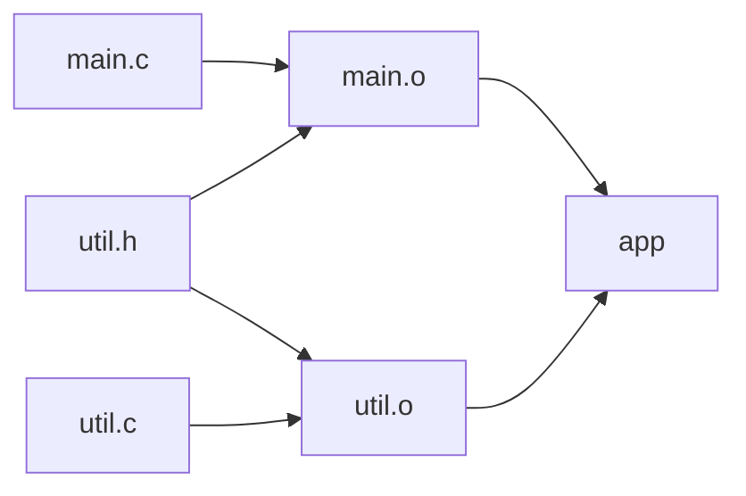
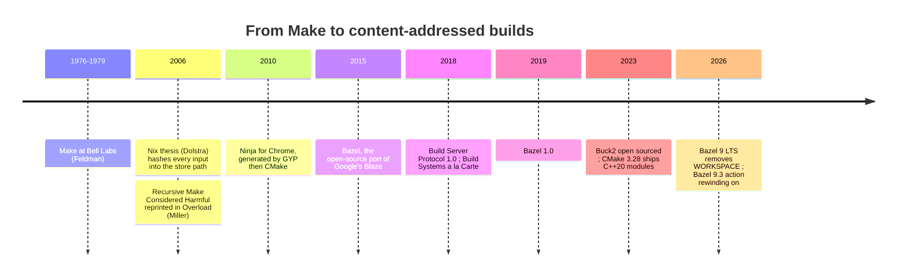
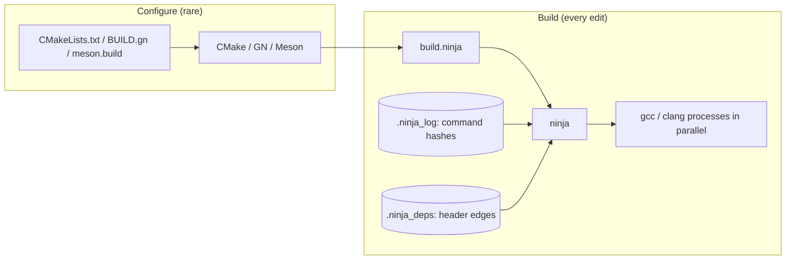
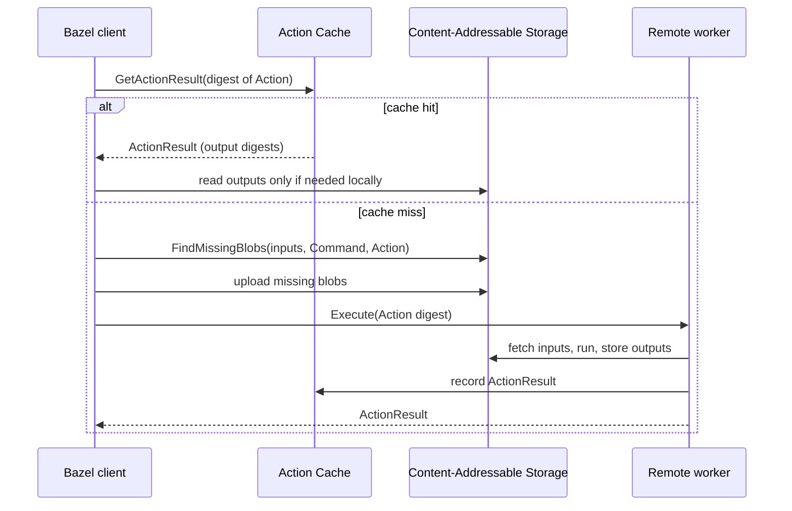
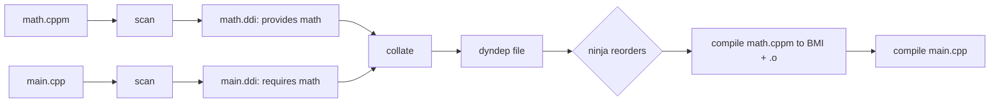

---
tags:
  - compilers
  - toolchains
  - build-systems
  - make
  - ninja
  - bazel
  - buck2
  - nix
  - remote-execution
  - cpp-modules
status: complete
sources:
  - https://john.cs.olemiss.edu/~hcc/csci450/notes/localcopy/make.pdf
  - https://accu.org/journals/overload/14/71/miller_2004/
  - https://www.microsoft.com/en-us/research/uploads/prod/2020/04/build-systems-jfp.pdf
  - https://aosabook.org/en/posa/ninja.html
  - https://ninja-build.org/manual.html
  - https://bazel.build/basics/hermeticity
  - https://en.wikipedia.org/wiki/Bazel_(software)
  - https://googleapis.dev/dotnet/Google.Apis.RemoteBuildExecution.v1/latest/api/Google.Apis.RemoteBuildExecution.v1.Data.BuildBazelRemoteExecutionV2Action.html
  - https://pkg.go.dev/github.com/bazelbuild/remote-apis/build/bazel/remote/execution/v2
  - https://www.buildbuddy.io/blog/bazels-remote-caching-and-remote-execution-explained/
  - https://blog.bazel.build/2023/10/06/bwob-in-bazel-7.html
  - https://engineering.fb.com/2023/04/06/open-source/buck2-open-source-large-scale-build-system/
  - https://grosskurth.ca/bib/2006/dolstra-thesis.pdf
  - https://reproducible-builds.org/docs/definition/
  - https://isocpp.org/files/papers/P1689R5.html
  - https://kitware.com/import-cmake-the-experiment-is-over
  - https://gcc.gnu.org/pipermail/gcc/2025-December/247240.html
  - https://clang.llvm.org/docs/JSONCompilationDatabase.html
  - https://github.com/axivion/bazel-compile-commands-extractor
  - https://scala-lang.org/blog/2018/06/15/bsp.html
  - https://build-server-protocol.github.io/docs/specification
  - https://blog.bazel.build/2026/01/20/bazel-9.html
  - https://blog.bazel.build/2026/07/07/bazel-q2-2026-community-update.html
  - https://newreleases.io/project/github/bazelbuild/bazel/release/9.3.0
  - https://bazel.build/about/roadmap
  - https://cmake.org/cmake/help/latest/release/4.4.html
  - https://mail.kde.org/pipermail/kde-devel/2026-July/004349.html
  - https://blog.jetbrains.com/idea/2025/07/bazel-ga-release/
created: 2026-11-26
updated: 2026-11-26
---

## Table Of Contents

- [[#TL;DR|TL;DR]]
- [[#The Problem|The Problem]]
- [[#Foundations|Foundations]]
    - [[#The Build Graph|The Build Graph]]
    - [[#Make's Rule - Timestamps|Make's Rule - Timestamps]]
    - [[#Correctness, Minimality and Early Cutoff|Correctness, Minimality and Early Cutoff]]
    - [[#Static vs Dynamic Dependencies|Static vs Dynamic Dependencies]]
    - [[#Traces - Verifying vs Constructive|Traces - Verifying vs Constructive]]
    - [[#Hermeticity and Reproducibility|Hermeticity and Reproducibility]]
- [[#How We Got Here|How We Got Here]]
- [[#How It Works|How It Works]]
    - [[#A Worked Example - One Program, Three Build Files|A Worked Example - One Program, Three Build Files]]
    - [[#Ninja - The Build Assembler|Ninja - The Build Assembler]]
    - [[#Bazel - Actions Keyed by Content|Bazel - Actions Keyed by Content]]
    - [[#Remote Caching and Remote Execution|Remote Caching and Remote Execution]]
    - [[#Buck2 - One Incremental Graph|Buck2 - One Incremental Graph]]
    - [[#Nix - Hashing the Whole World|Nix - Hashing the Whole World]]
    - [[#C++ Modules - When Compiles Must Be Ordered|C++ Modules - When Compiles Must Be Ordered]]
    - [[#Telling Tools About the Build - compile_commands.json and BSP|Telling Tools About the Build - compile_commands.json and BSP]]
- [[#Where It Is Now|Where It Is Now]]
- [[#Trade-offs & Open Problems|Trade-offs & Open Problems]]
- [[#Resources|Resources]]
- [[#Related Notes|Related Notes]]

## ***TL;DR***
---
*A build system decides which compiler, assembler and linker commands to run, in what order, and which ones it can skip. Everything that makes large codebases buildable in seconds rather than hours (incremental rebuilds, parallelism, shared caches, remote execution) comes from how that decision is made.*

- **A build is a graph of tasks.** Each task (compile `util.c`, link `app`) reads some files and writes others. The build system's job is to run the tasks whose inputs changed, in dependency order, as many at once as the graph allows. This is the coarse-grained, file-level version of [[Incremental Computation]].
- **Make (1976 to 1979) decided by timestamps.** Rebuild a target if any input is newer than it. Simple, fast, and wrong in ways that matter at scale: it misses flag changes, it trusts clocks, and it only knows the dependencies a human wrote down.
- **Ninja (2010 onward) made the low level fast.** It is "an assembler" for builds: a generator such as CMake writes an exact list of commands, and Ninja runs them, recording the headers each compile read and a hash of every command line ([Ninja manual](https://ninja-build.org/manual.html); [AOSA: Ninja](https://aosabook.org/en/posa/ninja.html)).
- **Bazel, Buck2 and Nix decide by content hashes.** A build step's identity is a hash of its exact command and the content of every input. If that hash has been seen before, on this machine or any other, the output can be reused. That turns a build into a lookup in a shared cache and lets steps run on remote machines.
- **Hermeticity is the price of caching.** A shared cache is only safe if a step cannot read anything it did not declare: not `/usr/bin/gcc`, not the clock, not a stray header. Bazel defines a hermetic build as one that, given the same source and configuration, "always returns the same output" ([Bazel docs](https://bazel.build/basics/hermeticity)).
- **Compilers and build systems now have to talk.** C++20 modules mean one compile must finish before another starts, so compilers emit a scan result in the P1689 JSON format and build tools schedule from it ([P1689R5](https://isocpp.org/files/papers/P1689R5.html)). In the other direction, IDEs learn how files are compiled from `compile_commands.json` or the Build Server Protocol.
- **As of November 2026,** Bazel 9 (LTS since January 2026) has removed its legacy WORKSPACE system and moved C++ rules out of the core; Bazel 9.3 (October 2026) turned on action rewinding so builds survive remote cache eviction; CMake 4.4 (July 2026) extends C++ module support to clang-cl.

## ***The Problem***
---
*A real program is thousands of compile steps plus a link, and almost every edit touches only a few of them. Rebuilding everything is correct but slow; rebuilding too little is fast but produces a binary that does not match the source.*

Picture a C++ project like Chrome, which the Ninja chapter describes as about 40,000 C++ files producing a binary around 90 MB ([AOSA: Ninja](https://aosabook.org/en/posa/ninja.html)). A one-line edit should cost seconds. To get there the build tool must answer four questions every time:

| Question | Why it is hard |
|---|---|
| **What depends on what?** | Some dependencies are written in build files; others (which headers a `.c` file includes, which modules a `.cpp` file imports) are only discoverable by reading or compiling the source. |
| **What changed?** | Timestamps are cheap but lie (clock skew, `git checkout` restoring old files, `touch`). Hashing content is honest but costs I/O. A changed compiler flag changes no file at all. |
| **What can be skipped?** | If a rebuilt object file is byte-identical to the old one, everything downstream could be skipped ("early cutoff"), but only if the tool notices. |
| **Can someone else's work be reused?** | A teammate or CI machine probably built the same file with the same flags an hour ago. Reusing that result requires being certain the inputs really were the same, including the compiler itself. |

Get any answer wrong in the "too little" direction and you ship a binary that does not match its source; the classic symptom is a bug that disappears after `make clean`. Peter Miller's "Recursive Make Considered Harmful" catalogued exactly these failures: builds that miss a regenerated header, need several passes, or are forced into slow clean rebuilds to be safe ([Miller, Overload 2006](https://accu.org/journals/overload/14/71/miller_2004/)).

## ***Foundations***
---
*Four ideas explain every build system: the task graph, how change is detected, how far a rebuild must propagate, and whether a step's result can be trusted anywhere else. The Build Systems à la Carte paper turns these into a precise taxonomy.*

### The Build Graph
*Targets are nodes, "needs" are edges, and a build is a walk of the graph from the requested targets down.*

A build system sees a directed acyclic graph. Leaves are source files; interior nodes are generated files; each node has a *rule* (the command that produces it). Feldman's original Make paper describes exactly this: Make walks the graph depth-first, brings each target's dependents up to date first, then rebuilds the target if needed ([Feldman, Make](https://john.cs.olemiss.edu/~hcc/csci450/notes/localcopy/make.pdf)).



Editing `util.c` dirties `util.o` and `app`. Editing `util.h` dirties both objects and `app`. Independent nodes (`main.o`, `util.o`) can be built in parallel, so the graph also gives the maximum parallelism.

### Make's Rule - Timestamps
*Make's whole change detector is one comparison of file modification times.*

$$
\text{rebuild}(t) \iff \neg\,\text{exists}(t) \;\lor\; \exists\, d \in \text{deps}(t) :\ \text{mtime}(d) > \text{mtime}(t)
$$

*In plain English: rebuild a target if it is missing or if anything it depends on was modified more recently than it was.* Feldman's paper says Make relies on "file last-modified timestamps from the file system", and treats missing targets as needing creation ([Feldman, Make](https://john.cs.olemiss.edu/~hcc/csci450/notes/localcopy/make.pdf)).

This rule is cheap (one `stat` per file) and needs no stored state, which is why it survived 45 years. Its blind spots follow directly from the formula:

- **The command is not an input.** Change `CFLAGS = -O0` to `-O2` and no file's timestamp moves, so nothing rebuilds.
- **Time is not content.** Restoring an older version of a file gives it an *older* timestamp, so a target built from the newer version looks up to date.
- **`deps(t)` is whatever the makefile says.** If a header is missing from the list, edits to it never trigger a rebuild. Miller's paper shows recursive make cutting the graph into per-directory pieces so that no single makefile sees the edge from a generated `parse.h` to `main.o` ([Miller](https://accu.org/journals/overload/14/71/miller_2004/)). His point is that "make does *not* have a bug": the input graph is incomplete.

### Correctness, Minimality and Early Cutoff
*A correct build matches a clean build; a minimal one runs only the tasks it must; early cutoff stops propagation when a rebuilt output did not actually change.*

Build Systems à la Carte (Mokhov, Mitchell and Peyton Jones) formalizes these. *Correctness*: after the build, every target equals what a from-scratch build would produce. *Minimality*: a task runs only if one of its transitive inputs changed. *Early cutoff*: if a task re-runs and produces the same result as last time, its dependents need not run ([BSALC, JFP 2020](https://www.microsoft.com/en-us/research/uploads/prod/2020/04/build-systems-jfp.pdf)).

Early cutoff matters most in compilers. Editing a comment in `util.c` forces `util.o` to recompile, but a deterministic compiler emits the same object bytes, so the link can be skipped. Make cannot see that, because the new `util.o` has a newer timestamp. The fine-grained version of the same idea, inside a single compiler, is the subject of [[Incremental Computation]].

### Static vs Dynamic Dependencies
*Some dependencies can be read from the build file; others are only known after running part of the build.*

The paper calls these **applicative** tasks (dependencies known without running the task) and **monadic** tasks ("a monadic task allows dynamic dependencies") ([BSALC](https://www.microsoft.com/en-us/research/uploads/prod/2020/04/build-systems-jfp.pdf)). C and C++ have two kinds of dynamic dependency:

| Kind | Discovered | How tools handle it |
|---|---|---|
| **Headers** (`#include`) | *While* compiling: the compiler knows what it opened | The compiler writes a depfile (`gcc -MD`), and the build tool reads it after the compile. The *first* build compiles everything anyway, so learning header edges late is fine. |
| **C++20 modules** (`import`) | *Before* compiling: an importer cannot even start until the imported module's interface has been compiled | A separate scan step must read each source, emit what it provides and requires, and the build tool reorders the graph before compiling ([P1689R5](https://isocpp.org/files/papers/P1689R5.html)). |

The second row is why modules took years to reach build tools: P1689 notes that with modules "compilation rules can now depend on each other and they must be executed in order", which header-era dependency files cannot express.

### Traces - Verifying vs Constructive
*What a build system remembers about past runs decides whether it can only skip work, or also fetch results it never computed.*

BSALC splits every build system into a **scheduler** (in what order to run tasks) and a **rebuilder** (whether to re-run a task), and classifies the rebuilders by what they store ([BSALC](https://www.microsoft.com/en-us/research/uploads/prod/2020/04/build-systems-jfp.pdf)):

| Rebuilder | Stores | Lets you | Example from the paper |
|---|---|---|---|
| **Dirty bit** | Nothing beyond the file system (timestamps) | Skip tasks whose inputs look older | Make |
| **Verifying trace** | For each task, hashes of the inputs it read last time | Skip a task if the hashes still match; early cutoff | Ninja, Shake |
| **Constructive trace** | Input hashes *and* the resulting output | Skip a task *and fetch its output*, even if this machine never ran it | Bazel, CloudBuild |
| **Deep constructive trace** | Hashes of the ultimate source inputs, not intermediate ones | Fetch a whole subtree's result without building its intermediate files | Buck, Nix |

The paper's table places them by scheduler too: Make and Ninja are *topological* (compute the order up front), Bazel is *restarting* (abort a task whose dependency is not ready and retry later), and Shake and Nix are *suspending* (pause a task until its dependency is built). The constructive rows are what make shared caches possible: a constructive trace "also stores the resulting value", so results can be reused across machines.

### Hermeticity and Reproducibility
*A cached result is only safe to share if the step that produced it could not have read anything undeclared. Hermeticity is that guarantee; reproducibility is its observable result.*

Bazel's definition: "When given the same input source code and product configuration, a hermetic build system always returns the same output." Its docs list the usual leaks: host binaries from `/usr/bin`, absolute paths, system compilers, steps that embed timestamps or build IDs, and steps that write into the source tree. The cures are to "treat tools as source code" (download and pin the compiler instead of using the host's) and to "enable strict sandboxing at the per-action level" ([Bazel hermeticity](https://bazel.build/basics/hermeticity)).

Reproducibility is the outward-facing version. The Reproducible Builds project defines it: a build is reproducible if, "given the same source code, build environment and build instructions, any party can recreate bit-by-bit identical copies of all specified artifacts" ([reproducible-builds.org](https://reproducible-builds.org/docs/definition/)). Every non-deterministic byte a compiler emits (a timestamp in a header, a random symbol suffix, an absolute path in debug info) is both a reproducibility bug and a cache miss.

## ***How We Got Here***
---
*Each generation fixed the previous one's change detector: timestamps, then recorded command lines and headers, then content hashes of everything, then hashes of the whole toolchain.*



| When | What happened | Source |
|---|---|---|
| 1978 to 1979 | Stuart Feldman's Make: "a simple mechanism for maintaining up-to-date versions of programs", with suffix-based implicit rules such as `.c` to `.o` | [Feldman](https://john.cs.olemiss.edu/~hcc/csci450/notes/localcopy/make.pdf) |
| 2006 (Overload reprint) | Miller shows recursive make builds too little, in the wrong order, or too much, and argues for one complete project-wide graph | [Miller](https://accu.org/journals/overload/14/71/miller_2004/) |
| 2006 | Eelco Dolstra's thesis: Nix store paths embed "the cryptographic hash of all inputs involved in building the component" | [Dolstra](https://grosskurth.ca/bib/2006/dolstra-thesis.pdf) |
| 2010 onward | Evan Martin starts Ninja to speed up Chrome's Linux build; a GYP-generated SCons build could take "30 seconds to start" | [AOSA: Ninja](https://aosabook.org/en/posa/ninja.html) |
| March 2015 | Bazel released as an "open-source port of Blaze"; 1.0 in October 2019 | [Wikipedia: Bazel](https://en.wikipedia.org/wiki/Bazel_(software)) |
| June 2018 | Build Server Protocol 1.0 from the Scala Center and JetBrains | [Scala blog](https://scala-lang.org/blog/2018/06/15/bsp.html) |
| 2018 / 2020 | Build Systems à la Carte (ICFP 2018, JFP 2020) gives the scheduler-by-rebuilder taxonomy | [BSALC](https://www.microsoft.com/en-us/research/uploads/prod/2020/04/build-systems-jfp.pdf) |
| April 2023 | Meta open-sources Buck2, written in Rust: "Buck2 completed builds 2x as fast as Buck1" | [Meta Engineering](https://engineering.fb.com/2023/04/06/open-source/buck2-open-source-large-scale-build-system/) |
| October 2023 | CMake 3.28 makes C++20 named modules non-experimental, using P1689 scanning and Ninja dyndep | [Kitware](https://kitware.com/import-cmake-the-experiment-is-over) |
| January 2026 | Bazel 9.0 LTS: WORKSPACE code removed, C++ rules moved to `rules_cc` | [Bazel blog](https://blog.bazel.build/2026/01/20/bazel-9.html) |

## ***How It Works***
---
*One small C program built three ways shows what each generation records, then remote execution, Buck2, Nix, C++ modules and IDE integration in turn.*

### A Worked Example - One Program, Three Build Files
*The same two-file program, described for Make, for Ninja (as a generator would write it) and for Bazel.*

The program: `main.c` and `util.c`, both including `util.h`, linked into `app`.

**Make**, with the compiler writing header dependencies (`-MMD`) that the makefile then includes:

```make
CFLAGS = -O2 -MMD -MP
OBJS   = main.o util.o

app: $(OBJS)
	$(CC) -o $@ $^

%.o: %.c
	$(CC) $(CFLAGS) -c $< -o $@

-include $(OBJS:.o=.d)    # main.d says: main.o: main.c util.h
```

Change `CFLAGS` to `-O0` and run `make`: nothing happens, because no timestamp moved. That is the bug the next two formats fix.

**Ninja**, as a generator such as CMake would emit it. No patterns, no conditionals, just exact edges:

```ninja
rule cc
  command = gcc -O2 -MD -MF $out.d -c $in -o $out
  depfile = $out.d
  deps = gcc
rule link
  command = gcc -o $out $in

build main.o: cc main.c
build util.o: cc util.c
build app: link main.o util.o
```

`deps = gcc` tells Ninja to fold each depfile into its binary deps log after the compile. Ninja also logs every command it ran, so editing `-O2` in the rule makes every `cc` edge out of date ([AOSA: Ninja](https://aosabook.org/en/posa/ninja.html)).

**Bazel**, where you declare targets and the rules (written in Starlark) derive the commands. In Bazel 9 the C++ rules live in `rules_cc` and must be loaded explicitly ([Bazel 9](https://blog.bazel.build/2026/01/20/bazel-9.html)):

```python
load("@rules_cc//cc:defs.bzl", "cc_binary", "cc_library")

cc_library(
    name = "util",
    srcs = ["util.c"],
    hdrs = ["util.h"],
)

cc_binary(
    name = "app",
    srcs = ["main.c"],
    deps = [":util"],
)
```

Here the headers are *declared*, not discovered. With sandboxing, an action sees only its declared inputs, so if `main.c` included a header nobody declared, the compile would fail instead of silently depending on it. Whether `main.o` is rebuilt depends on the content hash of its command and inputs, not on timestamps.

| Change | Make | Ninja | Bazel |
|---|---|---|---|
| Edit `util.h` | Rebuild both objects, relink (via `.d` files) | Same (via deps log) | Same |
| Change `-O2` to `-O0` | **Nothing** (bug) | Rebuild all compiles (command hash changed) | Rebuild all compiles (action key changed) |
| `touch util.c` (no content change) | Rebuild `util.o`, relink | Rebuild `util.o`, relink (the compiler rewrites `util.o`, so its timestamp moves) | Nothing (content hash unchanged) |
| Teammate already built this commit | Rebuild locally | Rebuild locally | Fetch outputs from the shared cache |

### Ninja - The Build Assembler
*Ninja does almost no thinking at build time; it loads a precomputed graph and runs it as fast as possible.*

The manual's philosophy: "Where other build systems are high-level languages, Ninja aims to be an assembler", and it "is intended to be used with a separate program generating its input files" ([Ninja manual](https://ninja-build.org/manual.html)). The work splits into two layers:



At startup Ninja parses the `.ninja` files, canonicalizes each path into one `Node`, loads the build log and deps log, stats every file, and plans the edges to run ([AOSA: Ninja](https://aosabook.org/en/posa/ninja.html)). The engineering details that made it fast for Chrome:

- **Deps log.** Early Ninja reparsed gcc's Makefile-style depfiles at startup; on Chrome those totalled 90 MB. Ninja now ingests them during the build and stores them as lists of integer path IDs in a binary log.
- **Command hashes.** The build log stores a hash of each command rather than its text, which cut the log "from 200 MB to less than 2 MB on Mac OS X" and made it "over 20 times faster to load".
- **No-op builds.** A Chrome build with nothing to do took "just under a second".
- **`restat`.** After a command runs, Ninja re-stats its outputs; outputs whose timestamps did not change are treated as never rebuilt, pruning their dependents ([Ninja manual](https://ninja-build.org/manual.html)). This is Ninja's form of early cutoff, useful for generators that rewrite a file only when its content changes.
- **`dyndep`** (since Ninja 1.10). A build edge can name a file, produced earlier in the same build, that adds dependencies discovered from source content, originally for Fortran modules and now for C++ modules.

### Bazel - Actions Keyed by Content
*Bazel turns targets into actions, identifies each action by a hash of everything it could read, and refuses to let actions read anything else.*

A Bazel build evaluates `BUILD` files and Starlark rules to produce a graph of **actions**: single command invocations with fully declared inputs and outputs. An action is never rerun just because a file is newer. It is rerun only if its *key* changes, and the key is computed from content:

$$
\text{key}(a) = H\big(\,H(\text{command, args, env}),\ \ \text{root}(\text{input tree}),\ \ \text{platform},\ \ldots\,\big)
$$

*In plain English: hash the exact command line, the Merkle root of all its input files, and the machine requirements; if that hash matches a previous run, the old outputs are valid.* The input tree is hashed bottom-up: each file by content, each directory by the hashes of its entries, so changing one header changes only the hashes on its path to the root.

Hermeticity is what makes the key honest. If an action could read `/usr/include/stdio.h` from the host without declaring it, two machines with different system headers would compute the same key for different outputs. Hence Bazel's push to fetch toolchains as declared inputs and to sandbox each action ([Bazel hermeticity](https://bazel.build/basics/hermeticity)).

### Remote Caching and Remote Execution
*Because an action's key fully describes it, the result can be stored under that key and reused by anyone, or the action can be shipped to another machine to run.*

Bazel, Buck2 and other tools speak the **Remote Execution API (REAPI)**, a gRPC protocol with three services: an **ActionCache** (`GetActionResult`, `UpdateActionResult`), a **ContentAddressableStorage** (`FindMissingBlobs`, `BatchReadBlobs`, `BatchUpdateBlobs`, `GetTree`), and **Execution** (`Execute`, `WaitExecution`) ([REAPI v2 bindings](https://pkg.go.dev/github.com/bazelbuild/remote-apis/build/bazel/remote/execution/v2)). Every blob is named by a `Digest`: a hash plus a size in bytes.

The `Action` message is the cache key. The spec says "`Action`s can be succinctly identified by the digest of their wire format encoding" and "once an `Action` has been executed, will be cached in the action cache" ([REAPI Action](https://googleapis.dev/dotnet/Google.Apis.RemoteBuildExecution.v1/latest/api/Google.Apis.RemoteBuildExecution.v1.Data.BuildBazelRemoteExecutionV2Action.html)). Its fields:

| Field | Meaning |
|---|---|
| `command_digest` | "The digest of the Command to run", which must be in the CAS (arguments, environment, output paths) |
| `input_root_digest` | Root of the input directory tree; "every subdirectory and content blob referred to, MUST be in the ContentAddressableStorage" |
| `platform` | Execution requirements (OS, CPU, container image) |
| `timeout` | Part of the key: "two `Actions` with different timeouts are different" |
| `salt` | Places the action "into a separate cache namespace" |
| `do_not_cache` | Result must not be cached or merged with in-flight duplicates |



With a cache but no remote workers, a miss runs locally and Bazel uploads outputs to the CAS and the result to the AC; with remote execution, Bazel uploads only the inputs the server is missing and lets a worker run the action ([BuildBuddy](https://www.buildbuddy.io/blog/bazels-remote-caching-and-remote-execution-explained/)).

**Build without the Bytes.** If outputs live in the remote CAS, a client need not download intermediate files at all. Since Bazel 7 the default, `--remote_download_outputs=toplevel`, downloads only what local actions need plus the outputs of the targets you asked for ([Bazel blog, 2023](https://blog.bazel.build/2023/10/06/bwob-in-bazel-7.html)). The catch: if the cache evicts an intermediate blob that a later action needs, the build breaks. Bazel 9.3 enabled `--rewind_lost_inputs` by default, so such builds now "recover from remote cache eviction by rerunning the actions that produced lost inputs" ([Bazel 9.3.0](https://newreleases.io/project/github/bazelbuild/bazel/release/9.3.0)).

### Buck2 - One Incremental Graph
*Buck2 keeps the same content-addressed model but runs loading, analysis and execution as one incremental computation.*

Meta's Buck2 (open-sourced April 2023) is "an extensible and performant build system written in Rust". Its core "has no knowledge of any language-specific rules": "the rule API is entirely in Starlark". It uses a "single incremental dependency graph", removing the separate phases that Buck1 and Bazel use, and it speaks the same remote execution API as Bazel (tested with Buildbarn and EngFlow). Meta reported builds completing "2x as fast as Buck1" in internal tests ([Meta Engineering](https://engineering.fb.com/2023/04/06/open-source/buck2-open-source-large-scale-build-system/)). Its engine, DICE, is covered in [[Incremental Computation]].

### Nix - Hashing the Whole World
*Nix applies the content-addressed idea to entire packages, including the compiler that builds them.*

In Nix every build output lives at a path like `/nix/store/bwacc7a5c5n3qx37nz5drwcgd2lv89w6-hello-2.1.1`, where the prefix is a hash of all build inputs: sources, build script, arguments, environment and every build-time dependency, computed recursively. Dolstra's thesis gives two purposes: hashes "prevent interference between components, and they allow complete identification of dependencies". Because nothing lives in global paths like `/usr/lib`, a build that uses an undeclared dependency cannot find it and "will fail deterministically" ([Dolstra 2006](https://grosskurth.ca/bib/2006/dolstra-thesis.pdf)). In BSALC's terms this is a *deep constructive trace*: a change to the compiler changes the hash of every package built with it, so caches of prebuilt binaries are safe to share.

### C++ Modules - When Compiles Must Be Ordered
*Modules turn independent compiles into a dependency graph between compiles, so the build must scan sources before it can schedule them.*

```cpp
// math.cppm
export module math;
export int square(int x) { return x * x; }

// main.cpp
import math;
int main() { return square(3); }
```

`main.cpp` cannot compile until `math.cppm` has produced its compiled interface (a BMI). With headers the order never mattered; with modules it does, and the build file does not say which file provides `math`. The fix standardized in P1689 (Ben Boeckel and Brad King, Kitware) is a scan step whose output, per source, lists what it `provides` and `requires`:

```json
{
  "version": 1,
  "revision": 0,
  "rules": [
    { "primary-output": "main.o",
      "requires": [ { "logical-name": "math" } ] }
  ]
}
```

The build tool matches each `requires` against some other file's `provides` by `logical-name` and adds the edge ([P1689R5](https://isocpp.org/files/papers/P1689R5.html)). CMake does this with a collator that writes a Ninja `dyndep` file:



CMake 3.28 (October 2023) made this non-experimental once all three major compilers could report dependencies "in the correct order": Clang 16+, GCC 14+, and MSVC from Visual Studio 17.4, with the Ninja and Visual Studio generators only ([Kitware](https://kitware.com/import-cmake-the-experiment-is-over)). The format is not only a CMake concern. In December 2025 a GCC proposal to emit module dependencies in Make syntax drew a reply from Boeckel that dependency data alone is not enough, because "Just because a module exists does not mean it is allowed to be imported by any given rule", and that real projects should use "an actual build system" ([gcc mailing list](https://gcc.gnu.org/pipermail/gcc/2025-December/247240.html)).

### Telling Tools About the Build - compile_commands.json and BSP
*Editors, linters and analyzers need the exact flags each file was compiled with; two formats carry that from the build to the tools.*

A Clang-based tool cannot parse `util.c` correctly without its include paths and macros. The **JSON Compilation Database** stores them as an array of entries, one per compile, with `directory`, `file`, and either `arguments` (preferred) or a shell-escaped `command`, plus an optional `output` ([Clang docs](https://clang.llvm.org/docs/JSONCompilationDatabase.html)):

```json
[
  { "directory": "/home/user/proj/build",
    "arguments": ["/usr/bin/clang", "-I../include", "-O2", "-c", "-o", "util.o", "../util.c"],
    "file": "../util.c" }
]
```

CMake writes it with `CMAKE_EXPORT_COMPILE_COMMANDS`, Ninja with `ninja -t compdb` ("a compilation database in the JSON format expected by the Clang tooling interface" ([Ninja manual](https://ninja-build.org/manual.html))), Clang itself can emit fragments with `-MJ`, and Bear intercepts compiler calls. Bazel has no built-in exporter; third-party extractors "export Bazel build actions into the compile_commands.json format" ([extractor README](https://github.com/axivion/bazel-compile-commands-extractor)). clangd reads the file to answer requests, as described in [[Language Servers and IDE Tooling]].

The **Build Server Protocol** goes further: instead of a static file, the IDE asks a running build server for its targets, sources and dependencies, and asks it to compile, test or run them. It was created because "IDEs create their own custom build tool integrations and build tools provide their own custom IDE integrations"; BSP 1.0 came from the Scala Center and JetBrains in June 2018, and "BSP and LSP are complementary" ([Scala blog](https://scala-lang.org/blog/2018/06/15/bsp.html)). The spec reuses LSP's base protocol ([BSP spec](https://build-server-protocol.github.io/docs/specification)).

## ***Where It Is Now***
---
*As of 26 November 2026: Bazel's long migration to a lean core is done, remote caching is hardening against eviction, and C++ modules support is filling in compiler by compiler.*

- **Bazel 9 is the LTS line.** Bazel 9.0 (20 January 2026) "completely removed the code supporting WORKSPACE", made Bzlmod the default dependency system, finished moving built-in C++ rules into `rules_cc`, made autoloads empty by default so rules must be loaded explicitly, and supports a prebuilt `protoc` via protobuf 33.4+. Starlark typing is planned for Bazel 10.0 ([Bazel blog](https://blog.bazel.build/2026/01/20/bazel-9.html)). Point releases followed: 9.1 in April, 9.2 in July ([Q2 2026 update](https://blog.bazel.build/2026/07/07/bazel-q2-2026-community-update.html)), and 9.3.0 on 7 October 2026, which enabled action rewinding by default and reports `MODULE.bazel` include cycles as errors instead of hanging ([Bazel 9.3.0](https://newreleases.io/project/github/bazelbuild/bazel/release/9.3.0)).
- **Remote caches are moving to chunked storage.** The Q2 2026 Bazel community update highlights content-defined chunking for remote caches, so a changed large output re-uploads only its changed chunks ([Q2 2026 update](https://blog.bazel.build/2026/07/07/bazel-q2-2026-community-update.html)); the current REAPI v2 bindings list `SplitBlob`, `SpliceBlob` and chunk-mapping calls on the CAS service ([REAPI v2 bindings](https://pkg.go.dev/github.com/bazelbuild/remote-apis/build/bazel/remote/execution/v2)). The REAPI working group meets monthly.
- **CMake 4.4** (announced July 2026 ([kde-devel](https://mail.kde.org/pipermail/kde-devel/2026-July/004349.html))) supports C++20 named modules with clang-cl, adds a `CXX_SCAN_FOR_MODULES` file-set property, lets module-providing targets be consumed by targets with different compile options, and its instrumentation can capture compiler trace files such as Clang's `-ftime-trace` ([CMake 4.4 notes](https://cmake.org/cmake/help/latest/release/4.4.html)).
- **IDE integration consolidated at JetBrains.** JetBrains now develops the Bazel plugin for IntelliJ IDEA, PyCharm and GoLand, replacing Google's (GA with the 2025.2 IDEs) ([JetBrains](https://blog.jetbrains.com/idea/2025/07/bazel-ga-release/)); the 2026.1 releases added "Bazel 9 compatibility" and the 2026.2 focus is Python and Go projects ([Q2 2026 update](https://blog.bazel.build/2026/07/07/bazel-q2-2026-community-update.html)).
- **Make-based module builds are contested.** The December 2025 GCC thread shows the split: some want GNU Make alone to build modules from compiler-emitted rules; the P1689 author argues dependency data without import permissions is not a satisfactory model ([gcc mailing list](https://gcc.gnu.org/pipermail/gcc/2025-December/247240.html)).

## ***Trade-offs & Open Problems***
---
*Every step up in correctness and sharing costs setup, discipline and I/O; the remaining hard problems sit where compilers do things build systems cannot see.*

| Approach | Change detection | Strengths | Costs |
|---|---|---|---|
| **Make** | Timestamps | Ubiquitous, no stored state, fine for small trees | Misses flag changes; trusts clocks; correctness depends on hand-written edges |
| **Generator + Ninja** (CMake, Meson, GN) | Timestamps + command hashes + compiler-reported headers | Very fast no-op and incremental builds; works with existing compilers | Local only; host toolchain leaks in; no sharing between machines |
| **Bazel / Buck2** | Content hashes of declared inputs and commands | Shared caches, remote execution, early cutoff by content | Every input must be declared; toolchains and third-party code must be wrapped in rules; migration effort (the WORKSPACE-to-Bzlmod move spanned major releases: off by default in 8.0, removed in 9.0) |
| **Nix** | Hash of all inputs, recursively, including the toolchain | Strongest isolation; binary caches are safe to share | Coarse (package-level) units; any toolchain change rebuilds everything above it |

**Open problems.**

- **Dynamic dependencies in a static world.** Header edges are learned after the fact; module edges must be learned before, which costs an extra scan per file and a collation step. Whether the build file or the compiler should own the "who may import what" question is unresolved ([gcc mailing list](https://gcc.gnu.org/pipermail/gcc/2025-December/247240.html)).
- **Determinism is a property of the whole toolchain.** A compiler that embeds a timestamp, build ID or absolute path in its output breaks both reproducibility and cache hits ([Bazel hermeticity](https://bazel.build/basics/hermeticity)). Every compiler, linker and code generator in the chain has to cooperate.
- **Trusting the cache.** An action-cache entry maps a key to outputs that nobody recomputes on a hit. That is the source of the speed, and also means whoever can write to the cache decides what every client links, so cache write access is effectively build-integrity access.
- **Losing bytes.** Build without the Bytes trades download time for a dependence on the remote CAS keeping blobs alive; action rewinding (default since Bazel 9.3) recovers but reruns work.
- **Header-heavy C and C++.** Editing a widely included header still rebuilds every translation unit that includes it; build systems can parallelize and cache, but cannot cut off what the language makes a real dependency. Modules and finer-grained compiler caches ([[Persistent Compiler Caches]]) attack this from the compiler side.
- **One project model for all tools.** IDEs need the build's view of the code. `compile_commands.json` is static and C-family-only; BSP is dynamic but mostly adopted in the JVM world; Bazel needs third-party extractors. There is still no universal build-to-tool protocol ([[Language Servers and IDE Tooling]]).
- **Granularity.** Build systems cache whole compiler invocations; compilers cache individual queries. Joining the two, so a cache hit can happen at the function level across machines, is open work at the boundary with [[Incremental Computation]].

## ***Resources***
---
*The original papers and design documents first, then the protocols and specs, then current release notes.*

**Papers and history**
- [Make: A Program for Maintaining Computer Programs](https://john.cs.olemiss.edu/~hcc/csci450/notes/localcopy/make.pdf): Stuart Feldman, Bell Labs (Software: Practice and Experience, 1979).
- [Recursive Make Considered Harmful](https://accu.org/journals/overload/14/71/miller_2004/): Peter Miller, Overload 14(71), 2006.
- [Build Systems à la Carte: Theory and Practice](https://www.microsoft.com/en-us/research/uploads/prod/2020/04/build-systems-jfp.pdf): Mokhov, Mitchell, Peyton Jones, JFP 2020. The scheduler and rebuilder taxonomy.
- [The Purely Functional Software Deployment Model](https://grosskurth.ca/bib/2006/dolstra-thesis.pdf): Eelco Dolstra, PhD thesis, Utrecht, 2006. Nix.
- [Ninja](https://aosabook.org/en/posa/ninja.html): Evan Martin, The Performance of Open Source Applications. Why and how Ninja is fast.

**Specs and docs**
- [The Ninja build system manual](https://ninja-build.org/manual.html): restat, dyndep, compdb.
- [Bazel: Hermeticity](https://bazel.build/basics/hermeticity).
- [REAPI `Action` message](https://googleapis.dev/dotnet/Google.Apis.RemoteBuildExecution.v1/latest/api/Google.Apis.RemoteBuildExecution.v1.Data.BuildBazelRemoteExecutionV2Action.html) and [v2 service bindings](https://pkg.go.dev/github.com/bazelbuild/remote-apis/build/bazel/remote/execution/v2).
- [Bazel's Remote Caching and Remote Execution Explained](https://www.buildbuddy.io/blog/bazels-remote-caching-and-remote-execution-explained/): BuildBuddy.
- [P1689R5: Format for describing dependencies of source files](https://isocpp.org/files/papers/P1689R5.html): Boeckel and King, 2022.
- [JSON Compilation Database Format Specification](https://clang.llvm.org/docs/JSONCompilationDatabase.html): Clang docs.
- [Build Server Protocol specification](https://build-server-protocol.github.io/docs/specification) and the [1.0 announcement](https://scala-lang.org/blog/2018/06/15/bsp.html).
- [Reproducible Builds: definition](https://reproducible-builds.org/docs/definition/).

**Systems and status, 2023 to 2026**
- [Build faster with Buck2](https://engineering.fb.com/2023/04/06/open-source/buck2-open-source-large-scale-build-system/): Hopman and Mitchell, Meta, April 2023.
- [import CMake; the Experiment is Over!](https://kitware.com/import-cmake-the-experiment-is-over): Kitware, October 2023.
- [Build without the Bytes in Bazel 7](https://blog.bazel.build/2023/10/06/bwob-in-bazel-7.html): Bazel blog, October 2023.
- [Bazel 9 LTS](https://blog.bazel.build/2026/01/20/bazel-9.html), [Q2 2026 community update](https://blog.bazel.build/2026/07/07/bazel-q2-2026-community-update.html), [9.3.0 release notes](https://newreleases.io/project/github/bazelbuild/bazel/release/9.3.0) and the [roadmap](https://bazel.build/about/roadmap).
- [CMake 4.4 release notes](https://cmake.org/cmake/help/latest/release/4.4.html) and [announcement](https://mail.kde.org/pipermail/kde-devel/2026-July/004349.html), July 2026.
- [Generation of Make Dependencies for C++ Modules](https://gcc.gnu.org/pipermail/gcc/2025-December/247240.html): gcc mailing list, December 2025.
- [Bazel plugin GA](https://blog.jetbrains.com/idea/2025/07/bazel-ga-release/): JetBrains, 2025.

## ***Related Notes***
---
*Where the build system meets the compiler on either side.*

- [[Incremental Computation]] — The fine-grained, inside-the-compiler version of the same problem: red-green, salsa, DICE and early cutoff.
- [[Language Servers and IDE Tooling]] — clangd's use of `compile_commands.json` and the Build Server Protocol from the IDE side.
- [[Linking and LTO]] — The final, usually uncached link step, and why it became the bottleneck once compiles were cached and distributed.
- [[Compiler Pipeline]] — The per-file pipeline that a build system invokes thousands of times.
- [[LLVM]] — Home of Clang, clang-scan-deps and the compilation database.
- [[Persistent Compiler Caches]] — Planned: ccache, sccache and on-disk compiler caches, the layer between a build system and a compiler.
- [[C++ Modules]] — Planned: BMIs, header units, `import std` and why modules took years to reach build tools.
- [[Reproducible Builds]] — Planned: deterministic compiler output, `SOURCE_DATE_EPOCH`, path remapping and bootstrapping trust.
- [[Profile-Guided Optimization]] — Another case where a build must feed data from one run back into the compiler.
