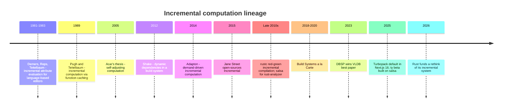
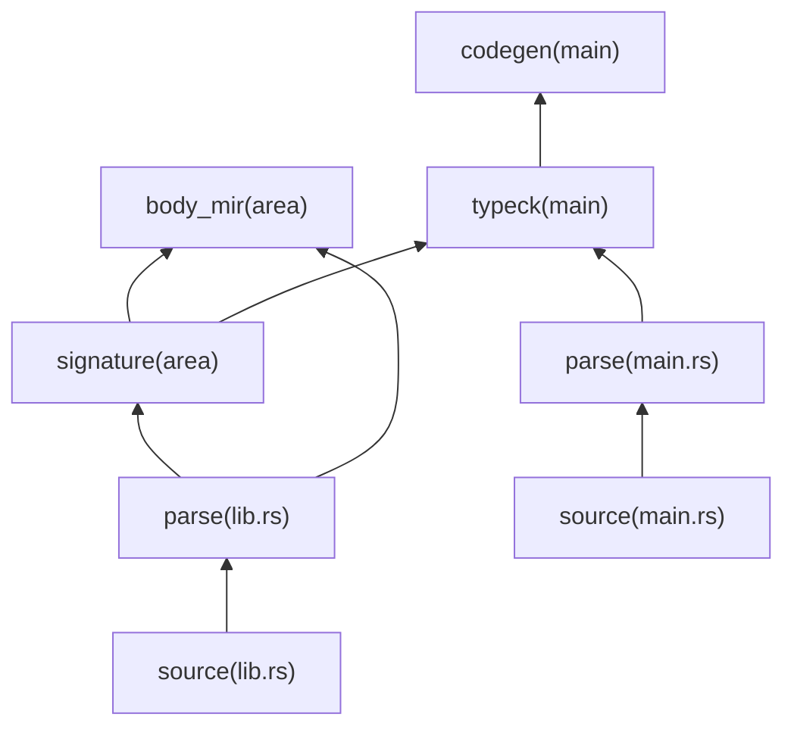
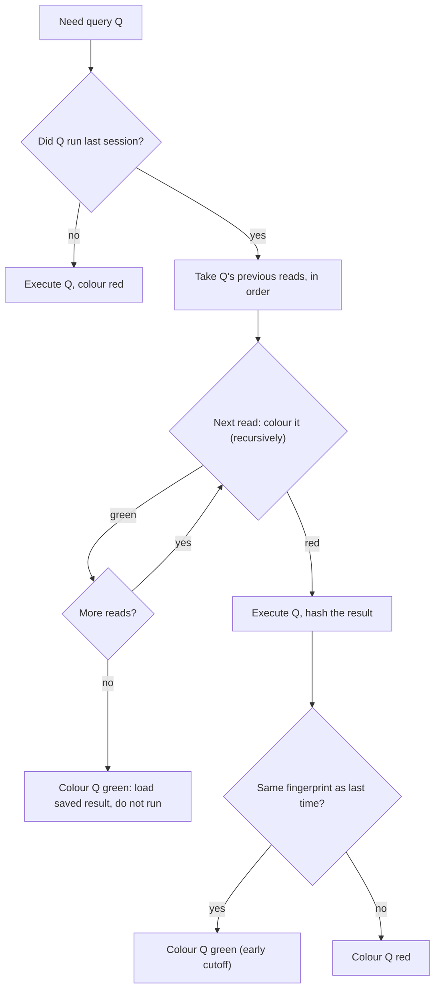

---
tags:
  - compilers
  - incremental-computation
  - toolchains
  - build-systems
  - rustc
  - salsa
  - language-servers
status: complete
sources:
  - https://rustc-dev-guide.rust-lang.org/queries/incremental-compilation.html
  - https://rustc-dev-guide.rust-lang.org/queries/incremental-compilation-in-detail.html
  - https://www.microsoft.com/en-us/research/uploads/prod/2020/04/build-systems-jfp.pdf
  - https://www.microsoft.com/en-us/research/uploads/prod/2018/03/build-systems-a-la-carte.pdf
  - https://people.mpi-sws.org/~hammer/adapton-pldi2014.pdf
  - https://www.csd.cmu.edu/sites/default/files/phd-thesis/CMU-CS-05-129.pdf
  - https://research.cs.wisc.edu/wpis/abstracts/toplas83.abs.html
  - https://www.springerprofessional.de/doi/10.1145/75277.75305
  - https://neilmitchell.blogspot.com/2012/07/shake-icfp-paper.html
  - https://salsa-rs.github.io/salsa/overview.html
  - https://docs.rs/crate/salsa/0.26.1/source/book/src/reference/algorithm.md
  - https://docs.rs/crate/salsa/0.26.1/source/book/src/cycles.md
  - https://docs.rs/crate/salsa/0.26.2/source/src/durability.rs
  - https://docs.rs/crate/salsa/0.27.0/source/src/function/backdate.rs
  - https://docs.rs/crate/salsa/0.26.2/source/tests/persistence.rs
  - https://docs.rs/crate/salsa/latest/source/RELEASES.md
  - https://nextjs.org/blog/turbopack-incremental-computation
  - https://nextjs.org/blog/next-16
  - https://buck2.build/docs/insights_and_knowledge/modern_dice/
  - https://ziglang.org/devlog/2025/
  - https://goals.rust-lang.org/2026/incremental-system-rethought.html
  - https://goals.rust-lang.org/2025h2/relink-dont-rebuild.html
  - https://goals.rust-lang.org/2026/roadmap-fast-builds.html
  - https://blog.rust-lang.org/2025/09/10/rust-compiler-performance-survey-2025-results
  - https://astral.sh/blog/ty
  - https://blog.janestreet.com/introducing-incremental/
  - https://arxiv.org/abs/2203.16684v1
  - https://ar5iv.labs.arxiv.org/html/2203.16684
  - https://research.vmware.com/announcements/vrg-paper-wins-a-vldb-23-best-research-paper-award
  - https://arxiv.org/html/2312.07946v2
created: 2026-11-26
updated: 2026-11-26
---

## Table Of Contents

- [[#TL;DR|TL;DR]]
- [[#The Problem|The Problem]]
- [[#Foundations|Foundations]]
    - [[#The Model - Inputs, Derived Values, Dependencies|The Model - Inputs, Derived Values, Dependencies]]
    - [[#Correctness - From-Scratch Consistency|Correctness - From-Scratch Consistency]]
    - [[#Minimality and Early Cutoff|Minimality and Early Cutoff]]
    - [[#Static vs Dynamic Dependencies|Static vs Dynamic Dependencies]]
    - [[#Push vs Pull|Push vs Pull]]
- [[#How We Got Here|How We Got Here]]
- [[#How It Works|How It Works]]
    - [[#A Worked Example - One Edit, Three Queries|A Worked Example - One Edit, Three Queries]]
    - [[#rustc - Red-Green on a Persisted Graph|rustc - Red-Green on a Persisted Graph]]
    - [[#Salsa - Revisions, Backdating and Durability|Salsa - Revisions, Backdating and Durability]]
    - [[#Self-Adjusting Computation and Adapton|Self-Adjusting Computation and Adapton]]
    - [[#Turbopack - Value Cells and Bottom-Up Dirtying|Turbopack - Value Cells and Bottom-Up Dirtying]]
    - [[#Buck2 DICE|Buck2 DICE]]
    - [[#Build Systems a la Carte - Two Axes|Build Systems a la Carte - Two Axes]]
    - [[#Early Cutoff Across Process Boundaries|Early Cutoff Across Process Boundaries]]
    - [[#Incremental Queries over Collections - DBSP|Incremental Queries over Collections - DBSP]]
- [[#Where It Is Now|Where It Is Now]]
- [[#Trade-offs & Open Problems|Trade-offs & Open Problems]]
- [[#Resources|Resources]]
- [[#Related Notes|Related Notes]]

## ***TL;DR***
---
*Incremental computation means updating a result after an input changes by redoing only the work that the change actually affects. It is the one idea behind fast rebuilds in compilers, instant diagnostics in language servers, and minimal rebuilds in build systems.*

- **The recipe is the same everywhere.** Record which inputs and intermediate results each computation read. When an input changes, find the computations that depend on it, re-run only those, and stop as soon as a re-run produces the same value as before.
- **That last step is "early cutoff", and it is where the speed comes from.** Editing a comment changes the file, but not the function signatures parsed from it, so nothing downstream of the signatures needs to re-run. Build Systems à la Carte defines it: when a task's "result is unchanged from the previous build, it is unnecessary" to rebuild its dependents ([Mokhov, Mitchell, Peyton Jones, JFP 2020](https://www.microsoft.com/en-us/research/uploads/prod/2020/04/build-systems-jfp.pdf)).
- **Modern compilers are built as query databases.** rustc, rust-analyzer (via **salsa**), Roslyn, ty and Turbopack compute each fact (the type of this function, the exports of this module) on demand, memoize it, and record dependencies automatically as queries call each other.
- **Two families of algorithm.** *Pull* (red-green, salsa): on the next request, walk down from the requested result and check whether its inputs changed. *Push* (self-adjusting computation, Jane Street's Incremental, Turbopack's dirtying): when an input changes, mark or recompute dependents upward. Adapton and Turbopack mix them: dirty eagerly, recompute lazily.
- **The hard parts are engineering, not theory.** Stable identities across edits, cheap but collision-resistant hashing, keeping volatile data (source positions) out of results, cycles, and the memory and disk cost of the cache. rustc's guide says stable hashing "is the main reason why incremental compilation can be slower than non-incremental compilation" ([rustc dev guide](https://rustc-dev-guide.rust-lang.org/queries/incremental-compilation-in-detail.html)).
- **As of November 2026**, the frontier is reuse *across* tools and processes: Rust's funded 2026 goals to share one incremental base between `cargo check` and `cargo build` and to stop rebuilding dependents when only private code changed, Turbopack's on-disk cache in `next dev`, salsa-based type checkers like Astral's ty recomputing diagnostics in milliseconds, and Zig's `--watch -fincremental` loop.

## ***The Problem***
---
*Programs are edited in tiny steps, but compilers were designed to process whole programs. Without incrementality, the cost of every rebuild grows with the size of the program rather than the size of the change.*

A developer changes one line and saves. A batch compiler re-lexes, re-parses, re-type-checks, re-optimizes and re-links everything in the crate or module. For a large project that is seconds to minutes, on every save. A language server has it worse: it wants fresh diagnostics after every keystroke.

Rust users rank this the top pain point. In the 2025 Rust compiler performance survey, "Waiting too long for an incremental rebuild after making a small source code change" was both the most common open-ended complaint and the most common problem respondents said they struggled with; about 55% wait more than ten seconds for a rebuild in their most frustrating project ([Rust Blog, Sept 2025](https://blog.rust-lang.org/2025/09/10/rust-compiler-performance-survey-2025-results)).

The obvious fix, caching per file, is too coarse. Make-style systems cache whole output files, so they "do not understand and cannot cache internal data structures within the compiler" ([Vercel, Jan 2026](https://nextjs.org/blog/turbopack-incremental-computation)). And a modern compiler's outputs do not map neatly onto source files:

| Why per-file caching breaks | Example |
|---|---|
| A file's meaning depends on other files | Type-checking `main.rs` needs the signatures in `lib.rs` |
| Generic code is instantiated where it is used | A change to a generic function must reach every caller's monomorphized copy ([[Monomorphization]]) |
| Whole-program passes cross files | Inlining, dead-code elimination, bundler tree-shaking |
| Most edits change nothing important | Comments, whitespace, function bodies that no other file looks inside |

So the real problem is finer: find, inside the compiler, exactly which intermediate facts an edit invalidates, recompute only those, and prove the result equals a clean build.

## ***Foundations***
---
*Five ideas cover the whole field: a dependency graph of memoized computations, a correctness condition, two efficiency properties, the static vs dynamic dependency split, and the push vs pull choice of when to do work.*

### The Model - Inputs, Derived Values, Dependencies

Every system in this note uses the same three ingredients, under different names:

| Concept | Meaning | rustc | salsa | Build Systems à la Carte | Turbopack |
|---|---|---|---|---|---|
| **Input** | Set from outside; never computed | Source files, flags | `#[salsa::input]` | Input key (task is `Nothing`) | File-system cell |
| **Derived value** | A pure function of other values, memoized | Query result | `#[salsa::tracked]` fn | Task | `turbo_tasks::function` |
| **Dependency edge** | "Computing X read Y" | Dep-graph edge | Recorded read | `fetch` call | Cell read |
| **Version** | Logical clock for changes | Session | Revision | Build | Invalidation |

The edges are recorded **automatically**, by intercepting every read. rustc can do this because every query-to-query access goes through the query context, so "we can record these accesses and thus actually build this dependency graph in memory" ([rustc dev guide](https://rustc-dev-guide.rust-lang.org/queries/incremental-compilation-in-detail.html)). Hand-written dependency lists (as in a Makefile) are where incremental systems usually go wrong.

The one hard requirement is **purity**: a derived value must depend only on what it read through the tracked interface. salsa states that everything other than inputs is "a deterministic function of these inputs" ([salsa overview](https://salsa-rs.github.io/salsa/overview.html)). A query that peeks at a global, the clock or an untracked file breaks the system silently.

### Correctness - From-Scratch Consistency

An incremental system is correct when the updated result equals what a clean run on the new input would produce. Writing $\text{run}(P, I)$ for running program $P$ on input $I$, and $\oplus$ for applying a change $\Delta$:

$$
\text{update}\big(\text{run}(P, I),\ \Delta\big) \;=\; \text{run}(P,\ I \oplus \Delta)
$$

*In words: a rebuild after an edit must give exactly the answer a fresh build would give.* Adapton proves this property ("from-scratch consistency") for its calculus ([Hammer et al., PLDI 2014](https://people.mpi-sws.org/~hammer/adapton-pldi2014.pdf)), and Build Systems à la Carte uses the same idea to define a correct build system. Every incremental-compilation bug is a violation of this equation, which is why fuzzers compare incremental and clean output (see [[Compiler Testing and Fuzzing]], where Cranelift's `cranelift-icache` target checks exactly this).

### Minimality and Early Cutoff

Build Systems à la Carte names the two efficiency properties ([JFP 2020](https://www.microsoft.com/en-us/research/uploads/prod/2020/04/build-systems-jfp.pdf)):

- **Minimality.** "A build system is minimal if it executes tasks at most once per build", and only if something they transitively depend on changed.
- **Early cutoff.** If a task is re-run and its result equals the previous one, its dependents are skipped.

Early cutoff is the property that turns "rebuild everything downstream of the edited file" into "rebuild only what actually changed". For a derived value $v = f(d_1, \dots, d_n)$ with old dependencies $d_i$ and new dependencies $d_i'$:

$$
\forall i.\ d_i' = d_i \;\Rightarrow\; v' = v \quad\text{(reuse without running)}
$$

$$
f(d_1', \dots, d_n') = v \;\Rightarrow\; \text{dependents of } v \text{ need not re-run} \quad\text{(early cutoff)}
$$

*The first rule says unchanged inputs give an unchanged output, because $f$ is pure. The second says that even when inputs did change, an unchanged output stops the change from spreading.* Comparing outputs needs equality, so real systems compare cheap fingerprints (hashes) instead of full values.

### Static vs Dynamic Dependencies

Some systems know every dependency before running a task; others discover them while running.

| | Static (applicative) | Dynamic (monadic) |
|---|---|---|
| **Definition** | Dependencies "can be determined statically" | "a monadic task allows dynamic dependencies" ([JFP 2020](https://www.microsoft.com/en-us/research/uploads/prod/2020/04/build-systems-jfp.pdf)) |
| **Example** | `main.o: main.c util.h` in a Makefile | "type-check `f`" reads the signatures of whatever functions `f` happens to call |
| **Who needs it** | Simple builds | Every compiler: what a query reads depends on the program being compiled |

Compilers are dynamic all the way down. That is why the per-query dependency lists are **ordered**: rustc re-checks a query's previous reads in their original order, because if an early read changed, the later reads might never happen on the new input ([rustc dev guide](https://rustc-dev-guide.rust-lang.org/queries/incremental-compilation.html)). Shake brought dynamic dependencies to build systems in 2012, claiming to "eliminate this restriction" that "all dependencies [be] specified before the build starts" ([Mitchell, 2012](https://neilmitchell.blogspot.com/2012/07/shake-icfp-paper.html)).

### Push vs Pull

The second design axis is *when* work happens after a change.

| | Pull (demand-driven verification) | Push (change propagation) |
|---|---|---|
| **On input change** | Bump a version counter; do nothing else | Walk *up* to dependents; mark dirty or recompute |
| **On request** | Walk *down* from the requested value, verifying inputs | Return the already-updated value |
| **Good for** | Many possible outputs, few requested (IDEs) | Few outputs, always watched (UIs, spreadsheets, dev servers) |
| **Examples** | rustc red-green, salsa | Acar's self-adjusting computation, Jane Street Incremental |
| **Hybrids** | Adapton, Turbopack: dirty eagerly, recompute only on demand | |

Pull wastes no work on results nobody asks for, but each request must re-verify a path from the result to the inputs. Push keeps results fresh but may recompute things nobody looks at. Adapton's paper argues that eager propagation is "oblivious to specific demands on the program output" and measures what laziness buys (below).

## ***How We Got Here***
---
*The ideas arrived three times: in syntax-directed editors (1980s), in functional-programming research on self-adjusting computation (2000s), and in production compilers and build systems rebuilt around query databases (2010s to now).*



| Era | Milestone | Why it mattered |
|---|---|---|
| 1981 to 1983 | Reps, Teitelbaum and Demers: incremental attribute grammars for the Cornell Synthesizer Generator. Editors keep programs as attributed trees and update "attribute values after every modification", including an algorithm "asymptotically optimal in time" ([TOPLAS 1983](https://research.cs.wisc.edu/wpis/abstracts/toplas83.abs.html)) | First incremental semantic analysis: type errors updated as you type, 40 years before LSP |
| 1989 | Pugh and Teitelbaum, "Incremental computation via function caching" (POPL 1989) ([ACM](https://www.springerprofessional.de/doi/10.1145/75277.75305)) | Memoization as the general mechanism for incrementality |
| 2005 | Acar's CMU thesis, *Self-Adjusting Computation*: programs that "adjust to any external change to their data (state) automatically" ([thesis](https://www.csd.cmu.edu/sites/default/files/phd-thesis/CMU-CS-05-129.pdf)) | Combines dynamic dependence graphs with memoization; gives complexity bounds |
| 2012 | Shake (Mitchell, ICFP 2012) ([Mitchell](https://neilmitchell.blogspot.com/2012/07/shake-icfp-paper.html)) | Dynamic dependencies for builds |
| 2014 | Adapton (Hammer, Khoo, Hicks, Foster, PLDI 2014) | Demand-driven, lazy change propagation |
| 2015 | Jane Street releases Incremental, "based on work by Umut Acar et. al." ([Jane Street, 2015](https://blog.janestreet.com/introducing-incremental/)) | Self-adjusting computation in production UIs and risk systems |
| Late 2010s | rustc's query system and red-green algorithm ([rustc dev guide](https://rustc-dev-guide.rust-lang.org/queries/incremental-compilation.html)); salsa generalizes the design for rust-analyzer | Query-based compilers become mainstream |
| 2018 / 2020 | Build Systems à la Carte (ICFP 2018, JFP 2020) | One framework covering Make, Excel, Shake, Bazel, Buck and Nix |
| 2023 | DBSP (VLDB 2023 best research paper, [VMware Research](https://research.vmware.com/announcements/vrg-paper-wins-a-vldb-23-best-research-paper-award)) | Automatic incrementalization of rich query languages |
| 2025 to 2026 | Turbopack default in Next.js 16; ty beta; Zig incremental; Rust 2026 goals | Fine-grained incrementality is now an expected product feature |

Yanhong Liu's 2025 survey frames the whole field as one idea: "Incrementalization is the essence of incremental computation", "the discrete counterpart of differentiation in calculus" ([Liu, FnT PL 2025](https://arxiv.org/html/2312.07946v2)). The derivative analogy comes back literally in DBSP.

## ***How It Works***
---
*A worked example first, then the main designs: rustc's red-green, salsa's revisions, self-adjusting computation and Adapton, Turbopack's push-then-pull, Buck2's DICE, the build-system taxonomy, cross-process cutoff and incremental queries over collections.*

### A Worked Example - One Edit, Three Queries

Take a two-file program and a tiny query-based compiler:

```rust
// lib.rs
pub fn area(w: u32, h: u32) -> u32 { w * h }      // body will change

// main.rs
fn main() { println!("{}", lib::area(3, 4)); }
```

Queries (each memoized, each recording what it reads):

| Query | Reads |
|---|---|
| `parse(lib.rs)` | `source(lib.rs)` |
| `signature(area)` | `parse(lib.rs)` |
| `body_mir(area)` | `parse(lib.rs)`, `signature(area)` |
| `typeck(main)` | `parse(main.rs)`, `signature(area)` |
| `codegen(main)` | `typeck(main)` |



Now edit the body of `area` to `w.saturating_mul(h)` and request `codegen(main)` and `body_mir(area)`:

| Query | What happens | Colour |
|---|---|---|
| `source(lib.rs)` | Input changed | red |
| `parse(lib.rs)` | A dependency is red, so re-run; the tree differs | red |
| `signature(area)` | Re-run; result `fn(u32, u32) -> u32` is **identical**, so early cutoff | green |
| `typeck(main)` | All reads green, so reuse **without running** | green |
| `codegen(main)` | All reads green, so reuse | green |
| `body_mir(area)` | Reads a red value, so re-run | red |

Only three computations ran: the parse, the signature (to discover it was unchanged) and the edited body. `main` was never re-checked. The trap is in `parse(lib.rs)`: if `signature` stored *source positions* and the edit shifted them, the signature would compare unequal and the cutoff would be lost. This is exactly the "spans are volatile" problem rustc fights (next section).

### rustc - Red-Green on a Persisted Graph

rustc's compiler is a set of queries on `TyCtxt`, and after each compilation it saves the **query DAG** (who read whom, in order) plus **fingerprints** of results ([rustc dev guide](https://rustc-dev-guide.rust-lang.org/queries/incremental-compilation.html)). On the next run each query is coloured: **red** means its result changed since last time, **green** means unchanged.

The core procedure is **try-mark-green**:



The guide's key sentence: "if all the inputs to query Q are colored green, then the query Q **must** result in the same value as last time", so it need not run ([rustc dev guide](https://rustc-dev-guide.rust-lang.org/queries/incremental-compilation.html)). Several engineering details carry most of the weight ([in detail](https://rustc-dev-guide.rust-lang.org/queries/incremental-compilation-in-detail.html)):

- **128-bit stable fingerprints.** Results are hashed "in a stable way", meaning the same value gives the same hash in a different process, so fingerprints from different sessions can be compared. Collisions are treated as negligibly rare. Hashing is costly, and the guide names it "the main reason why incremental compilation can be slower than non-incremental compilation."
- **Stable identities.** In-memory ids like `DefId` are just indices and shift when items are added. The cache stores a `DefPathHash` (a hash of the item's path, such as `crate::module::Type::method`), which survives unrelated edits, and maps it back to the current session's `DefId` on load.
- **Spans hurt reuse.** Source locations change whenever earlier code moves, so including them in a result makes it look changed. Results try to keep positions out or relative.
- **Firewall queries.** A big monolithic query (such as the indexed HIR for a crate) changes on almost any edit, so it is marked `eval_always` and `no_hash` (always red, never hashed), and small **projection** queries read pieces of it. "The projection queries act as a 'firewall', shielding their dependents from the unconditionally red `no_hash` node."
- **Selective caching.** Fingerprints and the graph are cheap to store, so all of them are saved. Results are saved only "in select cases": a cheap query is re-run rather than deserialized. The dep graph and caches are rewritten in full each session, which costs a few percent of compile time.

Incrementality in rustc ends at the crate boundary and at code generation. Each crate is a separate `rustc` process, and linking always runs from scratch ([Rust Blog, Sept 2025](https://blog.rust-lang.org/2025/09/10/rust-compiler-performance-survey-2025-results)); see [[Linking and LTO]] for incremental-linking work.

### Salsa - Revisions, Backdating and Durability

salsa is the library form of the same design, used by rust-analyzer ([[Language Servers and IDE Tooling]] shows its API), ty and others. Its vocabulary: **inputs** (set with setters that need `&mut` access to the database), **tracked functions** (memoized), **tracked structs** (immutable intermediate entities), **interned structs** (equal values share one id) and **accumulators** (side outputs such as diagnostics, kept separate from return values) ([salsa overview](https://salsa-rs.github.io/salsa/overview.html)).

The algorithm, from the salsa book ([algorithm](https://docs.rs/crate/salsa/0.26.1/source/book/src/reference/algorithm.md)):

1. "The Salsa database always tracks a single **revision**." Every `set` on an input starts a new revision, and each input remembers the revision in which it last changed.
2. Each memoized result stores the revision it was last *verified* in and the revision it last *changed* in.
3. When a tracked function is called in a newer revision, salsa checks whether any recorded input changed after the result was last verified. If none did, it returns the cached value.
4. If something changed, it re-runs the function. If the new value equals the old, salsa **backdates** it: the result keeps its old "changed at" revision, so callers see it as unchanged. This is salsa's early cutoff.

Backdating has guard rails. The source only backdates when the old value is not provisional (not mid-cycle), the values compare equal, and durability did not decrease; a result that looks older than its inputs triggers a "backdate violation", which usually means a query "branched on untracked state" ([salsa source](https://docs.rs/crate/salsa/0.27.0/source/src/function/backdate.rs)).

**Durability** is salsa's answer to the cost of verification. Inputs are tagged LOW ("things that change frequently", such as the crate being edited), MEDIUM, or HIGH ("not expected to change under common usage", such as "the standard library or something from crates.io") ([salsa source](https://docs.rs/crate/salsa/0.26.2/source/src/durability.rs)). Salsa tracks the last revision in which each durability level saw a change. "If a tracked function depends (transitively) only on high durability inputs" and only a low-durability input changed, salsa confirms the cached result without walking any edges ([salsa book](https://docs.rs/crate/salsa/0.26.1/source/book/src/reference/algorithm.md)). In an IDE, that skips re-verifying everything that came from the standard library on each keystroke.

**Cycles.** By default a dependency cycle panics. A query can opt into **fixed-point iteration** with `cycle_initial` (a starting value, usually the bottom of a lattice) and `cycle_fn`, and salsa iterates until the value stops changing, panicking after 200 iterations. This only converges if the queries are monotone over a lattice of finite height, the same condition as in [[Dataflow Analysis]] and [[Abstract Interpretation]] ([salsa cycles](https://docs.rs/crate/salsa/0.26.1/source/book/src/cycles.md)). Recursive type inference in a Python checker is the motivating case.

### Self-Adjusting Computation and Adapton

The research line approaches the problem from general programs rather than compilers.

**Self-adjusting computation** (Acar, 2005) runs a program once while recording a **dynamic dependence graph**: which reads of mutable "modifiable" cells led to which computations. After the input changes, **change propagation** re-executes only the affected reads and splices the results back into the graph. Acar's key insight was that dependence graphs alone are not enough, and memoization alone is "often inefficient", so the thesis combines them into memoized dynamic dependence graphs. It also gives a cost model: **trace stability**. If two runs' traces differ by $O(f(n))$, change propagation takes $O(f(n) \log f(n))$ time in general and $O(f(n))$ in some cases ([Acar thesis](https://www.csd.cmu.edu/sites/default/files/phd-thesis/CMU-CS-05-129.pdf)). *In words: the update costs about as much as the amount the computation actually changed, not the size of the input.*

Jane Street's **Incremental** brought this to production OCaml in 2015, with `Var.set` for inputs, `map`/`bind` to build the graph (bind lets the graph's shape change at runtime), `observe` to mark outputs and `stabilize` to propagate. Its announcement measured about 30 ns of overhead per node firing, so it pays off when nodes do real work ([Jane Street, 2015](https://blog.janestreet.com/introducing-incremental/)).

**Adapton** (PLDI 2014) argued that eager propagation updates results no one asked for. It splits a change into two phases:

- **Dirtying** (on `set`): walk *backward* through dependency edges and mark them dirty. No recomputation.
- **Repair** (on `force` of a result): walk the demanded result's dirty edges in order; re-run a thunk only if a value it read actually differs from the recorded one.

On lazy workloads where only part of the output is demanded, the paper reports 7× to 2000× speedups over naive recomputation versus 2× to 20× for prior eager techniques, and a 300× speedup on mergesort where traditional self-adjusting computation slowed down. When all output is demanded, Adapton was about 1.5× to 3.5× slower than eager propagation ([Hammer et al., PLDI 2014](https://people.mpi-sws.org/~hammer/adapton-pldi2014.pdf)). The lesson carried into later systems: dirty eagerly, compute on demand.

### Turbopack - Value Cells and Bottom-Up Dirtying

Turbopack, the Rust bundler behind Next.js, cites salsa, rustc's query system, Adapton and Parcel as inspiration ([Vercel, Jan 2026](https://nextjs.org/blog/turbopack-incremental-computation)). Its unit is the **value cell** (`Vc<T>`): a file, an AST, a module's import/export metadata, chunking information. A dependency is recorded only when a cell is actually *read* (awaited), so a function that receives a map of many cells depends only on the ones it touched, finer than memoizing on whole arguments. Vercel compares it to signals in SolidJS.

On a file change, Turbopack works **bottom-up**: the file watcher marks every function that read the file's cell dirty, re-running them updates their output cells, and "Cell updates are skipped if the cell contents are equal", which is early cutoff. Re-execution is "demand-driven": dirty functions run only when they are part of an "active query", such as an open page in the dev server.

A dependency graph with millions of nodes makes some whole-subgraph questions expensive ("find all dirty nodes under this route", "collect all warnings"). Turbopack keeps an **aggregation graph**: layered summary nodes that each cover many functions, with errors and warnings attached, so these queries walk a few summary nodes instead of the full graph. Next.js 16.1 persisted the dependency graph, aggregation graph and cell contents to disk for `next dev`, stable and on by default, after "over a year of dedicated work".

### Buck2 DICE

Buck2's engine is DICE ("Distributed Incremental Computation Engine"; the page admits "It's not distributed at this point"). Values carry **version numbers**, every change bumps the version, and invalidating a leaf invalidates its reverse dependencies. When an invalidated node is requested, DICE re-checks its dependencies in recorded order, exiting at the first change. Checks are non-speculative: "we won't ever request a key that the normal compute wouldn't also request". Each key type supplies an equality function, which gives early cutoff ([Buck2 docs](https://buck2.build/docs/insights_and_knowledge/modern_dice/)). The same engine serves the build graph and analysis, which is the build-system side of the story covered in [[Build Systems]].

### Build Systems a la Carte - Two Axes

Mokhov, Mitchell and Peyton Jones showed that a build system is two independent choices: a **scheduler** (what order to run tasks) and a **rebuilder** (whether a task needs re-running). A build task in their Haskell model is a function that computes one key's value given a way to `fetch` other keys:

```haskell
newtype Task c k v = Task (forall f. c f => (k -> f v) -> f v)
type Tasks c k v   = k -> Maybe (Task c k v)   -- Nothing = input
```

Choosing `c = Applicative` gives static dependencies; `c = Monad` gives dynamic ones. Their table places real systems ([JFP 2020](https://www.microsoft.com/en-us/research/uploads/prod/2020/04/build-systems-jfp.pdf)):

| Rebuilder \ Scheduler | Topological | Restarting | Suspending |
|---|---|---|---|
| **Dirty bit** | Make | Excel | – |
| **Verifying traces** | Ninja | – | Shake |
| **Constructive traces** | CloudBuild | Bazel | – |
| **Deep constructive traces** | Buck | – | Nix |

- **Dirty bit:** remember which inputs changed (Make uses file timestamps).
- **Verifying traces:** store hashes of what a task read; re-run if any differ. rustc's red-green and salsa are verifying traces with a suspending scheduler, like Shake.
- **Constructive traces:** also store the *results*, keyed by input hashes, so outputs can come from a shared or remote cache. This is what makes remote caching possible.
- **Suspending scheduler:** when a task fetches something not yet built, suspend it and build that first. This is the natural fit for dynamic dependencies and is what a query-based compiler does.

### Early Cutoff Across Process Boundaries

Inside one `rustc` process, red-green gives fine-grained cutoff. Between crates there is almost none. Cargo treats each crate as depending on the metadata (`.rmeta`) of its transitive dependencies, so "when a crate's `rmeta` changes, the `rustc` invocations corresponding to all transitive dependents of that crate are rerun", and `.rmeta` is oversensitive: comments, reordered `use` statements and formatting can change it ([Relink, Don't Rebuild](https://goals.rust-lang.org/2025h2/relink-dont-rebuild.html)). The goal's stated aim: "Only changes to a crate that affect the public interface of the crate should cause downstream crates to rebuild", with spans and comments removed from `.rmeta` and `DefId`s made stabler. Even a fully cached incremental `rustc` run costs real time replaying queries and re-emitting output, which is why skipping the process entirely still matters.

The goal page contrasts C and C++, where the same comment or formatting edits would rebuild only one translation unit; their pain is the opposite one, header edits that rebuild every file including them (see [[Build Systems]]).

### Incremental Queries over Collections - DBSP

When the computation is a query over large collections (a points-to analysis in Datalog, a database view), tracking individual function calls is the wrong grain. **DBSP** (Budiu, McSherry, Ryzhyk, Tannen; VLDB 2023) models computations over streams of *changes*, with integration $I$ (sum the changes into a full collection) and differentiation $D$ (turn a stream of collections into a stream of changes). The incremental version of a query is

$$
Q^{\Delta} = D \circ Q \circ I
$$

and incrementalization distributes over composition:

$$
(Q_1 \circ Q_2)^{\Delta} = Q_1^{\Delta} \circ Q_2^{\Delta}
$$

*In words: to incrementalize a big query, incrementalize each operator and chain them. Linear operators (filter, projection, union and the like) are their own incremental versions, and "Almost all relational and Datalog queries are based on linear operators"* ([DBSP](https://ar5iv.labs.arxiv.org/html/2203.16684)). This is the route by which incremental program analyses in Datalog, such as the incremental solvers mentioned in [[Dataflow Analysis]] and [[Pointer and Alias Analysis]], can update after an edit.

## ***Where It Is Now***
---
*As of November 2026: query-based incrementality is standard in new compilers and language servers, persistent on-disk caches are spreading, and the open work is about sharing caches between tools and processes, not about inventing new algorithms.*

### Rust

- **The 2026 "Fast Builds" roadmap** funds a redesign called *Incremental Systems Rethought* (RFC 3881, accepted as a goal, AWS-sponsored). The problem it states: the current system "doesn't share progress between compiler activities", so `cargo check`, then `cargo build`, then `cargo test` rebuilds the workspace three times; flags that do not affect the current command (like `-Clto` on `cargo check`) also force recompilation. The target is no recompilation for `build` after `check`, and later function-level dependency tracking and flag-aware dynamic dependencies ([goal page](https://goals.rust-lang.org/2026/incremental-system-rethought.html)).
- **Relink, Don't Rebuild** (2025h2 goal) aims at cross-crate early cutoff, with implementation on branches as of its last update ([goal page](https://goals.rust-lang.org/2025h2/relink-dont-rebuild.html)). Its 2026 status beyond the roadmap listing was not confirmed for this note.
- **Still uncached** as of the 2025 survey: derive proc-macro expansion ("work is underway to change that") and linking; lld became the default on x86-64 Linux to shrink the link step ([Rust Blog, Sept 2025](https://blog.rust-lang.org/2025/09/10/rust-compiler-performance-survey-2025-results)). [[Compiler Pipeline]] has the linker numbers.

### salsa and the tools built on it

- salsa's latest published version on docs.rs is 0.28.5 (seen November 2026) ([docs.rs](https://docs.rs/crate/salsa/latest/source/RELEASES.md)). Recent versions add fixed-point cycle handling and a `persistence` feature with its own tests ([docs.rs](https://docs.rs/crate/salsa/0.26.2/source/tests/persistence.rs)), the start of salsa caches that survive a restart.
- **ty**, Astral's Python type checker and language server, reached beta on 16 December 2025 and "was designed from the ground up to power a language server". In Astral's own PyTorch benchmark, after editing a central file "ty recomputes diagnostics in 4.7ms: 80x faster than Pyright (386ms)" and about 500× faster than Pyrefly. Astral thanks the salsa team for their collaboration ([Astral, Dec 2025](https://astral.sh/blog/ty)). [[Type Systems and Inference]] covers the checker itself.
- rust-analyzer moved to the new salsa in March 2025 ([[Language Servers and IDE Tooling]]).

### Zig

Zig's self-hosted x86 backend became the default for debug builds in June 2025, partly to unlock incremental compilation, which was "just a few linker enhancements and bug fixes away from making incremental compilation stable and robust" and promised "small changes to rebuild in milliseconds". By October 2025 Andrew Kelley described running `zig build ... --watch -fincremental` where "the new errors are literally on my screen in the blink of an eye" ([Zig devlog 2025](https://ziglang.org/devlog/2025/)). Zig's incremental mode depends on its self-hosted backends and linkers, which is why linker work, "now sometimes the bottleneck of compilation speed", gated it. Whether incremental is on by default in a stable Zig release as of November 2026 was not confirmed for this note.

### Bundlers and build engines

- **Turbopack** became the default bundler in Next.js 16 (October 2025) ([Next.js 16](https://nextjs.org/blog/next-16)), and its file-system cache for `next dev` became stable and default in 16.1 ([Vercel, Jan 2026](https://nextjs.org/blog/turbopack-incremental-computation)).
- **Buck2's DICE** keeps one incremental graph for the whole build and its analysis ([Buck2 docs](https://buck2.build/docs/insights_and_knowledge/modern_dice/)).

### Research

Liu's 2025 *Foundations and Trends* survey ties incremental computation back to finite differencing and gives the "Iterate, Incrementalize, Implement" method for deriving incremental programs by hand or by transformation ([Liu, 2025](https://arxiv.org/html/2312.07946v2)).

## ***Trade-offs & Open Problems***
---
*Incrementality trades memory, disk and a constant-factor slowdown for asymptotically less work after small edits. It wins only if the bookkeeping costs less than what it saves, and only if it never gives a different answer than a clean build.*

| Choice | Wins | Costs |
|---|---|---|
| **Fine grain** (per function, per cell) | Maximal reuse; early cutoff deep in the compiler | Graph size, memory, hashing time; Jane Street measured ~30 ns per node firing |
| **Coarse grain** (per file, per crate) | Little bookkeeping; easy to cache remotely | Rebuilds far more than needed |
| **Pull / verify on demand** | No work for unrequested results | Every request re-walks a verification path (salsa's durability exists to shortcut it) |
| **Push / propagate eagerly** | Results always fresh; reads are free | Work on results nobody uses (Adapton's critique) |
| **Persist to disk** | Fast cold start after restart | Serialization cost; rustc rewrites caches each session; cache format becomes a compatibility surface |
| **Store results vs re-run** | Skip expensive queries | Disk and load time; rustc stores results only "in select cases" |

**Open problems.**

- **Hashing cost vs correctness.** Fingerprints make cutoff cheap but hashing every result can make an incremental build slower than a clean one for small crates; collisions are assumed away rather than ruled out ([rustc dev guide](https://rustc-dev-guide.rust-lang.org/queries/incremental-compilation-in-detail.html)).
- **Volatile data.** Source positions, generated names and order-dependent ids (like `DefId`) defeat cutoff unless every result is designed to exclude them. This is a property of the whole compiler, not a local fix.
- **Purity is unenforced.** Procedural macros, build scripts and environment reads can be non-deterministic. salsa can only warn after the fact (backdate violations), and [[Language Servers and IDE Tooling]] records a rust-analyzer cache bug caused by a non-deterministic proc macro.
- **Sharing across tools.** Rust's goal to share one incremental base between check, build, test and Clippy is a 12-month plan as of 2026; most toolchains still keep a separate cache per command, profile and tool.
- **Cycles.** Fixed-point iteration requires monotone queries over finite-height lattices; type inference with recursion and overloads does not always fit, and the result can depend on which query was the cycle head.
- **The back end and the linker.** Front-end queries are incremental in most modern compilers, but optimization across functions (inlining, [[Linking and LTO|LTO]]) and linking are largely not; Zig and the wild linker are the main attempts to make machine-code output itself incremental.
- **Proving it.** Adapton proved from-scratch consistency for a calculus, but no production query compiler has a proof; correctness rests on testing incremental output against clean builds ([[Compiler Testing and Fuzzing]]).

## ***Resources***
---
*Primary sources for the algorithms, then production design docs, then current status.*

**Theory and papers**
- [Build Systems à la Carte: Theory and Practice](https://www.microsoft.com/en-us/research/uploads/prod/2020/04/build-systems-jfp.pdf): Mokhov, Mitchell, Peyton Jones, JFP 2020 (ICFP 2018 [version](https://www.microsoft.com/en-us/research/uploads/prod/2018/03/build-systems-a-la-carte.pdf)). Minimality, early cutoff, the scheduler and rebuilder table.
- [Adapton: Composable, Demand-Driven Incremental Computation](https://people.mpi-sws.org/~hammer/adapton-pldi2014.pdf): Hammer, Khoo, Hicks, Foster, PLDI 2014.
- [Self-Adjusting Computation](https://www.csd.cmu.edu/sites/default/files/phd-thesis/CMU-CS-05-129.pdf): Umut Acar, CMU PhD thesis, 2005.
- [Incremental Context-Dependent Analysis for Language-Based Editors](https://research.cs.wisc.edu/wpis/abstracts/toplas83.abs.html): Reps, Teitelbaum, Demers, TOPLAS 1983.
- [Incremental computation via function caching](https://www.springerprofessional.de/doi/10.1145/75277.75305): Pugh and Teitelbaum, POPL 1989.
- [Shake Before Building](https://neilmitchell.blogspot.com/2012/07/shake-icfp-paper.html): Neil Mitchell, ICFP 2012.
- [DBSP: Automatic Incremental View Maintenance for Rich Query Languages](https://arxiv.org/abs/2203.16684v1): Budiu, McSherry, Ryzhyk, Tannen, VLDB 2023.
- [Incremental Computation: What Is the Essence?](https://arxiv.org/html/2312.07946v2): Yanhong A. Liu, Foundations and Trends in PL, 2025.

**Production designs**
- [rustc dev guide: Incremental compilation](https://rustc-dev-guide.rust-lang.org/queries/incremental-compilation.html) and [in detail](https://rustc-dev-guide.rust-lang.org/queries/incremental-compilation-in-detail.html): red-green, fingerprints, `DefPathHash`, firewall queries.
- [salsa overview](https://salsa-rs.github.io/salsa/overview.html), [algorithm](https://docs.rs/crate/salsa/0.26.1/source/book/src/reference/algorithm.md), [cycles](https://docs.rs/crate/salsa/0.26.1/source/book/src/cycles.md), and the source for [durability](https://docs.rs/crate/salsa/0.26.2/source/src/durability.rs) and [backdating](https://docs.rs/crate/salsa/0.27.0/source/src/function/backdate.rs).
- [Inside Turbopack: Building Faster by Building Less](https://nextjs.org/blog/turbopack-incremental-computation): Shew, Woodruff, Koppers, Vercel, January 2026.
- [Introduction to Modern DICE](https://buck2.build/docs/insights_and_knowledge/modern_dice/): Buck2 docs.
- [Introducing Incremental](https://blog.janestreet.com/introducing-incremental/): Yaron Minsky, Jane Street, 2015.

**Status, late 2025 to 2026**
- [Rust compiler performance survey 2025 results](https://blog.rust-lang.org/2025/09/10/rust-compiler-performance-survey-2025-results): Rust Blog, September 2025.
- [Incremental Systems Rethought](https://goals.rust-lang.org/2026/incremental-system-rethought.html), [Relink, Don't Rebuild](https://goals.rust-lang.org/2025h2/relink-dont-rebuild.html) and the [Fast Builds roadmap](https://goals.rust-lang.org/2026/roadmap-fast-builds.html): Rust Project Goals.
- [ty beta](https://astral.sh/blog/ty): Astral, December 2025.
- [Zig devlog 2025](https://ziglang.org/devlog/2025/): x86 backend default, incremental compilation and `--watch`.
- [Next.js 16](https://nextjs.org/blog/next-16): Turbopack as default bundler, October 2025.

## Related Notes

- [[Language Servers and IDE Tooling]] — salsa's API, rust-analyzer's architecture and why IDEs drove query-based compilers.
- [[Compiler Pipeline]] — The batch pipeline and how query-based compilers reorganize it.
- [[Lexing and Parsing]] — Incremental parsing and red-green syntax trees, the tree-level form of the same reuse idea.
- [[Build Systems]] — Make to Bazel, hermeticity and remote caching, the coarse-grained side of this note.
- [[Linking and LTO]] — The link step, which most incremental pipelines still redo from scratch, and incremental LTO in GCC 15.
- [[Dataflow Analysis]] — Fixed points over lattices, the same convergence condition salsa's cycle handling needs.
- [[Abstract Interpretation]] — Monotone fixed-point iteration in its general form.
- [[Pointer and Alias Analysis]] — Whole-program analyses in Datalog that incremental solvers aim to update after edits.
- [[Type Systems and Inference]] — ty, Pyrefly and TypeScript's checkers, built around incremental re-checking.
- [[Compiler Testing and Fuzzing]] — Checking that incremental output matches a clean build.
- [[Monomorphization]] — Planned: why generic instantiation spreads one edit across many crates.
