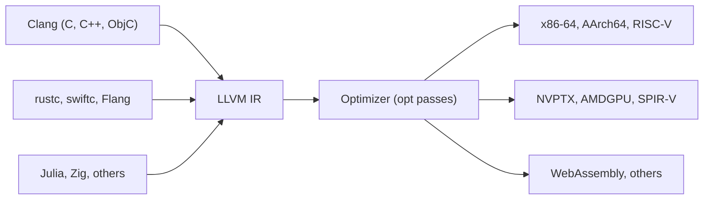
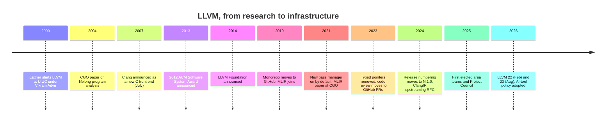

---
tags:
  - compilers
  - llvm
  - toolchain
  - compiler-infrastructure
  - clang
  - pass-manager
  - code-generation
  - open-source-governance
status: complete
sources:
  - https://llvm.org/pubs/2004-01-30-CGO-LLVM.html
  - https://aosabook.org/en/v1/llvm.html
  - https://lists.llvm.org/pipermail/cfe-dev/2007-July/000000.html
  - https://blog.llvm.org/2013/04/llvm-recipient-of-2012-acm-system.html
  - https://blog.llvm.org/2014/04/the-llvm-foundation.html
  - https://blog.llvm.org/2019/08/the-llvm-project-is-moving-to-github.html
  - https://maskray.me/blog/2023-09-09-reflections-on-llvm-switch-to-github-pull-requests
  - https://blog.llvm.org/posts/2021-03-26-the-new-pass-manager
  - https://llvm.org/docs/NewPassManager.html
  - https://llvm.org/docs/WritingAnLLVMNewPMPass.html
  - https://lists.llvm.org/pipermail/llvm-commits/Week-of-Mon-20230123/1120352.html
  - https://www-old.cs.utah.edu/~regehr/papers/undef-pldi17.pdf
  - https://lists.llvm.org/pipermail/llvm-commits/Week-of-Mon-20250113/1543521.html
  - https://lists.llvm.org/pipermail/llvm-commits/Week-of-Mon-20250818/1707978.html
  - https://discourse.llvm.org/t/rfc-replacing-getelementptr-with-ptradd/68699
  - https://discourse.llvm.org/t/rfc-add-a-new-byte-type-to-llvm-ir/89522/36
  - https://llvm.org/docs/ORCv2.html
  - https://releases.llvm.org/23.1.0/tools/flang/docs/ReleaseNotes.html
  - https://llvm.org/docs/HowToReleaseLLVM.html
  - https://lists.llvm.org/pipermail/llvm-commits/Week-of-Mon-20231218/1266364.html
  - https://llvm.org/docs/ProjectGovernance.html
  - https://discourse.llvm.org/t/llvm-area-team-election-results/84601
  - https://discourse.llvm.org/t/2026-llvm-community-area-team-elections-voting-closes-2-9/89708
  - https://discourse.llvm.org/t/expanding-clang-area-team-size-to-5-in-2026/88896
  - https://www.llvm.org/docs/AIToolPolicy.html
  - https://discourse.llvm.org/t/rfc-llvm-ai-tool-policy-human-in-the-loop/89159
  - https://releases.llvm.org/22.1.0/docs/ReleaseNotes.html
  - https://discourse.llvm.org/t/llvm-22-1-0-released/89950
  - https://releases.llvm.org/23.1.0/docs/ReleaseNotes.html
  - https://www.phoronix.com/news/LLVM-23.1-Released
  - https://developer.arm.com/community/arm-community-blogs/b/tools-software-ides-blog/posts/what-is-new-in-llvm-23
  - https://discourse.llvm.org/t/llvm-23-x-will-branch-next-week-tue-14th-july/91233
  - https://discourse.llvm.org/t/llvm-23-1-2-released/91895
  - https://lists.llvm.org/pipermail/flang-commits/2026-July/080588.html
  - https://discourse.llvm.org/t/clangir-upstream-progress-report-april-2026/90562
  - https://blog.llvm.org/posts/2025-gsoc-clangir-upstreaming/
  - https://discourse.llvm.org/t/rfc-upstreaming-clangir/76587
  - https://lists.llvm.org/pipermail/llvm-commits/Week-of-Mon-20260105/1814751.html
  - https://lists.llvm.org/pipermail/llvm-dev/2020-February/139034.html
  - https://developers.redhat.com/index%2Ephp/articles/2023/12/07/how-single-iteration-instcombine-improves-llvm-compile-time
  - https://www.npopov.com/2026/01/31/This-year-in-LLVM-2025.html
  - https://blog.rust-lang.org/2025/09/01/rust-lld-on-1.90.0-stable
  - https://rust.googlesource.com/rust/+/466ea4e6c39f8a43727edcc726ca86b499e14d83
  - https://forums.swift.org/t/updating-llvm-project-branch-for-swift-main-stable-23-x/88326
  - https://github.com/ziglang/zig/issues/16270
  - https://kristoff.it/blog/zig-new-relationship-llvm/
  - https://ziglang.org/download/0.15.1/release-notes.html
  - https://docs.julialang.org/en/v1/devdocs/llvm/
  - https://rocm.docs.amd.com/projects/llvm-project/en/latest/LLVM/llvm/html/NVPTXUsage.html
  - https://arxiv.org/pdf/2002.11054
  - https://llvm.org/devmtg/2023-10/slides/keynote/Mojo.pdf
  - https://pytorch.org/blog/triton-kernel-compilation-stages/
  - https://lists.llvm.org/pipermail/llvm-dev/2022-January/154668.html
  - https://llvm.org/
  - https://developer.apple.com/library/archive/releasenotes/DeveloperTools/RN-llvm-gcc
  - https://lists.llvm.org/pipermail/llvm-dev/2020-October/145902.html
  - https://developer.android.com/ndk/guides/cpp-support
  - https://ziglang.org/download/0.12.0/release-notes.html
  - https://docs.nvidia.com/cuda/nvvm-ir-spec/
  - https://blog.llvm.org/2015/08/llvm-foundation-granted-501c3-nonprofit.html
  - https://llvm.googlesource.com/llvm-project/+/18695b27d56508499000a5cedf7dd7694e83a57c
  - https://releases.llvm.org/23.1.0/docs/_sources/AIToolPolicy.md.txt
  - https://www.phoronix.com/news/LLVM-Clang-22.1-Released
  - https://lists.llvm.org/pipermail/llvm-commits/Week-of-Mon-20260302/1863352.html
  - https://lists.llvm.org/pipermail/llvm-commits/Week-of-Mon-20240122/1284932.html
  - https://lists.llvm.org/pipermail/llvm-branch-commits/2026-June/095984.html
created: 2026-11-26
updated: 2026-11-26
---

## Table Of Contents

- [[#TL;DR|TL;DR]]
- [[#The Problem|The Problem]]
- [[#Foundations|Foundations]]
    - [[#The Three-Phase Design|The Three-Phase Design]]
    - [[#Libraries, Not a Program|Libraries, Not a Program]]
    - [[#LLVM IR in One Page|LLVM IR in One Page]]
    - [[#Opaque Pointers|Opaque Pointers]]
- [[#How We Got Here|How We Got Here]]
- [[#How It Works|How It Works]]
    - [[#A Worked Example|A Worked Example]]
    - [[#Inspecting the Pipeline|Inspecting the Pipeline]]
    - [[#The New Pass Manager|The New Pass Manager]]
    - [[#A Pass Skeleton|A Pass Skeleton]]
    - [[#The Back End|The Back End]]
    - [[#The Subprojects|The Subprojects]]
    - [[#Who Builds on LLVM|Who Builds on LLVM]]
    - [[#Governance and Process|Governance and Process]]
- [[#Where It Is Now|Where It Is Now]]
    - [[#LLVM 22 and 23|LLVM 22 and 23]]
    - [[#Compile Time Becomes a Goal|Compile Time Becomes a Goal]]
    - [[#ClangIR Moves Upstream|ClangIR Moves Upstream]]
    - [[#How the Project Runs in 2026|How the Project Runs in 2026]]
- [[#Trade-offs & Open Problems|Trade-offs & Open Problems]]
- [[#Resources|Resources]]
- [[#Related Notes|Related Notes]]

## ***TL;DR***
---
*LLVM is a collection of reusable compiler libraries built around one typed, SSA-based intermediate representation. Front ends emit LLVM IR, a shared optimizer improves it, and per-target back ends turn it into machine code, which is why Clang, Rust, Swift, Julia, Zig and most GPU compilers share one middle and back end.*

- **What it is.** Not one compiler but a toolkit: an IR, an optimizer built from independent passes, code generators for many CPUs and GPUs, plus subprojects (Clang, LLD, LLDB, libc++, compiler-rt, [[MLIR]], Flang, BOLT and more). Lattner's own summary: LLVM IR is "the *only* interface to the optimizer" ([Lattner, AOSA 2011](https://aosabook.org/en/v1/llvm.html)).
- **Where it came from.** A University of Illinois research project started by Chris Lattner under Vikram Adve around 2000, published at CGO 2004 ([Lattner and Adve, 2004](https://llvm.org/pubs/2004-01-30-CGO-LLVM.html)). Apple adopted it, Clang was announced in July 2007 ([cfe-dev, 2007](https://lists.llvm.org/pipermail/cfe-dev/2007-July/000000.html)), and LLVM won the 2012 ACM Software System Award ([LLVM Blog, 2013](https://blog.llvm.org/2013/04/llvm-recipient-of-2012-acm-system.html)).
- **How it is organized.** Three phases (front end, optimizer, back end) joined by IR, with IR in three equivalent forms: text `.ll`, binary bitcode `.bc`, and in-memory C++ objects. Any stage can run alone through `opt` and `llc`.
- **Big IR changes of the last decade.** Pointers became untyped (`ptr`), finished in LLVM 17; `freeze` and poison replaced most uses of `undef`; `nocapture` became `captures(none)` (2025); `ptrtoaddr` arrived in LLVM 22.
- **Optimizer.** The new pass manager (default since 2021) caches analyses and invalidates them by what each pass says it preserved ([LLVM Blog, 2021](https://blog.llvm.org/posts/2021-03-26-the-new-pass-manager)). Pipelines `default<O1>` to `default<O3>`, `Os`, `Oz` are just pass lists.
- **Back end.** SelectionDAG or GlobalISel picks instructions, Machine IR carries code through scheduling and [[Register Allocation]], and the MC layer encodes bytes. TableGen generates most target-specific tables.
- **As of November 2026:** LLVM 23.1 (25 August 2026) is current, with point releases every two weeks up to 23.1.6 on 17 November ([llvm.org](https://llvm.org/)), and `main` has been LLVM 24 since July. The project now has elected area teams and a Project Council, an AI-tool "human in the loop" policy, and a visible push on compile time.

## ***The Problem***
---
*Before LLVM, compilers were mostly monolithic programs: you could not easily pull GCC's optimizer into a JIT, a static analyzer or a new language. LLVM set out to make the shared middle of a compiler a library, and to keep a program's IR around long after the front end finished.*

The classic argument is combinatorial. With $M$ source languages and $N$ targets, separate compilers need

$$
\text{cost}_{\text{separate}} = M \times N \qquad \text{cost}_{\text{shared IR}} = M + N
$$

**In plain English:** if every language-target pair is its own compiler, adding a language means writing $N$ new back ends. With one shared IR, a new language writes one front end and gets every target, and a new target writes one back end and gets every language. The [[Compiler Pipeline]] and [[Intermediate Representations]] notes cover this argument in general.

The idea was old (UNCOL dates to 1958). What was missing around 2000 was an implementation people could reuse. Lattner's AOSA chapter describes the state of the art he was reacting to: GCC was retargetable but its pieces were hard to use apart, so projects that wanted a JIT, a static analyzer or a source-to-source tool usually started from scratch ([Lattner, AOSA 2011](https://aosabook.org/en/v1/llvm.html)). LLVM's CGO paper added a second goal: keep a typed, analyzable representation of the program available "at compile-time, link-time, run-time, and in idle time between runs", so optimization could continue over a program's whole life ([Lattner and Adve, 2004](https://llvm.org/pubs/2004-01-30-CGO-LLVM.html)). The lifelong part mostly turned into [[Linking and LTO|link-time optimization]] and [[JIT Compilation|JITs]]; the library part turned into the industry's default compiler back end.

## ***Foundations***
---
*Three ideas carry the whole project: a three-phase split joined by one IR, every piece shipped as a library, and an IR precise enough to be optimized aggressively. The IR's semantics (poison, pointers, provenance) are still being refined today.*

### The Three-Phase Design

*Front ends own languages, back ends own machines, and the optimizer in the middle owns neither.*



Each front end lowers its AST, often through its own higher-level IR (Rust MIR, Swift SIL, Flang's FIR in [[MLIR]]), into LLVM IR. Nothing in the optimizer knows which language produced the IR, and nothing in a back end knows which passes ran.

### Libraries, Not a Program

*Every component is a C++ library, and the command-line tools are thin wrappers around them.*

Lattner stresses that LLVM IR exists in "three isomorphic forms": the textual `.ll` format, the compact bitcode `.bc` format, and the in-memory data structures, and that tools convert freely between them ([Lattner, AOSA 2011](https://aosabook.org/en/v1/llvm.html)). That is what makes the pipeline inspectable:

| Tool | Wraps | Typical use |
|---|---|---|
| `clang -emit-llvm` | Clang front end + CodeGen | Produce `.ll` or `.bc` from C/C++ |
| `opt` | The pass manager | Run any pass list on IR |
| `llc` | The code generator | IR to assembly or object file |
| `lli` | The JIT ([ORC](https://llvm.org/docs/ORCv2.html)) | Run IR directly |
| `llvm-link` | IR linker | Merge modules (the core of full LTO) |

A JIT like Julia's, a GPU compiler like Triton's, or a language like Rust links these libraries directly instead of shelling out to tools.

### LLVM IR in One Page

*A typed, SSA, RISC-like language with an infinite register file, explicit control flow, and side tables for attributes and metadata.*

- **Module, function, basic block, instruction.** A module holds globals and functions; a function is a list of basic blocks; each block ends in exactly one terminator (`br`, `ret`, `switch`...). Details on CFGs and dominance are in [[Intermediate Representations]].
- **SSA.** Every value (`%x`) is assigned once; merges use `phi`. Front ends do not have to build SSA themselves: Clang spills locals to `alloca` slots and lets `mem2reg`/SROA promote them. See [[SSA Form]].
- **Types.** Integers of any width (`i1`, `i32`, `i128`), floating point (`half`, `bfloat`, `float`, `double`...), `ptr` (with an optional address space, `ptr addrspace(3)`), vectors (`<4 x float>`, scalable `<vscale x 4 x i32>`), arrays, structs, labels, `void`.
- **Intrinsics.** Functions named `llvm.*` that the optimizer and back ends understand: `llvm.memcpy`, `llvm.smax`, `llvm.fshl`, `llvm.vector.reduce.add`, `llvm.lifetime.start`, target ones like `llvm.nvvm.*` and `llvm.amdgcn.*`. New operations usually start as intrinsics rather than instructions.
- **Attributes.** Facts on functions, parameters and return values: `nounwind`, `noundef`, `nonnull`, `readonly`, `noalias`, `captures(none)`. Many optimizations are only legal because of them.
- **Poison, undef and `freeze`.** An `add nsw` that overflows does not trap; it yields *poison*, which taints everything computed from it and becomes UB only at certain uses (a branch condition, a store address). Lee et al. showed LLVM's older `undef`/poison rules let GVN and loop unswitching contradict each other and proposed `freeze`, which turns poison into one arbitrary but fixed value; it is now an instruction and the long-term plan is to remove `undef` ([Lee et al., PLDI 2017](https://www-old.cs.utah.edu/~regehr/papers/undef-pldi17.pdf)). Worked through in [[Classic Optimizations]].
- **Metadata.** Side information that must be safe to drop: debug info (`!dbg`), type-based [[Pointer and Alias Analysis|alias analysis]] (`!tbaa`), loop hints (`!llvm.loop`), profile data (`!prof`). Dropping metadata may lose optimization or debug info but never changes meaning.

### Opaque Pointers

*LLVM pointers no longer carry a pointee type; types live on the loads, stores and GEPs instead.*

```llvm
; typed pointers (LLVM 14 and earlier by default)
%p = getelementptr inbounds i32, i32* %a, i64 %i
%q = bitcast i32* %p to i8*
; opaque pointers (default in LLVM 15, required from LLVM 17): no bitcast needed
%p = getelementptr inbounds i32, ptr %a, i64 %i
```

Pointee types never constrained anything (any pointer could be bitcast to any other), so they produced bitcast noise and missed optimizations. The migration took several releases; the LLVM docs were updated in January 2023 to say typed pointers "are no longer supported" on main ([llvm-commits, Jan 2023](https://lists.llvm.org/pipermail/llvm-commits/Week-of-Mon-20230123/1120352.html)). The same logic continues today: an RFC proposes replacing `getelementptr` with a plain byte-offset `ptradd` ([LLVM Discourse, 2023](https://discourse.llvm.org/t/rfc-replacing-getelementptr-with-ptradd/68699)), and 2025-2026 work added `captures(...)` and `ptrtoaddr` to pin down pointer provenance.

## ***How We Got Here***
---
*LLVM went from a graduate research project to Apple's compiler to the shared back end of most new languages in about fifteen years, then spent the next decade modernizing its IR, its pass manager and its own development process.*



- **UIUC research (2000 to 2004).** The CGO 2004 paper presented LLVM as "a compiler framework designed to support transparent, lifelong program analysis and transformation", built on a low-level, typed, SSA-based code representation ([Lattner and Adve, 2004](https://llvm.org/pubs/2004-01-30-CGO-LLVM.html)). It was explicitly not meant to be a universal IR for every purpose.
- **Apple (2005 onward).** Apple hired Lattner in 2005 and put LLVM into production, at first behind GCC's own front end (llvm-gcc, which Apple shipped in its developer tools; [Apple, LLVM-GCC 4.2 Release Notes](https://developer.apple.com/library/archive/releasenotes/DeveloperTools/RN-llvm-gcc)). In July 2007 Clang was announced on the new cfe-dev list as a new C-family front end built on LLVM ([cfe-dev, 2007](https://lists.llvm.org/pipermail/cfe-dev/2007-July/000000.html)). Clang plus LLVM replaced GCC on Apple platforms and later underpinned Swift.
- **Recognition and a foundation (2013 to 2014).** ACM's 2012 Software System Award went to Vikram Adve, Evan Cheng and Chris Lattner for LLVM ([LLVM Blog, 2013](https://blog.llvm.org/2013/04/llvm-recipient-of-2012-acm-system.html)), and the LLVM Foundation was announced in April 2014 to run developer meetings, hold project assets and support the community ([LLVM Blog, 2014](https://blog.llvm.org/2014/04/the-llvm-foundation.html)).
- **Moving to GitHub (2019 to 2023).** The project announced its move from SVN to a single GitHub monorepo in 2019 ([LLVM Blog, 2019](https://blog.llvm.org/2019/08/the-llvm-project-is-moving-to-github.html)). Code review moved from Phabricator to GitHub pull requests between 1 September and 1 October 2023 ([MaskRay, 2023](https://maskray.me/blog/2023-09-09-reflections-on-llvm-switch-to-github-pull-requests)). Mailing lists had moved to Discourse in the meantime, which is now where RFCs happen.
- **MLIR (2019 to 2021).** Google's MLIR, a framework for building many IRs ("dialects") with shared infrastructure, joined the LLVM project and was published at CGO 2021 ([Lattner et al., 2020](https://arxiv.org/pdf/2002.11054)). See [[MLIR]].
- **New pass manager (2021).** After years of parallel development, the new pass manager had been turned on by default for the optimization pipeline by the time of the LLVM Blog's March 2021 post on it ([LLVM Blog, 2021](https://blog.llvm.org/posts/2021-03-26-the-new-pass-manager)).
- **BOLT (2022).** Meta's post-link binary optimizer was proposed for LLVM in an October 2020 RFC ([llvm-dev, 2020](https://lists.llvm.org/pipermail/llvm-dev/2020-October/145902.html)) and merged into the monorepo in January 2022 ([llvm-dev, 2022](https://lists.llvm.org/pipermail/llvm-dev/2022-January/154668.html)).
- **Version numbers (2023).** A December 2023 change made each release branch start at N.1.0, so N.0.0 means "development snapshot on main" and LLVM 18.1.0 was the first release under the scheme ([llvm-commits, 2023](https://lists.llvm.org/pipermail/llvm-commits/Week-of-Mon-20231218/1266364.html)).

## ***How It Works***
---
*This section follows one C function through Clang, the optimizer and the back end, shows the commands to watch each step, then covers how passes are scheduled, how to write one, how the back end is built, and what the rest of the project contains.*

### A Worked Example

*A two-line `max` shows SSA construction, CFG simplification and canonicalization to an intrinsic.*

```c
int max(int a, int b) { return a > b ? a : b; }
```

At `-O0` Clang emits naive IR: every parameter goes to a stack slot and the conditional becomes real branches.

```llvm
define dso_local i32 @max(i32 noundef %a, i32 noundef %b) {
entry:
  %a.addr = alloca i32, align 4
  %b.addr = alloca i32, align 4
  store i32 %a, ptr %a.addr, align 4
  store i32 %b, ptr %b.addr, align 4
  %0 = load i32, ptr %a.addr, align 4
  %1 = load i32, ptr %b.addr, align 4
  %cmp = icmp sgt i32 %0, %1
  br i1 %cmp, label %cond.true, label %cond.false
cond.true:
  %2 = load i32, ptr %a.addr, align 4
  br label %cond.end
cond.false:
  %3 = load i32, ptr %b.addr, align 4
  br label %cond.end
cond.end:
  %cond = phi i32 [ %2, %cond.true ], [ %3, %cond.false ]
  ret i32 %cond
}
```

Three passes do almost all the work:

```llvm
; after sroa: stack slots promoted to SSA values
  %cmp = icmp sgt i32 %a, %b
  br i1 %cmp, label %cond.true, label %cond.false   ; arms now just branch
  %cond = phi i32 [ %a, %cond.true ], [ %b, %cond.false ]

; after simplifycfg: the diamond becomes a select
  %cmp = icmp sgt i32 %a, %b
  %cond = select i1 %cmp, i32 %a, i32 %b
  ret i32 %cond

; after instcombine: canonicalized to an intrinsic
  %cond = call i32 @llvm.smax.i32(i32 %a, i32 %b)
  ret i32 %cond
```

The final form matters: by turning compare-and-select into `llvm.smax`, later passes and every back end only need to recognize one shape. `llc` for x86-64 lowers it to a conditional move: `mov eax, esi; cmp edi, esi; cmovg eax, edi; ret`.

### Inspecting the Pipeline

*Because every stage reads and writes IR, you can stop, print or rerun any of them.*

```bash
# -O0 marks functions optnone; disable that or opt will skip them
clang -O0 -Xclang -disable-O0-optnone -S -emit-llvm max.c -o max.ll
opt -passes='sroa,simplifycfg,instcombine' -S max.ll -o max.opt.ll      # chosen passes
opt -passes='default<O2>' -print-after-all -S max.ll -o /dev/null 2> trace.txt
opt -passes='default<O2>' -print-changed -filter-print-funcs=max -S max.ll -o /dev/null
opt -passes='default<O2>' -print-pipeline-passes -disable-output max.ll  # expanded pass list
llc -O2 max.opt.ll -o max.s                                              # assembly
llc -O2 -stop-after=finalize-isel max.opt.ll -o max.mir                  # Machine IR after isel
clang -O2 -c max.c -mllvm -print-after-all 2> trace.txt                  # same, from the driver
```

`-print-changed` is usually the most useful of these, since `-print-after-all` dumps the module after hundreds of passes that did nothing. Compiler Explorer's "Opt Pipeline" view shows the same information interactively. The [[Classic Optimizations]] and [[Loop Optimizations]] notes use this workflow to show individual passes.

### The New Pass Manager

*Passes are nested by IR unit, analyses are computed lazily and cached, and each pass reports which analyses it left valid.*

The new pass manager (NPM) separates *transformations* from *analyses* ([LLVM docs, Using the New Pass Manager](https://llvm.org/docs/NewPassManager.html); [LLVM Blog, 2021](https://blog.llvm.org/posts/2021-03-26-the-new-pass-manager)):

- **Nesting by IR unit.** A `ModulePassManager` holds module passes (GlobalOpt, IPSCCP) and a CGSCC adaptor; that holds the inliner and a `FunctionPassManager` (SROA, EarlyCSE, InstCombine, GVN, SimplifyCFG), which holds loop adaptors (LICM, IndVarSimplify, LoopRotate). Each level has its own analysis manager.
- **Analyses are pulled, not scheduled.** A pass asks `FAM.getResult<DominatorTreeAnalysis>(F)`; the analysis manager computes it if needed and caches it per function.
- **Invalidation is explicit.** A pass returns `PreservedAnalyses`. `PreservedAnalyses::all()` means "I changed nothing"; returning `none()` drops every cached analysis for that unit; a pass can also say it preserved the CFG or specific analyses.
- **The CGSCC level** walks strongly connected components of the call graph bottom-up, so the inliner sees callees that have already been simplified. When Chrome switched to the NPM it saw 3-4% Speedometer 2.0 gains on Linux and Windows and an 8-9MB size drop; the blog guesses the cause is better use of profile information and better handling of large ThinLTO call graphs ([LLVM Blog, 2021](https://blog.llvm.org/posts/2021-03-26-the-new-pass-manager)).
- **Pipelines are data.** `default<O1>`, `default<O2>`, `default<O3>`, `default<Os>` and `default<Oz>` are pass lists built by `PassBuilder`; `-O3` adds more aggressive inlining and loop transforms, `Os`/`Oz` lower inlining and unrolling thresholds to favour size. LTO adds separate pre-link and post-link pipelines (`thinlto-pre-link<O2>`, `lto<O2>`), covered in [[Linking and LTO]].

The payoff is that a pass claiming to preserve, say, the dominator tree saves every later pass from rebuilding it; a pass that wrongly claims preservation causes miscompiles from stale analyses.

### A Pass Skeleton

*A new-PM pass is a class with a `run` method; a plugin registers its name with `PassBuilder` so `opt -passes=` can find it.*

```cpp
// CountInsts.cpp: build as a shared library against an installed LLVM
#include "llvm/IR/PassManager.h"
#include "llvm/Passes/PassBuilder.h"
#include "llvm/Passes/PassPlugin.h"
#include "llvm/Support/raw_ostream.h"
using namespace llvm;

namespace {
struct CountInstsPass : PassInfoMixin<CountInstsPass> {
  PreservedAnalyses run(Function &F, FunctionAnalysisManager &FAM) {
    unsigned N = 0;
    for (BasicBlock &BB : F) N += BB.size();
    errs() << F.getName() << ": " << N << " instructions\n";
    return PreservedAnalyses::all();   // nothing changed, keep every analysis
  }
  static bool isRequired() { return true; }  // also run on optnone functions
};
} // namespace

extern "C" LLVM_ATTRIBUTE_WEAK PassPluginLibraryInfo llvmGetPassPluginInfo() {
  return {LLVM_PLUGIN_API_VERSION, "CountInsts", "0.1", [](PassBuilder &PB) {
    PB.registerPipelineParsingCallback(
        [](StringRef Name, FunctionPassManager &FPM, ArrayRef<PassBuilder::PipelineElement>) {
          if (Name != "count-insts") return false;
          FPM.addPass(CountInstsPass());
          return true;
        });
  }};
}
```

Running `opt -load-pass-plugin=./CountInsts.so -passes='count-insts' -disable-output max.ll` prints 14 instructions for the `-O0` IR above; with `-passes='default<O2>,function(count-insts)'` it prints 2.

`PassInfoMixin` supplies the boilerplate (name, printing); the official tutorial builds a similar pass inside the tree ([LLVM docs, Writing an LLVM Pass](https://llvm.org/docs/WritingAnLLVMNewPMPass.html)). A transforming pass would return `PreservedAnalyses::none()` (or a narrower set) whenever it edits IR. Callbacks such as `registerPipelineStartEPCallback` insert a plugin pass into the standard `-O2` pipeline instead of only by name.

### The Back End

*Code generation lowers SSA IR to a target's instructions in stages, most of them generated from TableGen descriptions.*

The stages run in order: IR-level preparation (CodeGenPrepare), instruction selection, Machine IR passes (scheduling, PHI elimination), [[Register Allocation]], prologue and epilogue insertion, then the MC layer emits an object file or assembly.

- **Instruction selection.** *SelectionDAG* builds a DAG per basic block, legalizes types and operations the target lacks, runs a DAG combiner, then pattern-matches into machine nodes. *GlobalISel* works on whole functions in four steps (IRTranslator, Legalizer, RegBankSelect, InstructionSelect) and reuses Machine IR throughout, which avoids building a second representation. GlobalISel is "the default instruction selector at -O0" on AArch64 ([Arm, Oct 2026](https://developer.arm.com/community/arm-community-blogs/b/tools-software-ides-blog/posts/what-is-new-in-llvm-23)), and a January 2026 patch series proposes routing AArch64 `optnone` functions through it too ([llvm-commits, Jan 2026](https://lists.llvm.org/pipermail/llvm-commits/Week-of-Mon-20260105/1814751.html)). Algorithms are in [[Instruction Selection]].
- **Machine IR (MIR).** `MachineFunction` / `MachineBasicBlock` / `MachineInstr`, first in SSA form over virtual registers, then over physical registers after [[Register Allocation]]. It serializes to a YAML `.mir` format, so codegen passes can be tested one at a time just like IR passes.
- **MC layer.** Below MIR, `MCInst` is a bare opcode plus operands. The MC layer contains the assembler, disassembler and object writers (ELF, Mach-O, COFF, Wasm, XCOFF), which is why Clang has an integrated assembler and tools like `llvm-objdump` and LLDB share one instruction decoder.
- **TableGen.** A small declarative language (`.td` files) describes registers, instructions, encodings, selection patterns, calling conventions and scheduling models; `llvm-tblgen` generates C++ tables and matchers from it. One instruction record gives the encoder its opcode, the assembler its syntax and SelectionDAG a pattern to match; MLIR reuses the same tool for its operation definitions.

### The Subprojects

*The `llvm-project` monorepo is a whole toolchain, not just a compiler back end.*

| Subproject | What it is | Notes |
|---|---|---|
| **Clang** | C, C++, Objective-C, OpenCL, CUDA, HIP front end and driver | Also clang-tidy, clangd, clang-format, the static analyzer |
| **LLD** | Linker for ELF, Mach-O, COFF, Wasm | Rust made it the default linker on x86-64 Linux in 1.90 ([Rust Blog, 2025](https://blog.rust-lang.org/2025/09/01/rust-lld-on-1.90.0-stable)) |
| **LLDB** | Debugger | Uses Clang to parse expressions in the debugged program's types |
| **compiler-rt** | Runtime libraries | Builtins (soft-float, `__muldi3`), [[Sanitizers\|sanitizers]] (ASan, TSan, MSan, UBSan, HWASan), profiling, fuzzing (libFuzzer) |
| **libc++, libc++abi, libunwind** | C++ standard library and ABI support | Default on Apple platforms; the only STL in Android's NDK since r18 ([Android NDK docs](https://developer.android.com/ndk/guides/cpp-support)) |
| **[[MLIR]]** | Framework for multi-level IRs (dialects) | Base of Flang's FIR, ClangIR, Triton, Mojo, IREE, CIRCT |
| **Flang** | Fortran front end | Lowers through MLIR (FIR, HLFIR) to LLVM IR ([Flang 23 notes](https://releases.llvm.org/23.1.0/tools/flang/docs/ReleaseNotes.html)) |
| **BOLT** | Post-link binary optimizer | Reorders code using profiles, see [[Linking and LTO]] |
| **Polly** | Polyhedral loop optimizer | Optional, see [[Loop Optimizations]] |
| **ORC JIT** | On-request JIT APIs | `LLJIT`, lazy compilation, used by Julia and `clang-repl` ([ORC docs](https://llvm.org/docs/ORCv2.html)) |

The [llvm.org](https://llvm.org/) front page lists the current set.

### Who Builds on LLVM

*Most production languages created since 2010, and most GPU compilers, emit LLVM IR; a few are now trying to depend on it less.*

| User | How it uses LLVM | Notes |
|---|---|---|
| **Rust** | rustc lowers MIR to LLVM IR | Ships its own LLVM fork and tracks each LLVM major closely; the LLVM 22 upgrade landed in January 2026 ([rust-lang/rust #150722](https://rust.googlesource.com/rust/+/466ea4e6c39f8a43727edcc726ca86b499e14d83)). Cranelift is an alternative debug back end |
| **Swift** | SIL to LLVM IR, Clang for C/ObjC interop | Apple's `swiftlang/llvm-project` fork; Swift `main` moved to `stable/23.x` in September 2026 ([Swift Forums, 2026](https://forums.swift.org/t/updating-llvm-project-branch-for-swift-main-stable-23-x/88326)) |
| **Zig** | LLVM for release builds, own back ends for debug | A 2023 tracking issue to drop LLVM, Clang and LLD ([ziglang/zig #16270](https://github.com/ziglang/zig/issues/16270)) is still open work, with maintainers saying LLVM stays as an option and the release-build default; since 0.12 Zig "generates LLVM bitcode module files directly" ([Zig 0.12.0 notes](https://ziglang.org/download/0.12.0/release-notes.html)), and its self-hosted x86-64 back end is the Debug default since 0.15, except on NetBSD, OpenBSD and Windows ([Zig 0.15.1 notes](https://ziglang.org/download/0.15.1/release-notes.html)) |
| **Julia** | JIT: type-specialized Julia IR to LLVM IR at run time | Custom LLVM passes for its GC and runtime ([Julia devdocs](https://docs.julialang.org/en/v1/devdocs/llvm/)) |
| **CUDA / NVPTX** | Clang compiles CUDA; NVPTX back end emits PTX | NVIDIA's own NVVM IR is based on LLVM IR ([NVVM IR spec](https://docs.nvidia.com/cuda/nvvm-ir-spec/)); see also the [NVPTX user guide](https://rocm.docs.amd.com/projects/llvm-project/en/latest/LLVM/llvm/html/NVPTXUsage.html) |
| **AMDGPU / ROCm** | AMDGPU back end emits GCN/RDNA/CDNA code | AMD maintains its own llvm-project distribution for ROCm |
| **WebAssembly** | Wasm back end plus LLD's Wasm linker | Used by Emscripten, Rust and Zig, see [[WebAssembly]] |
| **Mojo** | Built on MLIR, lowers to LLVM IR | Presented as an MLIR-first language at the 2023 LLVM Dev Meeting ([Modular, 2023](https://llvm.org/devmtg/2023-10/slides/keynote/Mojo.pdf)) |
| **Triton** | Python DSL to Triton IR (MLIR) to LLVM IR to PTX or AMDGPU | ([PyTorch Blog](https://pytorch.org/blog/triton-kernel-compilation-stages/)); see [[GPU Kernel Compilers]] |

### Governance and Process

*A foundation holds the assets, an elected structure makes project-wide decisions, and day-to-day work happens through GitHub pull requests and Discourse RFCs.*

- **LLVM Foundation.** A non-profit, announced in 2014 and granted 501(c)(3) status in 2015, that runs the developer meetings, grants and infrastructure, and holds the trademark ([LLVM Blog, 2014](https://blog.llvm.org/2014/04/the-llvm-foundation.html); [LLVM Blog, 2015](https://blog.llvm.org/2015/08/llvm-foundation-granted-501c3-nonprofit.html)). It does not direct technical work.
- **Releases.** Two major releases a year: a release branch is cut from `main`, release candidates follow every couple of weeks, the final N.1.0 ships roughly six weeks after branching, and point releases follow every two weeks for a few months ([LLVM docs, How To Release LLVM](https://llvm.org/docs/HowToReleaseLLVM.html)). Branches have recently been cut in January and July (LLVM 23 branched 14 July 2026, [LLVM Discourse](https://discourse.llvm.org/t/llvm-23-x-will-branch-next-week-tue-14th-july/91233), and 23.1.0 followed on 25 August, [llvm.org](https://llvm.org/)).
- **RFCs.** Significant changes (new IR features, new subprojects, policy) start as an RFC on Discourse; review then happens on GitHub PRs with "code owners" (now called maintainers) per area.
- **Area teams and the Project Council.** After a 2024 governance RFC, contributors elected the first area teams in early 2025 ([LLVM Discourse, 2025](https://discourse.llvm.org/t/llvm-area-team-election-results/84601)). There are four area teams (LLVM, Clang, MLIR, Infrastructure), each with an odd number of members (three to nine) elected for one-year terms; they keep their area's maintainer list, mediate disagreements and make the final call when consensus fails. The Project Council is made up of the four area-team chairs and can overrule an area team by a two-thirds vote ([LLVM docs, Project Governance](https://llvm.org/docs/ProjectGovernance.html)).
- **AI-tool policy.** After the "human in the loop" RFC ([LLVM Discourse](https://discourse.llvm.org/t/rfc-llvm-ai-tool-policy-human-in-the-loop/89159)), LLVM added a policy to its docs on 16 January 2026 ([commit, #154441](https://llvm.googlesource.com/llvm-project/+/18695b27d56508499000a5cedf7dd7694e83a57c)). It allows any tools but requires "a human in the loop": contributors must read and review all AI-generated code or text before asking others to review it, remain accountable for it and be able to answer questions about it; contributions with substantial tool-generated content must be labelled (for example an `Assisted-by:` trailer); agents that act in project spaces without human approval are banned; and maintainers can label "extractive" contributions, whose review cost exceeds their benefit to the project ([LLVM docs, AI Tool Use Policy](https://www.llvm.org/docs/AIToolPolicy.html)).

## ***Where It Is Now***
---
*As of November 2026, LLVM 23.1 is the current release and LLVM 24 is in development. The themes of 2025-2026 are pointer-provenance cleanup in the IR, compile-time speed, ClangIR's arrival upstream, and a project that has finished its move to elected governance and written rules for AI tools.*

### LLVM 22 and 23

*Two releases in 2026, each with IR refinements, new CPU and GPU targets, and Clang language work.*

| | LLVM 22.1 | LLVM 23.1 |
|---|---|---|
| **Shipped** | 24 February 2026 ([LLVM Discourse](https://discourse.llvm.org/t/llvm-22-1-0-released/89950)) | 25 August 2026, after branching 14 July ([llvm.org](https://llvm.org/)); point releases every two weeks since, e.g. 23.1.2 on 22 September ([LLVM Discourse](https://discourse.llvm.org/t/llvm-23-1-2-released/91895)) and 23.1.6 on 17 November |
| **IR** | New `ptrtoaddr` instruction reads a pointer's address without capturing provenance ([LLVM 22 notes](https://releases.llvm.org/22.1.0/docs/ReleaseNotes.html); [PR #139357](https://lists.llvm.org/pipermail/llvm-commits/Week-of-Mon-20250818/1707978.html)) | New float literal syntax, a `noipa` attribute that blocks interprocedural analysis of a definition, `alwaysinline` no longer bypassing target-feature checks, `bugpoint` removed in favour of `llvm-reduce` ([LLVM 23 notes](https://releases.llvm.org/23.1.0/docs/ReleaseNotes.html)) |
| **Optimizer** | Tail folding by default in the RISC-V [[Vectorization|loop vectorizer]]; SLP "copyable elements" ([LLVM 22 notes](https://releases.llvm.org/22.1.0/docs/ReleaseNotes.html)) | GlobalISel, debug-info and codegen compile-time work: Arm reports `-O0 -g` builds about 15% faster on CTMark and `-O3` builds about 8.7% faster, without naming the baseline ([Arm, Oct 2026](https://developer.arm.com/community/arm-community-blogs/b/tools-software-ides-blog/posts/what-is-new-in-llvm-23)) |
| **Targets** | Intel Nova Lake, Arm C1 and Ampere1C support ([LLVM 22 notes](https://releases.llvm.org/22.1.0/docs/ReleaseNotes.html); [Phoronix](https://www.phoronix.com/news/LLVM-Clang-22.1-Released)) | AMD Zen 6, NVIDIA "Rigel" support, partial C++26 in Clang ([Phoronix](https://www.phoronix.com/news/LLVM-23.1-Released)) |

In January 2025 the IR had already gained a `captures(...)` attribute, replacing the yes/no `nocapture` with a statement of *which* parts of a pointer (address, provenance) may escape ([llvm-commits, Jan 2025](https://lists.llvm.org/pipermail/llvm-commits/Week-of-Mon-20250113/1543521.html)); `nocapture` itself was converted to `captures(none)` in the same period. Together with `ptrtoaddr`, this is the IR catching up with the formal provenance models now used in C, C++ and Rust. `main` was bumped to 24.0.0git in July 2026 ([flang-commits](https://lists.llvm.org/pipermail/flang-commits/2026-July/080588.html)); on the usual cadence LLVM 24 would branch around January 2027 and ship in early 2027, but no date had been announced when this note was written.

### Compile Time Becomes a Goal

*LLVM's code quality is rarely the complaint now; its speed, especially for debug builds, is.*

Compile time used to regress quietly, one pass at a time. In February 2020 Nikita Popov pointed out on llvm-dev that LLVM had no per-commit compile-time tracking and that LLVM 10 optimized builds had regressed by around 5-15% ([llvm-dev, 2020](https://lists.llvm.org/pipermail/llvm-dev/2020-February/139034.html)); the public LLVM compile-time tracker now compares commits by instruction counts on CTMark (as used in the Red Hat article below). Examples of the resulting work: InstCombine was changed in LLVM 18 to run a single iteration instead of looping to a fixed point, cutting CTMark compile time by about 4% ([Red Hat, 2023](https://developers.redhat.com/index%2Ephp/articles/2023/12/07/how-single-iteration-instcombine-improves-llvm-compile-time)), and the 2026 GlobalISel work above. Outside LLVM, the pressure shows in Rust's switch to LLD (the [Rust Blog](https://blog.rust-lang.org/2025/09/01/rust-lld-on-1.90.0-stable) reports a 7x faster link and a 40% cut in end-to-end time for incremental debug rebuilds of ripgrep, and 20% for from-scratch debug builds), in Cranelift and in fast non-LLVM back ends that consume LLVM IR, covered in [[Compiler Pipeline]] and [[JIT Compilation]].

### ClangIR Moves Upstream

*Clang is getting the high-level IR that Rust (MIR) and Swift (SIL) have had for years.*

ClangIR (CIR) is an MLIR dialect between Clang's AST and LLVM IR, meant for C/C++-aware analysis and optimization (lifetimes, coroutines, idioms) before semantics are lost in LLVM IR. Upstreaming was proposed in 2024 ([RFC](https://discourse.llvm.org/t/rfc-upstreaming-clangir/76587)) and progressed through 2025 ([LLVM Blog, 2025](https://blog.llvm.org/posts/2025-gsoc-clangir-upstreaming/)). The April 2026 progress report put CIR on x86-64 at 92.1% of LLVM's SingleSource tests and 77.6% of MultiSource, compiling 4 of 10 SPEC CPU 2017 integer benchmarks (ARM64 figures were lower), and "not yet ready for self-hosting"; it is opt-in with `-fclangir` and the incubator repository has been archived ([LLVM Discourse, Apr 2026](https://discourse.llvm.org/t/clangir-upstream-progress-report-april-2026/90562)).

### How the Project Runs in 2026

*Elections are now annual, and the rules for AI tools are written down.*

The second round of area-team elections (members serve one-year terms) closed on 9 February 2026 ([LLVM Discourse](https://discourse.llvm.org/t/2026-llvm-community-area-team-elections-voting-closes-2-9/89708)), with the Clang area team expanded to five members ([LLVM Discourse](https://discourse.llvm.org/t/expanding-clang-area-team-size-to-5-in-2026/88896)). The AI-tool policy above ships in the LLVM 23 documentation ([23.1.0 docs](https://releases.llvm.org/23.1.0/docs/_sources/AIToolPolicy.md.txt)). Nikita Popov's annual "This year in LLVM (2025)" ([npopov.com, Jan 2026](https://www.npopov.com/2026/01/31/This-year-in-LLVM-2025.html)) is the best single summary of middle-end work in 2025; it could not be read for this note.

## ***Trade-offs & Open Problems***
---
*LLVM's generality is its strength and its cost: it is slower than specialized compilers, its IR semantics are still being formalized, and the whole ecosystem rides on one project's review capacity.*

| Trade-off | Benefit | Cost |
|---|---|---|
| One shared IR | Every language gets every target and optimization | IR must serve C, Rust, GPUs and JITs, so its semantics are a negotiated compromise |
| Library design | Reuse in JITs, analyzers, IDEs | No stable C++ API; every downstream fork pays a rebase tax each release |
| Many small passes | Easy to test and reorder | Repeated work and compile-time overhead, especially at `-O0` |
| Monorepo, fast release train | Coordinated changes across Clang, LLD, libc++ | Downstreams (Rust, Swift, ROCm) must chase two releases a year |

- **IR semantics.** `undef` is not gone yet, provenance is only partly modelled (`captures`, `ptrtoaddr`), and a 2026 RFC added a byte type (`bN`) so that `memcpy`-style code can copy raw memory, pointers included, without laundering their provenance ([LLVM Discourse, 2026](https://discourse.llvm.org/t/rfc-add-a-new-byte-type-to-llvm-ir/89522/36)). Initial IR support landed in 2026 ([PR #178666](https://lists.llvm.org/pipermail/llvm-commits/Week-of-Mon-20260302/1863352.html)), and in LLVM 23 GlobalISel's IRTranslator already handles it ([LLVM 23 notes](https://releases.llvm.org/23.1.0/docs/ReleaseNotes.html)). Tools like Alive2 check transforms against these semantics; see [[Verified Compilers]] and [[Compiler Testing and Fuzzing]].
- **Debug-build speed.** LLVM's `-O0` path pays for generality it does not use. Fast alternative back ends (Cranelift, TPDE, Zig's) are partly a vote of no confidence in this path.
- **Back-end selectors and pass manager.** SelectionDAG cannot see across basic blocks, and the move to GlobalISel is slow and target-by-target. **Codegen pass manager.** The new pass manager covers the optimizer; porting the code generator off the legacy pass manager is still in progress. `llc` gained opt-in new-PM support in January 2024 ([llvm-commits, 2024](https://lists.llvm.org/pipermail/llvm-commits/Week-of-Mon-20240122/1284932.html)), individual codegen passes are still being ported one by one, and in 2026 Clang gained an option, not the default, to run its codegen pipeline under the new PM ([llvm-branch-commits, Jun 2026](https://lists.llvm.org/pipermail/llvm-branch-commits/2026-June/095984.html)).
- **Where high-level work goes.** New domains (ML, hardware design, quantum) increasingly build in [[MLIR]] and use LLVM IR only as the last step, and ClangIR may move C++ optimizations upstream of LLVM IR too. The open question is how much optimization stays in LLVM IR versus moving to dialects above it.
- **Review bandwidth.** The project's limiting resource is reviewers. The AI-tool policy exists because generated patches are cheap to produce and expensive to review.
- **Monoculture risk.** Rust, Swift, Julia, CUDA via Clang, ROCm, Emscripten and most AI compilers follow LLVM's release train, so an LLVM miscompile or IR-semantics change reaches many ecosystems at once. GCC, Cranelift and vendor compilers are the main counterweights, and Zig is working to make LLVM optional, citing compile speed and compiler size ([Cro and Kelley, 2020](https://kristoff.it/blog/zig-new-relationship-llvm/); [ziglang/zig #16270](https://github.com/ziglang/zig/issues/16270)).

## ***Resources***
---
*Start with Lattner's AOSA chapter for the architecture, the CGO paper for the original aims, and the pass-manager blog post plus the LLVM docs for how the optimizer works today. Release notes and Discourse cover what changed recently.*

**Primary papers and history**
- [LLVM: A Compilation Framework for Lifelong Program Analysis & Transformation](https://llvm.org/pubs/2004-01-30-CGO-LLVM.html): Lattner and Adve, CGO 2004.
- [LLVM chapter, The Architecture of Open Source Applications](https://aosabook.org/en/v1/llvm.html): Lattner, 2011.
- [Taming Undefined Behavior in LLVM](https://www-old.cs.utah.edu/~regehr/papers/undef-pldi17.pdf): Lee et al., PLDI 2017.
- [MLIR: A Compiler Infrastructure for the End of Moore's Law](https://arxiv.org/pdf/2002.11054): Lattner et al., 2020.

**Docs:** [Using the New Pass Manager](https://llvm.org/docs/NewPassManager.html), [Writing an LLVM Pass](https://llvm.org/docs/WritingAnLLVMNewPMPass.html), [ORC Design and Implementation](https://llvm.org/docs/ORCv2.html), [How To Release LLVM](https://llvm.org/docs/HowToReleaseLLVM.html), [Project Governance](https://llvm.org/docs/ProjectGovernance.html), [AI Tool Use Policy](https://www.llvm.org/docs/AIToolPolicy.html).

**Practitioners and posts**
- [The New Pass Manager](https://blog.llvm.org/posts/2021-03-26-the-new-pass-manager): LLVM Blog, 2021.
- [Reflections on LLVM's switch to GitHub pull requests](https://maskray.me/blog/2023-09-09-reflections-on-llvm-switch-to-github-pull-requests): MaskRay, 2023.
- [This year in LLVM (2025)](https://www.npopov.com/2026/01/31/This-year-in-LLVM-2025.html): Nikita Popov, Jan 2026.
- [Zig's new relationship with LLVM](https://kristoff.it/blog/zig-new-relationship-llvm/): Loris Cro and Andrew Kelley, 2020.

**Releases (2026):** [LLVM 22.1.0 notes](https://releases.llvm.org/22.1.0/docs/ReleaseNotes.html), [LLVM 23.1.0 notes](https://releases.llvm.org/23.1.0/docs/ReleaseNotes.html), [What is new in LLVM 23](https://developer.arm.com/community/arm-community-blogs/b/tools-software-ides-blog/posts/what-is-new-in-llvm-23) (Arm, Oct 2026), [ClangIR progress report, April 2026](https://discourse.llvm.org/t/clangir-upstream-progress-report-april-2026/90562).

## Related Notes

- [[Compiler Pipeline]] — The front, middle and back end split that LLVM made into libraries.
- [[Intermediate Representations]] — Where LLVM IR sits among AST, MIR, SIL, GIMPLE and machine IR.
- [[SSA Form]] — The form LLVM IR is always in, and how mem2reg and SROA build it.
- [[Classic Optimizations]] — InstCombine, GVN, SCCP and the poison/freeze semantics in depth.
- [[Instruction Selection]] — SelectionDAG and GlobalISel algorithms.
- [[Register Allocation]] — LLVM's greedy allocator and Machine IR after isel.
- [[Linking and LTO]] — LLD, full and ThinLTO pipelines, and BOLT.
- [[MLIR]] — LLVM's multi-level IR framework, home of Flang's FIR, ClangIR and most [[ML Compilers|ML compilers]].
- [[JIT Compilation]] — ORC, Julia and fast back ends that compete with LLVM's `-O0`.
- [[GPU Kernel Compilers]] — Triton and other stacks that end in NVPTX or AMDGPU.
- [[Compiler, Assembler, Linker, and Loader]] — The owner's note on the C build stages that Clang, the MC layer and LLD implement.
- [[Pointer and Alias Analysis]] — Which pointers may refer to the same memory, and how optimizers use it.
- [[Undefined Behavior and Compiler Semantics]] — What UB, poison and provenance let the optimizer assume.
- [[Sanitizers]] — The compiler-rt runtimes and IR passes behind `-fsanitize=`.
