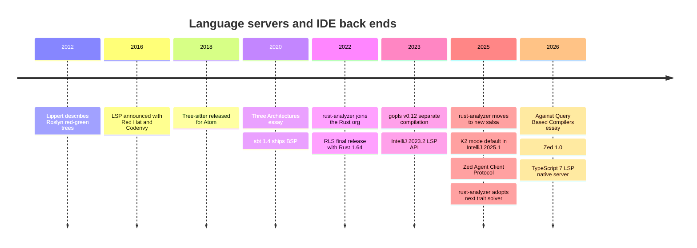
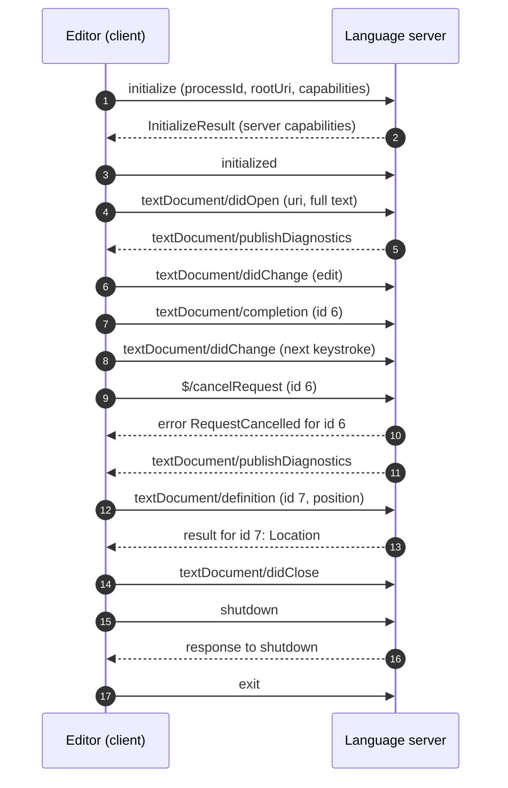
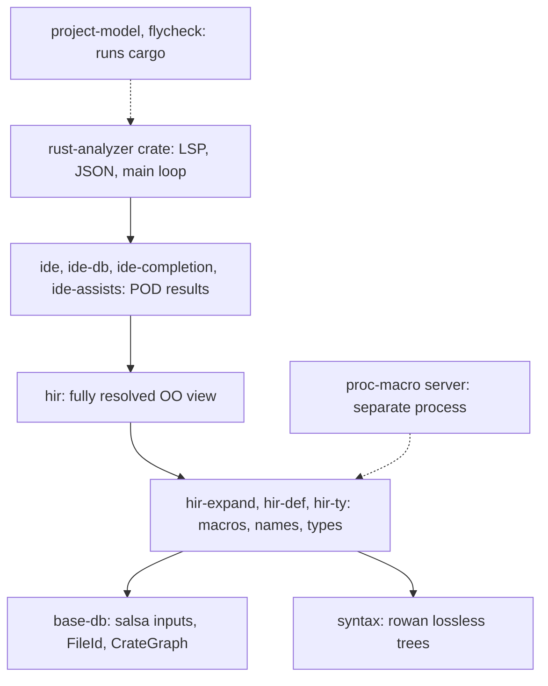

---
tags:
  - compilers
  - language-servers
  - lsp
  - ide-tooling
  - incremental-computation
  - toolchains
status: complete
sources:
  - https://microsoft.github.io/language-server-protocol/overviews/lsp/overview/
  - https://microsoft.github.io/language-server-protocol/specifications/lsp/3.18/specification
  - https://microsoft.github.io/language-server-protocol/specifications/lsp/3.17/specification/
  - https://code.visualstudio.com/blogs/2016/06/27/common-language-protocol
  - https://en.wikipedia.org/wiki/Language_Server_Protocol
  - https://rust-analyzer.github.io/blog/2020/07/20/three-architectures-for-responsive-ide.html
  - https://matklad.github.io/2026/02/25/against-query-based-compilers.html
  - https://fuchsia.googlesource.com/third_party/github.com/rust-lang/rust-analyzer/+/HEAD/docs/dev/architecture.md
  - https://fuchsia.googlesource.com/third_party/github.com/rust-lang/rust-analyzer/+/HEAD/docs/dev/syntax.md
  - https://salsa-rs.github.io/salsa/overview.html
  - https://redlib.hackliberty.org/r/rust/comments/1jbyunp/call_for_testing_rustanalyzer
  - https://scribe.disroot.org/post/scribe.disroot.org/5307109
  - https://rust-analyzer.github.io/thisweek/2025/12/22/changelog-307.html
  - https://newreleases.io/project/github/rust-lang/rust-analyzer/release/2026-08-10
  - https://goals.rust-lang.org/2026/next-solver.html
  - https://blog.rust-lang.org/2026/08/21/enabling-next-solver-on-nightly/
  - https://devclass.com/2022/07/05/rust-team-releases-1-62-sets-end-date-for-deprecated-language-server
  - https://blog.jetbrains.com/rust/2026/05/29/how-rust-ides-understand-code/
  - https://ericlippert.com/2012/06/08/red-green-trees/
  - https://github.com/dotnet/roslyn/blob/main/docs/wiki/Roslyn-Overview.md
  - https://thestrangeloop.com/2018/tree-sitter---a-new-parsing-system-for-programming-tools.html
  - https://en.wikipedia.org/wiki/Tree-sitter_(parser_generator)
  - https://tree-sitter.github.io/tree-sitter/using-parsers/3-advanced-parsing.html
  - https://tree-sitter.github.io/tree-sitter/syntax-highlighting
  - https://clangd.llvm.org/design/indexing
  - https://blog.jetbrains.com/idea/2025/04/the-story-behind-k2-mode-and-how-it-works/
  - https://plugins.jetbrains.com/docs/intellij/stub-indexes.html
  - https://plugins.jetbrains.com/docs/intellij/language-server-protocol.html
  - https://build-server-protocol.github.io/docs/specification
  - https://scala-lang.org/blog/2020/10/27/bsp-in-sbt.html
  - https://go.dev/blog/gopls-scalability
  - https://devblogs.microsoft.com/typescript/announcing-typescript-7-0/
  - https://helix-editor.com/news/release-25-07-highlights/
  - https://zed.dev/blog/zed-1-0
  - https://zed.dev/acp
  - https://github.com/oraios/serena
  - https://circleci.com/blog/claude-code-lsp/
  - https://www.how2shout.com/news/claude-code-v2-0-74-lsp-language-server-protocol-update.html
created: 2026-11-26
updated: 2026-11-26
---

## Table Of Contents

- [[#TL;DR|TL;DR]]
- [[#The Problem|The Problem]]
- [[#Foundations|Foundations]]
    - [[#Laziness Beats Incrementality|Laziness Beats Incrementality]]
    - [[#Lossless, Immutable Syntax Trees|Lossless, Immutable Syntax Trees]]
    - [[#Memoized Queries and Revisions|Memoized Queries and Revisions]]
    - [[#JSON-RPC, Capabilities and Snapshots|JSON-RPC, Capabilities and Snapshots]]
- [[#How We Got Here|How We Got Here]]
- [[#How It Works|How It Works]]
    - [[#An LSP Session|An LSP Session]]
    - [[#A Real Request on the Wire|A Real Request on the Wire]]
    - [[#Capabilities Grew by Version|Capabilities Grew by Version]]
    - [[#Roslyn: The Compiler as an API|Roslyn: The Compiler as an API]]
    - [[#rust-analyzer: Salsa Over Rowan|rust-analyzer: Salsa Over Rowan]]
    - [[#Tree-sitter: Syntax Without Semantics|Tree-sitter: Syntax Without Semantics]]
    - [[#clangd: Preambles and Layered Indexes|clangd: Preambles and Layered Indexes]]
    - [[#IntelliJ PSI and Kotlin K2|IntelliJ PSI and Kotlin K2]]
    - [[#gopls: Separate Compilation Inside the Server|gopls: Separate Compilation Inside the Server]]
    - [[#The Build Server Protocol|The Build Server Protocol]]
- [[#Where It Is Now|Where It Is Now]]
    - [[#The Protocol Itself|The Protocol Itself]]
    - [[#Rust: New Salsa, New Trait Solver|Rust: New Salsa, New Trait Solver]]
    - [[#TypeScript 7's Native Language Server|TypeScript 7's Native Language Server]]
    - [[#Editors Built Around LSP and Tree-sitter|Editors Built Around LSP and Tree-sitter]]
    - [[#Language Servers as Tools for AI Agents|Language Servers as Tools for AI Agents]]
- [[#Trade-offs & Open Problems|Trade-offs & Open Problems]]
- [[#Resources|Resources]]
- [[#Related Notes|Related Notes]]

## ***TL;DR***
---
*An IDE needs a compiler front end that answers one question about half-typed code in milliseconds, not one that compiles a correct program once. That requirement produced the Language Server Protocol (a JSON-RPC contract between any editor and any language) and a family of front ends built on laziness, memoized queries and immutable lossless trees.*

- **Different job, different compiler.** A batch compiler is eager, whole-program and can stop at the first error. An IDE front end must be **lazy** (compute only what the cursor needs), **incremental** (reuse work across keystrokes), **error-tolerant** (always produce a tree) and **cancellable**. matklad's summary: "it's not the incrementality that makes an IDE fast. Rather, it's laziness" ([rust-analyzer blog, 2020](https://rust-analyzer.github.io/blog/2020/07/20/three-architectures-for-responsive-ide.html)).
- **LSP turns M×N integrations into M+N.** Announced by Microsoft with Red Hat and Codenvy on June 27, 2016 ([VS Code blog](https://code.visualstudio.com/blogs/2016/06/27/common-language-protocol)), LSP runs the language brain in a separate process and speaks JSON-RPC 2.0 over a `Content-Length` framed stream. Client and server negotiate **capabilities** at `initialize` ([LSP 3.18 spec](https://microsoft.github.io/language-server-protocol/specifications/lsp/3.18/specification)).
- **Three reference architectures.** Roslyn exposes the compiler as immutable APIs with red-green trees; rust-analyzer layers **salsa** (memoized, dependency-tracked queries) over **rowan** lossless trees; IntelliJ indexes per-file **stubs** map-reduce style. clangd snapshots a C++ "preamble" and merges several symbol indexes. Tree-sitter handles syntax-only features (highlighting, folding, structural selection) in editors and on GitHub.
- **Neighbours of LSP.** The **Build Server Protocol** reuses LSP's base protocol so IDEs can ask sbt, Bloop, Mill or Bazel about build targets ([BSP spec](https://build-server-protocol.github.io/docs/specification)); Zed's **Agent Client Protocol** (August 2025) does the same for AI agents ([Zed](https://zed.dev/acp)).
- **As of November 2026.** LSP **3.18** is the current spec and 3.19 is labelled upcoming; rust-analyzer moved to the new salsa (March 2025) and the next trait solver (October 2025); **TypeScript 7** (July 2026) ships an LSP-native Go language server with first errors on the VS Code repo in under 1.3 s versus about 17.5 s; and coding agents now call language servers directly (Claude Code's LSP tool, Serena over MCP).

## ***The Problem***
---
*A batch compiler optimizes throughput on a complete, correct program. An editor needs latency on an incomplete, mostly broken one, and it needs the same answers from many tools at once.*

The [[Compiler Pipeline]] was designed for a run that starts, reads every file, reports errors and exits. An IDE asks a stream of tiny, position-specific questions ("what is the type under the cursor?", "complete after this dot") while the user is mid-edit, and every keystroke invalidates part of the previous answer.

| | Batch compiler | IDE front end |
|---|---|---|
| **Unit of work** | Whole crate, module or translation unit | One query at one cursor position |
| **Goal** | Throughput, correct output | Latency per keystroke |
| **Input** | Mostly correct code | Usually broken code |
| **Order** | Eager: parse all, check all, emit | Lazy: compute only what this request needs |
| **State** | Starts fresh, exits | Long-lived, holds the whole project in memory |
| **Errors** | May stop at the first | Must produce a tree and partial types anyway |
| **Concurrency** | Parallel passes | New edits must cancel stale work |

rust-analyzer's architecture doc puts the error requirement as an invariant: analysis returns `(T, Vec<Error>)` rather than failing, and "rust-analyzer should be partially available even when the build is broken" ([architecture.md](https://fuchsia.googlesource.com/third_party/github.com/rust-lang/rust-analyzer/+/HEAD/docs/dev/architecture.md)). Rust's original language server, RLS, shows what happens without that: it ran `rustc` with a save-analysis option and parsed the output, which was slow, and it was deprecated in favour of rust-analyzer with its last release alongside Rust 1.64 in September 2022 ([DevClass, 2022](https://devclass.com/2022/07/05/rust-team-releases-1-62-sets-end-date-for-deprecated-language-server)). A JetBrains retrospective sums up the root cause: "rustc barely works with incomplete code" ([JetBrains, 2026](https://blog.jetbrains.com/rust/2026/05/29/how-rust-ides-understand-code/)).

The second problem is economic. Before LSP every editor had to build support for every language. The 2016 announcement framed the fix as letting a language server "be implemented once and have different tools take advantage of it" ([VS Code blog](https://code.visualstudio.com/blogs/2016/06/27/common-language-protocol)).

$$
\text{integrations}_{\text{bespoke}} = M \times N \qquad \text{integrations}_{\text{LSP}} = M + N
$$

**In plain English:** with $M$ editors and $N$ languages, bespoke plugins need one integration per pair; with a shared protocol each editor implements a client once and each language implements a server once. Ten editors and fifty languages go from 500 integrations to 60.

## ***Foundations***
---
*Four ideas carry every modern IDE back end: be lazy, keep trees lossless and immutable, memoize computations with tracked dependencies, and talk over a small negotiated protocol.*

### Laziness Beats Incrementality
*The fastest work is the work you never do, and language design decides how much you can skip.*

matklad's 2020 essay names three ways to get a responsive IDE ([rust-analyzer blog](https://rust-analyzer.github.io/blog/2020/07/20/three-architectures-for-responsive-ide.html)):

| Architecture | How it stays fast | Examples cited | Price |
|---|---|---|---|
| **Map-reduce indexing** | Index each file independently into a stub of top-level declarations; merge into a global index; resolve names lazily. Building the index is "an embarrassingly parallel task" | IntelliJ, Sorbet | Needs a well-defined fully-qualified-name concept; restrict metaprogramming that adds top-level items |
| **Header files** | Process imports once, snapshot compiler state, re-analyze only the edited unit | clangd, OCaml's Merlin | Declaration-before-use; "almost nobody likes headers and forward declarations" |
| **Query-based** | Every function call records its dependencies; reuse results whose inputs did not change; stop invalidating when a recomputed value equals the old one | rust-analyzer on salsa | Complexity, memory, slower raw speed; "somewhat uncharted territory" |

Rust needs the third option because its compilation unit is a whole crate, there are no headers, and macros can add items anywhere, so "purely laziness based models do not work for Rust." In February 2026 the same author argued the flip side: query systems are limited by "the dependency structure of the source language," some computations (avalanche-like ones such as hashes) are "provably impossible to make usefully incremental," and a language like Zig, which allows per-file parsing and name resolution, can push queries late and keep the front end as simple coarse-grained phases ([matklad, 2026](https://matklad.github.io/2026/02/25/against-query-based-compilers.html)).

### Lossless, Immutable Syntax Trees
*An IDE tree must round-trip to the exact source text, survive syntax errors, and be shareable across threads.*

[[Lexing and Parsing]] covers the parsing side in depth (resilient recursive descent, red-green trees, rowan, tree-sitter's GLR). The properties that matter for tooling are:

- **Full fidelity.** Roslyn's trees hold "all the source information in full fidelity" and are "completely round-trippable back to the text it was parsed from"; whitespace and comments are *trivia* attached to tokens ([Roslyn Overview](https://github.com/dotnet/roslyn/blob/main/docs/wiki/Roslyn-Overview.md)). Formatting and refactoring need this, because they must print the file back.
- **Immutability.** Roslyn trees "are immutable and thread-safe", and an edit produces a new tree that reuses the old one's nodes ([Roslyn Overview](https://github.com/dotnet/roslyn/blob/main/docs/wiki/Roslyn-Overview.md)). The *green* layer (position-free, shareable) and the *red* layer (parent pointers and absolute offsets, built on demand) make that cheap ([Lippert, 2012](https://ericlippert.com/2012/06/08/red-green-trees/)).
- **Errors outside the tree.** rowan keeps syntax errors in a side list and red nodes as cheap cursors rather than memoized objects ([rust-analyzer syntax doc](https://fuchsia.googlesource.com/third_party/github.com/rust-lang/rust-analyzer/+/HEAD/docs/dev/syntax.md)).

### Memoized Queries and Revisions
*Turn the compiler into a database of pure functions whose results are cached and invalidated by tracked reads.*

Salsa, the framework under rust-analyzer, models a program as **inputs** (set from outside, with setters that need `&mut` access to the database) and **tracked functions** whose reads are recorded and whose results are memoized. On the next call, salsa checks whether any recorded input changed before reusing the memo; its docs call this the "red-green algorithm" ([salsa overview](https://salsa-rs.github.io/salsa/overview.html)). The example from the salsa book:

```rust
#[salsa::input]
pub struct ProgramFile {
    pub path: PathBuf,
    pub contents: String,
}

#[salsa::tracked]
fn parse_file<'db>(db: &'db dyn crate::Db, file: ProgramFile) -> Ast<'db> {
    let contents: &str = file.contents(db); // tracked read
    // ... build and return the Ast ...
}

// Later, after changing the input:
use salsa::Setter as _;
file.set_contents(&mut db).to(String::from("fn foo() { /* add a comment */ }"));
```

Each write starts a new **revision**. A hand sketch of the reuse rule, using the early-cutoff idea from the 2020 essay:

$$
\text{reuse}(q, r) \iff \forall d \in \text{deps}(q):\ \text{value}_r(d) = \text{value}_{r'}(d)
$$

**In plain English:** a cached answer for query $q$ computed at an earlier revision $r'$ is still valid at revision $r$ if every query it read still produces the same value. Because dependencies are themselves queries, a change that is re-derived to an identical value (adding a comment changes the file text, but not the function signatures derived from it) stops propagating there.

Other salsa building blocks: **interned** structs give equal values the same id so comparisons are cheap, and **tracked structs** are created inside tracked functions, with fields marked `#[tracked]` excluded from identity so that changing them does not re-run readers of other fields ([salsa overview](https://salsa-rs.github.io/salsa/overview.html)).

### JSON-RPC, Capabilities and Snapshots
*The protocol layer is deliberately thin: framed JSON messages, a negotiation step, and a document-sync model.*

- **Framing.** Each message is an ASCII header, `\r\n`, then the content. `Content-Length` (bytes) is required; `Content-Type` defaults to `application/vscode-jsonrpc; charset=utf-8`; the body always uses `"jsonrpc": "2.0"` ([LSP 3.18](https://microsoft.github.io/language-server-protocol/specifications/lsp/3.18/specification)).
- **Requests vs notifications.** Requests carry an `id` and are answered by a response with the same `id`; notifications such as `didOpen` get no response. Cancellation is a notification, `$/cancelRequest` with `{ id }`, and a cancelled request "must still return a response", typically error `RequestCancelled` (-32800) ([LSP 3.18](https://microsoft.github.io/language-server-protocol/specifications/lsp/3.18/specification)).
- **Capabilities.** "A capability groups a set of language features"; client and server each announce theirs, so a server can support definitions but not workspace symbols ([LSP overview](https://microsoft.github.io/language-server-protocol/overviews/lsp/overview/)).
- **Document ownership.** After `didOpen`, the editor owns the document's contents in memory and streams edits; after `didClose`, the file on disk is the truth again ([LSP overview](https://microsoft.github.io/language-server-protocol/overviews/lsp/overview/)). The server therefore analyzes a *snapshot* of unsaved buffers, not the disk.

## ***How We Got Here***
---
*IDE back ends started inside single products (Roslyn, IntelliJ), LSP made them portable in 2016, Rust forced query-based designs into the open, and 2025 to 2026 pushed speed rewrites and AI-agent clients.*



| When | Event | Source |
|---|---|---|
| Jun 2012 | Eric Lippert's post on Roslyn's red-green trees | [Lippert](https://ericlippert.com/2012/06/08/red-green-trees/) |
| Jun 27, 2016 | Microsoft, Red Hat and Codenvy announce LSP at DevNation; VS Code's TypeScript and C# (OmniSharp) servers are the models | [VS Code blog](https://code.visualstudio.com/blogs/2016/06/27/common-language-protocol), [Wikipedia](https://en.wikipedia.org/wiki/Language_Server_Protocol) |
| 2018 | Tree-sitter (Max Brunsfeld, GitHub) released for Atom | [Wikipedia](https://en.wikipedia.org/wiki/Tree-sitter_(parser_generator)), [Strange Loop](https://thestrangeloop.com/2018/tree-sitter---a-new-parsing-system-for-programming-tools.html) |
| Jul 2020 | matklad's "Three Architectures for a Responsive IDE" | [rust-analyzer blog](https://rust-analyzer.github.io/blog/2020/07/20/three-architectures-for-responsive-ide.html) |
| Oct 2020 | sbt 1.4 ships the Build Server Protocol, co-designed by the Scala Center and JetBrains | [Scala blog](https://scala-lang.org/blog/2020/10/27/bsp-in-sbt.html) |
| Feb to Sep 2022 | rust-analyzer joins the Rust project; RLS deprecated, last release with Rust 1.64 | [DevClass](https://devclass.com/2022/07/05/rust-team-releases-1-62-sets-end-date-for-deprecated-language-server) |
| Sep 2023 | gopls v0.12 brings separate compilation, about 75% less memory | [Go blog](https://go.dev/blog/gopls-scalability) |
| 2023.2 | IntelliJ Platform gains an LSP client API for plugins | [JetBrains SDK](https://plugins.jetbrains.com/docs/intellij/language-server-protocol.html) |
| Mar 2025 | rust-analyzer upgrades salsa and moves the crate graph into salsa | [call for testing](https://redlib.hackliberty.org/r/rust/comments/1jbyunp/call_for_testing_rustanalyzer) |
| 2025.1 | K2 mode becomes the default Kotlin analysis in IntelliJ IDEA | [JetBrains](https://blog.jetbrains.com/idea/2025/04/the-story-behind-k2-mode-and-how-it-works/) |
| Aug 27, 2025 | Zed introduces the Agent Client Protocol with Gemini CLI | [Zed](https://zed.dev/acp) |
| Oct 27, 2025 | rust-analyzer switches from Chalk to the next trait solver | [changelog #299](https://scribe.disroot.org/post/scribe.disroot.org/5307109) |
| Feb 25, 2026 | matklad, "Against Query Based Compilers" | [matklad](https://matklad.github.io/2026/02/25/against-query-based-compilers.html) |
| Apr 29, 2026 | Zed 1.0 | [Zed blog](https://zed.dev/blog/zed-1-0) |
| Jul 8, 2026 | TypeScript 7.0 with an LSP-based native language server | [TypeScript blog](https://devblogs.microsoft.com/typescript/announcing-typescript-7-0/) |

Two lineages meet here. One is the "compiler as a platform" idea: Roslyn's goal was to turn compilers from "black boxes" into "APIs that you can use for code related tasks", with Visual Studio's own C# features rebuilt on them ([Roslyn Overview](https://github.com/dotnet/roslyn/blob/main/docs/wiki/Roslyn-Overview.md)). The other is the IntelliJ lineage of a separate, IDE-specific analyzer over PSI and stub indexes. LSP sits on top of either: it only fixes the wire format, not how the server computes answers.

## ***How It Works***
---
*Start at the wire (one LSP session, one real message), then look inside five servers that answer the same requests in very different ways, and at BSP, which handles the build side.*

### An LSP Session
*The client starts and owns the server process; everything else is requests, notifications and pushed diagnostics.*



What the spec pins down ([LSP 3.18](https://microsoft.github.io/language-server-protocol/specifications/lsp/3.18/specification), [3.17 lifecycle](https://microsoft.github.io/language-server-protocol/specifications/lsp/3.17/specification/)):

- `initialize` must come first and only once. Requests before it get error `-32002`, and notifications are dropped except `exit`. Its params carry `processId`, `clientInfo`, `rootUri`, `capabilities`, `trace` and `workspaceFolders`. Lifecycle then continues with `initialized`, and ends with `shutdown` and `exit`.
- Diagnostics are pushed by the server (`publishDiagnostics`) whenever it likes; since 3.17 clients may also *pull* them.
- Long operations report through `$/progress` with `begin`, `report` and `end` (since 3.15), started either by a client-provided `workDoneToken` or by the server calling `window/workDoneProgress/create`.

### A Real Request on the Wire
*Go to Definition is the canonical example in the LSP overview: a URI plus a zero-based line and character in, a URI plus a range out.*

The LSP overview shows a C++ `textDocument/definition` request carrying a document URI and position, and a response with the defining file's URI and a start/end range ([LSP overview](https://microsoft.github.io/language-server-protocol/overviews/lsp/overview/)). Here is the same shape for a Rust file (hand-written, not captured from a server; the `Content-Length` values are the exact byte counts of the compact JSON bodies):

```text
Content-Length: 165\r\n
\r\n
{"jsonrpc":"2.0","id":7,"method":"textDocument/definition","params":{"textDocument":{"uri":"file:///work/shapes/src/main.rs"},"position":{"line":11,"character":18}}}
```

```json
// Content-Length: 150
{
  "jsonrpc": "2.0",
  "id": 7,
  "result": {
    "uri": "file:///work/shapes/src/geom.rs",
    "range": {
      "start": { "line": 3, "character": 7 },
      "end":   { "line": 3, "character": 11 }
    }
  }
}
```

Note what is *not* in the request: no file contents (the server already has the buffer from `didOpen`/`didChange`), no symbol name (the server resolves the position itself), and no build configuration (the server discovered that at startup). Positions are line and character offsets, and how a "character" is counted is itself negotiated: 3.17 added `positionEncodings`, and if a client lists none, servers can assume UTF-16 ([LSP 3.18](https://microsoft.github.io/language-server-protocol/specifications/lsp/3.18/specification)).

### Capabilities Grew by Version
*The protocol grows by adding optional capabilities, so old clients keep working and new features light up only when both sides opt in.*

From the "since" tags in the 3.18 specification ([LSP 3.18](https://microsoft.github.io/language-server-protocol/specifications/lsp/3.18/specification)):

| Version | Notable additions |
|---|---|
| **3.15** | `$/progress` for work done and partial results, `selectionRange`, diagnostic tags |
| **3.16** | Semantic tokens, call hierarchy, monikers, linked editing ranges, annotated text edits, `codeDescription` |
| **3.17** | Position encodings, inlay hints, inline values, type hierarchy, pull diagnostics, notebook documents, `RelativePattern`, `ServerCancelled` error |
| **3.18** | `inlineCompletion` (ghost-text completions), `workspace/textDocumentContent` (virtual documents), `SnippetTextEdit`, Markdown in diagnostic messages, `Command.tooltip`, a regex-engine capability, workspace edit metadata |

Semantic tokens (3.16) are worth noting: they let the server, which knows types, colour identifiers, while the editor's own tree-sitter grammar handles fast lexical highlighting. Inline completion (3.18) brings ghost-text completions, the pattern AI assistants popularized, into the standard protocol.

### Roslyn: The Compiler as an API
*One compiler serves both command-line builds and the IDE, through immutable snapshots.*

- **Trees.** Full fidelity, immutable, red-green internally, new versions share nodes with the old ([Roslyn Overview](https://github.com/dotnet/roslyn/blob/main/docs/wiki/Roslyn-Overview.md)).
- **Workspace snapshots.** "A solution is an immutable model of the projects and documents"; once you hold a `Solution` from `CurrentSolution`, "that instance will never change", and edits produce a new solution you apply back to the workspace. Every IDE feature therefore reads a consistent snapshot without locks.
- **Semantics on demand.** A `Compilation` is "everything needed to compile" a program; a `SemanticModel` gives the symbols, types and diagnostics for one file, computed when asked ([Roslyn Overview](https://github.com/dotnet/roslyn/blob/main/docs/wiki/Roslyn-Overview.md)).

The design choice: no separate IDE analyzer at all. Correctness comes for free (the IDE and the compiler cannot disagree), at the cost of making the production compiler itself lazy, immutable and thread-safe.

### rust-analyzer: Salsa Over Rowan
*A compiler front end rebuilt as a layered query database, with LSP as a thin shell around it.*



From the [architecture doc](https://fuchsia.googlesource.com/third_party/github.com/rust-lang/rust-analyzer/+/HEAD/docs/dev/architecture.md):

- **Inputs are data, not IO.** Input is a set of `(PathBuf, String)` pairs plus a `CrateGraph` (crate roots, cfg flags, dependencies). "The analyzer keeps all this input data in memory and never does any IO." `base-db` sees files only as opaque `FileId`s and knows nothing about cargo; cargo features are lowered to cfg flags before they reach it.
- **API boundaries.** `syntax` and `ide` are stable boundaries; `hir-*` are not. Only the top `rust-analyzer` crate knows about LSP and JSON, so `ide` is shaped for "an ideal Rust-specific client", not by LSP's limits.
- **Host and snapshot.** `AnalysisHost` is state "to which you can transactionally apply_change"; `Analysis` is "an immutable snapshot".
- **Cancellation by unwinding.** Salsa keeps "a global revision counter". An edit bumps it; stale computations notice, panic with a special value, and the `ide` layer turns that into `Result<T, Cancelled>`, which is why "rust-analyzer requires unwinding". Each LSP request also runs inside `catch_unwind`, so one buggy feature cannot kill the server.
- **The key invariant.** "Typing inside a function's body never invalidates global derived data." The expensive crate-wide results (item signatures, name resolution) must survive keystrokes inside a body.
- **Untrusted plugins out of process.** Procedural macros run in a separate process that can be restarted after a fatal error; they may also be non-deterministic, which breaks salsa's assumption that queries are pure.
- **Threading.** An explicit event loop: state-changing or typing-critical requests run on the main thread, others in a background pool; the server is "stateless, a-la HTTP", so follow-up requests must carry their own context.

Worked example (a hand sketch of the invalidation chain implied by the invariant above, not traced from rust-analyzer):

```rust
// geom.rs
pub struct Rect { pub w: f64, pub h: f64 }
impl Rect {
    pub fn area(&self) -> f64 {
        self.w * self.h      // user types here: `self.w * self.h + 0.0`
    }
}
```

1. `file_text(geom.rs)` changes, so `parse(geom.rs)` re-runs (rowan re-parse).
2. The file's item-level summary (rust-analyzer calls it the item tree) is rebuilt, but it equals the old one (same items, same signatures), so propagation stops: crate-wide name resolution and the `impl` tables are reused.
3. Only `infer(Rect::area)` is invalidated, and it is recomputed lazily the next time something (diagnostics, hover) asks for it.

### Tree-sitter: Syntax Without Semantics
*A generated incremental GLR parser with one C API, used where an editor needs structure on every keystroke but no types.*

Tree-sitter compiles a JavaScript grammar DSL to a C parser with incremental reparsing and error recovery ([Strange Loop, 2018](https://thestrangeloop.com/2018/tree-sitter---a-new-parsing-system-for-programming-tools.html)); its parsing algorithm is covered in [[Lexing and Parsing]]. The editing protocol is two calls ([tree-sitter docs](https://tree-sitter.github.io/tree-sitter/using-parsers/3-advanced-parsing.html)):

```c
typedef struct {
  uint32_t start_byte;
  uint32_t old_end_byte;
  uint32_t new_end_byte;
  TSPoint start_point;
  TSPoint old_end_point;
  TSPoint new_end_point;
} TSInputEdit;

void ts_tree_edit(TSTree *, const TSInputEdit *);
// then: ts_parser_parse(parser, old_tree, input)
```

First you *edit* the old tree so node ranges stay in sync with the text, then you re-parse passing the old tree, which "will create a new tree that internally shares structure with the old tree".

Features are written as S-expression **queries** over the tree. Highlighting uses `highlights.scm` (captures such as `@function`, mapped to theme colours), `locals.scm` (`@local.scope`, `@local.definition`, `@local.reference`, so a variable and its uses share a colour) and `injections.scm` (embedded languages such as a `<script>` tag) ([tree-sitter highlighting docs](https://tree-sitter.github.io/tree-sitter/syntax-highlighting)):

```scheme
; highlights.scm for Go: colour each declared function name
(function_declaration name: (identifier) @function)
```

The `tree-sitter-highlight` library "is currently used on GitHub.com for highlighting code written in several languages" ([tree-sitter docs](https://tree-sitter.github.io/tree-sitter/syntax-highlighting)), and GitHub's code navigation is built on it too; Emacs, Neovim, Zed, Helix and Lapce integrate it ([Wikipedia](https://en.wikipedia.org/wiki/Tree-sitter_(parser_generator))). The usual division of labour in 2026 editors: tree-sitter for highlighting, folding, indentation and structural selection; an LSP server for anything that needs name resolution or types.

### clangd: Preambles and Layered Indexes
*C++ cannot be analyzed lazily per symbol, so clangd parses only open files and answers everything else from indexes.*

clangd is the "header files" architecture: it builds a real Clang AST for the files you have open, and keeps the expensive, rarely changing **preamble** (the block of `#include`s at the top) separate from the cheap, frequently rebuilt main file ([clangd indexing design](https://clangd.llvm.org/design/indexing)). For everything outside the open file it uses an index, because the current AST "doesn't have the information we need":

| Layer | What it holds |
|---|---|
| **Dynamic index** (`FileIndex`) | Symbols from open files and their headers; keeps references current while you type |
| **Background index** | Every project file, indexed in a thread pool; shards cached as `*.idx` under `.cache/clangd/index/` next to `compile_commands.json` so unchanged files are not reindexed at startup |
| **Static index** | Optional, built offline with `clangd-indexer` and loaded with `-index-file` |
| **Remote index** | Served from another machine, so weak machines skip building it |

The layers are "stitched together using `MergedIndex`", so feature code sees one view of symbols, references and relations (such as inheritance) ([clangd indexing design](https://clangd.llvm.org/design/indexing)). Because the compile flags live in `compile_commands.json`, clangd depends on the build system for its view of the world, the same gap BSP addresses for JVM languages.

### IntelliJ PSI and Kotlin K2
*JetBrains IDEs predate LSP and use their own in-process model; K2 shows a compiler and IDE converging on one lazy analyzer.*

- **PSI and stubs.** IntelliJ's Program Structure Interface tree can be backed by a full AST or by a **stub**: a compact, serialized subset holding only what other files need (declarations, names, modifiers; usually no statements or locals). Touching something the stub lacks, such as the element's text, "causes file parsing to switch from the stub to AST backing" ([IntelliJ SDK](https://plugins.jetbrains.com/docs/intellij/stub-indexes.html)). Stub indexes map keys like class names to PSI elements. This is the map-reduce architecture: "During indexing we don't parse function bodies at all" ([JetBrains, 2026](https://blog.jetbrains.com/rust/2026/05/29/how-rust-ides-understand-code/)).
- **Kotlin K1 to K2.** The Kotlin plugin long ran the old compiler's analyzer inside the IDE. It used implicit laziness under "a single shared lock", which made it hard to debug and let Find Usages block other features. K2 "dropped all implicit laziness" and resolves each declaration up to a named phase (for example `SUPER_TYPES`), removing the global lock so analysis can run in parallel. IDE features now go through the **Analysis API**, which hides resolution and caching behind calls like `KtExpression.expressionType` ([JetBrains, 2025](https://blog.jetbrains.com/idea/2025/04/the-story-behind-k2-mode-and-how-it-works/)). K2 mode became the default in IntelliJ IDEA 2025.1.
- **LSP as an add-on.** Since 2023.2 the IntelliJ Platform also has an LSP client API for plugins, but JetBrains says LSP "shouldn't be considered as a replacement for the existing language API", because native support "still offers a wider range of integration with IDE features" ([IntelliJ SDK](https://plugins.jetbrains.com/docs/intellij/language-server-protocol.html)).

### gopls: Separate Compilation Inside the Server
*Borrowing the batch compiler's own trick (per-package summaries) cut a language server's memory by about three quarters.*

"gopls v0.11 held all these symbols in memory, as though gopls was compiling your entire program at once." v0.12 (September 2023) "brings separate compilation to gopls, reusing the same package summary format used by the compiler", caches results in files, and applies pruned incremental rebuilds in the spirit of Make. Across 28 popular repositories memory fell by about 75% on average ([Go blog](https://go.dev/blog/gopls-scalability)). Go's per-package summaries, in the format the compiler already uses, are exactly the kind of dependency structure matklad's 2026 essay says lets you avoid fine-grained queries.

### The Build Server Protocol
*LSP assumes the server already knows the project; BSP standardizes asking the build tool.*

BSP's goal is "to reduce the effort required by tooling developers to integrate between available IDEs and build tools"; its base protocol is "identical to the language server base protocol", and it can run alongside LSP or without it, as in IntelliJ ([BSP spec](https://build-server-protocol.github.io/docs/specification)). The Scala Center designed it with JetBrains, and sbt 1.4 (October 2020) shipped a built-in server so Metals and IntelliJ share sbt's incremental compiler instead of duplicating compilation ([Scala blog](https://scala-lang.org/blog/2020/10/27/bsp-in-sbt.html)).

| Request or notification | Purpose |
|---|---|
| Build target listing | Targets (libraries, tests, binaries) with metadata that is "fast or cheap to compute" |
| `buildTarget/sources` | Source files and directories of a target |
| `buildTarget/dependencySources` | Library sources, so Go to Definition works into dependencies |
| `buildTarget/compile`, `/test`, `/run` | Delegate the actual build |
| `build/publishDiagnostics` | Compiler diagnostics from the build tool |

Implementations listed by the spec: Bloop (the first), sbt, Mill and Bazel (via bazel-bsp); Gradle is named as wanted but not native.

## ***Where It Is Now***
---
*As of November 2026: LSP is the default contract even for JetBrains and AI agents, the big rewrites are about speed (TypeScript in Go, salsa in rust-analyzer), and the newest clients are coding agents rather than people.*

### The Protocol Itself
*3.18 is current, 3.19 is next, and even the biggest non-LSP IDE keeps widening its LSP support.*

- As of November 2026 the official site labels **3.18** "Current" and **3.19** "Upcoming" ([LSP 3.18](https://microsoft.github.io/language-server-protocol/specifications/lsp/3.18/specification)). The 3.18 additions most visible to users are inline completion and virtual documents (`workspace/textDocumentContent`).
- JetBrains' LSP client API added pull diagnostics and document links in 2025.1; inlay hints and folding in 2025.2; call and type hierarchy, Go To Symbol and server progress in 2025.3; and rename, code lens, range formatting and optimize imports in **2026.1** ([IntelliJ SDK](https://plugins.jetbrains.com/docs/intellij/language-server-protocol.html)).

### Rust: New Salsa, New Trait Solver
*rust-analyzer spent 2025 swapping out both its incremental engine and its type checker core.*

- **New salsa (March 2025).** A "big Salsa upgrade" plus moving the crate graph into salsa, so the unit of invalidation went from "the entire crate graph" to "an individual crate": adding a dependency or editing a build script reindexes only affected crates. The project said this would enable parallel autocomplete and persistent caches, and "unblocks us from using the Rust compiler's new trait solver" ([call for testing](https://redlib.hackliberty.org/r/rust/comments/1jbyunp/call_for_testing_rustanalyzer)).
- **Next trait solver (October 27, 2025).** rust-analyzer switched from Chalk to rustc's next-generation trait solver ([changelog #299](https://scribe.disroot.org/post/scribe.disroot.org/5307109); [Rust project goal](https://goals.rust-lang.org/2026/next-solver.html)), so the IDE and the compiler now share the same trait logic. The solver became the default on rustc nightly in August 2026 ([Rust Blog](https://blog.rust-lang.org/2026/08/21/enabling-next-solver-on-nightly/)); see [[Type Systems and Inference]].
- **Memory follow-ups.** December 2025: using GC "instead of `salsa` interning for solver types" saved 648 MB and 31 s when analyzing rust-analyzer itself ([changelog #307](https://rust-analyzer.github.io/thisweek/2025/12/22/changelog-307.html)); August 2026: item-tree memory optimizations saved another 29 MB ([release 2026-08-10](https://newreleases.io/project/github/rust-lang/rust-analyzer/release/2026-08-10)). I could not confirm that persistent on-disk caches have shipped.

### TypeScript 7's Native Language Server
*The Go port rebuilt the editor service on LSP and made it multi-threaded.*

TypeScript 7.0 (July 8, 2026) has a language service that "is built on the Language Server Protocol (LSP) and is able to leverage multiple threads to serve simultaneous requests" ([TypeScript blog](https://devblogs.microsoft.com/typescript/announcing-typescript-7-0/)). Reported numbers:

| Measure | TypeScript 6 | TypeScript 7 |
|---|---|---|
| Time to first error opening a file in the VS Code repo | about 17.5 s | under 1.3 s |
| Canva codebase, time to first error | about 58 s | about 4.8 s |
| Failing language-server commands | baseline | down by over 80% |
| Server crashes | baseline | down by over 60% |

Gaps at release: Vue, MDX, Astro, Svelte and Angular template checking still needed TypeScript 6 because there was no stable programmatic API yet ([TypeScript blog](https://devblogs.microsoft.com/typescript/announcing-typescript-7-0/)); the 7.1 beta in October 2026 began restoring one (see [[Type Systems and Inference]]). The batch-compiler side of the port (parallel checking, about 10x faster builds) is covered there too.

### Editors Built Around LSP and Tree-sitter
*The new wave of editors treats LSP and tree-sitter as the whole language layer, and competes on speed and agents.*

- **Helix 25.07 (July 15, 2025)** replaced its highlighter with `tree-house`, a from-scratch tree-sitter integration that tracks local definitions at parse time and re-parses only changed injection layers; it also added LSP document colours, rendered "exactly like the LSP inlay hints feature" ([Helix](https://helix-editor.com/news/release-25-07-highlights/)).
- **Zed 1.0 (April 29, 2026).** Zed reached 1.0 after five years, across Mac, Windows and Linux, and leans on ACP to host third-party agents such as Claude Agent, Codex, OpenCode and Cursor ([Zed blog](https://zed.dev/blog/zed-1-0)).
- **The Agent Client Protocol** is "an open standard that enables any agent to integrate seamlessly with any editing environment", Apache-licensed, introduced August 27, 2025; its site lists Zed, JetBrains IDEs, VS Code, Emacs and Neovim among editors and over 50 agents ([Zed ACP](https://zed.dev/acp)). It applies the LSP idea (one protocol between M clients and N back ends) to agents.

### Language Servers as Tools for AI Agents
*Coding agents rediscovered why IDEs need semantic indexes: grep cannot tell a definition from a comment.*

- **Claude Code** gained an LSP tool in late 2025 (version 2.0.74, reported December 2025, exposing go to definition, find references, document symbols, hover and diagnostics) ([how2shout](https://www.how2shout.com/news/claude-code-v2-0-74-lsp-language-server-protocol-update.html)). Language servers come from plugins whose `.lsp.json` maps a server command to file extensions; a June 2026 test on `vuejs/core` found the LSP configuration "the only configuration that never missed" references, while grep alone missed some (9 of 11, 249 of 260), with LSP output 2 to 3x leaner on the largest task. Costs: memory, slow cold starts while indexing, per-language setup ([CircleCI, 2026](https://circleci.com/blog/claude-code-lsp/)).
- **Serena** wraps language servers (over 40 languages by default) as an MCP server offering symbol-level tools such as find symbol, find referencing symbols and replace symbol body, calling itself "the IDE for your agent"; a paid JetBrains plugin can replace the LSP back end ([Serena](https://github.com/oraios/serena)).
- The pattern: the agent is just another LSP client, often driven through MCP. The protocol's position-based API (line and character) fits editors better than agents, which think in symbol names, so tools like Serena put a name-based symbol layer on top.

## ***Trade-offs & Open Problems***
---
*Every design here buys latency with something: memory, complexity, language restrictions, or loss of fidelity at the protocol boundary.*

| Approach | Wins | Costs |
|---|---|---|
| **Compiler as API** (Roslyn, Kotlin K2) | IDE and compiler cannot disagree; one implementation | Production compiler must be lazy, immutable, thread-safe |
| **Separate IDE analyzer** (IntelliJ PSI, rust-analyzer alongside rustc) | Freedom to be lazy and error-tolerant | Two implementations of the language to keep consistent; JetBrains calls this "much more than 'just' double work" |
| **Query database** (salsa) | Fine-grained reuse for languages without headers | Dependency-tracking memory and overhead; hard to profile; needs pure (deterministic) inputs |
| **Map-reduce stubs** (IntelliJ, gopls-like summaries) | Parallel, cheap, scales to huge repos | Needs language support for per-file or per-package summaries |
| **Syntax only** (tree-sitter) | Fast, uniform across hundreds of languages | No names or types; recovery can fragment incomplete constructs |
| **LSP** | M+N integrations, process isolation | Lowest common denominator; rich IDEs keep native APIs |

Open problems:

- **Language design decides IDE quality.** matklad's 2026 argument is that query machinery is a fallback forced by languages like Rust; Zig-style per-file name resolution avoids most of it ([matklad, 2026](https://matklad.github.io/2026/02/25/against-query-based-compilers.html)). New languages increasingly get judged on how well they can be served by an IDE.
- **Determinism.** Salsa assumes pure queries, but procedural macros can be non-deterministic, which caused at least one cache-invalidation bug in rust-analyzer ([rust-analyzer blog](https://rust-analyzer.github.io/blog/2020/07/20/three-architectures-for-responsive-ide.html)). Build scripts and macros that read the environment remain hard to model.
- **Memory.** Long-lived servers hold whole projects; gopls cut 75% by moving to compiler-style summaries, rust-analyzer is still shaving hundreds of MB, and agents that start a fresh server per task pay cold-start indexing every time.
- **Project models.** A language server is only as good as its view of the build (`compile_commands.json`, Cargo metadata, `rust-project.json`). BSP solves this for the JVM and Scala world, but there is still no universal build-to-IDE protocol across ecosystems.
- **Protocol fidelity.** LSP's UTF-16 baseline for positions, stateless request model and generic capability set limit what servers can express; JetBrains still treats LSP as an add-on to native support ([IntelliJ SDK](https://plugins.jetbrains.com/docs/intellij/language-server-protocol.html)), and rust-analyzer keeps its `ide` API deliberately unconstrained by LSP.
- **Agents as clients.** Positions in, positions out suits a cursor, not a model. Whether LSP grows symbol-oriented queries, or MCP and ACP wrappers become the standard agent interface, is unsettled as of November 2026.

## ***Resources***
---
*Start with the LSP overview and matklad's two architecture essays, then the rust-analyzer architecture doc and the Roslyn overview; the clangd, IntelliJ and gopls pages show three other ways to solve the same problem.*

**Protocols and specs**
- [Language Server Protocol overview](https://microsoft.github.io/language-server-protocol/overviews/lsp/overview/): Microsoft. Session walkthrough and the Go to Definition example.
- [LSP 3.18 specification](https://microsoft.github.io/language-server-protocol/specifications/lsp/3.18/specification): Microsoft, current as of 2026. Base protocol, lifecycle, capabilities.
- [LSP 3.17 specification](https://microsoft.github.io/language-server-protocol/specifications/lsp/3.17/specification/): Microsoft. Lifecycle messages and earlier feature set.
- [Build Server Protocol specification](https://build-server-protocol.github.io/docs/specification): BSP project. LSP's sibling for build tools.
- [Agent Client Protocol](https://zed.dev/acp): Zed, 2025. Editor-to-agent protocol.

**Design docs and primary posts**
- [A Common Protocol for Languages](https://code.visualstudio.com/blogs/2016/06/27/common-language-protocol): VS Code team, 2016. The launch announcement.
- [Three Architectures for a Responsive IDE](https://rust-analyzer.github.io/blog/2020/07/20/three-architectures-for-responsive-ide.html): Aleksey Kladov, 2020. Laziness vs incrementality.
- [Against Query Based Compilers](https://matklad.github.io/2026/02/25/against-query-based-compilers.html): Aleksey Kladov, 2026. The counterpoint.
- [rust-analyzer architecture](https://fuchsia.googlesource.com/third_party/github.com/rust-lang/rust-analyzer/+/HEAD/docs/dev/architecture.md) and [syntax design](https://fuchsia.googlesource.com/third_party/github.com/rust-lang/rust-analyzer/+/HEAD/docs/dev/syntax.md): rust-analyzer team. Layers, invariants, cancellation, rowan.
- [Salsa overview](https://salsa-rs.github.io/salsa/overview.html): salsa project. Inputs, tracked functions, red-green.
- [Roslyn Overview](https://github.com/dotnet/roslyn/blob/main/docs/wiki/Roslyn-Overview.md): .NET team. Compiler as platform, immutable trees and solutions.
- [Red-green trees](https://ericlippert.com/2012/06/08/red-green-trees/): Eric Lippert, 2012.
- [The clangd index](https://clangd.llvm.org/design/indexing): LLVM. Dynamic, background, static and remote indexes.
- [The story behind K2 mode](https://blog.jetbrains.com/idea/2025/04/the-story-behind-k2-mode-and-how-it-works/): JetBrains, 2025. Phased lazy resolution and the Analysis API.
- [Stub indexes](https://plugins.jetbrains.com/docs/intellij/stub-indexes.html) and [LSP in the IntelliJ Platform](https://plugins.jetbrains.com/docs/intellij/language-server-protocol.html): JetBrains SDK docs.
- [Scaling gopls](https://go.dev/blog/gopls-scalability): Findley and Donovan, Go blog, 2023.
- [BSP support in sbt 1.4](https://scala-lang.org/blog/2020/10/27/bsp-in-sbt.html): Scala Center, 2020.
- [Tree-sitter: advanced parsing](https://tree-sitter.github.io/tree-sitter/using-parsers/3-advanced-parsing.html) and [syntax highlighting](https://tree-sitter.github.io/tree-sitter/syntax-highlighting): tree-sitter docs.
- [Tree-sitter: a new parsing system for programming tools](https://thestrangeloop.com/2018/tree-sitter---a-new-parsing-system-for-programming-tools.html): Max Brunsfeld, Strange Loop 2018.

**Releases and news (2025 to 2026)**
- [Announcing TypeScript 7.0](https://devblogs.microsoft.com/typescript/announcing-typescript-7-0/): Microsoft, July 2026. LSP-native language server numbers.
- [rust-analyzer call for testing: new salsa](https://redlib.hackliberty.org/r/rust/comments/1jbyunp/call_for_testing_rustanalyzer): rust-analyzer team on r/rust, March 2025 (mirror).
- [rust-analyzer changelog #299](https://scribe.disroot.org/post/scribe.disroot.org/5307109) (mirror), [#307](https://rust-analyzer.github.io/thisweek/2025/12/22/changelog-307.html) and [release 2026-08-10](https://newreleases.io/project/github/rust-lang/rust-analyzer/release/2026-08-10): next trait solver and memory work.
- [Enabling the next-generation trait solver on nightly](https://blog.rust-lang.org/2026/08/21/enabling-next-solver-on-nightly/): Rust Blog, August 2026.
- [Helix 25.07 highlights](https://helix-editor.com/news/release-25-07-highlights/): Helix, July 2025.
- [Zed is 1.0](https://zed.dev/blog/zed-1-0): Nathan Sobo, April 2026.
- [RLS end date](https://devclass.com/2022/07/05/rust-team-releases-1-62-sets-end-date-for-deprecated-language-server): DevClass, 2022.

**Practitioners and agents**
- [How Rust IDEs understand code](https://blog.jetbrains.com/rust/2026/05/29/how-rust-ides-understand-code/): JetBrains RustRover blog, 2026. rust-analyzer and RustRover engineers compare designs.
- [Claude Code LSP](https://circleci.com/blog/claude-code-lsp/): CircleCI blog, June 2026. Measured LSP vs grep for an agent.
- [Serena](https://github.com/oraios/serena): Oraios. Language servers exposed to agents over MCP.

## Related Notes

- [[Lexing and Parsing]] — Resilient parsing, red-green trees, rowan and tree-sitter's GLR algorithm in depth.
- [[Incremental Computation]] — The algorithms under salsa: red-green verification, backdating, durability and early cutoff.
- [[Type Systems and Inference]] — The next trait solver, TypeScript 7's checker and Python checkers built for language servers.
- [[Compiler Pipeline]] — The batch pipeline that IDE front ends reorganize into lazy queries.
- [[Intermediate Representations]] — rust-analyzer's item trees and HIR are IDE-oriented IRs.
- [[Dataflow Analysis]] — Narrowing and flow-sensitive checks that language servers run per keystroke.
- [[LLVM]] — Home of Clang and clangd.
- [[Compiler, Assembler, Linker, and Loader]] — The build stages whose flags `compile_commands.json` captures for clangd.
- [[Linking and LTO]] — Build-side concerns that BSP and project models expose to IDEs.
- [[Compiler Testing and Fuzzing]] — Fuzzing parsers and analyzers that must never crash on broken input.
- [[Abstract Interpretation]] — Static analyses that IDEs surface as diagnostics.
- [[Grammar-Constrained Decoding]] — Planned: incremental parsing reused to constrain LLM output, the other AI use of parser tech.
