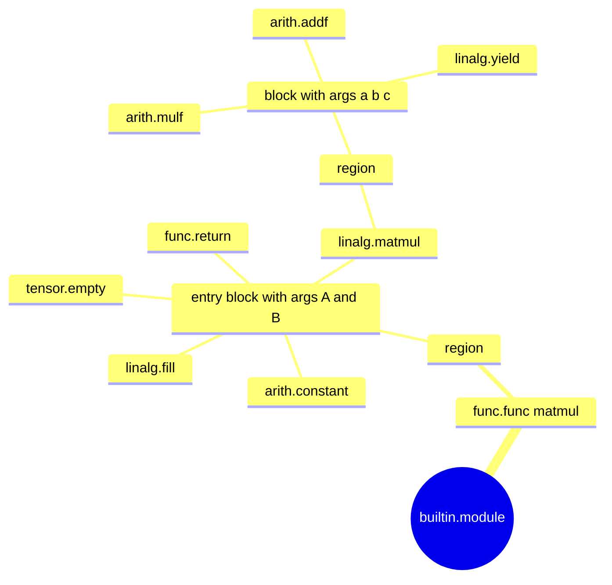
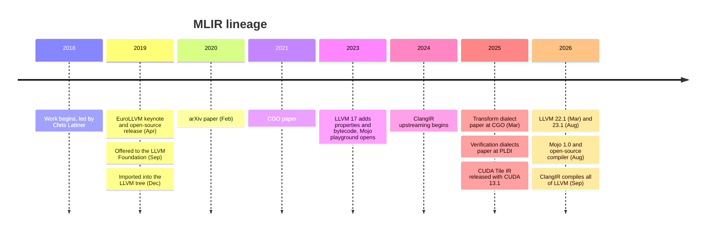
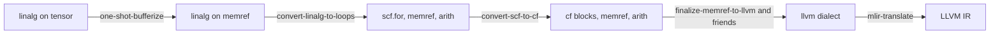

---
tags:
  - compilers
  - mlir
  - intermediate-representation
  - dialects
  - progressive-lowering
  - pattern-rewriting
  - ml-compilers
status: complete
sources:
  - https://arxiv.org/pdf/2002.11054
  - https://research.google/pubs/mlir-scaling-compiler-infrastructure-for-domain-specific-computation/
  - https://llvm.org/devmtg/2019-04/slides/Keynote-ShpeismanLattner-MLIR.pdf
  - https://lists.llvm.org/pipermail/llvm-dev/2019-September/135090.html
  - https://lists.llvm.org/pipermail/llvm-dev/2019-December/137860.html
  - https://en.wikipedia.org/wiki/MLIR_(software)
  - https://mlir.llvm.org/docs/LangRef/
  - https://mlir.llvm.org/docs/Rationale/Rationale/
  - https://mlir.llvm.org/docs/PassManagement
  - https://mlir.llvm.org/docs/PatternRewriter
  - https://mlir.llvm.org/docs/DialectConversion/
  - https://mlir.llvm.org/docs/PDLL/
  - https://mlir.llvm.org/docs/Bufferization
  - https://mlir.llvm.org/docs/ReleaseNotes
  - https://arxiv.org/html/2409.03864v2
  - https://2025.cgo.org/details/cgo-2025-papers/7
  - https://src.rcs.uwaterloo.ca/xref/llvm-project/mlir/test/Integration/Dialect/Linalg/CPU/test-tensor-matmul.mlir
  - https://src.rcs.uwaterloo.ca/xref/llvm-project/mlir/test/Integration/Dialect/Linalg/CPU/test-one-shot-bufferize.mlir
  - https://flang.llvm.org/docs/HighLevelFIR.html
  - https://circt.llvm.org/
  - https://openxla.org/stablehlo
  - https://pytorch.org/blog/triton-kernel-compilation-stages/
  - https://arxiv.org/abs/2505.23819
  - https://github.com/NVIDIA/cuda-tile
  - https://developer.nvidia.com/blog/advancing-gpu-programming-with-the-cuda-tile-ir-backend-for-openai-triton/
  - https://docs.tenstorrent.com/tt-mlir/dialects-overview.html
  - https://en.wikipedia.org/wiki/Mojo_(programming_language)
  - https://modular.com/blog/modular-26-5-mojo-1-0-is-here
  - https://simonwillison.net/2026/Aug/18/mojo-is-now-open-source/
  - https://blog.llvm.org/posts/2025-gsoc-clangir-upstreaming/
  - https://discourse.llvm.org/t/clangir-upstream-progress-report-may-2026/90760
  - https://discourse.llvm.org/t/clangir-progress-report-september-2026/91947
  - https://phoronix.com/news/ClangIR-Build-Default-Maybe
  - https://developer.arm.com/community/arm-community-blogs/b/tools-software-ides-blog/posts/what-is-new-in-llvm-23
  - https://developer.arm.com/community/arm-community-blogs/b/tools-software-ides-blog/posts/what-is-new-in-llvm-22
  - https://lists.llvm.org/pipermail/llvm-commits/Week-of-Mon-20250721/1688505.html
  - https://llvm.googlesource.com/llvm-project/+/8bc0d4d1ccb708d20413876258885a48d3ca6b3d
  - https://discourse.llvm.org/t/mlir-organization-charter/84118
  - https://discourse.llvm.org/t/rfc-mlir-dialect-canonicalization/90013
  - https://discourse.llvm.org/t/eurollvm-2026-round-table-summary-mlir-canonicalization/90588
  - https://www.modular.com/blog/democratizing-ai-compute-part-8-what-about-the-mlir-compiler-infrastructure
  - https://llvm.org/devmtg/2024-04/slides/Keynote/Amini-Niu-HowSlowIsMLIR.pdf
  - https://users.cs.utah.edu/~regehr/papers/pldi25.pdf
created: 2026-11-26
updated: 2026-11-26
---

## Table Of Contents

- [[#TL;DR|TL;DR]]
- [[#The Problem|The Problem]]
- [[#Foundations|Foundations]]
    - [[#Everything Is an Operation|Everything Is an Operation]]
    - [[#Attributes, Types and Properties|Attributes, Types and Properties]]
    - [[#Regions, Blocks and Block Arguments|Regions, Blocks and Block Arguments]]
    - [[#Dialects|Dialects]]
    - [[#Traits and Interfaces|Traits and Interfaces]]
    - [[#ODS and TableGen|ODS and TableGen]]
- [[#How We Got Here|How We Got Here]]
- [[#How It Works|How It Works]]
    - [[#The Upstream Dialect Stack|The Upstream Dialect Stack]]
    - [[#The Pass Infrastructure|The Pass Infrastructure]]
    - [[#Pattern Rewriting|Pattern Rewriting]]
    - [[#The Transform Dialect|The Transform Dialect]]
    - [[#Bufferization|Bufferization]]
    - [[#Worked Example - Lowering a Matmul|Worked Example - Lowering a Matmul]]
    - [[#Who Builds on It|Who Builds on It]]
- [[#Where It Is Now|Where It Is Now]]
    - [[#Releases and Upstream Work|Releases and Upstream Work]]
    - [[#ClangIR|ClangIR]]
    - [[#Mojo, Triton and Tile IRs|Mojo, Triton and Tile IRs]]
    - [[#Governance and RFCs|Governance and RFCs]]
- [[#Trade-offs & Open Problems|Trade-offs & Open Problems]]
- [[#Resources|Resources]]
- [[#Related Notes|Related Notes]]

## ***TL;DR***
---
*MLIR is not one IR but a toolkit for building IRs: you define "dialects" of operations, types and attributes, mix them in one program, and lower step by step from domain-level ops down to [[LLVM]] IR. It exists because every language and ML framework kept rebuilding the same compiler plumbing for its own private IR.*

- **What it is.** A compiler infrastructure, imported into the LLVM tree in December 2019, whose one core concept is the *operation*. Modules, functions, loops, tensor ops and machine instructions are all operations; an operation can hold *regions* of *blocks* that hold more operations ([Lattner et al., CGO 2021](https://arxiv.org/pdf/2002.11054)).
- **Why it exists.** Swift, Rust, Julia and Fortran each "develop their own IR", and TensorFlow's stack had a dozen graph IRs, each re-implementing SSA, pass managers, parsers, printers and verifiers. MLIR offers that scaffolding once.
- **How you use it.** Declare ops in TableGen (ODS), attach *traits* and *interfaces* so generic passes can reason about them, and transform with passes, rewrite patterns, the *dialect conversion* framework or a *Transform dialect* script.
- **Progressive lowering.** A typical CPU path: `linalg` on `tensor` → *bufferization* → `linalg` on `memref` → `scf` loops → `cf` branches → `llvm` dialect → LLVM IR. Each step drops one kind of structure on purpose.
- **Who uses it.** OpenXLA/StableHLO, IREE, Triton, Torch-MLIR, CIRCT (hardware), Flang, Mojo, Tenstorrent's tt-mlir, NVIDIA's CUDA Tile IR, and ClangIR for C and C++.
- **As of November 2026.** LLVM 23.1 (August 2026) is current; ClangIR compiles all of LLVM and Clang per translation unit but its self-built Clang still fails tests; Mojo 1.0 shipped with an open-source compiler; the community argues about canonicalization, governance and compile time rather than core concepts.

## ***The Problem***
---
*LLVM IR gave everyone one shared low-level IR, but many optimizations need structure that LLVM IR has already thrown away. So each serious front end built its own mid-level IR from scratch, and ML frameworks built dozens.*

LLVM's abstraction suits C-like code, but loop nests have become branches, tensors have become pointer arithmetic, and language rules like ownership are gone. Language after language responded with a private high-level IR; the MLIR paper names Swift, Rust, Julia and Fortran and calls SIL and MIR its spiritual relatives ([Lattner et al.](https://arxiv.org/pdf/2002.11054)):

| Project | Private IR | Why it needed one |
|---|---|---|
| Swift | SIL | Definite initialization, ARC optimization, devirtualization |
| Rust | MIR | Borrow checking, drop elaboration |
| Flang (Fortran) | FIR, later HLFIR | Array semantics, descriptors, dispatch tables for devirtualization |
| TensorFlow | TF Graph, XLA HLO, TPU IR, TF Lite, Grappler, TensorRT, nGraph, NNAPI, Core ML | Graph fusion, layout and device placement |

The TensorFlow list is from the 2019 keynote, which named three problems: "similar-but-different proprietary technologies", fragile tools with "poor/no location info, or even crashes", and "duplication of infrastructure at all levels" ([Shpeisman and Lattner, EuroLLVM 2019](https://llvm.org/devmtg/2019-04/slides/Keynote-ShpeismanLattner-MLIR.pdf)). Each IR re-implemented an in-memory SSA form, a text format, a verifier, a pass manager, location tracking and test tools.

Hardware added pressure. [[AI Accelerators]], GPUs and FPGAs each want different intermediate forms, and the slowing of Moore's law meant more of them. The arXiv version of the paper is titled *A Compiler Infrastructure for the End of Moore's Law*; the CGO 2021 version is *MLIR: Scaling Compiler Infrastructure for Domain Specific Computation* ([Google Research](https://research.google/pubs/mlir-scaling-compiler-infrastructure-for-domain-specific-computation/)).

## ***Foundations***
---
*Six ideas carry the system: the generic operation, open-ended attributes and types, nested regions with block arguments, dialects as namespaces, traits and interfaces as the way generic code reasons about unknown ops, and ODS for declaring all of it.*

### Everything Is an Operation

*MLIR has no built-in "instruction", "function" or "module"; all are operations, and one generic syntax prints any of them.*

"The unit of semantics in MLIR is an 'operation'" ([Lattner et al.](https://arxiv.org/pdf/2002.11054)). Each has a name (`dialect.opname`), SSA operands and results, properties and attributes, successor blocks, regions and a location. The generic form shows everything, even for ops the parser doesn't know ([LangRef](https://mlir.llvm.org/docs/LangRef/)):

```mlir
%r:2 = "demo.op"(%a, %b) <{mode = 1 : i32}> ({
  ^bb0(%x: f32):
    "demo.yield"(%x) : (f32) -> ()
}) {demo.note = "hi"} : (i32, f32) -> (i32, f32) loc("model.py":3:4)
```

`%r:2` is two results, `<{...}>` holds *properties*, `({...})` is a region, `{...}` holds *discardable* attributes, then the function type and a location. Dialects usually register a custom format so the same kind of op prints as `arith.addf %a, %b : f32`.

### Attributes, Types and Properties

*Constants and type information are open-ended values that any dialect can extend.*

- **Types** describe SSA values: builtin `i32`, `index`, `tensor<4x?xf32>`, `memref<4x8xf32>`, `vector<8xf32>`, plus dialect types such as `!llvm.ptr`. MLIR "enforces strict type equality checking and does not provide type conversion rules" ([Lattner et al.](https://arxiv.org/pdf/2002.11054)).
- **Attributes** are "structured compile-time static information": integers, strings, dense arrays, `affine_map<(d0, d1) -> (d1, d0)>`, dialect attributes.
- **Properties** store an op's *inherent* data directly on the op instead of in a uniqued dictionary. Introduced in LLVM 17 (2023), the default since LLVM 18 ([MLIR release notes](https://mlir.llvm.org/docs/ReleaseNotes)). Discardable attributes carry a dialect prefix and are verified by that dialect ([LangRef](https://mlir.llvm.org/docs/LangRef/)).
- **Locations** are attached to every op; "source location tracking and traceability" is a design principle, so a fused kernel can point back to the Python lines that produced it.

### Regions, Blocks and Block Arguments

*Nesting is first class: an op holds regions, a region holds blocks, a block holds ops. Merges use block arguments, not phi nodes.*

A block is a list of ops ending in a terminator, with typed *block arguments* that replace [[SSA Form|phi nodes]]; branches pass values to them like calls (`cf.br ^bb3(%a : i64)`), and the entry block's arguments are the region's arguments ([LangRef](https://mlir.llvm.org/docs/LangRef/); [Rationale](https://mlir.llvm.org/docs/Rationale/Rationale/)). *SSACFG* regions are ordered and use dominance; *graph* regions have one block, no meaningful order and allow cycles, which CIRCT uses for netlists. The `IsolatedFromAbove` trait "restricts directly accessing values defined in containing regions", which is what lets passes run on functions in parallel.



**In plain English:** the module is an op with one region; each function is an op inside it with its own region; even `linalg.matmul` carries a small region describing its scalar body (multiply, add, yield). The same walk, verify and rewrite machinery works at every level.

### Dialects

*A dialect is "a logical grouping of Ops, attributes and types under a unique namespace", plus hooks for parsing, folding and inlining.*

`arith.addf`, `scf.for`, `memref.load` and `llvm.call` live in different dialects but can sit in one function. That is the trick behind *progressive lowering*: a pass converts some ops from dialect A to dialect B and leaves the rest alone, so modules are routinely half lowered. Dialects are *upstream* (in the LLVM repo) or *downstream* (in your project, like StableHLO, Triton's `tt` and `ttg`, or Flang's `fir`).

### Traits and Interfaces

*Generic passes never switch on op names; they ask what an op promises (traits) or call methods it implements (interfaces).*

| Mechanism | What it is | Examples |
|---|---|---|
| **Trait** | Static property, often with a verifier | `Pure`, `Commutative`, `Terminator`, `IsolatedFromAbove`, `SameOperandsAndResultType` |
| **Op interface** | Virtual-method-like API an op implements | `MemoryEffectOpInterface`, `LoopLikeOpInterface`, `CallOpInterface`, `TilingInterface`, `BufferizableOpInterface`, `DestinationStyleOpInterface` |
| **Dialect interface** | Hook for a whole dialect | `DialectInlinerInterface` (is inlining legal here) |

This is how one `canonicalize`, `cse`, `inline` or loop-invariant code motion pass works on dialects written years later: CSE asks `MemoryEffectOpInterface` whether an op has side effects, LICM asks `LoopLikeOpInterface` where the body is, tiling asks `TilingInterface` how to slice an op ([Lattner et al.](https://arxiv.org/pdf/2002.11054)).

### ODS and TableGen

*Ops are declared, not hand-written: one TableGen record generates the C++ class, builders, verifier, parser, printer and docs.*

Operation Definition Specification (ODS) reuses LLVM's TableGen. A Toy-tutorial-style transpose op:

```tablegen
def Toy_TransposeOp : Toy_Op<"transpose", [Pure]> {
  let arguments = (ins F64Tensor:$input);
  let results   = (outs F64Tensor:$output);
  let assemblyFormat = "`(` $input `:` type($input) `)` attr-dict `to` type($output)";
  let hasCanonicalizer = 1;
}
```

`mlir-tblgen` turns this into a `TransposeOp` class with typed accessors (`getInput()`), the textual format, operand checks and Markdown docs. Types, attributes, interfaces and passes are declared the same way.

## ***How We Got Here***
---
*MLIR started in 2018 around TensorFlow, joined LLVM at the end of 2019, and spread from ML to Fortran, hardware design and GPU kernel languages, and finally toward C and C++.*



- **Origins (2018-2019).** Work began in 2018 ([Wikipedia](https://en.wikipedia.org/wiki/MLIR_(software))). The April 2019 EuroLLVM keynote announced MLIR was "open source, as of last wednesday" ([keynote](https://llvm.org/devmtg/2019-04/slides/Keynote-ShpeismanLattner-MLIR.pdf)). In September 2019 Lattner wrote that MLIR "was and has always been built with the idea that it would go to LLVM" ([llvm-dev](https://lists.llvm.org/pipermail/llvm-dev/2019-September/135090.html)), and it was imported into the LLVM tree in December 2019 ([LLVM Weekly #313](https://lists.llvm.org/pipermail/llvm-dev/2019-December/137860.html)).
- **The paper (2020-2021).** Its principles: "little builtin, everything customizable", "SSA and regions", "progressive lowering", "maintain higher-level semantics", IR validation, declarative rewrite patterns, and source location tracking. It reported applications to TensorFlow, a polyhedral `affine` dialect, Flang's FIR, and a lattice-regression compiler that gave "up to 8× performance improvement on a production model" after about three person-months ([Lattner et al.](https://arxiv.org/pdf/2002.11054)).
- **Beyond ML.** Flang added HLFIR above FIR so Fortran array expressions stay values instead of becoming temporaries early ([Flang HLFIR](https://flang.llvm.org/docs/HighLevelFIR.html)). CIRCT applies "MLIR and the LLVM development methodology to the domain of hardware design tools" with FIRRTL, HW, Comb, Seq, SV, Calyx and other dialects ([CIRCT](https://circt.llvm.org/)).

## ***How It Works***
---
*A compiler built on MLIR is a pipeline of passes over a module that mixes dialects. Passes rewrite ops with patterns or the conversion framework until only the target dialect is left, then MLIR translates it to LLVM IR, SPIR-V or another output.*

### The Upstream Dialect Stack

*Upstream dialects form a ladder from whole-tensor math down to LLVM; downstream projects plug in near the top.*

| Level | Dialects | What they keep |
|---|---|---|
| ML graph | `tosa`; downstream `stablehlo`, `torch`, `ttir` | Whole-tensor ops with framework semantics |
| Structured ops | `linalg`, `tensor` | Loop nests as indexing maps plus a scalar body; value semantics |
| Loops | `affine`, `scf` | Structured loops; `affine` adds exact dependence info ([[Loop Optimizations]]) |
| Vectors | `vector`, `x86vector`, `arm_neon`, `arm_sve`, `arm_sme`, `amx` | Virtual n-D vectors and target intrinsics ([[Vectorization]]) |
| Memory | `memref`, `bufferization` | Buffers with shapes, strides and layouts |
| Scalars and CFG | `arith`, `math`, `index`, `cf`, `func` | Arithmetic; plain CFG with block arguments and calls |
| GPU and exits | `gpu`, `nvvm`, `rocdl`, `amdgpu`, `xegpu`, `spirv`, `llvm` | Kernels and intrinsics; `llvm` mirrors LLVM IR for `mlir-translate` |

### The Pass Infrastructure

*Passes are anchored on an op type and nest like the IR; anything isolated from above can run in parallel.*

A pass manager is anchored on an op (`builtin.module`, `func.func`, or `any`), and textual pipelines mirror the nesting: `--pass-pipeline="builtin.module(func.func(cse,canonicalize),convert-func-to-llvm)"` runs CSE and canonicalization on each function, then a module-level conversion ([Pass Infrastructure](https://mlir.llvm.org/docs/PassManagement)).
Multithreading requires anchors to be `IsolatedFromAbove`, and passes must not touch ops above their anchor. The infrastructure provides analysis caching, `-mlir-timing`, `-mlir-print-ir-after-all` and `-mlir-print-ir-after-change`, and crash reproducers that save the pipeline and IR for replay with `-run-reproducer`.

### Pattern Rewriting

*Most transformations are small local rewrites; a driver decides how to apply them.*

A `RewritePattern` matches a root op and edits through a `PatternRewriter` that tracks changes ([Pattern Rewriting](https://mlir.llvm.org/docs/PatternRewriter); [Dialect Conversion](https://mlir.llvm.org/docs/DialectConversion/)):

| Driver | How it works | Typical use |
|---|---|---|
| **Greedy** (`applyPatternsGreedily`) | Worklist; applies the highest-benefit pattern, re-adds changed ops, stops at a fixed point or an iteration limit | `canonicalize`, local cleanups |
| **Walk** (`walkAndApplyPatterns`) | One walk, no revisiting | Cheap one-shot rewrites |
| **Dialect conversion** (`applyPartialConversion`, `applyFullConversion`, `applyAnalysisConversion`) | `ConversionTarget` marks ops legal, illegal or dynamically legal; `TypeConverter` maps types; full conversion fails if anything illegal remains | Lowering between dialects |

When a pattern changes a value's type (a `memref` becoming an LLVM struct), the framework bridges the gap with `builtin.unrealized_conversion_cast` ops, and `reconcile-unrealized-casts` removes them once both sides agree. Historically the driver could *roll back* patterns when a legalization got stuck; the docs now recommend the no-rollback mode (`ConversionConfig::allowPatternRollback = false`), since rollback "adds significant compile-time cost" and complicates debugging ([Dialect Conversion](https://mlir.llvm.org/docs/DialectConversion/)).

Patterns are written in C++, the older TableGen DRR, or **PDLL**, a small language designed after the `pdl` dialect for both ahead-of-time and [[JIT Compilation|JIT]] pattern compilation ([PDLL](https://mlir.llvm.org/docs/PDLL/)):

```pdll
// transpose(transpose(x)) -> x
Pattern TransposeTranspose with benefit(10) {
  replace op<toy.transpose>(op<toy.transpose>(x: Value)) with x;
}
```

### The Transform Dialect

*A Transform script is an MLIR program that transforms another MLIR program, so the schedule lives outside the compiler's C++.*

Transform ops act on *handles* to payload ops. This script finds every `linalg.matmul` and tiles it 2 by 8 into `scf.for` loops, leaving the reduction dimension whole; run it with `mlir-opt --transform-interpreter`:

```mlir
module attributes {transform.with_named_sequence} {
  transform.named_sequence @__transform_main(%root: !transform.any_op {transform.readonly}) {
    %mm = transform.structured.match ops{["linalg.matmul"]} in %root
        : (!transform.any_op) -> !transform.any_op
    %tiled, %loops:2 = transform.structured.tile_using_for %mm tile_sizes [2, 8, 0]
        : (!transform.any_op) -> (!transform.any_op, !transform.any_op, !transform.any_op)
    transform.yield
  }
}
```

The paper reports "up to 2.6%" compile-time overhead over the default pipeline, tiling that matches OpenMP (0.49 s vs 0.48 s median), and a 1.68× speedup from autotuning a batch matmul schedule ([Lücke et al., 2024](https://arxiv.org/html/2409.03864v2)).

### Bufferization

*Tensors are values, memrefs are memory; bufferization decides where each tensor lives and when a copy is needed.*

High-level code works on immutable `tensor` values, which makes rewrites safe (no aliasing), but hardware needs buffers. *One-Shot Bufferize* analyzes a whole function using SSA use-def chains, decides which tensors can be updated in place and which need a copy, then rewrites to `memref` ([Bufferization](https://mlir.llvm.org/docs/Bufferization)). It relies on *destination-passing style*: an op like `linalg.matmul` takes an `outs` operand whose buffer the result reuses if nothing still needs its old contents. One-Shot Bufferize "does not deallocate buffers"; the ownership-based deallocation passes do that.

### Worked Example - Lowering a Matmul

*A 4×8 by 8×16 matmul goes from one op on tensors to LLVM dialect in four steps. The pass flags are the ones upstream's `test-tensor-matmul.mlir` uses; the IR is hand-written to match upstream syntax and trimmed.*



**Step 0: tensors.** Pure values, no memory.

```mlir
func.func @matmul(%A: tensor<4x8xf32>, %B: tensor<8x16xf32>) -> tensor<4x16xf32> {
  %zero = arith.constant 0.0 : f32
  %init = tensor.empty() : tensor<4x16xf32>
  %C0 = linalg.fill ins(%zero : f32) outs(%init : tensor<4x16xf32>) -> tensor<4x16xf32>
  %C = linalg.matmul ins(%A, %B : tensor<4x8xf32>, tensor<8x16xf32>)
                     outs(%C0 : tensor<4x16xf32>) -> tensor<4x16xf32>
  return %C : tensor<4x16xf32>
}
```

**Step 1: bufferize.** `-one-shot-bufferize="bufferize-function-boundaries" -buffer-deallocation-pipeline -convert-bufferization-to-memref`. `tensor.empty` becomes an allocation that `fill` and `matmul` write in place. (Function arguments get fully dynamic strided layouts unless an option asks for identity layouts; identity is shown for readability.)

```mlir
func.func @matmul(%A: memref<4x8xf32>, %B: memref<8x16xf32>) -> memref<4x16xf32> {
  %cst = arith.constant 0.000000e+00 : f32
  %alloc = memref.alloc() {alignment = 64 : i64} : memref<4x16xf32>
  linalg.fill ins(%cst : f32) outs(%alloc : memref<4x16xf32>)
  linalg.matmul ins(%A, %B : memref<4x8xf32>, memref<8x16xf32>) outs(%alloc : memref<4x16xf32>)
  return %alloc : memref<4x16xf32>
}
```

**Step 2: loops.** `-convert-linalg-to-loops` expands each op from its indexing maps and scalar body (the fill nest is omitted). A real pipeline would tile and vectorize here instead.

```mlir
scf.for %i = %c0 to %c4 step %c1 {
  scf.for %j = %c0 to %c16 step %c1 {
    scf.for %k = %c0 to %c8 step %c1 {
      %a = memref.load %A[%i, %k] : memref<4x8xf32>
      %b = memref.load %B[%k, %j] : memref<8x16xf32>
      %c = memref.load %alloc[%i, %j] : memref<4x16xf32>
      %p = arith.mulf %a, %b : f32
      %s = arith.addf %c, %p : f32
      memref.store %s, %alloc[%i, %j] : memref<4x16xf32>
    }
  }
}
```

**Step 3: CFG.** `-convert-scf-to-cf` turns each loop into a header block whose block argument is the induction variable (`^bb5(%k: index)`), a `cf.cond_br` on `arith.cmpi slt, %k, %c8`, and a body that ends with `cf.br ^bb5(%k1 : index)`.

**Step 4: LLVM dialect.** `-expand-strided-metadata -lower-affine -convert-arith-to-llvm -finalize-memref-to-llvm -convert-func-to-llvm -convert-cf-to-llvm -reconcile-unrealized-casts` ([test-tensor-matmul](https://src.rcs.uwaterloo.ca/xref/llvm-project/mlir/test/Integration/Dialect/Linalg/CPU/test-tensor-matmul.mlir); [test-one-shot-bufferize](https://src.rcs.uwaterloo.ca/xref/llvm-project/mlir/test/Integration/Dialect/Linalg/CPU/test-one-shot-bufferize.mlir) uses the same passes as a nested pipeline). Each `memref` becomes a *descriptor* struct (allocated pointer, aligned pointer, offset, sizes, strides), and each load becomes address arithmetic:

```mlir
%row = llvm.mul %i, %c8 : i64
%idx = llvm.add %row, %k : i64
%pa  = llvm.getelementptr %alignedA[%idx] : (!llvm.ptr, i64) -> !llvm.ptr, f32
%a   = llvm.load %pa : !llvm.ptr -> f32
%p   = llvm.fmul %a, %b : f32
```

`mlir-translate --mlir-to-llvmir` then emits ordinary LLVM IR for `opt` and `llc`. **What each step threw away:** value semantics (step 1), the fact that this is a matmul (step 2), structured loops (step 3), multi-dimensional indexing (step 4). An optimization that needs a fact must run before the step that drops it.

### Who Builds on It

*Most domain compilers started since 2020 are MLIR pipelines with a few private dialects on top of the upstream stack.*

| Project | Domain | Own dialects | Lowers through |
|---|---|---|---|
| StableHLO (OpenXLA) | ML graphs from TensorFlow, JAX, PyTorch | `stablehlo`, `chlo`, `vhlo` | XLA or IREE; "5yrs backward compatibility and 2yrs forward" ([StableHLO](https://openxla.org/stablehlo)) |
| Triton | GPU kernels in Python | Triton-IR, TritonGPU-IR | LLVM IR, then PTX or AMDGCN ([PyTorch blog](https://pytorch.org/blog/triton-kernel-compilation-stages/)) |
| CIRCT | Hardware design | `firrtl`, `hw`, `comb`, `seq`, `sv` | Verilog ([CIRCT](https://circt.llvm.org/)) |
| Flang | Fortran | `hlfir`, `fir` | FIR pipeline to `llvm` ([HLFIR](https://flang.llvm.org/docs/HighLevelFIR.html)) |
| tt-mlir | Tenstorrent chips | `ttir`, `ttnn`, `ttkernel`, `ttmetal` | Tenstorrent runtime; `ttir` "accepts `tosa` and `linalg` input" ([tt-mlir](https://docs.tenstorrent.com/tt-mlir/dialects-overview.html)) |
| CUDA Tile IR | NVIDIA tile kernels | `cuda_tile` | Bytecode, compiled to cubin by `tileiras` or JIT by the driver ([cuda-tile](https://github.com/NVIDIA/cuda-tile)) |

Triton shows why the framework matters. Its key abstraction, the *layout* mapping tensor elements to registers, threads and warps, lives on TritonGPU types, and the 2025 *linear layouts* work represents layouts "as binary matrices acting on the bits of the hardware representation", removing the quadratic blow-up of hand-written layout-to-layout conversions ([Zhou et al., 2025](https://arxiv.org/abs/2505.23819)):

$$
L : \mathbb{F}_2^{\,\text{reg}} \times \mathbb{F}_2^{\,\text{thread}} \times \mathbb{F}_2^{\,\text{warp}} \to \mathbb{F}_2^{\,\text{tensor index}}
$$

**In plain English:** write the register, thread and warp numbers in binary; a layout is a 0/1 matrix that maps those bits to the bits of a tensor coordinate, with XOR as addition. Composing or inverting layouts becomes matrix algebra. See [[GPU Kernel Compilers]] and [[ML Compilers]].

## ***Where It Is Now***
---
*As of November 2026: MLIR is the default substrate for new ML, GPU-kernel and hardware compilers; ClangIR nearly self-hosts; and the open questions are governance, canonicalization and compile time rather than new core concepts.*

### Releases and Upstream Work

- **LLVM 22** (22.1.1 on March 11, 2026) mostly extended Flang's MLIR-to-LLVM translation, for example OpenMP `taskloop` ([Arm, LLVM 22](https://developer.arm.com/community/arm-community-blogs/b/tools-software-ides-blog/posts/what-is-new-in-llvm-22)).
- **LLVM 23.1** (August 26, 2026) pushed ML into the `tosa` and `spirv` dialects: TOSA 1.1 draft features, block-scaled MX tensor types, experimental unknown-dimension shapes, and a TOSA-to-SPIR-V path using `SPV_ARM_tensors`, `SPV_ARM_graph` and Float8 ([Arm, LLVM 23](https://developer.arm.com/community/arm-community-blogs/b/tools-software-ides-blog/posts/what-is-new-in-llvm-23)).
- **LLVM 24 (in progress)** makes strict property assembly formats the default, deprecates `amdgpu::Chipset` for `ROCDL::TargetInfo`, and stops the target-independent GPU transforms library from linking target dialects ([MLIR release notes](https://mlir.llvm.org/docs/ReleaseNotes)).
- **Infrastructure churn in 2025.** The `mesh` dialect was renamed `shard` (July 2025, [PR #150177](https://lists.llvm.org/pipermail/llvm-commits/Week-of-Mon-20250721/1688505.html)), and dialect conversion gained a flag to disable rollback ([commit](https://llvm.googlesource.com/llvm-project/+/8bc0d4d1ccb708d20413876258885a48d3ca6b3d)).

### ClangIR

ClangIR (`-fclangir`) puts a `cir` dialect between Clang's AST and LLVM IR; upstreaming from the incubator began in 2024 ([LLVM blog](https://blog.llvm.org/posts/2025-gsoc-clangir-upstreaming/)). Progress through 2026 was fast. In May, CIR passed 96.0% of LLVM's SingleSource tests and built 239 self-hosting targets ([May 2026 report](https://discourse.llvm.org/t/clangir-upstream-progress-report-may-2026/90760)). By the September 28 report: SingleSource 99.5%, MultiSource 98.0%, SPEC CPU 2017 9/10 integer and 8/8 floating point, libcxx 97.0%, and **all 4,744 LLVM and Clang translation units** compiled with `-fclangir`. The CIR-built Clang links but failed 2,074 `check-clang` tests; whole-tree builds cost about 1.57× plain Clang; C++20 module `import` and some coroutine lowering were unfinished, and ARM64 had no numbers yet ([September 2026 report](https://discourse.llvm.org/t/clangir-progress-report-september-2026/91947)). A September RFC proposes *building* ClangIR by default while leaving it off for code generation ([Phoronix, Sep 2026](https://phoronix.com/news/ClangIR-Build-Default-Maybe)). I found no October or November report.

### Mojo, Triton and Tile IRs

- **Mojo** "builds on the Multi-Level Intermediate Representation (MLIR)"; 1.0 shipped on August 11, 2026 and the compiler and toolchain were released under Apache 2.0 on August 18 ([Wikipedia](https://en.wikipedia.org/wiki/Mojo_(programming_language)); [Simon Willison](https://simonwillison.net/2026/Aug/18/mojo-is-now-open-source/)). Modular's site now reads "A Qualcomm Company" ([Modular](https://modular.com/blog/modular-26-5-mojo-1-0-is-here)).
- **CUDA Tile IR** is NVIDIA's "MLIR-based intermediate representation and compiler infrastructure" for tile-based kernels, aligned with CUDA 13.1 ([cuda-tile](https://github.com/NVIDIA/cuda-tile)). A January 2026 incubator lets Triton target Tile IR instead of PTX on Blackwell GPUs ([NVIDIA, Jan 2026](https://developer.nvidia.com/blog/advancing-gpu-programming-with-the-cuda-tile-ir-backend-for-openai-triton/)), so two MLIR-based kernel stacks now feed each other.

### Governance and RFCs

- **Charter.** A January 2025 proposal splits MLIR into *core*, *low-level* (`arith`, `scf`, `memref`, `vector`...) and *tensor* (`linalg`, `tensor`, `tosa`, `bufferization`) groups of 3 to 5 maintainers each, and warns against "incomplete dialects upstream without a clear roadmap" ([Discourse](https://discourse.llvm.org/t/mlir-organization-charter/84118)).
- **Lattner's critique.** In April 2025 he wrote that MLIR scaled too early, giving "'many things fast' at the expense of getting 'something great at each level'", that weak governance left AI dialects "contested or incomplete", and that "MLIR" should name only the domain-independent core ([Modular](https://www.modular.com/blog/democratizing-ai-compute-part-8-what-about-the-mlir-compiler-infrastructure)).
- **Canonicalization.** A February 2026 RFC asks for dialect control over which op patterns `canonicalize` loads ([RFC](https://discourse.llvm.org/t/rfc-mlir-dialect-canonicalization/90013)); the EuroLLVM 2026 round table concluded "the `canonicalize` pass does not canonicalize the IR" and asked for guaranteed, documented canonical forms ([summary](https://discourse.llvm.org/t/eurollvm-2026-round-table-summary-mlir-canonicalization/90588)).

## ***Trade-offs & Open Problems***
---
*MLIR moves complexity from "write a compiler" to "pick, compose and maintain dialects". That pays off for teams building many compilers, and costs teams that need one fast, stable one.*

| Choice | You get | You pay |
|---|---|---|
| Many dialects, progressive lowering | Right abstraction for each optimization | More lowering code; semantics can drift between levels |
| Generic op representation | One toolset for every IR | Pointer-heavy structures, slower than a bespoke IR |
| Upstream dialects | Shared maintenance | Your compiler breaks when upstream changes them |
| Downstream dialects | Full control | You own the conversions and the LLVM rebases |

- **Compile time.** The 2024 keynote measured interface dispatch at 11.71 vs 2.7 ns per op for an LLVM-style switch, unrolling a structured loop 88× slower than a CFG loop, and partial conversion at 5,398 ns per op with full patterns; it urged treating each new abstraction level as costly ([Amini and Niu](https://llvm.org/devmtg/2024-04/slides/Keynote/Amini-Niu-HowSlowIsMLIR.pdf)). ClangIR's 1.57× build cost shows the price in a C++ compiler.
- **API churn.** There is no stable C++ API. Downstream projects pin LLVM commits: CUDA Tile IR's releases list the breaking LLVM commits they track ([cuda-tile](https://github.com/NVIDIA/cuda-tile)). StableHLO's VHLO versioning exists because the IR itself would otherwise break serialized models.
- **Semantics.** Dialects define syntax and verifiers, not meaning. Giving five dialects SMT semantics and translation-validating `canonicalize` found five upstream miscompilation bugs ([Fehr et al., PLDI 2025](https://users.cs.utah.edu/~regehr/papers/pldi25.pdf)). See [[Verified Compilers]].
- **Upstream versus downstream.** Each big user keeps its own top dialects (StableHLO, Torch, Triton, Tile IR), so the "shared" stack starts at `linalg` or lower, and there is still no upstream ML graph dialect everyone uses.
- **Performance ceiling.** Lattner wrote in 2025 that he knew of no AI-dialect-based stack matching CUDA for GenAI LLMs on NVIDIA GPUs. The gap is closed by hand-built dialects (Triton, Tile IR, Mojo), not by upstream ones.

## ***Resources***
---
*Start with the paper and the Toy tutorial, then the LangRef, pass and rewrite docs. The Transform dialect paper and the bufferization doc cover the two hardest parts of real pipelines; the 2024 keynote covers performance.*

**Papers**
- [MLIR: Scaling Compiler Infrastructure for Domain Specific Computation](https://arxiv.org/pdf/2002.11054): Lattner, Amini, Bondhugula, Cohen, Davis, Pienaar, Riddle, Shpeisman, Vasilache, Zinenko; CGO 2021 ([Google Research](https://research.google/pubs/mlir-scaling-compiler-infrastructure-for-domain-specific-computation/)).
- [The MLIR Transform Dialect](https://arxiv.org/html/2409.03864v2): Lücke et al., [CGO 2025](https://2025.cgo.org/details/cgo-2025-papers/7).
- [First-Class Verification Dialects for MLIR](https://users.cs.utah.edu/~regehr/papers/pldi25.pdf): Fehr, Fan, Pompougnac, Regehr, Grosser; PLDI 2025.
- [Linear Layouts](https://arxiv.org/abs/2505.23819): Zhou et al., 2025 (Triton).

**Talks and posts**
- [MLIR keynote, EuroLLVM 2019](https://llvm.org/devmtg/2019-04/slides/Keynote-ShpeismanLattner-MLIR.pdf); [How Slow Is MLIR, EuroLLVM 2024](https://llvm.org/devmtg/2024-04/slides/Keynote/Amini-Niu-HowSlowIsMLIR.pdf); [Democratizing AI Compute, Part 8](https://www.modular.com/blog/democratizing-ai-compute-part-8-what-about-the-mlir-compiler-infrastructure) (Lattner, Apr 2025).
- [Triton kernel compilation stages](https://pytorch.org/blog/triton-kernel-compilation-stages/) (PyTorch) and [CUDA Tile IR backend for Triton](https://developer.nvidia.com/blog/advancing-gpu-programming-with-the-cuda-tile-ir-backend-for-openai-triton/) (NVIDIA, Jan 2026).

**Docs**
- [Language Reference](https://mlir.llvm.org/docs/LangRef/), [Rationale](https://mlir.llvm.org/docs/Rationale/Rationale/), [Pass Infrastructure](https://mlir.llvm.org/docs/PassManagement), [Pattern Rewriting](https://mlir.llvm.org/docs/PatternRewriter), [Dialect Conversion](https://mlir.llvm.org/docs/DialectConversion/), [PDLL](https://mlir.llvm.org/docs/PDLL/), [Bufferization](https://mlir.llvm.org/docs/Bufferization), [Release notes](https://mlir.llvm.org/docs/ReleaseNotes).
- Users: [StableHLO](https://openxla.org/stablehlo), [CIRCT](https://circt.llvm.org/), [Flang HLFIR](https://flang.llvm.org/docs/HighLevelFIR.html), [tt-mlir dialects](https://docs.tenstorrent.com/tt-mlir/dialects-overview.html), [CUDA Tile IR](https://github.com/NVIDIA/cuda-tile).
- Status: [ClangIR September 2026 report](https://discourse.llvm.org/t/clangir-progress-report-september-2026/91947), [MLIR charter proposal](https://discourse.llvm.org/t/mlir-organization-charter/84118), [canonicalization round table](https://discourse.llvm.org/t/eurollvm-2026-round-table-summary-mlir-canonicalization/90588).

## Related Notes

- [[Intermediate Representations]] — Where MLIR sits among CFG, SSA and graph IRs.
- [[SSA Form]] — Block arguments versus phi nodes, and MLIR's interface-driven mem2reg.
- [[LLVM]] — The low-level IR at the bottom of most MLIR pipelines.
- [[Compiler Pipeline]] — How multi-level IRs changed the front, middle and back end split.
- [[ML Compilers]] — StableHLO, IREE, Torch-MLIR and XLA.
- [[GPU Kernel Compilers]] — Triton, CUDA Tile IR and layout-aware lowering.
- [[Loop Optimizations]] — Affine dialect, tiling and the Transform dialect.
- [[Vectorization]] — The `vector` dialect and linalg vectorization.
- [[Dataflow Analysis]] — MLIR's composable DataFlowSolver.
- [[Classic Optimizations]] — Canonicalization, CSE and folding as patterns.
- [[E-Graphs and Equality Saturation]] — An alternative to greedy rewriting.
- [[Verified Compilers]] — Giving dialects formal semantics.
- [[AI Accelerators]] — The hardware behind many downstream dialects.
